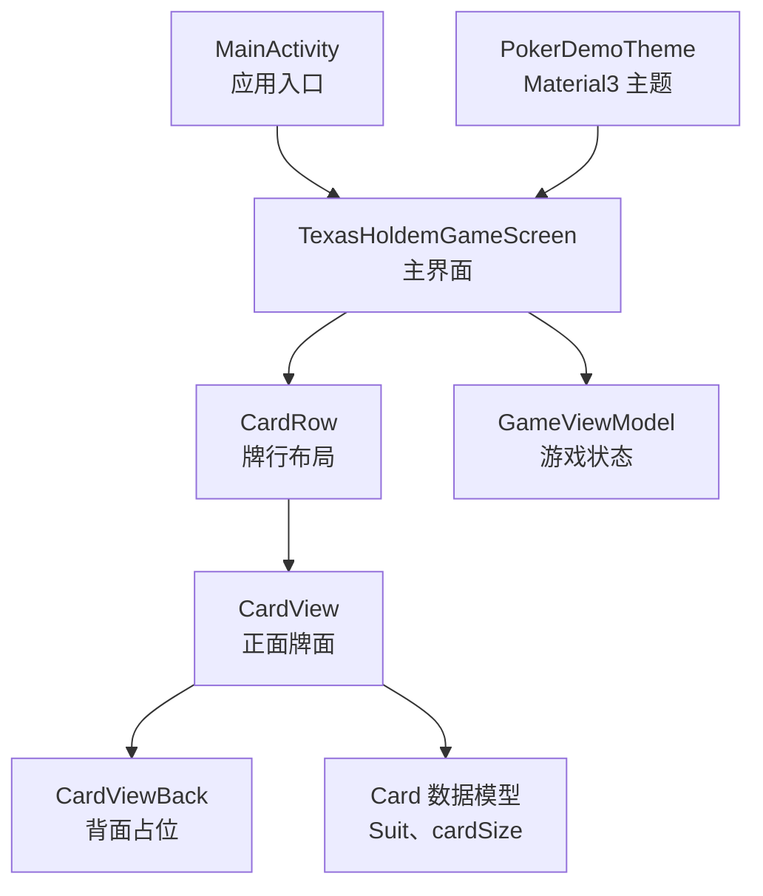
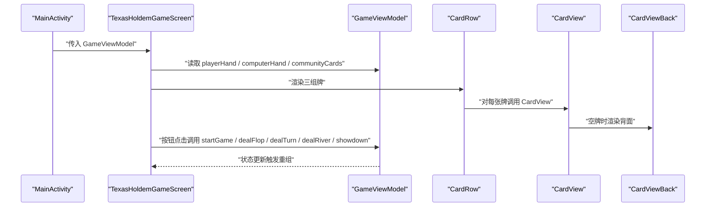
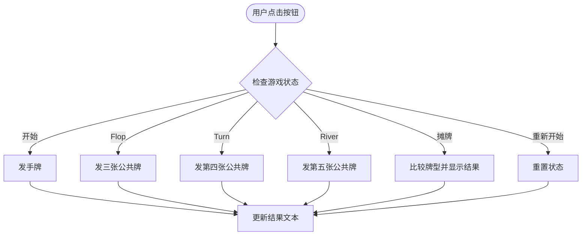
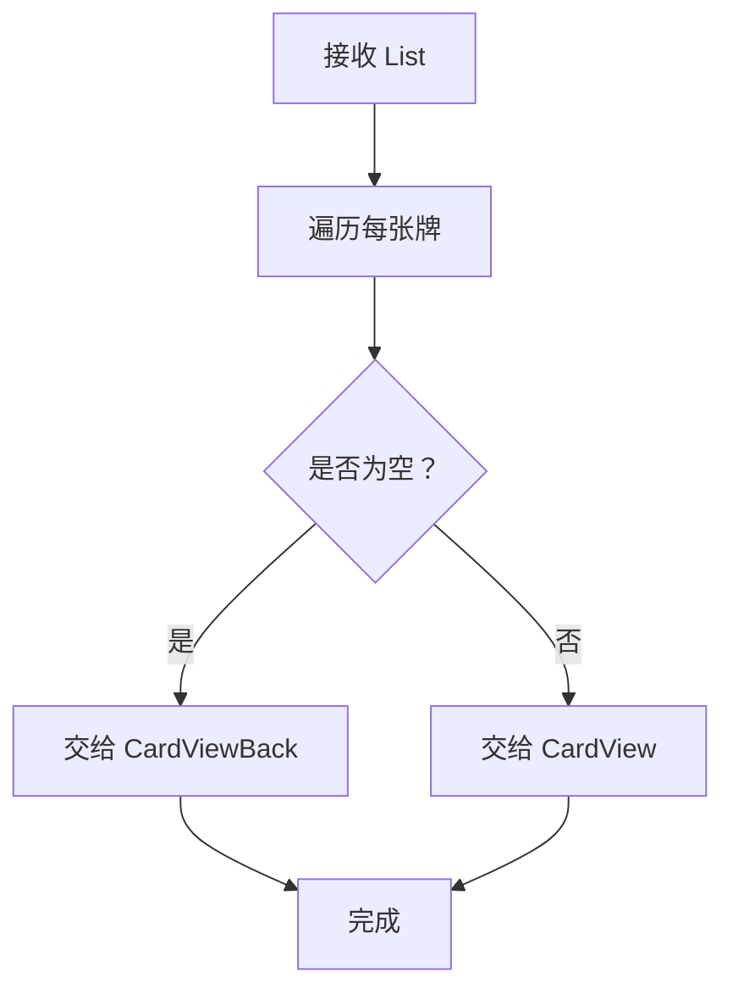
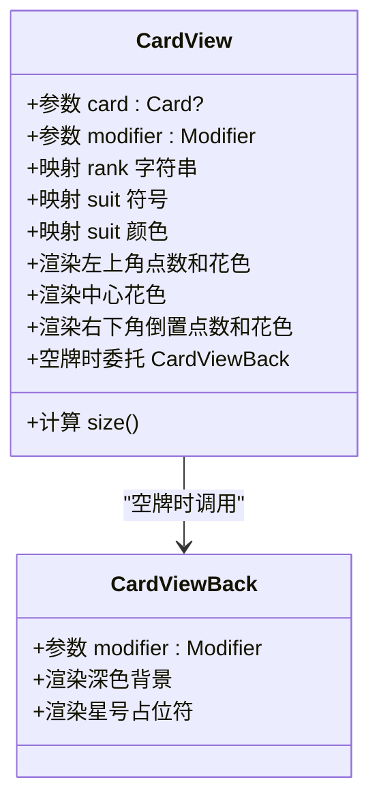
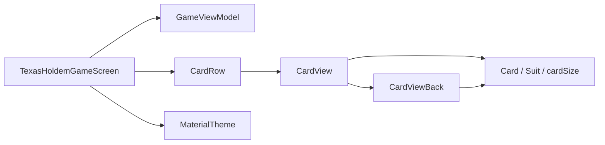
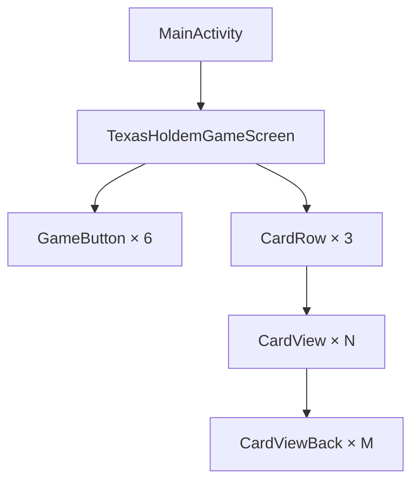

# UI 组件参考

<cite>
**本文引用的文件**   
- [GameScreen.kt](file://app/src/main/java/com/aniapp/pokerdemo/ui/GameScreen.kt)
- [CardRow.kt](file://app/src/main/java/com/aniapp/pokerdemo/ui/CardRow.kt)
- [CardView.kt](file://app/src/main/java/com/aniapp/pokerdemo/ui/CardView.kt)
- [CardViewBack.kt](file://app/src/main/java/com/aniapp/pokerdemo/ui/CardViewBack.kt)
- [Card.kt](file://app/src/main/java/com/aniapp/pokerdemo/data/Card.kt)
- [GameViewModel.kt](file://app/src/main/java/com/aniapp/pokerdemo/vm/GameViewModel.kt)
- [Theme.kt](file://app/src/main/java/com/aniapp/pokerdemo/ui/theme/Theme.kt)
- [Color.kt](file://app/src/main/java/com/aniapp/pokerdemo/ui/theme/Color.kt)
- [Type.kt](file://app/src/main/java/com/aniapp/pokerdemo/ui/theme/Type.kt)
- [MainActivity.kt](file://app/src/main/java/com/aniapp/pokerdemo/MainActivity.kt)
</cite>

## 目录

1. [简介](#简介)
2. [项目结构](#项目结构)
3. [核心组件总览](#核心组件总览)
4. [架构总览](#架构总览)
5. [详细组件分析](#详细组件分析)
6. [依赖关系分析](#依赖关系分析)
7. [性能与响应式设计](#性能与响应式设计)
8. [可访问性与主题定制](#可访问性与主题定制)
9. [组合模式与复用策略](#组合模式与复用策略)
10. [常见问题排查](#常见问题排查)
11. [结论](#结论)

## 简介

PokerDemo 是一个基于 Jetpack Compose 和 Material3 的德州扑克界面演示。其 UI 组件体系围绕四个核心 Composable 构建：

| 组件 | 职责 | 主要输入 |
|---|---|---|
| `TexasHoldemGameScreen` | 主界面布局、按钮编排、状态文本显示 | `GameViewModel` |
| `CardRow` | 横向流式渲染多张牌或背面占位符 | `List<Card?>` |
| `CardView` | 正面牌面显示，支持花色符号、点数、旋转排版 | `Card?` |
| `CardViewBack` | 背面占位视图，用于未翻开的手牌 | 无数据，仅样式 |

这些组件共同构成“手牌行 + 公共牌行 + 操作按钮 + 结果文本”的典型扑克桌面布局。

## 项目结构

UI 相关代码集中在 `ui` 包中，数据模型位于 `data` 包，状态逻辑位于 `vm` 包，应用入口在 `MainActivity`。



**图示来源**   
- [MainActivity.kt:1-16](file://app/src/main/java/com/aniapp/pokerdemo/MainActivity.kt#L1-L16)
- [GameScreen.kt:1-104](file://app/src/main/java/com/aniapp/pokerdemo/ui/GameScreen.kt#L1-L104)
- [CardRow.kt:1-24](file://app/src/main/java/com/aniapp/pokerdemo/ui/CardRow.kt#L1-L24)
- [CardView.kt:1-79](file://app/src/main/java/com/aniapp/pokerdemo/ui/CardView.kt#L1-L79)
- [CardViewBack.kt:1-30](file://app/src/main/java/com/aniapp/pokerdemo/ui/CardViewBack.kt#L1-L30)
- [Card.kt:1-98](file://app/src/main/java/com/aniapp/pokerdemo/data/Card.kt#L1-L98)
- [Theme.kt:1-58](file://app/src/main/java/com/aniapp/pokerdemo/ui/theme/Theme.kt#L1-L58)

**章节来源**   
- [MainActivity.kt:1-16](file://app/src/main/java/com/aniapp/pokerdemo/MainActivity.kt#L1-L16)
- [GameScreen.kt:1-104](file://app/src/main/java/com/aniapp/pokerdemo/ui/GameScreen.kt#L1-L104)

## 核心组件总览

### `TexasHoldemGameScreen`

这是整个德州扑克界面的顶层 Composable。它负责：

- 使用垂直列布局承载标题、电脑手牌、公共牌、玩家手牌、操作按钮和结果文本。
- 背景使用深绿色模拟牌桌。
- 根据 `showComputerCards` 决定电脑手牌是显示两张背面，还是显示真实手牌。
- 通过 `CardRow` 渲染三组牌：电脑手牌、公共牌、玩家手牌。
- 提供六枚 Material3 按钮，分别触发发牌流程的不同阶段。
- 底部显示当前游戏结果文本。

**函数签名（语义描述）**

```kotlin
@Composable
fun TexasHoldemGameScreen(
    vm: GameViewModel
)
```

| 参数 | 类型 | 说明 |
|---|---|---|
| `vm` | `GameViewModel` | 注入的游戏状态与动作方法 |

**调用示例（概念）**

```kotlin
// 由 Activity 创建 ViewModel 后传入
val viewModel = ... 
TexasHoldemGameScreen(viewModel)
```

**关键行为**

- 标题使用 Material3 的中等标题样式。
- 电脑手牌在未摊牌前固定为两个空值，从而渲染两个背面占位符。
- 公共牌直接绑定到 `communityCards`。
- 玩家手牌直接绑定到 `playerHand`。
- 按钮点击直接调用 ViewModel 对应方法，不持有本地状态。

**章节来源**   
- [GameScreen.kt:1-104](file://app/src/main/java/com/aniapp/pokerdemo/ui/GameScreen.kt#L1-L104)
- [GameViewModel.kt:1-74](file://app/src/main/java/com/aniapp/pokerdemo/vm/GameViewModel.kt#L1-L74)

### `CardRow`

`CardRow` 是一个横向流式布局容器，将一组牌或空值依次交给 `CardView` 渲染。

**函数签名（语义描述）**

```kotlin
@OptIn(ExperimentalLayoutApi::class)
@Composable
fun CardRow(
    cards: List<Card?>
)
```

| 参数 | 类型 | 说明 |
|---|---|---|
| `cards` | `List<Card?>` | 每张牌可以是真实牌对象，也可以是空值表示背面 |

**布局逻辑**

- 使用 FlowRow 实现自动换行。
- 宽度填满父容器。
- 整体内边距为 8dp。
- 每个元素统一交给 `CardView` 处理正反面。

**章节来源**   
- [CardRow.kt:1-24](file://app/src/main/java/com/aniapp/pokerdemo/ui/CardRow.kt#L1-L24)

### `CardView`

`CardView` 负责渲染一张正面牌。当传入空值时，它委托给 `CardViewBack`。

**函数签名（语义描述）**

```kotlin
@Composable
fun CardView(
    card: Card?,
    modifier: Modifier = Modifier
)
```

| 参数 | 类型 | 默认值 | 说明 |
|---|---|---|---|
| `card` | `Card?` | — | 真实牌对象；为空时显示背面 |
| `modifier` | `Modifier` | `Modifier` | 允许外部调整尺寸、对齐、布局修饰符 |

**渲染规则**

- 如果牌为空，调用 `CardViewBack`，并赋予背面卡片尺寸。
- 如果牌存在，则：
  - 计算字体大小比例。
  - 根据花色映射 Unicode 符号。
  - 黑桃花色和梅花使用黑色，红桃和方块使用红色。
  - 左上角显示点数和花色。
  - 中央显示大号花色符号。
  - 右下角以 180° 旋转显示倒置的点数和花色。
  - 白色圆角背景加阴影，模拟扑克牌外观。

**动态字体与尺寸**

- 卡片基础尺寸来自 `cardSize()`。
- 点数字号约为卡片高度的 22%。
- 角落花色字号约为卡片高度的 28%。
- 中心花色字号约为卡片高度的 45%。
- 卡片宽高比例为宽等于基础尺寸，高等于基础尺寸的 1.35 倍。

**章节来源**   
- [CardView.kt:1-79](file://app/src/main/java/com/aniapp/pokerdemo/ui/CardView.kt#L1-L79)
- [Card.kt:74-78](file://app/src/main/java/com/aniapp/pokerdemo/data/Card.kt#L74-L78)

### `CardViewBack`

`CardViewBack` 是背面占位视图，用于展示尚未翻开的牌。

**函数签名（语义描述）**

```kotlin
@Composable
fun CardViewBack(
    modifier: Modifier = Modifier
)
```

| 参数 | 类型 | 默认值 | 说明 |
|---|---|---|---|
| `modifier` | `Modifier` | `Modifier` | 外部传入尺寸时会覆盖默认背面尺寸 |

**视觉行为**

- 高度为基础卡片高度的 0.9 倍，宽度为基础高度的 1.3 倍。
- 深蓝色背景。
- 圆角阴影。
- 居中显示星号符号作为占位标记。

**章节来源**   
- [CardViewBack.kt:1-30](file://app/src/main/java/com/aniapp/pokerdemo/ui/CardViewBack.kt#L1-L30)

## 架构总览

UI 层遵循单向数据流：Activity 持有 ViewModel，ViewModel 暴露可变状态，UI 只读状态并通过回调触发业务动作。



**图示来源**   
- [MainActivity.kt:1-16](file://app/src/main/java/com/aniapp/pokerdemo/MainActivity.kt#L1-L16)
- [GameScreen.kt:1-104](file://app/src/main/java/com/aniapp/pokerdemo/ui/GameScreen.kt#L1-L104)
- [CardRow.kt:1-24](file://app/src/main/java/com/aniapp/pokerdemo/ui/CardRow.kt#L1-L24)
- [CardView.kt:1-79](file://app/src/main/java/com/aniapp/pokerdemo/ui/CardView.kt#L1-L79)
- [CardViewBack.kt:1-30](file://app/src/main/java/com/aniapp/pokerdemo/ui/CardViewBack.kt#L1-L30)
- [GameViewModel.kt:1-74](file://app/src/main/java/com/aniapp/pokerdemo/vm/GameViewModel.kt#L1-L74)

## 详细组件分析

### `TexasHoldemGameScreen` 按钮编排与状态文本

#### 按钮布局

按钮分为两行：

| 第一行按钮 | 作用 |
|---|---|
| 开始 | 初始化牌堆、发玩家手牌和电脑手牌 |
| Flop | 发出前三张公共牌 |
| Turn | 发出第四张公共牌 |
| River | 发出第五张公共牌 |

| 第二行按钮 | 作用 |
|---|---|
| 摊牌 | 显示电脑手牌并比较牌型 |
| 重新开始 | 重置状态并重新发牌 |

#### 状态文本

底部 Text 直接显示 `result.value`。该字符串由 ViewModel 控制，例如初始提示、进行中提示、胜负结果和错误提示。



**图示来源**   
- [GameScreen.kt:53-96](file://app/src/main/java/com/aniapp/pokerdemo/ui/GameScreen.kt#L53-L96)
- [GameViewModel.kt:13-74](file://app/src/main/java/com/aniapp/pokerdemo/vm/GameViewModel.kt#L13-L74)

**章节来源**   
- [GameScreen.kt:1-104](file://app/src/main/java/com/aniapp/pokerdemo/ui/GameScreen.kt#L1-L104)
- [GameViewModel.kt:1-74](file://app/src/main/java/com/aniapp/pokerdemo/vm/GameViewModel.kt#L1-L74)

### `CardRow` 横向渲染逻辑

`CardRow` 的核心职责是把一组牌交给 `CardView` 渲染。它本身不关心牌的正反面，也不维护任何状态。



**图示来源**   
- [CardRow.kt:10-24](file://app/src/main/java/com/aniapp/pokerdemo/ui/CardRow.kt#L10-L24)
- [CardView.kt:16-79](file://app/src/main/java/com/aniapp/pokerdemo/ui/CardView.kt#L16-L79)
- [CardViewBack.kt:10-30](file://app/src/main/java/com/aniapp/pokerdemo/ui/CardViewBack.kt#L10-L30)

**章节来源**   
- [CardRow.kt:1-24](file://app/src/main/java/com/aniapp/pokerdemo/ui/CardRow.kt#L1-L24)

### `CardView` 正面牌面渲染

`CardView` 是牌面信息最集中的组件。

#### 花色与颜色映射

| 花色枚举 | 符号 | 文字颜色 |
|---|---|---|
| SPADES | ♠ | 黑色 |
| HEARTS | ♥ | 红色 |
| DIAMONDS | ♦ | 红色 |
| CLUBS | ♣ | 黑色 |

#### 点数映射

点数 2 到 10 使用数字字符串，J、Q、K、A 映射为小写字母，再统一转为大写显示。

#### 布局结构



**图示来源**   
- [CardView.kt:1-79](file://app/src/main/java/com/aniapp/pokerdemo/ui/CardView.kt#L1-L79)
- [CardViewBack.kt:1-30](file://app/src/main/java/com/aniapp/pokerdemo/ui/CardViewBack.kt#L1-L30)

**章节来源**   
- [CardView.kt:1-79](file://app/src/main/java/com/aniapp/pokerdemo/ui/CardView.kt#L1-L79)
- [GameScreen.kt:98-104](file://app/src/main/java/com/aniapp/pokerdemo/ui/GameScreen.kt#L98-L104)

### `CardViewBack` 背面占位视图

`CardViewBack` 是一个轻量级占位组件。它没有业务逻辑，只有视觉表现。

**关键点**

- 默认尺寸依赖 `cardSize()`。
- 外层 Box 同时承担尺寸、阴影、背景和居中对齐。
- 内部 Text 用星号表示未翻开。

**章节来源**   
- [CardViewBack.kt:1-30](file://app/src/main/java/com/aniapp/pokerdemo/ui/CardViewBack.kt#L1-L30)

## 依赖关系分析

UI 组件与数据、状态的依赖如下：



**图示来源**   
- [GameScreen.kt:1-104](file://app/src/main/java/com/aniapp/pokerdemo/ui/GameScreen.kt#L1-L104)
- [CardRow.kt:1-24](file://app/src/main/java/com/aniapp/pokerdemo/ui/CardRow.kt#L1-L24)
- [CardView.kt:1-79](file://app/src/main/java/com/aniapp/pokerdemo/ui/CardView.kt#L1-L79)
- [CardViewBack.kt:1-30](file://app/src/main/java/com/aniapp/pokerdemo/ui/CardViewBack.kt#L1-L30)
- [Card.kt:1-98](file://app/src/main/java/com/aniapp/pokerdemo/data/Card.kt#L1-L98)
- [Theme.kt:1-58](file://app/src/main/java/com/aniapp/pokerdemo/ui/theme/Theme.kt#L1-L58)

**耦合与内聚分析**

- `CardRow` 与具体牌面细节解耦，只依赖 `Card?` 列表。
- `CardView` 与 `Card` 数据模型强耦合，但仅做展示。
- `TexasHoldemGameScreen` 是 UI 协调者，耦合 ViewModel 和多个子组件。
- `CardViewBack` 独立性强，适合复用为通用背面占位符。
- ViewModel 与 UI 通过可变状态通信，避免双向绑定。

**潜在循环依赖**

当前 UI 层没有循环导入。数据模型和 ViewModel 被 UI 单向依赖，符合分层原则。

**章节来源**   
- [GameScreen.kt:1-104](file://app/src/main/java/com/aniapp/pokerdemo/ui/GameScreen.kt#L1-L104)
- [CardRow.kt:1-24](file://app/src/main/java/com/aniapp/pokerdemo/ui/CardRow.kt#L1-L24)
- [CardView.kt:1-79](file://app/src/main/java/com/aniapp/pokerdemo/ui/CardView.kt#L1-L79)
- [CardViewBack.kt:1-30](file://app/src/main/java/com/aniapp/pokerdemo/ui/CardViewBack.kt#L1-L30)
- [Card.kt:1-98](file://app/src/main/java/com/aniapp/pokerdemo/data/Card.kt#L1-L98)

## 性能与响应式设计

### 动态卡片尺寸

`cardSize()` 根据屏幕宽度除以 7 计算基础卡片宽度。这种设计考虑了最多五张公共牌加上间距的场景。

| 维度 | 计算方式 |
|---|---|
| 基础宽度 | `screenWidthDp / 7` |
| 卡片宽度 | 基础尺寸 |
| 卡片高度 | 基础尺寸 × 1.35 |
| 背面宽度 | 基础尺寸 × 0.9 |
| 背面高度 | 基础尺寸 × 1.3 |

**优点**

- 简单直观。
- 随屏幕宽度线性缩放。
- 适合单列牌行场景。

**风险**

- 屏幕较窄时，单张牌可能过小。
- 未考虑不同设备密度下的字体可读性差异。
- 未区分横屏与竖屏的具体适配策略。

### 重组成本

- `CardRow` 每次遍历所有牌并调用 `CardView`。
- `CardView` 对非空牌执行多次 Text 绘制和变换。
- 若牌列表很大，应考虑局部重组优化，例如对稳定 ID 的元素进行重组隔离。

### 优化建议

1. 使用 `key` 为每张牌指定稳定标识，减少不必要的重组。
2. 将花色符号、颜色等常量计算提升到上层缓存。
3. 对频繁变动的牌行使用更细粒度的状态包装。
4. 在大屏设备上适当增大最小字号，提升可读性。
5. 对阴影、圆角等绘图开销较大的属性，在低端设备上可降级。

**章节来源**   
- [Card.kt:74-78](file://app/src/main/java/com/aniapp/pokerdemo/data/Card.kt#L74-L78)
- [CardView.kt:16-79](file://app/src/main/java/com/aniapp/pokerdemo/ui/CardView.kt#L16-L79)
- [CardViewBack.kt:10-30](file://app/src/main/java/com/aniapp/pokerdemo/ui/CardViewBack.kt#L10-L30)

## 可访问性与主题定制

### 可访问性现状

当前 UI 的可访问性支持较弱：

- 按钮没有自定义内容描述。
- 结果文本没有语义标签。
- 牌面没有朗读内容。
- 缺少焦点管理和键盘导航语义。

### 改进建议

| 目标 | 建议 |
|---|---|
| 按钮可访问性 | 为 `GameButton` 添加 `contentDescription` |
| 牌面可访问性 | 为 `CardView` 提供可读名称，如“红桃 A” |
| 结果文本 | 使用语义化 Text，并提供状态变化提示 |
| 暗色模式 | 硬编码颜色应优先从主题获取 |
| 字体大小 | 支持系统字体缩放 |

### 主题定制

项目定义了 `PokerDemoTheme`，并使用 Material3 的深色、浅色和动态配色方案。

| 配置项 | 说明 |
|---|---|
| `darkTheme` | 是否启用深色主题 |
| `dynamicColor` | 是否使用 Android 12+ 动态颜色 |
| `colorScheme` | 深色、浅色或动态颜色方案 |
| `typography` | 应用自定义 Typography |

**注意**

- `TexasHoldemGameScreen` 目前直接使用硬编码颜色，没有完全使用 `MaterialTheme.colorScheme`。
- 未来可将牌桌背景、文字颜色、按钮颜色迁移到主题资源中。

**章节来源**   
- [Theme.kt:1-58](file://app/src/main/java/com/aniapp/pokerdemo/ui/theme/Theme.kt#L1-L58)
- [Color.kt:1-11](file://app/src/main/java/com/aniapp/pokerdemo/ui/theme/Color.kt#L1-L11)
- [Type.kt:1-34](file://app/src/main/java/com/aniapp/pokerdemo/ui/theme/Type.kt#L1-L34)
- [GameScreen.kt:14-44](file://app/src/main/java/com/aniapp/pokerdemo/ui/GameScreen.kt#L14-L44)

## 组合模式与复用策略

### 组合关系



**图示来源**   
- [MainActivity.kt:1-16](file://app/src/main/java/com/aniapp/pokerdemo/MainActivity.kt#L1-L16)
- [GameScreen.kt:1-104](file://app/src/main/java/com/aniapp/pokerdemo/ui/GameScreen.kt#L1-L104)
- [CardRow.kt:1-24](file://app/src/main/java/com/aniapp/pokerdemo/ui/CardRow.kt#L1-L24)
- [CardView.kt:1-79](file://app/src/main/java/com/aniapp/pokerdemo/ui/CardView.kt#L1-L79)
- [CardViewBack.kt:1-30](file://app/src/main/java/com/aniapp/pokerdemo/ui/CardViewBack.kt#L1-L30)

### 复用策略

1. **`CardView` 复用**  
   已支持空值分支，可复用为任意位置的正反面牌。

2. **`CardViewBack` 复用**  
   可作为通用背面占位符，用于等待加载、隐藏手牌、占位行等场景。

3. **`CardRow` 复用**  
   适合所有需要横向流式排列牌的场景，包括对手手牌、弃牌堆、历史牌等。

4. **`GameButton` 复用**  
   当前按钮样式一致，适合封装为统一的交互按钮。

5. **扩展方向**  
   - 增加选中态、禁用态、加载态。
   - 增加动画过渡，例如发牌动画、翻牌动画。
   - 增加手势操作，例如拖拽选牌、滑动弃牌。

**章节来源**   
- [GameScreen.kt:53-104](file://app/src/main/java/com/aniapp/pokerdemo/ui/GameScreen.kt#L53-L104)
- [CardRow.kt:1-24](file://app/src/main/java/com/aniapp/pokerdemo/ui/CardRow.kt#L1-L24)
- [CardView.kt:1-79](file://app/src/main/java/com/aniapp/pokerdemo/ui/CardView.kt#L1-L79)
- [CardViewBack.kt:1-30](file://app/src/main/java/com/aniapp/pokerdemo/ui/CardViewBack.kt#L1-L30)

## 常见问题排查

### 问题一：公共牌数量不足就摊牌

**现象**  
点击摊牌后，结果文本提示请发完所有公共牌。

**原因**  
`showdown` 要求公共牌数量为 5。

**解决**  
按顺序点击 Flop、Turn、River，确保公共牌达到五张。

**章节来源**   
- [GameViewModel.kt:47-65](file://app/src/main/java/com/aniapp/pokerdemo/vm/GameViewModel.kt#L47-L65)

### 问题二：电脑手牌始终显示背面

**现象**  
直到摊牌前，电脑手牌都是两个背面占位符。

**原因**  
未摊牌前，`showComputerCards` 为 false，界面强制传入两个空值。

**解决**  
正常流程下，摊牌后会自动显示电脑手牌。

**章节来源**   
- [GameScreen.kt:29-38](file://app/src/main/java/com/aniapp/pokerdemo/ui/GameScreen.kt#L29-L38)
- [GameViewModel.kt:18-19](file://app/src/main/java/com/aniapp/pokerdemo/vm/GameViewModel.kt#L18-L19)
- [GameViewModel.kt:54-65](file://app/src/main/java/com/aniapp/pokerdemo/vm/GameViewModel.kt#L54-L65)

### 问题三：牌面太小或字体不可读

**现象**  
在小屏设备上，牌面文字较小。

**原因**  
`cardSize()` 仅按屏幕宽度除以 7，未设置最小字号保护。

**解决**  
- 增加最小卡片尺寸限制。
- 增加系统字体缩放支持。
- 在横屏模式下调整牌行布局。

**章节来源**   
- [Card.kt:74-78](file://app/src/main/java/com/aniapp/pokerdemo/data/Card.kt#L74-L78)
- [CardView.kt:20-79](file://app/src/main/java/com/aniapp/pokerdemo/ui/CardView.kt#L20-L79)

### 问题四：主题颜色不一致

**现象**  
牌桌背景、文字颜色与 Material3 主题脱节。

**原因**  
UI 中使用了硬编码颜色，未完全依赖 `MaterialTheme`。

**解决**  
将背景色、文字色、按钮色迁移到主题配置。

**章节来源**   
- [GameScreen.kt:14-44](file://app/src/main/java/com/aniapp/pokerdemo/ui/GameScreen.kt#L14-L44)
- [Theme.kt:1-58](file://app/src/main/java/com/aniapp/pokerdemo/ui/theme/Theme.kt#L1-L58)

## 结论

PokerDemo 的 UI 组件体系简洁清晰，采用 Compose 的组合式架构，将主界面、牌行、牌面和背面占位符拆分为独立组件。`TexasHoldemGameScreen` 承担协调职责，`CardRow` 提供通用牌行布局，`CardView` 负责正面牌面信息展示，`CardViewBack` 提供背面占位能力。

当前实现适合学习 Compose 布局和状态管理，但在可访问性、主题一致性、响应式适配和性能优化方面仍有改进空间。后续可优先完成主题迁移、可访问性增强、牌面动画和横屏适配，使 UI 组件具备更强的复用性和生产可用性。