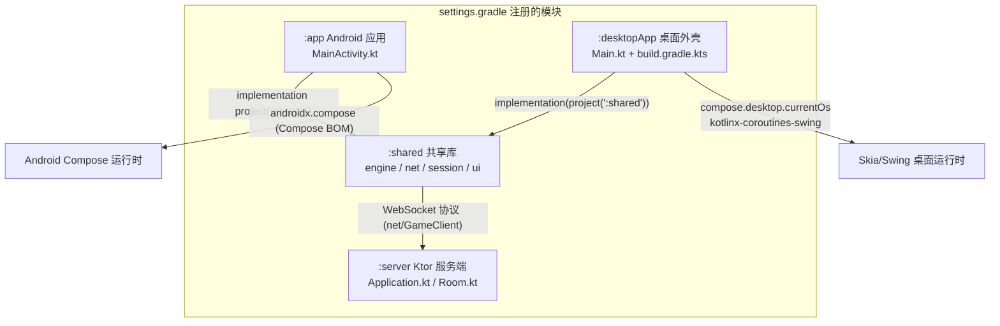
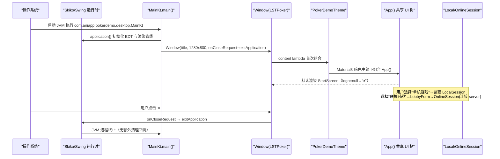
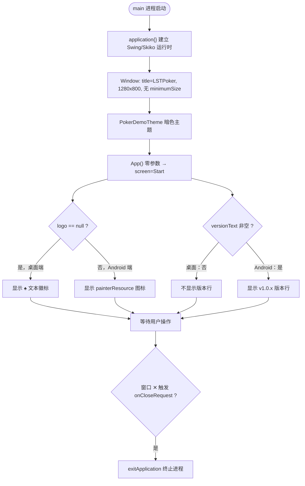
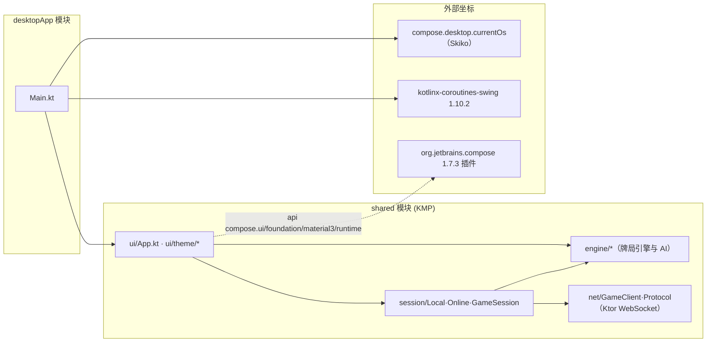

# 桌面端入口与运行

<cite>
**本文引用的文件**
- [Main.kt](file://desktopApp/src/main/kotlin/com/aniapp/pokerdemo/desktop/Main.kt)
- [build.gradle.kts（桌面模块）](file://desktopApp/build.gradle.kts)
- [App.kt](file://shared/src/commonMain/kotlin/com/aniapp/pokerdemo/ui/App.kt)
- [Theme.kt](file://shared/src/commonMain/kotlin/com/aniapp/pokerdemo/ui/theme/Theme.kt)
- [StartScreen.kt](file://shared/src/commonMain/kotlin/com/aniapp/pokerdemo/ui/start/StartScreen.kt)
- [GameScreen.kt](file://shared/src/commonMain/kotlin/com/aniapp/pokerdemo/ui/GameScreen.kt)
- [GameSession.kt](file://shared/src/commonMain/kotlin/com/aniapp/pokerdemo/session/GameSession.kt)
- [OnlineSession.kt](file://shared/src/commonMain/kotlin/com/aniapp/pokerdemo/session/OnlineSession.kt)
- [MainActivity.kt](file://app/src/main/java/com/aniapp/pokerdemo/MainActivity.kt)
- [RenderSmokeTest.kt](file://shared/src/desktopTest/kotlin/com/aniapp/pokerdemo/ui/RenderSmokeTest.kt)
- [TableLayoutRenderTest.kt](file://shared/src/desktopTest/kotlin/com/aniapp/pokerdemo/ui/TableLayoutRenderTest.kt)
- [settings.gradle](file://settings.gradle)
- [libs.versions.toml](file://gradle/libs.versions.toml)
- [shared/build.gradle.kts](file://shared/build.gradle.kts)
- [app/build.gradle](file://app/build.gradle)
</cite>

## 目录
1. [引言](#引言)
2. [项目结构](#项目结构)
3. [核心组件](#核心组件)
4. [架构总览](#架构总览)
5. [详细组件分析](#详细组件分析)
6. [依赖分析](#依赖分析)
7. [构建与运行](#构建与运行)
8. [渲染校验测试](#渲染校验测试)
9. [性能考量](#性能考量)
10. [故障排查指南](#故障排查指南)
11. [结论](#结论)

## 引言

`desktopApp` 是本项目的 Compose Multiplatform 桌面端外壳模块，职责极为单一而关键：**为 `shared` 模块中跨平台共享的 UI 树提供一个操作系统窗口容器**。它不实现任何游戏逻辑、牌桌引擎或网络协议——这些全部位于 `shared` 的 `commonMain` 源集中，由 Android 端（`app` 模块）与桌面端共同复用。

对非专业读者而言，可以把整个项目想象成"一台电视机"：节目内容（扑克游戏界面与规则）录制在共享磁带（`shared`）上，而 Android 端和桌面端只是两台不同尺寸、不同外壳的电视。桌面端这台"电视"仅做三件事：设定窗口标题为 `LSTPoker`、初始尺寸 1280×800，把共享磁带插进去播放，并在用户点击窗口关闭按钮时结束进程。

需要特别澄清的一点是：本文档所依据的实际代码中，`compose.desktop` 配置块**只声明了 `application.mainClass`，并未配置 `nativeDistributions`（Linux/Windows/macOS 安装包或 `packageVersion = 1.0`）**；窗口也**未设置最小尺寸 900×600**。因此桌面端当前通过 Gradle 的 `run` 任务以 JVM 方式直接启动，而非打包为原生安装程序。下文所有描述均以仓库真实代码为准。

## 项目结构

仓库采用 Gradle 多模块布局，`settings.gradle` 中注册了四个子模块：`:app`（Android 应用）、`:shared`（Kotlin Multiplatform 共享库）、`:server`（Ktor 联机服务端）、`:desktopApp`（Compose Desktop 桌面外壳）。



**图表来源**
- [settings.gradle:27-31](file://settings.gradle#L27-L31)
- [desktopApp/build.gradle.kts:9-13](file://desktopApp/build.gradle.kts#L9-L13)
- [app/build.gradle:63-71](file://app/build.gradle#L63-L71)

**本节来源**
- [settings.gradle:27-31](file://settings.gradle#L27-L31)
- [desktopApp/build.gradle.kts:1-28](file://desktopApp/build.gradle.kts#L1-L28)
- [shared/build.gradle.kts:1-50](file://shared/build.gradle.kts#L1-L50)

桌面模块内部结构非常扁平，仅有一个 Kotlin 源文件：

| 路径 | 作用 |
| --- | --- |
| `desktopApp/src/main/kotlin/com/aniapp/pokerdemo/desktop/Main.kt` | JVM 入口函数 `main()`，创建窗口并挂载共享 UI |
| `desktopApp/build.gradle.kts` | 插件、依赖与 `compose.desktop.application.mainClass` 声明 |

由于入口函数位于名为 `Main.kt` 的文件中，Kotlin 编译器会为其生成名为 `MainKt` 的 façade 类，因此构建脚本中登记的主类全限定名为 `com.aniapp.pokerdemo.desktop.MainKt`。

## 核心组件

### Main.kt：窗口外壳与进程生命周期

`Main.kt` 全文仅约 18 行，其结构可拆解为三层嵌套调用：

1. **`application { ... }`**：Compose Desktop 提供的应用级入口，负责初始化 Swing/AWT 事件循环、Skiko（Skia 合成器）渲染管线与应用生命周期。
2. **`Window(...)`**：创建一个操作系统原生窗口，参数包括：
   - `title = "LSTPoker"` —— 窗口标题栏文本；
   - `state = rememberWindowState(width = 1280.dp, height = 800.dp)` —— 初始窗口尺寸为 1280×800 逻辑像素。**注意：此处只设置了初始宽高，没有传入 `minimumSize`，因此不存在 900×600 的最小尺寸约束，窗口可被自由缩小。**
   - `onCloseRequest = ::exitApplication` —— 当用户触发窗口关闭（点击 ✕ 或系统快捷键）时，直接调用 `exitApplication` 终止 JVM 进程，不做任何确认弹窗或会话清理回调。这意味着在线对局中关闭窗口等同于强制断开。
3. **内容 Lambda**：`PokerDemoTheme { App() }` —— 先套用 `shared` 中的暗色 Material3 主题（金色主色 + 绿呢背景），再挂载共享根可组合函数 `App()`。

关键点在于**桌面端调用 `App()` 时没有传任何参数**，全部使用默认值：`versionText = ""`（启动页不显示版本号）、`logo = null`（启动页中央徽标回退为纯文本"♠"符号）、`autoStartLocal = false`（始终从启动页开始）、`backHandler = null`（无返回键处理）。这正是与 Android 端差异的全部来源。

**本节来源**
- [Main.kt:1-18](file://desktopApp/src/main/kotlin/com/aniapp/pokerdemo/desktop/Main.kt#L1-L18)
- [Theme.kt:1-28](file://shared/src/commonMain/kotlin/com/aniapp/pokerdemo/ui/theme/Theme.kt#L1-L28)

### desktopApp/build.gradle.kts：构建契约

该脚本定义了桌面模块如何被编译与运行：

| 配置项 | 取值 | 说明 |
| --- | --- | --- |
| 插件 | `kotlin.jvm`、`kotlin.compose`、`compose.multiplatform`（即 `org.jetbrains.compose` 1.7.3） | 通过版本目录 `libs.plugins.*` 引用，Kotlin 2.0.21 |
| 依赖 `project(":shared")` | implementation | 引入共享 UI/引擎/会话代码 |
| 依赖 `compose.desktop.currentOs` | implementation | 按当前操作系统自动选择 Skiko 原生二进制，提供窗口与渲染后端 |
| 依赖 `libs.kotlinx.coroutines.swing` | implementation | 将协程调度桥接到 Swing EDT，保证 UI 更新线程正确 |
| JVM target | `JvmTarget.JVM_11`，Java source/target 11 | 与 `shared` 的 desktop 目标一致 |
| `compose.desktop.application.mainClass` | `"com.aniapp.pokerdemo.desktop.MainKt"` | 使 Gradle 生成 `:desktopApp:run` 等任务 |
| `compose.desktop.nativeDistributions` | **未声明** | 因此不提供 `packageDistributionForCurrentOS`/`crossPlatformDistribution` 的原生安装包配置，也无 `packageVersion 1.0` 之类的打包元数据 |

**本节来源**
- [desktopApp/build.gradle.kts:1-28](file://desktopApp/build.gradle.kts#L1-L28)
- [libs.versions.toml:3-20](file://gradle/libs.versions.toml#L3-L20)
- [libs.versions.toml:52-59](file://gradle/libs.versions.toml#L52-L59)

### App()：两端共用的 UI 树根节点

`shared` 的 `App.kt` 定义了屏幕状态机 `AppScreen`（`Start` / `Local(aiCount)` / `OnlineForm` / `Online(config)`）以及带七个可选参数的根可组合函数 `App(...)`。桌面端与 Android 端对它的调用方式对比如下：

| 参数 | 桌面端（Main.kt） | Android 端（MainActivity.kt） | 影响 |
| --- | --- | --- | --- |
| `versionText` | 默认 `""` | `stringResource(R.string.app_version)`（形如 `v1.0.<分钟数>`） | 启动页底部是否显示版本行 |
| `logo` | 默认 `null` → 显示"♠"文本 | `Image(painterResource(R.mipmap.ic_launcher_foreground))` 放大 1.45 倍 | 启动页中央徽标图形 |
| `autoStartLocal` / `autoStartAiCount` | 默认 `false` / `1` | debug 包解析 intent 的 `scenario` 参数后可为 `true` | 是否跳过启动页直达本地牌桌 |
| `scenarioDeck` / `scenarioChips` | 默认 `null` | 仅 debuggable 包从 intent 构造固定牌序与起始筹码 | 真机复现特定局面 |
| `backHandler` | 默认 `null` | `{ onBack -> BackHandler(onBack = onBack) }` 注入 Activity 返回栈 | 非启动页时物理返回键回到首页 |

`App` 内部还承担会话生命周期管理：进入 `Local` 或 `Online` 屏幕时用 `remember` 创建 `LocalSession` / `OnlineSession`，并用 `DisposableEffect` 在离开时调用 `session.dispose()`。桌面端切换屏幕、关闭窗口都会经由这条路径释放资源（关窗时因 `exitApplication` 直接退出进程，实际依赖 JVM 关停）。

```mermaid
classDiagram
    class AppScreen {
        <<sealed interface>>
        +Start
        +Local(aiCount Int)
        +OnlineForm
        +Online(config OnlineConfig)
    }
    class App_Fn {
        <<composable App()>>
        +versionText String
        +logo Composable?
        +autoStartLocal Boolean
        +autoStartAiCount Int
        +scenarioDeck Function?
        +scenarioChips List~Int~?
        +backHandler Function?
    }
    class GameSession {
        <<interface>>
        +uiState StateFlow~GameUiState~
        +act(action PlayerAction)
        +nextHand()
        +newMatch()
        +dispose()
    }
    class LocalSession {
        <<shared commonMain>>
    }
    class OnlineSession {
        <<shared commonMain>>
        +Phase Connecting
        +Phase InLobby
        +Phase Playing
        +Phase Ended
    }
    class PokerDemoTheme {
        <<composable>>
        +darkColorScheme(Gold, FeltGreen)
    }
    class DesktopMain {
        <<fun main()>>
        +application{}
        +Window(title LSTPoker, 1280x800)
        +onCloseRequest exitApplication
    }
    class AndroidMainActivity {
        <<ComponentActivity>>
        +setContent PokerDemoTheme{App(...)}
        +painterResource logo
        +BackHandler 注入
    }

    DesktopMain --> PokerDemoTheme : "包裹内容"
    DesktopMain --> App_Fn : "零参数调用"
    AndroidMainActivity --> PokerDemoTheme
    AndroidMainActivity --> App_Fn : "注入 logo/version/backHandler"
    App_Fn --> AppScreen : "状态机"
    App_Fn --> LocalSession : "Local 屏幕"
    App_Fn --> OnlineSession : "Online 屏幕"
    LocalSession ..|> GameSession
    OnlineSession ..|> GameSession
```

**图表来源**
- [App.kt:41-131](file://shared/src/commonMain/kotlin/com/aniapp/pokerdemo/ui/App.kt#L41-L131)
- [Main.kt:10-18](file://desktopApp/src/main/kotlin/com/aniapp/pokerdemo/desktop/Main.kt#L10-L18)
- [MainActivity.kt:23-49](file://app/src/main/java/com/aniapp/pokerdemo/MainActivity.kt#L23-L49)
- [GameSession.kt:28-34](file://shared/src/commonMain/kotlin/com/aniapp/pokerdemo/session/GameSession.kt#L28-L34)

**本节来源**
- [App.kt:41-131](file://shared/src/commonMain/kotlin/com/aniapp/pokerdemo/ui/App.kt#L41-L131)
- [GameSession.kt:1-48](file://shared/src/commonMain/kotlin/com/aniapp/pokerdemo/session/GameSession.kt#L1-L48)
- [OnlineSession.kt:20-50](file://shared/src/commonMain/kotlin/com/aniapp/pokerdemo/session/OnlineSession.kt#L20-L50)

## 架构总览

下图展示桌面进程启动后的完整运行链路，从 JVM `main()` 一直到共享 UI 与网络层：



**图表来源**
- [Main.kt:10-18](file://desktopApp/src/main/kotlin/com/aniapp/pokerdemo/desktop/Main.kt#L10-L18)
- [App.kt:47-131](file://shared/src/commonMain/kotlin/com/aniapp/pokerdemo/ui/App.kt#L47-L131)

## 详细组件分析

### 启动流程与平台注入点

桌面端与 Android 端的差异被刻意收敛为"**窗口外壳 + 三个注入参数**"：

1. **窗口外壳**：桌面用 `Window`/`application`，Android 用 `ComponentActivity` + `setContent` + `enableEdgeToEdge()`。
2. **logo 注入**：`StartScreen` 中央的圆角金边框（116dp）内部优先渲染传入的 `logo` 可组合项，否则回退到 64sp 的金色"♠"字符。Android 传入的是 `mipmap` 启动图标前景图层；桌面未传入，走回退分支。
3. **versionText 注入**：`StartScreen` 底部仅在字符串非空时追加一行半透明小字。Android 通过 `resValue` 自动生成 `app_version` 字符串资源（`v1.0.<距基准时间的分钟数>`，见 `app/build.gradle` 的 `autoVersion` 逻辑）；桌面为空串，故不显示。
4. **backHandler 注入**：`App` 在进入任意非 `Start` 屏幕前调用 `backHandler?.invoke { screen = AppScreen.Start }`。Android 侧以 `androidx.activity.compose.BackHandler` 实现"物理返回键回首页"；桌面侧该槽位为 `null`，退出只能靠关闭窗口。



**图表来源**
- [Main.kt:10-18](file://desktopApp/src/main/kotlin/com/aniapp/pokerdemo/desktop/Main.kt#L10-L18)
- [App.kt:47-72](file://shared/src/commonMain/kotlin/com/aniapp/pokerdemo/ui/App.kt#L47-L72)
- [StartScreen.kt:96-160](file://shared/src/commonMain/kotlin/com/aniapp/pokerdemo/ui/start/StartScreen.kt#L96-L160)
- [MainActivity.kt:26-49](file://app/src/main/java/com/aniapp/pokerdemo/MainActivity.kt#L26-L49)

### 响应式布局：同一 UI 树适配手机与桌面视口

`shared` 的 UI 完全基于 `BoxWithConstraints` 的相对尺寸计算，不含任何平台判断分支。例如 `GameScreen` 根据可用宽度推导卡牌尺寸（`maxWidth / 7.2 或 9`），并将对手座位按水平等分槽位沿椭圆弧分布，保证相邻座位列永不交叠。因此 1280×800 的桌面窗口与 360×780 的手机屏幕共用同一段布局代码，这一性质由 `desktopTest` 中的渲染测试专门验证（见下文"渲染校验测试"）。

**本节来源**
- [GameScreen.kt:41-60](file://shared/src/commonMain/kotlin/com/aniapp/pokerdemo/ui/GameScreen.kt#L41-L60)

## 依赖分析



要点：
- `desktopApp` 对 `shared` 是单向 `implementation` 依赖；`shared` 通过 `api(compose.*)` 把 Compose 运行时传递给消费方，因此桌面模块无需重复声明 Compose 库。
- `shared` 的 KMP 配置同时定义 `androidTarget()` 与 `jvm("desktop")` 两个编译目标；`desktopMain` 源集补充 `kotlinx-coroutines-swing`，`desktopTest` 源集补充 `compose.desktop.currentOs`（供无头渲染测试使用）。
- 版本统一由 `gradle/libs.versions.toml` 版本目录管理：Compose Multiplatform `1.7.3`、Kotlin `2.0.21`、协程 `1.10.2`。

**图表来源**
- [desktopApp/build.gradle.kts:3-13](file://desktopApp/build.gradle.kts#L3-L13)
- [shared/build.gradle.kts:4-9](file://shared/build.gradle.kts#L4-L9)
- [shared/build.gradle.kts:16-50](file://shared/build.gradle.kts#L16-L50)
- [libs.versions.toml:3-17](file://gradle/libs.versions.toml#L3-L17)

**本节来源**
- [desktopApp/build.gradle.kts:1-28](file://desktopApp/build.gradle.kts#L1-L28)
- [shared/build.gradle.kts:1-64](file://shared/build.gradle.kts#L1-L64)
- [libs.versions.toml:1-59](file://gradle/libs.versions.toml#L1-L59)

## 构建与运行

基于当前构建脚本的真实能力，桌面端的运行方式为：

| 目标 | 命令 | 前提 |
| --- | --- | --- |
| 在本机启动桌面应用 | `./gradlew :desktopApp:run` | Gradle 依据 `compose.desktop.application.mainClass = com.aniapp.pokerdemo.desktop.MainKt` 生成 run 任务；`compose.desktop.currentOs` 拉取与宿主 OS（Linux/Windows/macOS）匹配的 Skiko 二进制 |
| 联机模式 | 先 `:server` 启动 Ktor 服务，再在应用内"联机对战"填写主机/端口 | 桌面与 Android 客户端共用 `shared/net/GameClient` 协议 |

由于 `build.gradle.kts` 中**没有** `compose.desktop { nativeDistributions { ... } }` 块，本仓库目前无法产出 msi/dmg/deb 之类原生安装包，也没有 `packageVersion = "1.0"` 的打包版本声明；若未来需要分发安装程序，需在 `compose.desktop` 块内补充 `nativeDistributions` 并列出目标平台与版本。同理，窗口未设最小尺寸，如需限制可缩范围，应在 `rememberWindowState` 中增加 `minimumSize = Size(900.dp, 600.dp)`。

**本节来源**
- [desktopApp/build.gradle.kts:24-28](file://desktopApp/build.gradle.kts#L24-L28)
- [Main.kt:11-15](file://desktopApp/src/main/kotlin/com/aniapp/pokerdemo/desktop/Main.kt#L11-L15)

## 渲染校验测试

`shared/src/desktopTest` 借助 Compose Desktop 的 `ImageComposeScene`（离屏 Skia 渲染场景，来自 `desktopTest` 源集依赖的 `compose.desktop.currentOs`）在无显示器环境下对共享 UI 进行像素级回归校验，产物写入 `build/render/*.png`：

- **RenderSmokeTest**
  - `renderStartScreen`：以 1280×800 桌面视口渲染 `App(versionText = "v-test")` 启动页，冒烟验证主题与首页组合无异常。
  - `renderHandAndShowdown`：用固定 `Deck` 构造 `LocalSession`，驱动真实对局（`act(RaiseTo(2000))` 后推进时间线），分别抓取行牌阶段与摊牌阶段的画面，等价于在桌面上跑一局端到端 UI。
- **TableLayoutRenderTest**：`renderAllSeatCountsBothViewports` 遍历 **2–6 个座位 ×（360×780 手机视口、1280×800 桌面视口）** 共 10 种组合，用 `StubSession` 注入包含超长昵称、弃牌、全押、断线、AI 等边界状态的 `TableView`，逐帧推进 150 步动画后截图，用于人工/视觉比对布局在不同人数与视口下不重叠、不越界。

这两类测试只在 JVM（desktop）目标上运行，是"桌面端作为共享 UI 的验证载体"这一角色的直接体现——它们与 `Main.kt` 使用完全相同的 `PokerDemoTheme { App/GameScreen(...) }` 组合入口。

**本节来源**
- [RenderSmokeTest.kt:21-74](file://shared/src/desktopTest/kotlin/com/aniapp/pokerdemo/ui/RenderSmokeTest.kt#L21-L74)
- [TableLayoutRenderTest.kt:22-89](file://shared/src/desktopTest/kotlin/com/aniapp/pokerdemo/ui/TableLayoutRenderTest.kt#L22-L89)
- [shared/build.gradle.kts:46-49](file://shared/build.gradle.kts#L46-L49)

## 性能考量

- **单窗口单进程**：桌面应用为普通 JVM 进程，Skiko 使用 GPU 加速合成；1280×800 初始尺寸下牌桌动画（卡片翻转、筹码滑动）以帧驱动方式重绘，CPU 占用主要来自动画期间的高频重组。
- **协程调度**：`kotlinx-coroutines-swing` 将 `Dispatchers.Main` 映射到 Swing EDT，保证 `uiState` 的 `StateFlow` 收集与界面更新在同一线程，避免跨线程 UI 访问开销。
- **会话泄漏防护**：`App` 对每个会话实例注册 `DisposableEffect(session) { onDispose { session.dispose() } }`，屏幕切换即释放引擎定时器与 WebSocket 连接；但窗口 `onCloseRequest = ::exitApplication` 是直接杀进程，不走该清理路径，在线模式下服务端需依靠连接断开自行回收房间席位。
- **渲染测试成本**：`ImageComposeScene` 每帧均为同步软渲染（测试内还有 `Thread.sleep(12)` 节流），仅适合 CI/离线校验，不影响运行时性能。

[本节为一般性指导，未直接分析特定源文件]

## 故障排查指南

| 症状 | 可能原因 | 定位与处置 |
| --- | --- | --- |
| `./gradlew :desktopApp:run` 报"找不到主类" | `mainClass` 与实际包名不符 | 核对 `desktopApp/build.gradle.kts` 第 26 行与 `Main.kt` 的 package 声明是否为 `com.aniapp.pokerdemo.desktop.MainKt` |
| 启动即崩溃 / UnsatisfiedLinkError | `compose.desktop.currentOs` 解析到的 Skiko 与宿主 OS/架构不匹配 | 检查构建机平台；必要时显式指定对应 skiko 坐标 |
| 窗口出现但内容空白 | EDT 阻塞或主题组合异常 | 参考 `RenderSmokeTest.renderStartScreen` 在离屏场景复现，隔离是 UI 树问题还是窗口问题 |
| 想限制窗口不能缩得太小 | 当前 `rememberWindowState` 未设 `minimumSize` | 属功能缺失而非缺陷；如需 900×600 下限须修改 `Main.kt` |
| 需要 dmg/msi/deb 安装包 | 未配置 `nativeDistributions` | 在 `compose.desktop` 块内新增 `nativeDistributions { targetFormats(...); version = "1.0" }` 后方可使用打包任务 |
| 联机连不上 | 服务端未启动或 `OnlineConfig` 主机/端口错误 | 桌面端与 Android 端共用 `OnlineSession` 的连接阶段状态（Connecting/InLobby/Playing/Ended），界面会显示"连接中…"或错误提示（3 秒自动清除） |

**本节来源**
- [desktopApp/build.gradle.kts:24-28](file://desktopApp/build.gradle.kts#L24-L28)
- [Main.kt:11-15](file://desktopApp/src/main/kotlin/com/aniapp/pokerdemo/desktop/Main.kt#L11-L15)
- [App.kt:96-131](file://shared/src/commonMain/kotlin/com/aniapp/pokerdemo/ui/App.kt#L96-L131)
- [OnlineSession.kt:20-50](file://shared/src/commonMain/kotlin/com/aniapp/pokerdemo/session/OnlineSession.kt#L20-L50)

## 结论

`desktopApp` 是一个教科书式的"薄壳"模块：不到 20 行源码 + 一份 28 行的构建脚本，就把完整的德州扑克应用带到桌面平台。其设计价值体现在三点：

1. **逻辑零复制**——单机引擎、AI、联机协议、全部 Compose UI 均驻留 `shared`，桌面与 Android 的行为一致性由 `desktopTest` 的离屏渲染持续背书；
2. **平台差异显式化**——所有端差被压缩为 `App()` 的三个注入槽位（logo、versionText、backHandler）与窗口外壳本身，读一处即可枚举全部差异；
3. **演进空间清晰**——若要正式发布安装包或收紧窗口约束，只需分别补 `nativeDistributions` 与 `minimumSize`，不会触碰任何业务代码。

建议后续迭代优先级：补充 `nativeDistributions` 以便分发、为窗口设置合理最小尺寸、以及在 `onCloseRequest` 中加入在线会话的优雅断开逻辑。

[本节为总结性内容，未直接分析特定源文件]