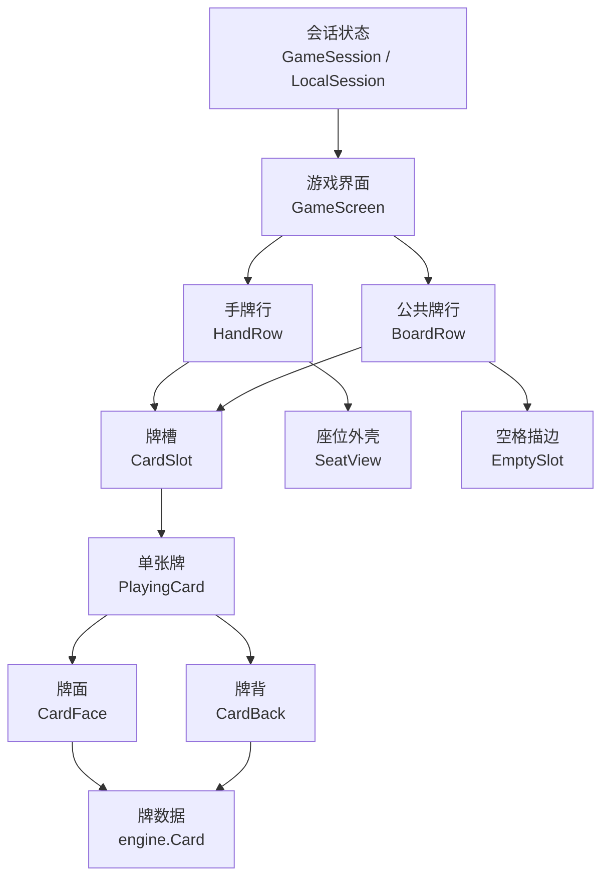
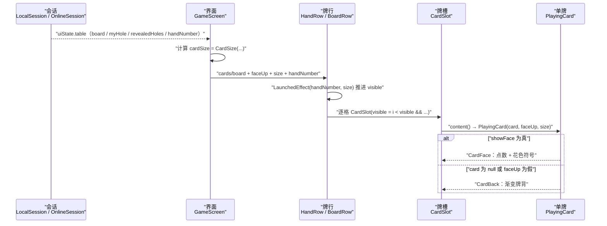
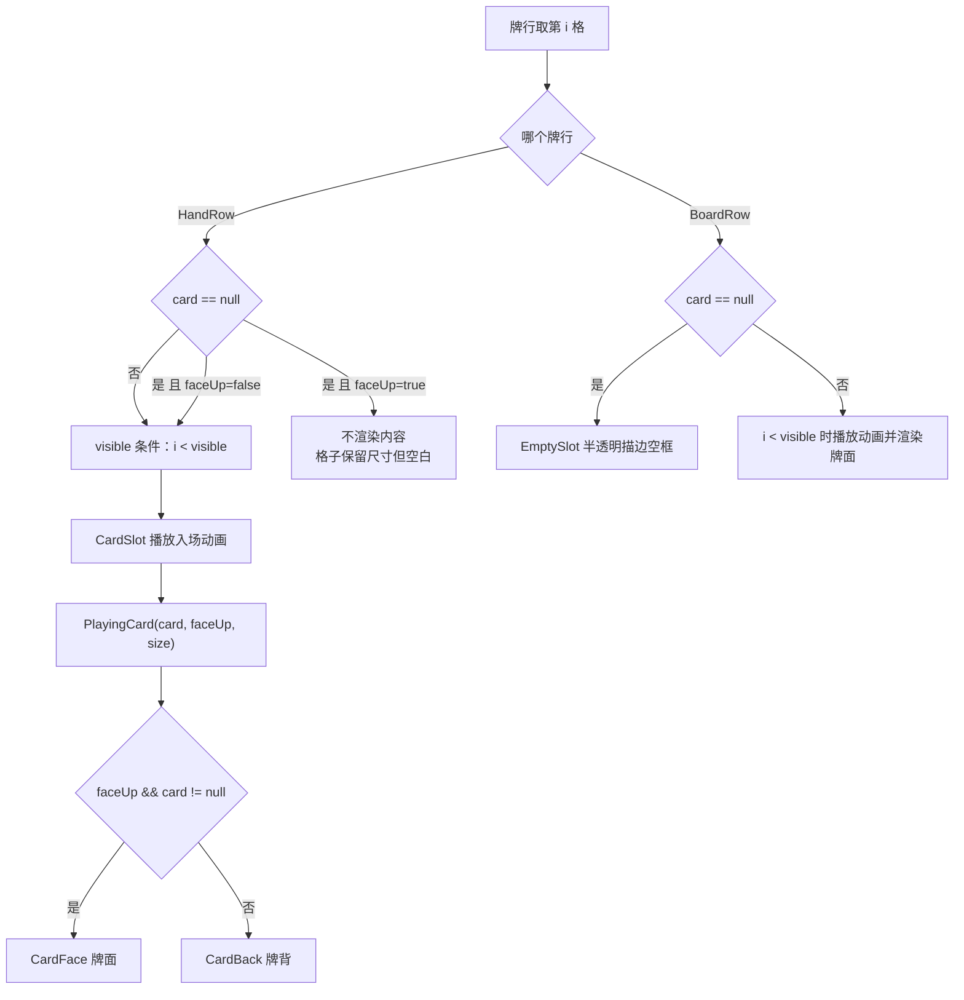
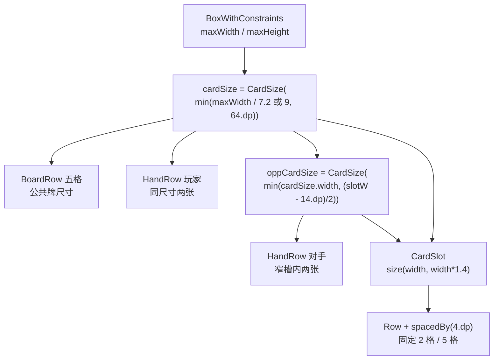

# 牌行 CardRow

<cite>
**本文引用的文件**
- [CardRow.kt](file://shared/src/commonMain/kotlin/com/aniapp/pokerdemo/ui/card/CardRow.kt)
- [PlayingCard.kt](file://shared/src/commonMain/kotlin/com/aniapp/pokerdemo/ui/card/PlayingCard.kt)
- [GameScreen.kt](file://shared/src/commonMain/kotlin/com/aniapp/pokerdemo/ui/GameScreen.kt)
- [SeatView.kt](file://shared/src/commonMain/kotlin/com/aniapp/pokerdemo/ui/table/SeatView.kt)
- [Card.kt](file://shared/src/commonMain/kotlin/com/aniapp/pokerdemo/engine/Card.kt)
- [Protocol.kt](file://shared/src/commonMain/kotlin/com/aniapp/pokerdemo/net/Protocol.kt)
- [GameState.kt](file://shared/src/commonMain/kotlin/com/aniapp/pokerdemo/engine/GameState.kt)
- [LocalSession.kt](file://shared/src/commonMain/kotlin/com/aniapp/pokerdemo/session/LocalSession.kt)
</cite>

## 目录
1. [简介](#简介)
2. [模块位置与依赖清单](#模块位置与依赖清单)
3. [核心组件总览](#核心组件总览)
4. [架构与数据流](#架构与数据流)
5. [HandRow：手牌行详解](#handrow手牌行详解)
6. [BoardRow：公共牌行详解](#boardrow公共牌行详解)
7. [空位占位符 null 的处理机制](#空位占位符-null-的处理机制)
8. [CardSlot 与发牌动画](#cardslot-与发牌动画)
9. [Row 布局、间距与尺寸参数](#row-布局间距与尺寸参数)
10. [调用示例与使用场景](#调用示例与使用场景)
11. [与 PlayingCard 的组合关系](#与-playingcard-的组合关系)
12. [响应式设计考虑](#响应式设计考虑)
13. [性能与重组注意事项](#性能与重组注意事项)
14. [常见问题排查](#常见问题排查)
15. [结论](#结论)

## 简介
牌行组件是德州扑克界面中负责"把一组牌横向排出来"的一层，现位于跨平台共享模块的 `com.aniapp.pokerdemo.ui.card` 包内。它不再是一个单一的 `CardRow` 函数，而是拆成两个语义明确的 Composable：**HandRow**（固定两张的手牌行）与 **BoardRow**（固定五格的公共牌行）。两者都使用 `Row` + `Arrangement.spacedBy(4.dp)` 做横向排列，逐格交给同目录的 **PlayingCard** 渲染牌面或牌背，并通过 `handNumber` 驱动逐张入场的发牌动画。

需要特别说明的是：该组件已经是 Compose Multiplatform 代码，Android、桌面等端共用同一份实现；早期 Android 专属版本（含 `FlowRow` 自动换行、`fillMaxWidth` 容器留白、独立的 `CardView` / `CardViewBack` 视图以及 `cardSize()` / `toCardRank()` 辅助函数）在当前代码库中已不存在，相关行为在本版本中被固定槽位数与显式 `CardSize` 参数取代。

## 模块位置与依赖清单
牌行相关文件全部位于 `shared` 模块，构建产物随 Compose Multiplatform 一起进入各端，而非仅 Android：

| 角色 | 文件 |
| --- | --- |
| 牌行容器（HandRow / BoardRow / CardSlot / EmptySlot） | `shared/src/commonMain/kotlin/com/aniapp/pokerdemo/ui/card/CardRow.kt` |
| 单张牌的牌面与牌背渲染（PlayingCard / CardFace / CardBack / CardSize） | `shared/src/commonMain/kotlin/com/aniapp/pokerdemo/ui/card/PlayingCard.kt` |
| 组装牌行的页面 | `shared/src/commonMain/kotlin/com/aniapp/pokerdemo/ui/GameScreen.kt` |
| 承载牌行的座位外壳 | `shared/src/commonMain/kotlin/com/aniapp/pokerdemo/ui/table/SeatView.kt` |
| 牌数据模型 | `shared/src/commonMain/kotlin/com/aniapp/pokerdemo/engine/Card.kt` |
| 服务端/本地会话下发的表格视图 | `shared/src/commonMain/kotlin/com/aniapp/pokerdemo/net/Protocol.kt` |



**图表来源**
- [GameScreen.kt:69-74](file://shared/src/commonMain/kotlin/com/aniapp/pokerdemo/ui/GameScreen.kt#L69-L74)
- [GameScreen.kt:100-115](file://shared/src/commonMain/kotlin/com/aniapp/pokerdemo/ui/GameScreen.kt#L100-L115)
- [CardRow.kt:26-109](file://shared/src/commonMain/kotlin/com/aniapp/pokerdemo/ui/card/CardRow.kt#L26-L109)
- [PlayingCard.kt:36-64](file://shared/src/commonMain/kotlin/com/aniapp/pokerdemo/ui/card/PlayingCard.kt#L36-L64)

**章节来源**
- [CardRow.kt:1-24](file://shared/src/commonMain/kotlin/com/aniapp/pokerdemo/ui/card/CardRow.kt#L1-L24)
- [GameScreen.kt:26-33](file://shared/src/commonMain/kotlin/com/aniapp/pokerdemo/ui/GameScreen.kt#L26-L33)

## 核心组件总览
- **HandRow**：两张一行的手牌容器，参数为 `cards: List<Card?>` + `faceUp: Boolean`，用于玩家自己与对手的底牌。
- **BoardRow**：五格一行的公共牌容器，参数为 `board: List<Card>`（非空元素列表），不足五张的位置渲染为空框。
- **CardSlot**：私有单格容器，负责固定尺寸占位、占位内容以及 `AnimatedVisibility` 的淡入 + 横向滑入动画。
- **EmptySlot**：私有占位视觉，半透明白色描边圆角矩形，表示"尚未发出的公共牌位置"。
- **PlayingCard**：同目录的单张牌组件，按 `faceUp && card != null` 决定显示牌面还是牌背，并带 Y 轴翻转动画。
- **CardSize**：`data class CardSize(val width: Dp)`，高度由 `width * 1.4f` 推导，是牌行与单牌之间唯一的尺寸契约。
- **Card**：`data class Card(val rank: Int, val suit: Suit)`，rank 用 2..14 表示 2 到 A，不含"是否为空"的语义。

**章节来源**
- [CardRow.kt:26-109](file://shared/src/commonMain/kotlin/com/aniapp/pokerdemo/ui/card/CardRow.kt#L26-L109)
- [PlayingCard.kt:36-64](file://shared/src/commonMain/kotlin/com/aniapp/pokerdemo/ui/card/PlayingCard.kt#L36-L64)
- [Card.kt:9-22](file://shared/src/commonMain/kotlin/com/aniapp/pokerdemo/engine/Card.kt#L9-L22)

## 架构与数据流
牌行本身不持有业务状态，只消费 `TableView` 派生出的列表与 `handNumber`：



**图表来源**
- [LocalSession.kt:133-165](file://shared/src/commonMain/kotlin/com/aniapp/pokerdemo/session/LocalSession.kt#L133-L165)
- [GameScreen.kt:48-60](file://shared/src/commonMain/kotlin/com/aniapp/pokerdemo/ui/GameScreen.kt#L48-L60)
- [CardRow.kt:33-52](file://shared/src/commonMain/kotlin/com/aniapp/pokerdemo/ui/card/CardRow.kt#L33-L52)
- [CardRow.kt:87-102](file://shared/src/commonMain/kotlin/com/aniapp/pokerdemo/ui/card/CardRow.kt#L87-L102)
- [PlayingCard.kt:40-63](file://shared/src/commonMain/kotlin/com/aniapp/pokerdemo/ui/card/PlayingCard.kt#L40-L63)

**章节来源**
- [Protocol.kt:60-74](file://shared/src/commonMain/kotlin/com/aniapp/pokerdemo/net/Protocol.kt#L60-L74)
- [GameScreen.kt:141-144](file://shared/src/commonMain/kotlin/com/aniapp/pokerdemo/ui/GameScreen.kt#L141-L144)

## HandRow：手牌行详解

### 函数签名与职责
```kotlin
@Composable
fun HandRow(
    cards: List<Card?>,
    faceUp: Boolean,
    size: CardSize,
    handNumber: Int,
    modifier: Modifier = Modifier
)
```
- `cards: List<Card?>`：允许混合真实牌对象与 `null` 占位；HandRow 只取前两个下标（`repeat(2)` + `getOrNull(i)`），多余元素被忽略，长度不足时对应槽位得到 `null`。
- `faceUp: Boolean`：整行统一的翻牌开关。为 `false` 时即使有真实牌也显示牌背；为 `true` 且元素非 `null` 才显示牌面。
- `size: CardSize`：由上层传入的牌尺寸，决定每格宽高。
- `handNumber: Int`：当前手数，作为动画计数器的 key。
- `modifier`：直接施加在 `Row` 上，不参与内部排版。

HandRow 不保存业务状态，只维护一个以 `handNumber` 为 key 的可见张数计数器 `visible`，然后按序渲染两格。

**章节来源**
- [CardRow.kt:26-53](file://shared/src/commonMain/kotlin/com/aniapp/pokerdemo/ui/card/CardRow.kt#L26-L53)

### 逐张入场的计数逻辑
`LaunchedEffect(handNumber, cards.size)` 内的规则是：
1. 若已有计数超过新的牌数，先归零（防止切手后残留旧进度）；
2. 只要计数小于牌数，就每 `delay(120)` 毫秒自增一次，直到全部可见。

因此新一手开始时，两张手牌以约 120ms 间隔依次出现；同一手内牌数变化也会重新推进计数。

**章节来源**
- [CardRow.kt:33-40](file://shared/src/commonMain/kotlin/com/aniapp/pokerdemo/ui/card/CardRow.kt#L33-L40)

## BoardRow：公共牌行详解
```kotlin
@Composable
fun BoardRow(
    board: List<Card>,
    size: CardSize,
    handNumber: Int,
    modifier: Modifier = Modifier
)
```
与 HandRow 的差异有三点：
- 元素类型是 `List<Card>`（非可空），因为公共牌要么已经发出、要么根本不存在，不存在"背面公共牌"这一形态。
- 固定渲染 5 格（`repeat(5)`），用 `board.getOrNull(i)` 取值；未发出的位置 `card == null`。
- 可见条件为 `card != null && i < visible.intValue`，即只有"确实存在的牌"才参与逐张入场，未发出的位置立即渲染 `EmptySlot()` 空框，保持牌桌中央始终是稳定的五格视觉。

Flop / Turn / River 分别让 `board` 长度为 3 / 4 / 5，牌行无需任何分支即可正确表现"三张实牌 + 两个空框"这类中间态。

**章节来源**
- [CardRow.kt:55-84](file://shared/src/commonMain/kotlin/com/aniapp/pokerdemo/ui/card/CardRow.kt#L55-L84)
- [GameState.kt:41-50](file://shared/src/commonMain/kotlin/com/aniapp/pokerdemo/engine/GameState.kt#L41-L50)

## 空位占位符 null 的处理机制
牌行对 `null` 的处理分为两条不同路径，理解这一点是使用该组件的关键。



**图表来源**
- [CardRow.kt:42-52](file://shared/src/commonMain/kotlin/com/aniapp/pokerdemo/ui/card/CardRow.kt#L42-L52)
- [CardRow.kt:72-83](file://shared/src/commonMain/kotlin/com/aniapp/pokerdemo/ui/card/CardRow.kt#L72-L83)
- [PlayingCard.kt:40-63](file://shared/src/commonMain/kotlin/com/aniapp/pokerdemo/ui/card/PlayingCard.kt#L40-L63)

要点：
- **HandRow 中的 `null` 不是"跳过"**：`visible = i < visible.intValue && (card != null || !faceUp)`。当 `faceUp = false` 时，即使 `cards` 里放的是 `null`，格子依然会带动画地渲染出牌背——这正是对手暗牌的标准用法（`opponentHole` 在未摊牌时返回 `listOf(null, null)`）。
- **HandRow 中 `faceUp = true` 且 `card == null`** 时条件为假，格子只保留 `CardSlot` 的固定尺寸占位，不绘制牌背也不绘制牌面，避免出现"亮牌却是背面"的矛盾画面。
- **BoardRow 中的缺位用 `EmptySlot()`**：不是牌背，而是一圈 `Color.White.copy(alpha = 0.15f)` 的 1dp 描边、8dp 圆角矩形，语义是"这里还没有牌"。
- 是否显示为占位完全由外层列表内容与 `faceUp` 决定，`Card` 数据模型自身没有可空/占位字段。

**章节来源**
- [CardRow.kt:44-52](file://shared/src/commonMain/kotlin/com/aniapp/pokerdemo/ui/card/CardRow.kt#L44-L52)
- [CardRow.kt:72-83](file://shared/src/commonMain/kotlin/com/aniapp/pokerdemo/ui/card/CardRow.kt#L72-L83)
- [CardRow.kt:104-109](file://shared/src/commonMain/kotlin/com/aniapp/pokerdemo/ui/card/CardRow.kt#L104-L109)
- [GameScreen.kt:141-144](file://shared/src/commonMain/kotlin/com/aniapp/pokerdemo/ui/GameScreen.kt#L141-L144)
- [Card.kt:9-22](file://shared/src/commonMain/kotlin/com/aniapp/pokerdemo/engine/Card.kt#L9-L22)

## CardSlot 与发牌动画
`CardSlot` 是牌行的私有单格容器，也是"宽度自适应换成固定槽位"这一设计的落点：

- 外层 `Box(Modifier.size(size.width, size.height))`：无论内部有没有牌，格子始终占据一张牌的完整面积，因此发牌过程中行宽不会抖动。
- `if (!visible) placeholder()`：不可见时先画占位内容（BoardRow 传入 `EmptySlot()`，HandRow 默认传入空 lambda）。
- `AnimatedVisibility` 的进场为 `fadeIn(tween(250)) + slideInHorizontally(tween(250)) { -it / 2 }`，即从右侧轻微横移淡入；退场为 `fadeOut(tween(150))`。
- `content` 为尾随 lambda，牌行在其中调用 `PlayingCard(card, faceUp, size)`，动画包裹的是完整的单张牌而非其内部子节点。

这意味着旧的"FlowRow 自动换行 + fillMaxWidth 填满父级 + padding(8.dp) 容器留白"方案已被"固定槽位数 + 固定尺寸 Box + 4dp 水平间距"取代：行宽由 `2 × size.width + 4dp`（手牌）或 `5 × size.width + 4 × 4dp`（公共牌）决定，适配工作交给上层计算 `CardSize`。

**章节来源**
- [CardRow.kt:87-102](file://shared/src/commonMain/kotlin/com/aniapp/pokerdemo/ui/card/CardRow.kt#L87-L102)
- [CardRow.kt:41](file://shared/src/commonMain/kotlin/com/aniapp/pokerdemo/ui/card/CardRow.kt#L41)
- [CardRow.kt:71](file://shared/src/commonMain/kotlin/com/aniapp/pokerdemo/ui/card/CardRow.kt#L71)

## Row 布局、间距与尺寸参数
- **横向排列**：两个牌行都用 `Row(modifier, horizontalArrangement = Arrangement.spacedBy(4.dp))`，牌与牌之间恒定 4dp 间隙。这是牌行唯一的水平间距来源，容器自身不再添加 `padding(8.dp)` 之类的内边距。
- **左右留白的责任转移**：页面级留白由 `GameScreen` 的 `Column` 通过 `padding(horizontal = 12.dp, vertical = 8.dp)` 提供，垂直节奏由 `Spacer` 提供；座位内部的上下呼吸感则由 `SeatView` 在 `cards()` 前后插入 2dp/4dp 的 `Spacer` 完成。
- **尺寸契约**：`CardSize(width)` 的高度为 `width * 1.4f`，`CardSlot` 与 `PlayingCard` 都读取同一对象，保证牌背、牌面、空框三者严格等大，从而在同一行内高度协调。
- **不做自动换行**：由于槽位数固定（2 或 5），牌行永远不会换行；若需要在窄屏容纳更多座位，上层通过缩小 `oppCardSize` 而不是增加行数来解决。

**章节来源**
- [CardRow.kt:41](file://shared/src/commonMain/kotlin/com/aniapp/pokerdemo/ui/card/CardRow.kt#L41)
- [CardRow.kt:71](file://shared/src/commonMain/kotlin/com/aniapp/pokerdemo/ui/card/CardRow.kt#L71)
- [PlayingCard.kt:36-38](file://shared/src/commonMain/kotlin/com/aniapp/pokerdemo/ui/card/PlayingCard.kt#L36-L38)
- [GameScreen.kt:82-86](file://shared/src/commonMain/kotlin/com/aniapp/pokerdemo/ui/GameScreen.kt#L82-L86)
- [SeatView.kt:56-62](file://shared/src/commonMain/kotlin/com/aniapp/pokerdemo/ui/table/SeatView.kt#L56-L62)

## 调用示例与使用场景

### 玩家自己的两张手牌
`GameScreen` 底部座位用 `table.myHole`（类型为 `List<Card>`，来自 `PlayerState.hole`）配合恒为 `true` 的 `faceUp`：

```kotlin
HandRow(
    cards = table.myHole,
    faceUp = true,
    size = cardSize,
    handNumber = table.handNumber
)
```
两张真实牌 → 依次动画入场并显示牌面。

**章节来源**
- [GameScreen.kt:105-115](file://shared/src/commonMain/kotlin/com/aniapp/pokerdemo/ui/GameScreen.kt#L105-L115)
- [LocalSession.kt:161](file://shared/src/commonMain/kotlin/com/aniapp/pokerdemo/session/LocalSession.kt#L161)

### 对手的两张暗牌与摊牌亮牌
对手行同样调用 `HandRow`，但 `cards` 来自 `opponentHole(table, seat)`，`faceUp` 取决于该座位是否已进入 `revealedHoles`：

```kotlin
HandRow(
    cards = opponentHole(table, s),
    faceUp = table.revealedHoles.containsKey(s.seat),
    size = oppCardSize,
    handNumber = table.handNumber
)
```
`opponentHole` 的三种返回值决定了三种视觉：
- 已弃牌（`seat.folded`）→ `emptyList()`：两格都取到 `null`，且 `faceUp` 为假时会渲染牌背；
- 已摊牌 → `revealedHoles.getValue(seat.seat)`：两张真实牌 + `faceUp = true` → 牌面；
- 其他情况 → `listOf(null, null)`：`faceUp = false` → 两张牌背占位。

**章节来源**
- [GameScreen.kt:64-76](file://shared/src/commonMain/kotlin/com/aniapp/pokerdemo/ui/GameScreen.kt#L64-L76)
- [GameScreen.kt:141-144](file://shared/src/commonMain/kotlin/com/aniapp/pokerdemo/ui/GameScreen.kt#L141-L144)
- [LocalSession.kt:135-137](file://shared/src/commonMain/kotlin/com/aniapp/pokerdemo/session/LocalSession.kt#L135-L137)

### 五格公共牌
```kotlin
BoardRow(table.board, cardSize, table.handNumber)
```
- 翻牌前：`board` 为空 → 五个空框；
- Flop：三张实牌 + 两个空框；
- Turn / River：四张 / 五张实牌，新加入的一张仍按 120ms 节拍单独入场。

**章节来源**
- [GameScreen.kt:99-100](file://shared/src/commonMain/kotlin/com/aniapp/pokerdemo/ui/GameScreen.kt#L99-L100)
- [CardRow.kt:55-84](file://shared/src/commonMain/kotlin/com/aniapp/pokerdemo/ui/card/CardRow.kt#L55-L84)

### 直接构造含 null 的列表
脱离页面也可以手工喂给 `HandRow` 任意组合来验证视觉，例如 `[null, null]`（两张牌背）、`[Card(14, Suit.SPADES), null]`（一张牌面 + 一格空白，需 `faceUp = true`）、`listOf(Card(13, Suit.HEARTS), Card(2, Suit.CLUBS))`（两张牌面）。注意第三张及以后的元素不会被渲染。

**章节来源**
- [CardRow.kt:42-52](file://shared/src/commonMain/kotlin/com/aniapp/pokerdemo/ui/card/CardRow.kt#L42-L52)
- [Card.kt:9](file://shared/src/commonMain/kotlin/com/aniapp/pokerdemo/engine/Card.kt#L9)

## 与 PlayingCard 的组合关系
牌行只负责"排几格、什么时候让格子出现"，牌本身的画法完全下沉到同目录的 `PlayingCard`：

- `PlayingCard(card: Card?, faceUp: Boolean, size: CardSize, modifier)` 计算 `showFace = faceUp && card != null`，并用 `animateFloatAsState` 把 `rotationY` 在 0° 与 180° 间过渡（400ms），配合 `cameraDistance = 12 * density` 形成立体翻牌。
- 旋转角 ≤ 90° 时渲染正面侧内容：`card != null` 走 `CardFace`，否则退化为 `CardBack`；> 90° 时渲染镜像容器里的 `CardBack`。因此牌行传入 `null` 与传入 `faceUp = false` 最终都会落到牌背，但前者只在 `faceUp = false` 时被牌行放行渲染。
- `CardFace` 依据 `card.rank`（14→A、13→K、12→Q、11→J）和 `card.suit` 选择符号与颜色（黑桃/梅花用 `CardBlack`，红心/方块用 `CardRed`），字号按 `size.width` 比例缩放，角落正标 + 中心大符号 + 右下倒置标。
- `CardBack` 使用线性渐变底 + 边框 + `Canvas` 斜线网格，尺寸同样取自 `size`。
- 旧的 `CardView` / `CardViewBack` 组件与 `toCardRank()` 之类的点数转字符串扩展均已不存在，rank→字母的映射现在内联在 `CardFace` 中。

**章节来源**
- [PlayingCard.kt:40-64](file://shared/src/commonMain/kotlin/com/aniapp/pokerdemo/ui/card/PlayingCard.kt#L40-L64)
- [PlayingCard.kt:66-105](file://shared/src/commonMain/kotlin/com/aniapp/pokerdemo/ui/card/PlayingCard.kt#L66-L105)
- [PlayingCard.kt:107-130](file://shared/src/commonMain/kotlin/com/aniapp/pokerdemo/ui/card/PlayingCard.kt#L107-L130)
- [Color.kt:8-11](file://shared/src/commonMain/kotlin/com/aniapp/pokerdemo/ui/theme/Color.kt#L8-L11)

## 响应式设计考虑
牌行的"响应式"不再依赖运行时换行，而是由上层按可用宽度反推牌尺寸：



**图表来源**
- [GameScreen.kt:47-50](file://shared/src/commonMain/kotlin/com/aniapp/pokerdemo/ui/GameScreen.kt#L47-L50)
- [GameScreen.kt:57-60](file://shared/src/commonMain/kotlin/com/aniapp/pokerdemo/ui/GameScreen.kt#L57-L60)
- [CardRow.kt:87-92](file://shared/src/commonMain/kotlin/com/aniapp/pokerdemo/ui/card/CardRow.kt#L87-L92)
- [PlayingCard.kt:36-38](file://shared/src/commonMain/kotlin/com/aniapp/pokerdemo/ui/card/PlayingCard.kt#L36-L38)

设计含义：
1. **尺寸上限**：`minOf(..., 64.dp)` 限制单牌最大宽度，避免大屏上牌过大。
2. **人数自适应**：座位多于 3 个时用 `maxWidth / 9f`，否则 `/ 7.2f`，人多则牌更小。
3. **槽位约束**：对手牌额外受 `(slotW - 14.dp) / 2f` 限制，保证两张牌加 4dp 间隙能塞进等分槽位，相邻座位列不会交叠。
4. **永不换行**：由于槽位数固定，窄屏上的表现是牌变小、而不是变成两行；如果确实需要"每行 N 张"的可变布局，应在上层创建多个牌行实例，而不是指望现有实现自动折行。

**章节来源**
- [GameScreen.kt:47-62](file://shared/src/commonMain/kotlin/com/aniapp/pokerdemo/ui/GameScreen.kt#L47-L62)
- [CardRow.kt:26-53](file://shared/src/commonMain/kotlin/com/aniapp/pokerdemo/ui/card/CardRow.kt#L26-L53)

## 性能与重组注意事项
- **无状态但有动效状态**：牌行通过 `remember(handNumber) { mutableIntStateOf(0) }` 缓存可见计数，`mutableIntStateOf` 避免了装箱带来的额外重组；`LaunchedEffect` 的 key 为 `(handNumber, cards.size)`，牌数不变的同手内不会因为引用变化重启计时。
- **格子数量恒定**：`repeat(2)` / `repeat(5)` 使每次重组产生的 Composable 数量固定且极小，无需为牌行引入列表 key 或惰性容器；这与旧版基于集合遍历的写法相比，重组范围更可预测。
- **AnimationScope 与退出动画**：`AnimatedVisibility` 会在 `visible` 转假时执行 150ms 淡出，切换手数时可能出现新旧帧短暂共存，属于预期行为；不要在牌行外部再包一层动画，以免叠加时长。
- **控制上游状态粒度**：真正触发牌行重组的是 `TableView` 的 `board`、`myHole`、`revealedHoles`、`handNumber` 变化。`LocalSession.toTableView` 每次都会重建整个 `TableView`，因此应尽量减少引擎推送快照的频率，而不是在牌行里做缓存。
- **不要在牌行内引入业务状态**：牌行保持"输入列表 + 输出布局"的单向数据流；如需自定义占位或动画节奏，应通过新增参数（如可选的 `placeholder` lambda）来表达，而不是在 `CardRow.kt` 中持有可变游戏状态。
- **跨平台一致性**：`PlayingCard` 的牌背使用 `Canvas` 绘制斜线网格，翻牌使用 `graphicsLayer`；这些均为基础 Compose 图形能力，在共享模块中可直接运行于各目标平台，不需要 Android 专属 API。

**章节来源**
- [CardRow.kt:33-52](file://shared/src/commonMain/kotlin/com/aniapp/pokerdemo/ui/card/CardRow.kt#L33-L52)
- [CardRow.kt:59-83](file://shared/src/commonMain/kotlin/com/aniapp/pokerdemo/ui/card/CardRow.kt#L59-L83)
- [CardRow.kt:87-102](file://shared/src/commonMain/kotlin/com/aniapp/pokerdemo/ui/card/CardRow.kt#L87-L102)
- [LocalSession.kt:133-165](file://shared/src/commonMain/kotlin/com/aniapp/pokerdemo/session/LocalSession.kt#L133-L165)

## 常见问题排查

### 传了 null 却没有出现牌背？
检查 `faceUp`。HandRow 的可见条件是 `card != null || !faceUp`：`faceUp = true` 且元素为 `null` 时格子会保持空白（只有尺寸占位），这是为了避免"亮牌状态下显示牌背"。想看到牌背请使用 `faceUp = false`。

**章节来源**
- [CardRow.kt:44-48](file://shared/src/commonMain/kotlin/com/aniapp/pokerdemo/ui/card/CardRow.kt#L44-L48)

### 公共牌那一格是空框而不是牌背？
这是 `BoardRow` 的既定行为：`card == null` 的位置渲染 `EmptySlot()`（半透明描边），表示该街尚未发牌。牌背只出现在手牌行。

**章节来源**
- [CardRow.kt:74-82](file://shared/src/commonMain/kotlin/com/aniapp/pokerdemo/ui/card/CardRow.kt#L74-L82)
- [CardRow.kt:104-109](file://shared/src/commonMain/kotlin/com/aniapp/pokerdemo/ui/card/CardRow.kt#L104-L109)

### 为什么牌行不换行，或者看起来超出预期宽度？
两个牌行都是固定槽位的 `Row`，不会自动折行；总宽度等于 `格数 × size.width + (格数 - 1) × 4.dp`。若过宽，请在调用方缩小传入的 `CardSize`（参考 `GameScreen` 中 `oppCardSize` 的做法），而不是修改牌行本身。

**章节来源**
- [CardRow.kt:41](file://shared/src/commonMain/kotlin/com/aniapp/pokerdemo/ui/card/CardRow.kt#L41)
- [GameScreen.kt:57-60](file://shared/src/commonMain/kotlin/com/aniapp/pokerdemo/ui/GameScreen.kt#L57-L60)

### 牌看起来太大或太小？
尺寸完全由上层传入的 `CardSize(width)` 决定，高度按 `width * 1.4f` 推导；牌行不做任何自适应测量。调整入口是 `GameScreen` 里的 `cardSize` / `oppCardSize` 计算式。

**章节来源**
- [PlayingCard.kt:36-38](file://shared/src/commonMain/kotlin/com/aniapp/pokerdemo/ui/card/PlayingCard.kt#L36-L38)
- [GameScreen.kt:50](file://shared/src/commonMain/kotlin/com/aniapp/pokerdemo/ui/GameScreen.kt#L50)

### 新一手牌没有重新播放发牌动画？
动画进度以 `handNumber` 为 key。请确认 `TableView.handNumber` 确实递增（引擎在新手开始时 `handNumber = state.handNumber + 1`），并且调用方把同一个 `handNumber` 传给了牌行。

**章节来源**
- [CardRow.kt:33-40](file://shared/src/commonMain/kotlin/com/aniapp/pokerdemo/ui/card/CardRow.kt#L33-L40)
- [GameState.kt:44](file://shared/src/commonMain/kotlin/com/aniapp/pokerdemo/engine/GameState.kt#L44)

### 只想显示一张牌面 + 一张空白可以吗？
可以，传 `[Card(...), null]` 并设 `faceUp = true`：第一格正常入场显示牌面，第二格因可见条件为假而保持空白占位。

**章节来源**
- [CardRow.kt:42-52](file://shared/src/commonMain/kotlin/com/aniapp/pokerdemo/ui/card/CardRow.kt#L42-L52)

## 结论
牌行组件在共享模块中以 `HandRow` 与 `BoardRow` 两种形态存在：前者用 `List<Card?>` + `faceUp` 表达"两张手牌可能是暗牌或占位"，后者用 `List<Card>` 表达"五格里有多少牌就发多少"。它们都以固定槽位的 `Row` + `spacedBy(4.dp)` 排列，把每一格交给私有的 `CardSlot` 做尺寸占位与入场动画，再由同目录的 `PlayingCard` 统一渲染牌面或牌背，尺寸契约集中在 `CardSize` 上。

与早期 Android 版本相比，当前实现的变化需要注意：
- 位置迁移到 `shared/src/commonMain/.../ui/card/`，随 Compose Multiplatform 服务所有端；
- 依赖对象改为同目录的 `PlayingCard`（牌面 `CardFace` / 牌背 `CardBack`），不再有 `CardView` / `CardViewBack`；
- 布局策略由 `FlowRow` 自动换行 + `fillMaxWidth` + `padding(8.dp)` 改为固定格数 + 上层计算 `CardSize`，页面留白交给 `GameScreen` 与 `SeatView`；
- 与 `cardSize()` / `toCardRank()` 相关的描述不再适用，点数到字母的映射内联在 `CardFace` 中。

在使用建议上：保持牌行无业务状态，让 `handNumber` 与牌列表成为唯一驱动源；需要精确控制每行牌数或整体宽度时，在调用方计算并传入 `CardSize`，而不是期待牌行自行折行。