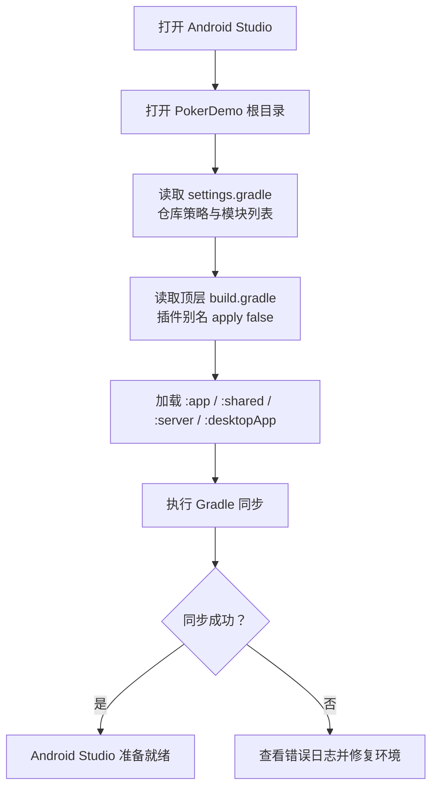
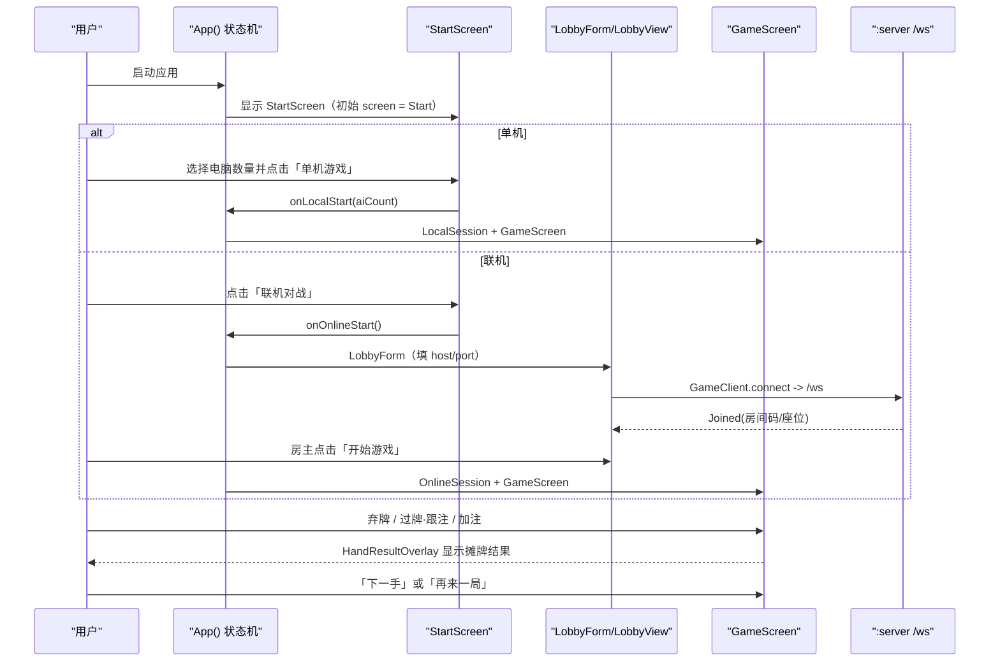
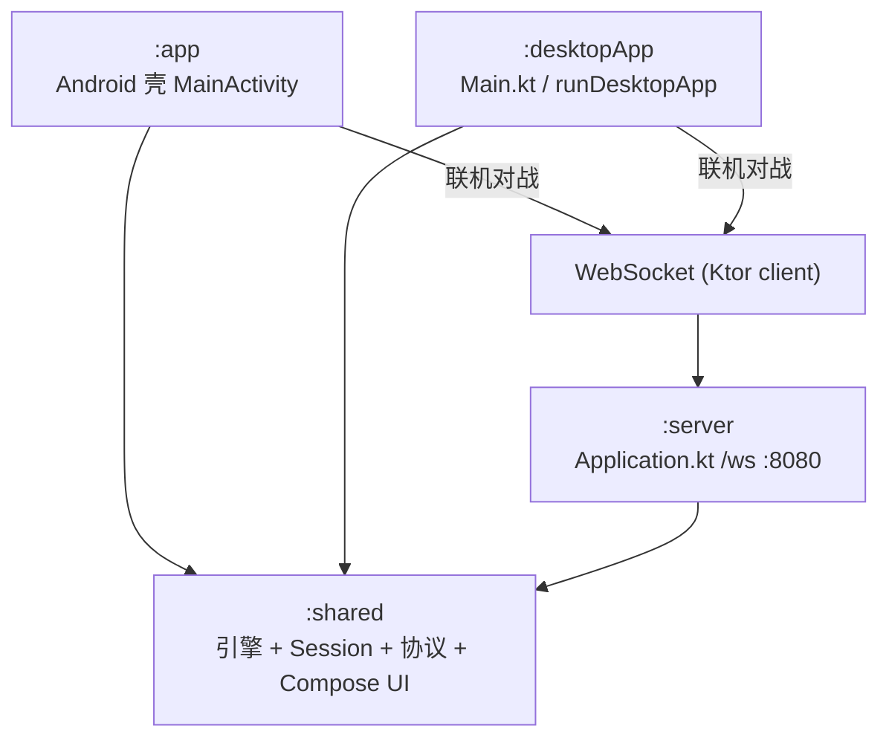
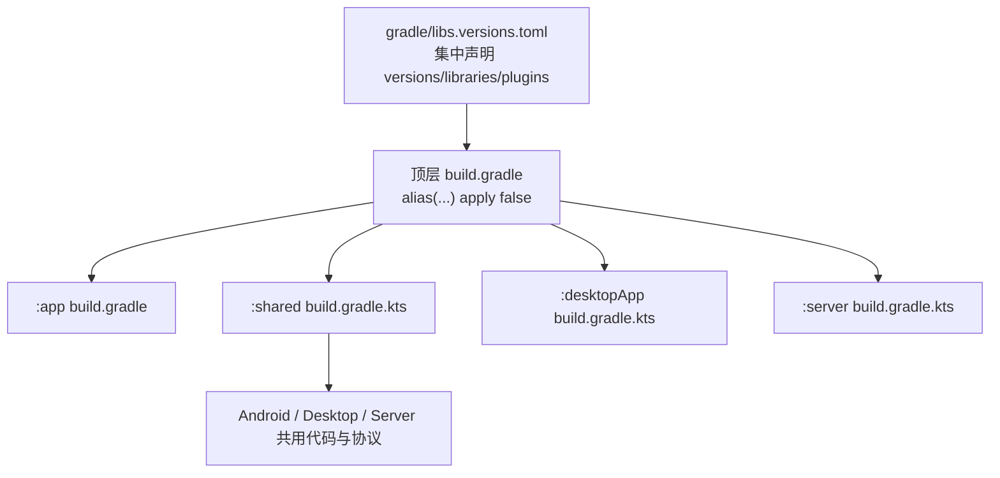

# 快速开始

<cite>
**本文引用的文件**
- [settings.gradle](file://settings.gradle)
- [build.gradle](file://build.gradle)
- [gradle/libs.versions.toml](file://gradle/libs.versions.toml)
- [gradle.properties](file://gradle.properties)
- [gradle/wrapper/gradle-wrapper.properties](file://gradle/wrapper/gradle-wrapper.properties)
- [app/build.gradle](file://app/build.gradle)
- [app/src/main/AndroidManifest.xml](file://app/src/main/AndroidManifest.xml)
- [app/src/main/java/com/aniapp/pokerdemo/MainActivity.kt](file://app/src/main/java/com/aniapp/pokerdemo/MainActivity.kt)
- [shared/build.gradle.kts](file://shared/build.gradle.kts)
- [desktopApp/build.gradle.kts](file://desktopApp/build.gradle.kts)
- [desktopApp/src/main/kotlin/com/aniapp/pokerdemo/desktop/Main.kt](file://desktopApp/src/main/kotlin/com/aniapp/pokerdemo/desktop/Main.kt)
- [server/build.gradle.kts](file://server/build.gradle.kts)
- [server/src/main/kotlin/com/aniapp/pokerdemo/server/Application.kt](file://server/src/main/kotlin/com/aniapp/pokerdemo/server/Application.kt)
- [server/src/main/resources/logback.xml](file://server/src/main/resources/logback.xml)
- [shared/src/commonMain/kotlin/com/aniapp/pokerdemo/ui/App.kt](file://shared/src/commonMain/kotlin/com/aniapp/pokerdemo/ui/App.kt)
- [shared/src/commonMain/kotlin/com/aniapp/pokerdemo/ui/start/StartScreen.kt](file://shared/src/commonMain/kotlin/com/aniapp/pokerdemo/ui/start/StartScreen.kt)
- [shared/src/commonMain/kotlin/com/aniapp/pokerdemo/ui/lobby/LobbyScreen.kt](file://shared/src/commonMain/kotlin/com/aniapp/pokerdemo/ui/lobby/LobbyScreen.kt)
- [shared/src/commonMain/kotlin/com/aniapp/pokerdemo/net/GameClient.kt](file://shared/src/commonMain/kotlin/com/aniapp/pokerdemo/net/GameClient.kt)
</cite>

## 目录
1. [简介](#简介)
2. [环境要求](#环境要求)
3. [克隆与打开项目](#克隆与打开项目)
4. [四个模块的构建与运行](#四个模块的构建与运行)
5. [首次运行模拟器或真机](#首次运行模拟器或真机)
6. [启动流程与基本操作](#启动流程与基本操作)
7. [确认所装包的新旧](#确认所装包的新旧)
8. [模块职责概览](#模块职责概览)
9. [依赖版本集中管理](#依赖版本集中管理)
10. [常见构建问题排查](#常见构建问题排查)
11. [总结](#总结)

## 简介
PokerDemo 是一个 Kotlin Multiplatform + Compose Multiplatform 的德州扑克项目，同一套 `shared` 界面与牌局引擎同时运行在 **Android**、**桌面端（JVM）** 上，并可连接独立的 **Ktor WebSocket 服务端** 进行局域网联机对战。项目由四个 Gradle 模块组成：`:app`（Android 客户端）、`:shared`（跨平台引擎与 UI）、`:desktopApp`（桌面入口）、`:server`（房间与对局服务端）。

应用打开后首先进入 **StartScreen**：可选择「单机游戏」（1–5 个电脑对手）或「联机对战」（创建/加入房间），不再是直接进入发牌演示页。

## 环境要求
- **Android Studio**：建议使用支持 AGP 8.13 与 Kotlin 2.x 的稳定版本（例如 2024.x 系列），Compose Multiplatform 插件为 `1.7.3`。
- **JDK**：所有模块的编译目标统一为 Java 11（`jvmTarget = 11`），请确保 Android Studio 使用的 JDK 至少满足该要求。
- **Android Gradle Plugin**：AGP 版本由 `gradle/libs.versions.toml` 集中声明为 `8.13.2`。
- **Gradle**：项目使用 Gradle Wrapper，指定下载并使用的版本为 `gradle-8.14.3-bin.zip`。
- **Android SDK**：`compileSdk`/`targetSdk` 为 `36`，`minSdk` 为 `28`。
- **网络**：首次构建需要访问仓库下载依赖与 Gradle 二进制包；`settings.gradle` 已配置阿里云镜像优先，再回落到 `google()`/`mavenCentral()`。
- **服务端运行时**：`:server` 通过 Ktor CIO 引擎监听 TCP 端口，本机运行时无需额外容器；联机测试时需保证客户端与服务端处于同一网络且端口可达。

**本节来源**
- [gradle/libs.versions.toml:1-59](file://gradle/libs.versions.toml#L1-L59)
- [gradle/wrapper/gradle-wrapper.properties:1-8](file://gradle/wrapper/gradle-wrapper.properties#L1-L8)
- [settings.gradle:1-26](file://settings.gradle#L1-L26)
- [app/build.gradle:11-21](file://app/build.gradle#L11-L21)
- [app/build.gradle:52-58](file://app/build.gradle#L52-L58)

## 克隆与打开项目
1. 克隆仓库并进入目录：
   ```
   git clone <仓库地址>
   cd PokerDemo
   ```
2. 启动 Android Studio，选择 **Open** 打开项目根目录 `PokerDemo`。
3. Android Studio 读取 `settings.gradle`，识别出根工程 `PokerDemo` 及 `:app`、`:shared`、`:server`、`:desktopApp` 四个模块。
4. 等待 Gradle 同步完成；同步失败时参考后文「常见构建问题排查」。



**图表来源**
- [settings.gradle:1-31](file://settings.gradle#L1-L31)
- [build.gradle:1-11](file://build.gradle#L1-L11)

**本节来源**
- [settings.gradle:27-31](file://settings.gradle#L27-L31)
- [build.gradle:1-11](file://build.gradle#L1-L11)

## 四个模块的构建与运行
项目始终使用 Gradle Wrapper 脚本（Windows 用 `gradlew.bat`，macOS/Linux 用 `./gradlew`），避免本地 Gradle 版本不一致。

### Android 客户端（:app）
```
./gradlew :app:assembleDebug      # 生成 debug APK
./gradlew :app:installDebug       # 安装到已连接的设备/模拟器
```
也可在 Android Studio 中确认工具栏选中 **debug** 变体与目标设备后点击 **Run 'app'**。

### 桌面端（:desktopApp）
`desktopApp/build.gradle.kts` 通过 `compose.desktop { application { mainClass = ... } }` 注册了 **runDesktopApp** 任务：
```
./gradlew :desktopApp:runDesktopApp
```
或在 IDE 中直接运行 `Main.kt` 的 `main()` 函数——它创建一个标题为 `LSTPoker`、尺寸 1280×800 的窗口并渲染与 Android 相同的 `App()` 界面。

### 服务端（:server）
服务端入口是 `Application.kt` 的 `main()`，使用 Ktor CIO 引擎在 **8080 端口**、绑定 `0.0.0.0` 启动，并在 `module()` 中安装 WebSockets、注册 **`/ws`** 路由处理房间与对局消息：
```
./gradlew :server:run
```
（等价于直接运行 `Application.kt` 的 `main()`。）启动后日志由 `logback.xml` 输出到控制台，`io.ktor` 级别为 `WARN`。

客户端联机时在「联机对战」表单填写 **服务器地址**（如 `192.168.1.5`）与 **端口**（默认 `8080`），随后 `GameClient.connect()` 以该 host/port 建立到 `/ws` 的 WebSocket 会话。

> 注意：当前实现只暴露 `/ws` 一个路由，没有额外的健康检查接口；判断服务是否就绪请直接观察控制台启动日志，或用客户端连接结果验证。

### 一次完整联机验证的顺序
1. 先启动服务端（`./gradlew :server:run`），记下本机局域网 IP。
2. 在 Android 或桌面端进入「联机对战」→ 填 host/port → 「创建房间」，选好座位数（2–6）与 AI 补位。
3. 另一台设备选「加入房间」并输入 4 位房间码。
4. 房主在房间页点击「开始游戏」。

**本节来源**
- [app/build.gradle:11-49](file://app/build.gradle#L11-L49)
- [desktopApp/build.gradle.kts:24-28](file://desktopApp/build.gradle.kts#L24-L28)
- [desktopApp/src/main/kotlin/com/aniapp/pokerdemo/desktop/Main.kt:10-18](file://desktopApp/src/main/kotlin/com/aniapp/pokerdemo/desktop/Main.kt#L10-L18)
- [server/build.gradle.kts:34-36](file://server/build.gradle.kts#L34-L36)
- [server/src/main/kotlin/com/aniapp/pokerdemo/server/Application.kt:17-27](file://server/src/main/kotlin/com/aniapp/pokerdemo/server/Application.kt#L17-L27)
- [server/src/main/kotlin/com/aniapp/pokerdemo/server/Application.kt:60-77](file://server/src/main/kotlin/com/aniapp/pokerdemo/server/Application.kt#L60-L77)
- [shared/src/commonMain/kotlin/com/aniapp/pokerdemo/ui/lobby/LobbyScreen.kt:60-120](file://shared/src/commonMain/kotlin/com/aniapp/pokerdemo/ui/lobby/LobbyScreen.kt#L60-L120)
- [shared/src/commonMain/kotlin/com/aniapp/pokerdemo/net/GameClient.kt:32-36](file://shared/src/commonMain/kotlin/com/aniapp/pokerdemo/net/GameClient.kt#L32-L36)
- [server/src/main/resources/logback.xml:1-11](file://server/src/main/resources/logback.xml#L1-L11)

## 首次运行模拟器或真机
### 使用模拟器
1. **Tools > Device Manager** → **Create Virtual Device**。
2. 选择硬件配置，CPU/ABI 推荐 `arm64-v8a` 以匹配本机架构。
3. 选择与 `minSdk 28` 兼容的系统镜像并启动。
4. 回到主界面点击 **Run**，或执行 `./gradlew :app:installDebug`。
5. 若要在模拟器上测联机，把表单中的服务器地址填为宿主机的局域网 IP（`10.0.2.2` 可作为指向宿主机 `127.0.0.1` 的替代）。

### 使用真机调试
1. 手机开启开发者选项与 USB 调试，数据线连接电脑。
2. 在设备列表中确认可见后点击 **Run**。
3. 联机场景下手机与服务端必须在同一 Wi-Fi，服务器地址填运行 `:server` 那台机器的局域网 IP。

**本节来源**
- [app/build.gradle:19-21](file://app/build.gradle#L19-L21)
- [shared/src/commonMain/kotlin/com/aniapp/pokerdemo/ui/lobby/LobbyScreen.kt:100-120](file://shared/src/commonMain/kotlin/com/aniapp/pokerdemo/ui/lobby/LobbyScreen.kt#L100-L120)

## 启动流程与基本操作
`App()` 内部用一个 `AppScreen` 状态机决定当前页面，初始值为 `Start`（除非通过 `autoStartLocal` 参数直接进牌桌，供自动化测试使用）：

1. **StartScreen**：显示标题、牌面动画与版本号；用「−/+」按钮选择 **电脑数量（1–5）**，点击 **「单机游戏」** 直接进入牌桌，或点击 **「联机对战」** 进入联机表单。
2. **LobbyForm**：填昵称、服务器地址、端口，切换 **创建房间 / 加入房间**。创建时可设座位数（2–6）与「空位 AI 补位」开关；加入时输入 4 位字母房间码。校验不通过会在表单内提示（如「请填写服务器地址」「端口不合法」「房间码为 4 位字母」）。
3. **LobbyView**：连接成功后显示房间码与各座位状态（房主、AI、托管标记），房主点 **「开始游戏」**；关闭 AI 补位时需至少 2 名真人才能开局。
4. **GameScreen**：正式牌桌。顶部显示手数与盲注（联机时还有房间码），中部为底池与公共牌，底部为手牌与操作条 **「弃牌 / 过牌·跟注 / 加注」**，加注时展开滑杆面板确定加注额度。回合推进由引擎驱动，非自己行动时显示「思考中…」。
5. **HandResultOverlay**：摊牌后弹出本手结果与分池明细，点击 **「下一手」** 继续，整场结束时点击 **「再来一局」** 重开新对局。



**图表来源**
- [shared/src/commonMain/kotlin/com/aniapp/pokerdemo/ui/App.kt:44-131](file://shared/src/commonMain/kotlin/com/aniapp/pokerdemo/ui/App.kt#L44-L131)
- [shared/src/commonMain/kotlin/com/aniapp/pokerdemo/ui/start/StartScreen.kt:56-161](file://shared/src/commonMain/kotlin/com/aniapp/pokerdemo/ui/start/StartScreen.kt#L56-L161)
- [shared/src/commonMain/kotlin/com/aniapp/pokerdemo/ui/lobby/LobbyScreen.kt:58-197](file://shared/src/commonMain/kotlin/com/aniapp/pokerdemo/ui/lobby/LobbyScreen.kt#L58-L197)
- [shared/src/commonMain/kotlin/com/aniapp/pokerdemo/ui/action/ActionBar.kt:41-105](file://shared/src/commonMain/kotlin/com/aniapp/pokerdemo/ui/action/ActionBar.kt#L41-L105)
- [shared/src/commonMain/kotlin/com/aniapp/pokerdemo/net/GameClient.kt:32-36](file://shared/src/commonMain/kotlin/com/aniapp/pokerdemo/net/GameClient.kt#L32-L36)

**本节来源**
- [shared/src/commonMain/kotlin/com/aniapp/pokerdemo/ui/App.kt:44-131](file://shared/src/commonMain/kotlin/com/aniapp/pokerdemo/ui/App.kt#L44-L131)
- [shared/src/commonMain/kotlin/com/aniapp/pokerdemo/ui/start/StartScreen.kt:56-161](file://shared/src/commonMain/kotlin/com/aniapp/pokerdemo/ui/start/StartScreen.kt#L56-L161)
- [shared/src/commonMain/kotlin/com/aniapp/pokerdemo/ui/lobby/LobbyScreen.kt:200-321](file://shared/src/commonMain/kotlin/com/aniapp/pokerdemo/ui/lobby/LobbyScreen.kt#L200-L321)

## 确认所装包的新旧
`:app` 的版本号由构建脚本自动生成，无需手动修改：以 `Asia/Shanghai` 时区的 `2026-11-17 00:00` 为起点，按「距起点的分钟数」计算 `versionCode` 与 `versionName = 1.0.{autoVersion}`，因此每次构建版本单调递增。APK 文件名同时带上构建时间戳：

```
LSTPoker-v{versionName}-{buildType}-{yyyyMMdd-HHmm}.apk
```
例如 `LSTPoker-v1.0.1234-debug-20261118-1015.apk`，产物位于 `app/build/outputs/apk/<buildType>/`。此外 `versionName` 会写入字符串资源 `app_version`，`MainActivity` 将其作为 `versionText` 传给 `App()`，最终显示在 StartScreen 底部——这是快速核对「设备上装的到底是哪个包」的最直接方式。release 变体在演示阶段复用 `~/.android/debug.keystore` 签名，使 release 包也能直接安装。

**本节来源**
- [app/build.gradle:7-12](file://app/build.gradle#L7-L12)
- [app/build.gradle:22-27](file://app/build.gradle#L22-L27)
- [app/build.gradle:29-42](file://app/build.gradle#L29-L42)
- [app/build.gradle:43-47](file://app/build.gradle#L43-L47)
- [app/src/main/java/com/aniapp/pokerdemo/MainActivity.kt:26-34](file://app/src/main/java/com/aniapp/pokerdemo/MainActivity.kt#L26-L34)
- [shared/src/commonMain/kotlin/com/aniapp/pokerdemo/ui/start/StartScreen.kt:152-156](file://shared/src/commonMain/kotlin/com/aniapp/pokerdemo/ui/start/StartScreen.kt#L152-L156)

## 模块职责概览
| 模块 | 关键文件 | 职责 |
|---|---|---|
| `:app` | `MainActivity.kt`、`app/build.gradle` | Android 入口壳：注入主题、Logo、版本号与 `scenario` 调试参数，界面完全委托给 `:shared` 的 `App()`。 |
| `:shared` | `engine/`、`session/`、`net/`、`ui/` | KMP 库模块，同时产出 `androidTarget` 与 `jvm("desktop")`：牌局引擎与规则 AI、`LocalSession`/`OnlineSession`、Ktor WebSocket 客户端、以及 StartScreen/Lobby/GameScreen 等全部跨平台 Compose UI。 |
| `:desktopApp` | `Main.kt`、`build.gradle.kts` | 桌面 JVM 入口，创建窗口渲染 `App()`，并通过 `compose.desktop.application` 提供 `runDesktopApp` 任务。 |
| `:server` | `Application.kt`、`Room.kt` | Ktor CIO 服务端，`/ws` 路由承载创建/加入房间、开始一手、行动、AI 补位开关、离开等消息，`RoomManager` 负责房间生命周期与 AI 填充延迟。 |



**图表来源**
- [settings.gradle:27-31](file://settings.gradle#L27-L31)
- [shared/build.gradle.kts:3-17](file://shared/build.gradle.kts#L3-L17)
- [shared/build.gradle.kts:21-30](file://shared/build.gradle.kts#L21-L30)
- [app/build.gradle:62-64](file://app/build.gradle#L62-L64)
- [desktopApp/build.gradle.kts:8-12](file://desktopApp/build.gradle.kts#L8-L12)
- [server/build.gradle.kts:8-12](file://server/build.gradle.kts#L8-L12)
- [server/src/main/kotlin/com/aniapp/pokerdemo/server/Application.kt:17-27](file://server/src/main/kotlin/com/aniapp/pokerdemo/server/Application.kt#L17-L27)

**本节来源**
- [app/src/main/java/com/aniapp/pokerdemo/MainActivity.kt:23-48](file://app/src/main/java/com/aniapp/pokerdemo/MainActivity.kt#L23-L48)
- [desktopApp/src/main/kotlin/com/aniapp/pokerdemo/desktop/Main.kt:10-18](file://desktopApp/src/main/kotlin/com/aniapp/pokerdemo/desktop/Main.kt#L10-L18)
- [server/src/main/kotlin/com/aniapp/pokerdemo/server/Application.kt:22-107](file://server/src/main/kotlin/com/aniapp/pokerdemo/server/Application.kt#L22-L107)

## 依赖版本集中管理
所有版本与库别名集中在 `gradle/libs.versions.toml`，顶层 `build.gradle` 仅以 `apply false` 声明插件别名，各模块再按需 `alias(libs.plugins.*)` 引用。

| 类别 | 关键项 | 含义 |
|---|---|---|
| 插件 | `android-application` / `android-library` | 来自 `agp = 8.13.2`，分别用于 `:app` 与 `:shared` 的 Android 目标。 |
| 插件 | `kotlin-android` / `kotlin-jvm` / `kotlin-multiplatform` | 来自 `kotlin = 2.0.21`，对应 `:app`、`:server`+`:desktopApp`、`:shared`。 |
| 插件 | `kotlin-compose`、`compose-multiplatform`、`kotlin-serialization` | Compose 编译器插件、Compose Multiplatform（`1.7.3`）、序列化插件（协议 JSON）。 |
| 库 | `ktor-server-*`（`ktor = 3.0.1`） | 服务端 core/cio/websockets/content-negotiation 与 test-host。 |
| 库 | `ktor-client-*` | 共享模块的 WebSocket 客户端能力。 |
| 库 | `kotlinx-coroutines-*`、`kotlinx-serialization-json` | 协程（android/core/swing/test，`1.10.2`）与 JSON 序列化（`1.7.3`）。 |
| 库 | `androidx-compose-bom`（`2024.09.00`）、`androidx-*`、`logback-classic` | Compose BOM、AndroidX 基础库、服务端日志实现。 |

`gradle.properties` 另设定 `org.gradle.jvmargs=-Xmx2048m -Dfile.encoding=UTF-8`、`android.useAndroidX=true` 与 `android.nonTransitiveRClass=true`。



**图表来源**
- [gradle/libs.versions.toml:1-59](file://gradle/libs.versions.toml#L1-L59)
- [build.gradle:1-11](file://build.gradle#L1-L11)
- [app/build.gradle:1-5](file://app/build.gradle#L1-L5)
- [shared/build.gradle.kts:3-8](file://shared/build.gradle.kts#L3-L8)
- [desktopApp/build.gradle.kts:3-6](file://desktopApp/build.gradle.kts#L3-L6)
- [server/build.gradle.kts:3-6](file://server/build.gradle.kts#L3-L6)

**本节来源**
- [gradle/libs.versions.toml:1-59](file://gradle/libs.versions.toml#L1-L59)
- [build.gradle:1-11](file://build.gradle:1-11)
- [gradle.properties:9-23](file://gradle.properties#L9-L23)

## 常见构建问题排查
### Gradle 同步失败
- 确认能访问 `settings.gradle` 中配置的阿里云镜像与 `google()`/`mavenCentral()`；`dependencyResolutionManagement` 采用 `FAIL_ON_PROJECT_REPOS`，任何子模块自行声明仓库都会导致同步失败，应只在 `settings.gradle` 里改仓库。
- 清理后重试：
  ```
  ./gradlew --stop
  ./gradlew clean :app:assembleDebug
  ```

### SDK 版本不匹配
- 项目要求 `compileSdk`/`targetSdk = 36`、`minSdk = 28`（`:shared` 的 Android 目标同样为 36/28）。出现 `compileSdk` 不存在时，请在 SDK Manager 安装 Android SDK Platform 36，而不是下调项目配置。

### JDK 或 AGP/Kotlin 版本不兼容
- 编译目标为 Java 11，Kotlin `2.0.21`、AGP `8.13.2`、Compose Multiplatform `1.7.3`。升级其中任一组件时，需同步调整 Android Studio、Gradle Wrapper 与 JDK 组合，避免链式不兼容。

### Gradle 版本不一致
- Wrapper 固定为 `gradle-8.14.3-bin.zip`；请勿直接调用系统全局 `gradle`。若 wrapper 下载超时，可检查 `networkTimeout=10000` 与代理设置。

### 桌面端无法启动
- `runDesktopApp` 依赖当前操作系统的 Compose 桌面产物（`compose.desktop.currentOs`），需在带图形界面的环境中运行；无头 CI 上只能编译不能开窗。

### 服务端端口被占用 / 客户端连不上
- `8080` 已被占用时先停止占用进程再启动 `:server`。客户端连接失败通常有三类原因：host 填成了 `127.0.0.1`（模拟器/真机访问不到宿主机回环）、防火墙拦截端口、或服务端尚未启动。服务端只有 `/ws` 路由，不要用 HTTP GET 探活来判断服务状态。

### 找不到 release APK 或不确定装了哪个包
- release 产物命名含时间戳，同一分钟内多次构建文件名可能相同，请以 StartScreen 底部的 `v1.0.{autoVersion}` 为准核对；若 `~/.android/debug.keystore` 不存在，release 签名配置会失败，先在任意 debug 构建中让 AGP 生成默认 debug keystore。

**本节来源**
- [settings.gradle:1-25](file://settings.gradle#L1-L25)
- [gradle/wrapper/gradle-wrapper.properties:1-8](file://gradle/wrapper/gradle-wrapper.properties#L1-L8)
- [app/build.gradle:7-12](file://app/build.gradle#L7-L12)
- [app/build.gradle:34-47](file://app/build.gradle#L34-L47)
- [shared/build.gradle.kts:56-64](file://shared/build.gradle.kts#L56-L64)
- [desktopApp/build.gradle.kts:8-12](file://desktopApp/build.gradle.kts#L8-L12)
- [server/src/main/kotlin/com/aniapp/pokerdemo/server/Application.kt:17-27](file://server/src/main/kotlin/com/aniapp/pokerdemo/server/Application.kt#L17-L27)

## 总结
准备好 Android Studio、JDK 11+、SDK 36 与 Gradle Wrapper 后，按「克隆 → 打开 → 同步」即可加载四个模块。单独体验牌局最快的路径是 `./gradlew :app:installDebug`（或 `:desktopApp:runDesktopApp`），打开应用后在 StartScreen 选电脑数量并点「单机游戏」，即可进入牌桌用「弃牌/过牌·跟注/加注」推进对局并在摊牌浮层中查看结果、点「下一手」继续。需要多人同桌时，先 `./gradlew :server:run` 起 8080 端口的 `/ws` 服务，再在客户端联机表单填 host/port 创建或加入房间。若怀疑装错包，看 APK 名 `LSTPoker-v{versionName}-{buildType}-{yyyyMMdd-HHmm}.apk` 或 StartScreen 底部自动生成的版本号即可确认。依赖版本统一维护在 `gradle/libs.versions.toml`，遇到问题优先检查 Gradle 同步日志、SDK/JDK/Wrapper 版本以及服务端端口连通性。