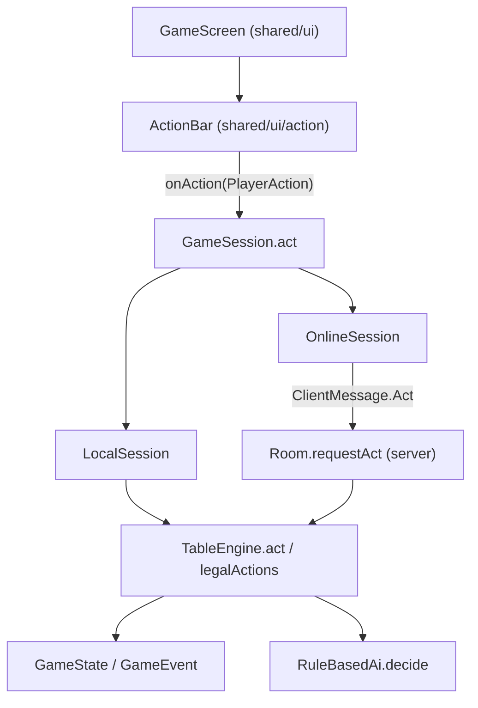
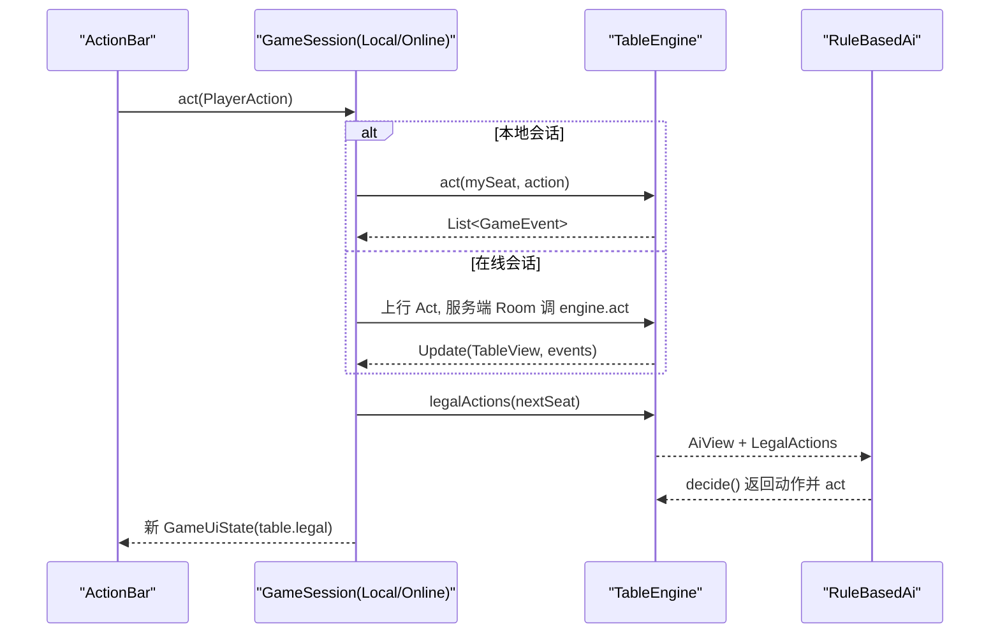
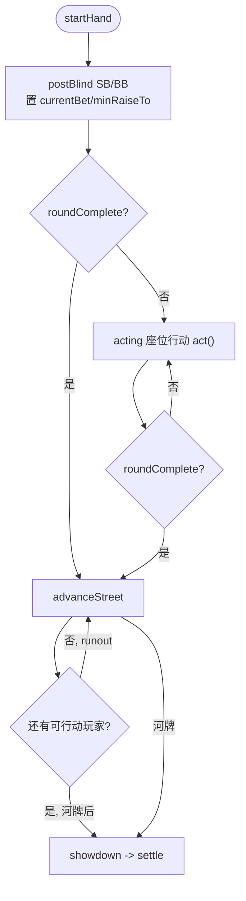
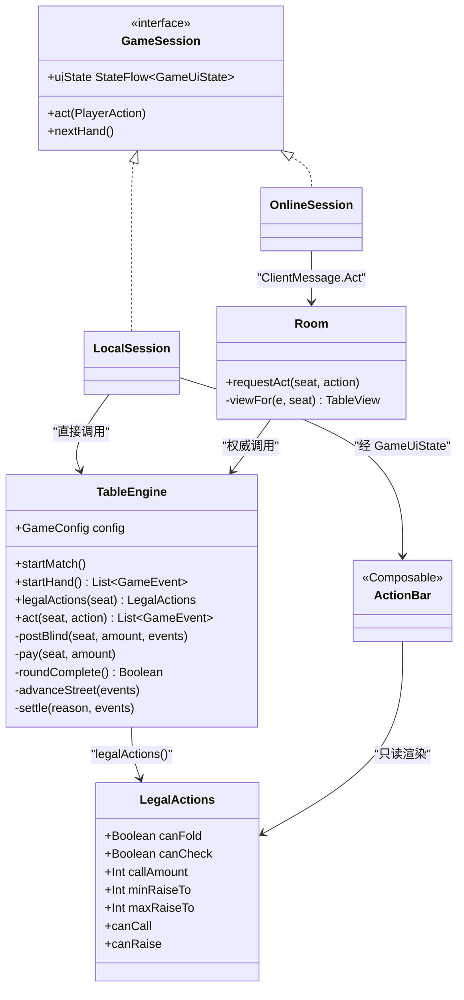

# 下注流程集成

<cite>
**本文引用的文件**
- [TableEngine.kt](file://shared/src/commonMain/kotlin/com/aniapp/pokerdemo/engine/TableEngine.kt)
- [PlayerAction.kt](file://shared/src/commonMain/kotlin/com/aniapp/pokerdemo/engine/PlayerAction.kt)
- [GameState.kt](file://shared/src/commonMain/kotlin/com/aniapp/pokerdemo/engine/GameState.kt)
- [GameEvent.kt](file://shared/src/commonMain/kotlin/com/aniapp/pokerdemo/engine/GameEvent.kt)
- [AiStrategy.kt](file://shared/src/commonMain/kotlin/com/aniapp/pokerdemo/engine/ai/AiStrategy.kt)
- [ActionBar.kt](file://shared/src/commonMain/kotlin/com/aniapp/pokerdemo/ui/action/ActionBar.kt)
- [GameSession.kt](file://shared/src/commonMain/kotlin/com/aniapp/pokerdemo/session/GameSession.kt)
- [LocalSession.kt](file://shared/src/commonMain/kotlin/com/aniapp/pokerdemo/session/LocalSession.kt)
- [OnlineSession.kt](file://shared/src/commonMain/kotlin/com/aniapp/pokerdemo/session/OnlineSession.kt)
- [GameScreen.kt](file://shared/src/commonMain/kotlin/com/aniapp/pokerdemo/ui/GameScreen.kt)
- [Room.kt](file://server/src/main/kotlin/com/aniapp/pokerdemo/server/Room.kt)
</cite>

## 目录
1. [引言](#引言)
2. [项目结构](#项目结构)
3. [核心组件](#核心组件)
4. [架构总览](#架构总览)
5. [详细组件分析](#详细组件分析)
   - [TableEngine 下注 API（GameConfig、postBlind/pay、legalActions、act）](#tableengine-下注-api)
   - [下注回合状态与发牌阶段的推进](#下注回合状态与发牌阶段的推进)
   - [Call/RaiseTo/Fold/Check 对底池与筹码的影响](#callraisetofoldcheck-对底池与筹码的影响)
   - [ActionBar 如何跟随 LegalActions 渲染按钮](#actionbar-如何跟随-legalactions-渲染按钮)
   - [LocalSession 与 OnlineSession 的动作下行链路](#localsession-与-onlinesession-的动作下行链路)
   - [非法动作的两条错误路径](#非法动作的两条错误路径)
6. [二次开发指引](#二次开发指引)
7. [依赖关系分析](#依赖关系分析)
8. [故障排查指南](#故障排查指南)
9. [结论](#结论)
10. [附录：测试建议](#附录测试建议)

## 引言
下注回合不再是一个需要"集成进来"的独立模块：它是 `shared` 引擎层 `TableEngine` 的内建能力。早期文档描述的 `BettingManager`（app 侧 data 层）与 `GameViewModel` 已不存在于当前代码库中，其职责被 `TableEngine`（盲注、下注、回合推进、结算）与 `session` 层的 `LocalSession`/`OnlineSession`（状态发布、AI 驱动、动作校验入口）取代。

本页说明现有链路的实现方式与二次开发方法，覆盖以下内容：
- `TableEngine` 的下注 API：`GameConfig` 盲注配置、`postBlind`/`pay` 资金流转、`legalActions` 合法性计算、`act` 动作执行；
- 发牌流程（`startHand` → `advanceStreet` → `showdown`/`settle`）如何与下注阶段交织；
- UI 层 `ActionBar` 依据 `LegalActions` 渲染合法操作按钮的方式；
- `LocalSession`/`OnlineSession` 经 `GameSession.act` 将玩家动作下行到引擎的路径；
- 非法动作在本地直接抛 `IllegalStateException`、联机回 `illegal_action` 错误的两条处理路径；
- 新增动作类型、扩展按钮与规则时的改动点清单。

## 项目结构
下注链路涉及四个层次，全部位于跨平台 `shared` 模块（服务端复用同一引擎）：
- `shared/engine`：`TableEngine` 维护 `GameState`（阶段、座位、底池、行动者），产出 `GameEvent` 序列；`PlayerAction`/`LegalActions` 定义动作与合法性模型；`ai` 包提供 `AiStrategy.decide(view, legal, random)` 决策接口。
- `shared/session`：`GameSession` 接口 + `GameUiState`；`LocalSession` 内嵌引擎并驱动 AI；`OnlineSession` 通过 WebSocket 收发协议消息。
- `shared/ui`：`GameScreen` 订阅 `uiState` 并把 `session::act` 传给 `ActionBar`；`ActionBar` 仅依据 `LegalActions` 决定按钮可用性。
- `server`：`Room` 持有权威 `TableEngine` 实例，接收 `ClientMessage.Act` 后调用 `engine.act`，失败时回 `ServerMessage.Error("illegal_action", …)`。

图表来源
- [GameScreen.kt:43-136](file://shared/src/commonMain/kotlin/com/aniapp/pokerdemo/ui/GameScreen.kt#L43-L136)
- [ActionBar.kt:42-116](file://shared/src/commonMain/kotlin/com/aniapp/pokerdemo/ui/action/ActionBar.kt#L42-L116)
- [LocalSession.kt:53-67](file://shared/src/commonMain/kotlin/com/aniapp/pokerdemo/session/LocalSession.kt#L53-L67)
- [OnlineSession.kt:125-128](file://shared/src/commonMain/kotlin/com/aniapp/pokerdemo/session/OnlineSession.kt#L125-L128)
- [Room.kt:125-137](file://server/src/main/kotlin/com/aniapp/pokerdemo/server/Room.kt#L125-L137)
- [TableEngine.kt:97-155](file://shared/src/commonMain/kotlin/com/aniapp/pokerdemo/engine/TableEngine.kt#L97-L155)

章节来源
- [TableEngine.kt:1-323](file://shared/src/commonMain/kotlin/com/aniapp/pokerdemo/engine/TableEngine.kt#L1-L323)
- [LocalSession.kt:1-166](file://shared/src/commonMain/kotlin/com/aniapp/pokerdemo/session/LocalSession.kt#L1-L166)
- [Room.kt:1-323](file://server/src/main/kotlin/com/aniapp/pokerdemo/server/Room.kt#L1-L323)

## 核心组件
- **TableEngine**（`shared/engine/TableEngine.kt`）：下注回合的唯一权威实现。构造参数含 `GameConfig(startingChips=2000, smallBlind=10, bigBlind=20)`、2–6 个 `PlayerInit` 座位。对外暴露 `startMatch`、`startHand`、`legalActions(seat)`、`act(seat, action)`；内部私有 `postBlind`、`pay`、`roundComplete`、`advanceStreet`、`showdown`、`settle`。
- **PlayerAction / LegalActions**（`shared/engine/PlayerAction.kt`）：`@Serializable` sealed 动作族 `Fold`/`Check`/`Call`/`RaiseTo(amount)`；`LegalActions(canFold, canCheck, callAmount, minRaiseTo, maxRaiseTo)` 附带派生属性 `canCall = callAmount > 0`、`canRaise = minRaiseTo != null && maxRaiseTo != null`。
- **GameState**（`shared/engine/GameState.kt`）：底池不是独立字段而是不变量派生值——`pot get() = players.sumOf { it.totalCommitted }`；每个座位携带 `streetBet`、`totalCommitted`、`hasActedThisRound`、`raiseReopened`；`Phase.isBetting()` 限定 PREFLOP/FLOP/TURN/RIVER 才可行动。
- **ActionBar**（`shared/ui/action/ActionBar.kt`）：Compose 下注控件，读取 `GameUiState.table.legal` 渲染弃牌/过牌/跟注/加注按钮与加注面板。
- **LocalSession / OnlineSession**（`shared/session`）：实现 `GameSession` 接口。本地路径同步调用引擎并在协程中驱动 AI；联机路径把动作序列化上行、由服务端 `Room` 调引擎并广播视图。

章节来源
- [TableEngine.kt:7-31](file://shared/src/commonMain/kotlin/com/aniapp/pokerdemo/engine/TableEngine.kt#L7-L31)
- [PlayerAction.kt:5-27](file://shared/src/commonMain/kotlin/com/aniapp/pokerdemo/engine/PlayerAction.kt#L5-L27)
- [GameState.kt:9-54](file://shared/src/commonMain/kotlin/com/aniapp/pokerdemo/engine/GameState.kt#L9-L54)
- [GameSession.kt:10-33](file://shared/src/commonMain/kotlin/com/aniapp/pokerdemo/session/GameSession.kt#L10-L33)

## 架构总览
一次完整下注交互的时序如下：UI 点击 → `GameSession.act` → `TableEngine.act`（先 `legalActions` 校验再更新状态）→ 返回 `GameEvent` 列表 → 会话发布新的 `GameUiState`（含 `TableView.legal`）→ `ActionBar` 依据新合法性刷新按钮。回合结束由 `roundComplete()` 触发 `advanceStreet`，直至 `settle` 结算。

图表来源
- [LocalSession.kt:53-104](file://shared/src/commonMain/kotlin/com/aniapp/pokerdemo/session/LocalSession.kt#L53-L104)
- [OnlineSession.kt:95-128](file://shared/src/commonMain/kotlin/com/aniapp/pokerdemo/session/OnlineSession.kt#L95-L128)
- [TableEngine.kt:97-155](file://shared/src/commonMain/kotlin/com/aniapp/pokerdemo/engine/TableEngine.kt#L97-L155)
- [Room.kt:125-137](file://server/src/main/kotlin/com/aniapp/pokerdemo/server/Room.kt#L125-L137)

## 详细组件分析

### TableEngine 下注 API
- **GameConfig**：`startingChips/smallBlind/bigBlind` 三个字段构成盲注与初始筹码配置；`startHand` 用 `config.smallBlind`、`config.bigBlind` 支付盲注，`lastRaiseSize` 每手重置为 `bigBlind`。
- **postBlind(seat, amount, events)**（私有，[TableEngine.kt:176-187](file://shared/src/commonMain/kotlin/com/aniapp/pokerdemo/engine/TableEngine.kt#L176-L187)）：按 `min(amount, chips)` 扣减筹码、累加 `streetBet` 与 `totalCommitted`，若扣完筹码为 0 则标记 `isAllIn`，并追加 `GameEvent.BlindsPosted`。短码不足盲注时自动全下，无需额外分支。
- **pay(seat, amount)**（私有，[TableEngine.kt:189-199](file://shared/src/commonMain/kotlin/com/aniapp/pokerdemo/engine/TableEngine.kt#L189-L199)）：所有 Call/RaiseTo 的资金出口，同样以 `min(amount, chips)` 封顶，保证筹码永不为负。
- **legalActions(seat)**（[TableEngine.kt:86-101](file://shared/src/commonMain/kotlin/com/aniapp/pokerdemo/engine/TableEngine.kt#L86-L101)）：非当前行动者或非下注阶段返回全空的默认 `LegalActions()`。否则计算：`toCall = max(currentBet - streetBet, 0)`；`canFold = true`；`canCheck = toCall == 0`；`callAmount = min(toCall, chips)`（筹码不足时为全下跟注额）；`canRaise` 要求 `streetBet + chips > currentBet` 且（本轮尚未行动或 `raiseReopened`），成立时给出 `minRaiseTo = min(state.minRaiseTo, maxTo)`、`maxRaiseTo = streetBet + chips`。
- **act(seat, action)**（[TableEngine.kt:103-155](file://shared/src/commonMain/kotlin/com/aniapp/pokerdemo/engine/TableEngine.kt#L103-L155)）：先用 `check` 断言阶段可行动与轮次正确，再取 `legalActions(seat)` 对动作做合法性校验（不满足即抛 `IllegalStateException`），执行后若 `roundComplete()` 则清空 `acting` 并 `advanceStreet`，否则 `nextSeat` 轮转给下一个未弃牌且有筹码的座位。

复杂度与不变量：所有动作为 O(座位数) 以内的算术/集合更新；不变量是 `pot == Σ totalCommitted`、`currentBet ≥ 各 streetBet`、`chips ≥ 0`。

章节来源
- [TableEngine.kt:7-10](file://shared/src/commonMain/kotlin/com/aniapp/pokerdemo/engine/TableEngine.kt#L7-L10)
- [TableEngine.kt:86-155](file://shared/src/commonMain/kotlin/com/aniapp/pokerdemo/engine/TableEngine.kt#L86-L155)
- [TableEngine.kt:176-199](file://shared/src/commonMain/kotlin/com/aniapp/pokerdemo/engine/TableEngine.kt#L176-L199)
- [PlayerAction.kt:15-27](file://shared/src/commonMain/kotlin/com/aniapp/pokerdemo/engine/PlayerAction.kt#L15-L27)

### 下注回合状态与发牌阶段的推进
发牌与下注不是两段独立流程，而是由同一个状态机交替驱动：
- `startHand()`（[TableEngine.kt:40-84](file://shared/src/commonMain/kotlin/com/aniapp/pokerdemo/engine/TableEngine.kt#L40-L84)）：校验阶段为 IDLE/HAND_OVER 且存活筹码玩家 ≥ 2；轮换庄家（跳过 0 筹码座位）；每人发两张底牌后立刻 `postBlind(sb)`、`postBlind(bb)`——单挑时小盲即庄家位；随后置 `currentBet = 顶注`、`minRaiseTo = 顶注 + bigBlind`，确定首个行动者（单挑为翻牌前庄家先行动，多人从大盲下家开始）。若盲注后已无人需要回应（如双方盲注即全下），`roundComplete()` 直接命中并 `advanceStreet` 空转跑完公共牌。
- `roundComplete()`（[TableEngine.kt:215-225](file://shared/src/commonMain/kotlin/com/aniapp/pokerdemo/engine/TableEngine.kt#L215-L225)）：仅剩一名未弃牌者、或所有未弃牌者都无筹码可行动（全下）时回合结束；单人可行动时要求其已行动且 `streetBet >= currentBet`；多人时要求全部已行动且 `streetBet == currentBet`。
- `advanceStreet()`（[TableEngine.kt:201-233](file://shared/src/commonMain/kotlin/com/aniapp/pokerdemo/engine/TableEngine.kt#L201-L233)）：重置各座 `streetBet/hasActedThisRound/raiseReopened` 与 `currentBet/minRaiseTo/lastRaiseSize`，burn 一张后发出 3/1/1 张公共牌进入下一街；河牌街直接 `showdown`。当未弃牌且有筹码的玩家 ≤ 1（runout）时不再开启下注，循环继续发牌直到摊牌，事件 `StreetDealt(phase, cards, runout=true)` 通知前端。
- `settle(reason)`（[TableEngine.kt:242-306](file://shared/src/commonMain/kotlin/com/aniapp/pokerdemo/engine/TableEngine.kt#L242-L306)）：先退还 uncalled bet（`UncalledReturned`）；FOLD 结束时底池全额归唯一未弃牌者；SHOWDOWN 时按 `totalCommitted` 分层构建主池/边池，逐层找最大牌型并按从庄家起顺序分配奇数筹码；最后清理 `streetBet/totalCommitted`，判定淘汰与对局结束（`MATCH_OVER`/`HAND_OVER`），产出 `PotAwarded`、`HandFinished`、`MatchFinished` 等事件。

图表来源
- [TableEngine.kt:40-84](file://shared/src/commonMain/kotlin/com/aniapp/pokerdemo/engine/TableEngine.kt#L40-L84)
- [TableEngine.kt:144-233](file://shared/src/commonMain/kotlin/com/aniapp/pokerdemo/engine/TableEngine.kt#L144-L233)
- [TableEngine.kt:236-306](file://shared/src/commonMain/kotlin/com/aniapp/pokerdemo/engine/TableEngine.kt#L236-L306)

章节来源
- [GameEvent.kt:8-26](file://shared/src/commonMain/kotlin/com/aniapp/pokerdemo/engine/GameEvent.kt#L8-L26)

### Call/RaiseTo/Fold/Check 对底池与筹码的影响
以下均出自 `act` 的 when 分支（[TableEngine.kt:110-146](file://shared/src/commonMain/kotlin/com/aniapp/pokerdemo/engine/TableEngine.kt#L110-L146)）：

- **Fold**：标记 `isFolded` 与 `hasActedThisRound`；已投入的 `totalCommitted` 留在池中不退还。若只剩一名竞争者，立即清空 `acting` 并以 `EndReason.FOLD` 结算整手（不等回合自然结束）。
- **Check**：仅当 `legal.canCheck`（`toCall == 0`）合法，否则抛"面对下注不能过牌"；只置 `hasActedThisRound`，不动资金。
- **Call**：仅当 `legal.canCall`（`callAmount > 0`）合法，否则抛"无需跟注"（此时应 Check）；`pay(seat, callAmount)` 补齐差额。因 `callAmount = min(toCall, chips)`，筹码不足会自动变成全下跟注而不会失败——这就是"筹码不足"场景的处理方式：**引擎不做自动 Fold，而是允许 all-in 跟注**，剩余差额在结算时作为 uncalled bet 退还。
- **RaiseTo(amount)**：要求 `legal.canRaise` 且 `amount ∈ [minRaiseTo, maxRaiseTo]`，否则抛"当前不能加注"/"加注额非法"。执行时 `pay(amount - streetBet)`；若 `amount >= state.minRaiseTo` 视为满额加注：更新 `lastRaiseSize = amount - prevBet`、`currentBet = amount`、`minRaiseTo = amount + lastRaiseSize`，并对其他未弃牌、非全下的玩家置 `raiseReopened = true`（重新开放其再加注权）；不足满额的 all-in 加注不重开行动，也不改变 `lastRaiseSize`。

底池影响统一体现为 `totalCommitted` 增加（`pot` 派生自求和）；筹码影响统一体现为 `chips` 减少且可能触发 `isAllIn`。

章节来源
- [TableEngine.kt:86-146](file://shared/src/commonMain/kotlin/com/aniapp/pokerdemo/engine/TableEngine.kt#L86-L146)
- [TableEngine.kt:242-260](file://shared/src/commonMain/kotlin/com/aniapp/pokerdemo/engine/TableEngine.kt#L242-L260)

### ActionBar 如何跟随 LegalActions 渲染按钮
`ActionBar(ui, onAction)`（[ActionBar.kt:42-116](file://shared/src/commonMain/kotlin/com/aniapp/pokerdemo/ui/action/ActionBar.kt#L42-L116)）不含任何规则判断，只读 `ui.legal`（即 `table.legal`，由 `toTableView`/`viewFor` 填入引擎 `legalActions(mySeat)` 的结果）：
- 总开关 `enabled = ui.isPlayerTurn && !ui.aiThinking`；`GameUiState.isPlayerTurn` 定义为 `table.acting == table.mySeat && table.phase.isBetting()`。
- **弃牌**按钮始终存在但 `enabled && legal.canFold` 才可用；**过牌/跟注**互斥展示：`legal.canCheck` 时显示"过牌"，否则显示"跟注 N"，且当 `callAmount >= me.chips` 时文案变为"跟注全下"；**加注**按钮 `enabled && legal.canRaise` 才可用。
- 展开的 `RaisePanel`（[ActionBar.kt:119-190](file://shared/src/commonMain/kotlin/com/aniapp/pokerdemo/ui/action/ActionBar.kt#L119-L190)）以 `minRaiseTo..maxRaiseTo` 为滑块区间、以 `bigBlind` 为步长对齐，快捷按钮按 `currentBet + (pot + toCall) * fraction` 估算后 `coerceIn(min, max)`；确认时发出 `PlayerAction.RaiseTo(raiseTo)`。
- `LaunchedEffect` 在轮到玩家/阶段/`currentBet`/手数变化时收起加注面板，避免陈旧输入。

因此按钮与服务端/引擎合法性天然一致：前端不需要重复校验，误触非法动作会走下文的两条错误路径。

章节来源
- [ActionBar.kt:42-190](file://shared/src/commonMain/kotlin/com/aniapp/pokerdemo/ui/action/ActionBar.kt#L42-L190)
- [GameSession.kt:20-21](file://shared/src/commonMain/kotlin/com/aniapp/pokerdemo/session/GameSession.kt#L20-L21)
- [LocalSession.kt:129-165](file://shared/src/commonMain/kotlin/com/aniapp/pokerdemo/session/LocalSession.kt#L129-L165)

### LocalSession 与 OnlineSession 的动作下行链路
- **GameSession 接口**（[GameSession.kt:27-33](file://shared/src/commonMain/kotlin/com/aniapp/pokerdemo/session/GameSession.kt#L27-L33)）：`uiState: StateFlow<GameUiState>`、`act(PlayerAction)`、`nextHand()`、`newMatch()`、`dispose()`。`GameScreen` 通过 `session.uiState.collectAsState()` 订阅、以 `ActionBar(ui = ui, onAction = session::act)` 接线（[GameScreen.kt:43-136](file://shared/src/commonMain/kotlin/com/aniapp/pokerdemo/ui/GameScreen.kt#L43-L136)）。
- **LocalSession**（[LocalSession.kt:53-104](file://shared/src/commonMain/kotlin/com/aniapp/pokerdemo/session/LocalSession.kt#L53-L104)）：`act` 先检查 `isPlayerTurn` 再同步调 `engine.act(mySeat, action)`，`publish(events)` 重建 `GameUiState`（含 `toTableView(mySeat)` 匿藏他人底牌的视图与盲注配置），随后 `maybeStartAi()` 在协程中以 700–1400ms 随机延迟逐个驱动 AI：每步取 `engine.legalActions(s)` 组成 `AiView`，交给 `RuleBasedAi.decide` 后再 `engine.act`。
- **OnlineSession**（[OnlineSession.kt:95-142](file://shared/src/commonMain/kotlin/com/aniapp/pokerdemo/session/OnlineSession.kt#L95-L142)）：`act` 同样先本地短路 `isPlayerTurn`，然后发送 `ClientMessage.Act(action)`；收到 `ServerMessage.Update` 时直接用服务端下发的 `TableView`（其中 `legal` 已由服务端计算）。
- **Room（服务端）**（[Room.kt:125-137](file://server/src/main/kotlin/com/aniapp/pokerdemo/server/Room.kt#L125-L137)、[Room.kt:257-317](file://server/src/main/kotlin/com/aniapp/pokerdemo/server/Room.kt#L257-L317)）：`requestAct` 在互斥锁内把房间座位映射为引擎座位（`seatMap.indexOf(seat)`），调用 `e.act(eSeat, action)` 后 `broadcastUpdate(events)` 向每位人类玩家发送按其座位脱敏的 `viewFor`；若阶段离开下注则 `endHand()` 释放 AI/断线座位，否则继续 `maybeAiLoop()`。

章节来源
- [LocalSession.kt:27-166](file://shared/src/commonMain/kotlin/com/aniapp/pokerdemo/session/LocalSession.kt#L27-L166)
- [OnlineSession.kt:95-142](file://shared/src/commonMain/kotlin/com/aniapp/pokerdemo/session/OnlineSession.kt#L95-L142)
- [Room.kt:63-317](file://server/src/main/kotlin/com/aniapp/pokerdemo/server/Room.kt#L63-L317)

### 非法动作的两条错误路径
同一条 `TableEngine.act` 校验逻辑（`check(...)` 抛出 `IllegalStateException`，消息如"当前阶段不可行动"“未轮到座位 X 行动”“面对下注不能过牌”“无需跟注”“当前不能加注”“加注额非法: N”），在两种部署形态下走不同路径：

1. **本地路径**：`LocalSession.act` 直接调用 `engine.act`，异常原样向上抛出，由调用方（当前主要是测试与 AI 循环的内部一致性保证）感知。由于 `ActionBar` 只在 `legal.*` 为真时启用按钮、`act` 又先判 `isPlayerTurn`，正常 UI 操作不会触发；该异常充当引擎不变量的兜底断言。
2. **联机路径**：客户端可能伪造或过期地发送 `Act`。`Room.requestAct` 用 `try/catch (ex: IllegalStateException)` 捕获，回 `sendError(seat, "illegal_action", ex.message)`，即 `ServerMessage.Error(code="illegal_action")`，且不改变游戏状态、不广播。`OnlineSession` 收到 Error 后：加入类错误码终止流程，其余（含 `illegal_action`）写入 `_error` StateFlow 供 UI 提示，可通过 `clearError()` 清除。此外座位不在 `seatMap`（如未参与本手）时回 `not_in_hand`，非房主开始回 `not_host`。

章节来源
- [TableEngine.kt:97-135](file://shared/src/commonMain/kotlin/com/aniapp/pokerdemo/engine/TableEngine.kt#L97-L135)
- [Room.kt:125-137](file://server/src/main/kotlin/com/aniapp/pokerdemo/server/Room.kt#L125-L137)
- [Room.kt:320-323](file://server/src/main/kotlin/com/aniapp/pokerdemo/server/Room.kt#L320-L323)
- [OnlineSession.kt:106-119](file://shared/src/commonMain/kotlin/com/aniapp/pokerdemo/session/OnlineSession.kt#L106-L119)

## 二次开发指引
围绕现有链路扩展下注能力时的改动点：

**新增动作类型（例如 Straddle、Bring-in）**
1. 在 `PlayerAction` sealed 接口中新增 `@Serializable` 变体（[PlayerAction.kt:5-14](file://shared/src/commonMain/kotlin/com/aniapp/pokerdemo/engine/PlayerAction.kt#L5-L14)）。sealed + kotlinx.serialization 使协议编解码自动生效，但需确认 `Protocol.kt` 中若有动作白名单/校验也同步放行。
2. 在 `LegalActions` 中补充对应合法性字段（如 `canStraddle`），并在 `TableEngine.legalActions` 里按规则填充。
3. 在 `TableEngine.act` 的 `when (action)` 中新增分支：完成资金走 `pay`/`postBlind` 语义、设置 `hasActedThisRound`、必要时调整 `currentBet/minRaiseTo/lastRaiseSize`；分支必须穷尽，编译器会强制你处理，这是防止遗漏的关键机制。
4. 若动作影响回合终止条件，更新 `roundComplete()`；若仅在特定街合法，用 `state.phase` 约束。
5. `ActionBar` 增加按钮并以 `enabled && legal.canXxx` 门控；AI 侧扩展 `AiStrategy.decide` 的返回域与 `RuleBasedAi` 策略（[AiStrategy.kt:21-23](file://shared/src/commonMain/kotlin/com/aniapp/pokerdemo/engine/ai/AiStrategy.kt#L21-L23)）。
6. 服务端无需单独改动——`Room.requestAct` 透传反序列化后的 `PlayerAction` 给引擎，非法即回 `illegal_action`。

**让 ActionBar 跟随新的 LegalActions 字段**：保持"UI 零规则"原则——所有条件写进 `TableEngine.legalActions`，`ActionBar` 只做 `legal.xxx` 真值判断与金额展示；新增展示金额优先取自 `ui.table`（`currentBet`、`pot`、`me.chips`），不要在前端复算规则。

**保持兼容性**：`startHand` 的发牌与盲注顺序、`advanceStreet` 的街推进、`settle` 的分池算法是相互咬合的：新增动作若产生额外下注，务必通过 `pay` 走统一的 `streetBet/totalCommitted/isAllIn` 更新路径，切勿绕过它直接改 `chips`，否则会破坏 `pot == Σ totalCommitted` 不变量与 uncalled bet 退还逻辑。

## 依赖关系分析
- `TableEngine` 依赖 `Deck`、`HandEvaluator`、`GameState/GameEvent/PlayerAction` 模型，不依赖任何 UI 或网络类型；
- `LocalSession` 组合 `TableEngine + RuleBasedAi`，产出 `GameUiState`；`toTableView(mySeat)` 负责按视角隐藏对手底牌（仅摊牌时揭示未弃牌者）；
- `Room` 在服务端复用同一个 `TableEngine`，通过 `seatMap` 处理关 AI 补位后的稀疏座位映射，`viewFor` 做逐座位脱敏；
- `ActionBar` 仅依赖 `GameUiState`/`LegalActions`/`PlayerAction`；`GameScreen` 仅依赖 `GameSession` 抽象，本地与在线可互换。

图表来源
- [TableEngine.kt:12-155](file://shared/src/commonMain/kotlin/com/aniapp/pokerdemo/engine/TableEngine.kt#L12-L155)
- [PlayerAction.kt:15-27](file://shared/src/commonMain/kotlin/com/aniapp/pokerdemo/engine/PlayerAction.kt#L15-L27)
- [LocalSession.kt:27-67](file://shared/src/commonMain/kotlin/com/aniapp/pokerdemo/session/LocalSession.kt#L27-L67)
- [Room.kt:125-137](file://server/src/main/kotlin/com/aniapp/pokerdemo/server/Room.kt#L125-L137)
- [ActionBar.kt:42-52](file://shared/src/commonMain/kotlin/com/aniapp/pokerdemo/ui/action/ActionBar.kt#L42-L52)

## 故障排查指南
- **底池与筹码之和不符**：检查是否绕过了 `pay/postBlind` 修改 `chips`；`GameState.pot` 是 `Σ totalCommitted` 的派生值，任何手工加池都会破坏 uncalled 退还与边池分层。
- **回合不推进（卡在某一街）**：核对 `hasActedThisRound` 是否在所有可行动者上置位、`streetBet == currentBet` 是否成立；all-in 玩家不计入 `actionable`，若全员全下应由 `roundComplete` 的空 actionable 分支走 runout。
- **加注后对手无法再加注**：区分满额加注与不足额 all-in 加注——只有 `amount >= state.minRaiseTo` 才会给其他人置 `raiseReopened`；短码 all-in 不重开行动是预期行为。
- **联机报"非法动作"**：查看 `ServerMessage.Error.code == "illegal_action"` 的 message（源自引擎 check 文本），通常是客户端视图过期（`legal` 已被新一轮 Update 替换前误点）；UI 应将错误提示为非阻塞 toast 并等待下一次 `Update`。
- **本地崩溃 IllegalStateException**：说明有调用方未经 `legalActions` 校验直接 `act`；修复点在调用侧而非放宽引擎断言。
- **按钮全灰**：确认 `isPlayerTurn`（`acting == mySeat && phase.isBetting()`）与 `aiThinking` 状态；AI 循环运行期间 `aiThinking=true` 会禁用整个操作栏。

## 结论
下注回合已内建于 `TableEngine`：`GameConfig` 提供盲注，`startHand` 完成发牌+收盲+定序，`legalActions/act` 承担合法性与资金流转，`roundComplete/advanceStreet/settle` 驱动街推进与分池结算。UI 侧 `ActionBar` 严格只读 `LegalActions`，会话层 `LocalSession`/`OnlineSession` 经 `GameSession.act` 分别走"本地直调引擎（非法即抛异常）"与"服务端权威执行（非法回 `illegal_action`）"两条路径。二次开发只需沿 PlayerAction → LegalActions → act 分支 → ActionBar/AI 的顺序扩展，即可在不触碰发牌与结算主干的前提下增加新下注能力。

## 附录：测试建议
仓库已有覆盖，新增功能时按同样维度补充：
- **引擎单测**（`shared/commonTest` 的 `HeadsUpTableEngineTest`/`MultiPlayerTableEngineTest`）：盲注与 uncalled 退还（`sbFoldReturnsUncalledToBigBlind`、`excessAllInIsRefunded`）、最小加注推进（`minRaiseProgression`）、满额加注重开行动 vs 短码 all-in 不重开（`fullRaiseReopensForAllActedPlayers`、`shortAllInDoesNotReopenAction`）、多人边池分层（`fourWayAllInCreatesThreeLayerSidePots`）、非法动作抛异常（`illegalActionsThrow`）、筹码守恒压力测试（`chipConservationStress500Hands`、`chipConservationStressMultiPlayer`）。
- **会话/端到端**（`server/test` 的 `RoomFlowTest`）：加入-隐藏信息-弃牌全流程（`createJoinHiddenInfoAndFold`）、非法动作与非房主开始的错误码断言（`illegalActionAndNonHostStartReturnError` 校验 `code == "illegal_action"`）、AI 补位自动行动、断线转 AI。
- **新增动作类型时建议补充**：该动作在各 `Phase` 的合法性矩阵、对 `roundComplete` 的影响、all-in 边界（金额被 `min(amount, chips)` 截断）、序列化往返（`PlayerAction`/`LegalActions` 均为 `@Serializable`）、以及联机路径下伪造该动作仍得到 `illegal_action` 而非状态变更。

章节来源
- [HeadsUpTableEngineTest.kt:18-224](file://shared/src/commonTest/kotlin/com/aniapp/pokerdemo/engine/HeadsUpTableEngineTest.kt#L18-L224)
- [MultiPlayerTableEngineTest.kt:27-245](file://shared/src/commonTest/kotlin/com/aniapp/pokerdemo/engine/MultiPlayerTableEngineTest.kt#L27-L245)
- [RoomFlowTest.kt:54-167](file://server/src/test/kotlin/com/aniapp/pokerdemo/server/RoomFlowTest.kt#L54-L167)