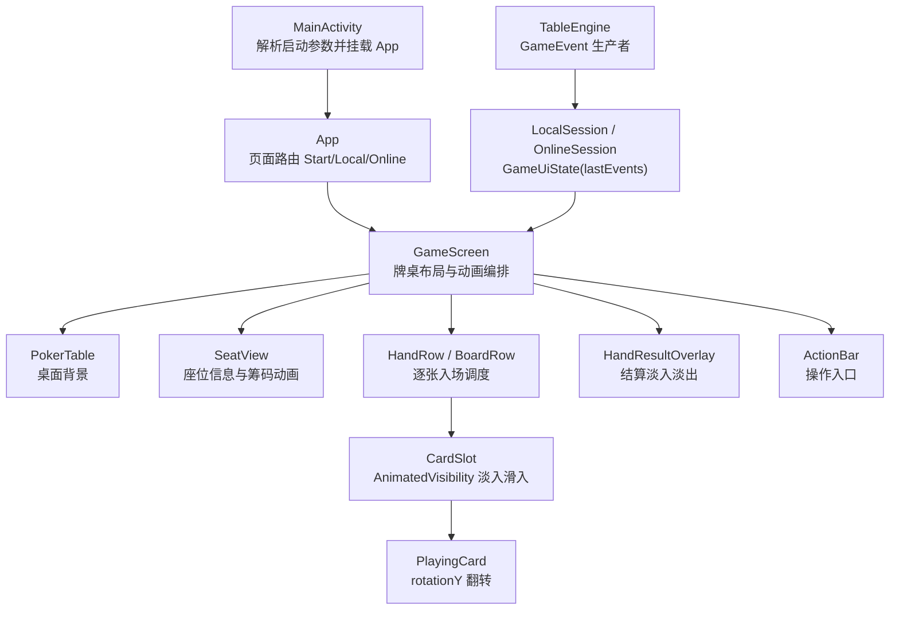
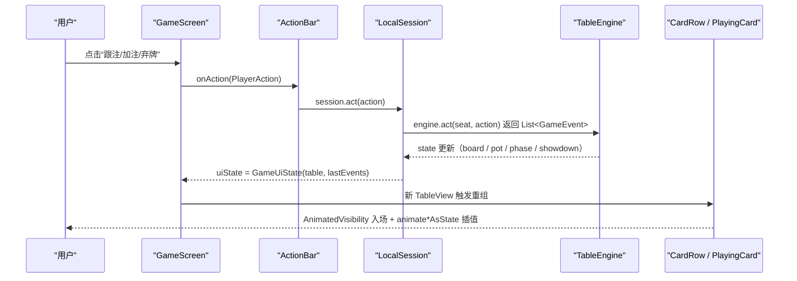
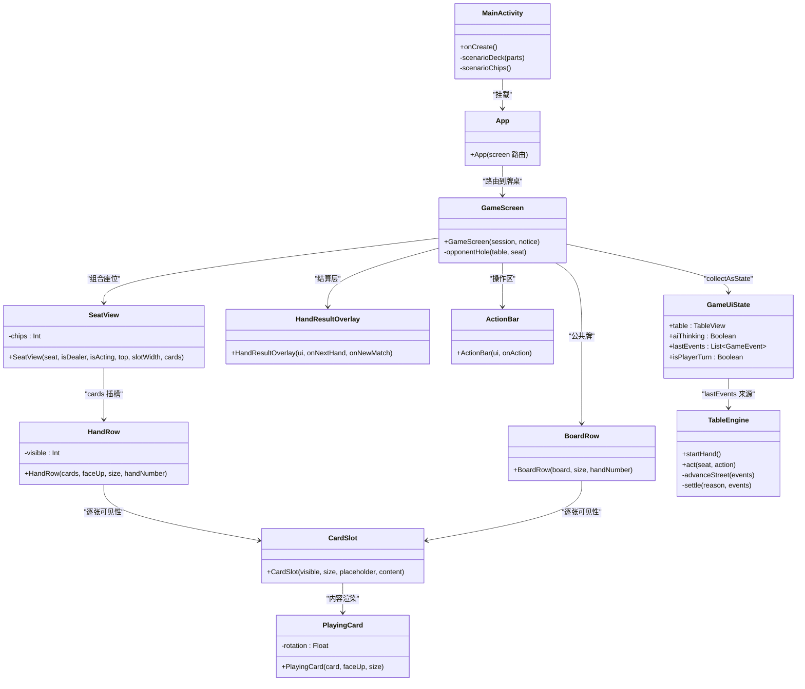

# 动画过渡效果

<cite>
**本文引用的文件**
- [shared/src/commonMain/kotlin/com/aniapp/pokerdemo/ui/card/PlayingCard.kt](file://shared/src/commonMain/kotlin/com/aniapp/pokerdemo/ui/card/PlayingCard.kt)
- [shared/src/commonMain/kotlin/com/aniapp/pokerdemo/ui/card/CardRow.kt](file://shared/src/commonMain/kotlin/com/aniapp/pokerdemo/ui/card/CardRow.kt)
- [shared/src/commonMain/kotlin/com/aniapp/pokerdemo/ui/table/SeatView.kt](file://shared/src/commonMain/kotlin/com/aniapp/pokerdemo/ui/table/SeatView.kt)
- [shared/src/commonMain/kotlin/com/aniapp/pokerdemo/ui/overlay/HandResultOverlay.kt](file://shared/src/commonMain/kotlin/com/aniapp/pokerdemo/ui/overlay/HandResultOverlay.kt)
- [shared/src/commonMain/kotlin/com/aniapp/pokerdemo/ui/GameScreen.kt](file://shared/src/commonMain/kotlin/com/aniapp/pokerdemo/ui/GameScreen.kt)
- [shared/src/commonMain/kotlin/com/aniapp/pokerdemo/ui/action/ActionBar.kt](file://shared/src/commonMain/kotlin/com/aniapp/pokerdemo/ui/action/ActionBar.kt)
- [shared/src/commonMain/kotlin/com/aniapp/pokerdemo/ui/start/StartScreen.kt](file://shared/src/commonMain/kotlin/com/aniapp/pokerdemo/ui/start/StartScreen.kt)
- [shared/src/commonMain/kotlin/com/aniapp/pokerdemo/ui/App.kt](file://shared/src/commonMain/kotlin/com/aniapp/pokerdemo/ui/App.kt)
- [shared/src/commonMain/kotlin/com/aniapp/pokerdemo/engine/GameEvent.kt](file://shared/src/commonMain/kotlin/com/aniapp/pokerdemo/engine/GameEvent.kt)
- [shared/src/commonMain/kotlin/com/aniapp/pokerdemo/engine/TableEngine.kt](file://shared/src/commonMain/kotlin/com/aniapp/pokerdemo/engine/TableEngine.kt)
- [shared/src/commonMain/kotlin/com/aniapp/pokerdemo/session/GameSession.kt](file://shared/src/commonMain/kotlin/com/aniapp/pokerdemo/session/GameSession.kt)
- [shared/src/commonMain/kotlin/com/aniapp/pokerdemo/session/LocalSession.kt](file://shared/src/commonMain/kotlin/com/aniapp/pokerdemo/session/LocalSession.kt)
- [shared/src/commonMain/kotlin/com/aniapp/pokerdemo/net/Protocol.kt](file://shared/src/commonMain/kotlin/com/aniapp/pokerdemo/net/Protocol.kt)
</cite>

## 目录
1. [引言](#引言)
2. [动画落点：从 app 到 shared/ui](#动画落点从-app-到-sharedui)
3. [可动画的事件时机清单](#可动画的事件时机清单)
4. [项目结构与组件职责](#项目结构与组件职责)
5. [架构总览](#架构总览)
6. [详细场景分析](#详细场景分析)
   - [发牌动画：手牌逐张入场](#发牌动画手牌逐张入场)
   - [翻牌动画：公共牌逐步展开](#翻牌动画公共牌逐步展开)
   - [摊牌动画：对手手牌的翻转展示](#摊牌动画对手手牌的翻转展示)
   - [结果提示动画：结算遮罩的淡入淡出](#结果提示动画结算遮罩的淡入淡出)
   - [数值与状态反馈动画](#数值与状态反馈动画)
   - [按钮交互反馈](#按钮交互反馈)
   - [状态转换动画：界面阶段切换](#状态转换动画界面阶段切换)
7. [依赖关系分析](#依赖关系分析)
8. [性能与可访问性](#性能与可访问性)
9. [故障排查指南](#故障排查指南)
10. [结论](#结论)

## 引言
本指南面向在德州扑克 Compose 界面中实现流畅动画的开发者。项目的 UI 代码已统一收敛到 `shared` 模块的 `com.aniapp.pokerdemo.ui` 包，跨 Android、Desktop 复用同一套动画实现。围绕六个关键交互场景——发牌入场、公共牌逐步展开、摊牌翻转、结算提示、按钮/数值反馈、阶段过渡——文档基于当前实现说明触发链路、参数选择与可扩展点，并给出 `AnimatedVisibility`、`animate*AsState`、`fadeIn/slideInHorizontally` 等 API 的实际用法、性能优化与可访问性建议。

## 动画落点：从 app 到 shared/ui
早期草稿把动画讨论定位在 Android `app` 模块的 `GameScreen`/`CardRow`/`CardView`/`CardViewBack`/`GameViewModel` 上。这些文件在当前版本已不存在：`app` 模块只保留 `MainActivity`，它负责解析启动参数（scenario/chips）、注入主题并把共享的 `App` 挂载起来，不再持有牌局状态或卡牌渲染逻辑。

现在动画的实现落点是：

- **牌面翻转与发牌出现效果**：`ui/card/PlayingCard.kt`（3D 绕 Y 轴翻转）与 `ui/card/CardRow.kt`（`HandRow`/`BoardRow` 的逐张延迟入场）。
- **座位与手牌的进出场**：`ui/table/SeatView.kt`（弃牌半透明、筹码数值滚动、行动高亮边框），配合 `GameScreen` 中传入的 `cards` 插槽渲染 `HandRow`。
- **结算展示**：`ui/overlay/HandResultOverlay.kt`（整手/整场结果的淡入淡出遮罩）。
- **驱动源**：`GameUiState.lastEvents`（`List<GameEvent>`）以及由事件更新后的 `TableView` 快照字段（`board`、`revealedHoles`、`pot`、`phase`、`handNumber`、`seats`）。

因此旧稿中两处表述已不适用，需要修正：

1. **“以 `showComputerCards` 布尔切换控制电脑手牌显隐”**：该布尔量随 `GameViewModel` 一起删除。当前是 `TableView.revealedHoles`（仅在 `TableEngine` 进入摊牌后填充）决定 `faceUp`，未摊牌的对手手牌以 `listOf(null, null)` 的背面形式常驻显示，翻转由 `PlayingCard` 内部完成，而不是区域级的显示/隐藏切换。
2. **“`CardRow` 使用 `FlowRow` 重排导致布局跳动”**：当前 `CardRow.kt` 使用固定数量（手牌 2 槽、公共牌 5 槽）的 `Row` + 预占尺寸的 `CardSlot`，牌数变化不会引发布局重排；入场动效来自 `AnimatedVisibility` 的淡入+水平滑入，而非列表重排动画。

**章节来源**
- [app/src/main/java/com/aniapp/pokerdemo/MainActivity.kt:23-48](file://app/src/main/java/com/aniapp/pokerdemo/MainActivity.kt#L23-L48)
- [shared/src/commonMain/kotlin/com/aniapp/pokerdemo/ui/GameScreen.kt:56-127](file://shared/src/commonMain/kotlin/com/aniapp/pokerdemo/ui/GameScreen.kt#L56-L127)
- [shared/src/commonMain/kotlin/com/aniapp/pokerdemo/session/LocalSession.kt:135-165](file://shared/src/commonMain/kotlin/com/aniapp/pokerdemo/session/LocalSession.kt#L135-L165)

## 可动画的事件时机清单
`GameEvent` 是一次状态发布（本地为 `LocalSession.publish`，联机为 `ServerMessage.Update`）携带的增量事实；UI 侧既可以按“新事件到达”做一次性动效，也可以读取事件落地后的 `TableView` 派生状态做持续性动画。

| GameEvent | 产生位置 | 对应可动画时机 | 当前落点 |
|---|---|---|---|
| `BlindsPosted(seat, amount)` | [TableEngine.kt:174](file://shared/src/commonMain/kotlin/com/aniapp/pokerdemo/engine/TableEngine.kt#L174) | 盲注筹码飞入底池、下注条出现 | `SeatView` 的 `BetChips`（尚未做飞行轨迹） |
| `HoleCardsDealt` | [TableEngine.kt:66](file://shared/src/commonMain/kotlin/com/aniapp/pokerdemo/engine/TableEngine.kt#L66) | 各座位手牌逐张飞入 | `HandRow` 的 `visible` 递增 + `CardSlot` 淡入滑入 |
| `ActionTaken(seat, action)` | [TableEngine.kt:110](file://shared/src/commonMain/kotlin/com/aniapp/pokerdemo/engine/TableEngine.kt#L110)、[TableEngine.kt:145](file://shared/src/commonMain/kotlin/com/aniapp/pokerdemo/engine/TableEngine.kt#L145) | 行动者金框切换、弃牌座位变暗、跟注/加注筹码增加 | `SeatView` 的 `isActing` 边框、`alpha(folded)`、`animateIntAsState(chips)` |
| `StreetDealt(phase, newCards, isRunout)` | [TableEngine.kt:230](file://shared/src/commonMain/kotlin/com/aniapp/pokerdemo/engine/TableEngine.kt#L230) | 新增公共牌依次入场；`isRunout=true` 时一次连续发出多张 | `BoardRow` 按 `board.size` 逐张推进 `visible` |
| `UncalledReturned(seat, amount)` | [TableEngine.kt:251](file://shared/src/commonMain/kotlin/com/aniapp/pokerdemo/engine/TableEngine.kt#L251) | 退回筹码的反向位移动画 | 目前仅体现为筹码数值滚动 |
| `ShowdownRevealed` | [TableEngine.kt:237](file://shared/src/commonMain/kotlin/com/aniapp/pokerdemo/engine/TableEngine.kt#L237) | 对手手牌背面翻成正面 | `faceUp = revealedHoles.containsKey(seat)` → `PlayingCard` 翻转 |
| `PotAwarded(potIndex, winners, amount)` | [TableEngine.kt:262](file://shared/src/commonMain/kotlin/com/aniapp/pokerdemo/engine/TableEngine.kt#L262)、[TableEngine.kt:298](file://shared/src/commonMain/kotlin/com/aniapp/pokerdemo/engine/TableEngine.kt#L298) | 底池金额滚动、彩池分给获胜座位的移动动画 | `GameScreen` 的 `animateIntAsState(pot)` |
| `PlayerEliminated(seat)` | [TableEngine.kt:304](file://shared/src/commonMain/kotlin/com/aniapp/pokerdemo/engine/TableEngine.kt#L304) | 淘汰座位淡出/离场 | 尚未实现（座位仍保留在列表中） |
| `HandFinished(result)` | [TableEngine.kt:309](file://shared/src/commonMain/kotlin/com/aniapp/pokerdemo/engine/TableEngine.kt#L309) | 结算遮罩淡入 | `HandResultOverlay` 的 `AnimatedVisibility` |
| `MatchFinished(winner)` | [TableEngine.kt:311](file://shared/src/commonMain/kotlin/com/aniapp/pokerdemo/engine/TableEngine.kt#L311) | 比赛结束文案与“再来一局”入口 | `HandResultOverlay` 的 `MATCH_OVER` 分支 |

需要注意：事件本身不直接驱动动画属性，而是先由引擎改写 `state`，再由 `toTableView`/`Update` 生成新的 `TableView`，UI 依据新快照中的目标值让 `animate*AsState`、`AnimatedVisibility` 自行插值。`lastEvents` 更适合用于“只在事件到达时播放一次”的效果（例如筹码飞行、音效、飘字），这类需求可用 `LaunchedEffect(ui.lastEvents)` 消费事件队列。

**章节来源**
- [shared/src/commonMain/kotlin/com/aniapp/pokerdemo/engine/GameEvent.kt:6-26](file://shared/src/commonMain/kotlin/com/aniapp/pokerdemo/engine/GameEvent.kt#L6-L26)
- [shared/src/commonMain/kotlin/com/aniapp/pokerdemo/engine/TableEngine.kt:220-312](file://shared/src/commonMain/kotlin/com/aniapp/pokerdemo/engine/TableEngine.kt#L220-L312)
- [shared/src/commonMain/kotlin/com/aniapp/pokerdemo/session/GameSession.kt:10-25](file://shared/src/commonMain/kotlin/com/aniapp/pokerdemo/session/GameSession.kt#L10-L25)
- [shared/src/commonMain/kotlin/com/aniapp/pokerdemo/session/LocalSession.kt:70-78](file://shared/src/commonMain/kotlin/com/aniapp/pokerdemo/session/LocalSession.kt#L70-L78)

## 项目结构与组件职责
- 视图层（`shared/ui`）
  - `GameScreen`：牌桌布局根节点，用 `BoxWithConstraints` 计算 `CardSize`，摆放对手 `SeatView`、公共牌 `BoardRow`、玩家 `SeatView`、底池文本、`ActionBar` 与 `HandResultOverlay`。
  - `ui/card/PlayingCard`：单张牌的正反面与 3D 翻转；`CardFace`/`CardBack` 为其私有渲染分支（不再有独立的 `CardView`/`CardViewBack` 组件）。
  - `ui/card/CardRow`：`HandRow`（2 槽）与 `BoardRow`（5 槽）+ 共用的 `CardSlot`、`EmptySlot` 占位。
  - `ui/table/SeatView`：座位信息行、庄家按钮、全下/托管角标、街注筹码堆。
  - `ui/overlay/HandResultOverlay`：一手/一场结束的模态结算层。
  - `ui/action/ActionBar`：弃牌/过牌-跟注/加注入口与加注面板。
  - `ui/start/StartScreen`：入口页淡入上浮动画。
- 状态层（`shared/session`）
  - `GameUiState`：`table` + `aiThinking` + `lastEvents` + 盲注/房间信息；`LocalSession`/`OnlineSession` 通过 `StateFlow` 发布。
- 引擎层（`shared/engine`）
  - `TableEngine`：产出 `GameEvent` 列表并维护 `Phase`、`board`、`showdown`、`result` 等；`GameState` 定义 `IDLE/PREFLOP/FLOP/TURN/RIVER/SHOWDOWN/HAND_OVER/MATCH_OVER`。

**图表来源**
- [shared/src/commonMain/kotlin/com/aniapp/pokerdemo/ui/App.kt:52-127](file://shared/src/commonMain/kotlin/com/aniapp/pokerdemo/ui/App.kt#L52-L127)
- [shared/src/commonMain/kotlin/com/aniapp/pokerdemo/ui/GameScreen.kt:44-143](file://shared/src/commonMain/kotlin/com/aniapp/pokerdemo/ui/GameScreen.kt#L44-L143)
- [shared/src/commonMain/kotlin/com/aniapp/pokerdemo/ui/card/CardRow.kt:26-108](file://shared/src/commonMain/kotlin/com/aniapp/pokerdemo/ui/card/CardRow.kt#L26-L108)
- [shared/src/commonMain/kotlin/com/aniapp/pokerdemo/session/LocalSession.kt:70-96](file://shared/src/commonMain/kotlin/com/aniapp/pokerdemo/session/LocalSession.kt#L70-L96)

**章节来源**
- [shared/src/commonMain/kotlin/com/aniapp/pokerdemo/ui/GameScreen.kt:44-143](file://shared/src/commonMain/kotlin/com/aniapp/pokerdemo/ui/GameScreen.kt#L44-L143)
- [shared/src/commonMain/kotlin/com/aniapp/pokerdemo/ui/card/CardRow.kt:26-108](file://shared/src/commonMain/kotlin/com/aniapp/pokerdemo/ui/card/CardRow.kt#L26-L108)
- [shared/src/commonMain/kotlin/com/aniapp/pokerdemo/ui/table/SeatView.kt:40-70](file://shared/src/commonMain/kotlin/com/aniapp/pokerdemo/ui/table/SeatView.kt#L40-L70)

## 架构总览
下图展示从用户操作到事件产出、状态发布、再到动画触发的完整链路。

**图表来源**
- [shared/src/commonMain/kotlin/com/aniapp/pokerdemo/session/LocalSession.kt:53-78](file://shared/src/commonMain/kotlin/com/aniapp/pokerdemo/session/LocalSession.kt#L53-L78)
- [shared/src/commonMain/kotlin/com/aniapp/pokerdemo/engine/TableEngine.kt:102-146](file://shared/src/commonMain/kotlin/com/aniapp/pokerdemo/engine/TableEngine.kt#L102-L146)
- [shared/src/commonMain/kotlin/com/aniapp/pokerdemo/ui/GameScreen.kt:56-127](file://shared/src/commonMain/kotlin/com/aniapp/pokerdemo/ui/GameScreen.kt#L56-L127)

## 详细场景分析

### 发牌动画：手牌逐张入场
目标：新一手开始时，玩家与对手的手牌按节奏逐张出现，而不是一次性刷出。

实现要点（`HandRow`）：
- 进度状态 `visible` 用 `remember(handNumber) { mutableIntStateOf(0) }` 保存，因此换一手会自然重置为 0。
- `LaunchedEffect(handNumber, cards.size)` 内以 `delay(120)` 循环把 `visible.intValue++` 推到 `cards.size`，形成每 120ms 一张的节拍；若当前可见数已超过目标（例如弃牌后 `cards` 变为空），先归零再重新计数。
- 每个槽位调用 `CardSlot(visible = i < visible.intValue && (card != null || !faceUp))`：条件同时要求“轮到该张”和“该位置确实有内容”，避免为不存在的正面牌渲染空白。
- `CardSlot` 外层是固定尺寸 `Box(size.width, size.height)`，内层 `AnimatedVisibility(enter = fadeIn(tween(250)) + slideInHorizontally(tween(250)) { -it / 2 }, exit = fadeOut(tween(150)))`，即从左半张牌宽度的偏移处淡入滑入，退出只淡出，保证槽位尺寸恒定、相邻座位不抖动。

推荐参数与现状对照：
- 逐张间隔 120ms（现实现常量），入场 250ms、退场 150ms；如需更紧凑可把间隔降到 80–100ms，但应保持小于入场时长以免视觉重叠。
- 起点若想模拟“从牌堆飞出”，可在 `slideInHorizontally` 之外叠加 `scaleIn(initialScale = 0.7f)`；注意 `PlayingCard` 已占用 `graphicsLayer.rotationY`，追加缩放应放在 `CardSlot` 的 `AnimatedVisibility` 修饰链上，避免两个图层属性互相覆盖。

**章节来源**
- [shared/src/commonMain/kotlin/com/aniapp/pokerdemo/ui/card/CardRow.kt:26-54](file://shared/src/commonMain/kotlin/com/aniapp/pokerdemo/ui/card/CardRow.kt#L26-L54)
- [shared/src/commonMain/kotlin/com/aniapp/pokerdemo/ui/card/CardRow.kt:85-108](file://shared/src/commonMain/kotlin/com/aniapp/pokerdemo/ui/card/CardRow.kt#L85-L108)
- [shared/src/commonMain/kotlin/com/aniapp/pokerdemo/engine/TableEngine.kt:60-70](file://shared/src/commonMain/kotlin/com/aniapp/pokerdemo/engine/TableEngine.kt#L60-L70)

### 翻牌动画：公共牌逐步展开
目标：Flop/Turn/River 的新公共牌按顺序出现，体现发牌节奏。

实现要点（`BoardRow`）：
- 与 `HandRow` 同构：`remember(handNumber) { mutableIntStateOf(0) }` + `LaunchedEffect(handNumber, board.size)` 每次推进一张，间隔 120ms。因为监听的是 `board.size`，当 `StreetDealt` 一次带来 3 张（Flop）或 runout 连发多张时，牌会依次补齐而不是瞬间填满。
- 未发到的槽位由 `placeholder = { EmptySlot() }` 渲染半透明白描边方块，使 5 个位置从一开始就存在，玩家能直观感到“还剩几张待发”。
- `visible = card != null && i < visible.intValue` 双条件确保只有引擎真正发出的牌才会入场。
- 每张牌以 `PlayingCard(card, true, size)` 正面呈现；若希望“翻面落到桌面”的效果，可改为先以 `faceUp=false` 出现、下一次状态再切 `true`，交给 `PlayingCard` 的 400ms `rotationY` 动画完成翻转。

推荐参数：
- 首次出现：alpha 0→1 + 水平位移 −宽度/2→0，250ms（现实现）
- 每牌间隔：120ms（现实现），可调 100–150ms
- 翻转补充：`rotationY` 0↔180°，400ms

**章节来源**
- [shared/src/commonMain/kotlin/com/aniapp/pokerdemo/ui/card/CardRow.kt:57-83](file://shared/src/commonMain/kotlin/com/aniapp/pokerdemo/ui/card/CardRow.kt#L57-L83)
- [shared/src/commonMain/kotlin/com/aniapp/pokerdemo/engine/TableEngine.kt:201-231](file://shared/src/commonMain/kotlin/com/aniapp/pokerdemo/engine/TableEngine.kt#L201-L231)

### 摊牌动画：对手手牌的翻转展示
目标：进入摊牌后，对手手牌由背面平滑翻转为正面。

实现要点：
- 可见性来源不是布尔开关，而是数据：`GameScreen` 传 `faceUp = table.revealedHoles.containsKey(s.seat)`，`revealedHoles` 仅在 `TableEngine` 置 `showdown = true` 后由 `toTableView` 填充未弃牌玩家的手牌。
- `opponentHole` 决定牌数据：弃牌座位返回空列表（槽位因 `card == null && faceUp` 不成立而保持空），已摊牌座位返回真实两张牌，其余返回 `listOf(null, null)` 以维持背面牌背。
- `PlayingCard` 内部：`showFace = faceUp && card != null`，`animateFloatAsState(targetValue = if (showFace) 0f else 180f, animationSpec = tween(400), label = "cardFlip")`，再通过 `graphicsLayer { rotationY = rotation; cameraDistance = 12 * density }` 做透视旋转。
- 正反面切换由角度判定：`rotation <= 90f` 渲染正面（无牌数据时回落为牌背），否则渲染预先 `rotationY = 180f` 的牌背，从而在半程处完成“翻面”，不会出现镜像文字。

扩展建议：
- 想让两张牌错开翻转，可把 `faceUp` 换成按索引延迟的状态（类似 `HandRow.visible` 的递增计数），或在 `PlayingCard` 的 `animationSpec` 上使用带 `delayMillis` 的 `tween`。
- 翻转属于较重的图层变换，建议只对摊牌座位开启，避免全桌同时旋转。

**章节来源**
- [shared/src/commonMain/kotlin/com/aniapp/pokerdemo/ui/card/PlayingCard.kt:40-65](file://shared/src/commonMain/kotlin/com/aniapp/pokerdemo/ui/card/PlayingCard.kt#L40-L65)
- [shared/src/commonMain/kotlin/com/aniapp/pokerdemo/ui/GameScreen.kt:66-77](file://shared/src/commonMain/kotlin/com/aniapp/pokerdemo/ui/GameScreen.kt#L66-L77)
- [shared/src/commonMain/kotlin/com/aniapp/pokerdemo/ui/GameScreen.kt:139-143](file://shared/src/commonMain/kotlin/com/aniapp/pokerdemo/ui/GameScreen.kt#L139-L143)
- [shared/src/commonMain/kotlin/com/aniapp/pokerdemo/session/LocalSession.kt:135-143](file://shared/src/commonMain/kotlin/com/aniapp/pokerdemo/session/LocalSession.kt#L135-L143)

### 结果提示动画：结算遮罩的淡入淡出
目标：一手/一场结束时，结算卡片以整体淡入方式呈现，离开时淡出且不遮挡操作。

实现要点（`HandResultOverlay`）：
- 唯一条件是阶段：`AnimatedVisibility(visible = phase == Phase.HAND_OVER || phase == Phase.MATCH_OVER, enter = fadeIn(tween(300)), exit = fadeOut(tween(200)))`，对应 `HandFinished`/`MatchFinished` 事件把 `phase` 改写后的时刻。
- 遮罩层 `background(Color.Black.copy(alpha = 0.65f))` 并用 `clickable(interactionSource = remember { MutableInteractionSource() }, indication = null) {}` 吞掉穿透点击，防止误触下方按钮。
- 内容按 `result.awards` 展开主池/边池归属，`EndReason.SHOWDOWN` 时列出各家牌型类别，否则提示“其余玩家弃牌”；`MATCH_OVER` 分支追加整场结果文案与“再来一局”，非房主的联机模式改为等待文案。
- 胜负色彩区分：我方获胜时标题使用 `Gold`，否则白色，配合语义文本共同传达结果，不单靠颜色。

可选增强：
- 入场叠加 `scaleIn(initialScale = 0.9f)` 或 `expandVertically` 制造弹出感；渐隐可用 `LaunchedEffect` 定时把可见性置为 false，避免长时间覆盖牌桌。
- 若需要“自动消失 + 手动继续”并存，注意当前实现依赖用户点击“下一手/再来一局”推进，自动渐隐不应移除该入口。

**章节来源**
- [shared/src/commonMain/kotlin/com/aniapp/pokerdemo/ui/overlay/HandResultOverlay.kt:38-143](file://shared/src/commonMain/kotlin/com/aniapp/pokerdemo/ui/overlay/HandResultOverlay.kt#L38-L143)
- [shared/src/commonMain/kotlin/com/aniapp/pokerdemo/engine/TableEngine.kt:306-312](file://shared/src/commonMain/kotlin/com/aniapp/pokerdemo/engine/TableEngine.kt#L306-L312)

### 数值与状态反馈动画
目标：让筹码、底池、行动权、弃牌等状态变化“看得见地”过渡，而不是硬跳变。

实现要点：
- 底池：`val pot by animateIntAsState(table.pot, tween(400), label = "pot")`，覆盖 `BlindsPosted`/`PotAwarded`/`UncalledReturned` 引起的金额变化。
- 座位筹码：`SeatInfoRow` 内 `val chips by animateIntAsState(seat.chips, tween(500), label = "chips")`，滚动幅度大于底池，突出个人输赢。
- 行动权：`isActing` 时给信息行加 `border(1.dp, Gold.copy(alpha = 0.8f), RoundedCornerShape(12.dp))` 并把名字染成金色；`GameScreen` 对对手使用 `table.acting == s.seat && table.phase.isBetting()`，对玩家使用 `ui.isPlayerTurn`。
- 弃牌：座位列整体 `alpha(if (seat.folded) 0.4f else 1f)`，形成即时“退场感”；由于是直接读值的静态修饰符，如需渐变可替换为 `animateFloatAsState`。
- 响应式密度：`slotWidth` 小于 160dp 走堆叠排版、小于 110dp 走 tiny 字号，动画属性不变，只改变布局层级，保证多人桌下高亮框仍然贴合。

**章节来源**
- [shared/src/commonMain/kotlin/com/aniapp/pokerdemo/ui/GameScreen.kt:96-98](file://shared/src/commonMain/kotlin/com/aniapp/pokerdemo/ui/GameScreen.kt#L96-L98)
- [shared/src/commonMain/kotlin/com/aniapp/pokerdemo/ui/table/SeatView.kt:40-130](file://shared/src/commonMain/kotlin/com/aniapp/pokerdemo/ui/table/SeatView.kt#L40-L130)
- [shared/src/commonMain/kotlin/com/aniapp/pokerdemo/ui/table/SeatView.kt:184-197](file://shared/src/commonMain/kotlin/com/aniapp/pokerdemo/ui/table/SeatView.kt#L184-L197)

### 按钮交互反馈
目标：操作按钮提供即时的按下/可用性反馈。

实现要点与现状：
- 项目沿用 Material3 `Button`/`OutlinedButton`，按下缩放与颜色过渡交由其默认的容器色/内容色状态（pressed/disabled）与 ripple 指示器完成，`ActionBar` 只为“弃牌”显式指定 `containerColor = FoldButton` 与 `disabledContainerColor`/`disabledContentColor`，其余按钮使用主题色。
- 可用性本身就是反馈通道：`enabled = ui.isPlayerTurn && !ui.aiThinking`，跟注标签随 `legal.callAmount` 与剩余筹码动态变为“跟注 N”或“跟注全下”，加注按钮在面板展开时切换为“收起”。
- 加注面板采用条件组合而非高度动画：`if (showRaise && enabled && legal.canRaise) { RaisePanel(...) }`，并由 `LaunchedEffect(ui.isPlayerTurn, ui.table.phase, ui.table.currentBet, ui.table.handNumber) { showRaise = false }` 在轮次/街次变化时收起，避免面板悬空。
- 结算层的“下一手/再来一局”按钮使用 `Gold` 容器色与深色内容色，与遮罩的暗背景形成对比。

若需强化触感：
- 在内容层叠加 `animateFloatAsState` 驱动的 `scale`（按下 0.97、松开 1.0，100–150ms），或 `animateColorAsState` 跟随 `interactionState.pressed`；不要改动 `Button` 自身的 `colors` 结构，以免破坏 Material3 的禁用态语义。
- 滑块拇指与轨道目前是自定义 `Box`（金色圆角块 + 按比例填充的轨道），拖动过程本身即为反馈，无需额外动画。

**章节来源**
- [shared/src/commonMain/kotlin/com/aniapp/pokerdemo/ui/action/ActionBar.kt:43-118](file://shared/src/commonMain/kotlin/com/aniapp/pokerdemo/ui/action/ActionBar.kt#L43-L118)
- [shared/src/commonMain/kotlin/com/aniapp/pokerdemo/ui/action/ActionBar.kt:121-191](file://shared/src/commonMain/kotlin/com/aniapp/pokerdemo/ui/action/ActionBar.kt#L121-L191)
- [shared/src/commonMain/kotlin/com/aniapp/pokerdemo/ui/overlay/HandResultOverlay.kt:126-141](file://shared/src/commonMain/kotlin/com/aniapp/pokerdemo/ui/overlay/HandResultOverlay.kt#L126-L141)

### 状态转换动画：界面阶段切换
目标：入口页、单机牌桌、联机大厅/连接态之间过渡自然，阶段变化不打断观感。

实现要点：
- 路由层：`App` 以 `var screen by remember { mutableStateOf<AppScreen>(...) }` 在 `Start`/`Local`/`OnlineForm`/`Online` 之间切换，`when` 分支直接替换整棵子树，当前没有跨页共享元素动画；会话对象用 `remember(s.aiCount)`/`remember(s.config)` 绑定，离开时由 `DisposableEffect` 调 `dispose()` 取消 AI 协程。
- 入口页入场：`StartScreen` 用 `LaunchedEffect(Unit) { entered = true }` + `animateFloatAsState(..., tween(600), label = "startFade")`，在 `graphicsLayer { alpha = fade; translationY = (1f - fade) * 60f }` 上实现淡入 + 上浮，装饰用的两张 `PlayingCard` 以 `offset` 与 `rotate(±16f)` 静态倾斜。
- 联机阶段：`OnlineSession.Phase.Connecting` 显示 `CircularProgressIndicator`（不确定进度动画），`InLobby` 渲染 `LobbyView`，`Playing` 才进入 `GameScreen`，`Ended` 回到消息+返回按钮；错误提示经 `LaunchedEffect(error) { delay(3000); session.clearError() }` 自动消退，并以 `notice` 文本出现在牌桌顶部。
- 牌桌内部阶段：`Phase.PREFLOP→…→SHOWDOWN→HAND_OVER/MATCH_OVER` 的差异并不通过整屏切换表达，而是分解为“公共牌入场 + 手牌翻转 + 底池滚动 + 结算遮罩淡入”四组局部动画，这样阶段跳转不打断牌桌构图；`Phase.isBetting()` 则用来约束高亮与按钮可用性。

扩展建议：
- 若要在页面级加入过渡，可用 `AnimatedContent` 或 `Crossfade` 包裹 `when (screen)` 的结果，并为 `Local`/`Online` 配置不同的 enter/exit；注意 `session` 的 `remember` key 必须保持不变，否则过渡期间会重建会话。
- `PlayerEliminated` 尚无对应离场动画，可在 `SeatView` 外层用 `AnimatedVisibility(exit = fadeOut + scaleOut)` 结合座位存活集合实现淡出移除。

**章节来源**
- [shared/src/commonMain/kotlin/com/aniapp/pokerdemo/ui/App.kt:52-127](file://shared/src/commonMain/kotlin/com/aniapp/pokerdemo/ui/App.kt#L52-L127)
- [shared/src/commonMain/kotlin/com/aniapp/pokerdemo/ui/start/StartScreen.kt:54-90](file://shared/src/commonMain/kotlin/com/aniapp/pokerdemo/ui/start/StartScreen.kt#L54-L90)
- [shared/src/commonMain/kotlin/com/aniapp/pokerdemo/ui/GameScreen.kt:86-127](file://shared/src/commonMain/kotlin/com/aniapp/pokerdemo/ui/GameScreen.kt#L86-L127)
- [shared/src/commonMain/kotlin/com/aniapp/pokerdemo/engine/GameState.kt:6-9](file://shared/src/commonMain/kotlin/com/aniapp/pokerdemo/engine/GameState.kt#L6-L9)

## 依赖关系分析
- `MainActivity` 只做平台装配：解析 `scenario`/`chips` 构造受控牌组，注入主题与 `App`，不参与动画。
- `App` 依赖 `session` 工厂与页面枚举，`GameScreen` 依赖 `GameSession.uiState`，所有动画输入均来自 `GameUiState.table` 与 `lastEvents`。
- `GameScreen` 组合 `PokerTable`、`SeatView`、`HandRow`/`BoardRow`、`ActionBar`、`HandResultOverlay`；`CardRow` 依赖 `PlayingCard` 与 `CardSize`，`PlayingCard` 依赖 `engine.Card/Suit` 与主题色。
- `SeatView` 依赖 `net.SeatInfo`，与卡牌组件解耦，可独立演进离场动画。
- `LocalSession`/`OnlineSession` 是 `GameEvent` 的两条投递路径：前者同步取 `TableEngine` 返回值，后者取 `ServerMessage.Update.events`，二者写入同一个 `lastEvents` 字段，因此动画策略在单机与联机下保持一致。

**图表来源**
- [shared/src/commonMain/kotlin/com/aniapp/pokerdemo/ui/GameScreen.kt:44-143](file://shared/src/commonMain/kotlin/com/aniapp/pokerdemo/ui/GameScreen.kt#L44-L143)
- [shared/src/commonMain/kotlin/com/aniapp/pokerdemo/ui/card/CardRow.kt:26-108](file://shared/src/commonMain/kotlin/com/aniapp/pokerdemo/ui/card/CardRow.kt#L26-L108)
- [shared/src/commonMain/kotlin/com/aniapp/pokerdemo/ui/card/PlayingCard.kt:40-65](file://shared/src/commonMain/kotlin/com/aniapp/pokerdemo/ui/card/PlayingCard.kt#L40-L65)
- [shared/src/commonMain/kotlin/com/aniapp/pokerdemo/ui/table/SeatView.kt:40-70](file://shared/src/commonMain/kotlin/com/aniapp/pokerdemo/ui/table/SeatView.kt#L40-L70)
- [shared/src/commonMain/kotlin/com/aniapp/pokerdemo/session/GameSession.kt:10-33](file://shared/src/commonMain/kotlin/com/aniapp/pokerdemo/session/GameSession.kt#L10-L33)

**章节来源**
- [shared/src/commonMain/kotlin/com/aniapp/pokerdemo/ui/App.kt:52-127](file://shared/src/commonMain/kotlin/com/aniapp/pokerdemo/ui/App.kt#L52-L127)
- [shared/src/commonMain/kotlin/com/aniapp/pokerdemo/session/LocalSession.kt:24-96](file://shared/src/commonMain/kotlin/com/aniapp/pokerdemo/session/LocalSession.kt#L24-L96)

## 性能与可访问性

### 性能优化
- 动画状态要挂在最小作用域：`visible` 用 `remember(handNumber)` 绑定到手牌行级别，`rotation` 绑定到单张 `PlayingCard`，避免整桌因一张牌而重组。
- 优先属性动画：现有实现全部走 `graphicsLayer`（`rotationY`、`alpha`、`translationY`）与 `AnimatedVisibility` 内置变换，不触发布局测量；新增效果也应避免 `height`/`width` 类动画，尤其多人桌座位是用 `offset(x, y)` 手工摆位的。
- 定时器与动画错峰：`LocalSession` 的 AI 思考间隔为 700–1400ms，`HandRow`/`BoardRow` 的逐张间隔为 120ms，两者叠加时同屏最多出现 2 张牌入场 + 1 次底池滚动，属可控范围；若扩展到全桌发牌，应减少并发翻转数量（3D 透视图层成本高于纯 alpha）。
- 复用规格常量：`tween(250)`/`tween(150)`/`tween(400)`/`tween(500)` 目前散落在各组件，抽取为共享常量可降低对象创建并保持节奏一致。
- 稳定 key：列表化改造（例如座位离场动画）时必须为每项提供稳定 `key`（座位号），否则 `AnimatedVisibility` 会在重组时被重置。

### 可访问性考虑
- 尊重减弱动效偏好：`PlayingCard` 的 400ms 翻转、`CardRow` 的逐张延迟、`StartScreen` 的 600ms 上浮都属于可跳过动画，建议在检测到 reduced motion 时把时长降为 0 或直接呈现终态。
- 提供替代信息：结果不仅靠颜色（`Gold` vs 白色）表达，`HandResultOverlay` 已用“你赢了！”“平分底池”“某某 赢了”等文本承载语义；新增动画不应移除这些文本。
- 不被动画阻断操作：结算遮罩用空 `clickable` 拦截穿透点击，属于有意的模态设计；其他区域（如加注面板）不应引入需要等待才能交互的动画。
- 对比度：牌背渐变、金色高亮边框与半透明占位框均位于深色桌面之上，新增颜色过渡需维持足够对比。
- 焦点与朗读：按钮沿用 Material3 语义，动画只作用于视觉层，不改变可访问名称；`notice`、思考中文本以固定高度占位，避免屏幕阅读器读到跳动内容。

### 动画配置最佳实践
- 时长分层：
  - 即时反馈（按钮、可用性）：≤150ms
  - 入场（牌张）：250ms + 120ms 逐张间隔
  - 数值滚动：底池 400ms、筹码 500ms
  - 翻转（牌面）：400ms
  - 遮罩：进 300ms / 出 200ms
- 缓动与曲线：当前统一使用默认缓动的 `tween`；如需更活泼的翻转，可对 `rotationY` 改用带轻微过冲的 `spring`，但不要同时修改 `cameraDistance`。
- 节奏一致性：所有“逐张”类动画共用同一间隔常量，避免出现两套节拍。
- 集中管理：把时长/间隔抽为 `ui/animation` 下的常量或 `MotionSpec` 对象，便于全局调参与无障碍降级。
- 可观测性：`animate*AsState` 均已填写 `label`（`cardFlip`、`pot`、`chips`、`startFade`），新增动画请保持同样命名习惯，便于调试工具定位。

**章节来源**
- [shared/src/commonMain/kotlin/com/aniapp/pokerdemo/ui/card/CardRow.kt:85-98](file://shared/src/commonMain/kotlin/com/aniapp/pokerdemo/ui/card/CardRow.kt#L85-L98)
- [shared/src/commonMain/kotlin/com/aniapp/pokerdemo/ui/card/PlayingCard.kt:42-56](file://shared/src/commonMain/kotlin/com/aniapp/pokerdemo/ui/card/PlayingCard.kt#L42-L56)
- [shared/src/commonMain/kotlin/com/aniapp/pokerdemo/session/LocalSession.kt:79-96](file://shared/src/commonMain/kotlin/com/aniapp/pokerdemo/session/LocalSession.kt#L79-L96)

## 故障排查指南
- 换一手后牌没有重新入场：确认 `HandRow`/`BoardRow` 收到的是 `table.handNumber`，`remember(handNumber)` 依赖它重置 `visible`；若上游漏传，`visible` 会停留在上一手的计数。
- 公共牌一次性全部出现：检查 `LaunchedEffect` 的 key 是否包含 `board.size`；若引擎在一次发布里连发多张（runout），仍需靠 `delay(120)` 循环逐张推进。
- 牌翻转方向错误或出现镜像内容：`PlayingCard` 依赖 `rotation <= 90f` 切换正反面绘制，且背面分支需自带 `graphicsLayer { rotationY = 180f }`；自定义翻转时不要只改角度不改分支。
- 对手手牌一直显示牌背：`faceUp` 取自 `table.revealedHoles.containsKey(seat)`，未摊牌或已弃牌都不会有数据；这是预期行为，不是动画缺失。
- 座位布局抖动或重叠：多人桌槽位宽度为 `maxWidth / opponents.size`，牌尺寸取 `min(基础尺寸, (slotW - 14.dp) / 2f)`；请勿给 `CardSlot` 增加会改变自身尺寸的动画（如 `expandIn`），否则会挤压相邻槽位。
- 结算层不出现或残留：可见性只取决于 `phase` 是否为 `HAND_OVER`/`MATCH_OVER`，若引擎未推进阶段（例如非房主未点“下一手”）则遮罩保持；联机非房主看到等待文案属正常。
- 数值不动：`animateIntAsState` 只在目标值变化时插值，若上游 `TableView` 未刷新（例如事件被丢弃），需要检查会话发布链路而非动画本身。
- 按钮看似无反馈：可用性由 `ui.isPlayerTurn && !ui.aiThinking` 决定，AI 思考期间按钮整体禁用是设计行为，此时应观察 `Material3` 的禁用配色而非补动画。

**章节来源**
- [shared/src/commonMain/kotlin/com/aniapp/pokerdemo/ui/card/CardRow.kt:26-83](file://shared/src/commonMain/kotlin/com/aniapp/pokerdemo/ui/card/CardRow.kt#L26-L83)
- [shared/src/commonMain/kotlin/com/aniapp/pokerdemo/ui/card/PlayingCard.kt:40-65](file://shared/src/commonMain/kotlin/com/aniapp/pokerdemo/ui/card/PlayingCard.kt#L40-L65)
- [shared/src/commonMain/kotlin/com/aniapp/pokerdemo/ui/GameScreen.kt:56-77](file://shared/src/commonMain/kotlin/com/aniapp/pokerdemo/ui/GameScreen.kt#L56-L77)
- [shared/src/commonMain/kotlin/com/aniapp/pokerdemo/ui/overlay/HandResultOverlay.kt:42-56](file://shared/src/commonMain/kotlin/com/aniapp/pokerdemo/ui/overlay/HandResultOverlay.kt#L42-L56)

## 结论
动画实现已从 `app` 模块的 ViewModel 驱动迁移到 `shared/ui` 的快照驱动：`TableEngine` 产出 `GameEvent`，会话把它连同新的 `TableView` 一起放进 `GameUiState`，`PlayingCard` 负责翻转、`CardRow` 负责逐张入场、`SeatView` 负责座位级反馈、`HandResultOverlay` 负责结算呈现。这套分工让单机与联机共享同一份动效代码，也让新增动画有明确的事件时机可挂靠。后续若要补齐筹码飞行轨迹、淘汰座位淡出或页面级过渡，只需在对应组件消费 `lastEvents` 或替换 `when` 分支的容器动画，不必改动引擎与会话协议。