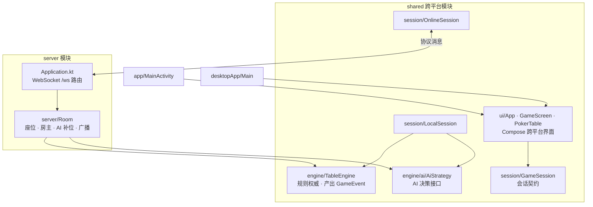
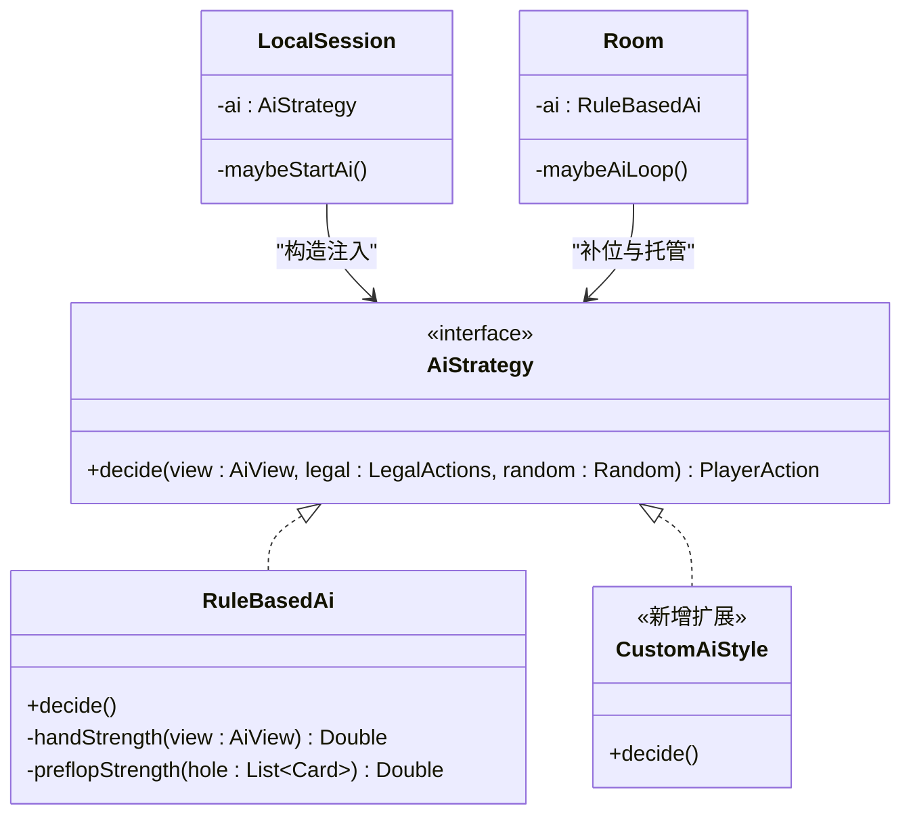
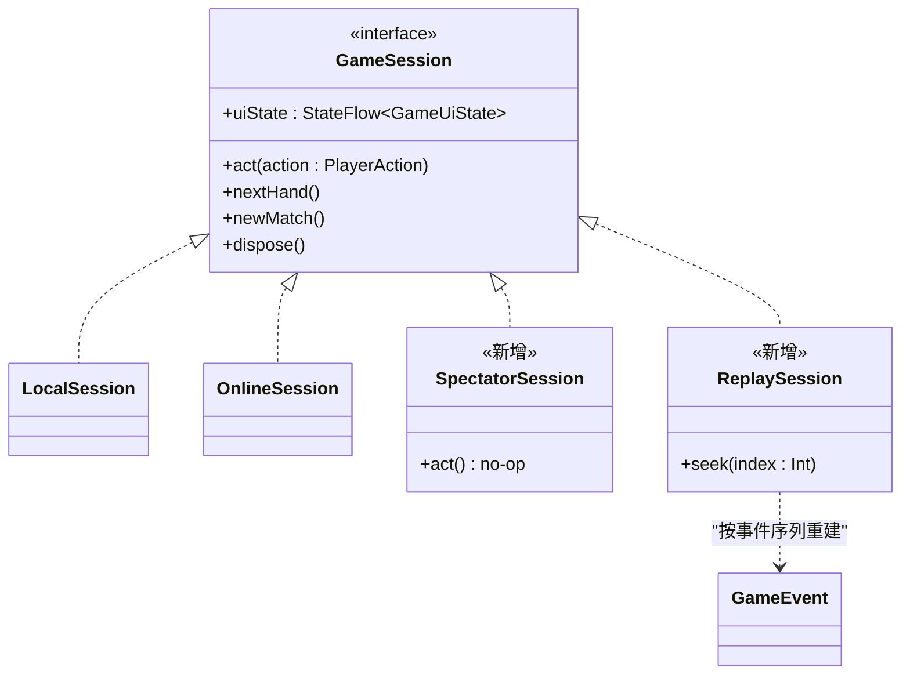
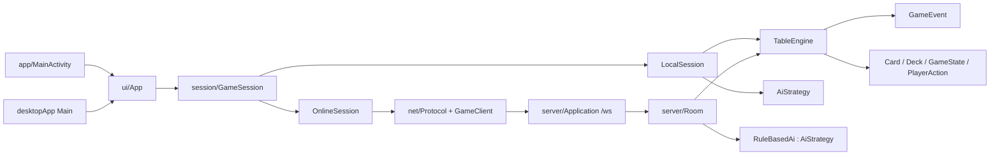

# 扩展与改进指南

<cite>
**本文引用的文件**
- [TableEngine.kt](file://shared/src/commonMain/kotlin/com/aniapp/pokerdemo/engine/TableEngine.kt)
- [GameEvent.kt](file://shared/src/commonMain/kotlin/com/aniapp/pokerdemo/engine/GameEvent.kt)
- [PlayerAction.kt](file://shared/src/commonMain/kotlin/com/aniapp/pokerdemo/engine/PlayerAction.kt)
- [Card.kt](file://shared/src/commonMain/kotlin/com/aniapp/pokerdemo/engine/Card.kt)
- [GameState.kt](file://shared/src/commonMain/kotlin/com/aniapp/pokerdemo/engine/GameState.kt)
- [AiStrategy.kt](file://shared/src/commonMain/kotlin/com/aniapp/pokerdemo/engine/ai/AiStrategy.kt)
- [RuleBasedAi.kt](file://shared/src/commonMain/kotlin/com/aniapp/pokerdemo/engine/ai/RuleBasedAi.kt)
- [GameSession.kt](file://shared/src/commonMain/kotlin/com/aniapp/pokerdemo/session/GameSession.kt)
- [LocalSession.kt](file://shared/src/commonMain/kotlin/com/aniapp/pokerdemo/session/LocalSession.kt)
- [OnlineSession.kt](file://shared/src/commonMain/kotlin/com/aniapp/pokerdemo/session/OnlineSession.kt)
- [Room.kt](file://server/src/main/kotlin/com/aniapp/pokerdemo/server/Room.kt)
- [Application.kt](file://server/src/main/kotlin/com/aniapp/pokerdemo/server/Application.kt)
- [App.kt](file://shared/src/commonMain/kotlin/com/aniapp/pokerdemo/ui/App.kt)
- [PlayingCard.kt](file://shared/src/commonMain/kotlin/com/aniapp/pokerdemo/ui/card/PlayingCard.kt)
- [MainActivity.kt](file://app/src/main/java/com/aniapp/pokerdemo/MainActivity.kt)
</cite>

## 目录

1. [引言](#引言)
2. [可扩展基线：当前架构现状](#可扩展基线当前架构现状)
3. [核心扩展点总览](#核心扩展点总览)
4. [详细扩展方案](#详细扩展方案)
   - [方向一：在 TableEngine 上扩展玩法（盲注级别、Straddle 等）](#方向一在-tableengine-上扩展玩法盲注级别straddle-等)
   - [方向二：替换或增加 AI 风格](#方向二替换或增加-ai-风格)
   - [方向三：新增 GameSession 会话实现（观战、断线重连、回放）](#方向三新增-gamesession-会话实现观战断线重连回放)
   - [方向四：在 Room 上扩展房间治理（鉴权、踢人、多桌）](#方向四在-room-上扩展房间治理鉴权踢人多桌)
   - [方向五：牌面视觉与动画的进一步增强](#方向五牌面视觉与动画的进一步增强)
   - [方向六：持久化](#方向六持久化)
5. [历史设想与已实现能力的对应关系](#历史设想与已实现能力的对应关系)
6. [依赖关系分析](#依赖关系分析)
7. [性能优化建议](#性能优化建议)
8. [故障排查指南](#故障排查指南)
9. [结论](#结论)
10. [附录：向后兼容与扩展点识别原则](#附录向后兼容与扩展点识别原则)

## 引言

本指南面向希望继续完善 PokerDemo 的开发者。仓库已经从早期的 Android 单模块演示演进为跨平台多人对战项目：引擎、协议、会话与 UI 全部收敛到 `shared` 跨平台模块，服务端由 `server` 模块提供 WebSocket 房间服务，`app`（Android）与 `desktopApp` 仅作为平台入口挂载共享 UI。

需要特别说明的是，早期文档中提出的“下注流程集成”和“网络对战”两个扩展设想**已经被实现取代**：下注回合（盲注、Call/Raise/Fold、边池结算）由 `shared/engine/TableEngine` 完整承担；房间系统与多人后端由 `server/Room` 与 `shared/session/OnlineSession` 落地。因此本页不再描述这些“待接入”的步骤，而是把重点放在**在当前基线上还能扩展什么、应该从哪里扩展**。

围绕这一基线，本指南给出六个可落地的扩展方向：

1. **玩法扩展**：在 `TableEngine` 上增加盲注级别结构、Straddle 等规则变体。
2. **AI 扩展**：在 `engine/ai/AiStrategy` 接口下替换或增加新的 AI 风格。
3. **会话扩展**：在 `session/GameSession` 契约下新增观战、断线重连、基于 `GameEvent` 日志的回放等会话实现。
4. **房间治理扩展**：在 `server/Room` 上增加鉴权、踢人、多桌调度等运营能力。
5. **视觉与动画增强**：在已有的 Compose Canvas 牌面和翻转动画基础上继续提升表现力。
6. **持久化**：使用平台存储保存历史记录与玩家偏好。

每个方向都遵循同一原则：**沿既有接缝扩展，不绕过权威状态的所有权**。

## 可扩展基线：当前架构现状

当前代码的关键事实（也是所有扩展决策的前提）：

- **引擎层**：`shared/src/commonMain/.../engine/TableEngine.kt` 是唯一的规则权威。它持有 `GameState`，实现发牌、盲注、行动合法性（`legalActions`）、下注轮推进（`advanceStreet`）、全下摊牌跑边（runout）、边池分层结算（`settle`）与淘汰判定。每次对外方法调用返回一组 `GameEvent`，供上层做动画与日志。
- **协议与会话层**：`net/Protocol.kt` 定义客户端/服务端消息；`session/GameSession` 是 UI 唯一依赖的会话契约，`LocalSession`（单机 + AI）与 `OnlineSession`（WebSocket 远端权威）是两个已实现的成员。
- **UI 层**：`ui/App.kt` 根据用户选择装配 `LocalSession` 或 `OnlineSession`，再交给 `GameScreen` / `PokerTable` 渲染；牌面由 `ui/card/PlayingCard.kt` 用 Compose Canvas 与 `graphicsLayer` 绘制，已包含翻牌旋转动画。
- **服务端**：`server/Application.kt` 在 `/ws` 路由上分发协议消息，`server/Room.kt` 管理座位、房主权限、AI 补位、断线托管与广播。
- **旧结构已不存在**：`app` 模块下的 `data/BettingManager.kt`、`vm/GameViewModel.kt`、独立的 app 版 `GameScreen` 均已删除，`app` 侧只剩 `MainActivity.kt` 这一个入口（负责主题、logo 与 debug 场景注入）。任何以“BettingManager 尚未被调用”为前提的扩展步骤都已失效。

**图示来源**
- [App.kt:67-117](file://shared/src/commonMain/kotlin/com/aniapp/pokerdemo/ui/App.kt#L67-L117)
- [LocalSession.kt:26-36](file://shared/src/commonMain/kotlin/com/aniapp/pokerdemo/session/LocalSession.kt#L26-L36)
- [OnlineSession.kt:28-40](file://shared/src/commonMain/kotlin/com/aniapp/pokerdemo/session/OnlineSession.kt#L28-L40)
- [Application.kt:24-30](file://server/src/main/kotlin/com/aniapp/pokerdemo/server/Application.kt#L24-L30)
- [Room.kt:63-80](file://server/src/main/kotlin/com/aniapp/pokerdemo/server/Room.kt#L63-L80)

**章节来源**
- [TableEngine.kt:1-50](file://shared/src/commonMain/kotlin/com/aniapp/pokerdemo/engine/TableEngine.kt#L1-L50)
- [GameSession.kt:11-31](file://shared/src/commonMain/kotlin/com/aniapp/pokerdemo/session/GameSession.kt#L11-L31)
- [MainActivity.kt:24-48](file://app/src/main/java/com/aniapp/pokerdemo/MainActivity.kt#L24-L48)

## 核心扩展点总览

下表列出经过源码验证的扩展接缝，以及每个接缝适合承载的改动类型：

| 扩展点 | 位置 | 已具备能力 | 适合的扩展方向 |
|---|---|---|---|
| `GameConfig` / `TableEngine` 构造参数 | `engine/TableEngine.kt` | 起始筹码、小盲、大盲；可注入 `Random` 与 `newDeck` 工厂 | 盲注级别递增、Ante、Straddle、自定义牌组 |
| `PlayerAction` / `LegalActions` | `engine/PlayerAction.kt` | Fold/Check/Call/RaiseTo 四类动作与合法范围计算 | 新动作类型（如 Straddle 需扩展动作或经 `startHand` 处理） |
| `GameEvent` 密封接口 | `engine/GameEvent.kt` | 全流程事件且全部 `@Serializable` | 驱动动画、写日志做回放、审计对局 |
| `AiStrategy.decide(AiView, LegalActions, Random)` | `engine/ai/AiStrategy.kt` | 纯函数式决策接口，`RuleBasedAi` 为其实现 | 替换激进/保守风格、多策略池、机器学习模型适配 |
| `GameSession` 接口 | `session/GameSession.kt` | `uiState: StateFlow<GameUiState>` + `act/nextHand/newMatch/dispose` | 观战会话、重连会话、回放会话 |
| `Room` / `RoomManager` | `server/Room.kt` | 房间码分配、房主权限、AI 补位开关、断线托管、按座位脱敏广播 | 鉴权、踢人、禁言、房间内多桌 |

**章节来源**
- [TableEngine.kt:6-20](file://shared/src/commonMain/kotlin/com/aniapp/pokerdemo/engine/TableEngine.kt#L6-L20)
- [PlayerAction.kt:6-27](file://shared/src/commonMain/kotlin/com/aniapp/pokerdemo/engine/PlayerAction.kt#L6-L27)
- [GameEvent.kt:5-26](file://shared/src/commonMain/kotlin/com/aniapp/pokerdemo/engine/GameEvent.kt#L5-L26)
- [AiStrategy.kt:9-23](file://shared/src/commonMain/kotlin/com/aniapp/pokerdemo/engine/ai/AiStrategy.kt#L9-L23)
- [GameSession.kt:25-31](file://shared/src/commonMain/kotlin/com/aniapp/pokerdemo/session/GameSession.kt#L25-L31)
- [Room.kt:40-59](file://server/src/main/kotlin/com/aniapp/pokerdemo/server/Room.kt#L40-L59)

## 详细扩展方案

### 方向一：在 TableEngine 上扩展玩法（盲注级别、Straddle 等）

#### 现状

`TableEngine` 通过 `GameConfig(startingChips, smallBlind, bigBlind)` 接收静态盲注，`startHand()` 内部完成庄家轮转、单挑（heads-up）盲注位置特判、`postBlind` 强制下注、`currentBet/minRaiseTo` 初始化以及首个行动者选择；最小加注幅度由 `lastRaiseSize` 跟踪并在每次有效全量加注后更新。座位数约束（2–6）在 `init` 块中校验。

#### 扩展步骤

1. **盲注级别结构（锦标赛升盲）**
   - 将 `GameConfig` 中的单一盲注扩展为级别表（例如 `List<BlindLevel(small, big, ante)>`），在 `TableEngine` 中按 `state.handNumber` 或时间选取当前级别。`startHand()` 里已有 `lastRaiseSize = config.bigBlind` 的重置点，改为从当前级别读取即可。
   - 注意同步修改两处下游：`GameUiState.smallBlind/bigBlind`（UI 展示加注步进）与服务端 `viewFor` 构造的 `TableView`——它们目前直接取 `engine.config`。
   - 通过 `GameEvent` 新增 `BlindsIncreased` 事件通知前端播放提示动画，保持“引擎产出事件、会话消费事件”的模式。

2. **Straddle（前注抓盲）**
   - Straddle 发生在 BB 之后、首个行动之前，属于 `startHand()` 的职责而非 `act()`。推荐做法：给 `startHand()` 增加可选参数或在返回事件后追加一次 `act(bbSeat+1, RaiseTo(2 * bigBlind))` 风格的内部处理，并把该动作记录为普通 `GameEvent.ActionTaken`，使后续 `roundComplete()` 的“所有人下注持平”判断天然成立。
   - 由于 `minRaiseTo` 在抓盲后应自动抬高，复用现有 `RaiseTo` 分支里的 `lastRaiseSize` 更新逻辑即可，无需新增结算路径。

3. **自定义牌组与可复现发牌**
   - `TableEngine` 构造函数已支持注入 `newDeck: () -> Deck` 与 `random`，`Deck` 亦可用给定牌序构造。测试与回放场景直接复用这条通道（`MainActivity` 的 debug `scenario` 参数就是走这条路注入固定牌序）。

4. **多人规则变更的安全网**
   - 任何影响底池归属的改动都应落在 `settle()` 的分层边池循环内，那里已经按 `totalCommitted` 去重分档并处理了无法分配的余数（向庄家左侧顺序派发）。新增 Ante 时只需在 `startHand()` 中对每个有筹码的座位调用 `pay`/`postBlind` 类似的提交逻辑，边池算法无需改动。

#### 向后兼容要点

- `GameConfig` 各字段均有默认值，新增字段务必保留默认行为（无 Ante、固定盲注）。
- 不要改变 `startHand()/act()` 的返回类型（`List<GameEvent>`），它是本地与服务端共同依赖的事件契约。

**章节来源**
- [TableEngine.kt:6-76](file://shared/src/commonMain/kotlin/com/aniapp/pokerdemo/engine/TableEngine.kt#L6-L76)
- [TableEngine.kt:104-156](file://shared/src/commonMain/kotlin/com/aniapp/pokerdemo/engine/TableEngine.kt#L104-L156)
- [TableEngine.kt:201-233](file://shared/src/commonMain/kotlin/com/aniapp/pokerdemo/engine/TableEngine.kt#L201-L233)
- [TableEngine.kt:242-305](file://shared/src/commonMain/kotlin/com/aniapp/pokerdemo/engine/TableEngine.kt#L242-L305)
- [Card.kt:25-35](file://shared/src/commonMain/kotlin/com/aniapp/pokerdemo/engine/Card.kt#L25-L35)
- [MainActivity.kt:50-66](file://app/src/main/java/com/aniapp/pokerdemo/MainActivity.kt#L50-L66)

### 方向二：替换或增加 AI 风格

#### 现状

`AiStrategy` 只有一个方法：`decide(view: AiView, legal: LegalActions, random: Random): PlayerAction`。`AiView` 提供手牌、公共牌、阶段、底池、需跟金额、本轮已投、筹码、大盲与活跃对手数——即一个不泄露他人底牌的完整决策视图。默认实现 `RuleBasedAi` 基于成牌强度估计（翻前启发式 + 翻后 `HandEvaluator` 加听牌加成）配合激进度与随机扰动做 Check/Call/Raise/Fold。

本地与远端两条链路都以相同方式消费该接口：`LocalSession.maybeStartAi()` 延迟 700–1400ms 后调用 `ai.decide(...)` 再喂给 `engine.act()`；服务端 `Room.maybeAiLoop()` 结构相同，并且断线玩家的托管也复用同一 AI。

#### 扩展步骤

1. **新增风格类**：实现 `AiStrategy`，例如紧凶型（收紧 `raiseThreshold`、减少诈唬频率）或松被动型（倾向 Call 小额下注）。只需产出合法的 `PlayerAction`——越界会被 `TableEngine.act()` 的 `check` 拒绝，因此实现内应对照 `legal.minRaiseTo..legal.maxRaiseTo` 夹取目标额（参考 `RuleBasedAi.raiseTarget` 的做法）。
2. **注入点**：`LocalSession` 构造函数的 `ai: AiStrategy` 已是参数化的，可直接传入新策略；服务端如需按房间配置策略，可在 `Room` 构造处将硬编码的 `RuleBasedAi()` 换成工厂参数，并保持 `seatMap` 稀疏座位映射逻辑不变。
3. **难度分级**：利用 `AiView.activeOpponents` 与大盲相对值设计多级阈值，而不要引入对 `GameState` 的直接访问——保持 AI 只能看到 `AiView` 这一信息边界，才能同时满足本地公平性与服务端防作弊。

**图示来源**
- [AiStrategy.kt:9-23](file://shared/src/commonMain/kotlin/com/aniapp/pokerdemo/engine/ai/AiStrategy.kt#L9-L23)
- [RuleBasedAi.kt:11-46](file://shared/src/commonMain/kotlin/com/aniapp/pokerdemo/engine/ai/RuleBasedAi.kt#L11-L46)
- [LocalSession.kt:26-36](file://shared/src/commonMain/kotlin/com/aniapp/pokerdemo/session/LocalSession.kt#L26-L36)
- [Room.kt:143-176](file://server/src/main/kotlin/com/aniapp/pokerdemo/server/Room.kt#L143-L176)

**章节来源**
- [RuleBasedAi.kt:48-87](file://shared/src/commonMain/kotlin/com/aniapp/pokerdemo/engine/ai/RuleBasedAi.kt#L48-L87)
- [LocalSession.kt:86-119](file://shared/src/commonMain/kotlin/com/aniapp/pokerdemo/session/LocalSession.kt#L86-L119)
- [Room.kt:158-176](file://server/src/main/kotlin/com/aniapp/pokerdemo/server/Room.kt#L158-L176)

### 方向三：新增 GameSession 会话实现（观战、断线重连、回放）

#### 现状

`GameSession` 契约极小：`uiState: StateFlow<GameUiState>` 加上 `act/nextHand/newMatch/dispose` 四个命令。`GameUiState` 内含 `TableView`（含 `myHole`、`legal`、`revealedHoles`）、`lastEvents`、盲注信息与在线标记。UI 层（`App.kt` → `GameScreen`）只认这个接口，这意味着任何能持续产出合法 `GameUiState` 的实现都可以无缝接入。

#### 三种推荐的会话扩展

1. **观战会话（SpectatorSession）**
   - 复用 `OnlineSession` 的连接流程，但以只读身份加入：服务端 `Room.viewFor()` 已按座位裁剪底牌（非本人座位不下发 `myHole`，摊牌前 `revealedHoles` 为空），可以为观战者下发同样的脱敏视图并将 `mySeat` 设为无效座位、`legal` 置空。
   - 客户端侧 `act()` 实现为 no-op 即可满足契约；`isPlayerTurn` 因 `acting != mySeat` 自然为 false，操作栏不会亮起。

2. **断线重连会话（ReconnectingSession）**
   - 现状：`OnlineSession` 检测到 `client.connected` 变为 false 时将阶段置为 `Phase.Ended("与服务器断开连接")`；服务端则把掉线座位转为 AI 托管（`disconnected()` 中 `holder.isAi = true`），一手结束后清理空座。
   - 扩展思路：在该检测点改为进入“重连退避循环”，重建 `GameClient` 并发送携带原房间码与新昵称的 `JoinRoom`；若仍在对局中，服务端会将其重新安置到空闲座位，而托管 AI 会继续代打。要让“回到原座位”成为可能，需要在服务端为房间增加令牌—座位绑定（见方向四的鉴权扩展），这是该功能唯一需要动服务端的部分。

3. **基于 GameEvent 日志的回放会话（ReplaySession）**
   - `GameEvent` 全部 `@Serializable`，且 `startHand()`/`act()` 的每次调用恰好返回该次状态迁移产生的完整事件序列（含 `BlindsPosted`、`StreetDealt`、`PotAwarded`、`HandFinished` 等）。因此“初始 `GameState` 快照 + 种子化 `Random` + 有序事件流”足以确定性地重建牌桌。
   - 实现方式：离线时用 `TableEngine(config, players, random = Random(seed), newDeck = ...)` 重放相同的 `startHand()/act()` 调用序列，把每步产出的事件写入日志；回放会话则读取日志，按索引重放并合成 `GameUiState(table = engine.toTableView(mySeat), lastEvents = …)`，`act/nextHand` 变成时间轴 seek 命令。`MainActivity` 中 debug `scenario` 固定牌序注入证明了这条确定性路径可行。

**图示来源**
- [GameSession.kt:25-31](file://shared/src/commonMain/kotlin/com/aniapp/pokerdemo/session/GameSession.kt#L25-L31)
- [GameEvent.kt:5-26](file://shared/src/commonMain/kotlin/com/aniapp/pokerdemo/engine/GameEvent.kt#L5-L26)
- [LocalSession.kt:136-166](file://shared/src/commonMain/kotlin/com/aniapp/pokerdemo/session/LocalSession.kt#L136-L166)

**章节来源**
- [OnlineSession.kt:63-121](file://shared/src/commonMain/kotlin/com/aniapp/pokerdemo/session/OnlineSession.kt#L63-L121)
- [Room.kt:143-160](file://server/src/main/kotlin/com/aniapp/pokerdemo/server/Room.kt#L143-L160)
- [Room.kt:246-281](file://server/src/main/kotlin/com/aniapp/pokerdemo/server/Room.kt#L246-L281)
- [TableEngine.kt:13-20](file://shared/src/commonMain/kotlin/com/aniapp/pokerdemo/engine/TableEngine.kt#L13-L20)

### 方向四：在 Room 上扩展房间治理（鉴权、踢人、多桌）

#### 现状

`RoomManager` 以 4 位大写字母房间码在内存 `ConcurrentHashMap` 中管理房间；`Room` 用一把 `Mutex` 串行化所有状态变更，实现了：房主自动认定（首个加入者）、仅房主可开始与切换 AI 补位（`requestStart`/`setAiFill` 中的 `not_host` 校验）、对局进行中禁止加入（`inHand` 检查）、昵称清洗（`cleanName` 截断 12 字符）、全员离开时自动关闭房间。错误通过 `ServerMessage.Error(code, message)` 单播回送。

#### 扩展步骤

1. **鉴权**
   - 现在 `addHuman` 只凭昵称占座。扩展时在 `ClientMessage.CreateRoom/JoinRoom` 中增加令牌字段：创建房间时服务端生成房主令牌回传；加入时签发会话令牌并与 `SeatHolder` 绑定。校验点集中在 `Application.kt` 的 `join()` 与各 `Room` 公开方法的锁内段落，避免在协程外判断状态。
   - 令牌—座位绑定同时是方向三中“重连回原座”的前置条件。

2. **踢人 / 禁言**
   - 在 `Room` 中新增 `suspend fun requestKick(hostSeat: Int, targetSeat: Int)`，模式完全仿照 `setAiFill`：锁内校验 `hostSeat` 权限与 `!inHand`（或直接允许任意时刻踢人但触发 `disconnected(target)` 的托管路径），随后关闭目标 session 并广播 `broadcastLobby()`。注意 `endHand()` 会把未连接的座位清空，踢人后的座位回收可以直接复用这段逻辑。
   - 被踢者需要专用错误码（如 `kicked`），客户端 `OnlineSession.handle` 中对未知 Error code 目前落入 `_error` 提示条；应将致命码并入 `Phase.Ended` 分支集合。

3. **多桌**
   - 当前一个 `Room` 持有一副 `engine` 与一张 `seatMap`。多桌的最小改造是把 `(engine, seatMap, inHand)` 打包为 `Table` 对象，`Room` 持有 `List<Table>` 并在 `requestStart` 时按人数分桌；`viewFor(seat)` 需要改为先查“座位→桌”的映射再取对应引擎视图。`RoomManager.get(code)` 的房间级语义保持不变，客户端协议只需在 `Joined`/`Update` 中透传桌号。
   - 所有跨桌操作仍应在房间级 `Mutex`（或每桌独立 Mutex + 房间级调度锁）内完成，沿用现有“锁内改状态、锁内广播”的写法，不要在持有锁时执行阻塞 IO 之外的等待。

4. **广播一致性红线**
   - `broadcastUpdate` 为每个连接单独构造 `viewFor(e, i)`，保证其他玩家的底牌永不出现在你的消息里；任何治理扩展（包括多桌）都必须保持逐座位脱敏，不能退化为共享一份全局 JSON。`sendToHumans` 中注释也提醒：Ktor 帧不可复用，必须逐会话重新序列化。

**章节来源**
- [Room.kt:40-59](file://server/src/main/kotlin/com/aniapp/pokerdemo/server/Room.kt#L40-L59)
- [Room.kt:82-141](file://server/src/main/kotlin/com/aniapp/pokerdemo/server/Room.kt#L82-L141)
- [Room.kt:143-160](file://server/src/main/kotlin/com/aniapp/pokerdemo/server/Room.kt#L143-L160)
- [Room.kt:190-207](file://server/src/main/kotlin/com/aniapp/pokerdemo/server/Room.kt#L190-L207)
- [Room.kt:246-323](file://server/src/main/kotlin/com/aniapp/pokerdemo/server/Room.kt#L246-L323)
- [Application.kt:36-111](file://server/src/main/kotlin/com/aniapp/pokerdemo/server/Application.kt#L36-L111)

### 方向五：牌面视觉与动画的进一步增强

#### 现状

早期“文字牌换图片牌”的设想已被超越：`ui/card/PlayingCard.kt` 已用 Compose Canvas 自绘牌面与牌背，并通过 `animateFloatAsState` + `graphicsLayer { rotationY }` 实现翻牌 3D 旋转；`SeatView` 与 `GameScreen` 用 `animateIntAsState(tween(500/400))` 平滑筹码与底池数字；`CardRow` 与 `HandResultOverlay` 使用 `AnimatedVisibility` 控制入场出场。引擎侧的 `GameUiState.lastEvents` 则为“哪个座位发生了什么”提供了精确的动画触发信号。

#### 仍可增强的点

1. **事件驱动的飞牌动画**：`GameEvent.StreetDealt` 携带 `newCards` 与 `isRunout`，可按事件计数为每张新公共牌错开入场延迟；`PotAwarded` 可驱动筹码飞向赢家座位的过渡。
2. **摊牌揭示节奏**：`TableView.revealedHoles` 仅在 `showdown` 后下发，UI 可按座位顺序逐个翻转 `PlayingCard`，复用现有 `rotationY` 机制。
3. **性能红线**：动画只消费不可变的 `GameUiState` 快照，切勿在组合期反查 `TableEngine.state`；列表重组为 `seats`/`board` 提供稳定 key，避免整表重建打断进行中的动画。

**章节来源**
- [PlayingCard.kt:41-60](file://shared/src/commonMain/kotlin/com/aniapp/pokerdemo/ui/card/PlayingCard.kt#L41-L60)
- [GameEvent.kt:12-18](file://shared/src/commonMain/kotlin/com/aniapp/pokerdemo/engine/GameEvent.kt#L12-L18)
- [Room.kt:262-280](file://server/src/main/kotlin/com/aniapp/pokerdemo/server/Room.kt#L262-L280)

### 方向六：持久化

#### 现状与建议

引擎与协议层的数值（`chips: Int`、`handNumber: Int`）均为可序列化基本类型，`GameEvent`/`GameState` 相关数据类普遍标注 `@Serializable`，这使持久化成本很低：

1. **玩家偏好（DataStore / 平台属性存储）**：昵称、上次连接的服务器地址、`OnlineConfig` 的座位数与 AI 补位默认值。`OnlineConfig` 与 `GameConfig` 都是纯数据类，是天然的读写载体。
2. **历史记录**：最有价值的存档单元是“`GameConfig` + 玩家名单 + 种子 + `List<GameEvent>` 日志”。这份数据既能渲染历史列表（胜负来自 `HandFinished`/`MatchFinished`），又能像方向三所述直接喂给 `TableEngine` 重放出完整牌局，不需要额外的对局详情 schema。
3. **写入时机**：订阅 `GameSession.uiState`，在 `lastEvents` 包含 `HandFinished` 时追加一条记录；避免每次重组写盘。跨平台注意：DataStore/Room 是 Android/JVM 方案，桌面端可选择同一 JVM 实现或将 JSON 日志写入文件，抽象层放在各平台的 session 装配处而不是 `shared` UI 中。

**章节来源**
- [GameSession.kt:11-23](file://shared/src/commonMain/kotlin/com/aniapp/pokerdemo/session/GameSession.kt#L11-L23)
- [GameEvent.kt:5-26](file://shared/src/commonMain/kotlin/com/aniapp/pokerdemo/engine/GameEvent.kt#L5-L26)
- [OnlineSession.kt:20-26](file://shared/src/commonMain/kotlin/com/aniapp/pokerdemo/session/OnlineSession.kt#L20-L26)

## 历史设想与已实现能力的对应关系

早期页面（含“下注流程集成”“网络对战功能”两个子页）提出的设想与当前实现对照如下：

| 历史设想 | 当前状态 | 承接实现 |
|---|---|---|
| 将 BettingManager 与 GameViewModel 联动实现 Call/Raise/Fold 影响筹码与底池 | **已由引擎实现，组件本身已删除** | `TableEngine.act()` 的 Fold/Check/Call/RaiseTo 分支与 `settle()` 边池结算 |
| 引入房间系统与多人后端 | **已实现** | `server/Room.kt` + `Application.kt` 的 `/ws` 协议 + `OnlineSession` |
| 断线重连与状态恢复 | **部分实现**：服务端有 AI 托管兜底，客户端目前直接终止会话 | `Room.disconnected()`；完整的“回原座”重连是方向三的待扩展项 |
| 文字牌替换为图片/矢量牌面 | **已实现（Canvas 矢量绘制路线）** | `ui/card/PlayingCard.kt` |
| 发牌/翻牌/摊牌动画 | **大部分实现** | `PlayingCard` 旋转、`animateIntAsState` 筹码/底池、`AnimatedVisibility` 覆盖层 |
| DataStore/Room 持久化 | 未实现，仍是有效扩展方向 | 见方向六 |

因此，“下注流程集成”和“网络对战功能”两篇子页描述的历史设想已被实现取代，查阅时应以本页方向一、方向四及引擎/服务端源码为准。

## 依赖关系分析

- UI 只依赖 `GameSession` 与 `GameUiState`，不直接接触引擎或服务端；这是新增会话实现能够“即插即用”的根本原因。
- `LocalSession` 与 `Room` 各自持有 `TableEngine` 实例并共用 `AiStrategy`，规则只有一份实现，不存在客户端/服务端双套下注逻辑漂移的问题。
- `TableEngine` 仅依赖 `engine` 包内模型（`Card/Deck/GameState/PlayerAction/GameEvent`），无任何平台 API，可安全运行于 Common 源集。

**图示来源**
- [App.kt:67-117](file://shared/src/commonMain/kotlin/com/aniapp/pokerdemo/ui/App.kt#L67-L117)
- [LocalSession.kt:26-36](file://shared/src/commonMain/kotlin/com/aniapp/pokerdemo/session/LocalSession.kt#L26-L36)
- [OnlineSession.kt:28-77](file://shared/src/commonMain/kotlin/com/aniapp/pokerdemo/session/OnlineSession.kt#L28-L77)
- [Room.kt:63-80](file://server/src/main/kotlin/com/aniapp/pokerdemo/server/Room.kt#L63-L80)
- [TableEngine.kt:1-20](file://shared/src/commonMain/kotlin/com/aniapp/pokerdemo/engine/TableEngine.kt#L1-L20)

**章节来源**
- [Application.kt:24-30](file://server/src/main/kotlin/com/aniapp/pokerdemo/server/Application.kt#L24-L30)
- [GameSession.kt:1-31](file://shared/src/commonMain/kotlin/com/aniapp/pokerdemo/session/GameSession.kt#L1-L31)

## 性能优化建议

1. **锁粒度**：`Room` 的全部变更都在单把 `Mutex` 内完成，包括向 WebSocket 发送帧。多桌扩展时若广播耗时上升，可将“状态变更”与“网络发送”拆分（锁内快照、锁外发送），但必须保证快照已按座位脱敏。
2. **AI 循环**：本地与服务端的 AI 行动都通过带 `delay(700..1400)` 的单协程循环推进，并用 `aiJob?.isActive` 防止重复启动；新增策略时保持 `decide()` 为纯计算，不要在内部做 IO。
3. **事件对象分配**：每步返回 `List<GameEvent>` 是刻意的短生命周期设计，便于回放与动画；高频路径（如升盲后每手多次结算）避免在事件里塞入大对象。
4. **重组范围**：`GameUiState` 是不可变快照，整包替换即可触发定向重组；扩展时不要把它拆成多个可变字段，以免破坏 `collectAsState` 的一致性读取。
5. **测试复用注入通道**：`TableEngine` 的 `random`/`newDeck` 参数同样服务于基准测试——用固定种子评估新 AI 风格，比真实对战采样快得多。

## 故障排查指南

| 问题 | 可能原因 | 解决建议 |
|---|---|---|
| 新玩法下结算金额异常 | 绕过了 `settle()` 的 `totalCommitted` 分层边池逻辑自行派彩 | 所有筹码转移统一走 `updateSeat` + 事件记录，检查 `UncalledReturned` 是否被正确产生 |
| 加注被服务端拒绝（illegal_action） | AI 或客户端提交的 `RaiseTo` 超出 `legalActions` 区间，或行动者已被 `raiseReopened` 规则限制 | 行动前先读 `TableView.legal`，参照 `RuleBasedAi.raiseTarget` 做 coerceIn |
| 观战/回放中看到不该看的底牌 | 直接广播了 `GameState` 而非逐座位的 `viewFor` | 保持 `Room.broadcastUpdate` 的按座位视图构造；回放日志需连同视角一起记录 |
| 关闭 AI 补位后无法开局 | `requestStart` 要求至少 2 名真人玩家（`need_players`） | 属预期行为；引导用户邀请第二位玩家或重新开启补位 |
| 断线后玩家“变成电脑” | 服务端 `disconnected()` 在对局中将掉线座位转为 AI 托管 | 属兜底设计；如需恢复本人操作，实施方向三的重连会话并绑定座位令牌 |
| 房间码冲突或找不到房间 | 房间保存在内存 `ConcurrentHashMap`，服务重启即丢失 | 生产化时把房间元数据落盘或改用外部注册中心 |
| UI 动画与状态不同步 | 动画期间 `GameUiState` 被新快照整体替换 | 用 `lastEvents` 触发动画、用最终快照收敛数值，二者不要互相等待 |

**章节来源**
- [TableEngine.kt:119-156](file://shared/src/commonMain/kotlin/com/aniapp/pokerdemo/engine/TableEngine.kt#L119-L156)
- [TableEngine.kt:242-260](file://shared/src/commonMain/kotlin/com/aniapp/pokerdemo/engine/TableEngine.kt#L242-L260)
- [Room.kt:93-125](file://server/src/main/kotlin/com/aniapp/pokerdemo/server/Room.kt#L93-L125)
- [Room.kt:143-160](file://server/src/main/kotlin/com/aniapp/pokerdemo/server/Room.kt#L143-L160)
- [Room.kt:209-221](file://server/src/main/kotlin/com/aniapp/pokerdemo/server/Room.kt#L209-L221)

## 结论

PokerDemo 的扩展格局已从“补齐单机闭环”转变为“在成熟的跨平台权威引擎上纵向加深”。推荐的扩展优先级：

1. **高**：玩法变体（盲注级别、Straddle）——改动集中在 `TableEngine.startHand()` 与 `GameConfig`，风险可控且立刻丰富对局体验。
2. **高**：会话族扩展（观战、重连、回放）——`GameSession` 契约与 `GameEvent` 序列化已经把地基打好，收益（内容可复现、社交可观战）远超成本。
3. **中**：房间治理（鉴权、踢人、多桌）——面向运营，须与重连令牌一并设计。
4. **中**：AI 风格库——纯接口实现，适合作为社区贡献的低门槛入口。
5. **低**：视觉/动画打磨与持久化——锦上添花，注意遵守“UI 只消费不可变快照”的边界。

所有扩展都应沿既有接缝切入：规则进引擎、决策进策略接口、传输进会话契约、治理进房间锁内——并保持 `GameEvent` 与 `GameSession` 这两个跨模块契约的稳定。

## 附录：向后兼容与扩展点识别原则

### 扩展点识别原则

- **权威状态变更点**：只有 `TableEngine` 的公开方法可以改变 `GameState`；新玩法一律先问“能否表达为 startHand/act 的一次配置或一个分支”。
- **事件契约点**：`GameEvent` 是动画、日志、回放三合一的信号源，新增枚举成员是兼容性最好的通知手段（旧消费者可忽略未知事件）。
- **决策接口点**：`AiStrategy.decide` 以 `AiView` 划定信息边界，任何新 AI 都不应获得超出 `AiView` 的视野。
- **会话装配点**：`GameSession` 四方法契约是 UI 的唯一依赖；新会话类型只在 `App.kt` 装配层接入，不改 UI 内部。
- **治理锁内点**：`Room` 中带 `mutex.withLock` 的方法段是权限校验的自然插入位置，新治理指令仿照 `setAiFill` 的错误码模式返回。

### 向后兼容性建议

- `GameConfig`、`PlayerInit`、`AiView` 的新字段一律给默认值，保证二进制与源码双重兼容。
- 扩展 `ClientMessage`/`ServerMessage` 时同步更新 `PokerJson` 的解析容错（未知消息当前回 `bad_message` 错误而非崩溃，可延续此策略）。
- 不删除 `GameSession` 既有方法；无法支持的命令（如观战的 `act`）实现为 no-op，让契约保持完整。
- 引擎规则改动必须先在 `commonTest` 的 `HeadsUpTableEngineTest`/`MultiPlayerTableEngineTest` 体系内补充用例，再考虑服务端 E2E（`server/test` 下的 `RoomFlowTest`/`E2EClient`）。

### 推荐扩展优先级

| 优先级 | 扩展方向 | 理由 |
|---|---|---|
| 高 | TableEngine 玩法变体 | 单点改动、全平台受益 |
| 高 | GameSession 会话族（观战/重连/回放） | 契约就绪，事件日志天然支持 |
| 中 | Room 治理（鉴权/踢人/多桌） | 运营必需，涉及协议变更需谨慎 |
| 中 | AI 风格扩展 | 接口极简，适合渐进投入 |
| 低 | 视觉动画进一步增强 | 已有基础，按需打磨 |
| 低 | 持久化 | 独立增量，不影响对局链路 |

**章节来源**
- [TableEngine.kt:6-20](file://shared/src/commonMain/kotlin/com/aniapp/pokerdemo/engine/TableEngine.kt#L6-L20)
- [GameEvent.kt:5-26](file://shared/src/commonMain/kotlin/com/aniapp/pokerdemo/engine/GameEvent.kt#L5-L26)
- [GameSession.kt:25-31](file://shared/src/commonMain/kotlin/com/aniapp/pokerdemo/session/GameSession.kt#L25-L31)
- [Room.kt:134-141](file://server/src/main/kotlin/com/aniapp/pokerdemo/server/Room.kt#L134-L141)
- [Application.kt:48-53](file://server/src/main/kotlin/com/aniapp/pokerdemo/server/Application.kt#L48-L53)