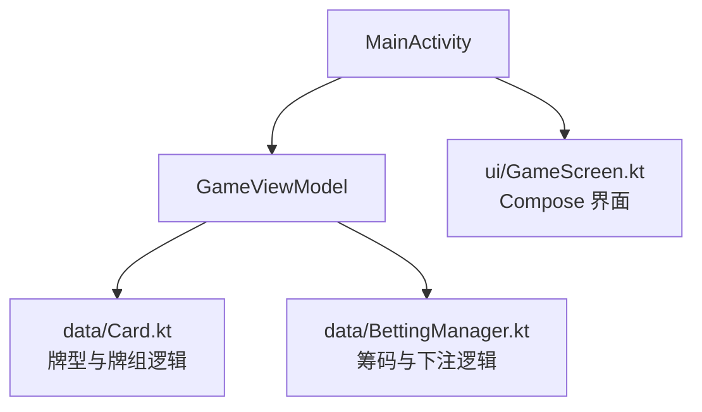
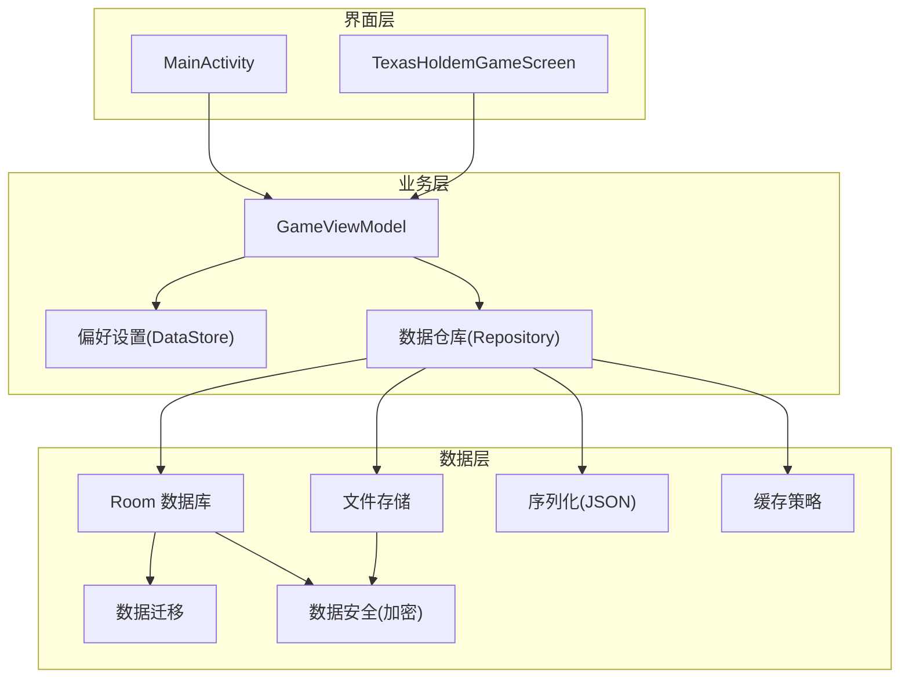
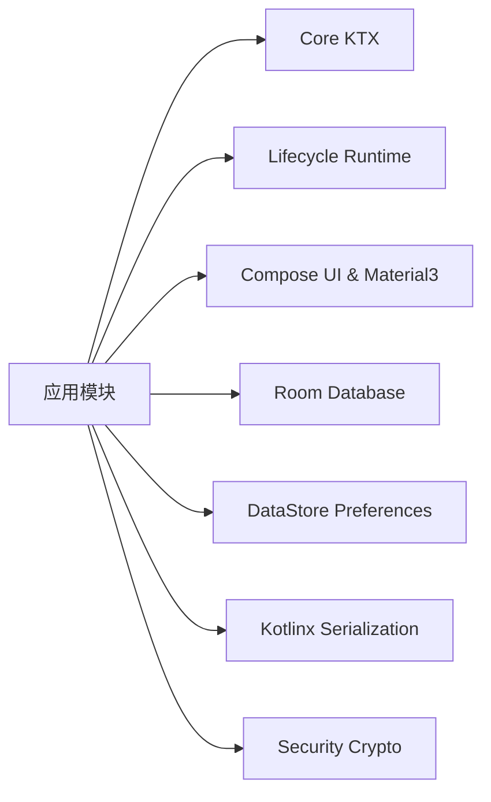
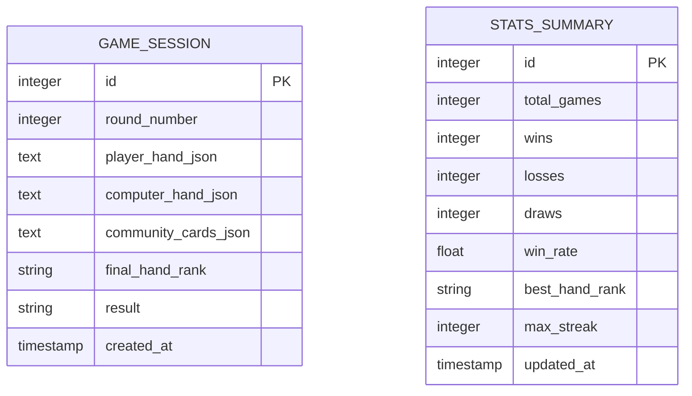
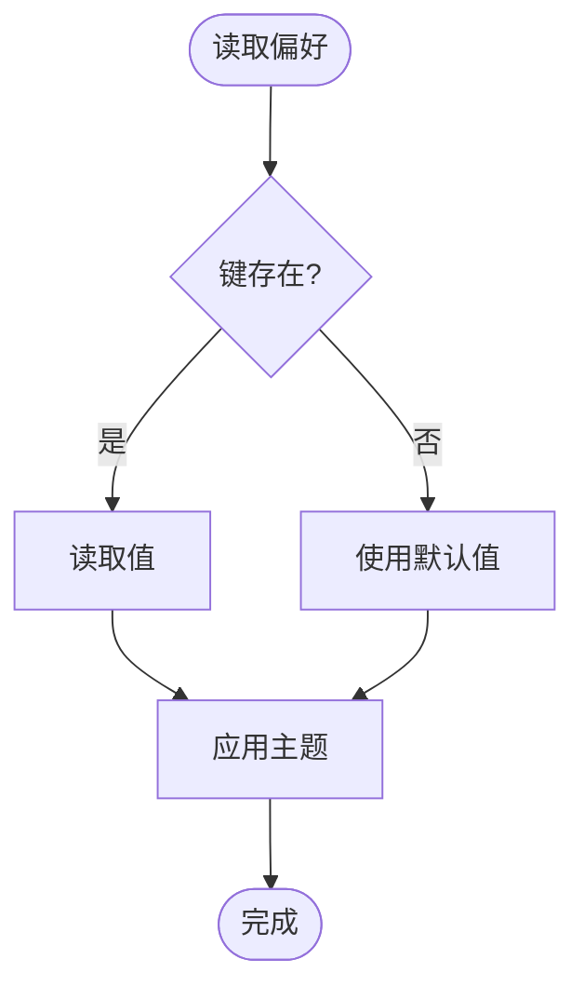
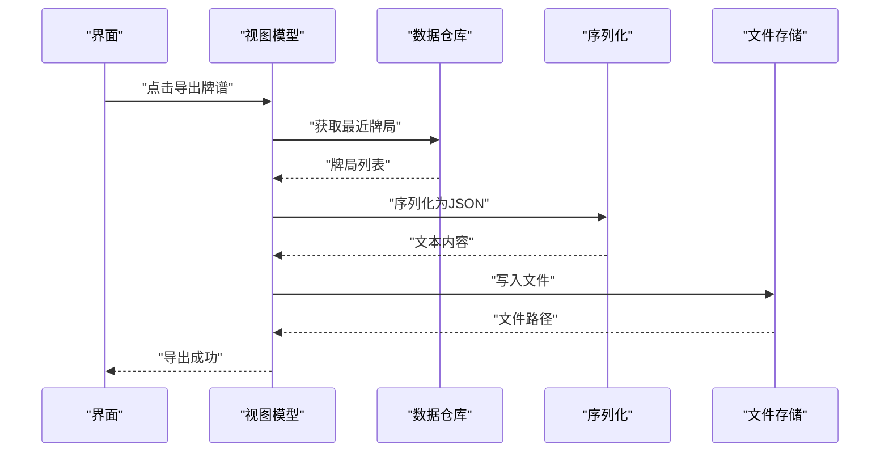

# 数据持久化方案

<cite>
**本文引用的文件**
- [MainActivity.kt](file://app/src/main/java/com/aniapp/pokerdemo/MainActivity.kt)
- [GameViewModel.kt](file://app/src/main/java/com/aniapp/pokerdemo/vm/GameViewModel.kt)
- [Card.kt](file://app/src/main/java/com/aniapp/pokerdemo/data/Card.kt)
- [BettingManager.kt](file://app/src/main/java/com/aniapp/pokerdemo/data/BettingManager.kt)
- [GameScreen.kt](file://app/src/main/java/com/aniapp/pokerdemo/ui/GameScreen.kt)
- [build.gradle](file://app/build.gradle)
- [libs.versions.toml](file://gradle/libs.versions.toml)
- [AndroidManifest.xml](file://app/src/main/AndroidManifest.xml)
</cite>

## 目录
1. [引言](#引言)
2. [项目结构](#项目结构)
3. [核心组件](#核心组件)
4. [架构总览](#架构总览)
5. [详细组件分析](#详细组件分析)
6. [依赖分析](#依赖分析)
7. [性能考虑](#性能考虑)
8. [故障排查指南](#故障排查指南)
9. [结论](#结论)
10. [附录](#附录)

## 引言
本指南为 PokerDemo 设计一套完整的数据持久化方案，目标是在现有德州扑克游戏基础上，增加用户偏好、牌局历史与统计、文件导出、离线缓存、数据迁移与安全保护等能力。方案覆盖以下存储技术：
- DataStore 偏好设置：保存主题、音量、难度等用户偏好。
- Room 数据库：持久化历史牌局、胜率统计、最佳战绩。
- 文件存储：导出牌谱、分享精彩时刻。
- 缓存策略：离线数据缓存与增量同步。
- 数据迁移：版本升级时的数据结构变更。
- 数据安全：敏感信息加密与隐私保护。

该方案将围绕现有代码中的入口 Activity、视图模型、UI 界面以及牌型与下注领域对象进行扩展，确保新增的持久化层对现有 UI 影响最小。

## 项目结构
当前应用采用简洁的 Android Compose 结构：
- MainActivity 作为应用入口，加载 GameViewModel 并渲染 TexasHoldemGameScreen。
- GameViewModel 维护手牌、公共牌、结果状态及发牌流程。
- data 包包含扑克领域对象（Card、HandRank、PokerHand）和下注管理（BettingManager）。
- ui 包提供 Compose 界面交互。
- build 与 gradle 配置使用 Kotlin + Compose BOM，尚未引入 Room、DataStore 或文件 I/O 相关依赖。

**图示来源**
- [MainActivity.kt:1-16](file://app/src/main/java/com/aniapp/pokerdemo/MainActivity.kt#L1-L16)
- [GameViewModel.kt:1-74](file://app/src/main/java/com/aniapp/pokerdemo/vm/GameViewModel.kt#L1-L74)
- [Card.kt:1-98](file://app/src/main/java/com/aniapp/pokerdemo/data/Card.kt#L1-L98)
- [BettingManager.kt:1-48](file://app/src/main/java/com/aniapp/pokerdemo/data/BettingManager.kt#L1-L48)
- [GameScreen.kt:1-104](file://app/src/main/java/com/aniapp/pokerdemo/ui/GameScreen.kt#L1-L104)

**章节来源**
- [MainActivity.kt:1-16](file://app/src/main/java/com/aniapp/pokerdemo/MainActivity.kt#L1-L16)
- [GameViewModel.kt:1-74](file://app/src/main/java/com/aniapp/pokerdemo/vm/GameViewModel.kt#L1-L74)
- [Card.kt:1-98](file://app/src/main/java/com/aniapp/pokerdemo/data/Card.kt#L1-L98)
- [BettingManager.kt:1-48](file://app/src/main/java/com/aniapp/pokerdemo/data/BettingManager.kt#L1-L48)
- [GameScreen.kt:1-104](file://app/src/main/java/com/aniapp/pokerdemo/ui/GameScreen.kt#L1-L104)

## 核心组件
在现有结构中，需要新增以下持久化组件：
- 偏好设置层：通过 DataStore 读写主题、音量、语言、难度等键值对。
- 数据访问层：Room DAO 与 Repository，封装历史牌局、胜率统计、最佳战绩的增删改查。
- 序列化层：将牌局序列化为 JSON 文本，支持导出与导入。
- 文件服务：提供牌谱导出、精彩时刻分享的文件写入与系统分享接口。
- 缓存服务：基于 Room 的离线缓存与增量同步策略。
- 安全服务：对敏感字段进行加密存储与访问控制。

这些组件将通过依赖注入或直接构造的方式注入到 ViewModel 中，使 UI 不直接感知存储实现细节。

**章节来源**
- [GameViewModel.kt:1-74](file://app/src/main/java/com/aniapp/pokerdemo/vm/GameViewModel.kt#L1-L74)
- [build.gradle:1-57](file://app/build.gradle#L1-L57)
- [libs.versions.toml:1-32](file://gradle/libs.versions.toml#L1-L32)

## 架构总览
下图展示新增持久化架构如何与现有 UI 和领域逻辑协作。

**图示来源**
- [MainActivity.kt:1-16](file://app/src/main/java/com/aniapp/pokerdemo/MainActivity.kt#L1-L16)
- [GameScreen.kt:1-104](file://app/src/main/java/com/aniapp/pokerdemo/ui/GameScreen.kt#L1-L104)
- [GameViewModel.kt:1-74](file://app/src/main/java/com/aniapp/pokerdemo/vm/GameViewModel.kt#L1-L74)

## 详细组件分析

### DataStore 偏好设置
用途：保存用户偏好、主题设置、音量配置。
建议实现要点：
- 定义键常量集合，避免魔法字符串；为布尔、整型、枚举类型分别提供默认值。
- 使用 DataStore.preferences 存储轻量级键值对，如主题模式、音量等级、是否开启音效。
- 在 ViewModel 初始化时读取偏好，并在用户修改后异步更新。
- 提供迁移钩子，当版本号变化时对旧键进行清理或映射。

复杂度与注意事项：
- DataStore 读操作是协程流，应配合 StateFlow 暴露给 UI。
- 写操作应避免在主线程执行，使用 IO 调度器。

参考位置：
- 建议在 app 模块新增 datastore 包，存放 PreferencesKeys、UserPreferencesRepository。
- 在 build.gradle 中添加 DataStore 依赖。

**章节来源**
- [build.gradle:1-57](file://app/build.gradle#L1-L57)
- [libs.versions.toml:1-32](file://gradle/libs.versions.toml#L1-L32)

### Room 数据库实体与 DAO
用途：记录历史牌局、胜率统计、最佳战绩。
建议实体设计：
- 历史牌局表：包含回合编号、玩家手牌、电脑手牌、公共牌、最终牌型、胜负结果、时间戳。
- 统计汇总表：玩家总场次、胜场、负场、平局、胜率、最佳牌型、连胜次数。
- 索引建议：按时间戳、胜负结果建立索引以加速分页查询。

DAO 建议方法：
- 插入单局牌局与批量插入多局牌局。
- 分页查询最近 N 局牌局，支持按结果过滤。
- 计算胜率与最佳战绩聚合查询。
- 删除过期记录或小于阈值的低价值牌局。

序列化建议：
- 使用 kotlinx.serialization 将牌局转换为 JSON，便于导出与分享。
- 对敏感字段（如玩家昵称）进行脱敏处理。

参考位置：
- Card.kt 定义了 Card、Suit、HandRank、PokerHand 等类型，可作为 Room 实体的基础字段类型或转换工具。
- BettingManager.kt 定义了筹码与下注状态，可映射为“下注快照”用于回放或复盘。

**章节来源**
- [Card.kt:1-98](file://app/src/main/java/com/aniapp/pokerdemo/data/Card.kt#L1-L98)
- [BettingManager.kt:1-48](file://app/src/main/java/com/aniapp/pokerdemo/data/BettingManager.kt#L1-L48)

### 文件存储与导出
用途：导出牌谱、分享精彩时刻。
建议实现要点：
- 将牌局序列化为可读文本或结构化 JSON，保存到应用私有目录或共享目录。
- 使用 MediaStore 或 SAF（Storage Access Framework）让用户选择分享位置。
- 针对图片与短视频片段，压缩后再写入以减少存储空间占用。
- 提供清理入口，删除过期的导出文件或缓存文件。

参考位置：
- 建议在 app 模块新增 storage 包，存放 FileExportService、ShareMediaService。

**章节来源**
- [AndroidManifest.xml:1-27](file://app/src/main/AndroidManifest.xml#L1-L27)

### 缓存策略与增量同步
用途：离线数据缓存、增量同步。
建议实现要点：
- 本地优先：所有牌局先写入 Room，再异步上传至云端（若未来扩展网络功能）。
- 增量同步：记录最后同步时间戳，仅拉取新牌局与统计更新。
- 冲突解决：以服务器时间为准合并统计指标，保留本地未同步牌局直到成功同步。
- 缓存淘汰：根据时间窗口或大小阈值清理旧缓存。

参考位置：
- Repository 层负责协调 Room、DataStore 与文件系统，向 ViewModel 暴露统一接口。

**章节来源**
- [GameViewModel.kt:1-74](file://app/src/main/java/com/aniapp/pokerdemo/vm/GameViewModel.kt#L1-L74)

### 数据迁移
用途：版本升级时的数据结构变更。
建议实现要点：
- 为每个 Room Schema 版本编写 Migration，明确添加列、重命名列、创建或删除索引的策略。
- 对历史数据进行回填或清洗，例如将旧的胜负字符串标准化为枚举值。
- 在应用启动时验证 schema 一致性，失败时回滚或提示用户备份数据。

参考位置：
- 在数据库初始化处声明版本号与迁移列表，并在测试环境校验迁移路径。

**章节来源**
- [build.gradle:1-57](file://app/build.gradle#L1-L57)

### 数据安全
用途：敏感信息加密、隐私保护。
建议实现要点：
- 对玩家昵称、设备标识等敏感字段使用 EncryptedSharedPreferences 或 SQLCipher 进行加密。
- 导出文件时默认对内容加密或使用受保护的沙箱目录。
- 权限最小化：仅在必要时申请存储、媒体等权限，并在卸载时自动清理敏感数据。
- 日志脱敏：避免打印用户隐私字段。

参考位置：
- AndroidManifest.xml 已启用备份与数据提取规则，需结合 data_extraction_rules.xml 与 backup_rules.xml 细化范围。

**章节来源**
- [AndroidManifest.xml:1-27](file://app/src/main/AndroidManifest.xml#L1-L27)

## 依赖分析
当前依赖主要为 Compose、Lifecycle、Activity 与 Core KTX，尚未引入 Room、DataStore、kotlinx.serialization 或加密库。需在 build.gradle 与 libs.versions.toml 中补充以下依赖：
- androidx.room.runtime、room-compiler、room-ktx
- androidx.datastore.preferences
- kotlinx.serialization
- androidx.security.crypto（可选，用于敏感字段加密）

**图示来源**
- [build.gradle:1-57](file://app/build.gradle#L1-L57)
- [libs.versions.toml:1-32](file://gradle/libs.versions.toml#L1-L32)

**章节来源**
- [build.gradle:1-57](file://app/build.gradle#L1-L57)
- [libs.versions.toml:1-32](file://gradle/libs.versions.toml#L1-L32)

## 性能考虑
- 分页查询：使用 Room Paging Library 对历史牌局进行分页，避免一次性加载大量数据。
- 索引优化：对常用查询字段（时间戳、胜负结果）建立索引；避免过多冗余索引。
- 批量写入：牌局结算后批量插入，减少事务开销。
- 内存管理：大对象（如牌谱 JSON）采用流式序列化，避免全量加载到内存。
- 后台任务：使用 WorkManager 执行导出、同步与清理任务，降低主线程压力。
- 监控指标：记录读写耗时、失败率、磁盘空间使用量，便于定位瓶颈。

[本节为通用性能建议，不直接分析具体源码文件]

## 故障排查指南
常见问题与处理建议：
- Room 初始化失败：检查 schema 版本与迁移是否正确；查看异常堆栈确认缺失列或约束冲突。
- DataStore 读取为空：确认键名一致性与默认值；检查协程作用域与调度器。
- 文件导出失败：检查存储权限与目标目录可写性；确认文件名不含非法字符。
- 数据不一致：核对本地与云端时间戳；检查增量同步的幂等性。
- 隐私泄露：扫描日志输出，移除敏感字段；确认加密库正确初始化。

**章节来源**
- [AndroidManifest.xml:1-27](file://app/src/main/AndroidManifest.xml#L1-L27)
- [GameViewModel.kt:1-74](file://app/src/main/java/com/aniapp/pokerdemo/vm/GameViewModel.kt#L1-L74)

## 结论
通过在本项目中引入 DataStore、Room、文件存储、缓存与迁移机制，并为敏感数据提供加密保护，PokerDemo 将获得稳定可靠的数据持久化能力。该方案在不破坏现有 UI 与领域逻辑的前提下，实现了用户偏好、牌局历史、统计分析与文件导出的完整闭环，并为未来的网络同步与数据分析奠定基础。

[本节为总结性内容，不直接分析具体源码文件]

## 附录

### Room Entity 设计示例（概念）
- 历史牌局表：回合编号、玩家手牌、电脑手牌、公共牌、最终牌型、胜负结果、时间戳。
- 统计汇总表：总场次、胜场、负场、平局、胜率、最佳牌型、连胜次数。
- 索引：时间戳、胜负结果、牌型类别。

[本节为概念性实体图，不直接对应源码文件]

### DataStore 键值管理示例（概念）
- 主题模式：BOOLEAN，默认浅色。
- 音量等级：INT，默认中等。
- 难度级别：ENUM，默认普通。
- 语言：STRING，默认系统语言。

[本节为概念流程图，不直接对应源码文件]

### 牌局导出与分享流程（概念）

[本节为概念时序图，不直接对应源码文件]