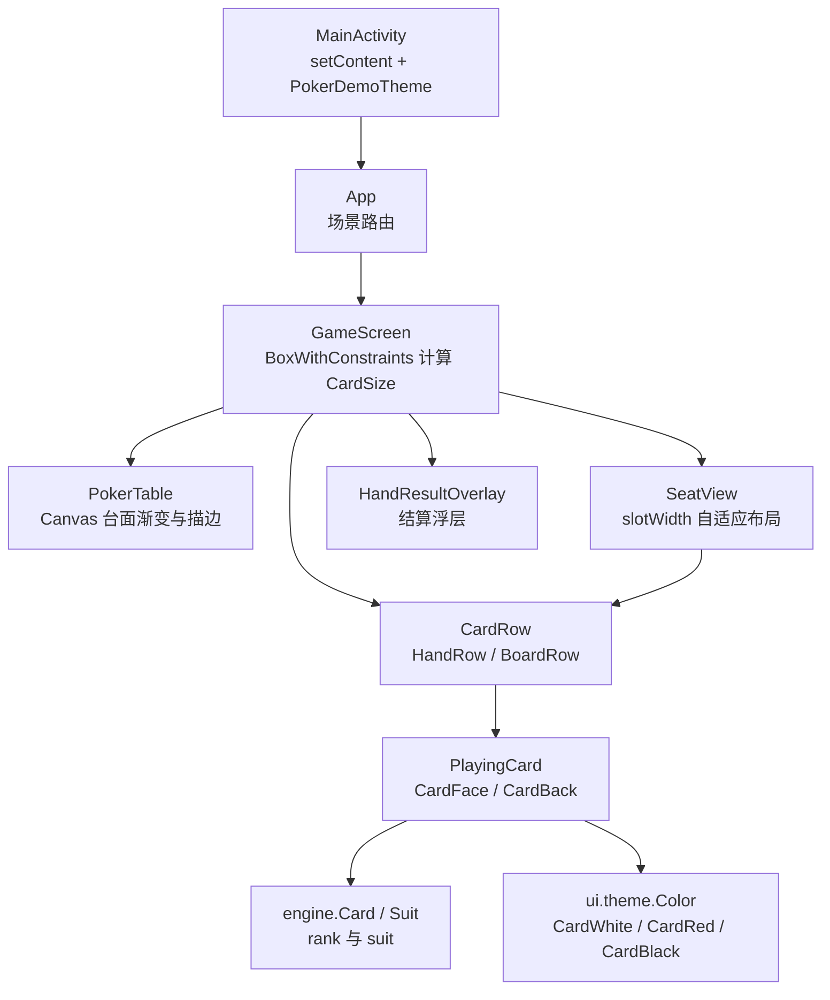
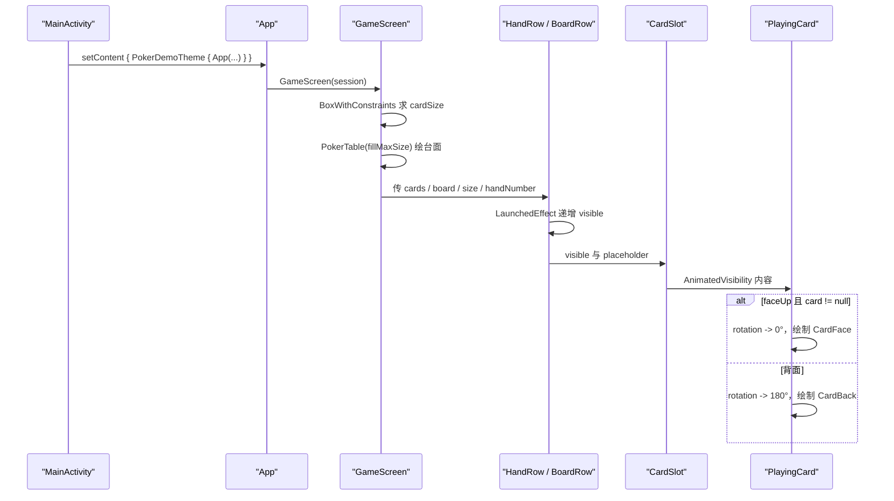
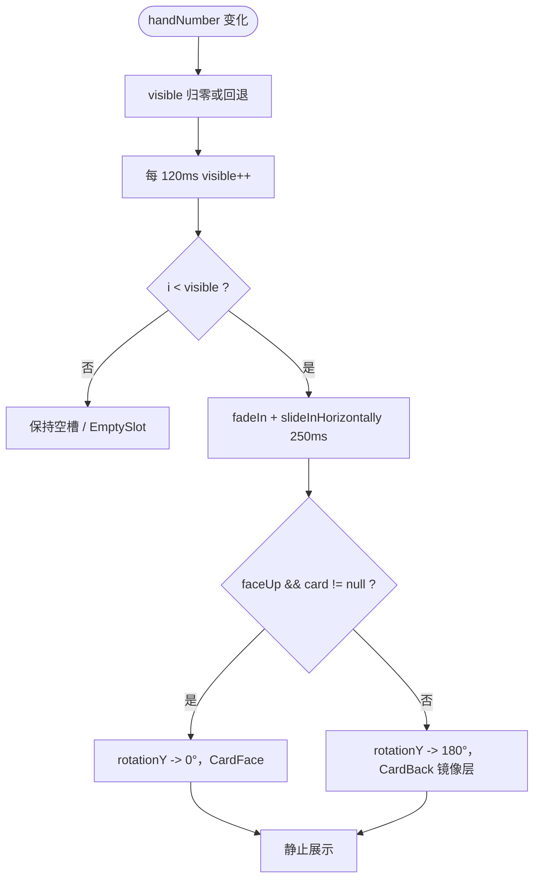
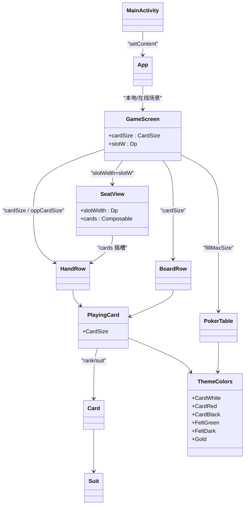

# 牌面视觉增强

<cite>
**本文引用的文件**
- [PlayingCard.kt](file://shared/src/commonMain/kotlin/com/aniapp/pokerdemo/ui/card/PlayingCard.kt)
- [CardRow.kt](file://shared/src/commonMain/kotlin/com/aniapp/pokerdemo/ui/card/CardRow.kt)
- [SeatView.kt](file://shared/src/commonMain/kotlin/com/aniapp/pokerdemo/ui/table/SeatView.kt)
- [PokerTable.kt](file://shared/src/commonMain/kotlin/com/aniapp/pokerdemo/ui/table/PokerTable.kt)
- [GameScreen.kt](file://shared/src/commonMain/kotlin/com/aniapp/pokerdemo/ui/GameScreen.kt)
- [StartScreen.kt](file://shared/src/commonMain/kotlin/com/aniapp/pokerdemo/ui/start/StartScreen.kt)
- [HandResultOverlay.kt](file://shared/src/commonMain/kotlin/com/aniapp/pokerdemo/ui/overlay/HandResultOverlay.kt)
- [Color.kt](file://shared/src/commonMain/kotlin/com/aniapp/pokerdemo/ui/theme/Color.kt)
- [Theme.kt](file://shared/src/commonMain/kotlin/com/aniapp/pokerdemo/ui/theme/Theme.kt)
- [Type.kt](file://shared/src/commonMain/kotlin/com/aniapp/pokerdemo/ui/theme/Type.kt)
- [Card.kt](file://shared/src/commonMain/kotlin/com/aniapp/pokerdemo/engine/Card.kt)
- [MainActivity.kt](file://app/src/main/java/com/aniapp/pokerdemo/MainActivity.kt)
- [App.kt](file://shared/src/commonMain/kotlin/com/aniapp/pokerdemo/ui/App.kt)
</cite>

## 目录
1. [引言](#引言)
2. [项目结构](#项目结构)
3. [核心组件](#核心组件)
4. [架构总览](#架构总览)
5. [详细组件分析](#详细组件分析)
   - [牌面渲染的当前形态](#牌面渲染的当前形态)
   - [用 Compose 绘制替代图片资源](#用-compose-绘制替代图片资源)
   - [牌背纹理与正面风格的统一](#牌背纹理与正面风格的统一)
   - [翻转动画与入场效果](#翻转动画与入场效果)
   - [随牌桌槽位自适应的尺寸方案](#随牌桌槽位自适应的尺寸方案)
   - [深色模式与主题色接入](#深色模式与主题色接入)
   - [无障碍与可读性支持](#无障碍与可读性支持)
6. [依赖关系分析](#依赖关系分析)
7. [性能与内存优化](#性能与内存优化)
8. [故障排查指南](#故障排查指南)
9. [结论](#结论)
10. [附录：实施清单与代码片段路径](#附录实施清单与代码片段路径)

## 引言
本指南面向希望把牌面从"文字卡片"升级为丰富视觉体验的开发者。历史上这一目标由 app 侧的 `ui/CardView.kt`、`ui/CardViewBack.kt` 与 `data/Card.kt` 承载，这些文件现已删除；牌面渲染整体迁移到 `shared` 模块，并以新的形态落地：

- 正反面一体的牌组件 `ui/card/PlayingCard.kt`（点数 + 花色符号、红黑配色、背面斜线纹理）。
- 横向排布容器 `ui/card/CardRow.kt`（`HandRow` / `BoardRow` + 空槽占位 + 逐张入场动画）。
- 座位组合 `ui/table/SeatView.kt`（手牌插槽 + 昵称、筹码、庄家与状态徽章、下注筹码）。
- 台面绘制 `ui/table/PokerTable.kt`（Canvas 绘制木色外圈 + `FeltGreen→FeltDark` 径向渐变台面 + `Gold` 描边内圈）。

原先按屏宽 ÷7 计算牌宽的 `cardSize()` 方案已不存在，取而代之的是在 `BoxWithConstraints` 中依据牌桌等宽槽位推导出的 `CardSize`。因此本指南的改进落点全部指向上述新文件：优先用 Compose 绘制（Canvas / Brush / shadow / RoundedCornerShape）而非引入图片资源，并在此基础上扩展渐变、阴影、圆角、动画、响应式尺寸与主题化配色。

## 项目结构
与牌面视觉直接相关的源码集中在 `shared` 的 `ui` 包，`app` 侧只保留入口：

- 牌面组件：`ui/card/PlayingCard.kt`、`ui/card/CardRow.kt`
- 牌桌与座位：`ui/table/PokerTable.kt`、`ui/table/SeatView.kt`
- 场景装配与尺寸来源：`ui/GameScreen.kt`、`ui/start/StartScreen.kt`、`ui/overlay/HandResultOverlay.kt`
- 数据模型：`engine/Card.kt`（`Suit`、`rank`、`createDeck()`、`Deck`）
- 主题：`ui/theme/Color.kt`、`ui/theme/Theme.kt`、`ui/theme/Type.kt`
- 宿主入口：`app/.../MainActivity.kt`、`shared/.../ui/App.kt`

图示来源
- [MainActivity.kt:24-47](file://app/src/main/java/com/aniapp/pokerdemo/MainActivity.kt#L24-L47)
- [App.kt:76-86](file://shared/src/commonMain/kotlin/com/aniapp/pokerdemo/ui/App.kt#L76-L86)
- [GameScreen.kt:48-76](file://shared/src/commonMain/kotlin/com/aniapp/pokerdemo/ui/GameScreen.kt#L48-L76)
- [PokerTable.kt:16-38](file://shared/src/commonMain/kotlin/com/aniapp/pokerdemo/ui/table/PokerTable.kt#L16-L38)
- [SeatView.kt:37-63](file://shared/src/commonMain/kotlin/com/aniapp/pokerdemo/ui/table/SeatView.kt#L37-L63)
- [CardRow.kt:26-81](file://shared/src/commonMain/kotlin/com/aniapp/pokerdemo/ui/card/CardRow.kt#L26-L81)
- [PlayingCard.kt:36-130](file://shared/src/commonMain/kotlin/com/aniapp/pokerdemo/ui/card/PlayingCard.kt#L36-L130)
- [Card.kt:5-22](file://shared/src/commonMain/kotlin/com/aniapp/pokerdemo/engine/Card.kt#L5-L22)
- [Color.kt:5-14](file://shared/src/commonMain/kotlin/com/aniapp/pokerdemo/ui/theme/Color.kt#L5-L14)

章节来源
- [MainActivity.kt:24-47](file://app/src/main/java/com/aniapp/pokerdemo/MainActivity.kt#L24-L47)
- [GameScreen.kt:48-131](file://shared/src/commonMain/kotlin/com/aniapp/pokerdemo/ui/GameScreen.kt#L48-L131)
- [Card.kt:1-35](file://shared/src/commonMain/kotlin/com/aniapp/pokerdemo/engine/Card.kt#L1-L35)

## 核心组件
- 牌面组件
  - `PlayingCard(card, faceUp, size, modifier)`：唯一对外牌组件，`showFace = faceUp && card != null`，内部按旋转角度切换 `CardFace` 与 `CardBack`。
  - `CardFace`：左上/右下对角显示点数与花色（右下角整组 `rotate(180f)`），中央绘制大号花色符号；`♠/♣` 取 `CardBlack`，`♥/♦` 取 `CardRed`。
  - `CardBack`：深蓝线性渐变底 + 浅色描边 + Canvas 交叉斜线纹理。
  - `CardSize(width)`：值对象，`height` 固定为 `width * 1.4f`，保证标准扑克比例。
- 排布容器
  - `HandRow`：两张底牌槽位，弃牌时列表为空即不显示。
  - `BoardRow`：五个公共牌槽位，未发牌位置由 `EmptySlot` 半透明白描边占位。
  - `CardSlot`：固定尺寸 Box + `AnimatedVisibility`，负责入场淡入与水平滑入。
- 牌桌与座位
  - `PokerTable`：单个 `Canvas` 依次绘制木色椭圆外圈、径向渐变台呢、`Gold` 细描边内圈。
  - `SeatView`：以 `slotWidth` 驱动 `stacked` / `tiny` 两档压缩布局，`cards()` 作为插槽由外部传入牌行。
- 数据模型
  - `Suit`：`SPADES / HEARTS / DIAMONDS / CLUBS`；`Card(rank, suit)` 中 `rank` 为 `2..14`，`14/13/12/11` 映射为 `A/K/Q/J`。
- 主题
  - `PokerDemoTheme` 固定使用 `darkColorScheme`，牌面相关颜色常量集中在 `ui/theme/Color.kt`。

章节来源
- [PlayingCard.kt:36-130](file://shared/src/commonMain/kotlin/com/aniapp/pokerdemo/ui/card/PlayingCard.kt#L36-L130)
- [CardRow.kt:26-108](file://shared/src/commonMain/kotlin/com/aniapp/pokerdemo/ui/card/CardRow.kt#L26-L108)
- [PokerTable.kt:16-39](file://shared/src/commonMain/kotlin/com/aniapp/pokerdemo/ui/table/PokerTable.kt#L16-L39)
- [SeatView.kt:37-134](file://shared/src/commonMain/kotlin/com/aniapp/pokerdemo/ui/table/SeatView.kt#L37-L134)
- [Card.kt:5-22](file://shared/src/commonMain/kotlin/com/aniapp/pokerdemo/engine/Card.kt#L5-L22)
- [Theme.kt:7-27](file://shared/src/commonMain/kotlin/com/aniapp/pokerdemo/ui/theme/Theme.kt#L7-L27)

## 架构总览
下图展示从入口到牌面绘制的一次渲染链路，以及牌面可见性与动画的决策点。

图示来源
- [MainActivity.kt:29-47](file://app/src/main/java/com/aniapp/pokerdemo/MainActivity.kt#L29-L47)
- [App.kt:76-86](file://shared/src/commonMain/kotlin/com/aniapp/pokerdemo/ui/App.kt#L76-L86)
- [GameScreen.kt:48-76](file://shared/src/commonMain/kotlin/com/aniapp/pokerdemo/ui/GameScreen.kt#L48-L76)
- [CardRow.kt:26-56](file://shared/src/commonMain/kotlin/com/aniapp/pokerdemo/ui/card/CardRow.kt#L26-L56)
- [CardRow.kt:84-100](file://shared/src/commonMain/kotlin/com/aniapp/pokerdemo/ui/card/CardRow.kt#L84-L100)
- [PlayingCard.kt:40-63](file://shared/src/commonMain/kotlin/com/aniapp/pokerdemo/ui/card/PlayingCard.kt#L40-L63)

## 详细组件分析

### 牌面渲染的当前形态
现状已经不再是"纯文字卡片"，而是完全由 Compose 绘制出来的复合牌面：

- 结构与层次
  - `Modifier.size(size.width, size.height)` → `graphicsLayer { rotationY; cameraDistance = 12 * density }` → 内容层。
  - 正面：`shadow(4.dp, RoundedCornerShape(8.dp))` + `background(CardWhite, RoundedCornerShape(8.dp))` + `padding(size.width * 0.08f)`，形成阴影、圆角与内缩安全区。
  - 背面：同样的阴影与圆角半径，底色换成 `Brush.linearGradient(0xFF2A4D8F → 0xFF152A52)`，再叠 `border(1.dp, 0xFF8FA8D8)`，最后用 `Canvas` 画交叉斜线。
- 字号随牌宽缩放
  - 角标点数 `size.width.value * 0.22f` sp、角标花色 `* 0.20f` sp、中央花色 `* 0.5f` sp，因此同一组件在手机与桌面视口都能保持比例一致。
- 牌桌背景
  - 台面不是硬编码纯色，而是 `PokerTable` 的 Canvas 分层：木色外圈 `0xFF2E1F14`、`Brush.radialGradient(listOf(FeltGreen, FeltDark), center = Offset(w/2, h*0.43), radius = w*0.6)` 的台呢、以及 `Gold.copy(alpha = 0.25f)` 的 2px 描边内圈。

进一步增强的落点
- 若需要更真实的纸牌质感，可在 `CardFace` 的底色上叠加一层极淡的 `Brush.linearGradient`（例如 `CardWhite → Color(0xFFF2EFE4)`），并把边框改为 `border(1.dp, Color(0xFFE0DCCE), RoundedCornerShape(8.dp))`，改动仅涉及该函数体。
- 花色的表现力可以从 Unicode 符号升级为 `Path` 矢量：在 `CardFace` 内用 `Canvas` + `drawPath` 替换中央 `Text(symbol)`，即可得到可缩放、可描边、可填充渐变的真正的图形花色。

章节来源
- [PlayingCard.kt:65-100](file://shared/src/commonMain/kotlin/com/aniapp/pokerdemo/ui/card/PlayingCard.kt#L65-L100)
- [PlayingCard.kt:102-130](file://shared/src/commonMain/kotlin/com/aniapp/pokerdemo/ui/card/PlayingCard.kt#L102-L130)
- [PokerTable.kt:16-38](file://shared/src/commonMain/kotlin/com/aniapp/pokerdemo/ui/table/PokerTable.kt#L16-L38)

### 用 Compose 绘制替代图片资源
当前实现刻意不使用任何位图或 VectorDrawable 牌面资源：`app/src/main/res` 下没有牌面图片，`app` 侧唯一的 `painterResource` 用法是启动页 Logo 图标。因此"用图片替代文字"这一方向在本仓库应以 **Compose 绘制** 为准，而不是引入图片管线。

推荐做法（按优先级）
1. 自定义 `DrawScope` 绘制：把 `CardFace` 中央符号与牌背纹理继续用 `Canvas` + `drawPath` / `drawLine` 表达，零 I/O、零解码、随 `size` 自动矢量缩放。
2. 渐变与阴影：沿用 `Brush.linearGradient` / `Brush.radialGradient` + `shadow(elevation, shape)` + `RoundedCornerShape`，与 `PokerTable` 的台面渐变语言保持一致。
3. 仅在确需照片级材质时才引入图片资源，此时必须放在 `shared` 的可共享资源体系里（本项目 UI 全在 `commonMain`，Android 专属的 `painterResource(R.drawable...)` 无法跨端复用），并注意：
   - 以密度分档提供资源，避免超大位图直接进入内存。
   - 用 `remember` 缓存解码结果，配合 `ContentScale.Crop` 与固定 `size` 约束防止越界重绘。
   - 装饰性图层 `contentDescription = null`，信息性图层给出完整描述。

自定义 Painter 的思路
- 若要把牌面样式抽成可复用绘制器，可实现一个 `CardPainter(size: LongSize, card: Card?)`，在 `apply(density, alpha)` 中一次性画出圆角底、渐变、边框、角标与中央花色，然后由 `Modifier.paint(remember(size, card) { CardPainter(size, card) })` 使用。相比多个 `Box` + `Text` 层级，它能减少布局节点，但会失去文本自动换行与字体缩放能力；现有实现选择 `Text` + `sp` 缩放正是为了保留后者。

章节来源
- [PlayingCard.kt:102-130](file://shared/src/commonMain/kotlin/com/aniapp/pokerdemo/ui/card/PlayingCard.kt#L102-L130)
- [PokerTable.kt:17-37](file://shared/src/commonMain/kotlin/com/aniapp/pokerdemo/ui/table/PokerTable.kt#L17-L37)
- [MainActivity.kt:32-40](file://app/src/main/java/com/aniapp/pokerdemo/MainActivity.kt#L32-L40)

### 牌背纹理与正面风格的统一
正反面已经在同一个 `PlayingCard` 组件内，天然共享尺寸与几何风格：

| 属性 | 正面 `CardFace` | 背面 `CardBack` |
| --- | --- | --- |
| 尺寸 | `size.width × size.height`（`height = width * 1.4f`） | 同左 |
| 阴影 | `shadow(4.dp, RoundedCornerShape(8.dp))` | 同左 |
| 圆角 | 8.dp | 8.dp（纹理裁剪为 5.dp 内圆角） |
| 底色 | `CardWhite` 纯色 | `0xFF2A4D8F → 0xFF152A52` 线性渐变 |
| 边框 | 无 | `1.dp`，`0xFF8FA8D8` |
| 纹理 | 点数 + 花色符号 | Canvas 交叉斜线，间距 `size.width.toPx() / 4f` |

统一的抓手是把散落在两个私有函数里的字面量提升为主题常量。目前 `CardWhite / CardRed / CardBlack` 已在 `ui/theme/Color.kt` 中，而背面蓝、边框浅蓝、斜线蓝与木色外圈仍是就地写死的十六进制值；新增牌背配色时应一并迁入 `Color.kt`，避免出现两套风格。纹理密度也已随牌宽变化（步长取自 `size.width.toPx()`），因此小尺寸对手牌与大尺寸公共牌看起来是同一套图案的不同缩放，而非不同图案。

章节来源
- [PlayingCard.kt:65-100](file://shared/src/commonMain/kotlin/com/aniapp/pokerdemo/ui/card/PlayingCard.kt#L65-L100)
- [PlayingCard.kt:102-130](file://shared/src/commonMain/kotlin/com/aniapp/pokerdemo/ui/card/PlayingCard.kt#L102-L130)
- [Color.kt:5-14](file://shared/src/commonMain/kotlin/com/aniapp/pokerdemo/ui/theme/Color.kt#L5-L14)
- [PokerTable.kt:19-22](file://shared/src/commonMain/kotlin/com/aniapp/pokerdemo/ui/table/PokerTable.kt#L19-L22)

### 翻转动画与入场效果
牌面动画由两层组成，二者职责清晰分离：

1. 翻面（`PlayingCard` 内部）
   - `animateFloatAsState(targetValue = if (showFace) 0f else 180f, animationSpec = tween(400))` 驱动 `rotationY`。
   - `cameraDistance = 12 * density` 提供 3D 透视感。
   - `rotation <= 90f` 时绘制正面（或在 `card == null` 时退化为背面），否则把 `CardBack` 放进 `graphicsLayer { rotationY = 180f }` 的镜像层，避免背面文字左右颠倒。
2. 逐张入场（`CardRow` 内部）
   - `LaunchedEffect(handNumber, cards.size)` 每 `delay(120)` 递增 `visible`，形成依次发牌节奏。
   - `CardSlot` 用 `AnimatedVisibility(enter = fadeIn(tween(250)) + slideInHorizontally(tween(250)) { -it / 2 }, exit = fadeOut(tween(150)))` 完成淡入 + 左侧滑入。
   - `handNumber` 变化时若已显示数量超过新牌数会先归零，保证新一手重新播放动画。

其它已有的运动语言
- 摊牌揭示：对手的 `faceUp` 来自 `table.revealedHoles.containsKey(s.seat)`，翻面动画因此自动成为"亮牌"效果。
- 数值过渡：底池 `animateIntAsState(table.pot, tween(400))`、座位筹码 `animateIntAsState(seat.chips, tween(500))`。
- 结算浮层：`AnimatedVisibility(fadeIn(tween(300)) / fadeOut(tween(200)))`。
- 静态摆牌：启动页用 `Modifier.rotate(-16f)` / `rotate(16f)` 给两张 `CardSize(76.dp)` 的牌做扇形倾斜。

扩展建议
- 若要加入"点击翻牌"交互，应在调用方持有状态并改变 `faceUp`，不要在 `PlayingCard` 内引入点击语义；同时动画期间屏蔽交互，避免 `rotation` 抖动。
- 入场动画的 120ms 步进与 250ms 时长属于经验值，加快发牌节奏时两者需同步调整，否则会出现前一张尚未落位、后一张已经开始的情况。

图示来源
- [CardRow.kt:34-55](file://shared/src/commonMain/kotlin/com/aniapp/pokerdemo/ui/card/CardRow.kt#L34-L55)
- [CardRow.kt:84-100](file://shared/src/commonMain/kotlin/com/aniapp/pokerdemo/ui/card/CardRow.kt#L84-L100)
- [PlayingCard.kt:41-62](file://shared/src/commonMain/kotlin/com/aniapp/pokerdemo/ui/card/PlayingCard.kt#L41-L62)
- [GameScreen.kt:66-70](file://shared/src/commonMain/kotlin/com/aniapp/pokerdemo/ui/GameScreen.kt#L66-L70)

章节来源
- [PlayingCard.kt:40-63](file://shared/src/commonMain/kotlin/com/aniapp/pokerdemo/ui/card/PlayingCard.kt#L40-L63)
- [CardRow.kt:26-108](file://shared/src/commonMain/kotlin/com/aniapp/pokerdemo/ui/card/CardRow.kt#L26-L108)
- [GameScreen.kt:95-97](file://shared/src/commonMain/kotlin/com/aniapp/pokerdemo/ui/GameScreen.kt#L95-L97)
- [SeatView.kt:74-76](file://shared/src/commonMain/kotlin/com/aniapp/pokerdemo/ui/table/SeatView.kt#L74-L76)
- [HandResultOverlay.kt:38-44](file://shared/src/commonMain/kotlin/com/aniapp/pokerdemo/ui/overlay/HandResultOverlay.kt#L38-L44)
- [StartScreen.kt:88-95](file://shared/src/commonMain/kotlin/com/aniapp/pokerdemo/ui/start/StartScreen.kt#L88-L95)

### 随牌桌槽位自适应的尺寸方案
`cardSize()`（按屏宽 ÷7 求 Dp 的扩展函数）已被移除，当前尺寸由两级推导构成，全部发生在 `GameScreen` 的 `BoxWithConstraints` 作用域内：

1. 全局基准牌宽
   - `val cardSize = CardSize(minOf(maxWidth / (if (table.seats.size > 3) 9f else 7.2f), 64.dp))`
   - 除数随人数档位切换：多人桌按 `maxWidth / 9` 收紧，少人桌按 `maxWidth / 7.2` 放宽；`minOf(..., 64.dp)` 为大屏设置上限，避免牌在桌面上过大。
   - 该基准用于玩家自己的底牌与五个公共牌行。
2. 对手牌宽受槽位二次收敛
   - 水平方向先把可用宽度等分：`val slotW = maxWidth / opponents.size`，注释明确说明"等分槽位保证相邻座位列永不交叠"。
   - 每位对手的牌宽取 `oppCardSize = CardSize(minOf(cardSize.width, (slotW - 14.dp) / 2f))`，即两张牌加上 14.dp 安全余量必须塞进所属槽位。
   - `slotW` 同时作为 `slotWidth` 传给 `SeatView`，驱动其 `stacked`（`< 160.dp`）与 `tiny`（`< 110.dp`）两档压缩：徽章文案缩短为"全"/"托"，字号降至 11/10.sp，间距随之收窄。
3. 垂直定位
   - 对手沿椭圆弧分布：`x = -maxWidth/2 + slotW * (j + 0.5)`，`y = -maxHeight * 0.16 * (1 + sin(π * f))`，其中 `f = (j + 0.5)/opponents.size`，从而在等宽槽位约束下保留环坐观感。

由于 `CardSize.height = width * 1.4f` 是派生属性，只要宽度确定，整张牌（含角标与中央符号的 `sp` 字号、背面纹理步长）都会同步缩放，无需再针对屏幕密度单独调参。渲染回归测试覆盖 2–6 人与手机（360×780）/桌面（1280×800）两种视口，可作为尺寸改动的验证入口。

章节来源
- [GameScreen.kt:48-76](file://shared/src/commonMain/kotlin/com/aniapp/pokerdemo/ui/GameScreen.kt#L48-L76)
- [GameScreen.kt:104-115](file://shared/src/commonMain/kotlin/com/aniapp/pokerdemo/ui/GameScreen.kt#L104-L115)
- [SeatView.kt:37-63](file://shared/src/commonMain/kotlin/com/aniapp/pokerdemo/ui/table/SeatView.kt#L37-L63)
- [SeatView.kt:77-134](file://shared/src/commonMain/kotlin/com/aniapp/pokerdemo/ui/table/SeatView.kt#L77-L134)
- [PlayingCard.kt:36-38](file://shared/src/commonMain/kotlin/com/aniapp/pokerdemo/ui/card/PlayingCard.kt#L36-L38)
- [TableLayoutRenderTest.kt:73-88](file://shared/src/desktopTest/kotlin/com/aniapp/pokerdemo/ui/TableLayoutRenderTest.kt#L73-L88)

### 深色模式与主题色接入
牌桌本身就是暗色调场景，因此主题不做明暗双份：

- `PokerDemoTheme` 只提供 `darkColorScheme`，把 `primary = Gold`、`secondary = FeltGreen`、`background = TableBackground`、`surface = TableSurface` 注入 `MaterialTheme`，`typography` 来自 `Type.kt` 的单一 `bodyLarge` 样式。
- 页面底色统一取 `TableBackground`（`GameScreen`、`App.CenterMessage`、`StartScreen` 三处一致），不再存在硬编码绿色背景；台面绿色则由 `PokerTable` 的 `FeltGreen/FeltDark` 渐变承担，与主题常量同源。
- 牌面配色走独立的一组常量：`CardWhite` 作底、`CardRed`/`CardBlack` 按花色二选一，这组颜色刻意不跟随 Material 调色板，以保证在任何主题下牌面可读性恒定。

若后续要支持动态主题或浅色场景，建议的接入顺序是：先在 `Color.kt` 补齐牌背与描边常量，再让 `CardFace`/`CardBack` 从 `MaterialTheme.colorScheme` 读取表面色而非直接引用 `CardWhite`，最后把 `PokerDemoTheme` 扩展为按 `isSystemInDarkTheme()` 选择两套 `colorScheme`；`app/src/main/res/values/colors.xml` 中的模板色仅供系统级素材（如 `ic_launcher_background`）使用，不参与牌面绘制。

章节来源
- [Theme.kt:7-27](file://shared/src/commonMain/kotlin/com/aniapp/pokerdemo/ui/theme/Theme.kt#L7-L27)
- [Color.kt:5-14](file://shared/src/commonMain/kotlin/com/aniapp/pokerdemo/ui/theme/Color.kt#L5-L14)
- [GameScreen.kt:48-52](file://shared/src/commonMain/kotlin/com/aniapp/pokerdemo/ui/GameScreen.kt#L48-L52)
- [PokerTable.kt:23-30](file://shared/src/commonMain/kotlin/com/aniapp/pokerdemo/ui/table/PokerTable.kt#L23-L30)
- [App.kt:132-134](file://shared/src/commonMain/kotlin/com/aniapp/pokerdemo/ui/App.kt#L132-L134)
- [Type.kt:9-16](file://shared/src/commonMain/kotlin/com/aniapp/pokerdemo/ui/theme/Type.kt#L9-L16)

### 无障碍与可读性支持
当前牌面完全由 `Text` 与 `Canvas` 组成，未提供任何语义描述：`PlayingCard` 的三个 `Text` 都没有 `semantics` 声明，`Canvas` 绘制的牌背纹理与台面也是纯装饰。这意味着读屏软件只能读到裸露的字符（如"A""♠"），无法获知"这是哪张牌、属于哪个座位、是否已亮牌"。

建议的最小改造
- 在 `PlayingCard` 外层加 `Modifier.semantics { contentDescription = ... }`，用 `engine/Card.kt` 的 `toString()`（输出 `As`、`Kh` 这类紧凑记号）之外的可读拼接，例如"红心 A"；`card == null || !faceUp` 时描述为"背面牌"。
- 中央大花色与牌背斜线属于重复信息/装饰，应标记为隐藏（`Modifier.semantics { hideFromAccessibility() }` 或不为 `Canvas` 添加语义），避免朗读冗余。
- `SeatView` 的徽章目前用单字"全""托"承载含义，窄槽位下更是首选形态；应为它们补 `contentDescription`（"全下""托管"），并保持 `DealerBadge` 的"D"附带"庄家"描述。
- 对比度方面，`CardRed = 0xFFD32F2F` 与 `CardBlack = 0xFF212121` 落在 `CardWhite = 0xFFFDFDF8` 上有充足余量；但 `SeatView` 中 `Color.White.copy(alpha = 0.4f)` 的弃牌透明度与 `StatusBadges` 的 9.sp 文字在小屏上偏弱，调整时不要低于现有对比水平。
- 文本均设置了 `lineHeight`（角标与中央符号各自等于自身字号），新增样式时保持这一约束，防止 `stacked`/`tiny` 档位下行高挤压导致裁切。

章节来源
- [PlayingCard.kt:65-100](file://shared/src/commonMain/kotlin/com/aniapp/pokerdemo/ui/card/PlayingCard.kt#L65-L100)
- [PlayingCard.kt:102-130](file://shared/src/commonMain/kotlin/com/aniapp/pokerdemo/ui/card/PlayingCard.kt#L102-L130)
- [SeatView.kt:143-176](file://shared/src/commonMain/kotlin/com/aniapp/pokerdemo/ui/table/SeatView.kt#L143-L176)
- [SeatView.kt:43-47](file://shared/src/commonMain/kotlin/com/aniapp/pokerdemo/ui/table/SeatView.kt#L43-L47)
- [Card.kt:11-21](file://shared/src/commonMain/kotlin/com/aniapp/pokerdemo/engine/Card.kt#L11-L21)

## 依赖关系分析
- `MainActivity` 只做宿主工作：`enableEdgeToEdge()`、`PokerDemoTheme { App(...) }`，并把 debug 场景牌序列转成 `Deck`。
- `App` 负责场景路由，本地与在线两条分支最终都渲染同一个 `GameScreen`。
- `GameScreen` 是尺寸与配色的唯一汇聚点：它计算 `cardSize` 与 `slotW`，装配 `PokerTable`、`SeatView`、`HandRow`、`BoardRow`、`ActionBar`、`HandResultOverlay`。
- `SeatView` 不直接依赖牌组件，而是通过 `cards: @Composable () -> Unit` 插槽接收 `HandRow`，座位逻辑与牌面视觉解耦。
- `CardRow` 依赖 `PlayingCard`，`PlayingCard` 依赖 `engine.Card/Suit` 与 `ui.theme` 的三个牌面颜色常量。
- `PokerTable` 只依赖 `ui.theme` 的台面颜色，与牌面无耦合。

图示来源
- [MainActivity.kt:29-47](file://app/src/main/java/com/aniapp/pokerdemo/MainActivity.kt#L29-L47)
- [App.kt:76-113](file://shared/src/commonMain/kotlin/com/aniapp/pokerdemo/ui/App.kt#L76-L113)
- [GameScreen.kt:48-76](file://shared/src/commonMain/kotlin/com/aniapp/pokerdemo/ui/GameScreen.kt#L48-L76)
- [GameScreen.kt:95-115](file://shared/src/commonMain/kotlin/com/aniapp/pokerdemo/ui/GameScreen.kt#L95-L115)
- [SeatView.kt:37-63](file://shared/src/commonMain/kotlin/com/aniapp/pokerdemo/ui/table/SeatView.kt#L37-L63)
- [CardRow.kt:26-81](file://shared/src/commonMain/kotlin/com/aniapp/pokerdemo/ui/card/CardRow.kt#L26-L81)
- [PlayingCard.kt:31-45](file://shared/src/commonMain/kotlin/com/aniapp/pokerdemo/ui/card/PlayingCard.kt#L31-L45)
- [PokerTable.kt:12-16](file://shared/src/commonMain/kotlin/com/aniapp/pokerdemo/ui/table/PokerTable.kt#L12-L16)

章节来源
- [GameScreen.kt:48-131](file://shared/src/commonMain/kotlin/com/aniapp/pokerdemo/ui/GameScreen.kt#L48-L131)
- [SeatView.kt:37-63](file://shared/src/commonMain/kotlin/com/aniapp/pokerdemo/ui/table/SeatView.kt#L37-L63)

## 性能与内存优化
- 绘制成本
  - 牌面全部即时绘制，没有位图解码与图片缓存问题；一桌最多 5（公共牌）+ 2×座位数（底牌）张牌，每张包含 3 个 `Text` 与一次 `shadow`，属于可控规模。
  - `shadow(elevation, shape)` 会为每个形状生成投影层，牌数较多时优先靠 `CardWhite` 上的浅色 `border` 制造立体感，而不是继续抬高 elevation。
-  recomposition 范围
  - `PlayingCard` 的输入只有 `card / faceUp / size`，都是不可变值；`CardSize` 是 `data class`，相同宽度不会触发额外失效。
  - 发牌进度用 `mutableIntStateOf` 保存在 `remember(handNumber)` 中，`visible` 递增只会影响各 `CardSlot` 的 `AnimatedVisibility`，不会重算整桌布局。
  - 台面 `PokerTable` 是无状态 `Canvas`，参数只有 `Modifier`，牌局状态变化不会让它重绘内容。
- 动画
  - 统一使用 `animateFloatAsState` / `animateIntAsState` + `tween`，由 Compose 帧调度驱动，无需自建定时器。
  - 发牌的 `delay(120)` 循环绑定在 `LaunchedEffect(handNumber, cards.size)` 上，key 变化会自动取消上一轮协程，注意不要把它改成不带 key 的常驻循环。
- 高分辨率与大屏
  - 由于采用矢量绘制 + `sp` 相对字号，不存在"高分辨率图"采样问题；大屏只需通过 `CardSize` 的上限（当前 64.dp）控制视觉重量，避免牌铺满桌面。
- 主题常量
  - 颜色以顶层 `val` 形式定义在 `ui/theme/Color.kt`，`Color` 本身是不可变值对象，重组时不会重建；新增样式请沿用这一方式而非在 Composable 内构造 `Color(...)`。

[本节为通用指导，不直接分析具体文件]

## 故障排查指南
- 牌显示过小或被截断
  - 检查 `GameScreen` 中 `cardSize` 的除数与 `64.dp` 上限是否与当前座位数匹配；人多时 `oppCardSize` 会被 `(slotW - 14.dp) / 2f` 进一步压小。
  - 确认 `CardSize.height` 未被外部覆盖：它恒为 `width * 1.4f`，任何强行指定高度的写法都会破坏比例。
- 相邻座位互相遮挡
  - 槽位等分是防重叠的前提：`slotW = maxWidth / opponents.size`，并且 `SeatView` 只有在 `slotWidth != Dp.Unspecified` 时才启用 `bounded` 分支。若绕过 `slotWidth` 直接摆放 `SeatView`，`stacked/tiny` 压缩不会生效。
- 翻面看到反向内容
  - `rotation > 90f` 分支必须把 `CardBack` 放进带 `graphicsLayer { rotationY = 180f }` 的镜像 Box；去掉该层会让背面出现左右翻转。
- 背面纹理消失或异常密集
  - 纹理步长来自 `size.width.toPx() / 4f`，且 `Canvas` 被 `clip(RoundedCornerShape(5.dp))` 限制在内圆角内；两者任一被改动都可能让斜线溢出或稀疏到看不见。
- 新一手不重播发牌动画
  - `HandRow`/`BoardRow` 的动画状态 key 是 `handNumber`，务必把它一路传下来；固定传常量会让 `visible` 停在已满状态。
- 公共牌位置跳动
  - 未发牌槽位由 `EmptySlot` 占位（半透明白描边、圆角 8.dp）。移除占位会让 `BoardRow` 宽度随街段变化，进而推动整行重排。
- 颜色与设计稿不一致
  - 先确认改动落在 `ui/theme/Color.kt` 还是组件内的字面量：牌背蓝、台面木色目前仍是组件内硬编码，主题常量只覆盖 `CardWhite/CardRed/CardBlack` 与 `Felt*/Gold/Table*`。

章节来源
- [GameScreen.kt:48-76](file://shared/src/commonMain/kotlin/com/aniapp/pokerdemo/ui/GameScreen.kt#L48-L76)
- [SeatView.kt:45-47](file://shared/src/commonMain/kotlin/com/aniapp/pokerdemo/ui/table/SeatView.kt#L45-L47)
- [PlayingCard.kt:56-62](file://shared/src/commonMain/kotlin/com/aniapp/pokerdemo/ui/card/PlayingCard.kt#L56-L62)
- [PlayingCard.kt:118-129](file://shared/src/commonMain/kotlin/com/aniapp/pokerdemo/ui/card/PlayingCard.kt#L118-L129)
- [CardRow.kt:34-55](file://shared/src/commonMain/kotlin/com/aniapp/pokerdemo/ui/card/CardRow.kt#L34-L55)
- [CardRow.kt:102-108](file://shared/src/commonMain/kotlin/com/aniapp/pokerdemo/ui/card/CardRow.kt#L102-L108)

## 结论
牌面视觉增强在本仓库的正确落点是 `shared` 的 Compose 绘制层，而不是 app 侧的图片资源：`PlayingCard` 已经把正反面、渐变、阴影、圆角、纹理与翻面动画收在一个组件里；`CardRow` 负责逐张入场与空槽占位；`SeatView` 通过 `slotWidth` 把座位信息与牌插槽组合起来；`PokerTable` 用单个 Canvas 建立台面视觉基座。尺寸策略也已从 `cardSize()` 的屏宽除法升级为"基准牌宽 + 等分槽位二次收敛 + 高度派生比例"。

推进顺序建议：先把牌背与台面的硬编码色迁入 `Color.kt` 以统一风格，再把中央花色从 Unicode 符号升级为 `Path` 矢量以获得更强的表现力，随后补充 `semantics` 让读屏用户能识别每张牌与每个状态徽章，最后才考虑动效细化（翻牌时长、发牌步进）与极端视口下的槽位阈值调参。所有改动都可以用 `TableLayoutRenderTest` 的多人数、双视口快照回归来验证。

[本节为总结性内容，不直接分析具体文件]

## 附录：实施清单与代码片段路径
- 牌面组件
  - 尺寸值对象与翻面容器：[PlayingCard.kt:36-63](file://shared/src/commonMain/kotlin/com/aniapp/pokerdemo/ui/card/PlayingCard.kt#L36-L63)
  - 正面角标、中央花色与红黑配色：[PlayingCard.kt:65-100](file://shared/src/commonMain/kotlin/com/aniapp/pokerdemo/ui/card/PlayingCard.kt#L65-L100)
  - 背面渐变、描边与斜线纹理：[PlayingCard.kt:102-130](file://shared/src/commonMain/kotlin/com/aniapp/pokerdemo/ui/card/PlayingCard.kt#L102-L130)
- 排布与入场
  - 底牌行与公共牌行的逐张显示：[CardRow.kt:26-81](file://shared/src/commonMain/kotlin/com/aniapp/pokerdemo/ui/card/CardRow.kt#L26-L81)
  - 槽位动画与空槽占位：[CardRow.kt:84-108](file://shared/src/commonMain/kotlin/com/aniapp/pokerdemo/ui/card/CardRow.kt#L84-L108)
- 牌桌与座位
  - 台面三层绘制（木圈 / 径向渐变 / 金描边）：[PokerTable.kt:16-38](file://shared/src/commonMain/kotlin/com/aniapp/pokerdemo/ui/table/PokerTable.kt#L16-L38)
  - 槽位驱动的压缩档位与徽章：[SeatView.kt:37-134](file://shared/src/commonMain/kotlin/com/aniapp/pokerdemo/ui/table/SeatView.kt#L37-L134)
  - 下注筹码绘制：[SeatView.kt:178-197](file://shared/src/commonMain/kotlin/com/aniapp/pokerdemo/ui/table/SeatView.kt#L178-L197)
- 尺寸与装配
  - `cardSize` 与 `slotW` 推导、弧线定位：[GameScreen.kt:48-76](file://shared/src/commonMain/kotlin/com/aniapp/pokerdemo/ui/GameScreen.kt#L48-L76)
  - 玩家座位与公共牌行使用基准牌宽：[GameScreen.kt:95-115](file://shared/src/commonMain/kotlin/com/aniapp/pokerdemo/ui/GameScreen.kt#L95-L115)
  - 对手底牌的可见性来源：[GameScreen.kt:133-138](file://shared/src/commonMain/kotlin/com/aniapp/pokerdemo/ui/GameScreen.kt#L133-L138)
  - 启动页静态摆牌示例：[StartScreen.kt:88-95](file://shared/src/commonMain/kotlin/com/aniapp/pokerdemo/ui/start/StartScreen.kt#L88-L95)
  - 结算浮层的淡入淡出与面板样式：[HandResultOverlay.kt:38-68](file://shared/src/commonMain/kotlin/com/aniapp/pokerdemo/ui/overlay/HandResultOverlay.kt#L38-L68)
- 数据模型
  - `Suit`、`Card.rank` 与字符串表示：[Card.kt:5-22](file://shared/src/commonMain/kotlin/com/aniapp/pokerdemo/engine/Card.kt#L5-L22)
- 主题与颜色
  - 牌面与台面颜色常量：[Color.kt:5-14](file://shared/src/commonMain/kotlin/com/aniapp/pokerdemo/ui/theme/Color.kt#L5-L14)
  - 暗色 colorScheme 与主题封装：[Theme.kt:7-27](file://shared/src/commonMain/kotlin/com/aniapp/pokerdemo/ui/theme/Theme.kt#L7-L27)
  - 排版样式：[Type.kt:9-16](file://shared/src/commonMain/kotlin/com/aniapp/pokerdemo/ui/theme/Type.kt#L9-L16)
- 验证入口
  - 多人数、双视口布局快照测试：[TableLayoutRenderTest.kt:73-88](file://shared/src/desktopTest/kotlin/com/aniapp/pokerdemo/ui/TableLayoutRenderTest.kt#L73-L88)
  - 一手牌与摊牌的渲染冒烟测试：[RenderSmokeTest.kt:44-73](file://shared/src/desktopTest/kotlin/com/aniapp/pokerdemo/ui/RenderSmokeTest.kt#L44-L73)
- 应用入口
  - Activity 宿主与主题包裹：[MainActivity.kt:24-47](file://app/src/main/java/com/aniapp/pokerdemo/MainActivity.kt#L24-L47)

[本节为路径索引，不直接分析具体文件]