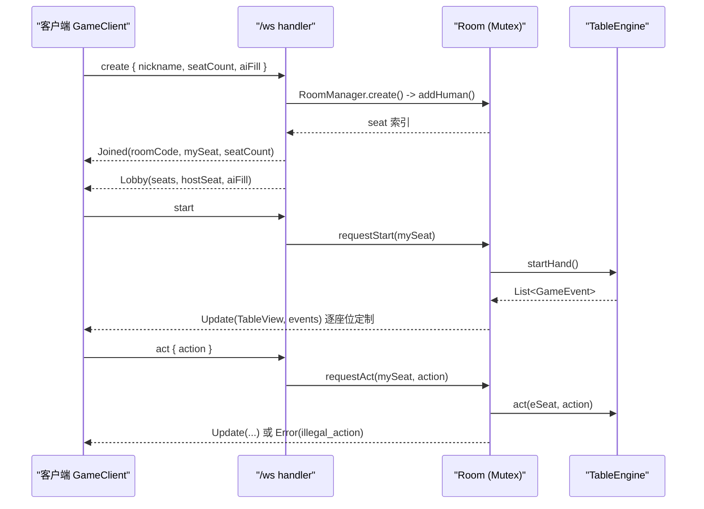
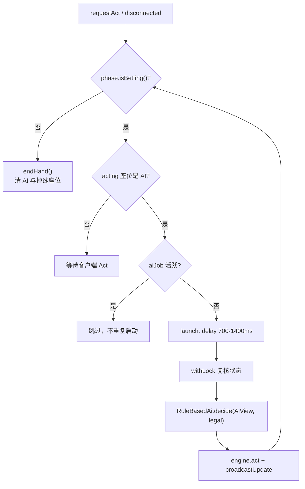

# 网络对战功能

<cite>
**本文引用的文件**
- [shared/src/commonMain/kotlin/com/aniapp/pokerdemo/net/Protocol.kt](file://shared/src/commonMain/kotlin/com/aniapp/pokerdemo/net/Protocol.kt)
- [shared/src/commonMain/kotlin/com/aniapp/pokerdemo/net/GameClient.kt](file://shared/src/commonMain/kotlin/com/aniapp/pokerdemo/net/GameClient.kt)
- [shared/src/commonMain/kotlin/com/aniapp/pokerdemo/session/OnlineSession.kt](file://shared/src/commonMain/kotlin/com/aniapp/pokerdemo/session/OnlineSession.kt)
- [shared/src/commonMain/kotlin/com/aniapp/pokerdemo/session/LocalSession.kt](file://shared/src/commonMain/kotlin/com/aniapp/pokerdemo/session/LocalSession.kt)
- [shared/src/commonMain/kotlin/com/aniapp/pokerdemo/session/GameSession.kt](file://shared/src/commonMain/kotlin/com/aniapp/pokerdemo/session/GameSession.kt)
- [shared/src/commonMain/kotlin/com/aniapp/pokerdemo/engine/TableEngine.kt](file://shared/src/commonMain/kotlin/com/aniapp/pokerdemo/engine/TableEngine.kt)
- [shared/src/commonMain/kotlin/com/aniapp/pokerdemo/engine/Card.kt](file://shared/src/commonMain/kotlin/com/aniapp/pokerdemo/engine/Card.kt)
- [shared/src/commonMain/kotlin/com/aniapp/pokerdemo/engine/GameState.kt](file://shared/src/commonMain/kotlin/com/aniapp/pokerdemo/engine/GameState.kt)
- [shared/src/commonMain/kotlin/com/aniapp/pokerdemo/engine/GameEvent.kt](file://shared/src/commonMain/kotlin/com/aniapp/pokerdemo/engine/GameEvent.kt)
- [shared/src/commonMain/kotlin/com/aniapp/pokerdemo/engine/PlayerAction.kt](file://shared/src/commonMain/kotlin/com/aniapp/pokerdemo/engine/PlayerAction.kt)
- [server/src/main/kotlin/com/aniapp/pokerdemo/server/Application.kt](file://server/src/main/kotlin/com/aniapp/pokerdemo/server/Application.kt)
- [server/src/main/kotlin/com/aniapp/pokerdemo/server/Room.kt](file://server/src/main/kotlin/com/aniapp/pokerdemo/server/Room.kt)
- [shared/src/commonMain/kotlin/com/aniapp/pokerdemo/ui/App.kt](file://shared/src/commonMain/kotlin/com/aniapp/pokerdemo/ui/App.kt)
- [shared/src/commonMain/kotlin/com/aniapp/pokerdemo/ui/lobby/LobbyScreen.kt](file://shared/src/commonMain/kotlin/com/aniapp/pokerdemo/ui/lobby/LobbyScreen.kt)
- [shared/src/commonMain/kotlin/com/aniapp/pokerdemo/ui/GameScreen.kt](file://shared/src/commonMain/kotlin/com/aniapp/pokerdemo/ui/GameScreen.kt)
- [shared/build.gradle.kts](file://shared/build.gradle.kts)
- [server/build.gradle.kts](file://server/build.gradle.kts)
</cite>

## 目录
1. [引言](#引言)
2. [整体架构](#整体架构)
3. [通信协议](#通信协议)
4. [服务端：房间与权威状态](#服务端房间与权威状态)
5. [客户端：连接与会话同步](#客户端连接与会话同步)
6. [本地 AI 与远程玩家的无缝切换](#本地-ai-与远程玩家的无缝切换)
7. [反作弊与信息裁剪](#反作弊与信息裁剪)
8. [断线处理与容错](#断线处理与容错)
9. [启动与调试](#启动与调试)
10. [尚未实现的方向](#尚未实现的方向)
11. [结论](#结论)

## 引言

多人在线德州扑克已经在本仓库落地为一条完整链路：`shared` 模块用 `kotlinx.serialization` 定义双向消息协议，`server` 模块以 Ktor + CIO 提供 WebSocket 服务并持有权威牌局，客户端通过 `OnlineSession` 消费服务端广播的 `TableView` 渲染牌桌。游戏规则本身（洗牌、发牌、下注轮推进、边池结算）由 `shared` 中的 `TableEngine` 实现，本地单机对局与服务端联机对局复用同一个引擎，只是运行进程不同。

本文描述这套已实现机制的职责划分、消息格式、同步模型与安全边界，并在最后列出仍然缺失的能力（认证、持久化、排行榜、自动重连等），作为后续演进方向。

## 整体架构

系统分为三层，全部共享 `shared` 模块的领域模型：

- **引擎层** `shared/engine`：`TableEngine` 维护 `GameState`，负责洗牌发牌、盲注、行动合法性校验、摊牌与分池，产出 `GameEvent` 列表。它不感知网络。
- **会话层** `shared/session`：`GameSession` 接口统一暴露 `uiState`/`act`/`nextHand`/`newMatch`/`dispose`。`LocalSession` 直接在本进程调用引擎；`OnlineSession` 把动作编码成 `ClientMessage` 发送，并把服务端 `TableView` 原样写入 `GameUiState`。UI 只依赖该抽象，因此单机与联机共用同一套 Compose 界面。
- **传输层**：`shared/net/GameClient` 是 Ktor `HttpClient(CIO)` + `WebSockets` 封装，连接 `/ws`；`server/Application.kt` 在同一端口上注册 `webSocket("/ws")` 路由，`server/Room.kt` 承担房间编排。

```mermaid
graph TB
    subgraph "客户端 (shared)"
        UI["App / GameScreen / LobbyView<br/>Compose 界面"]
        LS["LocalSession<br/>本地对局"]
        OS["OnlineSession<br/>联机对局"]
        GC["GameClient<br/>Ktor HttpClient(CIO) + WebSockets"]
        ENG["TableEngine<br/>规则与结算"]
    end

    subgraph "服务端 (server)"
        APP["Application.module<br/>webSocket(\"/ws\")"]
        RM["RoomManager<br/>房间码 -> Room"]
        ROOM["Room<br/>Mutex 串行化 + seatMap"]
    end

    UI --> LS
    UI --> OS
    LS --> ENG
    OS --> GC
    GC -->|"ClientMessage JSON"| APP
    APP --> ROOM
    ROOM -->|"ServerMessage JSON"| GC
    ROOM --> ENG
    RM --> ROOM
```

**图示来源**
- [shared/src/commonMain/kotlin/com/aniapp/pokerdemo/ui/App.kt:56-119](file://shared/src/commonMain/kotlin/com/aniapp/pokerdemo/ui/App.kt#L56-L119)
- [shared/src/commonMain/kotlin/com/aniapp/pokerdemo/session/OnlineSession.kt:26-82](file://shared/src/commonMain/kotlin/com/aniapp/pokerdemo/session/OnlineSession.kt#L26-L82)
- [shared/src/commonMain/kotlin/com/aniapp/pokerdemo/net/GameClient.kt:21-52](file://shared/src/commonMain/kotlin/com/aniapp/pokerdemo/net/GameClient.kt#L21-L52)
- [server/src/main/kotlin/com/aniapp/pokerdemo/server/Application.kt:18-32](file://server/src/main/kotlin/com/aniapp/pokerdemo/server/Application.kt#L18-L32)
- [server/src/main/kotlin/com/aniapp/pokerdemo/server/Room.kt:34-75](file://server/src/main/kotlin/com/aniapp/pokerdemo/server/Room.kt#L34-L75)

### 进程与依赖

| 模块 | 关键依赖 | 作用 |
| --- | --- | --- |
| `shared` | `ktor-client-core` / `ktor-client-cio` / `ktor-client-websockets` / `kotlinx-serialization-json` | 跨平台引擎、协议、会话与 UI |
| `server` | `ktor-server-core` / `ktor-server-cio` / `ktor-server-websockets` | JVM 权威房间服务 |

服务端不使用 Netty，嵌入式引擎是 **CIO**：`embeddedServer(CIO, port = 8080, host = "0.0.0.0")` 后调用 `module()`。

**章节来源**
- [shared/build.gradle.kts:26-31](file://shared/build.gradle.kts#L26-L31)
- [server/build.gradle.kts:11-17](file://server/build.gradle.kts#L11-L17)
- [server/src/main/kotlin/com/aniapp/pokerdemo/server/Application.kt:18-22](file://server/src/main/kotlin/com/aniapp/pokerdemo/server/Application.kt#L18-L22)

## 通信协议

### 消息载体

所有消息都是 JSON 文本帧，使用统一的 `PokerJson` 配置：`classDiscriminator = "type"`、`ignoreUnknownKeys = true`、`encodeDefaults = true`。判别字段 `type` 通过 `@SerialName` 指定，因此新增字段不会破坏旧客户端解析。

### 客户端 → 服务器

`ClientMessage` 是密封接口，共六种：

| type | 数据类 | 字段 | 语义 |
| --- | --- | --- | --- |
| `create` | `CreateRoom` | `nickname`、`seatCount = 6`、`aiFill = true` | 新建房间并成为房主 |
| `join` | `JoinRoom` | `code`、`nickname` | 按 4 位房间码加入 |
| `start` | `StartHand` | — | 房主开始下一手 |
| `act` | `Act` | `action: PlayerAction` | 提交弃牌/过牌/跟注/加注到 |
| `ai_fill` | `SetAiFill` | `enabled` | 房主切换空位 AI 补位 |
| `leave` | `Leave` | — | 主动离座 |

`PlayerAction` 同样可序列化：`Fold`、`Check`、`Call`、`RaiseTo(amount)`。

### 服务器 → 客户端

| type | 数据类 | 关键字段 |
| --- | --- | --- |
| `joined` | `Joined` | `roomCode`、`mySeat`、`seatCount` |
| `lobby` | `Lobby` | `roomCode`、`seats: List<LobbySeat>`、`hostSeat`、`seatCount`、`aiFill` |
| `update` | `Update` | `view: TableView`、`events: List<GameEvent>` |
| `error` | `Error` | `code`、`message` |
| `closed` | `RoomClosed` | — |

视图模型 `TableView` 是客户端渲染的唯一事实来源，包含公开信息（`seats: List<SeatInfo>`、`board`、`dealer`、`acting`、`phase`、`handNumber`、`currentBet`、`minRaiseTo`、`pot`）、本人私有信息（`mySeat`、`myHole`、`legal`）以及摊牌信息（`result`、`revealedHoles`）。`SeatInfo` 逐座位给出 `chips`、`streetBet`、`totalCommitted`、`folded`、`allIn`、`connected`、`isAi`。大厅视图 `LobbySeat` 只含 `seat`、`name`、`isAi`、`connected`。

`GameEvent`（`BlindsPosted`、`HoleCardsDealt`、`ActionTaken`、`StreetDealt`、`UncalledReturned`、`ShowdownRevealed`、`PotAwarded`、`PlayerEliminated`、`HandFinished`、`MatchFinished`）随 `Update` 附带，供 UI 播放动画与文案，不承担状态一致性职责。

**章节来源**
- [shared/src/commonMain/kotlin/com/aniapp/pokerdemo/net/Protocol.kt:13-107](file://shared/src/commonMain/kotlin/com/aniapp/pokerdemo/net/Protocol.kt#L13-L107)
- [shared/src/commonMain/kotlin/com/aniapp/pokerdemo/engine/GameEvent.kt:5-27](file://shared/src/commonMain/kotlin/com/aniapp/pokerdemo/engine/GameEvent.kt#L5-L27)
- [shared/src/commonMain/kotlin/com/aniapp/pokerdemo/engine/PlayerAction.kt:5-26](file://shared/src/commonMain/kotlin/com/aniapp/pokerdemo/engine/PlayerAction.kt#L5-L26)

### 错误码约定

服务端在两种位置回 `Error`：路由层的准入校验与房间层的业务校验。

| code | 触发条件 | 客户端处理 |
| --- | --- | --- |
| `bad_message` | 帧无法反序列化为 `ClientMessage` | 落入 `_error` 提示条 |
| `in_room` | 已在房间中又发 `create`/`join` | 提示条 |
| `bad_seat_count` | `seatCount` 不在 2..6 | 结束页（`Phase.Ended`） |
| `not_found` | 房间码不存在 | 结束页 |
| `join_failed` | 房间已满或对局进行中 | 结束页 |
| `no_room` | 未入房就发 `start`/`act`/`ai_fill` | 提示条 |
| `already_started` | 对局进行中再次 `start` 或改 `aiFill` | 提示条 |
| `not_host` | 非房主执行 `start`/`ai_fill` | 提示条 |
| `need_players` | 关闭 AI 补位且真人不足 2 人 | 提示条 |
| `not_in_hand` | 当前无进行中牌局或该座位不在牌局内 | 提示条 |
| `illegal_action` | 引擎 `check` 抛出 `IllegalStateException` | 提示条 |

`OnlineSession` 把 `join_failed`、`not_found`、`bad_seat_count` 视为不可恢复错误切到 `Phase.Ended`，其余写入 `error` StateFlow，由 `App` 显示 3 秒后自动 `clearError()`。

**章节来源**
- [server/src/main/kotlin/com/aniapp/pokerdemo/server/Application.kt:49-101](file://server/src/main/kotlin/com/aniapp/pokerdemo/server/Application.kt#L49-L101)
- [server/src/main/kotlin/com/aniapp/pokerdemo/server/Room.kt:94-137](file://server/src/main/kotlin/com/aniapp/pokerdemo/server/Room.kt#L94-L137)
- [shared/src/commonMain/kotlin/com/aniapp/pokerdemo/session/OnlineSession.kt:104-113](file://shared/src/commonMain/kotlin/com/aniapp/pokerdemo/session/OnlineSession.kt#L104-L113)
- [shared/src/commonMain/kotlin/com/aniapp/pokerdemo/ui/App.kt:96-104](file://shared/src/commonMain/kotlin/com/aniapp/pokerdemo/ui/App.kt#L96-L104)

## 服务端：房间与权威状态

### 监听与路由

`main()` 启动 CIO 嵌入式服务，监听 `0.0.0.0:8080`。`module(aiDelayMs: LongRange = 700L..1400L)` 安装 `WebSockets` 插件、创建 `RoomManager`，并只注册一条 `webSocket("/ws")` 路由。**没有 REST 端点，也没有 `/health` 健康检查路由**——服务可用性目前只能靠 TCP 连接是否成功判断。

每个 WebSocket 会话在 handler 内部持有局部变量 `room: Room?` 与 `mySeat = -1`，即"连接身份"仅存在于这条协程的闭包中，服务端不做任何鉴权，也不跨连接保存玩家档案。收到帧时先解码，失败回 `bad_message` 并继续；正常时按 `ClientMessage` 分支派发。`try/finally` 保证连接结束时调用 `room?.disconnected(mySeat)`。

昵称经 `cleanName` 归一化：`trim().take(12).ifEmpty { "玩家" }`。



**图示来源**
- [server/src/main/kotlin/com/aniapp/pokerdemo/server/Application.kt:28-101](file://server/src/main/kotlin/com/aniapp/pokerdemo/server/Application.kt#L28-L101)
- [server/src/main/kotlin/com/aniapp/pokerdemo/server/Room.kt:94-137](file://server/src/main/kotlin/com/aniapp/pokerdemo/server/Room.kt#L94-L137)

**章节来源**
- [server/src/main/kotlin/com/aniapp/pokerdemo/server/Application.kt:18-111](file://server/src/main/kotlin/com/aniapp/pokerdemo/server/Application.kt#L18-L111)

### 房间标识与生命周期

`RoomManager` 用 `ConcurrentHashMap<String, Room>` 管理房间。`create(seatCount, aiFill)` 先 `require(seatCount in 2..6)`，然后生成 **4 位大写字母房间码**（`(1..4).map { ('A'..'Z').random(random) }`），冲突则重摇。`get(code)` 对输入做 `trim().uppercase()`，因此大小写混输均可命中。房间在"所有真人离开"时由 `close()` 从表中移除并向客户端广播 `RoomClosed`。

### 座位分配与稀疏座位

`Room.seats` 是长度 `seatCount` 的数组，允许存在 `null`（空位）。`addHuman` 取第一个空槽位；若房主槽位失效则把 `hostSeat` 迁移到新座位。加入被拒的情况有两种：`inHand == true`（对局进行中）抛 `RoomException("对局进行中，无法加入")`，无空槽抛 `RoomException("房间已满")`，两者统一映射为 `join_failed`。

开启 AI 补位时，`requestStart` 会把所有空槽填成 `SeatHolder("AI-n", session = null, isAi = true)`，引擎座位号与房间座位号一致。关闭 AI 补位时空位保持 `null`，房间座位出现空洞；此时 `seatMap = occupied`（引擎连续索引 → 房间座位号）承担翻译工作：

- 进入引擎前：`val eSeat = seatMap.indexOf(seat)`，找不到即 `not_in_hand`。
- 出引擎后：`viewFor` 用 `seatMap[p.id]`、`seatMap[s.dealer]`、`seatMap[s.acting]`、以及 `result.awards.winners`/`result.revealed` 的键，把引擎索引换回房间座位号再下发。

因此 `TableView` 中的所有座位号始终是房间座位号，客户端无需知道 `seatMap` 的存在。

**章节来源**
- [server/src/main/kotlin/com/aniapp/pokerdemo/server/Room.kt:34-58](file://server/src/main/kotlin/com/aniapp/pokerdemo/server/Room.kt#L34-L58)
- [server/src/main/kotlin/com/aniapp/pokerdemo/server/Room.kt:66-120](file://server/src/main/kotlin/com/aniapp/pokerdemo/server/Room.kt#L66-L120)
- [server/src/main/kotlin/com/aniapp/pokerdemo/server/Room.kt:265-300](file://server/src/main/kotlin/com/aniapp/pokerdemo/server/Room.kt#L265-L300)

### 并发控制

`Room` 内只有一个 `Mutex`，`addHuman`、`requestStart`、`requestAct`、`setAiFill`、`disconnected` 全部在 `mutex.withLock` 中执行，AI 循环的每一步决策也在同一锁内完成。这把每个房间变成严格串行的状态机：不存在两名玩家同时推进引擎的可能，也不需要额外的版本号或 CAS。房间自建 `CoroutineScope(SupervisorJob() + Dispatchers.Default)` 承载 AI 定时任务，`close()` 时 `scope.cancel()`。

需要注意：广播发送发生在持锁期间，某个慢客户端会延长临界区。这是当前实现的取舍，见"尚未实现的方向"。

**章节来源**
- [server/src/main/kotlin/com/aniapp/pokerdemo/server/Room.kt:66-75](file://server/src/main/kotlin/com/aniapp/pokerdemo/server/Room.kt#L66-L75)
- [server/src/main/kotlin/com/aniapp/pokerdemo/server/Room.kt:168-221](file://server/src/main/kotlin/com/aniapp/pokerdemo/server/Room.kt#L168-L221)

### 洗牌与发牌位置

洗牌与发牌**只发生在 `TableEngine` 内部**，而引擎只运行在两个地方：`LocalSession` 所在的客户端进程，或 `Room` 所在的服务端进程。`Deck` 构造时用给定 `Random` 对 `createDeck()` 结果做一次 `shuffled`，之后 `draw()` 顺序弹出、`burn()` 烧一张；`TableEngine.startHand()` 每手重建 `deck` 并发出两张底牌，`advanceStreet()` 每次先烧牌再发 3/1/1 张公共牌。

客户端侧**没有任何洗牌或发牌代码路径**：`OnlineSession` 从不构造 `TableEngine`，底牌完全来自服务端下发的 `TableView.myHole`。默认随机源是 `kotlin Random.Default`（可通过构造参数注入 `random` 与 `newDeck`，测试用它构造固定牌局），并非密码学安全 CSPRNG。

**章节来源**
- [shared/src/commonMain/kotlin/com/aniapp/pokerdemo/engine/Card.kt:25-35](file://shared/src/commonMain/kotlin/com/aniapp/pokerdemo/engine/Card.kt#L25-L35)
- [shared/src/commonMain/kotlin/com/aniapp/pokerdemo/engine/TableEngine.kt:40-80](file://shared/src/commonMain/kotlin/com/aniapp/pokerdemo/engine/TableEngine.kt#L40-L80)
- [shared/src/commonMain/kotlin/com/aniapp/pokerdemo/engine/TableEngine.kt:201-232](file://shared/src/commonMain/kotlin/com/aniapp/pokerdemo/engine/TableEngine.kt#L201-L232)

### 开局与跨手延续

`requestStart` 的分支决定是"续一局比赛"还是"新建比赛"：若已有引擎且玩家姓名序列与新占座名单相同，则复用该引擎（`Phase.MATCH_OVER` 时先 `startMatch()` 重置筹码与牌序）；否则用 `PlayerInit(name)` 新建 `TableEngine`。这带来一个可观察的行为：只要参与者不变，筹码、手数与庄家位跨手累积；有人离座导致名单变化时，整场比赛重新开始。

开局的权限与人数门槛也在此处：只有 `hostSeat` 能发起（否则 `not_host`），`aiFill` 为假且 `humanCount < 2` 时返回 `need_players`。

**章节来源**
- [server/src/main/kotlin/com/aniapp/pokerdemo/server/Room.kt:94-120](file://server/src/main/kotlin/com/aniapp/pokerdemo/server/Room.kt#L94-L120)

### 一手结束后的收尾

`endHand()` 在 `requestAct` 或人类动作触发阶段推进完成后调用：置 `inHand = false`，清空所有 AI 座位与掉线座位，必要时迁移 `hostSeat`；若 `humanCount == 0` 直接 `close()`，否则广播新的 `Lobby`。也就是说每手之间房间都会回到"大厅态"，AI 补位是逐手重新填充的。

**章节来源**
- [server/src/main/kotlin/com/aniapp/pokerdemo/server/Room.kt:223-240](file://server/src/main/kotlin/com/aniapp/pokerdemo/server/Room.kt#L223-L240)

## 客户端：连接与会话同步

### GameClient

`GameClient(scope)` 内部创建 `HttpClient(CIO) { install(WebSockets) }`。`connect(host, port)` 用 `webSocketSession(host, port, path = "/ws")` 建立长连接，成功后在一个后台协程里 `for (frame in s.incoming)` 循环读取文本帧，解码为 `ServerMessage` 后 emit 到 `MutableSharedFlow(extraBufferCapacity = 64)`；读循环异常退出时在 `finally` 中把 `_connected` 置为 `false`。发送侧 `send(message)` 直接把 `ClientMessage` 编码成文本帧发出，`close()` 关闭会话与 client。

`incoming` 用 SharedFlow 而非 StateFlow：每条 `Update` 都必须送达，不能被后续值覆盖。

### OnlineSession 状态机

`OnlineConfig(host, port, nickname, seatCount?, joinCode?, aiFill)` 决定首条消息：`joinCode != null` 发 `JoinRoom`，否则发 `CreateRoom`（`seatCount ?: 6`）。连接失败（异常）→ `Phase.Ended("无法连接服务器：…")`。

`OnlineSession.Phase` 有四个状态：`Connecting`、`InLobby(roomCode, seats, hostSeat, seatCount, mySeat, aiFill)`、`Playing`、`Ended(message)`。`handle(msg)` 的映射关系：

- `Joined` → 记录 `mySeat`、`roomCode`（不改 phase，仍在等待 `Lobby`）
- `Lobby` → `Phase.InLobby`
- `Update` → 用 `msg.view` 与 `msg.events` 重建 `GameUiState(online = true, isHost = mySeat == hostSeat, roomCode = ...)`，phase 切到 `Playing`
- `Error` → 致命码转 `Ended`，其余转 `error`
- `RoomClosed` → `Ended("房间已关闭")`

另外，`client.connected.drop(1)` 的监听器会在连接断开且尚未 `disposed`、未处于 `Ended` 时置为 `Phase.Ended("与服务器断开连接")`。

### 同步模型：无乐观更新

客户端**不做乐观更新**。`act()` 只检查 `uiState.value.isPlayerTurn`（即 `table.acting == table.mySeat && table.phase.isBetting()`），随后异步 `send(ClientMessage.Act(action))`，**不修改任何本地状态**。界面上的筹码、公共牌、行动高亮全部在下一次收到 `Update` 时才改变。同理 `nextHand()`/`newMatch()` 都只发 `StartHand`，等待服务端广播。

这个设计带来的直接后果：

- 不存在需要回滚的本地猜测状态，也不存在客户端/服务端状态分叉，因此没有冲突解决逻辑。
- 动作反馈延迟等于一次往返时间；非法动作不会先出现在 UI 上，而是以 `Error(illegal_action)` 提示条形式返回。
- 服务端是唯一权威，客户端 `TableView.legal` 只是用于按钮启用条件的展示副本。

**章节来源**
- [shared/src/commonMain/kotlin/com/aniapp/pokerdemo/net/GameClient.kt:21-60](file://shared/src/commonMain/kotlin/com/aniapp/pokerdemo/net/GameClient.kt#L21-L60)
- [shared/src/commonMain/kotlin/com/aniapp/pokerdemo/session/OnlineSession.kt:32-133](file://shared/src/commonMain/kotlin/com/aniapp/pokerdemo/session/OnlineSession.kt#L32-L133)
- [shared/src/commonMain/kotlin/com/aniapp/pokerdemo/session/GameSession.kt:12-26](file://shared/src/commonMain/kotlin/com/aniapp/pokerdemo/session/GameSession.kt#L12-L26)

### UI 接入

`App` 用 `AppScreen` 密封接口在 `Start` / `Local(aiCount)` / `OnlineForm` / `Online(config)` 间切换。`Online` 分支按 `phase` 渲染：`Connecting` 显示进度圈，`InLobby` 渲染 `LobbyView`（房主可见"开始游戏"按钮与 AI 补位开关，非房主看到"等待房主开始游戏…"），`Playing` 复用与单机完全相同的 `GameScreen(session, notice = error)`，`Ended` 显示原因加"返回"按钮。`DisposableEffect` 保证离开界面时 `session.dispose()` 关闭连接。

`LobbyForm` 在本地做输入校验：地址非空、端口 1..65535、加入模式下房间码必须是 4 位字母（输入框自身就把字符过滤为 `'A'..'Z'` 并截断到 4 位），昵称留空时回退为"玩家"。

**章节来源**
- [shared/src/commonMain/kotlin/com/aniapp/pokerdemo/ui/App.kt:44-127](file://shared/src/commonMain/kotlin/com/aniapp/pokerdemo/ui/App.kt#L44-L127)
- [shared/src/commonMain/kotlin/com/aniapp/pokerdemo/ui/lobby/LobbyScreen.kt:62-190](file://shared/src/commonMain/kotlin/com/aniapp/pokerdemo/ui/lobby/LobbyScreen.kt#L62-L190)
- [shared/src/commonMain/kotlin/com/aniapp/pokerdemo/ui/lobby/LobbyScreen.kt:200-320](file://shared/src/commonMain/kotlin/com/aniapp/pokerdemo/ui/lobby/LobbyScreen.kt#L200-L320)

## 本地 AI 与远程玩家的无缝切换

同一张牌桌上可以混合真人与 AI，切换由三处协作完成：

1. **座位属性**：`SeatHolder.isAi` 与 `connected` 是唯一的判定依据，`SeatInfo` 把这两个字段透传给客户端，UI 据此显示"AI"/"托管"标签并在 `faceUp` 判断中把 AI 手牌扣着。
2. **驱动方式**：真人行动由 `Act` 消息驱动（`requestAct`），AI 行动由 `maybeAiLoop()` 驱动。二者最终都调用同一个 `TableEngine.act`，事件流与广播路径完全一致，客户端无法从消息形状区分某一步是谁走的。
3. **代打接管**：`disconnected` 在对局进行中把 `holder.connected = false; holder.isAi = true; holder.session = null`，若此刻正轮到该座位则立即 `maybeAiLoop()`，牌局不因掉线而卡死。

`maybeAiLoop()` 的结构值得注意：外层用 `scope.launch` 起一个 `aiJob`，若已有活跃 job 则跳过（防止重复驱动）；循环内每一轮先 `delay(random.nextLong(aiDelayMs.first, aiDelayMs.last + 1))`，默认区间 **700–1400ms**（由 `module(aiDelayMs)` 参数化，测试可传更短区间），然后在 `mutex.withLock` 内重新校验"仍在牌局、仍处于下注阶段、当前行动者仍是 AI"，再用 `AiView`（底牌、公共牌、阶段、底池、需跟额、本街已投、筹码、大盲、未弃牌对手数）调用 `RuleBasedAi.decide` 执行动作。当下一个行动者不是 AI 或牌局结束时 `return@launch` 退出循环，交由人类动作再次唤醒。

本地单机走的是对称逻辑：`LocalSession.maybeStartAi()` 同样用 `delay(aiRandom.nextLong(700, 1401))` 与 `RuleBasedAi`，只是直接操作本进程引擎而非广播。`LocalSession.toTableView(mySeat)` 与 `Room.viewFor(...)` 产出同一种 `TableView`，因此 `GameScreen` 无需分支即可同时服务两种模式。



**图示来源**
- [server/src/main/kotlin/com/aniapp/pokerdemo/server/Room.kt:151-221](file://server/src/main/kotlin/com/aniapp/pokerdemo/server/Room.kt#L151-L221)
- [server/src/main/kotlin/com/aniapp/pokerdemo/server/Room.kt:122-137](file://server/src/main/kotlin/com/aniapp/pokerdemo/server/Room.kt#L122-L137)
- [shared/src/commonMain/kotlin/com/aniapp/pokerdemo/session/LocalSession.kt:83-100](file://shared/src/commonMain/kotlin/com/aniapp/pokerdemo/session/LocalSession.kt#L83-L100)

**章节来源**
- [server/src/main/kotlin/com/aniapp/pokerdemo/server/Room.kt:66-75](file://server/src/main/kotlin/com/aniapp/pokerdemo/server/Room.kt#L66-L75)
- [server/src/main/kotlin/com/aniapp/pokerdemo/server/Room.kt:139-149](file://server/src/main/kotlin/com/aniapp/pokerdemo/server/Room.kt#L139-L149)

## 反作弊与信息裁剪

当前实现没有独立的反作弊服务，防作弊能力来自"服务端权威 + 视图裁剪"这一结构本身：

- **底牌隔离**：`broadcastUpdate` 对每个真人连接单独调用 `viewFor(e, i)`，`myHole = s.of(eSeat).hole` 只填入该座位自己的底牌。其他玩家的 `hole` 从未进入 `SeatInfo`，协议里根本没有承载他人底牌的字段。
- **摊牌亮牌隔离**：`revealedHoles` 仅在 `state.showdown` 为真时构造，且只收录 `!it.isFolded` 的玩家；未摊牌时恒为空 map。`GameScreen` 用 `table.revealedHoles.containsKey(seat.seat)` 决定是否翻牌，客户端无法提前看到弃牌者或未到摊牌阶段的手牌。
- **结算在服务端**：加注上限、跟注额、边池分层与余数分配全部由 `TableEngine` 计算，客户端收到的 `legal` 只是展示用的合法动作范围。伪造 `Act` 只能作用于自己座位，且必须满足 `state.acting == seat` 与 `legalActions` 校验，否则 `illegal_action`。
- **发送失败即托管**：`broadcastUpdate`/`sendToHumans` 捕获发送异常，把该座位标记为 `connected = false; isAi = true; session = null`，避免向已断开连接持续投递敏感视图。

`RoomFlowTest` 与 `E2EClient` 把这些约束固化为回归用例：两个客户端各自收到的 `myHole` 互不相同、摊牌前 `revealedHoles` 必须为空、`myHole.size` 必须为 2。

**章节来源**
- [server/src/main/kotlin/com/aniapp/pokerdemo/server/Room.kt:247-300](file://server/src/main/kotlin/com/aniapp/pokerdemo/server/Room.kt#L247-L300)
- [shared/src/commonMain/kotlin/com/aniapp/pokerdemo/ui/GameScreen.kt:69-72](file://shared/src/commonMain/kotlin/com/aniapp/pokerdemo/ui/GameScreen.kt#L69-L72)
- [shared/src/commonMain/kotlin/com/aniapp/pokerdemo/ui/GameScreen.kt:140-144](file://shared/src/commonMain/kotlin/com/aniapp/pokerdemo/ui/GameScreen.kt#L140-L144)
- [server/src/test/kotlin/com/aniapp/pokerdemo/server/RoomFlowTest.kt:73-77](file://server/src/test/kotlin/com/aniapp/pokerdemo/server/RoomFlowTest.kt#L73-L77)
- [server/src/test/kotlin/com/aniapp/pokerdemo/server/E2EClient.kt:64-65](file://server/src/test/kotlin/com/aniapp/pokerdemo/server/E2EClient.kt#L64-L65)

## 断线处理与容错

| 场景 | 服务端行为 | 客户端表现 |
| --- | --- | --- |
| 大厅中离开/断线 | `disconnected` 清空该槽位，房主离座则迁移 `hostSeat`，广播新 `Lobby`；真人归零时 `close()` | 其他人看到座位变空；自己收到 `RoomClosed` → `Phase.Ended("房间已关闭")` |
| 对局中断线 | 保留座位与筹码，标记 `isAi = true`、`connected = false`；若正轮到他立刻启动 AI 循环 | 其他客户端 `SeatInfo.connected == false`、`isAi == true`，UI 显示"托管" |
| 一手打完 | `endHand` 清除托管/AI 座位，重新分配房主并广播 `Lobby` | 回到大厅态，可再次开局 |
| 主动 `leave` | `room?.disconnected(mySeat)`，handler 局部状态复位但连接仍可复用 | — |
| WebSocket 读循环异常 | 不影响房间（`finally` 已触发 `disconnected`） | `_connected = false` → `Phase.Ended("与服务器断开连接")` |

**没有断线重连机制**：`GameClient` 不含心跳、ping、指数退避或待发送队列，`OnlineSession` 一旦进入 `Ended` 就只能由用户点"返回"重新走 `OnlineForm` 建连。掉线期间的动作也不会缓存重放——它们已由服务端 AI 代打完成。托管玩家回来也无法恢复原座位控制权，因为服务端不为连接保存任何玩家身份。

**章节来源**
- [server/src/main/kotlin/com/aniapp/pokerdemo/server/Room.kt:139-165](file://server/src/main/kotlin/com/aniapp/pokerdemo/server/Room.kt#L139-L165)
- [server/src/main/kotlin/com/aniapp/pokerdemo/server/Room.kt:223-246](file://server/src/main/kotlin/com/aniapp/pokerdemo/server/Room.kt#L223-L246)
- [shared/src/commonMain/kotlin/com/aniapp/pokerdemo/net/GameClient.kt:36-52](file://shared/src/commonMain/kotlin/com/aniapp/pokerdemo/net/GameClient.kt#L36-L52)
- [shared/src/commonMain/kotlin/com/aniapp/pokerdemo/session/OnlineSession.kt:74-82](file://shared/src/commonMain/kotlin/com/aniapp/pokerdemo/session/OnlineSession.kt#L74-L82)

## 启动与调试

- 启动服务端：运行 `server` 模块 `main()`，日志由 `server/src/main/resources/logback.xml` 配置；客户端在"联机对战"表单填服务器 IP + 端口 8080，创建房间后把 4 位房间码告知同伴加入。
- 端到端验证：`server/src/test` 下的 `RoomFlowTest`（创建/加入/隐藏信息/弃牌、非法动作与非房主开局报错、房间满员拒绝、AI 补位自动行动、对局中断线转托管后座位释放）与 `AiFillOptionTest`（关闭补位需 2 人、仅房主可切换、稀疏座位映射正确、跨手保留筹码与庄家位）基于 `ktor-server-test-host` + `E2EClient` 直连 `/ws` 收发消息，是排查协议问题的第一手参考。
- 缩短 AI 思考时间便于测试：`module(aiDelayMs = ...)` 就是为此暴露的参数。
- 视图自测：`E2EClient` 内置两条违规断言（`myHole` 非 2 张、摊牌前提前亮牌），可作为信息裁剪被破坏时的告警探针。
- 常见故障定位顺序：`bad_message` → 检查 `type` 判别字段与 `@SerialName`；一直停在"连接中…" → 检查 host/port 与防火墙；`join_failed` → 房间已满或已开局；界面卡在等待行动 → 确认服务端 `acting` 座位与 `seatMap` 翻译是否一致。

**章节来源**
- [server/src/test/kotlin/com/aniapp/pokerdemo/server/RoomFlowTest.kt:53-180](file://server/src/test/kotlin/com/aniapp/pokerdemo/server/RoomFlowTest.kt#L53-L180)
- [server/src/test/kotlin/com/aniapp/pokerdemo/server/AiFillOptionTest.kt:59-200](file://server/src/test/kotlin/com/aniapp/pokerdemo/server/AiFillOptionTest.kt#L59-L200)
- [server/src/test/kotlin/com/aniapp/pokerdemo/server/E2EClient.kt:55-70](file://server/src/test/kotlin/com/aniapp/pokerdemo/server/E2EClient.kt#L55-L70)

## 尚未实现的方向

以下能力在当前代码中没有对应实现，属于明确的后续工作，不应被理解为现有特性：

1. **身份认证与授权**：WebSocket 握手无任何令牌校验，房间内的"权限"仅是 `seat == hostSeat` 比较。若要公网部署，需要登录签发短期 JWT 并在握手或首条消息中校验，同时把房主身份绑定到账号而非连接。
2. **传输加密**：服务以明文 `ws://` 监听 `0.0.0.0:8080`，仅适合局域网。生产环境需 TLS（wss）与证书配置。
3. **断线重连与席位恢复**：缺少心跳、退避重试、事件序号与快照版本协商；`Update` 是全量视图而非增量，重连后只能重新加入房间。引入 `lastEventId`/`snapshotVersion` 之类的握手消息是自然切入点。
4. **REST 辅助接口与健康检查**：目前没有 `/health`，也没有排行榜、历史对局、报表导出等非实时 API；房间与对局数据全在内存，进程重启即丢失。
5. **数据持久化与统计**：无玩家档案表、无历史手牌记录、无审计日志，纠纷仲裁缺少依据。
6. **服务端横向扩展**：`RoomManager` 是单进程 `ConcurrentHashMap`，房间码唯一性与跨节点路由需要外部注册中心或按房间码分片。
7. **广播吞吐**：`broadcastUpdate` 在持有 `Mutex` 时逐个同步发送，慢客户端会阻塞整个房间；可将消息投递改为每座位出站队列异步排空。
8. **随机源强度**：默认 `Random.Default` 可替换为更强的种子来源，避免牌序可预测性风险。
9. **速率限制与风控**：当前对高频 `Act`/`Join` 没有限流，也缺少异常行为检测。

## 结论

网络对战的实现遵循一条清晰的原则：**规则只在引擎里跑，状态只在服务端有，客户端只渲染服务端裁剪过的视图**。`Protocol.kt` 用六个客户端消息与五个服务端消息覆盖了建房、入房、开局、行动、AI 补位与离场；`GameClient` 提供最小可用的 WebSocket 通道；`Room` 以单 `Mutex` 串行化换取无冲突的状态推进，并用 `seatMap` 支持稀疏座位与 AI 补位；`OnlineSession` 放弃乐观更新，把一致性完全交给 `Update` 广播。这使得本地 AI 与远程玩家能在同一张牌桌上无差别共存，也让底牌与摊牌信息天然只流向应得者。下一步的重点是把这套"局域网可信环境"假设替换为真正的认证、加密、重连与持久化能力。