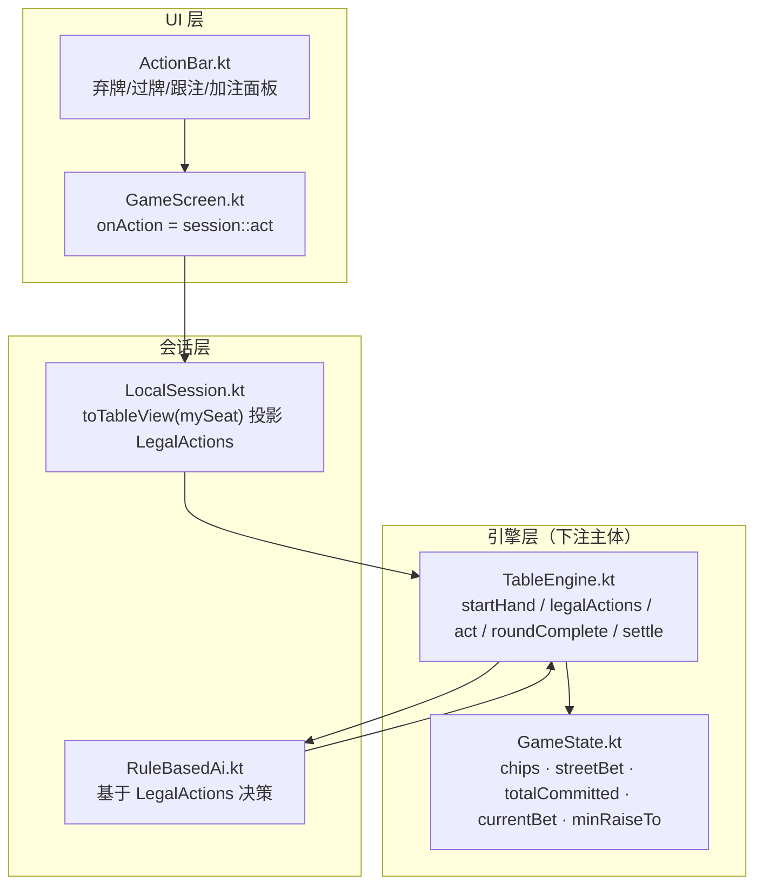
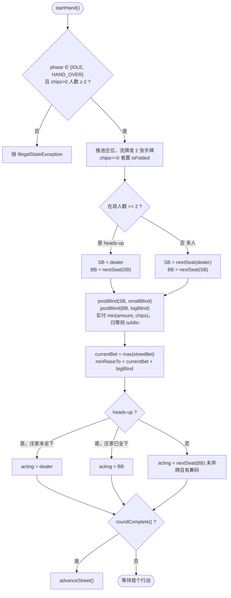
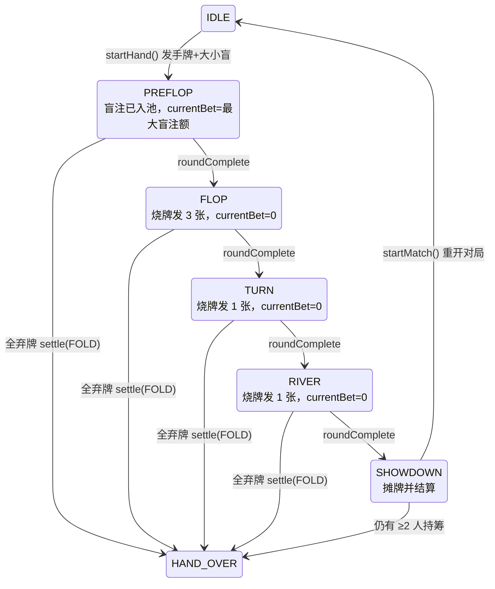
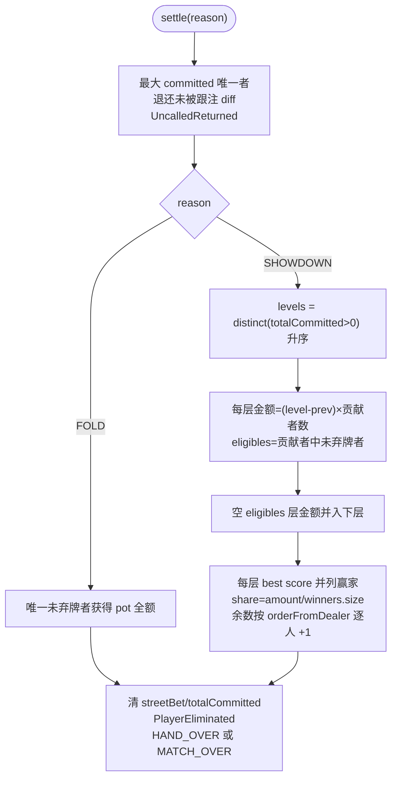
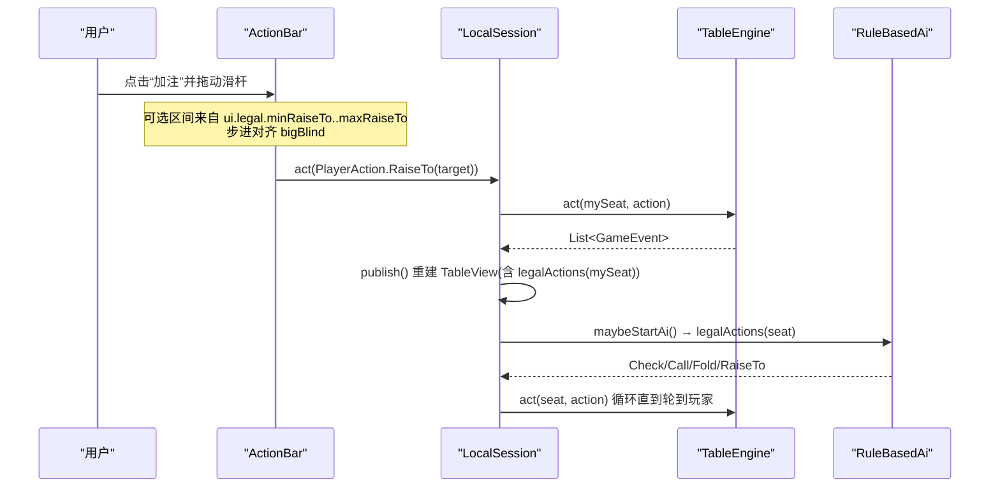

# 下注管理系统

<cite>
**本文引用的文件**
- [TableEngine.kt](file://shared/src/commonMain/kotlin/com/aniapp/pokerdemo/engine/TableEngine.kt)
- [GameState.kt](file://shared/src/commonMain/kotlin/com/aniapp/pokerdemo/engine/GameState.kt)
- [PlayerAction.kt](file://shared/src/commonMain/kotlin/com/aniapp/pokerdemo/engine/PlayerAction.kt)
- [GameEvent.kt](file://shared/src/commonMain/kotlin/com/aniapp/pokerdemo/engine/GameEvent.kt)
- [RuleBasedAi.kt](file://shared/src/commonMain/kotlin/com/aniapp/pokerdemo/engine/ai/RuleBasedAi.kt)
- [LocalSession.kt](file://shared/src/commonMain/kotlin/com/aniapp/pokerdemo/session/LocalSession.kt)
- [GameSession.kt](file://shared/src/commonMain/kotlin/com/aniapp/pokerdemo/session/GameSession.kt)
- [ActionBar.kt](file://shared/src/commonMain/kotlin/com/aniapp/pokerdemo/ui/action/ActionBar.kt)
- [HeadsUpTableEngineTest.kt](file://shared/src/commonTest/kotlin/com/aniapp/pokerdemo/engine/HeadsUpTableEngineTest.kt)
- [MultiPlayerTableEngineTest.kt](file://shared/src/commonTest/kotlin/com/aniapp/pokerdemo/engine/MultiPlayerTableEngineTest.kt)
</cite>

> 说明：早期文档所描述的 `app/src/main/java/com/aniapp/pokerdemo/data/BettingManager.kt`（含 `playerChips`/`aiChips`/`pot`/`currentBet` 四个整型字段与 `postBlinds()`/`playerCall()`/`aiRaise()` 方法）已从仓库中删除，Android 端现仅保留 `MainActivity.kt`。下注能力现在由跨端共享引擎 `TableEngine` 的下注回合逻辑实现，且**已被 UI 完整调用**（`ActionBar` → `GameSession.act` → `TableEngine.act`）。本文按当前实现重写。

## 目录
1. [简介](#简介)
2. [配置与核心状态字段](#配置与核心状态字段)
3. [架构总览](#架构总览)
4. [盲注：startHand 与 postBlind](#盲注starthand-与-postblind)
5. [合法性出口 legalActions](#合法性出口-legalactions)
6. [行动执行 act：跟注、加注、弃牌、过牌](#行动执行-act跟注加注弃牌过牌)
7. [AI 加注策略](#ai-加注策略)
8. [下注轮次结束判定 roundComplete](#下注轮次结束判定-roundcomplete)
9. [各阶段下注规则差异](#各阶段下注规则差异)
10. [结算 settle：主池、边池、余数与退还](#结算-settle主池边池余数与退还)
11. [边界情况与业务规则约束](#边界情况与业务规则约束)
12. [下注场景示例](#下注场景示例)
13. [集成方式](#集成方式)
14. [结论](#结论)

## 简介

下注管理不再由独立的“管理器”类承担，而是与发牌、回合推进、结算一起收敛在 `TableEngine` 内，围绕一份不可变快照 `GameState` 构建：

- **筹码**以座位为单位存放在 `PlayerState.chips`，一手牌的投入拆成 `streetBet`（本街）与 `totalCommitted`（整手累计），底池 `pot` 是派生属性而非独立累加字段。
- **下注目标**由 `GameState.currentBet`（需追平额）与 `GameState.minRaiseTo`（最小加注到的总额）表达，配合每个玩家的 `hasActedThisRound` / `raiseReopened` 判定谁能行动、谁能再加注。
- **唯一合法性出口**是 `legalActions(seat)`：UI、AI、测试都只依据它构造动作，再由 `act(seat, action)` 二次校验并落库。
- **短码全下不报错**：所有支付走 `min(amount, chips)`，余额归零即置 `isAllIn`；未被跟注的部分在结算时退还。

**章节来源**
- [TableEngine.kt:1-323](file://shared/src/commonMain/kotlin/com/aniapp/pokerdemo/engine/TableEngine.kt#L1-L323)
- [GameState.kt:1-57](file://shared/src/commonMain/kotlin/com/aniapp/pokerdemo/engine/GameState.kt#L1-L57)

## 配置与核心状态字段

### GameConfig

`GameConfig(startingChips = 2000, smallBlind = 10, bigBlind = 20)` 是下注体系的数值基线：起始筹码决定盲注可承受轮次，大小盲额度同时是最小加注步长与新街 `minRaiseTo` 的初值。座位数在构造时被约束为 2–6，越界抛 `IllegalArgumentException`。

```kotlin
data class GameConfig(
    val startingChips: Int = 2000,
    val smallBlind: Int = 10,
    val bigBlind: Int = 20
)
```

- 来源：[TableEngine.kt:6-24](file://shared/src/commonMain/kotlin/com/aniapp/pokerdemo/engine/TableEngine.kt#L6-L24)

### 字段职责对照

| 旧 BettingManager 概念 | 当前实现位置 | 语义 |
| --- | --- | --- |
| playerChips / aiChips | `PlayerState.chips` | 该座位**未投入**的可动筹码，按座位统一建模，不区分人类/AI |
| playerBet / aiBet | `PlayerState.streetBet` | 本街已下注额，进入下一街时被清零 |
| pot | `GameState.pot`（派生） | `players.sumOf { totalCommitted }`，一手牌全部投入之和 |
| currentBet | `GameState.currentBet` | 本街需要追平的最低总额，新街重置为 0 |
| — | `GameState.minRaiseTo` | 下一次合法加注需达到的总额下限 |
| — | `lastRaiseSize`（私有） | 最近一次**完整加注**的增量，用于滚动更新 `minRaiseTo` |
| — | `PlayerState.totalCommitted` | 整手累计投入，边池分层与退还的唯一依据 |
| — | `PlayerState.hasActedThisRound` / `raiseReopened` | 本街是否已行动 / 加注重开权 |
| — | `PlayerState.isAllIn` / `isFolded` | 已全下（无筹码但仍在局）/ 已弃牌 |

关键不变式：**任意时刻 `sum(chips + totalCommitted)` 等于开局总筹码**。测试 `chipConservationStress500Hands` 对每一手、每一步都断言该不变式。

- 来源：[GameState.kt:14-56](file://shared/src/commonMain/kotlin/com/aniapp/pokerdemo/engine/GameState.kt#L14-L56)、[TableEngine.kt:26-28](file://shared/src/commonMain/kotlin/com/aniapp/pokerdemo/engine/TableEngine.kt#L26-L28)、[HeadsUpTableEngineTest.kt:230-243](file://shared/src/commonTest/kotlin/com/aniapp/pokerdemo/engine/HeadsUpTableEngineTest.kt#L230-L243)

## 架构总览

下注数据全部留在引擎里，会话层把状态投影成可序列化视图，UI 只消费视图中的 `LegalActions`。



**图示来源**
- [ActionBar.kt:42-110](file://shared/src/commonMain/kotlin/com/aniapp/pokerdemo/ui/action/ActionBar.kt#L42-L110)
- [LocalSession.kt:52-56](file://shared/src/commonMain/kotlin/com/aniapp/pokerdemo/session/LocalSession.kt#L52-L56)、[LocalSession.kt:137-166](file://shared/src/commonMain/kotlin/com/aniapp/pokerdemo/session/LocalSession.kt#L137-L166)
- [TableEngine.kt:78-160](file://shared/src/commonMain/kotlin/com/aniapp/pokerdemo/engine/TableEngine.kt#L78-L160)

## 盲注：startHand 与 postBlind

`startHand()` 只在 `IDLE` 或 `HAND_OVER` 阶段被允许，且要求仍有至少两名玩家 `chips > 0`，否则抛 `IllegalStateException("剩余筹码不足两人，对局已结束")`。庄家推进使用 `nextSeat(dealer) { it.chips > 0 }`，因此淘汰座位被自动跳过。

大小盲位置取决于人数（heads-up 判定为 `chips > 0` 的人数恰为 2）：

| 情形 | 小盲 SB | 大盲 BB | 翻首先行者 |
| --- | --- | --- | --- |
| 单挑（heads-up） | 庄家本人 | 另一人 | 庄家（SB），BB 拥有 option |
| 多人（≥3 人在局） | 庄家下一位在局座位 | SB 再下一位 | BB 下一位 |

若庄家已全下，则先行权交给 BB。支付完成后取 `topBet = max(streetBet)` 写入 `currentBet`，并把 `minRaiseTo` 设为 `topBet + bigBlind`；随后立刻检查 `roundComplete()`，若已无可行动者（例如双方盲注即全下）则直接推进街道，避免把 `acting` 停在无人可动的座位。

`postBlind()` 与 `pay()` 共用同一套“短码安全”规则：实付 `min(amount, chips)`，扣 `chips`、加 `streetBet` 与 `totalCommitted`，余额归零时置 `isAllIn`。因此筹码少于盲注不会报错，只会形成小额全下。



- 来源：[TableEngine.kt:40-88](file://shared/src/commonMain/kotlin/com/aniapp/pokerdemo/engine/TableEngine.kt#L40-L88)、[TableEngine.kt:174-186](file://shared/src/commonMain/kotlin/com/aniapp/pokerdemo/engine/TableEngine.kt#L174-L186)
- 行为验证：[MultiPlayerTableEngineTest.kt:108-127](file://shared/src/commonTest/kotlin/com/aniapp/pokerdemo/engine/MultiPlayerTableEngineTest.kt#L108-L127)（四人：dealer=0/SB=1/BB=2/首行=3）、[HeadsUpTableEngineTest.kt:36-51](file://shared/src/commonTest/kotlin/com/aniapp/pokerdemo/engine/HeadsUpTableEngineTest.kt#L36-L51)（limp 后 BB 获得 canCheck + canRaise 的 option）、[MultiPlayerTableEngineTest.kt:158-172](file://shared/src/commonTest/kotlin/com/aniapp/pokerdemo/engine/MultiPlayerTableEngineTest.kt#L158-L172)（缩至两人后自动切换 heads-up 规则）

## 合法性出口 legalActions

`legalActions(seat)` 是全仓库唯一的合法性判定入口：非当前行动者、非下注阶段一律返回全 false 的空 `LegalActions`。

```kotlin
val toCall = (state.currentBet - me.streetBet).coerceAtLeast(0)
val maxTo = me.streetBet + me.chips
val canRaise = maxTo > state.currentBet && (!me.hasActedThisRound || me.raiseReopened)
return LegalActions(
    canFold = true,
    canCheck = toCall == 0,
    callAmount = minOf(toCall, me.chips),
    minRaiseTo = if (canRaise) minOf(state.minRaiseTo, maxTo) else null,
    maxRaiseTo = if (canRaise) maxTo else null
)
```

要点：

- `canFold` 恒为 true（轮到即可弃牌），`canCheck` 仅在无需追平时成立。
- `callAmount` 被 `me.chips` 截断，故筹码不足时它等于剩余全部筹码——UI 据此显示“跟注全下”。
- `canRaise` 受两个条件共同控制：必须能超过 `currentBet`，且**本轮尚未行动或行动权被重新开放**（`raiseReopened`）。
- `minRaiseTo` 会被 `maxTo` 下调：当剩余筹码不足以完成一个标准加注时，最小值即为全下额，此时 `min == max`。
- `LegalActions.canCall` 定义为 `callAmount > 0`，`canRaise` 定义为 `minRaiseTo != null && maxRaiseTo != null`。

- 来源：[TableEngine.kt:90-103](file://shared/src/commonMain/kotlin/com/aniapp/pokerdemo/engine/TableEngine.kt#L90-L103)、[PlayerAction.kt:17-27](file://shared/src/commonMain/kotlin/com/aniapp/pokerdemo/engine/PlayerAction.kt#L17-L27)

## 行动执行 act：跟注、加注、弃牌、过牌

`act(seat, action)` 先做两道前置校验（阶段必须 `isBetting()`、`state.acting` 必须等于 `seat`），再重新计算 `legalActions(seat)` 并按动作分支处理，最终发出 `GameEvent.ActionTaken`。

```mermaid
flowchart TD
    A(["act(seat, action)"]) --> V{"phase.isBetting()<br/>且 acting == seat ?"}
    V -->|否| E1["抛 IllegalStateException"]
    V -->|是| L["legal = legalActions(seat)"]
    L --> K{action}
    K -->|Fold| F["isFolded=true, hasActedThisRound=true"]
    F --> F1{"仅剩 1 名未弃牌者 ?"}
    F1 -->|是| FS["settle(EndReason.FOLD) 直接结束一手"]
    F1 -->|否| NX
    K -->|Check| CK["check(legal.canCheck)<br/>否则抛 '面对下注不能过牌'"]
    CK --> NX
    K -->|Call| CA["check(legal.canCall)<br/>pay(seat, legal.callAmount)"]
    CA --> NX
    K -->|RaiseTo(t)| RG["check(canRaise)<br/>check(t in minRaiseTo..maxRaiseTo)"]
    RG --> RF{"t >= state.minRaiseTo ?"}
    RF -->|是 完整加注| Y["lastRaiseSize = t - prevBet<br/>其他未弃牌非全下者 raiseReopened=true"]
    RF -->|否 短码全下| N["lastRaiseSize 不变<br/>不重开他人行动权"]
    Y --> UP["currentBet=t, minRaiseTo=t+lastRaiseSize"]
    N --> UP
    UP --> NX{"roundComplete() ?"}
    NX -->|是| AS["acting=null; advanceStreet()"]
    NX -->|否| NS["acting = nextSeat 未弃牌且有筹码"]
```

各分支细节：

- **Fold**：标记弃牌后立刻检查是否只剩一名未弃牌者，若是则整个 `settle(FOLD)` 提前执行并返回（不进入下一街）。弃牌者的 `totalCommitted` 仍留在底池中参与分配。
- **Check**：仅当 `legal.canCheck` 成立，否则抛 `"面对下注不能过牌"`。
- **Call**：`check(legal.canCall)`，实际支付额取 `legal.callAmount`，即 `min(toCall, chips)`；不足额跟注自然形成全下，不报错。
- **RaiseTo(amount)**：`amount` 是**加注后的总额**（不是增量），必须落在 `minRaiseTo..maxRaiseTo` 闭区间，越界抛 `"加注额非法"`。增量由 `pay(seat, amount - streetBet)` 计算。只有 `amount >= state.minRaiseTo` 的**完整加注**才更新 `lastRaiseSize` 并把其他未弃牌、未全下玩家的 `raiseReopened` 置回 true；不足一个完整加注的全下跟注只抬升 `currentBet`，不会让已经行动过的对手重新获得加注权。

- 来源：[TableEngine.kt:105-160](file://shared/src/commonMain/kotlin/com/aniapp/pokerdemo/engine/TableEngine.kt#L105-L160)
- 行为验证：[HeadsUpTableEngineTest.kt:53-68](file://shared/src/commonTest/kotlin/com/aniapp/pokerdemo/engine/HeadsUpTableEngineTest.kt#L53-L68)（40→60→160 的最小加注递进）、[HeadsUpTableEngineTest.kt:179-190](file://shared/src/commonTest/kotlin/com/aniapp/pokerdemo/engine/HeadsUpTableEngineTest.kt#L179-L190)（抢行动、面对下注过牌、非法加注额均抛异常）、[MultiPlayerTableEngineTest.kt:135-156](file://shared/src/commonTest/kotlin/com/aniapp/pokerdemo/engine/MultiPlayerTableEngineTest.kt#L135-L156)（完整加注重开已行动玩家）

## AI 加注策略

AI 侧没有独立的 `aiRaise()` 方法：`LocalSession.maybeStartAi()` 在轮到 AI 座位时调用 `engine.legalActions(s)`，把结果连同 `AiView` 交给 `RuleBasedAi.decide()`，再把返回的 `PlayerAction` 原样交回 `engine.act(s, action)`。也就是说 AI 的加注与人类走的是完全相同的合法性通道。

`RuleBasedAi` 的加注额构造体现了对引擎规则的尊重：

```kotlin
fun raiseTarget(fraction: Double): Int {
    val min = legal.minRaiseTo!!
    val max = legal.maxRaiseTo!!
    val potAfterCall = view.pot + view.toCall
    var target = view.streetBet + view.toCall + (potAfterCall * fraction).roundToInt()
    target = (target / view.bigBlind) * view.bigBlind   // 对齐到大盲整数倍
    target = target.coerceIn(min, max)                  // 保证落在合法区间
    if (target - view.streetBet > view.chips * 0.7) target = max  // 接近筹码上限则改为全下
    return target
}
```

决策规则概览（`strength` 为带 ±0.06 噪声的牌力评分）：

| 场景 | 条件 | 动作 |
| --- | --- | --- |
| 无需跟注 | `strength >= raiseThreshold` 且 `canRaise`，概率 0.8 | `RaiseTo(0.5–1.0 底池)` |
| 无需跟注（轻吹） | `strength < 0.4` 且 `canRaise`，概率 0.10 | `RaiseTo(0.6 底池)` |
| 无需跟注 | 其余 | `Check` |
| 面对下注 | `strength >= raiseThreshold` 且 `canRaise`，概率 0.6 | `RaiseTo(0.6–1.0 底池)` |
| 面对下注 | `strength >= toCall/(pot+toCall) + 0.05 + 0.02*(对手数-1)` | `Call` |
| 面对下注 | 赔率不合适 | `Fold` |

其中 `raiseThreshold = (0.7 + 0.04 * (activeOpponents - 1)) / aggression`，`aggression ∈ [0.8, 1.2)`，人多时更保守。由于所有目标值都被 `coerceIn(min, max)` 夹住，AI 永远不会触发 `act` 的加注非法异常。

- 来源：[RuleBasedAi.kt:11-40](file://shared/src/commonMain/kotlin/com/aniapp/pokerdemo/engine/ai/RuleBasedAi.kt#L11-L40)、[RuleBasedAi.kt:42-86](file://shared/src/commonMain/kotlin/com/aniapp/pokerdemo/engine/ai/RuleBasedAi.kt#L42-L86)
- 来源：[LocalSession.kt:74-105](file://shared/src/commonMain/kotlin/com/aniapp/pokerdemo/session/LocalSession.kt#L74-L105)

## 下注轮次结束判定 roundComplete

一轮（同一街的一次下注循环）结束由 `roundComplete()` 判定，覆盖四类边界：

1. **仅剩一人未弃牌**：`contenders.size <= 1`，直接结束（配合 `act` 中 Fold 分支提前结算）。
2. **全员全下**：未弃牌者中没有任何 `chips > 0` 的人，`actionable.isEmpty()` → 结束并进入自动发牌 runout。
3. **只剩单一可行动者**：只有他还有筹码。此时要求他**已在本街行动过**且 `streetBet >= currentBet` 才算结束——这正是 heads-up  limp 后 BB 的 option、以及“只需追平即可”的短码情形。注意用的是 `>=` 而非 `==`，因为超出部分会作为未跟注金额在结算时退还。
4. **常规情形**：所有可行动者都 `hasActedThisRound` 且 `streetBet == currentBet`。

- 来源：[TableEngine.kt:188-199](file://shared/src/commonMain/kotlin/com/aniapp/pokerdemo/engine/TableEngine.kt#L188-L199)
- 行为验证：[HeadsUpTableEngineTest.kt:36-51](file://shared/src/commonTest/kotlin/com/aniapp/pokerdemo/engine/HeadsUpTableEngineTest.kt#L36-L51)、[HeadsUpTableEngineTest.kt:93-105](file://shared/src/commonTest/kotlin/com/aniapp/pokerdemo/engine/HeadsUpTableEngineTest.kt#L93-L105)

## 各阶段下注规则差异

阶段由 `Phase` 枚举表达，`isBetting()` 为 PREFLOP/FLOP/TURN/RIVER 四者。`advanceStreet()` 负责在轮次结束后推进：



进入新街时的状态重置（对所有座位）：`streetBet = 0`、`hasActedThisRound = false`、`raiseReopened = false`；全局 `currentBet = 0`、`minRaiseTo = config.bigBlind`，私有 `lastRaiseSize` 也回到 `bigBlind`。

阶段差异一览：

| 维度 | 翻前 PREFLOP | 翻后 FLOP / TURN / RIVER |
| --- | --- | --- |
| 初始 `currentBet` | 最高盲注额（通常 = bigBlind，短码时更小） | 0 |
| 初始 `minRaiseTo` | `topBet + bigBlind` | `bigBlind` |
| 首位行动者 | heads-up 为庄家/SB；多人为 BB 下一位 | `nextSeat(dealer)` 起第一个未弃牌且有筹码者 |
| 默认动作 | 必须至少跟注差额 | 可先 `Check`（无人下注时） |
| 盲注产生的投入 | 计入 `totalCommitted`，参与后续边池分层 | 不涉及盲注 |
| 结束条件 | 同上四类边界，另需注意 BB option | 同上，无 option 概念 |

另外，当某街开始时“未弃牌且有筹码”的人数 ≤ 1（即所有人已全下），`acting` 被置为 `null` 并发出 `StreetDealt(..., runout = true)`，继续在同一循环内自动发完剩余公共牌直至河牌摊牌，不再产生任何下注机会。

- 来源：[TableEngine.kt:201-231](file://shared/src/commonMain/kotlin/com/aniapp/pokerdemo/engine/TableEngine.kt#L201-L231)、[GameState.kt:5-12](file://shared/src/commonMain/kotlin/com/aniapp/pokerdemo/engine/GameState.kt#L5-L12)
- 行为验证：[HeadsUpTableEngineTest.kt:93-105](file://shared/src/commonTest/kotlin/com/aniapp/pokerdemo/engine/HeadsUpTableEngineTest.kt#L93-L105)、[MultiPlayerTableEngineTest.kt:138-142](file://shared/src/commonTest/kotlin/com/aniapp/pokerdemo/engine/MultiPlayerTableEngineTest.kt#L138-L142)

## 结算 settle：主池、边池、余数与退还

`settle(reason, events)` 是唯一改变筹码归属的地方，输入只有各座位的 `totalCommitted` 与牌力评估结果。

**第一步：退还未被跟注部分。** 找出 `totalCommitted` 的最大值持有者，若唯一且最大值 > 0，则计算 `diff = maxC - 第二大 committed`，把 `diff` 从该玩家 `totalCommitted` 中退回 `chips`，并发出 `GameEvent.UncalledReturned(seat, diff)`。这一步保证后续分层不会出现“只有自己贡献、自己赢”的空边池。

**第二步：按承诺额分层。** 取所有 `> 0` 的 `totalCommitted` 去重升序得到 `levels`，逐层构造：

- 第 i 层金额 = `(level_i - level_{i-1}) × 该层贡献者数`，贡献者为 `totalCommitted >= level_i` 的所有座位。
- 该层有资格赢家 = 贡献者中未弃牌者。

**第三步：无效层并入下层。** 自高层向低层扫描，若某层 `eligibles` 为空（该层只有已弃牌者的钱），把它的金额累加到下一层并清零，使弃牌者的钱始终留在池中而非消失。

**第四步：平分与余数。** 每层取有资格者中的最高分，所有并列赢家 `share = amount / winners.size`，余数 `amount % winners.size` 按 `orderFromDealer(winners)` 顺序每人 1 枚发放——该排序把 `dealer` 左侧第一个座位排在最前，即余数优先给庄位顺时针方向的赢家。

**第五步：收尾。** `EndReason.FOLD` 走简化路径：唯一未弃牌者直接拿走 `state.pot` 全额。最后清理 `streetBet`/`totalCommitted`，对 `chips == 0` 且曾投入者发出 `PlayerEliminated`，存活人数 ≤ 1 时阶段变为 `MATCH_OVER` 并发出 `MatchFinished`，否则 `HAND_OVER`。



四层全下实例（筹码 100/200/300/400，全部押上）：400 中未被跟注的 100 先退还给座位 3，剩余形成 400（4 人）、300（3 人）、200（2 人）三层边池，分别判给牌力 A>B>C>D，最终筹码 400/300/200/100，总和仍为 1000。平局余数实例（1001+1001+1000 = 3003，前两家同花顺平手）：`share = 1001`，余 1 枚给 dealer(0) 左侧的第一个赢家座位 1，得到 1501/1502/999。

- 来源：[TableEngine.kt:239-311](file://shared/src/commonMain/kotlin/com/aniapp/pokerdemo/engine/TableEngine.kt#L239-L311)、[TableEngine.kt:313-316](file://shared/src/commonMain/kotlin/com/aniapp/pokerdemo/engine/TableEngine.kt#L313-L316)
- 行为验证：[MultiPlayerTableEngineTest.kt:27-55](file://shared/src/commonTest/kotlin/com/aniapp/pokerdemo/engine/MultiPlayerTableEngineTest.kt#L27-L55)、[MultiPlayerTableEngineTest.kt:84-106](file://shared/src/commonTest/kotlin/com/aniapp/pokerdemo/engine/MultiPlayerTableEngineTest.kt#L84-L106)、[HeadsUpTableEngineTest.kt:18-33](file://shared/src/commonTest/kotlin/com/aniapp/pokerdemo/engine/HeadsUpTableEngineTest.kt#L18-L33)、[HeadsUpTableEngineTest.kt:108-132](file://shared/src/commonTest/kotlin/com/aniapp/pokerdemo/engine/HeadsUpTableEngineTest.kt#L108-L132)

## 边界情况与业务规则约束

| 情形 | 处理方式 | 依据 |
| --- | --- | --- |
| 筹码不足盲注 | `postBlind` 实付 `min(amount, chips)` 并置 `isAllIn`，不报错；若双方即刻全下则 `roundComplete()` 触发自动 runout | [TableEngine.kt:174-186](file://shared/src/commonMain/kotlin/com/aniapp/pokerdemo/engine/TableEngine.kt#L174-L186)、[HeadsUpTableEngineTest.kt:155-172](file://shared/src/commonTest/kotlin/com/aniapp/pokerdemo/engine/HeadsUpTableEngineTest.kt#L155-L172) |
| 筹码不足跟注 | `callAmount = min(toCall, chips)`，等价于短码全下 | [TableEngine.kt:95-99](file://shared/src/commonMain/kotlin/com/aniapp/pokerdemo/engine/TableEngine.kt#L95-L99) |
| 筹码不足最小加注 | `minRaiseTo = min(state.minRaiseTo, maxTo)`，最小值被下调为全下额，`min == max` | [TableEngine.kt:100-101](file://shared/src/commonMain/kotlin/com/aniapp/pokerdemo/engine/TableEngine.kt#L100-L101)、[HeadsUpTableEngineTest.kt:135-152](file://shared/src/commonTest/kotlin/com/aniapp/pokerdemo/engine/HeadsUpTableEngineTest.kt#L135-L152) |
| 短码全下不重开加注 | 不足 `state.minRaiseTo` 的加注不更新 `lastRaiseSize`、不设置他人 `raiseReopened`，已行动过的对手只能跟注 | [TableEngine.kt:131-148](file://shared/src/commonMain/kotlin/com/aniapp/pokerdemo/engine/TableEngine.kt#L131-L148)、[HeadsUpTableEngineTest.kt:135-152](file://shared/src/commonTest/kotlin/com/aniapp/pokerdemo/engine/HeadsUpTableEngineTest.kt#L135-L152) |
| 加注额越界 | `RaiseTo` 不在 `minRaiseTo..maxRaiseTo` 内抛 `IllegalStateException("加注额非法: ...")` | [TableEngine.kt:131-134](file://shared/src/commonMain/kotlin/com/aniapp/pokerdemo/engine/TableEngine.kt#L131-L134) |
| 面对下注过牌 | `check(legal.canCheck)` 失败抛 `"面对下注不能过牌"` | [TableEngine.kt:120-123](file://shared/src/commonMain/kotlin/com/aniapp/pokerdemo/engine/TableEngine.kt#L120-L123) |
| 抢行动 / 非下注阶段行动 | `check(state.phase.isBetting())` 与 `check(state.acting == seat)` 双重拦截 | [TableEngine.kt:106-108](file://shared/src/commonMain/kotlin/com/aniapp/pokerdemo/engine/TableEngine.kt#L106-L108) |
| 被淘汰座位行动 | `startHand` 将 `chips == 0` 者置 `isFolded` 且不发牌，其 `acting` 永不为该座位，`act` 抛异常 | [TableEngine.kt:53-59](file://shared/src/commonMain/kotlin/com/aniapp/pokerdemo/engine/TableEngine.kt#L53-L59)、[MultiPlayerTableEngineTest.kt:174-201](file://shared/src/commonTest/kotlin/com/aniapp/pokerdemo/engine/MultiPlayerTableEngineTest.kt#L174-L201) |
| 超额全下的多余钱 | 结算首步退还未被跟注部分（如 1200 vs 800 剩 400 场景，退 2400） | [TableEngine.kt:240-252](file://shared/src/commonMain/kotlin/com/aniapp/pokerdemo/engine/TableEngine.kt#L240-L252)、[HeadsUpTableEngineTest.kt:108-132](file://shared/src/commonTest/kotlin/com/aniapp/pokerdemo/engine/HeadsUpTableEngineTest.kt#L108-L132) |
| 弃牌者的钱 | 保留在 `totalCommitted` 中参与分层，空 eligibles 层并入下层 | [TableEngine.kt:271-281](file://shared/src/commonMain/kotlin/com/aniapp/pokerdemo/engine/TableEngine.kt#L271-L281)、[MultiPlayerTableEngineTest.kt:57-82](file://shared/src/commonTest/kotlin/com/aniapp/pokerdemo/engine/MultiPlayerTableEngineTest.kt#L57-L82) |
| 座位数非法 | 构造函数 `require(players.size in 2..6)` 抛 `IllegalArgumentException` | [TableEngine.kt:20-24](file://shared/src/commonMain/kotlin/com/aniapp/pokerdemo/engine/TableEngine.kt#L20-L24)、[MultiPlayerTableEngineTest.kt:221-229](file://shared/src/commonTest/kotlin/com/aniapp/pokerdemo/engine/MultiPlayerTableEngineTest.kt#L221-L229) |
| 对局无法继续 | `startHand` 要求 `chips > 0` 人数 ≥ 2；结算后 ≤ 1 时进入 `MATCH_OVER` | [TableEngine.kt:42-44](file://shared/src/commonMain/kotlin/com/aniapp/pokerdemo/engine/TableEngine.kt#L42-L44)、[TableEngine.kt:303-310](file://shared/src/commonMain/kotlin/com/aniapp/pokerdemo/engine/TableEngine.kt#L303-L310) |

一致性检查建议（与测试同源）：每次 `act` 之后断言 `sum(chips + totalCommitted)` 不变、`pot == sum(totalCommitted)`、`currentBet == max(streetBet)`（本街内）。

## 下注场景示例

以下片段与 `HeadsUpTableEngineTest` / `MultiPlayerTableEngineTest` 中已验证的序列一致。

**正常跟注（单挑 limp，BB 保留 option）**

```kotlin
val engine = TableEngine(players = listOf(PlayerInit("你"), PlayerInit("电脑")))
engine.startMatch()
engine.startHand()            // dealer=0 => SB=0(10), BB=1(20), acting=0

engine.act(0, PlayerAction.Call)      // 补足差额 10，streetBet 均为 20
// 此刻 BB 既可过牌也可加注 —— option 生效
check(engine.legalActions(1).canCheck && engine.legalActions(1).canRaise)
engine.act(1, PlayerAction.Check)     // 翻前结束，进入 FLOP，acting 为非庄家的 1
```

**加注与最小加注递进**

```kotlin
engine.startHand()
println(engine.legalActions(0).minRaiseTo)  // 40 = BB 20 + BB 20
engine.act(0, PlayerAction.RaiseTo(40))
println(engine.legalActions(1).minRaiseTo)  // 60 = 40 + lastRaiseSize(20)
engine.act(1, PlayerAction.RaiseTo(100))    // 完整加注，lastRaiseSize=60
println(engine.legalActions(0).minRaiseTo)  // 160 = 100 + 60
engine.act(0, PlayerAction.Call)            // 进入 FLOP，currentBet 归 0
```

**弃牌立即结束一手并退还未跟注额**

```kotlin
engine.startHand()                 // heads-up: SB=dealer=0 已投 10，BB=1 已投 20
val events = engine.act(0, PlayerAction.Fold)
// phase == HAND_OVER；0 得 1990，1 得 2010
// events 含 UncalledReturned(seat=1, amount=10) 与 PotAwarded(0, [1], 20)
```

**多人全下形成三层边池**

```kotlin
val engine = TableEngine(players = (0..3).map { PlayerInit("P$it", listOf(100,200,300,400)[it]) })
engine.startHand()                 // dealer=0, SB=1, BB=2, acting=3
engine.act(3, PlayerAction.RaiseTo(400))   // 全下
engine.act(0, PlayerAction.Call)           // 全下
engine.act(1, PlayerAction.Call)           // 全下
engine.act(2, PlayerAction.Call)           // 全下 -> 自动 runout 到摊牌
// awards: 400->[0]、300->[1]、200->[2]；座位 3 拿回未被跟注的 100
```

**加注重开与短码不重开**

```kotlin
// 完整加注重开：翻后 1 加注到 40，2 跟注，0 虽已行动过仍可再加注到 80
engine.act(1, PlayerAction.RaiseTo(40))
engine.act(2, PlayerAction.Call)
check(engine.legalActions(0).canRaise && engine.legalActions(0).minRaiseTo == 80)

// 短码全下不重开：startingChips=100 时 BB 全下到 100 未构成完整加注，
// 先前已加注到 70 的庄家只能跟注 30，minRaiseTo 为 null
engine.act(1, PlayerAction.RaiseTo(100))
check(engine.legalActions(0).minRaiseTo == null)
engine.act(0, PlayerAction.Call)
```

- 来源：[HeadsUpTableEngineTest.kt:36-68](file://shared/src/commonTest/kotlin/com/aniapp/pokerdemo/engine/HeadsUpTableEngineTest.kt#L36-L68)、[HeadsUpTableEngineTest.kt:18-33](file://shared/src/commonTest/kotlin/com/aniapp/pokerdemo/engine/HeadsUpTableEngineTest.kt#L18-L33)、[HeadsUpTableEngineTest.kt:135-152](file://shared/src/commonTest/kotlin/com/aniapp/pokerdemo/engine/HeadsUpTableEngineTest.kt#L135-L152)、[MultiPlayerTableEngineTest.kt:27-55](file://shared/src/commonTest/kotlin/com/aniapp/pokerdemo/engine/MultiPlayerTableEngineTest.kt#L27-L55)、[MultiPlayerTableEngineTest.kt:135-156](file://shared/src/commonTest/kotlin/com/aniapp/pokerdemo/engine/MultiPlayerTableEngineTest.kt#L135-L156)

## 集成方式

与旧文档的猜测相反，下注系统**已经完整接入 UI**，链路如下：



集成要点：

- **投影而非暴露状态**：`TableEngine.toTableView(mySeat)` 把 `PlayerState` 映射为 `SeatInfo`（chips / streetBet / totalCommitted / folded / allIn），并把 `legalActions(mySeat)` 一并放进 `TableView.legal`，UI 无需了解引擎内部。
- **单向写入口**：`GameSession.act(action)` 是唯一动作入口，`LocalSession` 先用 `isPlayerTurn` 拦掉非己方回合，再交给 `engine.act`；`nextHand()` 仅在 `HAND_OVER` 时调用 `startHand()`，`newMatch()` 调用 `startMatch()` 复原筹码。
- **事件驱动表现层**：`act`/`startHand` 返回的 `GameEvent` 列表存入 `GameUiState.lastEvents`，供 `BlindsPosted`、`ActionTaken`、`StreetDealt`、`UncalledReturned`、`PotAwarded`、`HandFinished` 等动画与提示消费。
- **在线模式复用同一引擎**：`server` 侧房间同样以 `TableEngine` 为规则源，客户端经 `OnlineSession` 走相同协议动作，因此下注规则天然前后端一致。
- **自定义盲注/筹码**：通过 `GameConfig` 与 `PlayerInit(name, chips?)` 注入，`chips == null` 时回落到 `config.startingChips`；`LocalSession.defaultEngine(aiCount, newDeck, chips)` 展示了测试与调试用的注入方式。

- 来源：[GameSession.kt:12-37](file://shared/src/commonMain/kotlin/com/aniapp/pokerdemo/session/GameSession.kt#L12-L37)、[LocalSession.kt:52-72](file://shared/src/commonMain/kotlin/com/aniapp/pokerdemo/session/LocalSession.kt#L52-L72)、[LocalSession.kt:107-127](file://shared/src/commonMain/kotlin/com/aniapp/pokerdemo/session/LocalSession.kt#L107-L127)、[LocalSession.kt:137-166](file://shared/src/commonMain/kotlin/com/aniapp/pokerdemo/session/LocalSession.kt#L137-L166)、[ActionBar.kt:46-110](file://shared/src/commonMain/kotlin/com/aniapp/pokerdemo/ui/action/ActionBar.kt#L46-L110)、[ActionBar.kt:125-186](file://shared/src/commonMain/kotlin/com/aniapp/pokerdemo/ui/action/ActionBar.kt#L125-L186)

## 结论

下注管理的职责已由 `TableEngine` 的下注回合逻辑统一承担：`GameConfig` 提供 2000/10/20 的数值基线，`GameState` 用 `chips`/`streetBet`/`totalCommitted`/`currentBet`/`minRaiseTo` 取代了旧的四个平行字段，`startHand` 按 heads-up 与否精确摆放盲注与先行权，`legalActions` 成为人机共同的唯一合法性出口，`act` 在其之上执行并处理加注重开，`roundComplete` 收拢四种结束边界，`settle` 以 `totalCommitted` 分层完成主池、边池、余数与未跟注退还。整套规则通过“实付 `min(amount, chips)` + 全下标记 + 结算退还”实现了对短码与超额下注的无损处理，并由筹码守恒压力测试持续保障。旧文档关于“UI 尚未集成、建议在 GameViewModel 中引入 BettingManager”的结论已不再成立，相关代码路径也已从仓库移除。