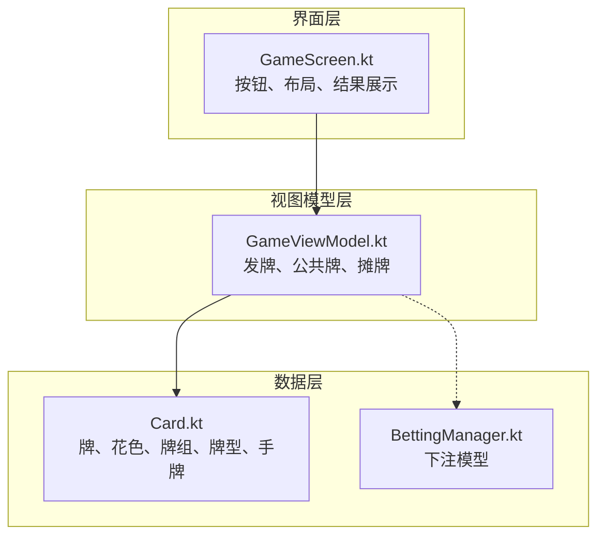
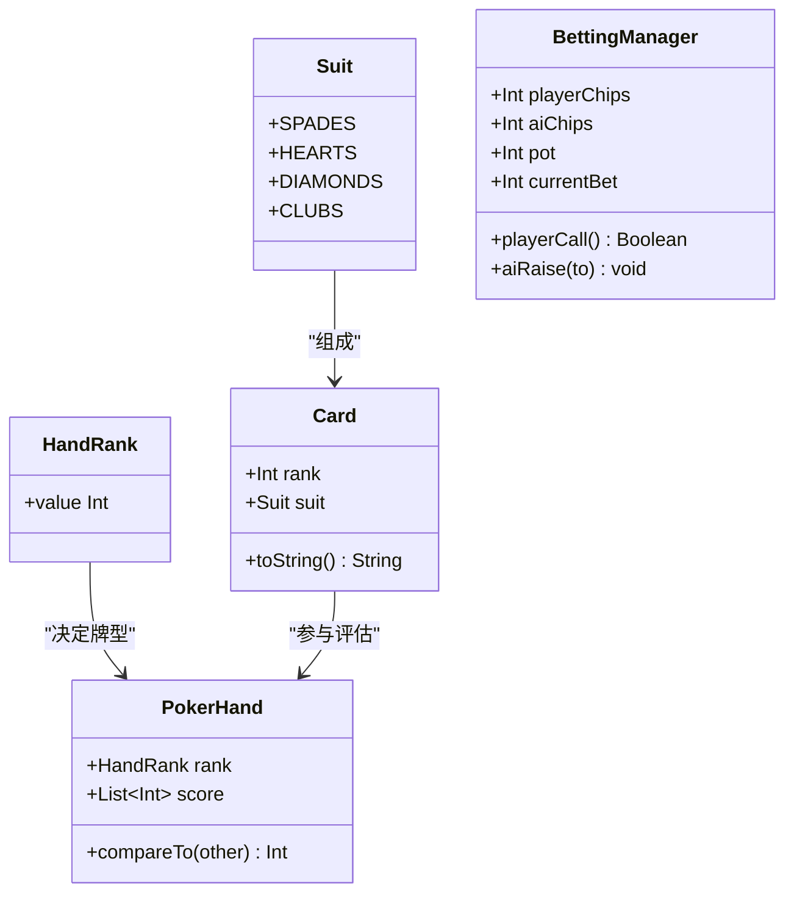
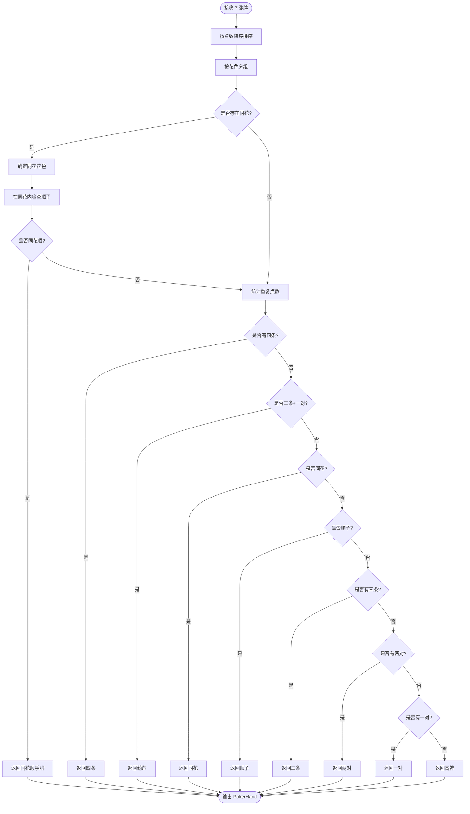
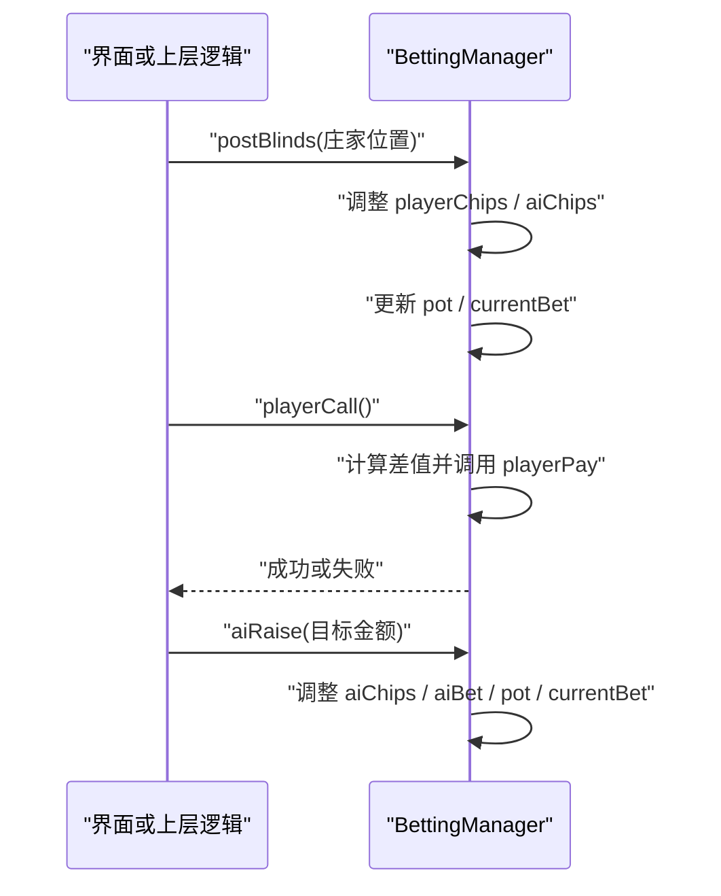
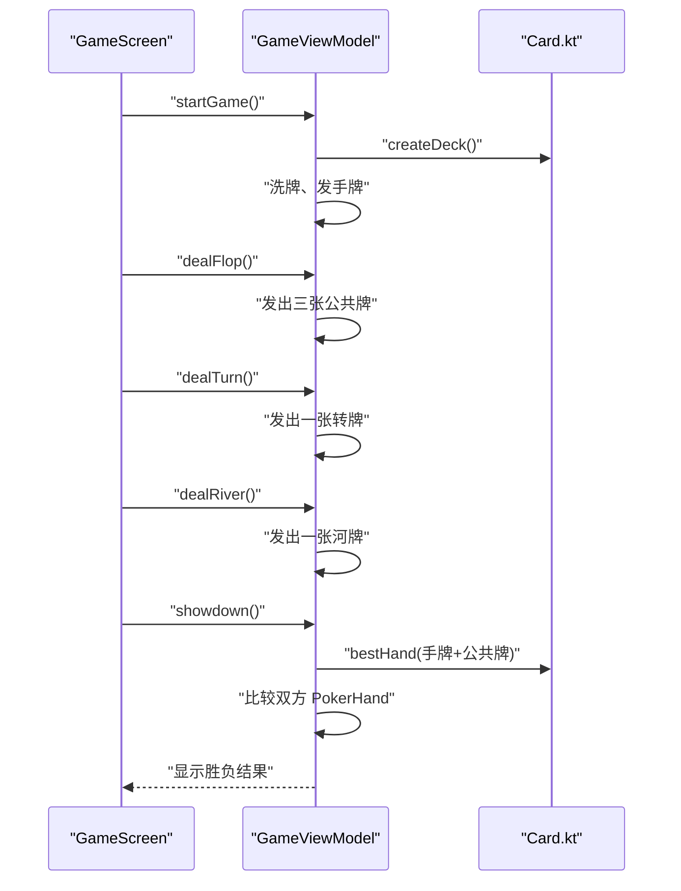
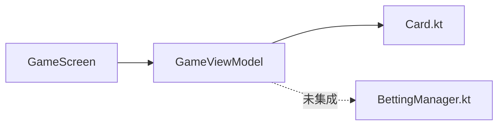

# 数据模型与规则

<cite>
**本文引用的文件**   
- [Card.kt](file://app/src/main/java/com/aniapp/pokerdemo/data/Card.kt)
- [BettingManager.kt](file://app/src/main/java/com/aniapp/pokerdemo/data/BettingManager.kt)
- [GameViewModel.kt](file://app/src/main/java/com/aniapp/pokerdemo/vm/GameViewModel.kt)
- [GameScreen.kt](file://app/src/main/java/com/aniapp/pokerdemo/ui/GameScreen.kt)
</cite>

## 目录
1. [引言](#引言)
2. [项目结构](#项目结构)
3. [核心数据模型](#核心数据模型)
4. [牌型判定与最佳手牌算法](#牌型判定与最佳手牌算法)
5. [下注管理模型](#下注管理模型)
6. [发牌与摊牌流程](#发牌与摊牌流程)
7. [依赖关系分析](#依赖关系分析)
8. [复杂度分析与性能优化](#复杂度分析与性能优化)
9. [常见问题排查](#常见问题排查)
10. [结论](#结论)

## 引言
本文件围绕 PokerDemo 的扑克数据模型与业务规则展开，重点说明：
- 扑克牌 Card、花色 Suit、标准牌组生成 createDeck()。
- 牌型等级 HandRank、可比较的手牌 PokerHand。
- 从 7 张牌中选出最优 5 张的 bestHand() 算法。
- 德州扑克下注模型 BettingManager 的状态与操作。
- GameViewModel 与 GameScreen 如何组合这些模型完成发牌、翻牌、转牌、河牌和摊牌。

本文尽量用图示和结构化表格表达技术细节，帮助非专业读者也能理解。

## 项目结构
本项目是 Android Compose 应用，核心逻辑位于 data、vm、ui 三个包：
- data：纯数据模型与算法（Card、Suit、HandRank、PokerHand、bestHand、BettingManager）。
- vm：状态管理与 UI 交互逻辑（GameViewModel）。
- ui：用户界面（GameScreen）。

**图表来源**
- [Card.kt:1-98](file://app/src/main/java/com/aniapp/pokerdemo/data/Card.kt#L1-L98)
- [BettingManager.kt:1-48](file://app/src/main/java/com/aniapp/pokerdemo/data/BettingManager.kt#L1-L48)
- [GameViewModel.kt:1-74](file://app/src/main/java/com/aniapp/pokerdemo/vm/GameViewModel.kt#L1-L74)
- [GameScreen.kt:1-104](file://app/src/main/java/com/aniapp/pokerdemo/ui/GameScreen.kt#L1-L104)

**章节来源**
- [Card.kt:1-98](file://app/src/main/java/com/aniapp/pokerdemo/data/Card.kt#L1-L98)
- [BettingManager.kt:1-48](file://app/src/main/java/com/aniapp/pokerdemo/data/BettingManager.kt#L1-L48)
- [GameViewModel.kt:1-74](file://app/src/main/java/com/aniapp/pokerdemo/vm/GameViewModel.kt#L1-L74)
- [GameScreen.kt:1-104](file://app/src/main/java/com/aniapp/pokerdemo/ui/GameScreen.kt#L1-L104)

## 核心数据模型

### 花色与点数
- Suit 表示花色，包含黑桃、红心、梅花、方块四种。
- Card 由整数 rank 与 suit 组成；rank 使用 2–14，其中 11=J、12=Q、13=K、14=A。
- createDeck() 生成 52 张牌的列表，顺序为每种花色依次包含 2–14 的点数。

| 字段 | 类型 | 含义 | 取值范围或枚举值 |
|---|---|---|---|
| rank | Int | 点数 | 2–14 |
| suit | Suit | 花色 | SPADES、HEARTS、DIAMONDS、CLUBS |

**章节来源**
- [Card.kt:1-18](file://app/src/main/java/com/aniapp/pokerdemo/data/Card.kt#L1-L18)

### 牌型等级与可比较手牌
- HandRank 定义九种牌型等级，从小到大排列：高牌、一对、两对、三条、顺子、同花、葫芦、四条、同花顺。
- PokerHand 保存当前手牌的 HandRank 与 score 序列；score 用于在相同牌型时比较主牌与踢脚牌。
- PokerHand 实现 Comparable，先按牌型等级比较，再逐位比较 score。

| 牌型 | 等级值 | score 语义 |
|---|---:|---|
| 高牌 | 1 | 前 5 大牌 |
| 一对 | 2 | 对子点数，随后踢脚 |
| 两对 | 3 | 较大对子、较小对子，随后踢脚 |
| 三条 | 4 | 三条点数，随后踢脚 |
| 顺子 | 5 | 顺子顶牌 |
| 同花 | 6 | 前 5 大牌 |
| 葫芦 | 7 | 三条点数、对子点数 |
| 四条 | 8 | 四条点数 |
| 同花顺 | 9 | 同花顺顶牌 |

**章节来源**
- [Card.kt:20-46](file://app/src/main/java/com/aniapp/pokerdemo/data/Card.kt#L20-L46)

### 类关系图

**图表来源**
- [Card.kt:1-46](file://app/src/main/java/com/aniapp/pokerdemo/data/Card.kt#L1-L46)
- [BettingManager.kt:1-48](file://app/src/main/java/com/aniapp/pokerdemo/data/BettingManager.kt#L1-L48)

## 牌型判定与最佳手牌算法

### bestHand() 设计目标
输入为 7 张牌，输出为最优 5 张牌构成的 PokerHand。其策略是：
1. 按点数降序排序。
2. 按花色分组，判断是否存在同花。
3. 去重后计算顺子候选。
4. 优先检查同花顺，再依次检查四条、葫芦、同花、顺子、三条、两对、一对、高牌。
5. 将关键牌值和踢脚牌写入 score，使 PokerHand 可比较。

**图表来源**
- [Card.kt:60-98](file://app/src/main/java/com/aniapp/pokerdemo/data/Card.kt#L60-L98)

### 算法复杂度
- 排序：O(n log n)，n 最多为 7。
- 花色分组：常数级。
- 去重与计数：常数级。
- 各类条件判断：常数级分支。
- 整体时间复杂度近似 O(1)，空间复杂度近似 O(1)。

### 典型牌型判断示例
以下示例描述输入牌集合与期望输出牌型，不直接给出源码：

| 场景 | 输入特征 | 期望牌型 | score 要点 |
|---|---|---|---|
| 高牌 | 无成对、非同花、非顺子 | 高牌 | 前 5 大牌 |
| 一对 | 有且仅有一个点数出现两次 | 一对 | 对子点数为主，其余为踢脚 |
| 两对 | 有两个不同点数各出现两次 | 两对 | 大对子在前、小对子在后 |
| 三条 | 有三个相同点数 | 三条 | 三条点数为主，其余为踢脚 |
| 顺子 | 五个连续点数 | 顺子 | 最大顶牌 |
| 同花 | 同一花色至少五张 | 同花 | 该花色前 5 大牌 |
| 葫芦 | 三条加一对 | 葫芦 | 三条点数、对子点数 |
| 四条 | 四个相同点数 | 四条 | 四条点数 |
| 同花顺 | 同花内存在五连 | 同花顺 | 同花顺顶牌 |

**章节来源**
- [Card.kt:60-98](file://app/src/main/java/com/aniapp/pokerdemo/data/Card.kt#L60-L98)

## 下注管理模型

### 状态字段
BettingManager 维护玩家筹码、电脑筹码、底池、当前下注额以及双方本轮已下注金额。

| 字段 | 类型 | 默认值 | 含义 |
|---|---|---:|---|
| playerChips | Int | 2000 | 玩家剩余筹码 |
| aiChips | Int | 2000 | 电脑剩余筹码 |
| smallBlind | Int | 10 | 小盲注 |
| bigBlind | Int | 20 | 大盲注 |
| pot | Int | 0 | 底池总金额 |
| currentBet | Int | 0 | 当前轮次最高下注额 |
| playerBet | Int | 0 | 玩家本轮已下注 |
| aiBet | Int | 0 | 电脑本轮已下注 |

### 主要方法
- postBlinds(isPlayerDealer)：根据庄家位置支付小盲和大盲。
- playerPay(amount)：玩家支付指定金额；若筹码不足返回失败。
- aiPay(amount)：电脑支付指定金额。
- playerCall()：玩家跟注到当前最高下注额。
- aiCall()：电脑跟注到当前最高下注额。
- playerRaise(to)：玩家加注到指定金额。
- aiRaise(to)：电脑加注到指定金额。
- resetBets()：重置本轮下注记录。

**图表来源**
- [BettingManager.kt:1-48](file://app/src/main/java/com/aniapp/pokerdemo/data/BettingManager.kt#L1-L48)

**章节来源**
- [BettingManager.kt:1-48](file://app/src/main/java/com/aniapp/pokerdemo/data/BettingManager.kt#L1-L48)

## 发牌与摊牌流程

GameViewModel 负责：
- 创建并洗牌牌组。
- 发给玩家和电脑各两张手牌。
- 分阶段发出 Flop、Turn、River 公共牌。
- 在 River 结束后摊牌，分别计算双方最佳手牌并比较结果。

**图表来源**
- [GameViewModel.kt:1-74](file://app/src/main/java/com/aniapp/pokerdemo/vm/GameViewModel.kt#L1-L74)
- [GameScreen.kt:1-104](file://app/src/main/java/com/aniapp/pokerdemo/ui/GameScreen.kt#L1-L104)
- [Card.kt:60-98](file://app/src/main/java/com/aniapp/pokerdemo/data/Card.kt#L60-L98)

**章节来源**
- [GameViewModel.kt:1-74](file://app/src/main/java/com/aniapp/pokerdemo/vm/GameViewModel.kt#L1-L74)
- [GameScreen.kt:1-104](file://app/src/main/java/com/aniapp/pokerdemo/ui/GameScreen.kt#L1-L104)

## 依赖关系分析

- GameViewModel 依赖 Card.kt 中的 createDeck() 与 bestHand()。
- GameScreen 依赖 GameViewModel 提供的状态与方法。
- BettingManager 目前作为独立数据模型存在，但 GameViewModel 尚未集成下注流程。

**图表来源**
- [GameViewModel.kt:1-74](file://app/src/main/java/com/aniapp/pokerdemo/vm/GameViewModel.kt#L1-L74)
- [GameScreen.kt:1-104](file://app/src/main/java/com/aniapp/pokerdemo/ui/GameScreen.kt#L1-L104)
- [Card.kt:1-98](file://app/src/main/java/com/aniapp/pokerdemo/data/Card.kt#L1-L98)
- [BettingManager.kt:1-48](file://app/src/main/java/com/aniapp/pokerdemo/data/BettingManager.kt#L1-L48)

**章节来源**
- [GameViewModel.kt:1-74](file://app/src/main/java/com/aniapp/pokerdemo/vm/GameViewModel.kt#L1-L74)
- [GameScreen.kt:1-104](file://app/src/main/java/com/aniapp/pokerdemo/ui/GameScreen.kt#L1-L104)
- [Card.kt:1-98](file://app/src/main/java/com/aniapp/pokerdemo/data/Card.kt#L1-L98)
- [BettingManager.kt:1-48](file://app/src/main/java/com/aniapp/pokerdemo/data/BettingManager.kt#L1-L48)

## 复杂度分析与性能优化

### 复杂度总结
- bestHand()：输入固定为 7 张牌，排序与分组均为常数规模，整体接近 O(1)。
- PokerHand.compareTo()：score 长度固定且很小，比较接近 O(1)。
- GameViewModel 发牌与摊牌：每次操作处理少量卡片，时间复杂度为 O(1)。

### 性能优化建议
- 避免重复排序：可在多次评估时复用排序后的结果，减少重复计算。
- 预分配数据结构：由于牌数固定，可预分配数组而非频繁创建集合。
- 缓存常见牌型评分：对高频出现的牌面组合可引入简单查表缓存。
- 分离 UI 与算法：保持 Card.kt 纯函数特性，便于单元测试与性能基准测试。

[本节为通用性能建议，不直接分析具体代码行]

## 常见问题排查

### 牌数校验失败
bestHand() 要求传入至少 7 张牌。如果只传入手牌或未发完公共牌就摊牌，会触发参数校验失败。

排查方式：
- 确保 showdown() 仅在社区牌数量为 5 时执行。
- 在 UI 层禁用“摊牌”按钮直到 River 发完。

**章节来源**
- [Card.kt:60-62](file://app/src/main/java/com/aniapp/pokerdemo/data/Card.kt#L60-L62)
- [GameViewModel.kt:47-63](file://app/src/main/java/com/aniapp/pokerdemo/vm/GameViewModel.kt#L47-L63)

### 下注金额异常
- playerPay() 在金额超过 playerChips 时返回失败。
- currentBet 始终取玩家与电脑本轮下注的最大值。

排查方式：
- 在 playerCall() 或 playerRaise() 前检查返回值。
- 确认 postBlinds() 是否正确设置初始下注。

**章节来源**
- [BettingManager.kt:1-48](file://app/src/main/java/com/aniapp/pokerdemo/data/BettingManager.kt#L1-L48)

### 牌型比较不一致
PokerHand 先比较牌型等级，再比较 score。若 score 构造不完整，可能导致相同牌型比较结果不符合预期。

排查方式：
- 核对不同牌型的 score 顺序是否符合规则。
- 使用典型牌面进行单元测试覆盖。

**章节来源**
- [Card.kt:28-46](file://app/src/main/java/com/aniapp/pokerdemo/data/Card.kt#L28-L46)
- [Card.kt:60-98](file://app/src/main/java/com/aniapp/pokerdemo/data/Card.kt#L60-L98)

## 结论
PokerDemo 的核心数据模型清晰分离：Card 与 Suit 表示基础牌，HandRank 与 PokerHand 表示牌型与比较规则，bestHand() 提供从 7 张牌中选择最优 5 张的策略。BettingManager 提供了完整的下注状态机接口，但目前尚未与 GameViewModel 的下注流程集成。建议在后续版本中：
- 将 BettingManager 接入发牌与摊牌流程。
- 增加下注回合状态机与弃牌逻辑。
- 补充单元测试，覆盖所有牌型与边界场景。
- 对 bestHand() 加入性能基准与缓存优化。