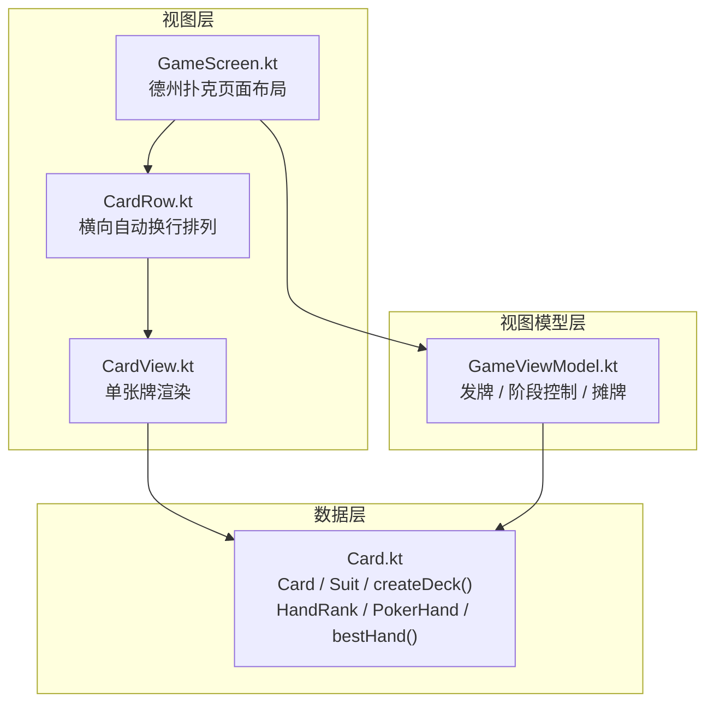
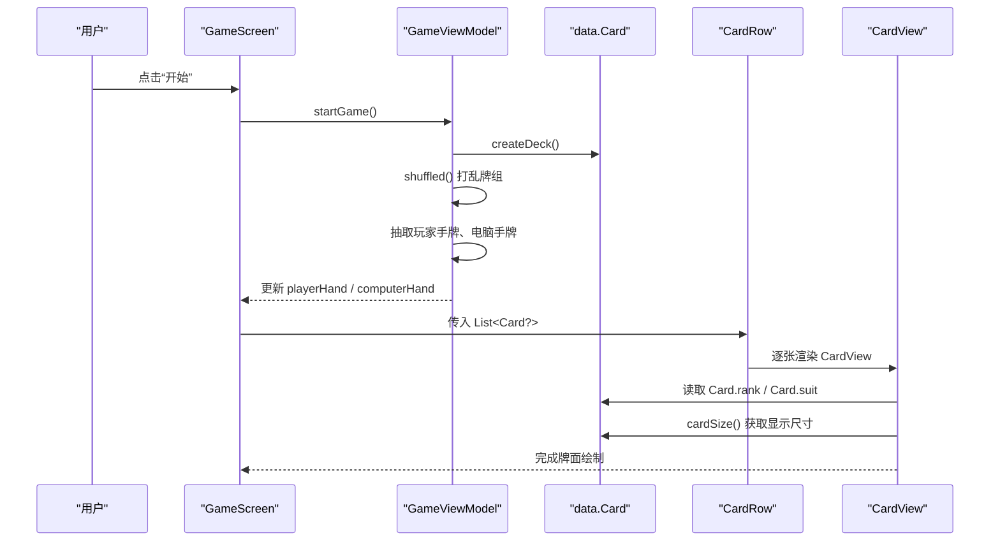
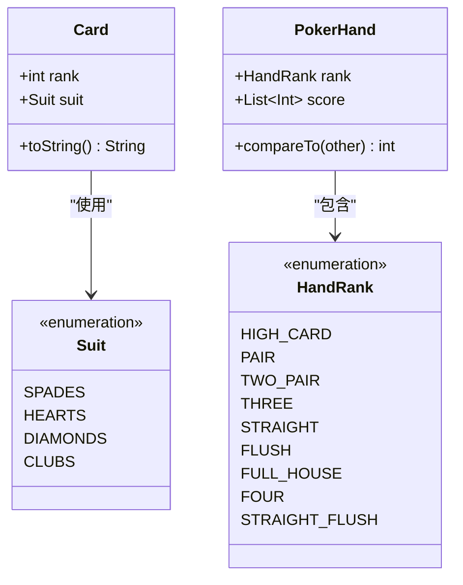
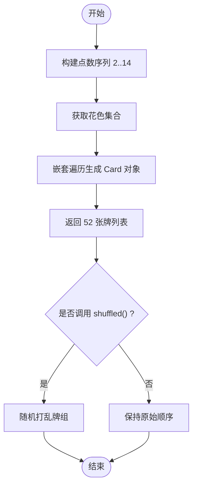
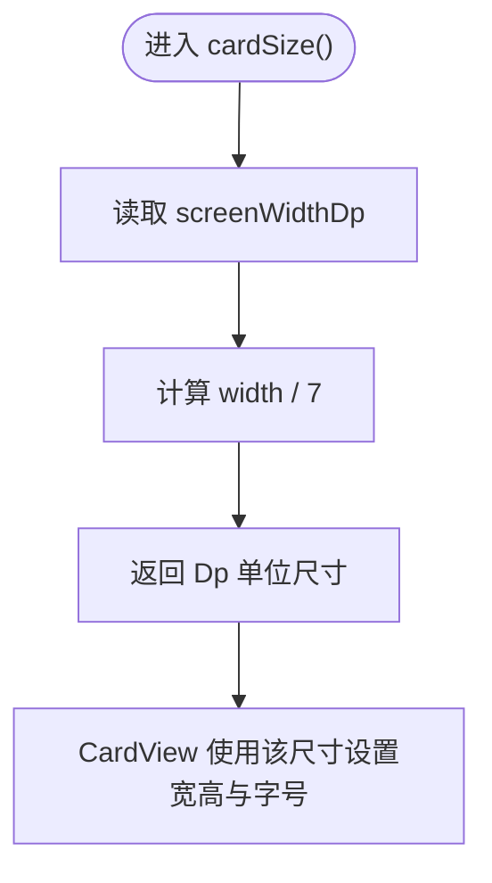
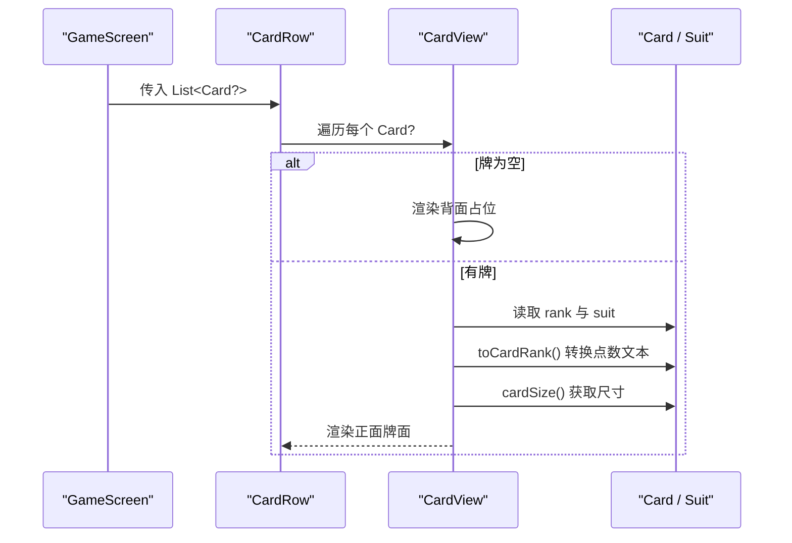
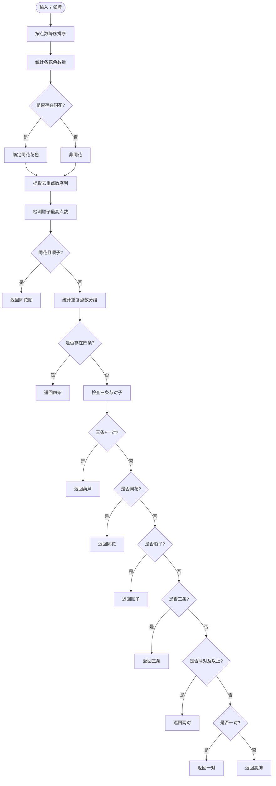
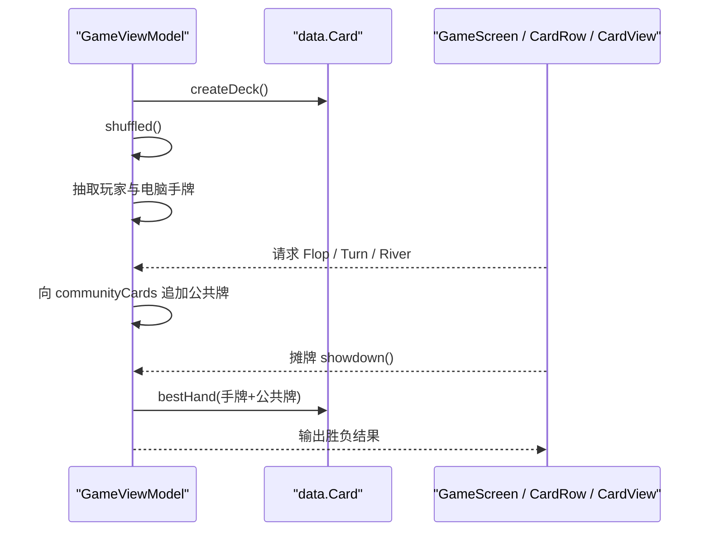
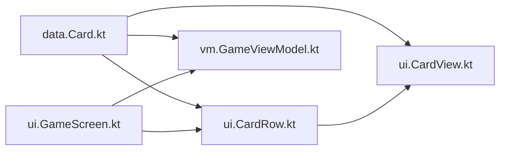

# 牌与牌组模型

<cite>
**本文引用的文件**   
- [Card.kt](file://app/src/main/java/com/aniapp/pokerdemo/data/Card.kt)
- [GameViewModel.kt](file://app/src/main/java/com/aniapp/pokerdemo/vm/GameViewModel.kt)
- [CardView.kt](file://app/src/main/java/com/aniapp/pokerdemo/ui/CardView.kt)
- [CardRow.kt](file://app/src/main/java/com/aniapp/pokerdemo/ui/CardRow.kt)
- [GameScreen.kt](file://app/src/main/java/com/aniapp/pokerdemo/ui/GameScreen.kt)
</cite>

## 目录
1. [引言](#引言)
2. [项目结构](#项目结构)
3. [核心组件](#核心组件)
4. [架构总览](#架构总览)
5. [详细组件分析](#详细组件分析)
6. [依赖关系分析](#依赖关系分析)
7. [性能考虑](#性能考虑)
8. [故障排查指南](#故障排查指南)
9. [结论](#结论)

## 引言
本文聚焦于德州扑克应用中的“牌”数据模型与“牌组管理”能力，围绕以下目标展开：
- 说明 Card 类的字段定义与花色枚举 Suit。
- 解释 createDeck() 如何生成 52 张完整牌组，并说明洗牌逻辑与随机化策略。
- 描述 cardSize() 如何依据屏幕宽度动态计算卡片显示尺寸。
- 给出在 UI 中创建牌组、获取单张牌信息以及展示牌面的具体用法路径。
- 梳理牌型评估与排序规则，包括牌型等级、主牌值比较与平局处理。

本项目的实现语言为 Kotlin，UI 基于 Jetpack Compose；数据层位于 data 包，视图层位于 ui 包，状态与流程由 vm 包管理。

## 项目结构
与牌和牌组直接相关的代码分布如下：
- data 包：定义牌、花色、牌组生成、牌型等级与手牌评估。
- ui 包：负责牌的绘制、排列与用户交互界面。
- vm 包：封装发牌、公共牌阶段推进、摊牌与结果输出等游戏流程。

**图表来源**
- [Card.kt:1-98](file://app/src/main/java/com/aniapp/pokerdemo/data/Card.kt#L1-L98)
- [GameScreen.kt:1-104](file://app/src/main/java/com/aniapp/pokerdemo/ui/GameScreen.kt#L1-L104)
- [CardRow.kt:1-24](file://app/src/main/java/com/aniapp/pokerdemo/ui/CardRow.kt#L1-L24)
- [CardView.kt:1-79](file://app/src/main/java/com/aniapp/pokerdemo/ui/CardView.kt#L1-L79)
- [GameViewModel.kt:1-74](file://app/src/main/java/com/aniapp/pokerdemo/vm/GameViewModel.kt#L1-L74)

**章节来源**
- [Card.kt:1-98](file://app/src/main/java/com/aniapp/pokerdemo/data/Card.kt#L1-L98)
- [GameScreen.kt:1-104](file://app/src/main/java/com/aniapp/pokerdemo/ui/GameScreen.kt#L1-L104)
- [CardRow.kt:1-24](file://app/src/main/java/com/aniapp/pokerdemo/ui/CardRow.kt#L1-L24)
- [CardView.kt:1-79](file://app/src/main/java/com/aniapp/pokerdemo/ui/CardView.kt#L1-L79)
- [GameViewModel.kt:1-74](file://app/src/main/java/com/aniapp/pokerdemo/vm/GameViewModel.kt#L1-L74)

## 核心组件
本节概述与“牌”和“牌组”直接相关的数据结构与函数：

- 花色枚举 Suit
  - 包含四种花色：黑桃、红心、方块、梅花。
  - 用于区分花色，参与同花判断与颜色渲染。

- 牌数据类 Card
  - rank：整数 2-14，其中 11=J、12=Q、13=K、14=A。
  - suit：Suit 枚举。
  - toString 返回 “点数-花色” 的字符串形式，便于调试与结果显示。

- 牌组生成 createDeck()
  - 遍历四种花色，对每种花色按 2-14 的顺序生成牌，得到 52 张牌。
  - 注意：createDeck() 本身不洗牌；洗牌发生在 GameViewModel.startGame() 调用 shuffled()。

- 牌型等级 HandRank
  - 从低到高依次为：高牌、一对、两对、三条、顺子、同花、葫芦、四条、同花顺。
  - value 用于快速比较牌型大小。

- 手牌表示 PokerHand
  - 包含 rank（牌型）与 score（主牌及踢脚列表）。
  - Comparable 实现优先比较牌型，再逐个比较 score 元素，最后视为平局。

- 动态尺寸 cardSize()
  - 读取屏幕宽度（dp），将宽度除以 7 作为单张牌的宽度，高度为宽度的 1.35 倍。
  - 使牌面在不同屏幕尺寸下保持合适的显示比例。

- 最佳手牌评估 bestHand()
  - 输入 7 张牌（2 张手牌 + 5 张公共牌），选出最优 5 张组合对应的牌型与评分。
  - 支持同花、顺子、四条、葫芦、两对、一对、高牌等判定。

**章节来源**
- [Card.kt:1-98](file://app/src/main/java/com/aniapp/pokerdemo/data/Card.kt#L1-L98)

## 架构总览
下图展示从用户操作到牌组管理与牌面展示的端到端流程：

**图表来源**
- [GameScreen.kt:1-104](file://app/src/main/java/com/aniapp/pokerdemo/ui/GameScreen.kt#L1-L104)
- [GameViewModel.kt:1-74](file://app/src/main/java/com/aniapp/pokerdemo/vm/GameViewModel.kt#L1-L74)
- [Card.kt:1-98](file://app/src/main/java/com/aniapp/pokerdemo/data/Card.kt#L1-L98)
- [CardRow.kt:1-24](file://app/src/main/java/com/aniapp/pokerdemo/ui/CardRow.kt#L1-L24)
- [CardView.kt:1-79](file://app/src/main/java/com/aniapp/pokerdemo/ui/CardView.kt#L1-L79)

## 详细组件分析

### Card 与 Suit 数据模型
- Card 是纯数据对象，包含点数 rank 与花色 suit。
- Suit 使用枚举表达四种花色，保证类型安全。
- toString 提供人类可读的标识，便于日志与结果展示。

**图表来源**
- [Card.kt:1-98](file://app/src/main/java/com/aniapp/pokerdemo/data/Card.kt#L1-L98)

**章节来源**
- [Card.kt:1-20](file://app/src/main/java/com/aniapp/pokerdemo/data/Card.kt#L1-L20)

### 牌组生成与洗牌逻辑
- createDeck() 通过双重循环构造 52 张牌：外层遍历花色，内层遍历点数 2-14。
- 生成的牌组顺序为先按花色分组，再按点数升序。
- 实际洗牌发生在 GameViewModel.startGame() 中对 createDeck().shuffled() 的结果进行转换与复用。
- 洗牌策略使用标准库的随机打乱方法，具备良好均匀性。

**图表来源**
- [Card.kt:12-20](file://app/src/main/java/com/aniapp/pokerdemo/data/Card.kt#L12-L20)
- [GameViewModel.kt:12-24](file://app/src/main/java/com/aniapp/pokerdemo/vm/GameViewModel.kt#L12-L24)

**章节来源**
- [Card.kt:12-20](file://app/src/main/java/com/aniapp/pokerdemo/data/Card.kt#L12-L20)
- [GameViewModel.kt:12-24](file://app/src/main/java/com/aniapp/pokerdemo/vm/GameViewModel.kt#L12-L24)

### 动态卡片尺寸 cardSize()
- cardSize() 基于当前屏幕宽度 screenWidthDp 计算牌宽：宽度 = 屏幕宽度 ÷ 7。
- CardView 根据该尺寸设置宽高比（宽 × 1.35），并据此调整字体大小。
- 这种方式确保在不同分辨率设备下，牌面仍能保持合理的视觉比例。

**图表来源**
- [Card.kt:49-54](file://app/src/main/java/com/aniapp/pokerdemo/data/Card.kt#L49-L54)
- [CardView.kt:15-35](file://app/src/main/java/com/aniapp/pokerdemo/ui/CardView.kt#L15-L35)

**章节来源**
- [Card.kt:49-54](file://app/src/main/java/com/aniapp/pokerdemo/data/Card.kt#L49-L54)
- [CardView.kt:15-35](file://app/src/main/java/com/aniapp/pokerdemo/ui/CardView.kt#L15-L35)

### 牌面渲染与 UI 使用
- GameScreen 提供德州扑克主界面，组织玩家手牌、电脑手牌与公共牌区域。
- CardRow 使用 FlowRow 自动换行排列牌，支持空位（null）表示背面牌。
- CardView 负责单张牌渲染：
  - 当 card 为 null 时，渲染背面占位。
  - 否则根据 suit 决定符号与颜色（黑桃、梅花为黑色；红心、方块为红色）。
  - 左上角显示点数与花色，中心显示大花色符号，右下角旋转 180° 显示倒置信息。
  - 字体大小随 cardSize() 动态缩放，提升可阅读性。

**图表来源**
- [GameScreen.kt:18-82](file://app/src/main/java/com/aniapp/pokerdemo/ui/GameScreen.kt#L18-L82)
- [CardRow.kt:10-23](file://app/src/main/java/com/aniapp/pokerdemo/ui/CardRow.kt#L10-L23)
- [CardView.kt:15-79](file://app/src/main/java/com/aniapp/pokerdemo/ui/CardView.kt#L15-L79)
- [GameScreen.kt:96-104](file://app/src/main/java/com/aniapp/pokerdemo/ui/GameScreen.kt#L96-L104)

**章节来源**
- [GameScreen.kt:18-82](file://app/src/main/java/com/aniapp/pokerdemo/ui/GameScreen.kt#L18-L82)
- [CardRow.kt:10-23](file://app/src/main/java/com/aniapp/pokerdemo/ui/CardRow.kt#L10-L23)
- [CardView.kt:15-79](file://app/src/main/java/com/aniapp/pokerdemo/ui/CardView.kt#L15-L79)
- [GameScreen.kt:96-104](file://app/src/main/java/com/aniapp/pokerdemo/ui/GameScreen.kt#L96-L104)

### 牌型评估与排序规则
bestHand() 接收 7 张牌，评估出最强 5 张组合的牌型与分数。其核心规则如下：

- 基本步骤
  - 将牌按点数降序排序。
  - 统计各花色牌数，判断是否存在同花。
  - 提取去重后的点数序列，判断是否存在顺子。
  - 若同时满足同花与顺子条件，则判定为同花顺。
  - 统计重复点数，识别四条、三条、两对、一对。
  - 若三条存在且另有至少一对，则为葫芦。
  - 否则按同花、顺子、三条、两对、一对、高牌的优先级返回。

- 主牌与踢脚
  - 不同牌型使用 score 列表记录关键值：例如四条记录四条的点数；葫芦记录三条与一对的点数；两对记录两对的主牌点数；同花与高牌记录前五大的点数。
  - PokerHand.compareTo() 先比较牌型等级，再逐项比较 score 元素，完全一致时为平局。

- 花色优先级
  - 在本实现中，花色不参与牌型等级的强弱比较；同花判定只要求同一花色数量 ≥ 5。
  - 花色主要用于视觉渲染与同花判断，不改变牌型比较结果。

**图表来源**
- [Card.kt:55-98](file://app/src/main/java/com/aniapp/pokerdemo/data/Card.kt#L55-L98)

**章节来源**
- [Card.kt:55-98](file://app/src/main/java/com/aniapp/pokerdemo/data/Card.kt#L55-L98)

### 在游戏流程中使用牌与牌组
- 创建牌组与发牌
  - 调用 GameViewModel.startGame()，内部会 createDeck() 并使用 shuffled() 打乱牌组，然后依次发出两张玩家手牌与两张电脑手牌。
- 公共牌阶段
  - Flop：发出三张公共牌。
  - Turn：发出第四张公共牌。
  - River：发出第五张公共牌。
- 摊牌与结果
  - showdown() 要求公共牌为五张，随后合并手牌与公共牌调用 bestHand() 分别评估双方最强手牌，比较后输出结果。
- UI 绑定
  - GameScreen 将 playerHand、computerHand、communityCards 传递给 CardRow，再由 CardView 渲染。

**图表来源**
- [GameViewModel.kt:12-68](file://app/src/main/java/com/aniapp/pokerdemo/vm/GameViewModel.kt#L12-L68)
- [GameScreen.kt:18-82](file://app/src/main/java/com/aniapp/pokerdemo/ui/GameScreen.kt#L18-L82)

**章节来源**
- [GameViewModel.kt:12-68](file://app/src/main/java/com/aniapp/pokerdemo/vm/GameViewModel.kt#L12-L68)
- [GameScreen.kt:18-82](file://app/src/main/java/com/aniapp/pokerdemo/ui/GameScreen.kt#L18-L82)

## 依赖关系分析
- data 层独立于 UI 与 ViewModel，仅定义数据结构、牌组生成与牌型评估。
- ui 层依赖 data 层的 Card、Suit、cardSize 与 toCardRank 扩展。
- vm 层依赖 data 层的 createDeck 与 bestHand，负责状态管理与业务流程。
- 不存在循环依赖：ui → data，vm → data，ui ↔ vm 通过状态与回调协作。

**图表来源**
- [Card.kt:1-98](file://app/src/main/java/com/aniapp/pokerdemo/data/Card.kt#L1-L98)
- [CardView.kt:1-79](file://app/src/main/java/com/aniapp/pokerdemo/ui/CardView.kt#L1-L79)
- [CardRow.kt:1-24](file://app/src/main/java/com/aniapp/pokerdemo/ui/CardRow.kt#L1-L24)
- [GameScreen.kt:1-104](file://app/src/main/java/com/aniapp/pokerdemo/ui/GameScreen.kt#L1-L104)
- [GameViewModel.kt:1-74](file://app/src/main/java/com/aniapp/pokerdemo/vm/GameViewModel.kt#L1-L74)

**章节来源**
- [Card.kt:1-98](file://app/src/main/java/com/aniapp/pokerdemo/data/Card.kt#L1-L98)
- [CardView.kt:1-79](file://app/src/main/java/com/aniapp/pokerdemo/ui/CardView.kt#L1-L79)
- [CardRow.kt:1-24](file://app/src/main/java/com/aniapp/pokerdemo/ui/CardRow.kt#L1-L24)
- [GameScreen.kt:1-104](file://app/src/main/java/com/aniapp/pokerdemo/ui/GameScreen.kt#L1-L104)
- [GameViewModel.kt:1-74](file://app/src/main/java/com/aniapp/pokerdemo/vm/GameViewModel.kt#L1-L74)

## 性能考虑
- 牌组生成
  - createDeck() 时间复杂度 O(52)，空间复杂度 O(52)。
  - 洗牌 shuffled() 时间复杂度近似 O(n)，n=52，开销极小。
- 牌型评估
  - bestHand() 对 7 张牌进行排序与分组，整体复杂度约为 O(n log n)，n≤7，非常轻量。
  - 同花与顺子判断均为线性扫描，常数级开销。
- UI 渲染
  - CardView 每次重组时根据 cardSize() 计算尺寸，计算量很小。
  - FlowRow 自动换行，在少量牌场景下无性能瓶颈。

[本节为通用性能讨论，未直接分析特定代码片段]

## 故障排查指南
- 提示“必须传入 7 张牌”
  - 原因：bestHand() 要求输入至少 7 张牌。
  - 排查：确认 showdown() 前已发完 5 张公共牌，并且 hand + communityCards 合计为 7 张。
  - 参考位置：bestHand() 前置校验。

- 牌没有洗牌
  - 现象：每次开局牌序相同。
  - 原因：忘记调用 shuffled() 或未进入 startGame()。
  - 排查：确认 GameViewModel.startGame() 调用了 createDeck().shuffled()。

- 牌面显示异常或空白
  - 现象：牌背或空白区域显示不正确。
  - 原因：传入 CardRow 的列表中混入 null；或 CardView 中 card 为 null 时渲染背面。
  - 排查：确认 GameScreen 与 GameViewModel 中 List<Card?> 的填充逻辑。

- 花色颜色错误
  - 现象：红心或方块显示为黑色。
  - 原因：suit 值映射错误或数据污染。
  - 排查：检查 CardView 中根据 suit 选择颜色的分支。

**章节来源**
- [Card.kt:55-98](file://app/src/main/java/com/aniapp/pokerdemo/data/Card.kt#L55-L98)
- [GameViewModel.kt:12-68](file://app/src/main/java/com/aniapp/pokerdemo/vm/GameViewModel.kt#L12-L68)
- [CardView.kt:15-79](file://app/src/main/java/com/aniapp/pokerdemo/ui/CardView.kt#L15-L79)

## 结论
本项目以简洁清晰的方式实现了德州扑克的牌与牌组模型：
- Card 与 Suit 提供了安全的类型化数据基础。
- createDeck() 与 GameViewModel 的组合完成了完整的 52 张牌生成与洗牌。
- cardSize() 让牌面在不同设备上自适应显示。
- bestHand() 实现了常用牌型的评估与排序，支撑摊牌胜负判定。
- UI 层通过 CardRow 与 CardView 将数据直观呈现给用户。

在实际使用中，建议始终通过 GameViewModel 的状态变化驱动 UI，避免绕过发牌流程直接修改牌集合；同时在扩展新功能时，尽量保持 data 层的纯函数特性，以便测试与维护。