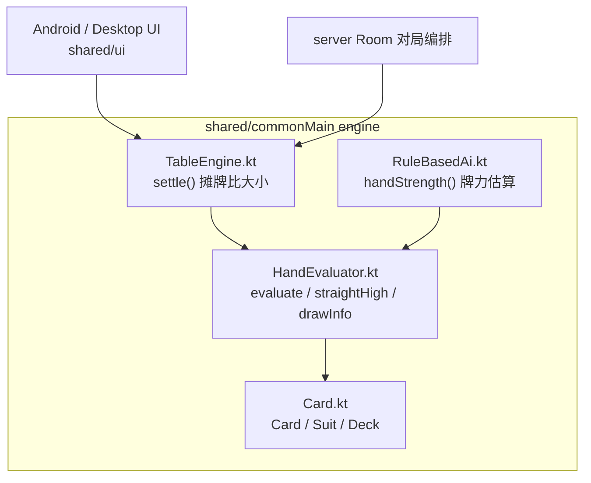
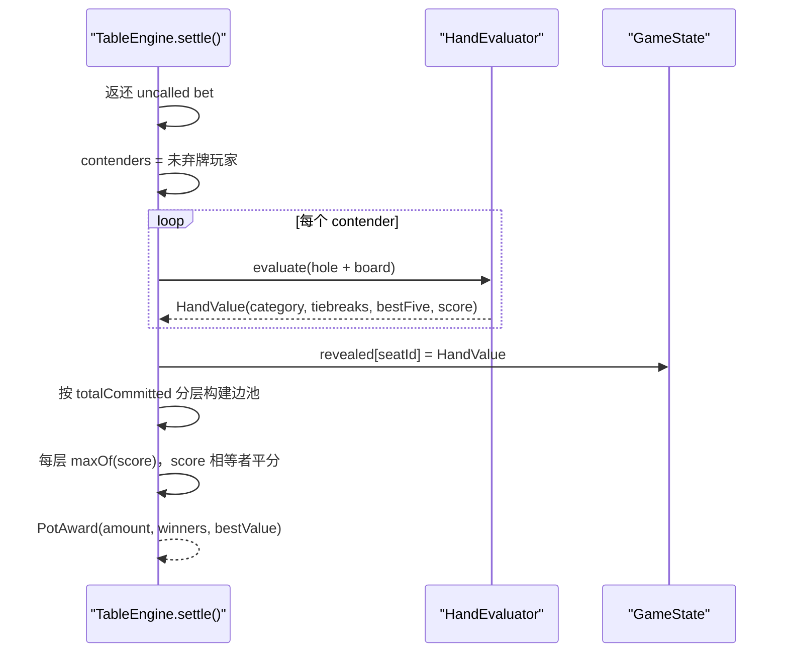
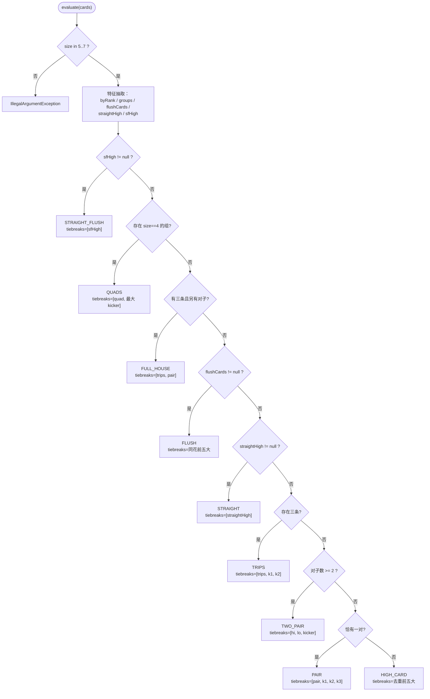
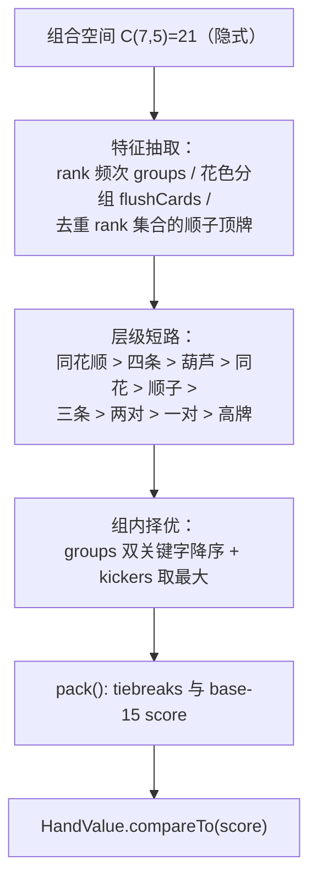
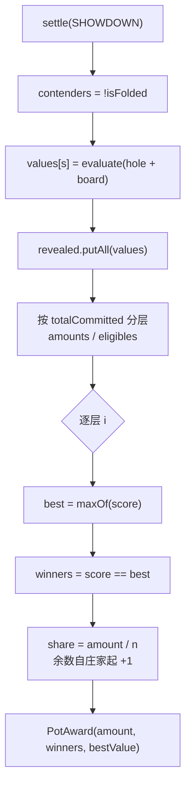

# 牌型评估算法

<cite>
**本文引用的文件**
- [HandEvaluator.kt](file://shared/src/commonMain/kotlin/com/aniapp/pokerdemo/engine/HandEvaluator.kt)
- [Card.kt](file://shared/src/commonMain/kotlin/com/aniapp/pokerdemo/engine/Card.kt)
- [TableEngine.kt](file://shared/src/commonMain/kotlin/com/aniapp/pokerdemo/engine/TableEngine.kt)
- [GameState.kt](file://shared/src/commonMain/kotlin/com/aniapp/pokerdemo/engine/GameState.kt)
- [RuleBasedAi.kt](file://shared/src/commonMain/kotlin/com/aniapp/pokerdemo/engine/ai/RuleBasedAi.kt)
- [HandEvaluatorTest.kt](file://shared/src/commonTest/kotlin/com/aniapp/pokerdemo/engine/HandEvaluatorTest.kt)
</cite>

## 目录
1. [引言](#引言)
2. [项目结构与实现位置](#项目结构与实现位置)
3. [核心数据结构与类型](#核心数据结构与类型)
4. [架构总览](#架构总览)
5. [详细组件分析](#详细组件分析)
6. [调用方分析](#调用方分析)
7. [性能分析与优化建议](#性能分析与优化建议)
8. [正确性验证方式](#正确性验证方式)
9. [故障排查指南](#故障排查指南)
10. [结论](#结论)
11. [附录：牌型判断示例](#附录牌型判断示例)

## 引言
本技术文档围绕德州扑克牌型评估的核心算法展开，说明以下目标：
- `HandValue` 结果结构的语义（`category`、`tiebreaks`、`bestFive`、`score`）与比较规则；
- `HandEvaluator.evaluate()` 的判定流程：如何在 5–7 张输入中确定最优 5 张等效组合，而不显式枚举 C(7,5)=21 种组合；
- 高牌、一对、两对、三条、顺子、同花、葫芦、四条、同花顺的识别条件与 `tiebreaks` 构造；
- `straightHigh()` 对 A 低顺（wheel，A-2-3-4-5）的特判处理；
- 新增的 `drawInfo()` 听牌辅助信息及其在 AI 牌力估算中的作用；
- 复杂度分析与预计算、缓存等优化建议。

需要特别说明的是：早期版本中的 `HandRank` / `PokerHand` / `bestHand()` API，以及“必须传入 7 张牌”的约束在当前代码中已不存在。牌型评估逻辑已从 Android 应用层迁移到跨端共享模块 `shared`，入口为 `object HandEvaluator` 的 `evaluate(cards: List<Card>): HandValue`，接受 **5–7 张**牌（少张数场景用于翻牌/转牌阶段的手牌评估）。

**章节来源**
- [HandEvaluator.kt:33-45](file://shared/src/commonMain/kotlin/com/aniapp/pokerdemo/engine/HandEvaluator.kt#L33-L45)

## 项目结构与实现位置
评估算法位于 Kotlin Multiplatform 共享模块，供 Android、Desktop 客户端与服务端复用：

- `shared/.../engine/Card.kt`：`Suit`、`Card(rank, suit)`、`createDeck()`、`Deck`（发牌与 burn）；
- `shared/.../engine/HandEvaluator.kt`：`HandCategory`、`HandValue`、`DrawInfo`、`object HandEvaluator`（`evaluate` / `straightHigh` / `drawInfo`）；
- `shared/.../engine/TableEngine.kt`：在 `settle()` 摊牌分支调用 `evaluate()` 完成比大小与边池分配；
- `shared/.../engine/ai/RuleBasedAi.kt`：在 `handStrength()` 中调用 `evaluate()` 与 `drawInfo()` 估算手牌强度；
- `shared/.../commonTest/.../HandEvaluatorTest.kt`：包含与独立枚举式 oracle 的交叉验证测试。

旧的 `app/src/main/java/com/aniapp/pokerdemo/data`（`Card`/`HandRank`/`PokerHand`/`bestHand()`）、`vm/GameViewModel.kt`、`ui/GameScreen.kt` 已不在仓库中；`app` 模块当前只保留 `MainActivity.kt`，UI 由 `shared/.../ui` 下的 Compose 多平台界面承担。



**图示来源**
- [HandEvaluator.kt:1-144](file://shared/src/commonMain/kotlin/com/aniapp/pokerdemo/engine/HandEvaluator.kt#L1-L144)
- [TableEngine.kt:241-300](file://shared/src/commonMain/kotlin/com/aniapp/pokerdemo/engine/TableEngine.kt#L241-L300)
- [RuleBasedAi.kt:46-68](file://shared/src/commonMain/kotlin/com/aniapp/pokerdemo/engine/ai/RuleBasedAi.kt#L46-L68)

**章节来源**
- [Card.kt:1-35](file://shared/src/commonMain/kotlin/com/aniapp/pokerdemo/engine/Card.kt#L1-L35)
- [HandEvaluator.kt:1-144](file://shared/src/commonMain/kotlin/com/aniapp/pokerdemo/engine/HandEvaluator.kt#L1-L144)

## 核心数据结构与类型

### Card 与 Suit
- `Suit`：`SPADES / HEARTS / DIAMONDS / CLUBS` 四值枚举，参与序列化。
- `Card(rank: Int, suit: Suit)`：`rank` 取值 2–14（T=10、J=11、Q=12、K=13、A=14），花色不参与牌型强弱比较，仅用于同花判定；`toString()` 输出如 `Ah`、`Ts` 的简写形式。
- `createDeck()` 生成 4×13 = 52 张牌；`Deck` 以 `ArrayDeque` 提供 `draw()` 与 `burn()`。

### HandCategory
按枚举声明顺序即牌型强弱升序排列，`ordinal` 从 0（高牌）到 8（同花顺），并带中文 `label`：`HIGH_CARD(高牌)`、`PAIR(一对)`、`TWO_PAIR(两对)`、`TRIPS(三条)`、`STRAIGHT(顺子)`、`FLUSH(同花)`、`FULL_HOUSE(葫芦)`、`QUADS(四条)`、`STRAIGHT_FLUSH(同花顺)`。命名上以 `TRIPS`/`QUADS` 取代旧式的 `THREE`/`FOUR`。

### HandValue（取代旧 PokerHand）
```kotlin
data class HandValue(
    val category: HandCategory,   // 牌型等级
    val tiebreaks: List<Int>,     // 逐位比较分数序列
    val bestFive: List<Card>,     // 构成最优牌型的 5 张具体牌
    val score: Long               // base-15 打包后的单一比较键
) : Comparable<HandValue> {
    override fun compareTo(other: HandValue): Int = score.compareTo(other.score)
}
```
- `category`：等价于旧文档所说的 handType，决定牌型层级。
- `tiebreaks`：等价于旧文档所说的 scoreSequence，是逐位比较用的 rank 序列（例如葫芦为 `[三条 rank, 对子 rank]`）。
- `bestFive`：新增字段，给出具体的 5 张牌对象，便于 UI 展示“最佳五张”。
- `score`：把 `category` 与最多 5 个 `tiebreaks` 打包成一个 `Long`，因此**比较只走 `compareTo` → `score` 单键比较**，不再需要“先比 rank 再逐项比 score”的两步循环。打包方式为 `score = (category.ordinal + 1)`，随后重复 5 次 `score = score * 15 + tiebreaks.getOrElse(i) { 0 }`；基数 15 恰能容纳 rank 0–14（0 作为“缺位补零”的哨兵值），保证字典序与数值序一致。

### DrawInfo（听牌辅助，新增能力）
```kotlin
data class DrawInfo(
    val flushDraw: Boolean,          // 同花听牌：某花色恰好 4 张
    val openEndedStraight: Boolean,  // 两头顺听牌（OESD）
    val gutshot: Boolean             // 卡张顺听牌（已在 OESD 成立时强制置 false）
)
```
该结构不由 `evaluate()` 返回，而由独立的 `HandEvaluator.drawInfo(hole, board)` 计算，专供 AI 在成牌较弱但存在听牌时上调牌力估计。

**章节来源**
- [Card.kt:6-31](file://shared/src/commonMain/kotlin/com/aniapp/pokerdemo/engine/Card.kt#L6-L31)
- [HandEvaluator.kt:5-31](file://shared/src/commonMain/kotlin/com/aniapp/pokerdemo/engine/HandEvaluator.kt#L5-L31)
- [HandEvaluator.kt:47-52](file://shared/src/commonMain/kotlin/com/aniapp/pokerdemo/engine/HandEvaluator.kt#L47-L52)

## 架构总览
评估器本身无状态、不依赖游戏流程；它被两类调用方使用：摊牌结算（确定性比大小）与 AI 决策（概率性牌力估算）。



**图示来源**
- [TableEngine.kt:241-300](file://shared/src/commonMain/kotlin/com/aniapp/pokerdemo/engine/TableEngine.kt#L241-L300)
- [HandEvaluator.kt:35-107](file://shared/src/commonMain/kotlin/com/aniapp/pokerdemo/engine/HandEvaluator.kt#L35-L107)

**章节来源**
- [TableEngine.kt:241-300](file://shared/src/commonMain/kotlin/com/aniapp/pokerdemo/engine/TableEngine.kt#L241-L300)

## 详细组件分析

### evaluate() 主流程
`evaluate(cards)` 首先校验 `cards.size in 5..7`，否则抛出 `IllegalArgumentException("需要 5-7 张牌，实际 N 张")`。随后一次性抽取三类特征，之后按优先级短路返回：

1. `byRank = cards.groupBy { it.rank }`：rank → 该 rank 的所有牌；
2. `groups`：按“张数降序、rank 降序”排序的频次分组，用于快速定位四条/三条/对子；
3. `flushCards`：任一花色中 `size >= 5` 的那组牌（同花候选池）；
4. `straightHigh = straightHigh(byRank.keys)`：全量 rank 集合上的顺子顶牌；
5. `sfHigh = flushCards?.let { straightHigh(it.map{rank}.toSet()) }`：**仅在同花池内**检测顺子，得到同花顺顶牌。

判定顺序遵循德州扑克强弱次序，命中即返回：



注意同花优先于顺子返回：当同一手牌同时含同花与顺子但不构成同花顺时（例如 `Ah Kh Qh Jh 9h Ts 9d`），结果为 `FLUSH`，这与牌型强弱顺序一致。

三个内部构造函数职责清晰：
- `pack(category, tiebreaks, five)`：组装 `HandValue` 并完成 base-15 打分；
- `ofRank(rank, n)` / `kickers(excluded, n)`：分别取同 rank 的前 n 张、排除已用 rank 后按 rank 降序取 n 张踢脚；
- `straightFive(high, pool)`：还原顺子的 5 张具体牌，`high == 5` 时使用 `[5,4,3,2,14]` 表示 wheel。

**章节来源**
- [HandEvaluator.kt:35-107](file://shared/src/commonMain/kotlin/com/aniapp/pokerdemo/engine/HandEvaluator.kt#L35-L107)
- [HandEvaluatorTest.kt:176-183](file://shared/src/commonTest/kotlin/com/aniapp/pokerdemo/engine/HandEvaluatorTest.kt#L176-L183)

### 组合选择策略：为何不需要枚举 C(7,5)=21
旧文档描述的“从 7 张中选最优 5 张”在此实现中通过**特征驱动 + 频次统计**达成等效结果，而非显式组合枚举：

- 牌型层级由全局特征决定：只要 `sfHigh` 存在，就必然存在某个同花 5 张组合是同花顺，无需搜索；四条/三条/对子由 `groups` 的频次直接给出；
- 每组牌型内部的“取哪几张”由固定规则唯一确定：主牌取最大频次组的最大 rank（`groups` 已按张数、rank 双重降序排序，故 `trips.first()`、`pairs[0]`、`pairs[1]` 即为最优选择）；踢脚一律取剩余 rank 的最大者（`kickers`）；同花取同花花色的前五大（**不会混入异色牌**）；
- 双三条场景由 `pairRank = groups.filter { size >= 2 && key != t }.maxOfOrNull { key }` 处理：第二个三条会被当作对子使用，从而选出更大的葫芦主体；
- 顺子的顶牌由 `straightHigh()` 在整个去重 rank 集合上求得最大值，天然对应“最优 5 张顺子”。

因此该算法的时间开销与组合数无关，且天然支持 5、6、7 三种输入规模——这正是旧版“必须 7 张”的实现无法覆盖翻牌/转牌阶段评估的原因。



**图示来源**
- [HandEvaluator.kt:36-52](file://shared/src/commonMain/kotlin/com/aniapp/pokerdemo/engine/HandEvaluator.kt#L36-L52)
- [HandEvaluator.kt:69-107](file://shared/src/commonMain/kotlin/com/aniapp/pokerdemo/engine/HandEvaluator.kt#L69-L107)

**章节来源**
- [HandEvaluator.kt:36-107](file://shared/src/commonMain/kotlin/com/aniapp/pokerdemo/engine/HandEvaluator.kt#L36-L107)
- [HandEvaluatorTest.kt:51-68](file://shared/src/commonTest/kotlin/com/aniapp/pokerdemo/engine/HandEvaluatorTest.kt#L51-L68)

### straightHigh() 与 A 低顺特判
`straightHigh(ranks: Set<Int>): Int?` 接收**去重后的 rank 集合**，返回可组成顺子的最大顶牌，无顺子返回 `null`：

- 若集合含 `14`（A），额外注入虚拟 rank `1`，使 A 既能作高点（T-J-Q-K-A）也能作低点（A-2-3-4-5）；
- 将扩展集合降序排序后线性扫描连续递减段，`run >= 5` 时返回 `sorted[i - 3]`，即该 5 连段的最大值（顶牌）；
- 由于 A 被映射为 1，wheel 的顶牌返回 `5` 而非 14，因此 `2-3-4-5-6` 严格大于 `A-2-3-4-5`，同花顺同理（steel wheel 顶牌也是 5）。

该函数被 `evaluate()` 复用两次：一次在全量 rank 集合上求普通顺子，一次在同花池 rank 集合上求同花顺。

**章节来源**
- [HandEvaluator.kt:109-122](file://shared/src/commonMain/kotlin/com/aniapp/pokerdemo/engine/HandEvaluator.kt#L109-L122)
- [HandEvaluatorTest.kt:128-147](file://shared/src/commonTest/kotlin/com/aniapp/pokerdemo/engine/HandEvaluatorTest.kt#L128-L147)

### 各牌型判定规则与 tiebreaks 构造

| 牌型 | 判定条件 | tiebreaks | bestFive 组成 |
|---|---|---|---|
| 同花顺 STRAIGHT_FLUSH | `sfHigh != null`（同花池内成顺） | `[sfHigh]` | `straightFive(sfHigh, flushCards)` |
| 四条 QUADS | 某 rank 出现 4 次 | `[quad, 最大 kicker]` | 4 张四条 + 1 张踢脚 |
| 葫芦 FULL_HOUSE | 存在三条且存在另一 rank ≥2 张 | `[trips, pairRank]` | 3 + 2 |
| 同花 FLUSH | 某花色 ≥5 张 | 同花池按 rank 降序前 5 | 同花前五大（不含异色牌） |
| 顺子 STRAIGHT | `straightHigh != null` | `[straightHigh]` | `straightFive(straightHigh, cards)` |
| 三条 TRIPS | 某 rank 出现 3 次且无对子配成葫芦 | `[trips, k1, k2]` | 3 + 2 踢脚 |
| 两对 TWO_PAIR | 对子数 ≥2 | `[hiPair, loPair, kicker]` | 2 + 2 + 1 |
| 一对 PAIR | 恰一个对子 | `[pair, k1, k2, k3]` | 2 + 3 踢脚 |
| 高牌 HIGH_CARD | 以上皆不成立 | 去重后前五大 rank | 5 张互不同 rank 的牌 |

要点说明：
- **同花的踢脚只算同花牌**：`flushCards.sortedByDescending { rank }.take(5)`，避免了把异色大牌误并入比较（历史缺陷已由测试锁定）；
- **三对归约为两对**：`pairs` 取前两个（`hi`、`lo`），第三个对子自动降级为最大踢脚来源；
- **两条一对与两三条**均按“主牌取最大”的规则处理，保证 `score` 单调反映真实强弱；
- 高牌分支使用 `distinctBy { it.rank }`，因为此分支下不可能有对子，等价于取前五大的独立 rank。

**章节来源**
- [HandEvaluator.kt:57-107](file://shared/src/commonMain/kotlin/com/aniapp/pokerdemo/engine/HandEvaluator.kt#L57-L107)
- [HandEvaluatorTest.kt:71-125](file://shared/src/commonTest/kotlin/com/aniapp/pokerdemo/engine/HandEvaluatorTest.kt#L71-L125)

### drawInfo() 听牌识别
`drawInfo(hole, board)` 面向尚未成牌的中间街（翻牌/转牌），输入为底牌加公共牌（通常 5 或 6 张）：

- `flushDraw`：合并后某花色**恰好** 4 张（≥5 张已是成牌同花，不算听牌）；
- 顺子听牌：先把 A（14）镜像为虚拟 rank 1，然后
  - 对 `r in 1..11` 检查窗口 `[r, r+3]`（4 张连续 rank）是否全部在场：若其两端延伸位 `r-1`、`r+4` 均在合法区间（`r >= 2 && r + 4 <= 14`）则记为 `openEndedStraight`，否则记为 `gutshot`；
  - 再对 `high in 5..14` 检查完整 5 张顺子窗口是否恰好缺一张（`count == 4`），命中则标记 `gutshot`；wheel 窗口特殊地用 `{14,2,3,4,5}` 表示，因此 `As 2h / 3d 4c 9h` 被判为卡张而非两头。
- 返回值中 `gutshot = gutshot && !openEndedStraight`：两头听优先，避免同一手牌重复计两种听牌。

**章节来源**
- [HandEvaluator.kt:124-143](file://shared/src/commonMain/kotlin/com/aniapp/pokerdemo/engine/HandEvaluator.kt#L124-L143)
- [HandEvaluatorTest.kt:207-218](file://shared/src/commonTest/kotlin/com/aniapp/pokerdemo/engine/HandEvaluatorTest.kt#L207-L218)

## 调用方分析

### TableEngine.settle()：摊牌比大小与边池分配
当一手牌以 `EndReason.SHOWDOWN` 结束（River 下注轮结束后由 `showdown()` 触发）时，`settle()` 执行以下与评估器直接相关的步骤：

1. 先返还最大投入者的 uncalled 差额（与牌型无关）；
2. 取未弃牌玩家 `contenders`，为每人计算 `HandEvaluator.evaluate(it.hole + state.board)`——即 2 张底牌 + 5 张公共牌共 7 张；结果写入 `values` 并同时填入 `revealed`（`GameState.received: Map<Int, HandValue>`，供 UI 摊牌展示 `bestFive`）；
3. 按各座位 `totalCommitted` 的去重升序分层构造主池与各边池金额及资格名单，并把无资格层的金额向下合并；
4. 对每一层：`best = eligible.maxOf { values.getValue(it).score }`，`winners = score == best` 的座位集合——**胜负完全由打包后的 `score` 单键决定**，相同即平分（余数按庄家起顺序分配 1 筹码）；每层产出 `PotAward(amount, winners, bestValue)`；
5. 若结束原因是 `EndReason.FOLD`，则不调用评估器，直接把底池给唯一未弃牌玩家。

值得注意的是：翻牌/转牌阶段的 `hole + board`（5/6 张）也满足 `evaluate()` 的输入约束，这也是接口放宽到 5–7 张的原因之一。



**图示来源**
- [TableEngine.kt:241-300](file://shared/src/commonMain/kotlin/com/aniapp/pokerdemo/engine/TableEngine.kt#L241-L300)
- [GameState.kt:30-35](file://shared/src/commonMain/kotlin/com/aniapp/pokerdemo/engine/GameState.kt#L30-L35)

**章节来源**
- [TableEngine.kt:236-300](file://shared/src/commonMain/kotlin/com/aniapp/pokerdemo/engine/TableEngine.kt#L236-L300)
- [GameState.kt:13-47](file://shared/src/commonMain/kotlin/com/aniapp/pokerdemo/engine/GameState.kt#L13-L47)

### RuleBasedAi.handStrength()：牌力估算
AI 在 `view.board.size >= 3` 时用 `HandEvaluator.evaluate(view.hole + view.board)`（5–7 张）取得 `HandValue`，并按 `value.category` 映射基础强度：高牌 0.15、一对 0.30/0.45（`value.tiebreaks[0]` 是否大于公共牌最大 rank，即是否“成对在上”）、两对 0.55、三条 0.65、顺子 0.75、同花 0.80、葫芦 0.90、四条与同花顺 0.98。

随后若 `value.category.ordinal <= TRIPS.ordinal` 且 `board.size < 5`，调用 `HandEvaluator.drawInfo(view.hole, view.board)` 追加听牌加成：同花听 +0.15、两头顺 +0.12、卡张顺 +0.06；转牌街（`board.size == 4`）加成减半。最终强度截断到 `[0, 1]`，再与加注阈值和底池赔率比较决定 `Check/RaiseTo/Call/Fold`。这里可以看到 `category.ordinal` 被直接当作强弱序数使用——依赖的正是枚举声明顺序。

**图示来源**
- [RuleBasedAi.kt:46-68](file://shared/src/commonMain/kotlin/com/aniapp/pokerdemo/engine/ai/RuleBasedAi.kt#L46-L68)

**章节来源**
- [RuleBasedAi.kt:13-68](file://shared/src/commonMain/kotlin/com/aniapp/pokerdemo/engine/ai/RuleBasedAi.kt#L13-L68)

## 性能分析与优化建议

### 时间复杂度
设 `n = cards.size`（5 ≤ n ≤ 7，常数上限）：
- `groupBy` 频次与花色分组：O(n)；`groups` 排序：O(k log k)，k ≤ n 为不同 rank 数；
- `straightHigh()`：排序 O(k log k) + 线性扫描 O(k)，最坏被调用 2 次；
- 各分支的 `ofRank` / `kickers` / `straightFive`：均为 O(n) 级别的过滤与取值；
- `pack()`：固定 5 次乘加，O(1)。

总体为 **O(n log n)**，在 n ≤ 7 时可视为常数级操作；相比显式枚举 21 种组合并对每种做 5 张评估的方案，避免了约 21× 的重复工作，且不随输入张数（5/6/7）产生组合爆炸。

### 空间复杂度
`byRank`、`groups`、`flushCards`、排序副本等辅助容器规模均由 n ≤ 7 界定，`HandValue` 内含至多 5 元素的列表与一个 `Long`，故为 **O(1)**（常数级）附加空间。

### 优化建议
- **预计算查表**：`score` 已是紧凑的 base-15 `Long`，可对 5 张牌的全部 C(52,5) ≈ 259 万种组合离线建表，或用 rank 多重集位图（13 bit rank + 4 bit 花色掩码）压缩为索引，将 7 张评估转为若干次查表取最大值；适合蒙特卡洛胜率模拟等高频路径。
- **缓存策略**：摊牌阶段每个座位只需评估一次（`settle()` 已用 `values` map 复用结果，边池多层比较不再重复调用），这是当前实现的关键缓存点。若上层要反复评估同一局面（如 AI 多次采样），应以“排序后的牌面序列”或其哈希为键缓存 `HandValue`；注意 `HandValue` 不可变，可安全共享。
- **增量评估**：`advanceStreet()` 每次只新增 1–3 张公共牌，可为每位玩家缓存“已含前 i 张公共牌”的最优结果，新街仅评估包含新牌的组合子集，减少冗余计算。
- **位运算加速**：用 13-bit rank 掩码检测顺子（滑动 5 位窗口）、4-bit 花色计数检测同花，可去掉 `straightHigh()` 中的排序开销；wheel 仍需保留“A 兼作 1”的双位设置。
- **并行化**：多座位评估彼此独立，可在服务端批量摊牌时并行；但单次评估成本极低，仅在大量并发牌局时才值得引入线程池。
- **保持短路顺序**：现有判定顺序让强特征（同花顺、四条）先返回，弱牌需遍历全部分支；如需进一步优化热点，可将高频出现的中间牌型判断前置，但要保证语义不变。

[本节为通用性能讨论，除已标注的缓存点外无需特定文件引用]

## 正确性验证方式
`HandEvaluatorTest` 采用“独立 oracle 交叉验证”策略：测试内实现一个与主评估器完全不同的 5 张暴力评估器 `oracle5()`，再用递归 `combinations(list, 5)` 枚举全部 C(7,5)=21（及 C(6,5)=6）种 5 张子集，取其中最强者作为期望 `(category.ordinal, tiebreaks)`，与 `HandEvaluator.evaluate()` 的结果逐项比对。随机种子固定的 1000 组 7 张与 300 组 6 张样本用于回归；另有针对同花踢脚、四条/三条踢脚、三对、双三条葫芦、wheel、steel wheel、牌型层级链、公共牌成牌平局等边界用例。这为“特征驱动法与显式枚举法等价”提供了实证依据。

**章节来源**
- [HandEvaluatorTest.kt:23-68](file://shared/src/commonTest/kotlin/com/aniapp/pokerdemo/engine/HandEvaluatorTest.kt#L23-L68)
- [HandEvaluatorTest.kt:150-205](file://shared/src/commonTest/kotlin/com/aniapp/pokerdemo/engine/HandEvaluatorTest.kt#L150-L205)

## 故障排查指南
- **“需要 5-7 张牌，实际 N 张”**：`evaluate()` 的 `require` 抛出的 `IllegalArgumentException`。排查点：确认传入的是 `hole + board`；摊牌时应为 2 + 5 = 7 张，翻牌/转牌阶段为 5 或 6 张；不要传入空列表或少于 5 张的部分牌面。
- **同花比较结果异常**：核对是否使用了 `flushCards` 内部的前五大（正确）而不是全牌堆前五大；测试 `flushKickerOnlyCountsFlushSuit` 锁定了该行为。
- **A-2-3-4-5 被判为最大顺**：检查 `straightHigh()` 是否保留了 `if (14 in ranks) ranks + 1` 的注入逻辑；wheel 顶牌必须是 5。
- **葫芦选错主体**：`trips.first()` 与 `pairRank` 都取自按“张数、rank”双重降序的 `groups`；若改动排序比较器会导致双三条/三对场景错误。
- **胜负/平局判定不符预期**：比较只依赖 `HandValue.score`，请确认 `pack()` 中基数 15 与 5 次迭代未被修改；基数变小会造成高位串扰，`tiebreaks` 超过 5 项会被截断。
- **AI 明显高估弱牌**：检查 `drawInfo()` 的加成条件 `value.category.ordinal <= TRIPS.ordinal && view.board.size < 5` 是否被绕过，以及转牌街 `bonus *= 0.5` 是否生效。
- **UI 展示的“最佳五张”与实际不符**：应读取 `HandValue.bestFive`，不要自行从 `tiebreaks` 反推具体花色。

**章节来源**
- [HandEvaluator.kt:35-52](file://shared/src/commonMain/kotlin/com/aniapp/pokerdemo/engine/HandEvaluator.kt#L35-L52)
- [HandEvaluator.kt:109-143](file://shared/src/commonMain/kotlin/com/aniapp/pokerdemo/engine/HandEvaluator.kt#L109-L143)
- [TableEngine.kt:263-300](file://shared/src/commonMain/kotlin/com/aniapp/pokerdemo/engine/TableEngine.kt#L263-L300)

## 结论
当前实现的牌型评估具备如下特征：
- 入口统一为 `HandEvaluator.evaluate(List<Card>) → HandValue`，支持 5–7 张输入，取代了旧的 `bestHand()` 与“必须 7 张”的限制；
- `HandValue` 用 `category + tiebreaks + bestFive + score` 四个字段兼顾可读性与比较效率，`Comparable` 直接基于 base-15 打包的 `score`，无需逐项循环；
- 算法以特征抽取与频次统计替代显式组合枚举，在数学上与 C(7,5) 全枚举等价，并有独立 oracle 测试交叉验证；
- `straightHigh()` 通过“A 兼作 1”的特判正确处理 wheel 与 steel wheel；
- 新增 `drawInfo()` 提供同花/两头/卡张听牌信息，与 `evaluate()` 一起支撑 `TableEngine.settle()` 的摊牌结算和 `RuleBasedAi` 的牌力估算。

[本节为总结性内容，无需特定文件引用]

## 附录：牌型判断示例
以下示例取自测试用例的真实牌面（`A/K/Q/T` 对应 rank 14/13/12/10，后缀 s/h/d/c 为花色），展示评分过程与最终 `HandValue` 字段。

1. **同花顺（steel wheel）** — `Ah 2h 3h 4h 5h Ks Qd`
   - 同花池 = 6 张红心？实为 5 张红心，`straightHigh({14,2,3,4,5})` 注入 1 后成顺，顶牌 5 → `sfHigh = 5`；
   - 结果：`category=STRAIGHT_FLUSH`，`tiebreaks=[5]`，`bestFive=[5h,4h,3h,2h,Ah]`；`2h 3h 4h 5h 6h …` 的 6 高同花顺因顶牌更大而胜出。

2. **四条** — `9s 9h 9d 9c Ks 3h 2d`
   - `groups` 首项 size==4 → quad=9；`kickers({9},1)` 取最大异 rank K；
   - 结果：`QUADS`，`tiebreaks=[9,13]`；对比 `9s 9h 9d 9c Qs Jh Td`（`[9,12]`）前者 `score` 更大。

3. **葫芦（双三条择大）** — `As Ah Ad 2s 2h 2d Kc`
   - `trips=[14,2]`，取 `t=14`；`pairRank` 在其余 ≥2 张组中取最大 → 2；单张 K 不构成对子；
   - 结果：`FULL_HOUSE`，`tiebreaks=[14,2]`。`As Ah Ad Ks Kh Kd 2c` 则为 `[14,13]`。

4. **同花（踢脚仅限同花色）** — `Ah 9h 7h 5h 3h 2h As`
   - 红心 6 张 ≥5 → `flushCards` 为红心组；`sfHigh=null`（红心内不成顺）；
   - 结果：`FLUSH`，`tiebreaks=[14,9,7,5,3]`——末尾那张异色 `As` 被排除，不参与同花比较。

5. **顺子（A 低顺特判）** — `As 2h 3d 4c 5s 9h Kd`
   - `straightHigh({14,2,3,4,5,9,13})` 注入 1 后最长连续段为 5-4-3-2-1 → 顶牌 5；
   - 结果：`STRAIGHT`，`tiebreaks=[5]`；`2s 3h 4d 5c 6s …` 的 `[6]` 更大；`As Kh Qd Jc Ts 2h 3d` 得 `[14]`。

6. **三条** — `8s 8h 8d Ac Ks 5h 2d`
   - 无对子可与三条配成葫芦 → 走 TRIPS 分支，`kickers({8},2)=[14,13]`；
   - 结果：`TRIPS`，`tiebreaks=[8,14,13]`。

7. **两对（三对归约）** — `As Ah Ks Kh Qd Qc 7h`
   - `pairs=[14,13,12]`，取 `hi=14, lo=13`，第三个对子 Q 降级为最大踢脚；
   - 结果：`TWO_PAIR`，`tiebreaks=[14,13,12]`。

8. **一对** — `Ks Kh Ac Qd Js 9c 3h`
   - 结果：`PAIR`，`tiebreaks=[13,14,12,11]`（三个最大踢脚 A、Q、J）。

9. **高牌** — `As Kh 9d 7c 5s 3h 2d`
   - 无同花、无顺子、无对子；`cards.sortedByDescending{rank}.distinctBy{rank}.take(5)`；
   - 结果：`HIGH_CARD`，`tiebreaks=[14,13,9,7,5]`。

10. **公共牌成牌的平局** — 公共牌 `As Ks Qs Js Ts`，两位玩家分别持 `2h 3h` 与 `4d 5d`
    - 双方 `evaluate()` 均得 `STRAIGHT_FLUSH`，`tiebreaks=[14]`，`score` 相同；
    - `compareTo` 返回 0，`settle()` 将该层底池按人数平分，余数自庄家起分配。

11. **听牌判定（drawInfo）**
    - `hole=Ah Kh, board=9h 7h 2c` → 红心恰 4 张：`flushDraw=true`；
    - `hole=5s 6h, board=7d 8c 2h` → 存在可两端延伸的 4 连段：`openEndedStraight=true`；
    - `hole=5s 7h, board=8d 9c 2h` → 缺 6 的单侧窗口：`gutshot=true, openEndedStraight=false`；
    - `hole=As 2h, board=3d 4c 9h` → wheel 窗口缺 5：`gutshot=true, openEndedStraight=false`。

**章节来源**
- [HandEvaluatorTest.kt:71-147](file://shared/src/commonTest/kotlin/com/aniapp/pokerdemo/engine/HandEvaluatorTest.kt#L71-L147)
- [HandEvaluatorTest.kt:158-218](file://shared/src/commonTest/kotlin/com/aniapp/pokerdemo/engine/HandEvaluatorTest.kt#L158-L218)
- [HandEvaluator.kt:57-143](file://shared/src/commonMain/kotlin/com/aniapp/pokerdemo/engine/HandEvaluator.kt#L57-L143)