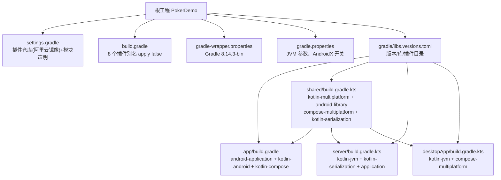
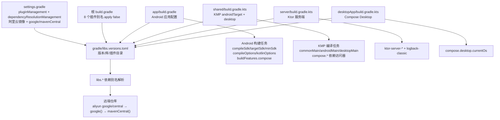
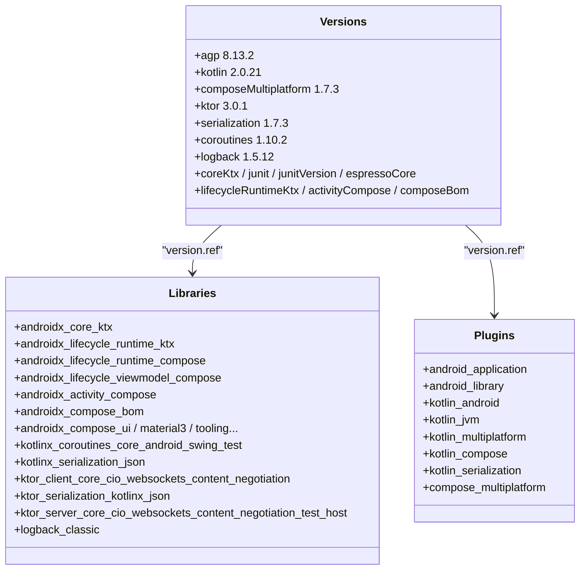
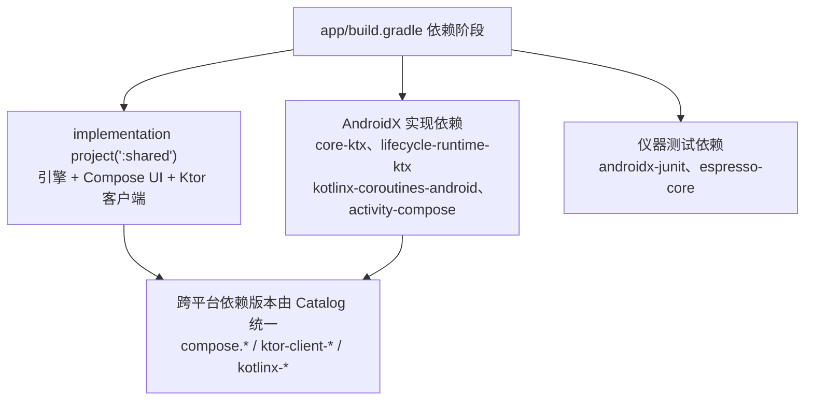
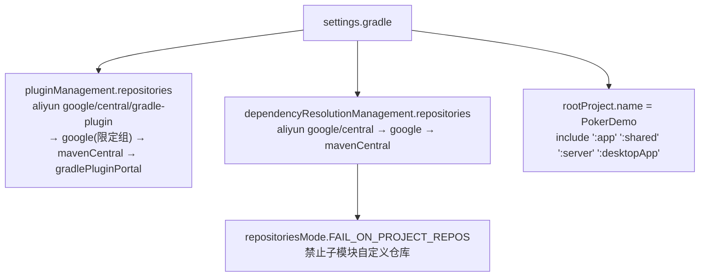
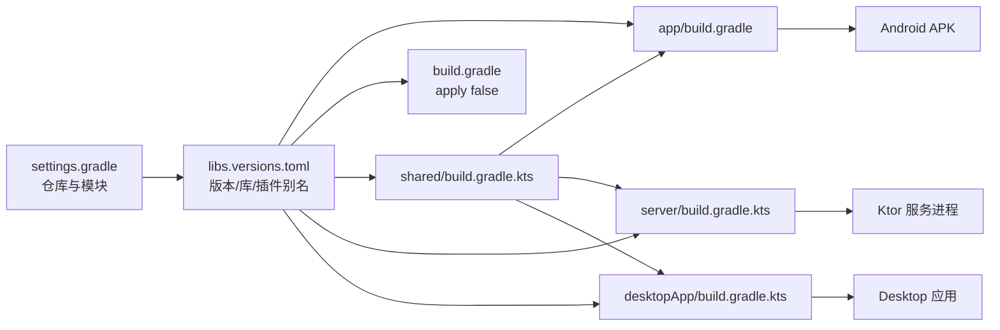

# Gradle Version Catalog 与依赖管理

<cite>
**本文引用的文件**
- [gradle/libs.versions.toml](file://gradle/libs.versions.toml)
- [app/build.gradle](file://app/build.gradle)
- [build.gradle](file://build.gradle)
- [settings.gradle](file://settings.gradle)
- [shared/build.gradle.kts](file://shared/build.gradle.kts)
- [server/build.gradle.kts](file://server/build.gradle.kts)
- [desktopApp/build.gradle.kts](file://desktopApp/build.gradle.kts)
- [gradle.properties](file://gradle.properties)
- [gradle/wrapper/gradle-wrapper.properties](file://gradle/wrapper/gradle-wrapper.properties)
- [app/proguard-rules.pro](file://app/proguard-rules.pro)
</cite>

## 目录
1. [引言](#引言)
2. [项目结构](#项目结构)
3. [核心组件](#核心组件)
4. [架构总览](#架构总览)
5. [详细组件分析](#详细组件分析)
6. [依赖关系分析](#依赖关系分析)
7. [性能与构建优化](#性能与构建优化)
8. [常见问题排查](#常见问题排查)
9. [结论](#结论)
10. [附录：最佳实践清单](#附录最佳实践清单)

## 引言
本文围绕 PokerDemo 这一 Kotlin Multiplatform（KMP）多模块工程的 Gradle 构建体系，系统化说明以下主题：
- 版本目录 gradle/libs.versions.toml 中集中声明的版本、依赖别名与插件别名及其用途。该目录现已扩展为覆盖 KMP 全栈的版本集：包含 `kotlin-multiplatform`、`compose-multiplatform`、`kotlin-serialization`、`android-library`、`ktor-server-*` 等插件与库别名，以及 ktor client、kotlinx-serialization、kotlinx-coroutines 系列库别名。
- app/build.gradle 模块级构建配置：AGP 8.13.2、Kotlin 插件、Compose 编译选项、测试依赖和 ProGuard 规则引用。
- 根级 build.gradle 中的插件声明与仓库源设置。
- settings.gradle 中的插件仓库管理（含阿里云镜像仓库）、依赖仓库与四个模块的声明方式。
- 各模块如何消费同一份 Version Catalog：shared（KMP + Android Library + Compose + Serialization）、server（Ktor 服务端 + Logback）、desktopApp（Compose Desktop）。
- 添加新依赖的最佳实践：避免版本冲突、使用 Version Catalog 引用、组织 composeOptions/kotlinOptions。
- 常见构建问题定位与修复思路，包括依赖解析失败、AGP/Kotlin/KMP 版本不兼容等。

本项目的关键特征是：所有版本与坐标集中在 Version Catalog 声明；Android Compose 相关库通过 BOM（Bill of Materials）统一版本，而跨平台 UI 与网络能力通过 Compose Multiplatform 插件与 Ktor 系列库在 shared 模块中共享。

**章节来源**
- [gradle/libs.versions.toml:1-59](file://gradle/libs.versions.toml#L1-L59)
- [app/build.gradle:1-72](file://app/build.gradle#L1-L72)
- [build.gradle:1-11](file://build.gradle#L1-L11)
- [settings.gradle:1-31](file://settings.gradle#L1-L31)

## 项目结构
该项目为四模块工程（app / shared / server / desktopApp），核心构建文件分布如下：
- 根目录：
  - build.gradle：以 `apply false` 声明全部八个插件别名（android application/library、kotlin android/jvm/multiplatform/compose/serialization、compose multiplatform），仅负责插件版本来源。
  - settings.gradle：集中管理插件仓库、依赖仓库（含阿里云镜像）、`rootProject.name` 与模块包含关系。
  - gradle.properties：全局 Gradle 与 AndroidX 开关。
  - gradle/wrapper/gradle-wrapper.properties：Gradle Wrapper 版本与下载地址（Gradle 8.14.3-bin）。
  - gradle/libs.versions.toml：Version Catalog，集中声明 `[versions]`、`[libraries]`、`[plugins]`。
- app 模块（Android 应用）：
  - app/build.gradle：命名空间、SDK 版本、自动版本号、签名与构建类型、编译选项、Compose 特性、依赖项与 ProGuard 规则。
  - app/proguard-rules.pro：ProGuard 混淆与压缩规则入口。
- shared 模块（KMP 共享逻辑与 UI）：shared/build.gradle.kts，同时产出 androidTarget 与 desktop(jvm) 目标。
- server 模块（Ktor JVM 服务端）：server/build.gradle.kts，含 `application` 插件与 e2eClient 任务。
- desktopApp 模块（Compose Desktop 客户端）：desktopApp/build.gradle.kts。

**图表来源**
- [settings.gradle:1-31](file://settings.gradle#L1-L31)
- [build.gradle:1-11](file://build.gradle#L1-L11)
- [gradle/wrapper/gradle-wrapper.properties:1-8](file://gradle/wrapper/gradle-wrapper.properties#L1-L8)
- [gradle.properties:1-23](file://gradle.properties#L1-L23)
- [gradle/libs.versions.toml:1-59](file://gradle/libs.versions.toml#L1-L59)
- [app/build.gradle:1-72](file://app/build.gradle#L1-L72)
- [shared/build.gradle.kts:1-64](file://shared/build.gradle.kts#L1-L64)
- [server/build.gradle.kts:1-41](file://server/build.gradle.kts#L1-L41)
- [desktopApp/build.gradle.kts:1-28](file://desktopApp/build.gradle.kts#L1-L28)

**章节来源**
- [settings.gradle:1-31](file://settings.gradle#L1-L31)
- [build.gradle:1-11](file://build.gradle#L1-L11)
- [gradle/wrapper/gradle-wrapper.properties:1-8](file://gradle/wrapper/gradle-wrapper.properties#L1-L8)

## 核心组件
本节聚焦 Version Catalog 中的“版本”“依赖别名”“插件别名”，以及它们在四个模块构建脚本中的消费方式。

### 版本目录中的关键版本
- AGP：8.13.2（`agp`）
- Kotlin：2.0.21（`kotlin`）
- Compose Multiplatform：1.7.3（`composeMultiplatform`）
- Ktor：3.0.1（`ktor`）
- kotlinx-serialization：1.7.3（`serialization`）
- kotlinx-coroutines：1.10.2（`coroutines`）
- Logback：1.5.12（`logback`）
- androidx.core:ktx：1.17.0（`coreKtx`）
- JUnit：4.13.2（`junit`）；androidx.test.ext:junit：1.3.0（`junitVersion`）；Espresso：3.7.0（`espressoCore`）
- lifecycle（runtime-ktx / runtime-compose / viewmodel-compose 共用）：2.10.0（`lifecycleRuntimeKtx`）
- androidx.activity:activity-compose：1.9.3（`activityCompose`）
- Compose BOM：2024.09.00（`composeBom`）

这些版本是后续所有依赖与插件版本的权威来源；新增条目时必须先在 `[versions]` 中登记，再由 `[libraries]`/`[plugins]` 通过 `version.ref` 引用。

**章节来源**
- [gradle/libs.versions.toml:1-14](file://gradle/libs.versions.toml#L1-L14)

### 依赖别名与用途
Android/Jetpack 系列：
- androidx-core-ktx：AndroidX 核心扩展库。
- junit / androidx-junit / androidx-espresso-core：单元测试与仪器测试基础库。
- androidx-lifecycle-runtime-ktx、androidx-lifecycle-runtime-compose、androidx-lifecycle-viewmodel-compose：生命周期运行时、Compose 绑定与 ViewModel 注入，三者共用 `lifecycleRuntimeKtx` 版本以保证一致。
- androidx-activity-compose：Activity 与 Jetpack Compose 集成入口。
- androidx-compose-bom：Compose 物料清单，用于统一 androidx.compose.* 各组件版本。
- androidx-compose-ui / ui-graphics / ui-tooling / ui-tooling-preview / ui-test-manifest / ui-test-junit4 / material3：Compose UI、图形、调试预览与测试基础设施、Material Design 3 组件（除 BOM 外均不写版本号，交由 BOM 决定）。

Kotlin 协程序列化系列（均以 `coroutines`/`serialization` 版本引用）：
- kotlinx-coroutines-core：多平台协程核心，供 shared 的 commonMain 使用。
- kotlinx-coroutines-android：Android 主线程调度，供 app 与 shared 的 androidMain 使用。
- kotlinx-coroutines-swing：Swing/AWT 调度器，供 desktopApp 与 shared 的 desktopMain 使用。
- kotlinx-coroutines-test：协程测试支持，供 shared 的 commonTest 与 server 的 testImplementation 使用。
- kotlinx-serialization-json：JSON 序列化运行时，供 shared 的 commonMain 使用。

Ktor 客户端系列（`ktor` = 3.0.1）：
- ktor-client-core / ktor-client-cio / ktor-client-websockets / ktor-client-content-negotiation：shared 中在线对战客户端的 HTTP 引擎、WebSocket 与内容协商能力。
- ktor-serialization-kotlinx-json：Ktor 与 kotlinx-serialization 的 JSON 编解码桥接，shared 与 server 共同使用。

Ktor 服务端与日志系列：
- ktor-server-core / ktor-server-cio / ktor-server-websockets / ktor-server-content-negotiation：server 模块的服务端内核、CIO 引擎、WebSocket 协议与内容协商。
- ktor-server-test-host：服务端测试宿主，server 的 testImplementation 使用。
- logback-classic：server 模块运行时日志实现。

**章节来源**
- [gradle/libs.versions.toml:16-47](file://gradle/libs.versions.toml#L16-L47)
- [shared/build.gradle.kts:18-46](file://shared/build.gradle.kts#L18-L46)
- [server/build.gradle.kts:9-22](file://server/build.gradle.kts#L9-L22)

### 插件别名
Catalog 现声明八个插件别名，不再只有 android-application/kotlin-android/kotlin-compose 三个：
- android-application（`com.android.application`，版本引用 `agp`）：app 模块。
- android-library（`com.android.library`，版本引用 `agp`）：shared 模块的 Android 目标。
- kotlin-android（`org.jetbrains.kotlin.android`，版本引用 `kotlin`）：app 模块。
- kotlin-jvm（`org.jetbrains.kotlin.jvm`，版本引用 `kotlin`）：server 与 desktopApp 模块。
- kotlin-multiplatform（`org.jetbrains.kotlin.multiplatform`，版本引用 `kotlin`）：shared 模块。
- kotlin-compose（`org.jetbrains.kotlin.plugin.compose`，版本引用 `kotlin`）：app、shared、desktopApp 的 Compose 编译器插件。
- kotlin-serialization（`org.jetbrains.kotlin.plugin.serialization`，版本引用 `kotlin`）：shared 与 server 的 `@Serializable` 支持。
- compose-multiplatform（`org.jetbrains.compose`，版本引用 `composeMultiplatform`）：shared 与 desktopApp 提供 `compose.*` 依赖访问器与 `compose.desktop.*` DSL。

根级 build.gradle 以 `apply false` 一次性声明这八个别名，各模块再通过 `alias(libs.plugins.*)` 实际启用自己需要的组合。

**章节来源**
- [gradle/libs.versions.toml:49-59](file://gradle/libs.versions.toml#L49-L59)
- [build.gradle:1-11](file://build.gradle#L1-L11)
- [app/build.gradle:1-5](file://app/build.gradle#L1-L5)
- [shared/build.gradle.kts:3-9](file://shared/build.gradle.kts#L3-L9)
- [server/build.gradle.kts:3-7](file://server/build.gradle.kts#L3-L7)
- [desktopApp/build.gradle.kts:3-7](file://desktopApp/build.gradle.kts#L3-L7)

## 架构总览
下图展示 Version Catalog、Gradle 构建脚本与各模块构建流程之间的协作关系。

**图表来源**
- [settings.gradle:1-25](file://settings.gradle#L1-L25)
- [gradle/libs.versions.toml:1-59](file://gradle/libs.versions.toml#L1-L59)
- [build.gradle:1-11](file://build.gradle#L1-L11)
- [app/build.gradle:1-72](file://app/build.gradle#L1-L72)
- [shared/build.gradle.kts:1-64](file://shared/build.gradle.kts#L1-L64)
- [server/build.gradle.kts:1-41](file://server/build.gradle.kts#L1-L41)
- [desktopApp/build.gradle.kts:1-28](file://desktopApp/build.gradle.kts#L1-L28)

## 详细组件分析

### 版本目录 gradle/libs.versions.toml
该文件承担三大职责：
1. 在 `[versions]` 集中声明版本变量（含 KMP 版本集新增的 `coroutines`、`composeMultiplatform`、`ktor`、`serialization`、`logback`），便于升级与维护。
2. 在 `[libraries]` 将坐标 group/name/version 封装为 `libs.*` 依赖别名，提升可读性与一致性；其中 androidx-compose-* 系列刻意省略 version，改由 BOM 控制。
3. 在 `[plugins]` 将插件 id 与 version 封装为 `libs.plugins.*` 别名，避免重复硬编码插件版本；新增的 android-library、kotlin-jvm、kotlin-multiplatform、kotlin-serialization、compose-multiplatform 使四个模块可共享同一版本来源。

同一坐标可派生多个别名，例如 `androidx-lifecycle-runtime-ktx`、`androidx-lifecycle-runtime-compose`、`androidx-lifecycle-viewmodel-compose` 都指向 `version.ref = "lifecycleRuntimeKtx"`，从而强制 lifecycle 全家桶版本一致。

**图表来源**
- [gradle/libs.versions.toml:1-59](file://gradle/libs.versions.toml#L1-L59)

**章节来源**
- [gradle/libs.versions.toml:1-59](file://gradle/libs.versions.toml#L1-L59)

### 模块级构建 app/build.gradle
该文件定义 Android 应用模块的完整构建行为，可拆分为如下部分：

#### 插件与应用基本信息
- 通过 alias(libs.plugins.android.application)、alias(libs.plugins.kotlin.android)、alias(libs.plugins.kotlin.compose) 启用 Android、Kotlin Android 与 Kotlin Compose 插件。
- 命名空间与 applicationId：com.aniapp.pokerdemo。
- SDK 配置：`compileSdk { version = release(36) }`，targetSdk 36，minSdk 28。
- 版本号自动生成：以 2026-11-17 00:00（Asia/Shanghai）为起点，按“距起点的分钟数”单调自增出 `versionCode` 与 `versionName "1.0.<n>"`，并通过 `resValue` 注入 `app_version` 字符串资源，无需手动改版本。

**章节来源**
- [app/build.gradle:1-31](file://app/build.gradle#L1-L31)

#### 签名、构建类型与产物命名
- release 构建类型复用 debug keystore（演示阶段便于直接安装），并关闭代码混淆（minifyEnabled false）。
- 仍加载两个 ProGuard 配置文件：默认优化规则 `proguard-android-optimize.txt` 与项目自定义 `proguard-rules.pro`。
- `applicationVariants.all` 将 APK 重命名为 `LSTPoker-v<versionName>-<buildType>-<yyyyMMdd-HHmm>.apk`。

**章节来源**
- [app/build.gradle:32-50](file://app/build.gradle#L32-L50)
- [app/proguard-rules.pro:1-21](file://app/proguard-rules.pro#L1-L21)

#### 编译选项
- Java 源码与目标版本：11；`kotlinOptions.jvmTarget = '11'`，两者保持一致。
- 开启 `buildFeatures.compose`；Compose 编译器由 kotlin-compose 插件驱动，当前未出现 `composeOptions{}` 块。

**章节来源**
- [app/build.gradle:51-61](file://app/build.gradle#L51-L61)

#### 依赖声明策略
- implementation：`project(':shared')`（游戏引擎、UI 组件与网络协议均来自 shared）、libs.androidx.core.ktx、libs.androidx.lifecycle.runtime.ktx、libs.kotlinx.coroutines.android、libs.androidx.activity.compose。
- androidTestImplementation：libs.androidx.junit、libs.androidx.espresso.core。
- 值得注意的是：Compose 具体库（ui/material3/tooling 等）已不在 app 模块逐个声明，而是由 shared 模块通过 Compose Multiplatform 的 `compose.*` 访问器以 `api` 方式向下游暴露；因此 app 侧不再需要 `platform(libs.androidx.compose.bom)` 声明，BOM 相关别名保留在 Catalog 中供 Android 专属 Compose 依赖场景使用。

**图表来源**
- [app/build.gradle:63-72](file://app/build.gradle#L63-L72)
- [shared/build.gradle.kts:18-46](file://shared/build.gradle.kts#L18-L46)

**章节来源**
- [app/build.gradle:63-72](file://app/build.gradle#L63-L72)

### 共享模块 shared/build.gradle.kts
该模块是 Version Catalog 别名的主要消费者，一次启用五个插件别名：kotlin-multiplatform、android-library、kotlin-compose、compose-multiplatform、kotlin-serialization。
- targets：`androidTarget` 与 `jvm("desktop")`，两者 compilerOptions 的 JvmTarget 均为 JVM_11。
- commonMain：以 `api` 暴露 `compose.runtime/foundation/material3/ui`（来自 compose-multiplatform 插件提供的 `compose.*` 访问器），并以 `implementation` 引入 ktor-client-core/cio/websockets/content-negotiation、ktor-serialization-kotlinx-json、kotlinx-serialization-json、kotlinx-coroutines-core。
- commonTest：`kotlin("test")` 与 libs.kotlinx.coroutines.test。
- androidMain：libs.kotlinx.coroutines.android；desktopMain：libs.kotlinx.coroutines.swing；desktopTest：`compose.desktop.currentOs`（用于桌面渲染冒烟测试）。
- android {} 块：namespace `com.aniapp.pokerdemo.shared`、compileSdk 36、minSdk 28、Java 11 编译选项。

由于 commonMain 使用 `api(compose.*)`，下游 app 与 desktopApp 无需重复声明 Compose 依赖即可编译 UI 代码。

**章节来源**
- [shared/build.gradle.kts:1-64](file://shared/build.gradle.kts#L1-L64)

### 服务端模块 server/build.gradle.kts
- 插件：alias(libs.plugins.kotlin.jvm)、alias(libs.plugins.kotlin.serialization) 与内置 `application` 插件。
- 依赖：`project(':shared')`（复用 Protocol/引擎）、ktor-server-core、ktor-server-cio、ktor-server-websockets、ktor-server-content-negotiation、ktor-serialization-kotlinx-json，运行时日志 libs.logback.classic（配合 server/src/main/resources/logback.xml）。
- 测试：ktor-server-test-host、`kotlin("test")`、libs.junit、libs.kotlinx.coroutines.test。
- 语言级别：Kotlin compilerOptions 与 java sourceCompatibility/targetCompatibility 统一为 11；mainClass 为 com.aniapp.pokerdemo.server.ApplicationKt。
- 额外注册 `e2eClient` JavaExec 任务，复用 test runtimeClasspath 运行 E2E 客户端。

**章节来源**
- [server/build.gradle.kts:1-41](file://server/build.gradle.kts#L1-L41)

### 桌面模块 desktopApp/build.gradle.kts
- 插件：alias(libs.plugins.kotlin.jvm)、alias(libs.plugins.kotlin.compose)、alias(libs.plugins.compose.multiplatform)。
- 依赖：`project(':shared')`、`compose.desktop.currentOs`（由 compose-multiplatform 插件解析到当前操作系统的桌面 Compose 发行版）、libs.kotlinx.coroutines.swing。
- `compose.desktop.application.mainClass` 指向 com.aniapp.pokerdemo.desktop.MainKt；语言级别同样为 11。

**章节来源**
- [desktopApp/build.gradle.kts:1-28](file://desktopApp/build.gradle.kts#L1-L28)

### 根级构建 build.gradle
根 build.gradle 以 `apply false` 声明全部八个插件别名，表示“可用但未在当前工程直接应用”。真正的插件应用在四个模块脚本中完成。这种写法的好处：
- 根工程保持简洁，只负责插件版本来源，且保证 android-library 与 android-application 共用同一 `agp` 版本、kotlin-* 系列共用同一 `kotlin` 版本。
- 新增模块只需在自身脚本中启用所需插件组合，不会引入新的插件版本。

**章节来源**
- [build.gradle:1-11](file://build.gradle#L1-L11)

### settings.gradle：插件仓库、镜像与模块声明
settings.gradle 承担三项关键职责：

1. pluginManagement.repositories（顺序即解析优先级）：
   - 阿里云镜像：`https://maven.aliyun.com/repository/google`、`/central`、`/gradle-plugin`，用于在国内网络环境加速插件与依赖解析。
   - google：限制为 `com.android.*`、`com.google.*`、`androidx.*` 组，避免误拉取非 Android 插件。
   - mavenCentral() 与 gradlePluginPortal() 作为兜底源（compose-multiplatform、kotlin-multiplatform 等非 Google 生态插件由 portal/Central 提供）。

2. dependencyResolutionManagement.repositories：
   - 强制 FAIL_ON_PROJECT_REPOS：禁止子模块自行声明仓库，避免不同模块从不同源拉取依赖导致版本不一致。
   - 同样优先使用阿里云 google/central 镜像，再回落到 google() 与 mavenCentral()。

3. 模块声明：`rootProject.name = "PokerDemo"`，并 `include ':app'`、`':shared'`、`':server'`、`':desktopApp'`——四个模块取代了早期单 app 模块的结构。

**图表来源**
- [settings.gradle:1-31](file://settings.gradle#L1-L31)

**章节来源**
- [settings.gradle:1-31](file://settings.gradle#L1-L31)

### Gradle Wrapper 与全局属性
- gradle-wrapper.properties 指定 `gradle-8.14.3-bin.zip`，并启用 `validateDistributionUrl=true` 与 10s 网络超时；该 Gradle 版本需满足 AGP 8.13.2 与 Kotlin 2.0.21 的最低要求。
- gradle.properties 启用 AndroidX、使用官方 Kotlin 代码风格、开启 nonTransitiveRClass，并将 Gradle Daemon JVM 内存设置为 2048MB；并行构建（org.gradle.parallel）当前处于注释状态，仅在解耦项目中建议开启。

**章节来源**
- [gradle/wrapper/gradle-wrapper.properties:1-8](file://gradle/wrapper/gradle-wrapper.properties#L1-L8)
- [gradle.properties:1-23](file://gradle.properties#L1-L23)

## 依赖关系分析

**图表来源**
- [gradle/libs.versions.toml:1-59](file://gradle/libs.versions.toml#L1-L59)
- [app/build.gradle:1-72](file://app/build.gradle#L1-L72)
- [shared/build.gradle.kts:1-64](file://shared/build.gradle.kts#L1-L64)
- [server/build.gradle.kts:1-41](file://server/build.gradle.kts#L1-L41)
- [desktopApp/build.gradle.kts:1-28](file://desktopApp/build.gradle.kts#L1-L28)
- [settings.gradle:1-31](file://settings.gradle#L1-L31)

### 依赖分类与复杂度
- 跨平台核心：shared 的 commonMain 汇集 Compose（`compose.*`）、Ktor 客户端与 kotlinx-serialization/coroutines，形成唯一的“共享依赖收敛点”。
- Android 侧运行时依赖：core-ktx、lifecycle-runtime-ktx、kotlinx-coroutines-android、activity-compose。
- 服务端依赖：ktor-server-* + ktor-serialization-kotlinx-json + logback-classic，与客户端 ktor 系列共用同一 `ktor` 版本，避免协议编解码版本漂移。
- 测试依赖：区分 commonTest（kotlin-test + coroutines-test）、desktopTest（compose.desktop.currentOs）、server 测试（ktor-server-test-host + junit）与 Android 仪器测试（androidx-junit + espresso），避免把调试工具混入发布包。
- 版本一致性约束：`kotlin` 版本同时驱动 kotlin-android/jvm/multiplatform/compose/serialization 五个插件；`agp` 同时驱动 android-application 与 android-library；`composeMultiplatform` 独立于 `composeBom`，前者管理跨平台 Compose 发行版，后者仅管理 androidx.compose.* 坐标。

Gradle 依赖解析整体随依赖数量线性增长；集中式 Catalog 与 `api`/`implementation` 分层可减少跨模块版本矩阵爆炸带来的解析开销。platform/BOM 类依赖不参与打包，对产物体积影响可忽略。

**章节来源**
- [gradle/libs.versions.toml:1-59](file://gradle/libs.versions.toml#L1-L59)
- [shared/build.gradle.kts:18-46](file://shared/build.gradle.kts#L18-L46)
- [app/build.gradle:63-72](file://app/build.gradle#L63-L72)

## 性能与构建优化
- 已启用 AndroidX 与非传递 R 类，有助于减小资源类规模。
- Gradle Daemon JVM 堆内存设为 2GB；KMP + Ktor + Desktop 同工程构建时，如出现内存压力可提高 `-Xmx` 或按需开启 `org.gradle.parallel`（gradle.properties 已注明仅在解耦项目中启用）。
- 阿里云镜像置于仓库列表最前，减少国内网络下的解析等待；google 源的组正则限定避免在非 Google 源上反复尝试。
- 通过 `api(compose.*)` 让 shared 成为 Compose 依赖的唯一声明处，下游模块变更不会触发重复解析。
- 升级时优先校验 Kotlin ↔ AGP ↔ Gradle Wrapper ↔ Compose Multiplatform ↔ Ktor 的兼容性矩阵，再调整单个版本号。

[本节为通用建议，不直接分析具体代码文件]

## 常见问题排查

### 依赖解析失败
常见原因：
- 网络或代理问题导致无法访问阿里云镜像、Maven Central 或 Google 仓库。
- 子模块中声明了与 settings.gradle 不同的仓库，触发 FAIL_ON_PROJECT_REPOS。
- 插件别名对应的坐标只在 gradlePluginPortal 提供（如 `org.jetbrains.compose`），但 pluginManagement 未包含该源。

排查步骤：
1. 确认 settings.gradle 的 dependencyResolutionManagement.repositories 是否包含所需仓库，并注意镜像源在前、官方源兜底的顺序。
2. 检查是否存在子模块 build.gradle(.kts) 中再次声明 repositories。
3. 清理 Gradle 缓存后重试：删除 .gradle 与各模块 build 目录后重新同步。
4. 使用 `--info` 或 `--stacktrace` 查看具体失败坐标与仓库地址；必要时临时注释镜像源以判断是否为镜像同步延迟。

**章节来源**
- [settings.gradle:1-25](file://settings.gradle#L1-L25)

### AGP 版本不兼容
现象：
- 提示 AGP 与 Kotlin 或 Gradle 版本不兼容；shared 的 android-library 与 app 的 android-application 版本不一致时报错。
- Compose 编译异常或 UI 预览无法工作。

处理建议：
- 确认 gradle/libs.versions.toml 中 agp、kotlin、composeBom、composeMultiplatform 与 Gradle Wrapper（8.14.3）互相兼容。
- android-application 与 android-library 必须共用同一 `agp` 引用，不要为某个模块单独硬编码版本。
- 如需升级，先对齐 Gradle Wrapper 与 AGP，再调整 Kotlin，最后升级 Compose Multiplatform 与 Compose BOM。

**章节来源**
- [gradle/libs.versions.toml:1-14](file://gradle/libs.versions.toml#L1-L14)
- [gradle/libs.versions.toml:49-59](file://gradle/libs.versions.toml#L49-L59)
- [gradle/wrapper/gradle-wrapper.properties:1-8](file://gradle/wrapper/gradle-wrapper.properties#L1-L8)

### Kotlin 插件与 Compose / Serialization 插件版本不一致
现象：
- kotlin-compose、kotlin-serialization 与 Kotlin 主版本不匹配，导致 Compose 编译或 `@Serializable` 生成失败。
- KMP 模块报 “Kotlin Multiplatform plugin version mismatch”。

处理建议：
- 保持 kotlin-android / kotlin-jvm / kotlin-multiplatform / kotlin-compose / kotlin-serialization 全部引用同一 `kotlin` 版本（当前 2.0.21），符合预期。
- compose-multiplatform 是唯一使用 `composeMultiplatform` 版本的插件，升级时需查阅其与 Kotlin 版本的对应表。

**章节来源**
- [gradle/libs.versions.toml:49-59](file://gradle/libs.versions.toml#L49-L59)
- [shared/build.gradle.kts:3-9](file://shared/build.gradle.kts#L3-L9)

### KMP 目标与语言级别不一致
现象：
- shared 编译报 jvmTarget 与 Java 源码级别不一致；desktopTest 无法找到 Swing 调度器。

处理建议：
- 确认 androidTarget 与 `jvm("desktop")` 的 compilerOptions 均为 JVM_11，并与 android.compileOptions、server/desktopApp 的 java sourceCompatibility 保持一致。
- 涉及 Swing/AWT 线程切换的目标应使用 libs.kotlinx.coroutines.swing（desktopMain、desktopApp 已声明）。

**章节来源**
- [shared/build.gradle.kts:11-16](file://shared/build.gradle.kts#L11-L16)
- [shared/build.gradle.kts:53-63](file://shared/build.gradle.kts#L53-L63)
- [server/build.gradle.kts:24-30](file://server/build.gradle.kts#L24-L30)
- [desktopApp/build.gradle.kts:15-21](file://desktopApp/build.gradle.kts#L15-L21)

### Compose 预览或调试工具不可用
现象：
- Compose 预览空白或报错；IDE 无法解析 `compose.*` 访问器。

处理建议：
- 确认模块已启用 alias(libs.plugins.compose.multiplatform)（shared、desktopApp）与 alias(libs.plugins.kotlin.compose)。
- 确认 shared 的 commonMain 已声明 `implementation(compose.components.uiToolingPreview)`；Android 专属预览依赖仍可走 Catalog 中的 androidx-compose-ui-tooling* 别名。
- app 模块保留 `buildFeatures.compose = true`；检查 IDE 是否使用了正确的 Gradle 项目路径与 JDK。

**章节来源**
- [shared/build.gradle.kts:18-24](file://shared/build.gradle.kts#L18-L24)
- [app/build.gradle:57-61](file://app/build.gradle#L57-L61)
- [gradle/libs.versions.toml:31-36](file://gradle/libs.versions.toml#L31-L36)

### Ktor 版本与序列化桥接不匹配
现象：
- WebSocket 内容协商失败或 `kotlinx-serialization` 类找不到。

处理建议：
- ktor-client-*、ktor-server-*、ktor-serialization-kotlinx-json 必须共用同一 `ktor` 引用（3.0.1）；kotlinx-serialization-json 使用 `serialization`（1.7.3），需与 Ktor 3.x 支持范围匹配。
- 服务端日志缺失时确认 libs.logback.classic 已作为 implementation 引入。

**章节来源**
- [server/build.gradle.kts:9-22](file://server/build.gradle.kts#L9-L22)
- [shared/build.gradle.kts:25-32](file://shared/build.gradle.kts#L25-L32)

### ProGuard 或混淆相关问题
现象：
- 发布包崩溃或日志无法定位；虽然 minifyEnabled=false，仍需了解混淆规则位置。

处理建议：
- 确认 release 构建类型的 proguardFiles 指向默认优化规则与 app/proguard-rules.pro；如需保留行号以便调试，可在规则文件中启用 SourceFile 与 LineNumberTable 相关规则。
- 若将来开启混淆，需为 kotlinx-serialization 生成的 serializer 与 Ktor 协议类补充 keep 规则。

**章节来源**
- [app/build.gradle:41-46](file://app/build.gradle#L41-L46)
- [app/proguard-rules.pro:1-21](file://app/proguard-rules.pro#L1-L21)

## 结论
该项目已把 Version Catalog 从“单 Android 模块”扩充为覆盖 KMP 全栈的版本集：`[versions]` 新增 coroutines、composeMultiplatform、ktor、serialization、logback，`[libraries]` 新增 lifecycle-compose/viewmodel-compose、kotlinx-coroutines 四件套、kotlinx-serialization-json、ktor client/server 系列与 logback-classic，`[plugins]` 从三个扩展到八个（增加 android-library、kotlin-jvm、kotlin-multiplatform、kotlin-serialization、compose-multiplatform）。settings.gradle 通过阿里云镜像与四个模块声明支撑多平台构建，根 build.gradle 以 `apply false` 统一插件版本来源。shared 模块成为 Compose、Ktor 客户端与序列化依赖的唯一收敛点，server 与 desktopApp 各自消费服务端与桌面板别名。后续维护应继续遵循“版本集中、依赖别名化、跨平台依赖收敛到 shared、Android Compose 版本交给 BOM”的原则，并在升级时按顺序校验 Gradle、AGP、Kotlin、Compose Multiplatform 与 Ktor 的兼容性。

[本节为总结性内容，不直接分析具体代码文件]

## 附录：最佳实践清单

### 添加新依赖的正确方式
1. 先在 gradle/libs.versions.toml 的 `[versions]` 登记版本，再在 `[libraries]` 添加依赖别名并使用 `version.ref`；同一生态的多个构件（如 lifecycle 三件套、coroutines 四件套、ktor 系列）应共用一个版本引用。
2. 属于跨平台能力的依赖优先加到 shared 的 commonMain（并用 `api` 暴露给下游），平台专属实现（如 coroutines-android/swing）放到对应 source set。
3. 在模块脚本中使用 `libs.依赖别名` 引用：Groovy 写 `libs.androidx.core.ktx`，Kotlin DSL 写 `libs.kotlinx.coroutines.swing`；Compose 跨平台构件使用 `compose.*` 访问器而非手写坐标。
4. 根据用途选择依赖配置：
   - implementation / api：运行时与编译期可见性。
   - testImplementation / commonTest / desktopTest：单元与平台测试。
   - androidTestImplementation：仪器测试。
   - debugImplementation：仅调试变体（Android）。
   - platform(libs.androidx.compose.bom)：统一 androidx.compose.* 版本。
5. 新插件同样走 Catalog：在 `[plugins]` 声明 id + version.ref，并在根 build.gradle 追加 `alias(...) apply false`，模块内再 `alias(...)` 启用。

**章节来源**
- [gradle/libs.versions.toml:1-59](file://gradle/libs.versions.toml#L1-L59)
- [build.gradle:1-11](file://build.gradle#L1-L11)
- [shared/build.gradle.kts:18-46](file://shared/build.gradle.kts#L18-L46)
- [app/build.gradle:63-72](file://app/build.gradle#L63-L72)

### 避免版本冲突
- 始终通过 Version Catalog 管理版本，不在模块脚本内硬编码版本号或插件版本。
- Android 侧 Compose 依赖使用 BOM，避免多个 androidx.compose 库各自指定版本；跨平台 Compose 则统一由 `composeMultiplatform` 插件版本决定。
- 不要在子模块中新增仓库，除非确有必要；必要时修改 settings.gradle 的 dependencyResolutionManagement，并保持镜像源与官方源的同时可达。
- 升级前先检查 AGP、Kotlin、Gradle Wrapper、Compose Multiplatform/BOM、Ktor 的兼容性矩阵。

**章节来源**
- [settings.gradle:1-25](file://settings.gradle#L1-L25)
- [gradle/libs.versions.toml:1-14](file://gradle/libs.versions.toml#L1-L14)

### 组织 composeOptions 与 kotlinOptions
- 当前项目未使用 `composeOptions{}`：Android 侧由 kotlin-compose 插件与 `buildFeatures.compose` 控制，跨平台侧由 compose-multiplatform 插件控制。
- Kotlin 语言级别在各模块保持统一为 11：app 使用 `kotlinOptions.jvmTarget = '11'`，shared/server/desktopApp 使用 Kotlin DSL 的 `compilerOptions { jvmTarget.set(JvmTarget.JVM_11) }`，并与 `java/compileOptions` 的 VERSION_11 成对出现。
- 新增 KMP target 时，应在该 target 的 `compilerOptions` 中显式设置 JvmTarget，避免默认值与 Android 模块不一致。
- 若未来需要调整 Compose 编译器选项，建议在对应模块内新增配置并与 Kotlin 版本协调，而不是在 Catalog 之外引入独立版本。

**章节来源**
- [app/build.gradle:51-61](file://app/build.gradle#L51-L61)
- [shared/build.gradle.kts:11-16](file://shared/build.gradle.kts#L11-L16)
- [server/build.gradle.kts:24-30](file://server/build.gradle.kts#L24-L30)
- [desktopApp/build.gradle.kts:15-21](file://desktopApp/build.gradle.kts#L15-L21)