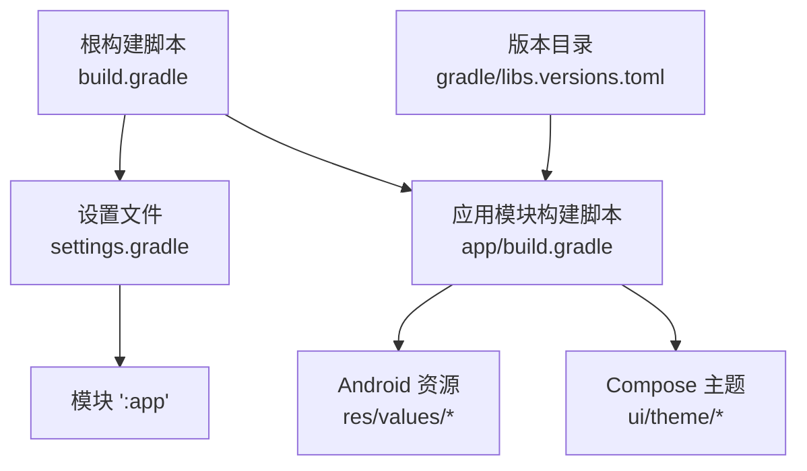
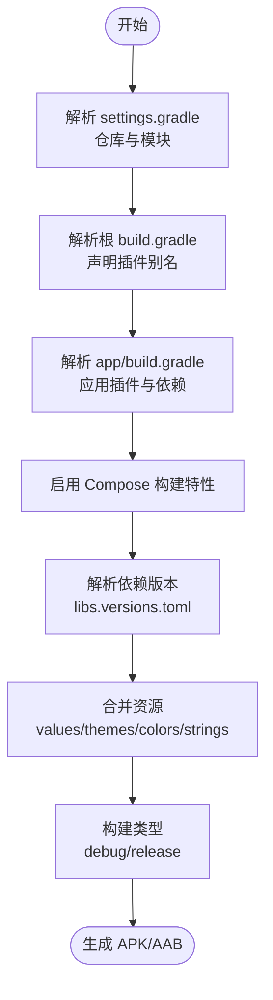
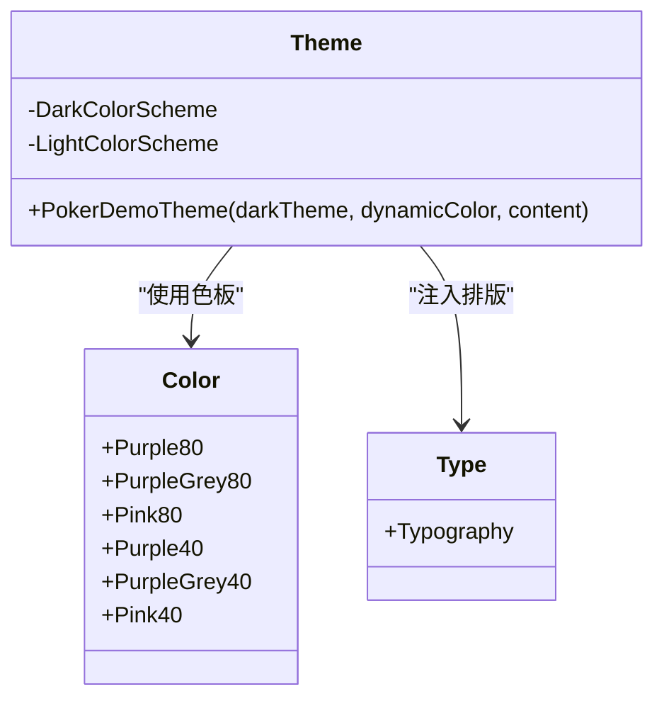
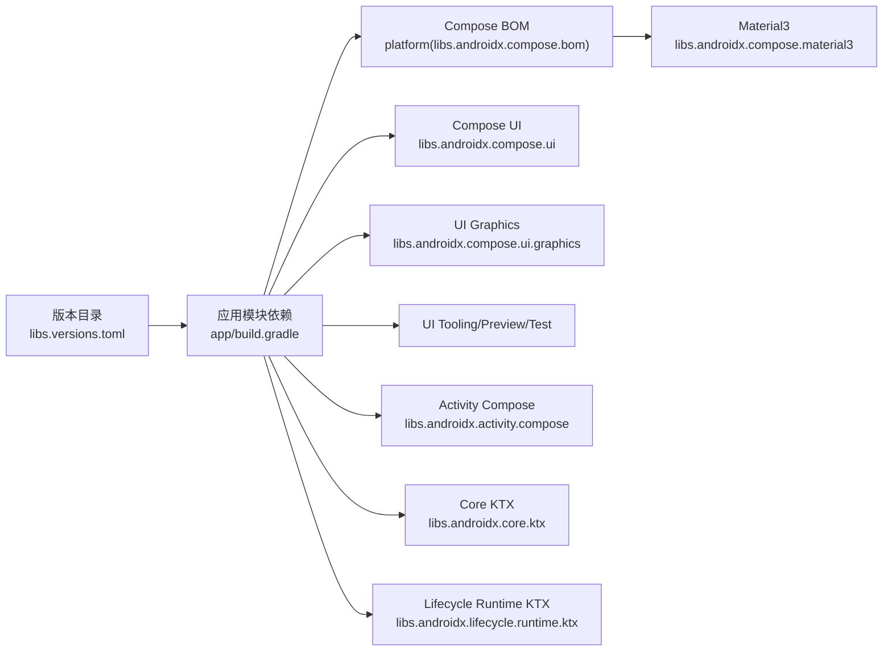

# 构建与配置

<cite>
**本文引用的文件**
- [gradle/libs.versions.toml](file://gradle/libs.versions.toml)
- [build.gradle](file://build.gradle)
- [settings.gradle](file://settings.gradle)
- [app/build.gradle](file://app/build.gradle)
- [gradle.properties](file://gradle.properties)
- [gradle/wrapper/gradle-wrapper.properties](file://gradle/wrapper/gradle-wrapper.properties)
- [app/proguard-rules.pro](file://app/proguard-rules.pro)
- [app/src/main/res/values/themes.xml](file://app/src/main/res/values/themes.xml)
- [app/src/main/res/values/colors.xml](file://app/src/main/res/values/colors.xml)
- [app/src/main/res/values/strings.xml](file://app/src/main/res/values/strings.xml)
- [app/src/main/java/com/aniapp/pokerdemo/ui/theme/Color.kt](file://app/src/main/java/com/aniapp/pokerdemo/ui/theme/Color.kt)
- [app/src/main/java/com/aniapp/pokerdemo/ui/theme/Theme.kt](file://app/src/main/java/com/aniapp/pokerdemo/ui/theme/Theme.kt)
- [app/src/main/java/com/aniapp/pokerdemo/ui/theme/Type.kt](file://app/src/main/java/com/aniapp/pokerdemo/ui/theme/Type.kt)
</cite>

## 目录
1. [简介](#简介)
2. [项目结构](#项目结构)
3. [核心组件](#核心组件)
4. [架构总览](#架构总览)
5. [详细组件分析](#详细组件分析)
6. [依赖关系分析](#依赖关系分析)
7. [性能与构建优化](#性能与构建优化)
8. [故障排查指南](#故障排查指南)
9. [结论](#结论)
10. [附录：自定义主题步骤](#附录自定义主题步骤)

## 简介
本文件系统化梳理 PokerDemo 的 Gradle 构建系统与资源配置，重点包括：
- 使用 Gradle Version Catalog 集中管理 Android Gradle Plugin、Kotlin、Activity Compose、Jetpack Compose、Material3、Lifecycle ViewModel 等依赖版本。
- 解释根级 build.gradle 中的插件声明与仓库源策略。
- 说明 settings.gradle 中的模块管理与仓库模式。
- 梳理 Android 资源组织：themes.xml、colors.xml、strings.xml。
- 提供基于 Material3 的自定义主题扩展方法，包括颜色系统、字体与动态主题。
- 给出 ProGuard 与资源压缩等构建优化建议。

## 项目结构
PokerDemo 是一个单模块 Android 应用，采用 Kotlin + Jetpack Compose + Material3 的现代 UI 栈。Gradle 构建体系通过 Version Catalog 统一版本，根模块仅声明公共插件，业务逻辑集中在 app 模块中。

图表来源
- [build.gradle:1-6](file://build.gradle#L1-L6)
- [settings.gradle:1-24](file://settings.gradle#L1-L24)
- [app/build.gradle:1-57](file://app/build.gradle#L1-L57)
- [gradle/libs.versions.toml:1-32](file://gradle/libs.versions.toml#L1-L32)

章节来源
- [build.gradle:1-6](file://build.gradle#L1-L6)
- [settings.gradle:1-24](file://settings.gradle#L1-L24)
- [app/build.gradle:1-57](file://app/build.gradle#L1-L57)

## 核心组件
本节聚焦构建系统的核心配置文件与资源入口。

- 版本目录（Version Catalog）
  - 统一管理 AGP、Kotlin、Core KTX、Junit、Espresso、Lifecycle Runtime、Activity Compose、Compose BOM 及其子模块、Material3 等版本号。
  - 在模块内通过 libs.xxx 引用，避免硬编码版本号，提升可维护性。
- 根级构建脚本
  - 仅声明 Android Application、Kotlin Android、Kotlin Compose 三个插件，且以 apply false 延迟到模块中启用。
- 设置文件
  - 定义 pluginManagement 与 dependencyResolutionManagement，强制仓库来源为 google() 与 mavenCentral()，并禁止子项目自行添加仓库。
  - 包含 :app 模块，项目名称为 PokerDemo。
- 应用模块构建脚本
  - 启用 Compose，配置 compileSdk/targetSdk/minSdk、Java/Kotlin 版本、ProGuard 规则路径、测试运行器。
  - 依赖全部通过 Version Catalog 引入。
- 全局属性
  - 启用 AndroidX、非传递 RClass、JVM 参数与 Kotlin 代码风格。
- 资源入口
  - themes.xml：定义 Android 原生主题 Theme.PokerDemo。
  - colors.xml：定义传统颜色资源。
  - strings.xml：定义应用名称等字符串。
  - ui/theme：Compose 主题 Color.kt、Theme.kt、Type.kt。

章节来源
- [gradle/libs.versions.toml:1-32](file://gradle/libs.versions.toml#L1-L32)
- [build.gradle:1-6](file://build.gradle#L1-L6)
- [settings.gradle:1-24](file://settings.gradle#L1-L24)
- [app/build.gradle:1-57](file://app/build.gradle#L1-L57)
- [gradle.properties:1-23](file://gradle.properties#L1-L23)
- [app/src/main/res/values/themes.xml:1-5](file://app/src/main/res/values/themes.xml#L1-L5)
- [app/src/main/res/values/colors.xml:1-10](file://app/src/main/res/values/colors.xml#L1-L10)
- [app/src/main/res/values/strings.xml:1-3](file://app/src/main/res/values/strings.xml#L1-L3)
- [app/src/main/java/com/aniapp/pokerdemo/ui/theme/Color.kt:1-11](file://app/src/main/java/com/aniapp/pokerdemo/ui/theme/Color.kt#L1-L11)
- [app/src/main/java/com/aniapp/pokerdemo/ui/theme/Theme.kt:1-58](file://app/src/main/java/com/aniapp/pokerdemo/ui/theme/Theme.kt#L1-L58)
- [app/src/main/java/com/aniapp/pokerdemo/ui/theme/Type.kt:1-34](file://app/src/main/java/com/aniapp/pokerdemo/ui/theme/Type.kt#L1-L34)

## 架构总览
Gradle 构建流程的关键节点如下：

图表来源
- [settings.gradle:1-24](file://settings.gradle#L1-L24)
- [build.gradle:1-6](file://build.gradle#L1-L6)
- [app/build.gradle:1-57](file://app/build.gradle#L1-L57)
- [gradle/libs.versions.toml:1-32](file://gradle/libs.versions.toml#L1-L32)

## 详细组件分析

### Gradle Version Catalog 与依赖管理
Version Catalog 将版本与库名解耦，便于统一升级与复用。

- 版本段（[versions]）
  - agp：Android Gradle Plugin 版本
  - kotlin：Kotlin 编译器版本
  - coreKtx：AndroidX Core KTX 版本
  - junit / junitVersion：单元测试与 Android 测试 JUnit 版本
  - espressoCore：Espresso 测试框架版本
  - lifecycleRuntimeKtx：生命周期运行时扩展版本
  - activityCompose：Activity Compose 集成版本
  - composeBom：Compose BOM 版本
- 库段（[libraries]）
  - androidx-core-ktx、androidx-lifecycle-runtime-ktx、androidx-activity-compose
  - androidx-compose-bom 及 Compose UI、Graphics、Tooling、Preview、Test、Material3
- 插件段（[plugins]）
  - android-application、kotlin-android、kotlin-compose

模块内通过 libs.* 引用这些库，并通过 platform(libs.androidx.compose.bom) 确保 Compose 子模块版本一致。

章节来源
- [gradle/libs.versions.toml:1-32](file://gradle/libs.versions.toml#L1-L32)
- [app/build.gradle:40-57](file://app/build.gradle#L40-L57)

### 根级构建脚本与插件策略
根 build.gradle 仅声明三个插件并使用 alias 别名，且均 apply false，实际启用放在 app/build.gradle 中，使多模块场景下更清晰可控。

- 插件别名
  - com.android.application
  - org.jetbrains.kotlin.android
  - org.jetbrains.kotlin.plugin.compose

章节来源
- [build.gradle:1-6](file://build.gradle#L1-L6)

### 设置文件与仓库源策略
settings.gradle 对仓库进行集中管控：
- pluginManagement.repositories
  - google() 限定 com.android.*、com.google.*、androidx.* 组
  - mavenCentral()
  - gradlePluginPortal()
- dependencyResolutionManagement.repositories
  - 启用 google() 与 mavenCentral()
  - repositoriesMode.set(FAIL_ON_PROJECT_REPOS) 禁止子模块私自添加仓库
- 模块声明
  - rootProject.name = "PokerDemo"
  - include ':app'

该策略有助于统一依赖来源、减少版本冲突和不可控的远程仓库访问。

章节来源
- [settings.gradle:1-24](file://settings.gradle#L1-L24)

### 应用模块构建配置
app/build.gradle 是应用的核心构建入口：
- 命名空间与 SDK
  - namespace
  - compileSdk、minSdk、targetSdk
- 构建类型
  - release 开启 minifyEnabled=false（当前未启用混淆），引用默认与自定义 ProGuard 规则
- Java/Kotlin 版本
  - sourceCompatibility/targetCompatibility=11
  - jvmTarget='11'
- Compose 特性
  - buildFeatures.compose=true
- 依赖
  - 全部通过 libs.* 引入，Compose 相关依赖使用 BOM 对齐版本

章节来源
- [app/build.gradle:1-57](file://app/build.gradle#L1-L57)

### Android 资源组织
- 主题（themes.xml）
  - 定义 Theme.PokerDemo，继承 Material Light NoActionBar 主题
- 颜色（colors.xml）
  - 定义紫色、青色、黑、白等传统颜色
- 字符串（strings.xml）
  - 定义应用名称
- Compose 主题（ui/theme）
  - Color.kt：定义深色与浅色色板（Purple、PurpleGrey、Pink）
  - Theme.kt：封装 PokerDemoTheme，根据系统暗色与动态色彩选择 colorScheme，并注入 Typography
  - Type.kt：定义基础排版样式（如 bodyLarge）

图表来源
- [app/src/main/java/com/aniapp/pokerdemo/ui/theme/Color.kt:1-11](file://app/src/main/java/com/aniapp/pokerdemo/ui/theme/Color.kt#L1-L11)
- [app/src/main/java/com/aniapp/pokerdemo/ui/theme/Theme.kt:1-58](file://app/src/main/java/com/aniapp/pokerdemo/ui/theme/Theme.kt#L1-L58)
- [app/src/main/java/com/aniapp/pokerdemo/ui/theme/Type.kt:1-34](file://app/src/main/java/com/aniapp/pokerdemo/ui/theme/Type.kt#L1-L34)

章节来源
- [app/src/main/res/values/themes.xml:1-5](file://app/src/main/res/values/themes.xml#L1-L5)
- [app/src/main/res/values/colors.xml:1-10](file://app/src/main/res/values/colors.xml#L1-L10)
- [app/src/main/res/values/strings.xml:1-3](file://app/src/main/res/values/strings.xml#L1-L3)
- [app/src/main/java/com/aniapp/pokerdemo/ui/theme/Color.kt:1-11](file://app/src/main/java/com/aniapp/pokerdemo/ui/theme/Color.kt#L1-L11)
- [app/src/main/java/com/aniapp/pokerdemo/ui/theme/Theme.kt:1-58](file://app/src/main/java/com/aniapp/pokerdemo/ui/theme/Theme.kt#L1-L58)
- [app/src/main/java/com/aniapp/pokerdemo/ui/theme/Type.kt:1-34](file://app/src/main/java/com/aniapp/pokerdemo/ui/theme/Type.kt#L1-L34)

## 依赖关系分析
依赖加载顺序与关系如下：

图表来源
- [gradle/libs.versions.toml:1-32](file://gradle/libs.versions.toml#L1-L32)
- [app/build.gradle:40-57](file://app/build.gradle#L40-L57)

章节来源
- [gradle/libs.versions.toml:1-32](file://gradle/libs.versions.toml#L1-L32)
- [app/build.gradle:40-57](file://app/build.gradle#L40-L57)

## 性能与构建优化
- 启用资源压缩与非传递 RClass
  - gradle.properties 已启用 android.nonTransitiveRClass=true，可减少 R 类体积。
- ProGuard/R8 混淆与裁剪
  - 当前 release 构建中 minifyEnabled=false；如需启用，请将 minifyEnabled 改为 true，并完善 app/proguard-rules.pro。
  - 保留行号调试信息可取消注释保留 SourceFile、LineNumberTable 的规则。
- Compose 编译优化
  - 保持 Compose BOM 管理版本一致性，避免重复依赖。
- Gradle 构建缓存与并行
  - 可在 gradle.properties 中按需开启 org.gradle.parallel=true 与构建缓存（org.gradle.caching=true）。
- JVM 参数
  - 已设置 org.gradle.jvmargs=-Xmx2048m -Dfile.encoding=UTF-8，可按需提高内存上限。

章节来源
- [gradle.properties:1-23](file://gradle.properties#L1-L23)
- [app/build.gradle:19-33](file://app/build.gradle#L19-L33)
- [app/proguard-rules.pro:1-21](file://app/proguard-rules.pro#L1-L21)

## 故障排查指南
- 无法解析插件或依赖
  - 检查 settings.gradle 是否允许私有仓库；当前 FAIL_ON_PROJECT_REPOS 会拒绝子模块自行添加仓库。
  - 确认代理或网络可访问 google() 与 mavenCentral()。
- Compose 预览不工作
  - 确认 buildFeatures.compose=true，并已引入 ui-tooling-preview 与 ui-tooling（debugImplementation）。
- 主题与颜色不生效
  - 检查 Theme.kt 是否正确注入 MaterialTheme 与 Typography；确认 Color.kt 色板值正确。
- 混淆后崩溃或白屏
  - 若启用 minifyEnabled=true，需在 proguard-rules.pro 中添加必要的 keep 规则；可先启用 SourceFile、LineNumberTable 定位问题。

章节来源
- [settings.gradle:1-24](file://settings.gradle#L1-L24)
- [app/build.gradle:19-33](file://app/build.gradle#L19-L33)
- [app/src/main/java/com/aniapp/pokerdemo/ui/theme/Theme.kt:1-58](file://app/src/main/java/com/aniapp/pokerdemo/ui/theme/Theme.kt#L1-L58)
- [app/proguard-rules.pro:1-21](file://app/proguard-rules.pro#L1-L21)

## 结论
本项目采用现代 Android 构建实践：通过 Version Catalog 统一管理依赖版本，根脚本仅声明插件，模块脚本专注业务依赖与构建选项。资源组织清晰，Compose 主题体系完整。建议在后续迭代中逐步启用混淆与资源压缩，并结合 CI 环境调优 Gradle 并发与缓存，以获得更快的构建体验。

## 附录：自定义主题步骤
以下是在现有基础上扩展主题的推荐流程。

### 颜色系统扩展
- 在 Color.kt 中新增品牌色或语义色（如 success、warning、error），并按明暗模式分别定义变量。
- 在 Theme.kt 的 darkColorScheme/lightColorScheme 中将这些颜色映射到 primary、secondary、tertiary、background、surface、on* 等槽位。
- 如需动态主题，保留 dynamicColor 分支；否则可直接回退到静态色板。

章节来源
- [app/src/main/java/com/aniapp/pokerdemo/ui/theme/Color.kt:1-11](file://app/src/main/java/com/aniapp/pokerdemo/ui/theme/Color.kt#L1-L11)
- [app/src/main/java/com/aniapp/pokerdemo/ui/theme/Theme.kt:1-58](file://app/src/main/java/com/aniapp/pokerdemo/ui/theme/Theme.kt#L1-L58)

### 字体配置
- 在 Type.kt 中替换 FontFamily.Default 为自定义字体族：
  - 将字体文件放入 res/font，并在代码中使用 FontFamily(Font(...)) 构造。
  - 根据需要调整 fontSize、lineHeight、letterSpacing。
- 可通过 Theme.kt 注入新的 Typography，供整个应用使用。

章节来源
- [app/src/main/java/com/aniapp/pokerdemo/ui/theme/Type.kt:1-34](file://app/src/main/java/com/aniapp/pokerdemo/ui/theme/Type.kt#L1-L34)
- [app/src/main/java/com/aniapp/pokerdemo/ui/theme/Theme.kt:1-58](file://app/src/main/java/com/aniapp/pokerdemo/ui/theme/Theme.kt#L1-L58)

### Material3 主题定制
- 在 Theme.kt 中扩展 colorScheme 的更多槽位（如 background、surface、outline、error）。
- 根据产品规范覆盖 Typography 的各层级样式（titleLarge、labelSmall 等）。
- 如需禁用动态色彩，可将 dynamicColor 参数默认设为 false。

章节来源
- [app/src/main/java/com/aniapp/pokerdemo/ui/theme/Theme.kt:1-58](file://app/src/main/java/com/aniapp/pokerdemo/ui/theme/Theme.kt#L1-L58)

### 传统资源与主题联动
- 在 values/themes.xml 中确保 Theme.PokerDemo 继承合适的父主题，并与 Compose 主题保持一致的视觉风格。
- 在 colors.xml 中补充传统控件所需的颜色，避免与 Compose 色板冲突。

章节来源
- [app/src/main/res/values/themes.xml:1-5](file://app/src/main/res/values/themes.xml#L1-L5)
- [app/src/main/res/values/colors.xml:1-10](file://app/src/main/res/values/colors.xml#L1-L10)

### 构建优化清单
- 启用资源压缩与 R8 混淆（release 构建）
  - 将 minifyEnabled 设置为 true，并完善 proguard-rules.pro。
- 启用非传递 RClass
  - 已在 gradle.properties 中启用 android.nonTransitiveRClass=true。
- 合理配置 Gradle 进程内存与并行
  - 按需要调整 org.gradle.jvmargs 与 org.gradle.parallel。

章节来源
- [gradle.properties:1-23](file://gradle.properties#L1-L23)
- [app/build.gradle:19-33](file://app/build.gradle#L19-L33)
- [app/proguard-rules.pro:1-21](file://app/proguard-rules.pro#L1-L21)