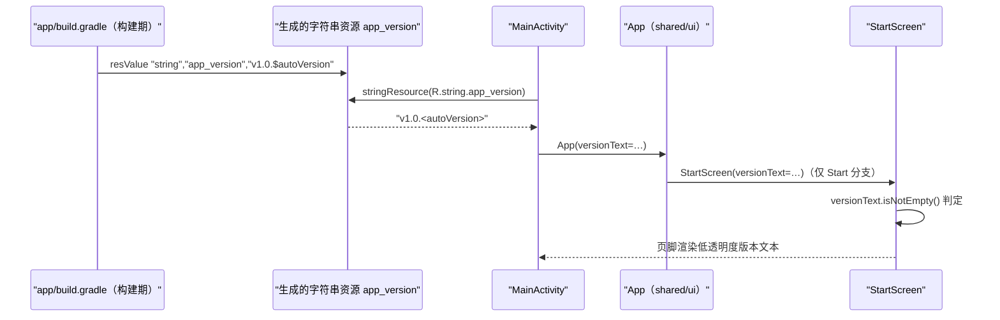
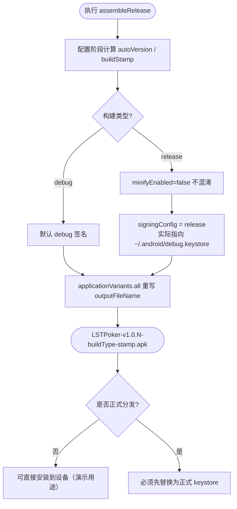
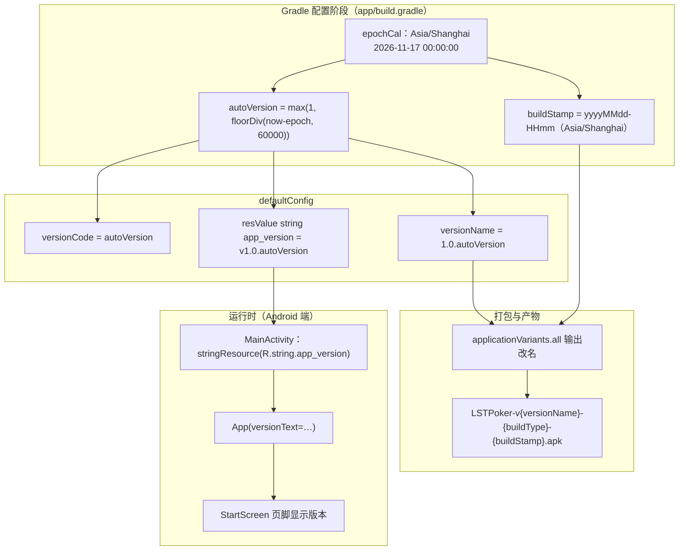

# 版本自动生成与发布产物命名

<cite>
**本文引用的文件**
- [app/build.gradle](file://app/build.gradle)
- [app/src/main/AndroidManifest.xml](file://app/src/main/AndroidManifest.xml)
- [app/src/main/res/values/strings.xml](file://app/src/main/res/values/strings.xml)
- [app/src/main/java/com/aniapp/pokerdemo/MainActivity.kt](file://app/src/main/java/com/aniapp/pokerdemo/MainActivity.kt)
- [shared/src/commonMain/kotlin/com/aniapp/pokerdemo/ui/App.kt](file://shared/src/commonMain/kotlin/com/aniapp/pokerdemo/ui/App.kt)
- [shared/src/commonMain/kotlin/com/aniapp/pokerdemo/ui/start/StartScreen.kt](file://shared/src/commonMain/kotlin/com/aniapp/pokerdemo/ui/start/StartScreen.kt)
- [desktopApp/build.gradle.kts](file://desktopApp/build.gradle.kts)
- [desktopApp/src/main/kotlin/com/aniapp/pokerdemo/desktop/Main.kt](file://desktopApp/src/main/kotlin/com/aniapp/pokerdemo/desktop/Main.kt)
</cite>

## 目录
1. [简介](#简介)
2. [构建期版本自动生成机制](#构建期版本自动生成机制)
3. [版本号在应用内的注入与显示链路](#版本号在应用内的注入与显示链路)
4. [APK 产物命名策略](#apk-产物命名策略)
5. [Release 签名配置与临时措施说明](#release-签名配置与临时措施说明)
6. [应用名称与清单标签的变化](#应用名称与清单标签的变化)
7. [架构总览](#架构总览)
8. [各平台差异与注意事项](#各平台差异与注意事项)
9. [故障排查指南](#故障排查指南)
10. [结论](#结论)

## 简介

本页记录 Android 模块 `app` 在构建期如何**自动生成版本号并命名发布产物**，取代了传统"手工修改 versionCode/versionName"的做法。核心思想是：以 Asia/Shanghai 时区的 **2026-11-17 00:00:00** 作为项目纪元（epoch），把"当前构建时刻距纪元的分钟数"直接当作版本尾号和 versionCode。这样每一次构建的版本号都随时间单调自增，开发者无需在任何文件中手动 bump 版本。

同一份构建脚本还负责三件事：

- 通过 `resValue` 把生成的版本字符串注入为 Android 资源 `app_version`，供 UI 层显示；
- 通过变体输出回调把 APK 重命名为包含版本名、构建类型与时间戳的规范文件名；
- 为 release 构建配置复用 debug 证书的临时签名方案（源码注释明确指出正式分发前必须替换）。

 launcher 显示名称由 `strings.xml` 中的 `app_name`（值为 **LSTPoker**）提供，经 `AndroidManifest.xml` 的 `android:label="@string/app_name"` 引用。

## 构建期版本自动生成机制

### 纪元时间与 autoVersion 计算

在 `app/build.gradle` 顶部（plugins 块之后、android 块之前），脚本定义了两个构建期变量：

- `epochCal`：一个按 **Asia/Shanghai** 时区初始化的 `Calendar` 实例，被设置为 `2026, Calendar.NOVEMBER, 17, 0, 0, 0` 且毫秒位清零，即项目纪元 2026-11-17 00:00:00（东八区）。使用显式时区可保证不同构建机器的系统时区不影响纪元锚点的一致性。
- `autoVersion`：`max(1, floorDiv(System.currentTimeMillis() - epochCal.timeInMillis, 60000))`，即"当前时刻距纪元的分钟数"，并对结果做下限保护——当构建发生在纪元之前（例如机器时钟回拨或纪元尚未到达）时，`floorDiv` 会得到 0 或负数，`max(1L, …)` 确保版本至少为 1。
- `buildStamp`：以 `yyyyMMdd-HHmm` 格式、同样取 **Asia/Shanghai** 时区生成的当前时间戳字符串，后续用于 APK 文件名。

由于 `autoVersion` 是分钟粒度且随墙上时钟单调增长，只要两次构建间隔超过一分钟，版本号就必然递增，因此**不需要任何人工维护版本的动作**。

### versionCode 与 versionName 的派生

在 `defaultConfig` 中：

| 配置项 | 取值 | 说明 |
|---|---|---|
| `versionCode` | `autoVersion as int` | 整数化的分钟差，Android 安装升级比较用 |
| `versionName` | `"1.0.${autoVersion}"` | 面向人类的可读版本，形如 `1.0.<分钟数>` |
| `resValue "string", "app_version"` | `"v1.0.${autoVersion}"` | 构建期动态注入的字符串资源，带 `v` 前缀 |

需要注意三个值之间的对应关系：`versionCode = autoVersion`、`versionName = "1.0.$autoVersion"`、资源字符串 `app_version = "v1.0.$autoVersion"`，三者同源同刻生成，天然一致，不存在手工同步出错的可能。

**本节来源**
- [app/build.gradle:7-13](file://app/build.gradle#L7-L13)
- [app/build.gradle:15-28](file://app/build.gradle#L15-L28)

## 版本号在应用内的注入与显示链路

版本号从 Gradle 构建脚本一路传递到开始页页脚，共经历四个环节：

1. **构建期注入资源**：`app/build.gradle` 的 `resValue "string", "app_version", "v1.0.${autoVersion}"` 使 AAPT 在编译时生成一个名为 `app_version` 的字符串资源（该资源**不在** `strings.xml` 中定义，而是纯构建期产物）。
2. **Activity 读取资源**：`MainActivity.onCreate` 在 `setContent` 中调用 `stringResource(R.string.app_version)`，把结果作为 `versionText` 参数传给跨端 Compose 入口 `App(...)`。
3. **App 路由透传**：`shared` 模块的 `App` 组合函数声明了默认值为空串的 `versionText: String = ""` 参数，仅在 `screen is AppScreen.Start` 分支把它继续传给 `StartScreen`。
4. **开始页页脚渲染**：`StartScreen` 在页脚区域（"盲注 10/20 · 起始筹码 2000"提示之下）判断 `versionText.isNotEmpty()`，非空时才追加 `Spacer` 和一个小字号、低透明度的 `Text(versionText, …)`，即显示形如 `v1.0.<分钟数>` 的版本串。

这条链路的解耦设计意味着：桌面端 `desktopApp` 直接调用 `App()` 时不传 `versionText`，走默认空串，开始页自然不显示版本行；而 Android 端因资源注入的存在总是显示最新版本。共享 UI 代码本身对"版本从哪来"完全无感知。



**Diagram sources**
- [app/build.gradle:26-26](file://app/build.gradle#L26-L26)
- [MainActivity.kt:27-33](file://app/src/main/java/com/aniapp/pokerdemo/MainActivity.kt#L27-L33)
- [App.kt:48-73](file://shared/src/commonMain/kotlin/com/aniapp/pokerdemo/ui/App.kt#L48-L73)
- [StartScreen.kt:63-67](file://shared/src/commonMain/kotlin/com/aniapp/pokerdemo/ui/start/StartScreen.kt#L63-L67)
- [StartScreen.kt:155-158](file://shared/src/commonMain/kotlin/com/aniapp/pokerdemo/ui/start/StartScreen.kt#L155-L158)

**本节来源**
- [app/build.gradle:22-28](file://app/build.gradle#L22-L28)
- [MainActivity.kt:24-48](file://app/src/main/java/com/aniapp/pokerdemo/MainActivity.kt#L24-L48)
- [App.kt:48-73](file://shared/src/commonMain/kotlin/com/aniapp/pokerdemo/ui/App.kt#L48-L73)
- [StartScreen.kt:63-161](file://shared/src/commonMain/kotlin/com/aniapp/pokerdemo/ui/start/StartScreen.kt#L63-L161)

## APK 产物命名策略

`app/build.gradle` 在 `applicationVariants.all { variant -> variant.outputs.all { … } }` 回调中重写每个构建输出的文件名：

```
LSTPoker-v{variant.versionName}-{variant.buildType.name}-{buildStamp}.apk
```

组成要素：

| 片段 | 来源 | 示例效果 |
|---|---|---|
| `LSTPoker` | 硬编码的产品名，与 `strings.xml` 中 launcher 名称一致 | 固定前缀 |
| `v${variant.versionName}` | 即构建期生成的 `1.0.<autoVersion>` | `v1.0.4321` |
| `${variant.buildType.name}` | `debug` 或 `release` | `debug` / `release` |
| `${buildStamp}` | Asia/Shanghai 时区的 `yyyyMMdd-HHmm` 时间戳 | `20261118-1530` |

由此产出的文件名（如 `LSTPoker-v1.0.4321-release-20261118-1530.apk`）自带版本、构建类型与构建时刻三重信息，便于演示阶段直接在设备安装目录或群聊中区分多个 APK，无需额外记录构建元数据。

需要理解的一个细节：`buildStamp` 与 `autoVersion` 都在 **Gradle 配置阶段求值一次**，因此同一次 Gradle 调用产生的所有变体共享同一个时间戳与版本号；跨次构建则自然刷新。

**本节来源**
- [app/build.gradle:12-13](file://app/build.gradle#L12-L13)
- [app/build.gradle:46-50](file://app/build.gradle#L46-L50)

## Release 签名配置与临时措施说明

`signingConfigs` 中定义了名为 `release` 的签名配置，并在 `buildTypes.release` 中通过 `signingConfig signingConfigs.release` 引用。其关键内容：

- `storeFile`：指向 `System.getProperty("user.home") + "/.android/debug.keystore"`，即**复用本机 Android SDK 自动生成的 debug 证书库**；
- `storePassword` / `keyPassword`：均为 `android`；
- `keyAlias`：`androiddebugkey`——这三项正是 Android debug keystore 的公认默认口令约定。

同时 `buildTypes.release` 设置 `minifyEnabled false`，即 release 构建**不做代码混淆/压缩**（尽管仍声明了 `proguardFiles`，在未开启 minify 时不生效）。

源码在 `signingConfigs.release` 块内留有明确注释：**这是演示阶段的临时措施**——让 release 包与 debug 包共用同一套证书，从而可直接安装到已装过 debug 版的设备上、免签名步骤；**正式分发前必须替换为正式的 keystore**。文档层面应把这视为一项已知技术债：当前 release 产物不具备商店上架资格，且 keystore 路径依赖构建机用户主目录，换机器构建需保证其存在 `~/.android/debug.keystore`（通常由首次 Android 构建自动生成）。



**Diagram sources**
- [app/build.gradle:7-13](file://app/build.gradle#L7-L13)
- [app/build.gradle:30-50](file://app/build.gradle#L30-L50)

**本节来源**
- [app/build.gradle:30-45](file://app/build.gradle#L30-L45)

## 应用名称与清单标签的变化

围绕版本/命名策略，静态资源侧做了两点配套调整：

1. **`strings.xml` 精简**：原演示用途的其他字符串已被移除，文件现仅保留 `<string name="app_name">LSTPoker</string>`。launcher 显示名称即为 **LSTPoker**，与 APK 文件名前缀保持一致。版本号字符串**不再**写死在此文件中，而是由构建脚本经 `resValue` 动态生成，避免手写值与自动值冲突。
2. **Manifest 标签引用**：`AndroidManifest.xml` 中 `<application android:label="@string/app_name">` 以及启动 `<activity android:label="@string/app_name">` 均改为引用 `@string/app_name`，使应用级与 Activity 级标签统一来源于同一资源。

这一分工确立了清晰的规则：**静态标识（应用名）归 `strings.xml`，动态标识（版本号）归构建脚本**，两者互不侵入。

**本节来源**
- [app/src/main/res/values/strings.xml:1-3](file://app/src/main/res/values/strings.xml#L1-L3)
- [app/src/main/AndroidManifest.xml:7-20](file://app/src/main/AndroidManifest.xml#L7-L20)
- [app/build.gradle:26-26](file://app/build.gradle#L26-L26)

## 架构 overview 总览

下图整体呈现"构建期版本引擎 → 资源注入 → UI 显示 → 产物命名"的完整闭环：



**Diagram sources**
- [app/build.gradle:7-50](file://app/build.gradle#L7-L50)
- [MainActivity.kt:27-33](file://app/src/main/java/com/aniapp/pokerdemo/MainActivity.kt#L27-L33)
- [App.kt:48-73](file://shared/src/commonMain/kotlin/com/aniapp/pokerdemo/ui/App.kt#L48-L73)
- [StartScreen.kt:155-158](file://shared/src/commonMain/kotlin/com/aniapp/pokerdemo/ui/start/StartScreen.kt#L155-L158)

## 各平台差异与注意事项

版本自动生成策略**仅作用于 Android 模块**：

- `desktopApp/build.gradle.kts` 不含任何版本声明，其 `compose.desktop.application` 仅配置 `mainClass`；桌面入口 `Main.kt` 调用 `App()` 时省略 `versionText`，走默认空串，因此桌面端开始页不显示版本行。
- `server/build.gradle.kts` 同样未定义项目版本，服务端不参与本策略。
- 共享测试中存在以固定串 `App(versionText = "v-test")` 渲染开始页的用例，说明 `versionText` 参数化接口在测试中也保持了可注入性。

另一处值得注意的行为是：`autoVersion` 依赖构建机的 `System.currentTimeMillis()`。这意味着**构建缓存/增量行为**上，凡是触发 `app` 模块配置阶段的活动都会重新求值版本；若在 CI 中要求"同一提交产出确定版本号"，此策略不适用（它本质上是"时间戳版本"而非"内容寻址版本"），但对本项目"演示产物随取随新"的目标而言恰好符合预期。

**本节来源**
- [desktopApp/build.gradle.kts:1-28](file://desktopApp/build.gradle.kts#L1-L28)
- [Main.kt:16-16](file://desktopApp/src/main/kotlin/com/aniapp/pokerdemo/desktop/Main.kt#L16-L16)
- [RenderSmokeTest.kt:34-34](file://shared/src/desktopTest/kotlin/com/aniapp/pokerdemo/ui/RenderSmokeTest.kt#L34-L34)

## 故障排查指南

| 症状 | 可能原因 | 排查方向 |
|---|---|---|
| 版本号异常巨大或为 1 | 构建机时钟错误（早于纪元则被 `max(1,…)` 兜底为 1；时钟超前则分钟数虚高） | 校准时钟；确认时区无关性由脚本内显式 `Asia/Shanghai` 保证 |
| release 构建失败提示找不到 keystore | 构建机不存在 `~/.android/debug.keystore` | 先执行一次 debug 构建或任意 Android SDK 操作触发生成，或改用显式 keystore |
| 无法覆盖安装 release 包 | release 与 debug 证书不一致（换机后 debug keystore 变化） | 卸载旧包重装，或统一签名材料 |
| APK 文件名未变成 `LSTPoker-…` | 使用了自定义打包任务绕过 `applicationVariants` 回调，或 AGP 版本不支持该 API | 确认走标准 `assembleDebug/assembleRelease`；检查 AGP 与 `android.application` 插件版本 |
| 开始页不显示版本行 | `versionText` 为空：非 Android 端运行，或 `resValue` 未生效 | 检查 `R.string.app_version` 是否生成；`StartScreen` 对空串按设计隐藏该行 |
| `strings.xml` 与资源注入冲突 | 手工在 `strings.xml` 中新增了同名 `app_version` | 保持 `app_version` 只由构建脚本注入，静态文件仅保留 `app_name` |

**本节来源**
- [app/build.gradle:7-13](file://app/build.gradle#L7-L13)
- [app/build.gradle:30-50](file://app/build.gradle#L30-L50)
- [StartScreen.kt:155-158](file://shared/src/commonMain/kotlin/com/aniapp/pokerdemo/ui/start/StartScreen.kt#L155-L158)

## 结论

本项目在 `app/build.gradle` 中实现了一套轻量而自洽的版本治理方案：以东八区 2026-11-17 00:00 为纪元锚点，将"距纪元的分钟数"同时用作 `versionCode`、`versionName` 尾号与注入资源 `app_version`，配合 `applicationVariants` 输出改名（`LSTPoker-v{versionName}-{buildType}-{yyyyMMdd-HHmm}.apk`），实现了**零手工 bump 的单调递增版本与自描述产物命名**。UI 侧通过 `MainActivity → App → StartScreen` 的 `versionText` 参数链把版本显示在开始页页脚，且该链路与桌面端天然隔离。静态资源方面，`strings.xml` 收敛为仅含 `app_name`（LSTPoker），Manifest 标签统一引用 `@string/app_name`。唯一需要持续关注的技术债是 release 签名复用 debug keystore 且关闭混淆——这是源码注释明示的演示期临时安排，正式分发前必须替换为正式 keystore 并按需开启 minify。