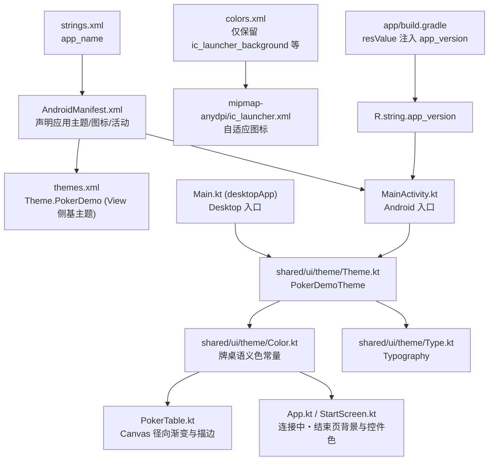
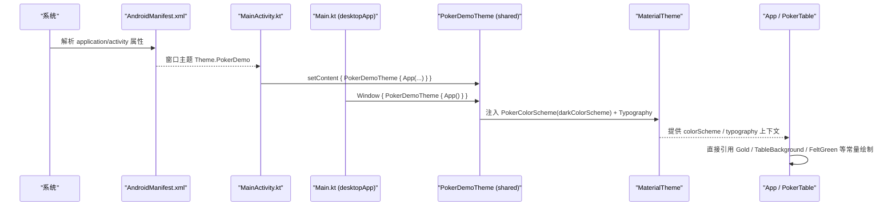
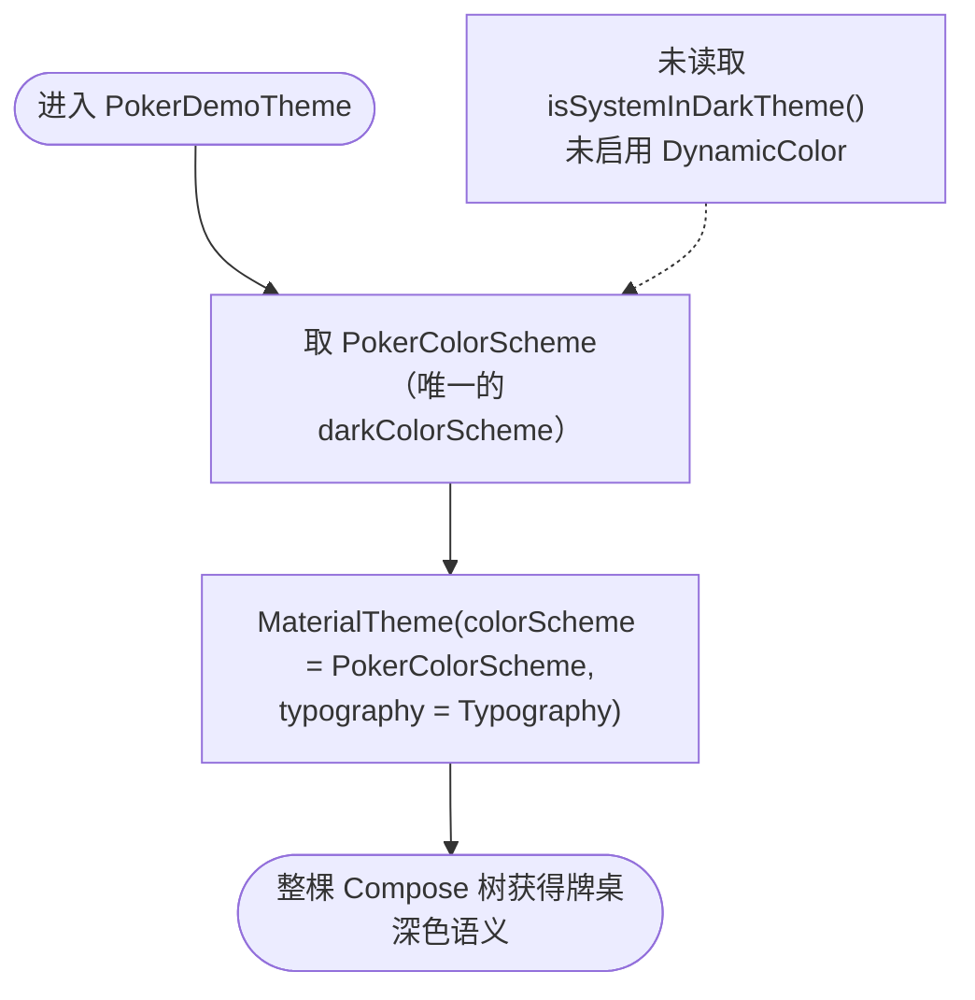
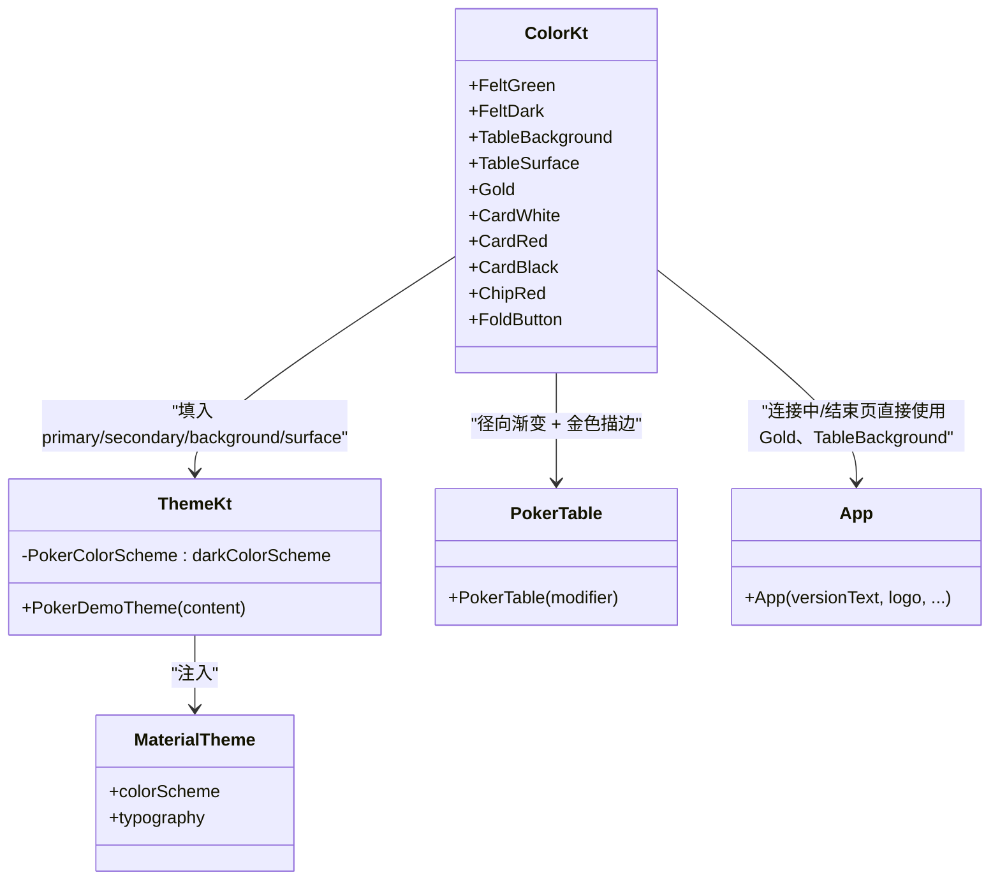
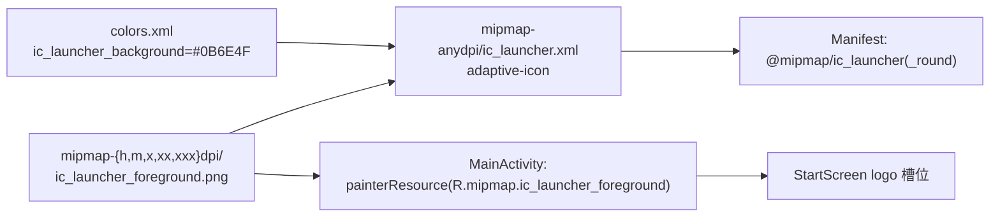
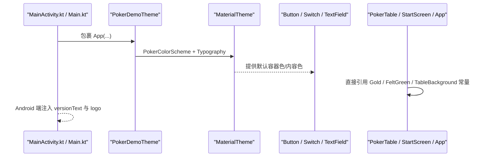
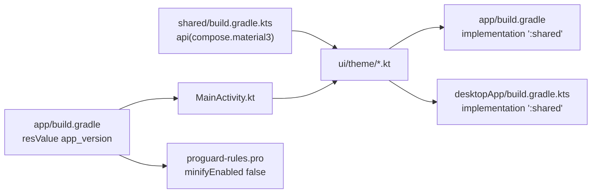

# 资源文件与主题配置

<cite>
**本文引用的文件**
- [app/src/main/res/values/themes.xml](file://app/src/main/res/values/themes.xml)
- [app/src/main/res/values/colors.xml](file://app/src/main/res/values/colors.xml)
- [app/src/main/res/values/strings.xml](file://app/src/main/res/values/strings.xml)
- [app/src/main/AndroidManifest.xml](file://app/src/main/AndroidManifest.xml)
- [app/src/main/res/mipmap-anydpi/ic_launcher.xml](file://app/src/main/res/mipmap-anydpi/ic_launcher.xml)
- [app/src/main/res/mipmap-anydpi/ic_launcher_round.xml](file://app/src/main/res/mipmap-anydpi/ic_launcher_round.xml)
- [shared/src/commonMain/kotlin/com/aniapp/pokerdemo/ui/theme/Color.kt](file://shared/src/commonMain/kotlin/com/aniapp/pokerdemo/ui/theme/Color.kt)
- [shared/src/commonMain/kotlin/com/aniapp/pokerdemo/ui/theme/Theme.kt](file://shared/src/commonMain/kotlin/com/aniapp/pokerdemo/ui/theme/Theme.kt)
- [shared/src/commonMain/kotlin/com/aniapp/pokerdemo/ui/theme/Type.kt](file://shared/src/commonMain/kotlin/com/aniapp/pokerdemo/ui/theme/Type.kt)
- [shared/src/commonMain/kotlin/com/aniapp/pokerdemo/ui/table/PokerTable.kt](file://shared/src/commonMain/kotlin/com/aniapp/pokerdemo/ui/table/PokerTable.kt)
- [shared/src/commonMain/kotlin/com/aniapp/pokerdemo/ui/App.kt](file://shared/src/commonMain/kotlin/com/aniapp/pokerdemo/ui/App.kt)
- [shared/src/commonMain/kotlin/com/aniapp/pokerdemo/ui/start/StartScreen.kt](file://shared/src/commonMain/kotlin/com/aniapp/pokerdemo/ui/start/StartScreen.kt)
- [app/src/main/java/com/aniapp/pokerdemo/MainActivity.kt](file://app/src/main/java/com/aniapp/pokerdemo/MainActivity.kt)
- [desktopApp/src/main/kotlin/com/aniapp/pokerdemo/desktop/Main.kt](file://desktopApp/src/main/kotlin/com/aniapp/pokerdemo/desktop/Main.kt)
- [app/build.gradle](file://app/build.gradle)
- [shared/build.gradle.kts](file://shared/build.gradle.kts)
- [app/proguard-rules.pro](file://app/proguard-rules.pro)
</cite>

## 目录
1. [简介](#简介)
2. [项目结构](#项目结构)
3. [核心组件](#核心组件)
4. [架构总览](#架构总览)
5. [详细组件分析](#详细组件分析)
   - [Material3 主题入口与深色模式策略](#material3-主题入口与深色模式策略)
   - [跨平台 Compose 色板：牌桌语义色](#跨平台-compose-色板牌桌语义色)
   - [XML 颜色资源与启动图标改造](#xml-颜色资源与启动图标改造)
   - [字符串资源管理与多语言扩展](#字符串资源管理与多语言扩展)
   - [AndroidManifest 中的应用元数据](#androidmanifest-中的应用元数据)
   - [Compose 中读取与应用资源](#compose-中读取与应用资源)
6. [依赖关系分析](#依赖关系分析)
7. [性能优化建议](#性能优化建议)
8. [故障排查指南](#故障排查指南)
9. [结论](#结论)
10. [附录：自定义主题实操步骤](#附录自定义主题实操步骤)

## 简介
本文围绕 Android XML 资源体系与 Jetpack Compose Material3 主题体系，说明本项目中两者的分工与协作方式。与早期版本相比，当前实现有两个关键变化需要重点理解：
- **Compose 主题三件套（Color.kt / Theme.kt / Type.kt）已从 app 模块迁移到 shared 模块的 commonMain**，成为 Android 与 Desktop 两个端共用的主题来源；色板不再是默认 Material 紫色系，而是一组**牌桌语义色**（FeltGreen、FeltDark、Gold、TableBackground 等），并被 `PokerTable` 的 Canvas 绘制与 `App` 的连接中/结束页直接引用。
- **app 侧 launcher 资源完成改造**：原先的 `drawable/ic_launcher_background.xml`、`drawable/ic_launcher_foreground.xml` 已移除，`mipmap-anydpi` 下的自适应图标改为引用 `@color/ic_launcher_background` 与新的 `@mipmap/ic_launcher_foreground` 位图；`colors.xml` 与 `strings.xml` 相应精简，演示用字符串被移除，界面显示的版本号改由构建脚本以 `resValue` 注入。

在此基础上，本文还覆盖 XML 主题入口、清单元数据、多语言扩展、字体与排版调整、深色模式适配，以及构建期混淆与资源瘦身策略。

## 项目结构
资源与主题相关代码分布在以下位置：
- XML 资源：`app/src/main/res/values` 下的 themes.xml、colors.xml、strings.xml；`app/src/main/res/mipmap-anydpi` 下的自适应图标定义；各密度 `mipmap-*dpi` 目录下的 `ic_launcher_foreground.png`；`res/xml` 下的备份与数据提取规则。
- 清单文件：`app/src/main/AndroidManifest.xml`。
- Compose 主题（跨平台）：`shared/src/commonMain/kotlin/com/aniapp/pokerdemo/ui/theme` 下的 Theme.kt、Color.kt、Type.kt。
- 应用入口：`app/src/main/java/com/aniapp/pokerdemo/MainActivity.kt`（Android）与 `desktopApp/src/main/kotlin/com/aniapp/pokerdemo/desktop/Main.kt`（Desktop），两者都通过 `PokerDemoTheme` 包裹业务界面 `App`。
- 构建配置：`app/build.gradle` 定义 Compose、版本自动增长与 `resValue` 注入；`shared/build.gradle.kts` 在 commonMain 中以 `api` 暴露 Compose Material3；`app/proguard-rules.pro` 提供混淆规则占位。

**图示来源**
- [app/src/main/AndroidManifest.xml:1-31](file://app/src/main/AndroidManifest.xml#L1-L31)
- [app/src/main/res/values/themes.xml:1-5](file://app/src/main/res/values/themes.xml#L1-L5)
- [app/src/main/java/com/aniapp/pokerdemo/MainActivity.kt:23-48](file://app/src/main/java/com/aniapp/pokerdemo/MainActivity.kt#L23-L48)
- [desktopApp/src/main/kotlin/com/aniapp/pokerdemo/desktop/Main.kt:10-17](file://desktopApp/src/main/kotlin/com/aniapp/pokerdemo/desktop/Main.kt#L10-L17)
- [shared/src/commonMain/kotlin/com/aniapp/pokerdemo/ui/theme/Theme.kt:1-28](file://shared/src/commonMain/kotlin/com/aniapp/pokerdemo/ui/theme/Theme.kt#L1-L28)
- [shared/src/commonMain/kotlin/com/aniapp/pokerdemo/ui/theme/Color.kt:1-14](file://shared/src/commonMain/kotlin/com/aniapp/pokerdemo/ui/theme/Color.kt#L1-L14)
- [shared/src/commonMain/kotlin/com/aniapp/pokerdemo/ui/theme/Type.kt:1-17](file://shared/src/commonMain/kotlin/com/aniapp/pokerdemo/ui/theme/Type.kt#L1-L17)
- [app/src/main/res/mipmap-anydpi/ic_launcher.xml:1-5](file://app/src/main/res/mipmap-anydpi/ic_launcher.xml#L1-L5)
- [app/build.gradle:19-30](file://app/build.gradle#L19-L30)

**章节来源**
- [app/src/main/AndroidManifest.xml:1-31](file://app/src/main/AndroidManifest.xml#L1-L31)
- [shared/src/commonMain/kotlin/com/aniapp/pokerdemo/ui/theme/Theme.kt:1-28](file://shared/src/commonMain/kotlin/com/aniapp/pokerdemo/ui/theme/Theme.kt#L1-L28)
- [app/build.gradle:1-72](file://app/build.gradle#L1-L72)

## 核心组件
- **AppCompat/Material XML 主题入口（themes.xml）**：仅声明一个空样式 `Theme.PokerDemo`，继承 `android:Theme.Material.Light.NoActionBar`，作为 View 体系的窗口外观基础（状态栏、无 ActionBar）。真正的界面配色由 Compose 侧决定。
- **Compose 主题（shared/ui/theme/Theme.kt）**：`PokerDemoTheme` 是唯一的 Compose 主题入口，内部只构造一套 `darkColorScheme`（名为 `PokerColorScheme`），并固定注入 `Typography`；不判断系统深色模式，也不使用动态取色（DynamicColor）。
- **Compose 色板（shared/ui/theme/Color.kt）**：一组牌桌语义色常量，包括桌面绿 FeltGreen/FeltDark、深背景 TableBackground、面板 TableSurface、强调金 Gold、卡牌 CardWhite/CardRed/CardBlack、筹码 ChipRed、弃牌按钮 FoldButton。
- **Compose 排版（shared/ui/theme/Type.kt）**：仅覆写 `bodyLarge`（默认字体族、Normal 字重、16sp/24sp、0.5sp 字距）的 `Typography`。
- **XML 颜色资源（colors.xml）**：保留模板紫色/青色与黑白基础色，并新增 `ic_launcher_background`（值 `#0B6E4F`，与 FeltGreen 同色）供自适应图标背景使用。
- **字符串资源（strings.xml）**：只剩 `app_name`（值为 `LSTPoker`）；界面版本号 `app_version` 不在 XML 中声明，而由构建脚本生成。
- **清单文件（AndroidManifest.xml）**：声明 INTERNET 权限、应用图标/标签/主题、竖屏锁定与 configChanges，注册唯一启动 Activity。
- **两端入口（MainActivity.kt / Main.kt）**：均以 `PokerDemoTheme { App(...) }` 包裹内容；Android 端额外注入 `versionText` 与 logo 组合 lambda，Desktop 端使用 `App()` 默认参数。

**章节来源**
- [app/src/main/res/values/themes.xml:1-5](file://app/src/main/res/values/themes.xml#L1-L5)
- [shared/src/commonMain/kotlin/com/aniapp/pokerdemo/ui/theme/Theme.kt:8-28](file://shared/src/commonMain/kotlin/com/aniapp/pokerdemo/ui/theme/Theme.kt#L8-L28)
- [shared/src/commonMain/kotlin/com/aniapp/pokerdemo/ui/theme/Color.kt:5-14](file://shared/src/commonMain/kotlin/com/aniapp/pokerdemo/ui/theme/Color.kt#L5-L14)
- [shared/src/commonMain/kotlin/com/aniapp/pokerdemo/ui/theme/Type.kt:9-16](file://shared/src/commonMain/kotlin/com/aniapp/pokerdemo/ui/theme/Type.kt#L9-L16)
- [app/src/main/res/values/colors.xml:1-11](file://app/src/main/res/values/colors.xml#L1-L11)
- [app/src/main/res/values/strings.xml:1-3](file://app/src/main/res/values/strings.xml#L1-L3)
- [app/src/main/AndroidManifest.xml:1-31](file://app/src/main/AndroidManifest.xml#L1-L31)

## 架构总览
下图展示从清单解析到 Compose 主题装配的完整链路，以及主题在 Android/Desktop 两个宿主上的复用关系。

**图示来源**
- [app/src/main/AndroidManifest.xml:5-22](file://app/src/main/AndroidManifest.xml#L5-L22)
- [app/src/main/java/com/aniapp/pokerdemo/MainActivity.kt:26-47](file://app/src/main/java/com/aniapp/pokerdemo/MainActivity.kt#L26-L47)
- [desktopApp/src/main/kotlin/com/aniapp/pokerdemo/desktop/Main.kt:10-17](file://desktopApp/src/main/kotlin/com/aniapp/pokerdemo/desktop/Main.kt#L10-L17)
- [shared/src/commonMain/kotlin/com/aniapp/pokerdemo/ui/theme/Theme.kt:8-27](file://shared/src/commonMain/kotlin/com/aniapp/pokerdemo/ui/theme/Theme.kt#L8-L27)

## 详细组件分析

### Material3 主题入口与深色模式策略
- **XML 侧**：`themes.xml` 只有一个不带任何 item 的样式 `Theme.PokerDemo`，parent 为 `android:Theme.Material.Light.NoActionBar`。它的作用是让窗口没有 ActionBar 并使用系统 Material 亮色窗口背景；由于界面完全由 Compose 绘制，这里不需要定义 colorPrimary/colorSurface 等属性。
- **Compose 侧**：`PokerDemoTheme` 是一个无参数的 Composable，直接把私有的 `PokerColorScheme` 与 `Typography` 传给 `MaterialTheme`。
- **关于 Light/Dark 切换的实现现状**：当前代码**没有** `lightColorScheme` 分支，也**没有**调用 `isSystemInDarkTheme()` 或动态取色 API。整套方案本身就是"单套深色牌桌配色"：无论系统是浅色还是深色偏好，界面始终呈现同一套暗色调 Material3 方案。因此"Light/Dark 主题切换"在本项目中表现为——主题固定为深色语义，切换能力需要通过新增浅色色板并在 `PokerDemoTheme` 中按条件选择来实现（见附录）。
- **对宿主的约束**：因为色板放在 shared 的 commonMain，Android 与 Desktop 共用同一个 `PokerDemoTheme`，任一端单独改动都会同步影响另一端，不存在"每端一套主题"的情况。

**图示来源**
- [shared/src/commonMain/kotlin/com/aniapp/pokerdemo/ui/theme/Theme.kt:8-27](file://shared/src/commonMain/kotlin/com/aniapp/pokerdemo/ui/theme/Theme.kt#L8-L27)
- [app/src/main/res/values/themes.xml:3-4](file://app/src/main/res/values/themes.xml#L3-L4)

**章节来源**
- [app/src/main/res/values/themes.xml:1-5](file://app/src/main/res/values/themes.xml#L1-L5)
- [shared/src/commonMain/kotlin/com/aniapp/pokerdemo/ui/theme/Theme.kt:1-28](file://shared/src/commonMain/kotlin/com/aniapp/pokerdemo/ui/theme/Theme.kt#L1-L28)
- [shared/src/commonMain/kotlin/com/aniapp/pokerdemo/ui/theme/Color.kt:1-14](file://shared/src/commonMain/kotlin/com/aniapp/pokerdemo/ui/theme/Color.kt#L1-L14)

### 跨平台 Compose 色板：牌桌语义色
`Color.kt` 取代了原来的紫色系常量，提供面向扑克牌桌场景的语义色，并在 `Theme.kt` 中被映射进 Material3 的角色位：

| 语义常量 | 色值 | 在色板中的角色 | 典型使用位置 |
| --- | --- | --- | --- |
| FeltGreen | `0xFF0B6E4F` | `secondary` | 牌桌呢面径向渐变的中心色 |
| FeltDark | `0xFF084C37` | — | 呢面渐变的边缘色（收暗） |
| TableBackground | `0xFF10241C` | `background` | 各界面根 Box 的背景填充 |
| TableSurface | `0xFF16302A` | `surface` | 面板/卡片容器底色 |
| Gold | `0xFFD4AF37` | `primary` | 高亮描边、主按钮、底池文本、行动指示 |
| CardWhite / CardRed / CardBlack | — | — | 牌面底色与花色文字 |
| ChipRed | `0xFFC62828` | — | 筹码图形 |
| FoldButton | `0xFF8E3B3B` | — | 弃牌按钮容器色 |

- **PokerTable 的直接消费**：`PokerTable` 用 `Canvas` 依次绘制木色椭圆边框（内联硬编码 `0xFF2E1F14`）、以 `Brush.radialGradient(colors = listOf(FeltGreen, FeltDark), ...)` 填充的呢面，以及 `Gold.copy(alpha = 0.25f)` 的描边内圈。这些颜色来自 `Color.kt` 常量而非 `MaterialTheme.colorScheme`，因此修改常量会同时改变牌桌外观与 Material 组件配色。
- **App 的连接中/结束页直接消费**：在线流程里 `Phase.Connecting` 使用 `CircularProgressIndicator(color = Gold)`，`Phase.Ended` 的返回按钮使用 `ButtonDefaults.buttonColors(containerColor = Gold, contentColor = Color(0xFF241B04))`，二者所在的 `CenterMessage` 容器背景为 `TableBackground`。
- **命名规范**：XML 颜色沿用 Android 模板的"色系+明度"风格（`purple_500`、`teal_200`），而 Compose 常量采用"业务语义名"（Felt/Gold/Table/Card/Chip/Fold），不再有深浅两套后缀；若后续引入浅色主题，建议按用途而不是按明度命名，避免与 Material 角色位混淆。

**图示来源**
- [shared/src/commonMain/kotlin/com/aniapp/pokerdemo/ui/theme/Color.kt:5-14](file://shared/src/commonMain/kotlin/com/aniapp/pokerdemo/ui/theme/Color.kt#L5-L14)
- [shared/src/commonMain/kotlin/com/aniapp/pokerdemo/ui/theme/Theme.kt:8-27](file://shared/src/commonMain/kotlin/com/aniapp/pokerdemo/ui/theme/Theme.kt#L8-L27)
- [shared/src/commonMain/kotlin/com/aniapp/pokerdemo/ui/table/PokerTable.kt:16-39](file://shared/src/commonMain/kotlin/com/aniapp/pokerdemo/ui/table/PokerTable.kt#L16-L39)
- [shared/src/commonMain/kotlin/com/aniapp/pokerdemo/ui/App.kt:103-135](file://shared/src/commonMain/kotlin/com/aniapp/pokerdemo/ui/App.kt#L103-L135)

**章节来源**
- [shared/src/commonMain/kotlin/com/aniapp/pokerdemo/ui/theme/Color.kt:1-14](file://shared/src/commonMain/kotlin/com/aniapp/pokerdemo/ui/theme/Color.kt#L1-L14)
- [shared/src/commonMain/kotlin/com/aniapp/pokerdemo/ui/table/PokerTable.kt:1-40](file://shared/src/commonMain/kotlin/com/aniapp/pokerdemo/ui/table/PokerTable.kt#L1-L40)
- [shared/src/commonMain/kotlin/com/aniapp/pokerdemo/ui/App.kt:103-135](file://shared/src/commonMain/kotlin/com/aniapp/pokerdemo/ui/App.kt#L103-L135)

### XML 颜色资源与启动图标改造
- **colors.xml 的精简结果**：文件中除模板遗留的 `purple_*`、`teal_*`、`black`、`white` 外，新增了 `ic_launcher_background`（`#0B6E4F`）。该值与 Compose 侧 `FeltGreen` 一致，使桌面图标背景与牌桌呢面同色，形成视觉延续。
- **自适应图标的新结构**：`mipmap-anydpi/ic_launcher.xml` 与 `ic_launcher_round.xml` 内容相同，均为 `<adaptive-icon>`，其中 `<background android:drawable="@color/ic_launcher_background" />` 直接引用颜色资源，`<foreground android:drawable="@mipmap/ic_launcher_foreground" />` 引用各密度 `mipmap-*dpi` 目录下的前景位图。**原先的 `drawable/ic_launcher_background.xml` 与 `drawable/ic_launcher_foreground.xml` 已删除**，图标不再依赖矢量 drawable，也不再使用 `@drawable` 引用。
- **图标资源在代码中的复用**：`MainActivity` 把 `R.mipmap.ic_launcher_foreground` 以 `painterResource` 载入，作为 `logo` lambda 传入 `App`；`App` 将其透传给 `StartScreen`，在起始页中央 116dp 圆角框内绘制（缩放 1.45 倍以填满裁切区域）。当 `logo` 为空时（如 Desktop 端），`StartScreen` 回退为金色 "♠" 文本。这样同一份 launcher 前景图既用作系统图标，又用作应用内品牌标识。

**图示来源**
- [app/src/main/res/values/colors.xml:9-9](file://app/src/main/res/values/colors.xml#L9-L9)
- [app/src/main/res/mipmap-anydpi/ic_launcher.xml:1-5](file://app/src/main/res/mipmap-anydpi/ic_launcher.xml#L1-L5)
- [app/src/main/res/mipmap-anydpi/ic_launcher_round.xml:1-5](file://app/src/main/res/mipmap-anydpi/ic_launcher_round.xml#L1-L5)
- [app/src/main/AndroidManifest.xml:10-13](file://app/src/main/AndroidManifest.xml#L10-L13)
- [app/src/main/java/com/aniapp/pokerdemo/MainActivity.kt:32-41](file://app/src/main/java/com/aniapp/pokerdemo/MainActivity.kt#L32-L41)
- [shared/src/commonMain/kotlin/com/aniapp/pokerdemo/ui/start/StartScreen.kt:96-108](file://shared/src/commonMain/kotlin/com/aniapp/pokerdemo/ui/start/StartScreen.kt#L96-L108)

**章节来源**
- [app/src/main/res/values/colors.xml:1-11](file://app/src/main/res/values/colors.xml#L1-L11)
- [app/src/main/res/mipmap-anydpi/ic_launcher.xml:1-5](file://app/src/main/res/mipmap-anydpi/ic_launcher.xml#L1-L5)
- [app/src/main/res/mipmap-anydpi/ic_launcher_round.xml:1-5](file://app/src/main/res/mipmap-anydpi/ic_launcher_round.xml#L1-L5)
- [app/src/main/java/com/aniapp/pokerdemo/MainActivity.kt:26-47](file://app/src/main/java/com/aniapp/pokerdemo/MainActivity.kt#L26-L47)

### 字符串资源管理与多语言扩展
- **当前内容**：`strings.xml` 只保留 `app_name`（`LSTPoker`），演示用途字符串已随资源精简一并移除。
- **app_version 的来源**：界面右下角显示的版本号并非 XML 字符串。`app/build.gradle` 在 `defaultConfig` 中以 `resValue "string", "app_version", "v1.0.${autoVersion}"` 注入该资源，`autoVersion` 由"距项目起点的分钟数"计算得出，与 `versionCode`、`versionName` 同源，因此无需手工维护版本字符串。`MainActivity` 通过 `stringResource(R.string.app_version)` 读出并以 `versionText` 参数交给 `App`，最终由 `StartScreen` 在底部渲染。
- **共享层不读 Android 资源**：`shared` 的 commonMain 无法引用 `R.string.*`，所以界面文案（如"德州扑克""联机对战""底池"等）目前以 Kotlin 字面量写在 UI 代码中，只有需要平台差异的版本号与图标由 app 侧注入。这也意味着多语言目前只能覆盖 Android 端资源可表达的部分。
- **多语言扩展方法**：
  - 复制 `values/strings.xml` 为 `values-zh-rCN/strings.xml`、`values-en/strings.xml` 等目录并提供本地化文本；`app_name` 在各语言目录下分别给出译名。
  - 将 shared 层的硬编码中文文案逐步上提：在 `App` 及其子界面增加文案参数或使用 expect/actual 的资源提供器，由 app 侧用 `stringResource` 传入，从而让布局与清单都能跟随语言切换。
  - 清单的 `android:label` 保持引用 `@string/app_name`，确保桌面名称与界面标题一致。

**章节来源**
- [app/src/main/res/values/strings.xml:1-3](file://app/src/main/res/values/strings.xml#L1-L3)
- [app/build.gradle:8-13](file://app/build.gradle#L8-L13)
- [app/build.gradle:22-30](file://app/build.gradle#L22-L30)
- [app/src/main/java/com/aniapp/pokerdemo/MainActivity.kt:29-32](file://app/src/main/java/com/aniapp/pokerdemo/MainActivity.kt#L29-L32)
- [shared/src/commonMain/kotlin/com/aniapp/pokerdemo/ui/App.kt:47-72](file://shared/src/commonMain/kotlin/com/aniapp/pokerdemo/ui/App.kt#L47-L72)
- [shared/src/commonMain/kotlin/com/aniapp/pokerdemo/ui/start/StartScreen.kt:155-157](file://shared/src/commonMain/kotlin/com/aniapp/pokerdemo/ui/start/StartScreen.kt#L155-L157)

### AndroidManifest 中的应用元数据
- **应用级别**：
  - `android:theme="@style/Theme.PokerDemo"` 与 `android:icon="@mipmap/ic_launcher"`、`android:roundIcon="@mipmap/ic_launcher_round"` 分别挂载主题与两版自适应图标。
  - `android:label="@string/app_name"` 使用字符串资源作为应用名。
  - `android:supportsRtl="true"` 开启 RTL 布局支持。
  - `android:allowBackup="true"`，并通过 `@xml/backup_rules`、`@xml/data_extraction_rules` 引用备份规则；这两个 xml 文件目前仍是模板示例内容（有效规则全部被注释掉）。
  - 声明 `android.permission.INTERNET`，用于联机模式的 WebSocket 客户端。
- **活动级别**：
  - `.MainActivity` 为 `exported="true"`，重复指定 `@style/Theme.PokerDemo` 与 `@string/app_name`。
  - `android:screenOrientation="portrait"` 锁定竖屏；`android:configChanges` 涵盖 `orientation|screenSize|screenLayout|keyboardHidden|uiMode|fontScale|locale|layoutDirection|density`，使旋转、深色模式切换（uiMode）、字体缩放与语言变更不会重建 Activity，而由 Compose 自行处理重组。
  - `intent-filter` 包含 `MAIN` + `LAUNCHER`，是唯一启动入口。

**章节来源**
- [app/src/main/AndroidManifest.xml:1-31](file://app/src/main/AndroidManifest.xml#L1-L31)
- [app/src/main/res/xml/backup_rules.xml:1-13](file://app/src/main/res/xml/backup_rules.xml#L1-L13)
- [app/src/main/res/xml/data_extraction_rules.xml:1-19](file://app/src/main/res/xml/data_extraction_rules.xml#L1-L19)

### Compose 中读取与应用资源
- **主题包裹**：Android 端在 `setContent { PokerDemoTheme { App(...) } }` 中包裹，Desktop 端在 `Window { PokerDemoTheme { App() } }` 中包裹，两端共享同一主题实例，保证视觉一致。
- **MaterialTheme 的消费范围**：`MaterialTheme` 只在 `Theme.kt` 内部被构造，业务界面并不通过 `MaterialTheme.colorScheme` 取色，而是直接 import `com.aniapp.pokerdemo.ui.theme` 中的语义常量（如 `Gold`、`TableBackground`、`TableSurface`、`FoldButton`、`ChipRed`）。因此 Material 组件（Button、OutlinedButton、Switch、TextField 等）的默认配色来自 `PokerColorScheme`，而画布与自定义容器色来自常量——两者必须成对维护。
- **平台资源读取**：Android 专有资源只能在 app 模块读取后注入共享层，本项目采用两种方式：`stringResource(R.string.app_version)` 得到版本号文本参数，`painterResource(R.mipmap.ic_launcher_foreground)` 包装成 `logo` 组合 lambda 参数。Desktop 端不提供这两项，`App` 的默认值（空版本号、`logo = null`）即为其降级表现。
- **深色模式与动态色**：如前所述，当前不读取系统深浅偏好、也不使用动态取色；如需支持，应显式在 `PokerDemoTheme` 中加入判定逻辑。

**图示来源**
- [app/src/main/java/com/aniapp/pokerdemo/MainActivity.kt:26-47](file://app/src/main/java/com/aniapp/pokerdemo/MainActivity.kt#L26-L47)
- [desktopApp/src/main/kotlin/com/aniapp/pokerdemo/desktop/Main.kt:10-17](file://desktopApp/src/main/kotlin/com/aniapp/pokerdemo/desktop/Main.kt#L10-L17)
- [shared/src/commonMain/kotlin/com/aniapp/pokerdemo/ui/theme/Theme.kt:19-27](file://shared/src/commonMain/kotlin/com/aniapp/pokerdemo/ui/theme/Theme.kt#L19-L27)
- [shared/src/commonMain/kotlin/com/aniapp/pokerdemo/ui/App.kt:36-37](file://shared/src/commonMain/kotlin/com/aniapp/pokerdemo/ui/App.kt#L36-L37)

**章节来源**
- [shared/src/commonMain/kotlin/com/aniapp/pokerdemo/ui/theme/Theme.kt:1-28](file://shared/src/commonMain/kotlin/com/aniapp/pokerdemo/ui/theme/Theme.kt#L1-L28)
- [shared/src/commonMain/kotlin/com/aniapp/pokerdemo/ui/App.kt:47-72](file://shared/src/commonMain/kotlin/com/aniapp/pokerdemo/ui/App.kt#L47-L72)

## 依赖关系分析
- **shared/build.gradle.kts**：以 `api(compose.runtime/foundation/material3/ui)` 暴露 Compose 依赖，使主题与语义色对所有下游 target（androidTarget 与 jvm("desktop")）可见；同时启用 `kotlin.compose` 与 `compose.multiplatform` 插件，这是主题能放进 commonMain 的前提。
- **app/build.gradle**：
  - 通过 `implementation project(':shared')` 复用主题与 UI；`buildFeatures { compose true }` 与 `kotlin.compose` 插件开启 Compose 编译。
  - `minSdk 28`、`targetSdk 36`、Java/Kotlin 目标 11。
  - `defaultConfig` 中 `resValue` 注入 `app_version`，`versionCode`/`versionName` 由时间派生的 `autoVersion` 统一驱动，APK 文件名亦带版本与构建时间戳。
  - release 构建类型仍为 `minifyEnabled false`，并指定 debug keystore 以便演示包可直接安装；混淆规则文件通过 `proguardFiles` 挂接。
- **desktopApp/build.gradle.kts**：依赖 `:shared` 与 `compose.desktop.currentOs`，主类为 `...desktop.MainKt`，因此主题改动会自动作用于桌面端。
- **残留的 XML 颜色**：`purple_*`、`teal_*`、`black`、`white` 已不参与 Compose 配色，属于模板遗留；实际被引用的只有 `ic_launcher_background`。

**图示来源**
- [shared/build.gradle.kts:3-25](file://shared/build.gradle.kts#L3-L25)
- [app/build.gradle:1-7](file://app/build.gradle#L1-L7)
- [app/build.gradle:22-30](file://app/build.gradle#L22-L30)
- [app/build.gradle:40-47](file://app/build.gradle#L40-L47)
- [desktopApp/src/main/kotlin/com/aniapp/pokerdemo/desktop/Main.kt:1-18](file://desktopApp/src/main/kotlin/com/aniapp/pokerdemo/desktop/Main.kt#L1-L18)

**章节来源**
- [shared/build.gradle.kts:1-40](file://shared/build.gradle.kts#L1-L40)
- [app/build.gradle:1-72](file://app/build.gradle#L1-L72)
- [app/proguard-rules.pro:1-21](file://app/proguard-rules.pro#L1-L21)

## 性能优化建议
- **图片与图标资源**：launcher 前景现为 5 个密度的 PNG，可替换为 WebP（无损或有损视内容而定）以减小体积；若前景本身是扁平图形，也可回到单一矢量的 mipmap 前景以减少多密度副本。注意 `ic_launcher_foreground` 同时被应用内 `painterResource` 复用，压缩时需保证放大 1.45 倍后的清晰度。
- **清理无用 XML 颜色**：`colors.xml` 中未被引用的模板色（紫/青/黑白）可安全删除，仅保留 `ic_launcher_background`，减少资源表条目；删除前先确认没有其他资源通过 `@color/...` 引用。
- **混淆与缩减**：release 目前 `minifyEnabled false`。若要开启，需同时设置 `shrinkResources true`，并验证序列化模型、反射入口（如 Ktor/kotlinx.serialization 相关类）不被裁剪；`proguard-rules.pro` 现仅为注释模板，可按需放开 `-keepattributes SourceFile,LineNumberTable` 与 `-renamesourcefileattribute SourceFile` 以获得可读堆栈。
- **字体与排版**：`Type.kt` 当前只用 `FontFamily.Default`，无字体加载开销。引入自定义字体时应优先使用可变字体或子集化文件，并按需仅覆盖用到的样式，避免全量替换导致首帧字体加载阻塞。
- **绘制与重组**：`PokerTable` 与 `StartScreen` 的背景为 Canvas 一次性绘制，颜色来自常量，重组代价低；若加入浅色主题或用户可切换配色，建议把色板对象提升为 `staticCompositionLocalOf`/`remember` 的稳定值，避免每次重组重新构造 `darkColorScheme` 引起大范围重绘。

[本节为通用性能建议，除上述明确点名的文件外不逐行分析具体实现]

## 故障排查指南
- **改了颜色但界面没变**：先确认改的是 shared 的 `Color.kt` 常量还是 `PokerColorScheme` 里的角色位。画布类组件（`PokerTable`、`StartScreen` 背景）直接用常量，Material 组件用色板；只改其一会出现"按钮变了、牌桌没变"这类不一致。
- **桌面端与 Android 端表现不同**：主题已共用，差异通常来自入口注入的参数——Desktop 端调用 `App()` 未传 `versionText` 与 `logo`，因此起始页不显示版本号、logo 位显示金色 "♠"，属预期降级而非主题失效。
- **找不到 `R.drawable.ic_launcher_background` / `ic_launcher_foreground`**：这两个 drawable 已删除，自适应图标现引用 `@color/ic_launcher_background` 与 `@mipmap/ic_launcher_foreground`；旧代码或文档中的 `@drawable/...` 引用需要同步更新。
- **`R.string.app_version` 解析不到**：该字符串由 `app/build.gradle` 的 `resValue` 生成，clean/同步 Gradle 后才会出现在生成的资源表中；不要在 `strings.xml` 里再手写同名 key，否则会产生重复资源冲突。
- **深色模式切换无反应**：`PokerDemoTheme` 不读取系统偏好，切换系统深浅色不会改变界面配色；Activity 已通过 `configChanges` 声明吸收 `uiMode` 变更，因此也不会因切换而重建。
- **图标在某些启动器上出现白边或被裁切**：自适应图标的前景/背景分层必须遵守安全区，前景 PNG 需留出外围留白；检查各密度 `ic_launcher_foreground.png` 是否齐全，缺失密度会回退缩放导致模糊。
- **开启混淆后崩溃**：检查 `proguard-rules.pro` 是否保留了网络协议序列化类与 Compose 运行时相关成员，必要时补充 `-keep` 规则后再验证。

**章节来源**
- [shared/src/commonMain/kotlin/com/aniapp/pokerdemo/ui/theme/Theme.kt:8-27](file://shared/src/commonMain/kotlin/com/aniapp/pokerdemo/ui/theme/Theme.kt#L8-L27)
- [shared/src/commonMain/kotlin/com/aniapp/pokerdemo/ui/table/PokerTable.kt:16-39](file://shared/src/commonMain/kotlin/com/aniapp/pokerdemo/ui/table/PokerTable.kt#L16-L39)
- [app/src/main/res/mipmap-anydpi/ic_launcher.xml:1-5](file://app/src/main/res/mipmap-anydpi/ic_launcher.xml#L1-L5)
- [app/build.gradle:22-30](file://app/build.gradle#L22-L30)
- [app/src/main/AndroidManifest.xml:17-22](file://app/src/main/AndroidManifest.xml#L17-L22)
- [app/proguard-rules.pro:1-21](file://app/proguard-rules.pro#L1-L21)

## 结论
本项目的资源配置呈现出"XML 极简、Compose 主导、跨平台共用"的格局：
- XML 侧只保留一个空壳窗口主题 `Theme.PokerDemo`、清单所需的 `app_name`、以及服务于自适应图标的 `ic_launcher_background`；launcher 资源已从 drawable 矢量迁移到 mipmap 前景 + 颜色背景的组合。
- Compose 主题三件套位于 shared 的 commonMain，`PokerDemoTheme` 以单一 `darkColorScheme` 承载牌桌语义色，被 Android 与 Desktop 两个入口共同包裹使用；界面绘制层直接引用语义常量，与 Material 色板成对生效。
- 版本号等资源由构建脚本注入，避免了 XML 与构建产物的双份维护。
- 深色/浅色切换与动态取色尚未实现，构建期的混淆与资源缩减仍处于关闭状态，构成明确的后续优化空间。

[本节为总结性内容，不直接分析具体文件]

## 附录：自定义主题实操步骤

### 修改颜色系统
1. 在 `shared/.../ui/theme/Color.kt` 中调整或新增语义常量（例如增加 `WinHighlight`、`Warning`）。
2. 同步在 `Theme.kt` 的 `PokerColorScheme` 中把新色填入对应角色位（`primary`、`secondary`、`tertiary`、`surface`、`background`、`surfaceVariant` 等）。
3. 检查所有直接引用常量的绘制代码——至少包括 `PokerTable` 的渐变与描边、`App` 的连接中/结束页、`StartScreen` 的背景与 logo 边框——确认改动符合预期。
4. 若改动涉及图标底色，另行更新 `app/src/main/res/values/colors.xml` 的 `ic_launcher_background`，保持桌面图标与牌桌呢面同色。

**章节来源**
- [shared/src/commonMain/kotlin/com/aniapp/pokerdemo/ui/theme/Color.kt:5-14](file://shared/src/commonMain/kotlin/com/aniapp/pokerdemo/ui/theme/Color.kt#L5-L14)
- [shared/src/commonMain/kotlin/com/aniapp/pokerdemo/ui/theme/Theme.kt:8-18](file://shared/src/commonMain/kotlin/com/aniapp/pokerdemo/ui/theme/Theme.kt#L8-L18)
- [shared/src/commonMain/kotlin/com/aniapp/pokerdemo/ui/table/PokerTable.kt:22-38](file://shared/src/commonMain/kotlin/com/aniapp/pokerdemo/ui/table/PokerTable.kt#L22-L38)
- [app/src/main/res/values/colors.xml:9-9](file://app/src/main/res/values/colors.xml#L9-L9)

### 增加浅色主题与系统偏好切换
1. 在 `Color.kt` 补一组浅色语义常量（如 `TableBackgroundLight`、`GoldOnLight`）。
2. 在 `Theme.kt` 新增 `private val PokerLightColorScheme = lightColorScheme(...)`。
3. 让 `PokerDemoTheme` 接受可选参数并读取 `isSystemInDarkTheme()`（或暴露给调用方做手动开关），据此选择色板后传给 `MaterialTheme`。
4. 由于画布类界面直接引用常量，需把这类颜色改为从 `MaterialTheme.colorScheme` 取值或以参数注入，否则浅色模式下牌桌背景仍会是深色。

**章节来源**
- [shared/src/commonMain/kotlin/com/aniapp/pokerdemo/ui/theme/Theme.kt:8-27](file://shared/src/commonMain/kotlin/com/aniapp/pokerdemo/ui/theme/Theme.kt#L8-L27)

### 添加自定义字体
1. 字体文件放到可跨端访问的位置；Android 侧可放 `app/src/main/res/font`，跨平台则考虑资源打包方案后由入口注入。
2. 在 `Type.kt` 中用 `FontFamily(...)` 构造字体族，并写入 `Typography` 的各样式（`bodyLarge`、`titleLarge`、`labelSmall` 等）。
3. 由于 `PokerDemoTheme` 已把 `Typography` 传给 `MaterialTheme`，全局 Text/Button 会自动生效；界面中大量使用 `fontSize`/`fontWeight` 直写的文本仍需逐个改用样式，才能保证字体真正落地。

**章节来源**
- [shared/src/commonMain/kotlin/com/aniapp/pokerdemo/ui/theme/Type.kt:1-17](file://shared/src/commonMain/kotlin/com/aniapp/pokerdemo/ui/theme/Type.kt#L1-L17)
- [shared/src/commonMain/kotlin/com/aniapp/pokerdemo/ui/theme/Theme.kt:19-26](file://shared/src/commonMain/kotlin/com/aniapp/pokerdemo/ui/theme/Theme.kt#L19-L26)

### 调整 Typography
- 在 `Type.kt` 的 `Typography(...)` 中补齐更多角色（`titleLarge`、`headlineSmall`、`labelMedium` 等），统一字号、行高、字重与字间距。
- 现有仅覆写 `bodyLarge` 的写法会让其余样式沿用 Material3 默认值，扩展时注意不要与界面中硬编码的 `fontSize` 冲突。
- 结合清单的 `fontScale` configChanges 行为，验证系统字体放大下文本仍可完整显示。

**章节来源**
- [shared/src/commonMain/kotlin/com/aniapp/pokerdemo/ui/theme/Type.kt:9-16](file://shared/src/commonMain/kotlin/com/aniapp/pokerdemo/ui/theme/Type.kt#L9-L16)
- [app/src/main/AndroidManifest.xml:17-22](file://app/src/main/AndroidManifest.xml#L17-L22)

### 替换或扩展启动图标
1. 替换各 `mipmap-*dpi/ic_launcher_foreground.png`（保持 5 个密度齐全与安全区留白）。
2. 如需更换背景色，只改 `colors.xml` 的 `ic_launcher_background`，无需修改 `mipmap-anydpi` 下的两个 xml。
3. 若应用内 logo 需随之变化，无需改代码——`MainActivity` 直接读取 `R.mipmap.ic_launcher_foreground`。

**章节来源**
- [app/src/main/res/mipmap-anydpi/ic_launcher.xml:1-5](file://app/src/main/res/mipmap-anydpi/ic_launcher.xml#L1-L5)
- [app/src/main/res/values/colors.xml:9-9](file://app/src/main/res/values/colors.xml#L9-L9)
- [app/src/main/java/com/aniapp/pokerdemo/MainActivity.kt:32-41](file://app/src/main/java/com/aniapp/pokerdemo/MainActivity.kt#L32-L41)

### Compose 中读取与应用资源
- 颜色：Material 组件走 `MaterialTheme.colorScheme.primary/secondary/background/surface`；自绘内容继续引用 `ui.theme` 语义常量。
- 排版：`MaterialTheme.typography.bodyLarge` 等（当前仅 `bodyLarge` 被定制）。
- 字符串：Android 端用 `stringResource(R.string.app_name)` / `stringResource(R.string.app_version)` 读取，再以参数传入共享层；`app_version` 由构建脚本 `resValue` 生成。
- 图片：`painterResource(R.mipmap.ic_launcher_foreground)` 包装成 `logo` lambda 注入 `App`。
- 主题包裹：任何新入口都必须以 `PokerDemoTheme { ... }` 包裹，否则 Material 组件会退回默认配色。

**章节来源**
- [app/src/main/java/com/aniapp/pokerdemo/MainActivity.kt:26-47](file://app/src/main/java/com/aniapp/pokerdemo/MainActivity.kt#L26-L47)
- [desktopApp/src/main/kotlin/com/aniapp/pokerdemo/desktop/Main.kt:10-17](file://desktopApp/src/main/kotlin/com/aniapp/pokerdemo/desktop/Main.kt#L10-L17)
- [shared/src/commonMain/kotlin/com/aniapp/pokerdemo/ui/App.kt:47-72](file://shared/src/commonMain/kotlin/com/aniapp/pokerdemo/ui/App.kt#L47-L72)

### 构建与发布优化
- 在 `app/build.gradle` 的 release 块中将 `minifyEnabled` 置为 `true`，并按需追加 `shrinkResources true`。
- 完善 `proguard-rules.pro`：保留序列化/反射所需成员，放开堆栈行号属性以便线上定位。
- 正式分发前替换 `signingConfigs.release` 中复用的 debug keystore。
- 用 APK Analyzer 复核资源占用，重点看 mipmap 前景位图与被删除的模板颜色是否清理干净。

**章节来源**
- [app/build.gradle:32-47](file://app/build.gradle#L32-L47)
- [app/proguard-rules.pro:1-21](file://app/proguard-rules.pro#L1-L21)