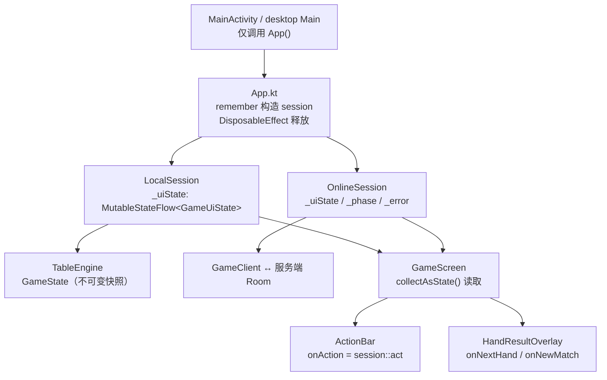
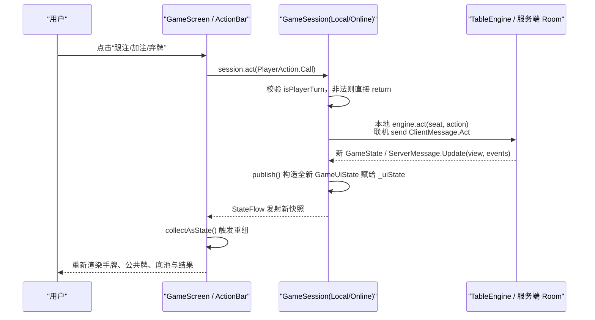
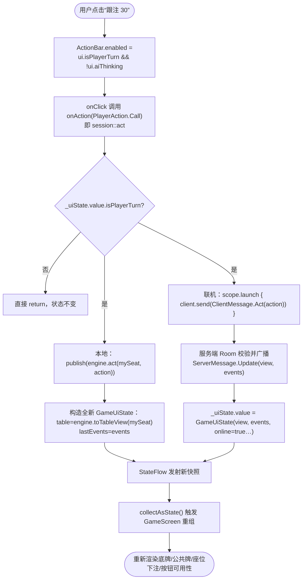
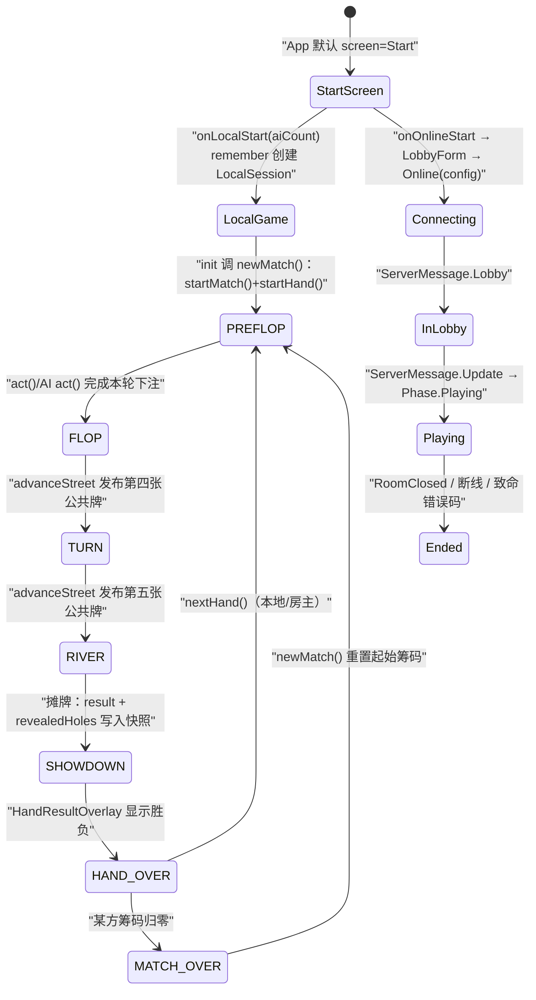

# Compose 单向数据流

<cite>
**本文引用的文件**   
- [MainActivity.kt](file://app/src/main/java/com/aniapp/pokerdemo/MainActivity.kt)
- [GameSession.kt](file://shared/src/commonMain/kotlin/com/aniapp/pokerdemo/session/GameSession.kt)
- [LocalSession.kt](file://shared/src/commonMain/kotlin/com/aniapp/pokerdemo/session/LocalSession.kt)
- [OnlineSession.kt](file://shared/src/commonMain/kotlin/com/aniapp/pokerdemo/session/OnlineSession.kt)
- [Protocol.kt](file://shared/src/commonMain/kotlin/com/aniapp/pokerdemo/net/Protocol.kt)
- [App.kt](file://shared/src/commonMain/kotlin/com/aniapp/pokerdemo/ui/App.kt)
- [GameScreen.kt](file://shared/src/commonMain/kotlin/com/aniapp/pokerdemo/ui/GameScreen.kt)
- [ActionBar.kt](file://shared/src/commonMain/kotlin/com/aniapp/pokerdemo/ui/action/ActionBar.kt)
- [HandResultOverlay.kt](file://shared/src/commonMain/kotlin/com/aniapp/pokerdemo/ui/overlay/HandResultOverlay.kt)
- [CardRow.kt](file://shared/src/commonMain/kotlin/com/aniapp/pokerdemo/ui/card/CardRow.kt)
- [TableEngine.kt](file://shared/src/commonMain/kotlin/com/aniapp/pokerdemo/engine/TableEngine.kt)
- [GameState.kt](file://shared/src/commonMain/kotlin/com/aniapp/pokerdemo/engine/GameState.kt)
- [PlayerAction.kt](file://shared/src/commonMain/kotlin/com/aniapp/pokerdemo/engine/PlayerAction.kt)
- [Room.kt](file://server/src/main/kotlin/com/aniapp/pokerdemo/server/Room.kt)
</cite>

## 目录
1. [引言](#引言)
2. [项目结构](#项目结构)
3. [核心组件](#核心组件)
4. [架构总览](#架构总览)
5. [详细组件分析](#详细组件分析)
6. [状态载体：不可变快照 GameUiState](#状态载体不可变快照-gameuistate)
7. [collectAsState() 如何把状态订阅到 UI](#collectasstate-如何把状态订阅到-ui)
8. [用户点击后的完整数据流](#用户点击后的完整数据流)
9. [AI 思考态的单独下发](#ai-思考态的单独下发)
10. [联机会话的状态与错误通道](#联机会话的状态与错误通道)
11. [会话生命周期：remember + DisposableEffect](#会话生命周期remember--disposableeffect)
12. [从“开始”到“摊牌”的状态流转](#从开始到摊牌的状态流转)
13. [为什么不允许 UI 直接修改牌数据](#为什么不允许-ui-直接修改牌数据)
14. [依赖关系分析](#依赖关系分析)
15. [性能与重组特性](#性能与重组特性)
16. [状态更新最佳实践与常见反模式](#状态更新最佳实践与常见反模式)
17. [排错指南](#排错指南)
18. [结论](#结论)

## 引言
PokerDemo 是一个 KMP（Kotlin Multiplatform）工程，Android 端 `MainActivity` 与桌面端 `Main.kt` 都只调用同一个跨端 Composable `App()`。它的 Compose 单向数据流不再依赖 Android 侧的 `GameViewModel` + `mutableStateOf/mutableStateListOf`，而是由 **session 层**承担状态所有者角色：

- 唯一可变状态源是 `MutableStateFlow<GameUiState>`：本地对局在 `LocalSession._uiState`，联机对局在 `OnlineSession._uiState`；此外 `OnlineSession` 用 `_phase` / `_error` 两个 `MutableStateFlow` 描述连接阶段与提示文案。
- UI 层统一用 `collectAsState()` 读取 `StateFlow`，从不持有牌局数据副本。
- 用户意图只能经 `GameSession` 接口方法下行：`act(action)`、`nextHand()`、`newMatch()`、`dispose()`。
- 本地会话在 `publish(events)` 中**整体替换**快照（构造新的 `GameUiState`），而不是增量修改某个牌列表；只有 AI 思考标志用 `_uiState.update { it.copy(...) }` 做局部字段更新。

本文说明这套机制的实现细节、状态类型选择理由、完整事件流、生命周期绑定方式，以及由此带来的可测试性与可预测性收益。

## 项目结构
与单向数据流相关的分层：

- `ui/App.kt`：屏幕路由与**会话构造点**。用 `remember(session key)` 创建 `LocalSession` / `OnlineSession`，用 `DisposableEffect` 绑定 `dispose()`；联机错误在这里用 `LaunchedEffect(error)` 自动清除。
- `session/GameSession.kt`：定义不可变快照 `GameUiState` 与意图接口 `GameSession`（`uiState: StateFlow<GameUiState>` + 四个命令方法）。
- `session/LocalSession.kt`：本地人机对局的状态所有者。包装 `TableEngine`，实现 `publish()` 快照替换与 AI 协程调度。
- `session/OnlineSession.kt`：联机客户端的状态所有者。把服务端 `ServerMessage.Update` 的视图写入 `_uiState`，把房间流程写入 `_phase`，把非致命错误写入 `_error`。
- `ui/GameScreen.kt`：牌桌 Composable，`session.uiState.collectAsState()` 后纯渲染，并把回调指向 `session::act`、`session::nextHand`、`session::newMatch`。
- `ui/action/ActionBar.kt`、`ui/overlay/HandResultOverlay.kt`：动作按钮与结果浮层，只消费传入的 `GameUiState`。
- `engine/TableEngine.kt`、`engine/GameState.kt`：真正的规则实现，`state` 为 `private set` 的不可变 `GameState`。



图示来源
- [App.kt:56-124](file://shared/src/commonMain/kotlin/com/aniapp/pokerdemo/ui/App.kt#L56-L124)
- [GameSession.kt:11-32](file://shared/src/commonMain/kotlin/com/aniapp/pokerdemo/session/GameSession.kt#L11-L32)
- [LocalSession.kt:25-99](file://shared/src/commonMain/kotlin/com/aniapp/pokerdemo/session/LocalSession.kt#L25-L99)
- [OnlineSession.kt:27-142](file://shared/src/commonMain/kotlin/com/aniapp/pokerdemo/session/OnlineSession.kt#L27-L142)
- [GameScreen.kt:42-144](file://shared/src/commonMain/kotlin/com/aniapp/pokerdemo/ui/GameScreen.kt#L42-L144)

章节来源
- [MainActivity.kt:23-47](file://app/src/main/java/com/aniapp/pokerdemo/MainActivity.kt#L23-L47)
- [App.kt:56-124](file://shared/src/commonMain/kotlin/com/aniapp/pokerdemo/ui/App.kt#L56-L124)

## 核心组件
- `GameUiState`：一个 `data class` 快照，字段包含 `table: TableView`、`aiThinking`、`lastEvents`、`smallBlind`/`bigBlind`、`online`、`isHost`、`roomCode`；派生属性 `isPlayerTurn`、`me`、`seatName(seat)` 供 UI 直接使用。
- `GameSession`：接口只暴露 `val uiState: StateFlow<GameUiState>` 与四个意图方法，UI 拿不到任何可变对象。
- `LocalSession`：`_uiState` 私有，对外 `asStateFlow()`；`init` 中即调用 `newMatch()` 完成首手发牌；`maybeStartAi()` 在协程里驱动 AI 行动。
- `OnlineSession`：除 `uiState` 外还暴露 `phase`、`error` 两条独立流，以及 `clearError()`、`setAiFill()` 两个联机专用方法。
- `TableView`：跨端共享的渲染视图模型（`seats`、`board`、`myHole`、`legal`、`result`、`revealedHoles` 等），既由本地 `TableEngine.toTableView(mySeat)` 生成，也是服务端下发的序列化载荷。

章节来源
- [GameSession.kt:11-48](file://shared/src/commonMain/kotlin/com/aniapp/pokerdemo/session/GameSession.kt#L11-L48)
- [Protocol.kt:50-74](file://shared/src/commonMain/kotlin/com/aniapp/pokerdemo/net/Protocol.kt#L50-L74)
- [LocalSession.kt:25-69](file://shared/src/commonMain/kotlin/com/aniapp/pokerdemo/session/LocalSession.kt#L25-L69)
- [OnlineSession.kt:27-60](file://shared/src/commonMain/kotlin/com/aniapp/pokerdemo/session/OnlineSession.kt#L27-L60)

## 架构总览
一轮交互的数据流向始终是「UI → 意图方法 → 状态所有者 → 新快照 → 重组」：



图示来源
- [GameScreen.kt:138-140](file://shared/src/commonMain/kotlin/com/aniapp/pokerdemo/ui/GameScreen.kt#L138-L140)
- [ActionBar.kt:60-115](file://shared/src/commonMain/kotlin/com/aniapp/pokerdemo/ui/action/ActionBar.kt#L60-L115)
- [LocalSession.kt:53-75](file://shared/src/commonMain/kotlin/com/aniapp/pokerdemo/session/LocalSession.kt#L53-L75)
- [OnlineSession.kt:88-133](file://shared/src/commonMain/kotlin/com/aniapp/pokerdemo/session/OnlineSession.kt#L88-L133)
- [TableEngine.kt:102-120](file://shared/src/commonMain/kotlin/com/aniapp/pokerdemo/engine/TableEngine.kt#L102-L120)

## 详细组件分析
本页其余小节分别展开：状态载体的设计、`collectAsState()` 的订阅语义、点击后的完整链路、AI 思考态下发、联机 phase/error 通道、会话生命周期绑定、状态流转图、约束理由与最佳实践。

## 状态载体：不可变快照 GameUiState
早期示例把牌面拆成 `mutableStateListOf<Card>`（`playerHand`、`computerHand`、`communityCards`）加若干标量（`result`、`showComputerCards`）直接暴露给 UI。当前实现改为**单一不可变快照**：所有渲染所需数据都在 `GameUiState` 内，牌面集合以 `TableView.myHole`、`TableView.board`、`TableView.revealedHoles`、`TableView.seats` 这些普通 `List`/`Map` 字段存在，由外层 `StateFlow` 负责可观察性。

字段与设计原因：

| 字段 | 类型 | 设计原因 |
|---|---|---|
| `table` | `TableView` | 牌桌全部可见信息：座位、公共牌、我的底牌、合法动作、结果、已翻开的底牌。整体替换即可一次性刷新所有牌面区域。 |
| `aiThinking` | `Boolean` | 纯 UI 提示标志，与引擎无关，因此可在 AI 等待期间单独 `update{}`，不触碰 `table`。 |
| `lastEvents` | `List<GameEvent>` | 本次状态变化对应的引擎事件序列，供调试与动画判断，不参与布局计算。 |
| `smallBlind` / `bigBlind` | `Int` | 头部文案与加注档位刻度需要的标量配置。 |
| `online` / `isHost` / `roomCode` | `Boolean`/`Boolean`/`String?` | 决定房主专属按钮（“下一手”“再来一局”）是否显示，以及头部是否展示房间号。 |
| `isPlayerTurn`（派生） | `computed` | `table.acting == table.mySeat && table.phase.isBetting()`，让 UI 不必自己拼装轮次条件。 |

为什么这样划分而不是继续用多个独立 observable：
- **一致性**：一手牌的牌面、下注、轮次必须同时生效。若 `board` 与 `legal` 分属两个状态，中间态可能出现“公共牌已翻出但按钮仍是上一街动作”。整体替换快照消除了这类撕裂帧。
- **可序列化**：同一份 `TableView` 既能被本地 `toTableView(mySeat)` 生成，也能作为服务端 `ServerMessage.Update` 的 JSON 载荷，本地/联机共用一套 UI。
- **标量仍保留**：`aiThinking`、`notice`（来自 `OnlineSession.error`）本质是独立于牌局的开关/文案，所以它们走各自的字段或各自的流，不需要和牌面一起发布。

章节来源
- [GameSession.kt:11-26](file://shared/src/commonMain/kotlin/com/aniapp/pokerdemo/session/GameSession.kt#L11-L26)
- [Protocol.kt:50-74](file://shared/src/commonMain/kotlin/com/aniapp/pokerdemo/net/Protocol.kt#L50-L74)
- [LocalSession.kt:117-165](file://shared/src/commonMain/kotlin/com/aniapp/pokerdemo/session/LocalSession.kt#L117-L165)
- [TableEngine.kt:13-31](file://shared/src/commonMain/kotlin/com/aniapp/pokerdemo/engine/TableEngine.kt#L13-L31)

## collectAsState() 如何把状态订阅到 UI
`GameScreen` 的第一行状态读取就是订阅点：

- `val ui by session.uiState.collectAsState()`，随后所有分支都从 `ui` 取值：`ui.table`、`ui.me`、`ui.isPlayerTurn`、`ui.aiThinking`、`ui.smallBlind/bigBlind`、`ui.roomCode`。
- `App` 中联机分支额外订阅两条流：`val phase by session.phase.collectAsState()`、`val error by session.error.collectAsState()`，用 `when (phase)` 决定渲染“连接中/大厅/牌桌/结束”。

订阅语义要点：
1. `collectAsState()` 在组合中注册收集器，`StateFlow` 会立即提供当前值，因此首次组合就能拿到完整快照，不会白屏一帧。
2. `StateFlow` 基于相等性去重：只有新值与旧值 `equals` 不同才发射。由于每次都是新建的 `GameUiState`，只要任一字段变化就会触发重组；反之重复 `publish` 相同内容不会产生多余帧。
3. 读取粒度决定重组范围：`ui` 是单个对象，因此 `BoxWithConstraints` 内的牌桌布局块整体参与重组；而 `animateIntAsState(table.pot, tween(400))`、`HandRow(... handNumber = table.handNumber)` 之类把具体数值下传给子组件，使动画与发牌计数只在相关节点变化。
4. 会话对象本身不是 `@Stable` 状态，它通过 `remember` 保持引用不变，避免每次重组重建收集器。

章节来源
- [GameScreen.kt:42-52](file://shared/src/commonMain/kotlin/com/aniapp/pokerdemo/ui/GameScreen.kt#L42-L52)
- [GameScreen.kt:90-138](file://shared/src/commonMain/kotlin/com/aniapp/pokerdemo/ui/GameScreen.kt#L90-L138)
- [App.kt:96-124](file://shared/src/commonMain/kotlin/com/aniapp/pokerdemo/ui/App.kt#L96-L124)
- [LocalSession.kt:33-41](file://shared/src/commonMain/kotlin/com/aniapp/pokerdemo/session/LocalSession.kt#L33-L41)

## 用户点击后的完整数据流
以“轮到玩家、点击跟注”为例：



图示来源
- [ActionBar.kt:45-115](file://shared/src/commonMain/kotlin/com/aniapp/pokerdemo/ui/action/ActionBar.kt#L45-L115)
- [LocalSession.kt:53-75](file://shared/src/commonMain/kotlin/com/aniapp/pokerdemo/session/LocalSession.kt#L53-L75)
- [OnlineSession.kt:88-107](file://shared/src/commonMain/kotlin/com/aniapp/pokerdemo/session/OnlineSession.kt#L88-L107)
- [Room.kt:120-131](file://server/src/main/kotlin/com/aniapp/pokerdemo/server/Room.kt#L120-L131)

链路上的三重防护值得注意：
- **UI 侧**：按钮的 `enabled` 由 `ui.isPlayerTurn && !ui.aiThinking` 与 `ui.legal` 共同决定，非法动作根本点不动。
- **Session 侧**：`act()` 首行 `if (!_uiState.value.isPlayerTurn) return`，忽略竞态下的多余点击。
- **Engine/服务端侧**：`TableEngine.act()` 用 `check(state.phase.isBetting())`、`check(state.acting == seat)` 与 `legalActions` 再次校验；联机路径由服务端捕获 `IllegalStateException` 后回 `sendError(seat, "illegal_action", …)`。

其他意图方法的链路同构：
- “下一手”→ `session.nextHand()` → 本地 `publish(engine.startHand())`；联机 `send(ClientMessage.StartHand)` → 服务端 `broadcastUpdate(events)`。
- “再来一局”→ `session.newMatch()` → 本地重置筹码并发首手；联机退化为 `nextHand()`。
- 加注面板确认 → `onAction(PlayerAction.RaiseTo(raiseTo))`，滑杆值 `raiseTo` 属于 `ActionBar` 内部的编辑态（`remember { mutableIntStateOf(0) }`），不入全局快照。

章节来源
- [ActionBar.kt:45-115](file://shared/src/commonMain/kotlin/com/aniapp/pokerdemo/ui/action/ActionBar.kt#L45-L115)
- [LocalSession.kt:53-69](file://shared/src/commonMain/kotlin/com/aniapp/pokerdemo/session/LocalSession.kt#L53-L69)
- [TableEngine.kt:102-120](file://shared/src/commonMain/kotlin/com/aniapp/pokerdemo/engine/TableEngine.kt#L102-L120)
- [Room.kt:108-131](file://server/src/main/kotlin/com/aniapp/pokerdemo/server/Room.kt#L108-L131)

## AI 思考态的单独下发
本地会话中 AI 不是同步计算的：`publish()` 之后会调用 `maybeStartAi()`，在没有轮到人类且仍处于下注阶段时启动一个常驻协程 `aiJob`：

- 循环内先 `_uiState.update { it.copy(aiThinking = true) }`，再 `delay(aiRandom.nextLong(700, 1401))` 模拟思考时间，然后取 `engine.legalActions(s)`、`ai.decide(...)` 得到动作，最后 `publish(engine.act(s, action))` 发布新快照。
- 循环退出（轮到人类、进入结算或阶段结束）时 `_uiState.update { it.copy(aiThinking = false) }`。

这里刻意使用 `update { copy(...) }` 而不是 `publish()`：`aiThinking` 不影响引擎状态，若走 `publish()` 会把 `lastEvents` 覆盖成空列表并重新抓取视图，既无必要也会干扰依赖事件的逻辑。`update {}` 保证该字段更新是原子的 CAS 循环，即使与协程外的 `act()` 竞争也不会丢写。

UI 对该标志有两处消费：
- `GameScreen` 的“思考中”文案：`ui.aiThinking` 优先显示“电脑思考中…”，否则当轮到他人且处于下注阶段显示“<座位名> 思考中…”。
- `ActionBar` 的 `enabled = ui.isPlayerTurn && !ui.aiThinking`，避免 AI 等待期间出现可点击但会被丢弃的按钮。

联机场景同理，只是延迟来源在服务端 `Room` 的 AI 协程，客户端只能通过 `Update` 里的 `acting != mySeat` 推断“他人思考中”。

章节来源
- [LocalSession.kt:71-99](file://shared/src/commonMain/kotlin/com/aniapp/pokerdemo/session/LocalSession.kt#L71-L99)
- [GameScreen.kt:124-138](file://shared/src/commonMain/kotlin/com/aniapp/pokerdemo/ui/GameScreen.kt#L124-L138)
- [ActionBar.kt:45-56](file://shared/src/commonMain/kotlin/com/aniapp/pokerdemo/ui/action/ActionBar.kt#L45-L56)
- [Room.kt:200-215](file://server/src/main/kotlin/com/aniapp/pokerdemo/server/Room.kt#L200-L215)

## 联机会话的状态与错误通道
`OnlineSession` 有三条独立的 `MutableStateFlow`，各自职责清晰：

| 流 | 类型 | 写入点 | UI 消费点 |
|---|---|---|---|
| `_uiState` | `GameUiState`（`online = true`） | `handle(ServerMessage.Update)` 整体替换 | `GameScreen` 牌桌渲染 |
| `_phase` | `Phase`（Connecting / InLobby / Playing / Ended） | 连接失败、收到 `Lobby`/`Update`/`RoomClosed`、断线检测 | `App` 的 `when (phase)` 屏幕切换 |
| `_error` | `String?` | 收到 `ServerMessage.Error` 且 code 不属于致命集合 | `LobbyView(error=…)`、`GameScreen(notice=error)` |

- 致命错误码 `join_failed`、`not_found`、`bad_seat_count` 会直接进入 `Phase.Ended(message)`，因为此时留在原界面没有意义；其余错误（如 `illegal_action`）只作为提示写入 `_error`。
- 提示的自动消失放在 UI 层而非 session 层：`App` 中 `LaunchedEffect(error) { if (error != null) { delay(3000); session.clearError() } }`。`error` 变化会重启该 effect，3 秒后调用 `clearError()` 把 `_error` 置回 `null`，从而让 notice 文本淡出。
- 初始 `_uiState` 用 `emptyTableView()`（空座位、`Phase.IDLE`、空 `LegalActions`）占位，保证收到第一帧 `Update` 之前 `GameScreen` 读取 `seats`/`legal` 也不会越界。
- 上行消息一律 `scope.launch { runCatching { client.send(...) } }`，发送失败不会污染状态流。

章节来源
- [OnlineSession.kt:44-107](file://shared/src/commonMain/kotlin/com/aniapp/pokerdemo/session/OnlineSession.kt#L44-L107)
- [OnlineSession.kt:112-142](file://shared/src/commonMain/kotlin/com/aniapp/pokerdemo/session/OnlineSession.kt#L112-L142)
- [App.kt:96-124](file://shared/src/commonMain/kotlin/com/aniapp/pokerdemo/ui/App.kt#L96-L124)
- [GameSession.kt:34-48](file://shared/src/commonMain/kotlin/com/aniapp/pokerdemo/session/GameSession.kt#L34-L48)

## 会话生命周期：remember + DisposableEffect
`App` 是唯一的会话构造点，两个关键约束防止状态漂移与协程泄漏：

- `val session = remember(s.aiCount) { LocalSession(scope = scope, aiCount = s.aiCount, engine = …) }`：以屏幕参数为 key，同一 AI 人数下反复重组复用同一实例；改变人数才会重建并重开比赛。联机分支对应 `remember(s.config) { OnlineSession(scope, s.config) }`。
- `DisposableEffect(session) { onDispose { session.dispose() } }`：离开牌桌（返回开始页、切换到大厅/联机）时主动取消 `aiJob`（本地）或关闭客户端连接（联机）。若不这样做，AI 协程会在后台继续 `delay` + `publish`，既浪费资源也可能在会话已被抛弃后仍尝试更新状态。

`scope` 来自 `rememberCoroutineScope()`，与组合生命周期挂钩；`LocalSession.newMatch()` 也会先 `aiJob?.cancel()` 再启新任务，因此“再来一局”不会残留上一局的思考协程。

平台入口保持极薄：`MainActivity` 只做 `setContent { PokerDemoTheme { App(...) } }`，并把 debug 用的 `scenario`/`chips` Intent 参数转成 `scenarioDeck`/`scenarioChips` 注入 `LocalSession.defaultEngine(...)`；桌面端 `Main.kt` 直接 `App()`。二者都不持有 ViewModel，也不接触牌数据。

章节来源
- [App.kt:56-96](file://shared/src/commonMain/kotlin/com/aniapp/pokerdemo/ui/App.kt#L56-L96)
- [LocalSession.kt:43-69](file://shared/src/commonMain/kotlin/com/aniapp/pokerdemo/session/LocalSession.kt#L43-L69)
- [OnlineSession.kt:135-142](file://shared/src/commonMain/kotlin/com/aniapp/pokerdemo/session/OnlineSession.kt#L135-L142)
- [MainActivity.kt:23-70](file://app/src/main/java/com/aniapp/pokerdemo/MainActivity.kt#L23-L70)

## 从“开始”到“摊牌”的状态流转


图示来源
- [LocalSession.kt:43-69](file://shared/src/commonMain/kotlin/com/aniapp/pokerdemo/session/LocalSession.kt#L43-L69)
- [TableEngine.kt:33-86](file://shared/src/commonMain/kotlin/com/aniapp/pokerdemo/engine/TableEngine.kt#L33-L86)
- [GameState.kt:7-12](file://shared/src/commonMain/kotlin/com/aniapp/pokerdemo/engine/GameState.kt#L7-L12)
- [HandResultOverlay.kt:36-143](file://shared/src/commonMain/kotlin/com/aniapp/pokerdemo/ui/overlay/HandResultOverlay.kt#L36-L143)
- [OnlineSession.kt:62-107](file://shared/src/commonMain/kotlin/com/aniapp/pokerdemo/session/OnlineSession.kt#L62-L107)

关键状态与 UI 表现对应：
- `Phase.PREFLOP…RIVER`（`isBetting()` 为真）：`ActionBar` 根据 `table.legal` 决定“过牌/跟注/加注/弃牌”可用性；`BoardRow` 随 `table.board` 增长逐张翻开。
- `Phase.HAND_OVER` + `result.reason == SHOWDOWN`：`revealedHoles` 非空，对手底牌正面朝上；浮层列出各池分配与双方牌型。
- `Phase.MATCH_OVER`：浮层换成整场比赛结论，房主/本地看到“再来一局”，非房主看到“等待房主开始新对局…”。

## 为什么不允许 UI 直接修改牌数据
在当前结构中，UI 想做也做不到：

- `GameUiState` 与其内部的 `TableView`、`SeatInfo` 全是 `val` 字段的数据类，牌列表是普通 `List<Card>`，没有 `add`/`clear` 可用。
- `_uiState` 是 `private`，对外只给 `asStateFlow()`；`TableEngine.state` 也是 `private set`。
- 唯一下行入口是 `GameSession` 的四个方法，且每个方法内部再做轮次/阶段校验。

这种约束的收益：

| 收益 | 说明 |
|---|---|
| 可测试性 | `LocalSessionTest`、`HeadsUpTableEngineTest`、`MultiPlayerTableEngineTest` 可直接构造会话/引擎（甚至注入固定牌堆 `newDeck` 与起始筹码 `chips`），断言 `uiState.value` 而不需要 Compose 环境；`RenderSmokeTest`、`TableLayoutRenderTest` 则只验证渲染。服务端行为由 `E2EClient` + `RoomFlowTest`、`AiFillOptionTest` 覆盖。 |
| 可预测性 | 任意时刻的界面都能由一份快照解释；不存在“UI 改了副本、session 又覆盖回去”的双写冲突。 |
| 单一事实源 | 同一副牌的规则判定只发生在 `TableEngine`（本地）或服务端 `Room`（联机），UI 只翻译视图。 |
| 跨端一致 | Android 与桌面共用 `App()`/`GameScreen()`，因为它们依赖的是 KMP 可用的 `StateFlow`，而非 Android `ViewModel`。 |
| 生命周期可控 | 会话创建与释放集中在 `App` 的两个 `remember`/`DisposableEffect`，切换屏幕不会残留 AI 协程或 socket。 |

章节来源
- [GameSession.kt:11-32](file://shared/src/commonMain/kotlin/com/aniapp/pokerdemo/session/GameSession.kt#L11-L32)
- [LocalSession.kt:25-41](file://shared/src/commonMain/kotlin/com/aniapp/pokerdemo/session/LocalSession.kt#L25-L41)
- [TableEngine.kt:25-31](file://shared/src/commonMain/kotlin/com/aniapp/pokerdemo/engine/TableEngine.kt#L25-L31)
- [App.kt:75-96](file://shared/src/commonMain/kotlin/com/aniapp/pokerdemo/ui/App.kt#L75-L96)

## 依赖关系分析
```mermaid
classDiagram
    class GameSession {
        <<interface>>
        +uiState : StateFlow~GameUiState~
        +act(action : PlayerAction)
        +nextHand()
        +newMatch()
        +dispose()
    }
    class GameUiState {
        +table : TableView
        +aiThinking : Boolean
        +lastEvents : List~GameEvent~
        +smallBlind : Int
        +bigBlind : Int
        +online : Boolean
        +isHost : Boolean
        +roomCode : String
        +isPlayerTurn : Boolean
        +seatName(seat) String
    }
    class LocalSession {
        -_uiState : MutableStateFlow~GameUiState~
        -aiJob : Job
        -publish(events)
        -maybeStartAi()
    }
    class OnlineSession {
        -_uiState : MutableStateFlow~GameUiState~
        -_phase : MutableStateFlow~Phase~
        -_error : MutableStateFlow~String~
        +phase : StateFlow~Phase~
        +error : StateFlow~String~
        +clearError()
        +setAiFill(enabled)
    }
    class TableEngine {
        +config : GameConfig
        +state : GameState
        +startMatch()
        +startHand()
        +legalActions(seat)
        +act(seat, action)
    }
    class GameScreen {
        +GameScreen(session, notice)
    }
    class ActionBar {
        +ActionBar(ui, onAction)
    }
    class HandResultOverlay {
        +HandResultOverlay(ui, onNextHand, onNewMatch)
    }
    class App {
        +App(...)
    }

    GameSession <|.. LocalSession
    GameSession <|.. OnlineSession
    LocalSession --> TableEngine : "调用并读回 state"
    LocalSession --> GameUiState : "publish 整体替换"
    OnlineSession --> GameUiState : "Update 消息替换"
    App --> LocalSession : "remember(aiCount)"
    App --> OnlineSession : "remember(config)"
    App --> GameScreen
    GameScreen --> GameUiState : "collectAsState()"
    GameScreen --> ActionBar : "ui + session::act"
    GameScreen --> HandResultOverlay : "ui + nextHand/newMatch"
```

图示来源
- [GameSession.kt:28-32](file://shared/src/commonMain/kotlin/com/aniapp/pokerdemo/session/GameSession.kt#L28-L32)
- [LocalSession.kt:25-99](file://shared/src/commonMain/kotlin/com/aniapp/pokerdemo/session/LocalSession.kt#L25-L99)
- [OnlineSession.kt:27-60](file://shared/src/commonMain/kotlin/com/aniapp/pokerdemo/session/OnlineSession.kt#L27-L60)
- [App.kt:75-124](file://shared/src/commonMain/kotlin/com/aniapp/pokerdemo/ui/App.kt#L75-L124)
- [GameScreen.kt:42-140](file://shared/src/commonMain/kotlin/com/aniapp/pokerdemo/ui/GameScreen.kt#L42-L140)

耦合特征：
- UI → Session 是抽象依赖（`GameSession` 接口），`GameScreen` 不知道自己是本地还是联机；差异通过 `ui.online`、`ui.isHost`、`notice` 参数表达。
- Session → Engine 是单向使用，引擎不反向依赖 Flow 或 Compose。
- 联机路径中 `OnlineSession` 与 `LocalSession` 产出同型快照，因此新增屏幕无需区分数据来源。

## 性能与重组特性
- **一次变更一次发射**：`publish()` 每轮引擎动作只写一次 `_uiState`，避免了多字段分别赋值造成的多次重组。
- **相等性去重**：`StateFlow` 不发射重复值；`aiThinking` 用 `update{}` 精确改一个字段，牌面未变时 `table` 引用内容不变。
- **重组范围控制**：牌桌几何在 `BoxWithConstraints` 内计算一次 `cardSize`；座位、公共牌、底部玩家区、按钮区分别下沉为 `SeatView`/`BoardRow`/`HandRow`/`ActionBar`，只接收所需的 `List<Card>`、`SeatInfo`、`Int` 等小参数。
- **动画与状态解耦**：底池数字用 `animateIntAsState(table.pot, tween(400))`，发牌逐张显现由 `remember(handNumber) { mutableIntStateOf(0) }` + `LaunchedEffect(handNumber, cards.size)` 驱动，属于 UI 本地过渡态，不回写快照。
- **昂贵计算不在重组函数里**：牌型评估、合法动作推导都在 `TableEngine`/服务端完成，`GameScreen` 只做布局与文本拼接。

章节来源
- [LocalSession.kt:71-99](file://shared/src/commonMain/kotlin/com/aniapp/pokerdemo/session/LocalSession.kt#L71-L99)
- [GameScreen.kt:47-120](file://shared/src/commonMain/kotlin/com/aniapp/pokerdemo/ui/GameScreen.kt#L47-L120)
- [CardRow.kt:28-70](file://shared/src/commonMain/kotlin/com/aniapp/pokerdemo/ui/card/CardRow.kt#L28-L70)

## 状态更新最佳实践与常见反模式
本项目实际遵循的做法：
1. **快照整体替换**：牌局推进一律 `publish(events)` 构造新 `GameUiState`；不要试图“就地改列表”。
2. **单字段用 `update { copy(...) }`**：像 `aiThinking` 这类与引擎无关的标志，用原子更新，避免读-改-写竞态。
3. **意图方法自带守卫**：`act()` 检查 `isPlayerTurn`、`nextHand()` 检查 `phase == HAND_OVER`，让 UI 的重复点击变成无害操作。
4. **UI 瞬态用 `remember`**：`showRaise`、`raiseTo`、逐张发牌计数都属于界面状态，不进快照；`LaunchedEffect(ui.isPlayerTurn, ui.table.phase, ui.table.currentBet, ui.table.handNumber)` 在轮次/街变化时收起加注面板。
5. **副作用与生命周期绑定**：`remember(key)` 建会话、`DisposableEffect(session) { onDispose { session.dispose() } }` 释放；提示自动清除用 `LaunchedEffect(error)`。
6. **不要在重组函数中做 IO**：网络发送包在 `scope.launch { runCatching { … } }` 内。

应当避免的反模式：
- 在 Composable 中复制一份 `table.board`/`myHole` 的可变列表并自行增删——会与下一次快照冲突，产生闪烁或错误牌面。
- 绕过 `GameSession` 直接持有 `TableEngine` 并调用 `engine.act(...)`——跳过 `publish()`，UI 收不到新状态。
- 在 `App` 之外（例如 Activity/Window 层）另建会话实例——破坏 `remember` 的复用契约，导致重复发牌或双份 AI 协程。
- 用普通变量保存牌数据而不经过 `StateFlow`——界面不会重组。
- 把 `delay`/洗牌等耗时逻辑放进重组体——应留在 session 协程或引擎中。

章节来源
- [LocalSession.kt:53-99](file://shared/src/commonMain/kotlin/com/aniapp/pokerdemo/session/LocalSession.kt#L53-L99)
- [ActionBar.kt:45-56](file://shared/src/commonMain/kotlin/com/aniapp/pokerdemo/ui/action/ActionBar.kt#L45-L56)
- [App.kt:75-100](file://shared/src/commonMain/kotlin/com/aniapp/pokerdemo/ui/App.kt#L75-L100)
- [OnlineSession.kt:112-142](file://shared/src/commonMain/kotlin/com/aniapp/pokerdemo/session/OnlineSession.kt#L112-L142)

## 排错指南
| 现象 | 可能原因 | 排查方法 |
|---|---|---|
| 点击按钮无反应 | `ui.isPlayerTurn` 为假，`act()` 直接 return | 打印 `uiState.value.table.acting` 与 `phase`，确认确实轮到本座位且处于下注阶段。 |
| 按钮一直禁用 | `aiThinking` 卡在 true | 检查 AI 协程是否因异常提前退出而未执行末尾的 `update { copy(aiThinking = false) }`。 |
| 界面停留在旧牌面 | 状态被写入但未被订阅 | 确认渲染走的是 `session.uiState.collectAsState()`，而不是缓存的旧 `ui` 局部变量。 |
| 换 AI 人数后牌局延续 | `remember` key 不含 `aiCount` | 本地分支应以 `s.aiCount` 为 key 重建 `LocalSession`。 |
| 返回开始页后仍有“电脑思考中” | 未释放会话协程 | 确认 `DisposableEffect(session)` 的 `onDispose` 调用了 `session.dispose()`。 |
| 联机错误提示不消失 | 忘记 `clearError()` | 检查 `LaunchedEffect(error)` 是否在 `delay(3000)` 后调用 `session.clearError()`。 |
| 联机卡在“连接中…” | 握手或建房消息异常 | 查看 `Phase` 是否被 `无法连接服务器` 置为 `Ended`，或 `Joined`/`Lobby` 未按顺序到达。 |
| 非房主看不到“下一手” | 预期行为 | `HandResultOverlay` 在 `ui.online && !ui.isHost` 时只显示等待文案，由房主 `StartHand` 驱动。 |

章节来源
- [LocalSession.kt:53-99](file://shared/src/commonMain/kotlin/com/aniapp/pokerdemo/session/LocalSession.kt#L53-L99)
- [App.kt:75-124](file://shared/src/commonMain/kotlin/com/aniapp/pokerdemo/ui/App.kt#L75-L124)
- [OnlineSession.kt:62-115](file://shared/src/commonMain/kotlin/com/aniapp/pokerdemo/session/OnlineSession.kt#L62-L115)
- [HandResultOverlay.kt:120-143](file://shared/src/commonMain/kotlin/com/aniapp/pokerdemo/ui/overlay/HandResultOverlay.kt#L120-L143)

## 结论
PokerDemo 的 Compose 单向数据流已从“Android ViewModel + 多个 `mutableStateOf/mutableStateListOf`”演进为“跨端 session + 单一 `MutableStateFlow<GameUiState>`”：

- 状态所有者是 `LocalSession` / `OnlineSession`，可变流私有、对外只给 `StateFlow`；牌面数据是不可变快照中的普通集合。
- UI 只用 `collectAsState()` 读取，意图只经 `act/nextHand/newMatch/dispose` 下行，形成严格闭环。
- 快照整体替换保证一帧内牌面、下注、轮次一致；`aiThinking` 之类的独立标志用 `update { copy(...) }` 精准下发；联机的 `phase`/`error` 各走各的流，notice 由 `LaunchedEffect(error) + delay(3000)` 自动清除。
- 会话在 `App` 中以 `remember(key)` 构造、以 `DisposableEffect(onDispose { session.dispose() })` 释放，切换屏幕不会泄漏 AI 协程或连接。

这套结构让规则实现（引擎/服务端）、状态容器（session）与呈现（Composable）彻底分离，因而可以脱离 UI 做单元与端到端测试，也让本地与联机两种模式共用同一份渲染代码。