# 多人在线对战架构

<cite>
**本文引用的文件**
- [Protocol.kt](file://shared/src/commonMain/kotlin/com/aniapp/pokerdemo/net/Protocol.kt)
- [GameClient.kt](file://shared/src/commonMain/kotlin/com/aniapp/pokerdemo/net/GameClient.kt)
- [ServerAddress.kt](file://shared/src/commonMain/kotlin/com/aniapp/pokerdemo/net/ServerAddress.kt)
- [PublicAddress.kt](file://shared/src/commonMain/kotlin/com/aniapp/pokerdemo/net/PublicAddress.kt)
- [OnlineSession.kt](file://shared/src/commonMain/kotlin/com/aniapp/pokerdemo/session/OnlineSession.kt)
- [GameSession.kt](file://shared/src/commonMain/kotlin/com/aniapp/pokerdemo/session/GameSession.kt)
- [LocalSession.kt](file://shared/src/commonMain/kotlin/com/aniapp/pokerdemo/session/LocalSession.kt)
- [Application.kt](file://server/src/main/kotlin/com/aniapp/pokerdemo/server/Application.kt)
- [Room.kt](file://server/src/main/kotlin/com/aniapp/pokerdemo/server/Room.kt)
- [TableEngine.kt](file://shared/src/commonMain/kotlin/com/aniapp/pokerdemo/engine/TableEngine.kt)
- [GameState.kt](file://shared/src/commonMain/kotlin/com/aniapp/pokerdemo/engine/GameState.kt)
- [PlayerAction.kt](file://shared/src/commonMain/kotlin/com/aniapp/pokerdemo/engine/PlayerAction.kt)
- [GameEvent.kt](file://shared/src/commonMain/kotlin/com/aniapp/pokerdemo/engine/GameEvent.kt)
- [App.kt](file://shared/src/commonMain/kotlin/com/aniapp/pokerdemo/ui/App.kt)
- [LobbyScreen.kt](file://shared/src/commonMain/kotlin/com/aniapp/pokerdemo/ui/lobby/LobbyScreen.kt)
- [build.gradle.kts](file://server/build.gradle.kts)
- [build.gradle.kts](file://shared/build.gradle.kts)
- [logback.xml](file://server/src/main/resources/logback.xml)
- [RoomFlowTest.kt](file://server/src/test/kotlin/com/aniapp/pokerdemo/server/RoomFlowTest.kt)
- [AiFillOptionTest.kt](file://server/src/test/kotlin/com/aniapp/pokerdemo/server/AiFillOptionTest.kt)
- [Sys.kt](file://admin/src/main/kotlin/com/aniapp/pokerdemo/admin/Sys.kt)
- [poker-daemon.sh](file://scripts/poker-daemon.sh)
- [DEPLOY.md](file://DEPLOY.md)
</cite>

## 目录
1. [引言](#引言)
2. [项目结构](#项目结构)
3. [核心组件](#核心组件)
4. [架构总览](#架构总览)
5. [详细组件分析](#详细组件分析)
   - [协议层：Protocol.kt](#协议层protocolkt)
   - [视图投影与防作弊信息裁剪](#视图投影与防作弊信息裁剪)
   - [客户端传输层：GameClient.kt](#客户端传输层gameclientkt)
   - [客户端会话层：OnlineSession.kt](#客户端会话层onlinesessionkt)
   - [服务端接入层：Application.kt](#服务端接入层applicationkt)
   - [服务端权威层：Room 与 RoomManager](#服务端权威层room-与-roommanager)
   - [AI 托管与乐观并发提交](#ai-托管与乐观并发提交)
   - [断线与房间生命周期](#断线与房间生命周期)
6. [依赖分析](#依赖分析)
7. [性能考量](#性能考量)
8. [故障排查指南](#故障排查指南)
9. [结论](#结论)
10. [附录：配置项与端点速查](#附录配置项与端点速查)

## 引言

本页面是「联机总览」，描述**已经落地的**多人在线对战实现，而不是改进提案。系统采用经典的**权威服务器（Authoritative Server）**模型：

- 所有牌桌状态的唯一真源是服务端 `Room` 内的 `TableEngine`；客户端只是状态的**渲染器**。
- 客户端**不做乐观更新**：玩家点击「跟注」后不会立刻改变本地筹码显示，而是等待服务端广播的 `update` 消息回填界面。
- 所有状态变更都在服务端 `Room` 的单个 `Mutex` 内**串行发生**，从而避免了「多个玩家同时行动」导致的竞态。
- 通信协议是 WebSocket 上的一层 JSON 文本帧，由 `kotlinx.serialization` 在 Android、桌面与服务端之间共享同一份类型定义（`shared/net/Protocol.kt`），协议只有一份、不可能漂移。

对战规模支持 2–6 个房间座位，人不够时可用 AI 补位（`ai_fill`）；玩家中途掉线时其座位会被服务端**就地转交给 AI 接管**，保证其他玩家的对局不中断。

> 术语约定：本文中的「座位」若不加限定，指**房间座位**（0..seatCount-1，可能稀疏）；「引擎座位」指 `TableEngine` 内部连续编号的玩家下标。两者的映射由 `Room.seatMap` 维护。

## 项目结构

联机能力横跨 4 个 Gradle 模块。`shared` 是 Kotlin Multiplatform 库（Android + Desktop 双目标），同时被服务端以 JVM 目标复用，因此协议与规则引擎天然双向共享：

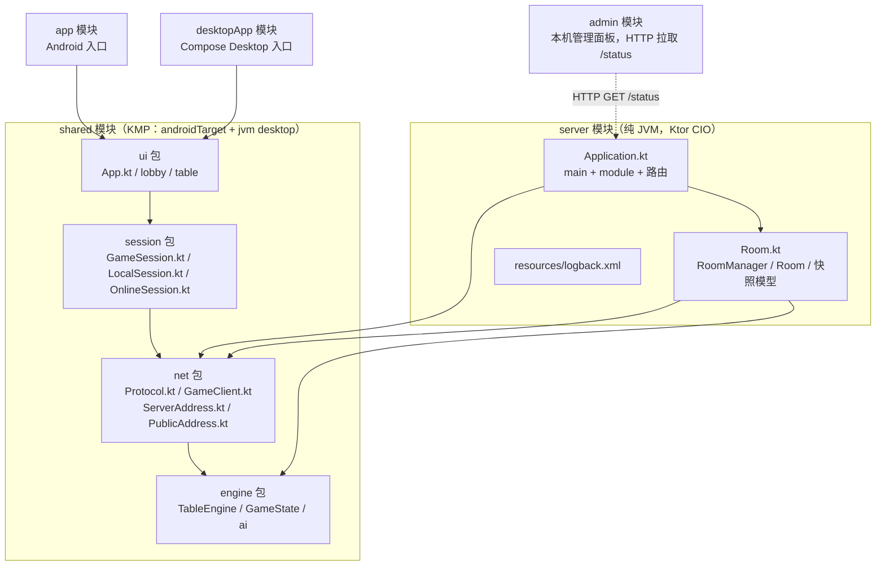

**图示来源**
- [shared/build.gradle.kts:9-49](file://shared/build.gradle.kts#L9-L49)
- [server/build.gradle.kts:8-17](file://server/build.gradle.kts#L8-L17)
- [Application.kt:1-36](file://server/src/main/kotlin/com/aniapp/pokerdemo/server/Application.kt#L1-L36)

联机相关的目录布局：

| 路径 | 角色 | 关键内容 |
| --- | --- | --- |
| `shared/src/commonMain/kotlin/com/aniapp/pokerdemo/net/` | 协议与传输 | 消息定义、WebSocket 客户端、地址解析 |
| `shared/src/commonMain/kotlin/com/aniapp/pokerdemo/session/` | 会话抽象 | 本地会话与在线会话的统一接口 `GameSession` |
| `shared/src/commonMain/kotlin/com/aniapp/pokerdemo/engine/` | 规则引擎 | 唯一的状态机实现，被服务端与离线模式共用 |
| `server/src/main/kotlin/com/aniapp/pokerdemo/server/` | 权威进程 | Ktor 服务、房间管理、广播与 AI 托管 |
| `shared/src/commonMain/kotlin/com/aniapp/pokerdemo/ui/` | 表现层 | 大厅表单、联机状态机驱动的界面切换 |
| `server/src/test/kotlin/com/aniapp/pokerdemo/server/` | 端到端验证 | 基于 `testApplication` 的真实 WebSocket 全流程测试 |

**本节来源**
- [Protocol.kt:1-18](file://shared/src/commonMain/kotlin/com/aniapp/pokerdemo/net/Protocol.kt#L1-L18)
- [GameClient.kt:1-19](file://shared/src/commonMain/kotlin/com/aniapp/pokerdemo/net/GameClient.kt#L1-L19)
- [Application.kt:1-36](file://server/src/main/kotlin/com/aniapp/pokerdemo/server/Application.kt#L1-L36)
- [Room.kt:1-36](file://server/src/main/kotlin/com/aniapp/pokerdemo/server/Room.kt#L1-L36)

## 核心组件

| 组件 | 所在文件 | 职责 | 关键约束 |
| --- | --- | --- | --- |
| `PokerJson` | [Protocol.kt:14-18](file://shared/src/commonMain/kotlin/com/aniapp/pokerdemo/net/Protocol.kt#L14-L18) | 全局唯一的 `Json` 实例 | `classDiscriminator="type"`、`ignoreUnknownKeys=true`、`encodeDefaults=true` |
| `ClientMessage` | [Protocol.kt:20-50](file://shared/src/commonMain/kotlin/com/aniapp/pokerdemo/net/Protocol.kt#L20-L50) | 上行请求密封接口 | 6 个变体：`create` / `join` / `start` / `act` / `ai_fill` / `leave` |
| `ServerMessage` | [Protocol.kt:86-113](file://shared/src/commonMain/kotlin/com/aniapp/pokerdemo/net/Protocol.kt#L86-L113) | 下行通知密封接口 | 5 个变体：`joined` / `lobby` / `update` / `error` / `closed` |
| `TableView` / `SeatInfo` / `LobbySeat` | [Protocol.kt:52-84](file://shared/src/commonMain/kotlin/com/aniapp/pokerdemo/net/Protocol.kt#L52-L84) | 按接收者裁剪的视图载荷 | 由服务端 `Room.viewFor` 逐人生成，不复用同一份对象 |
| `GameClient` | [GameClient.kt:20-63](file://shared/src/commonMain/kotlin/com/aniapp/pokerdemo/net/GameClient.kt#L20-L63) | Ktor `HttpClient(CIO)` + WebSockets 收发 | `incoming` 为 `MutableSharedFlow(extraBufferCapacity=64)` |
| `OnlineSession` | [OnlineSession.kt:33-194](file://shared/src/commonMain/kotlin/com/aniapp/pokerdemo/session/OnlineSession.kt#L33-L194) | 把消息流折叠成 UI 状态与阶段机 | 实现 `GameSession`，与 `LocalSession` 对 UI 完全同构 |
| `module()` 路由 | [Application.kt:30-132](file://server/src/main/kotlin/com/aniapp/pokerdemo/server/Application.kt#L30-L132) | `/ws` 与 `/status` 两个端点 | 仅安装 `WebSockets` + `ContentNegotiation` |
| `RoomManager` | [Room.kt:47-70](file://server/src/main/kotlin/com/aniapp/pokerdemo/server/Room.kt#L47-L70) | 房间码生成与查表 | `ConcurrentHashMap`，4 位大写字母码 |
| `Room` | [Room.kt:91-414](file://server/src/main/kotlin/com/aniapp/pokerdemo/server/Room.kt#L91-L414) | 权威状态机 + 广播 + AI 托管 | 全部变更在 `mutex.withLock` 内 |

**本节来源**
- [Protocol.kt:14-113](file://shared/src/commonMain/kotlin/com/aniapp/pokerdemo/net/Protocol.kt#L14-L113)
- [GameClient.kt:20-63](file://shared/src/commonMain/kotlin/com/aniapp/pokerdemo/net/GameClient.kt#L20-L63)
- [OnlineSession.kt:21-70](file://shared/src/commonMain/kotlin/com/aniapp/pokerdemo/session/OnlineSession.kt#L21-L70)
- [Application.kt:24-132](file://server/src/main/kotlin/com/aniapp/pokerdemo/server/Application.kt#L24-L132)
- [Room.kt:47-134](file://server/src/main/kotlin/com/aniapp/pokerdemo/server/Room.kt#L47-L134)

## 架构总览

下图是完整的联机数据通路：客户端仅有一个 socket，服务端每个连接对应一段协程，房间内所有连接共享一把锁。

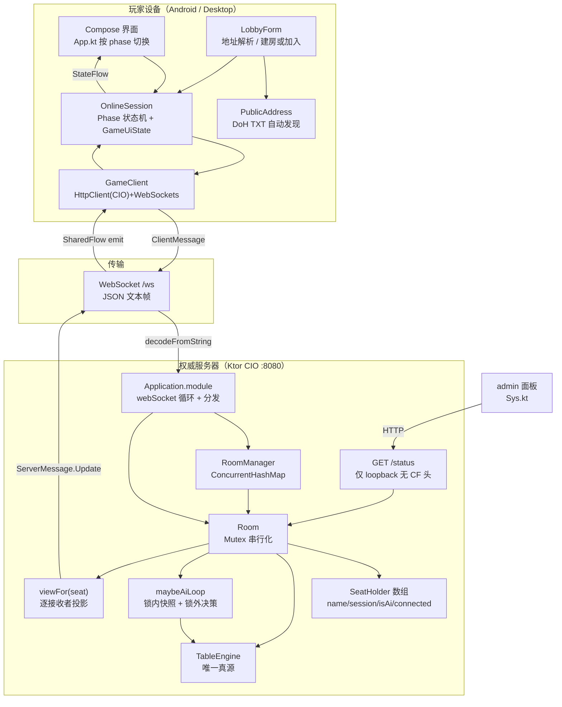

**图示来源**
- [GameClient.kt:20-55](file://shared/src/commonMain/kotlin/com/aniapp/pokerdemo/net/GameClient.kt#L20-L55)
- [OnlineSession.kt:72-157](file://shared/src/commonMain/kotlin/com/aniapp/pokerdemo/session/OnlineSession.kt#L72-L157)
- [Application.kt:38-131](file://server/src/main/kotlin/com/aniapp/pokerdemo/server/Application.kt#L38-L131)
- [Room.kt:136-179](file://server/src/main/kotlin/com/aniapp/pokerdemo/server/Room.kt#L136-L179)
- [Room.kt:255-391](file://server/src/main/kotlin/com/aniapp/pokerdemo/server/Room.kt#L255-L391)
- [Sys.kt:167](file://admin/src/main/kotlin/com/aniapp/pokerdemo/admin/Sys.kt#L167)

### 权威模型三条铁律

1. **写路径唯一**：`addHuman`、`requestStart`、`requestAct`、`setAiFill`、`disconnected`、`snapshot` 以及 AI 决策的提交，全部包在 `Room.mutex.withLock { ... }` 中；`Room` 内部没有任何绕过锁修改 `engine` / `seats` / `inHand` 的路径。
2. **读路径同样加锁**：`snapshot()` 走 `mutex.withLock`，因此 `/status` 观测到的是与牌桌写入互斥的一致快照，而不是撕裂的中间态。
3. **客户端零乐观更新**：`OnlineSession.act()` 只做 `isPlayerTurn` 预门控后发送 `act`，`_uiState` 仅在收到 `ServerMessage.Update` 时被整体替换；这与 `LocalSession.act()` 内直接 `publish(engine.act(...))` 形成鲜明对比。

**本节来源**
- [Room.kt:100-134](file://server/src/main/kotlin/com/aniapp/pokerdemo/server/Room.kt#L100-L134)
- [Room.kt:136-188](file://server/src/main/kotlin/com/aniapp/pokerdemo/server/Room.kt#L136-L188)
- [OnlineSession.kt:137-147](file://shared/src/commonMain/kotlin/com/aniapp/pokerdemo/session/OnlineSession.kt#L137-L147)
- [LocalSession.kt:52-92](file://shared/src/commonMain/kotlin/com/aniapp/pokerdemo/session/LocalSession.kt#L52-L92)

## 详细组件分析

### 协议层：Protocol.kt

`PokerJson` 是全项目共享的序列化配置：`classDiscriminator="type"` 让密封接口以 `{"type":"act", ...}` 的形式落地；`ignoreUnknownKeys=true` 使新增字段对旧客户端向后兼容；`encodeDefaults=true` 保证带默认值的字段（如 `TableView.revealedHoles` 的空 Map）始终显式出现在报文中，避免「缺字段」与「取默认值」在两端产生歧义。

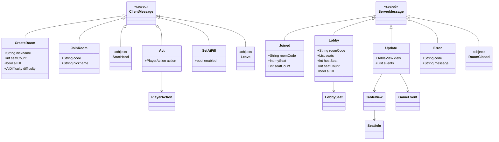

**图示来源**
- [Protocol.kt:20-50](file://shared/src/commonMain/kotlin/com/aniapp/pokerdemo/net/Protocol.kt#L20-L50)
- [Protocol.kt:52-113](file://shared/src/commonMain/kotlin/com/aniapp/pokerdemo/net/Protocol.kt#L52-L113)

**上行消息（`ClientMessage`）**

| `type` | Kotlin 变体 | 字段（含默认值） | 客户端触发点 |
| --- | --- | --- | --- |
| `create` | `CreateRoom` | `nickname`、`seatCount=6`、`aiFill=true`、`difficulty=STANDARD` | `OnlineSession` 建连成功后自动发送（无 `joinCode` 时） |
| `join` | `JoinRoom` | `code`、`nickname` | 有 `joinCode` 时自动发送 |
| `start` | `StartHand` | 无载荷 | `nextHand()` / `newMatch()`，大厅「开始」按钮 |
| `act` | `Act` | `action: PlayerAction` | `act()`，且要求 `isPlayerTurn` 为真 |
| `ai_fill` | `SetAiFill` | `enabled: Boolean` | `setAiFill()`，大厅开关 |
| `leave` | `Leave` | 无载荷 | **`OnlineSession` 未主动发送**，依赖 `dispose()` 关闭 socket，由服务端 `finally` 兜底 |

**下行消息（`ServerMessage`）**

| `type` | Kotlin 变体 | 载荷语义 | 发送时机 |
| --- | --- | --- | --- |
| `joined` | `Joined` | 房间码、分配座位、座位总数 | `addHuman` 成功后立即单播给新连接 |
| `lobby` | `Lobby` | `LobbySeat` 列表 + `hostSeat` + `aiFill` | 入房后、`setAiFill` 后、一手结束 `endHand` 后 |
| `update` | `Update` | **接收者专属** `TableView` + 本步 `GameEvent` 列表 | 每次牌桌推进后逐人广播 |
| `error` | `Error` | `code` + 面向玩家的中文 `message` | 校验失败时单播 |
| `closed` | `RoomClosed` | 无载荷 | 房间内人类玩家归零时 |

注意 `Update` 的语义设计：它同时携带「完整状态快照」和「本步产生的事件序列」。快照保证任何掉线重连/丢帧后的界面都能一次收敛（幂等），事件序列则专门驱动发牌、下注、摊牌等**动画与音效**，二者职责分离。

`PlayerAction` 只有 4 个动作（`Fold`/`Check`/`Call`/`RaiseTo(amount)`），加注用「抬到总额」而非「加注增量」表达，使服务端校验与网络重放都更简单；`GameEvent` 则定义 10 种事件（盲注、发底牌、行动、翻牌、未跟注退还、摊牌亮牌、边池派发、淘汰、单手结束、整场结束）。

**本节来源**
- [Protocol.kt:14-113](file://shared/src/commonMain/kotlin/com/aniapp/pokerdemo/net/Protocol.kt#L14-L113)
- [PlayerAction.kt:5-26](file://shared/src/commonMain/kotlin/com/aniapp/pokerdemo/engine/PlayerAction.kt#L5-L26)
- [GameEvent.kt:5-26](file://shared/src/commonMain/kotlin/com/aniapp/pokerdemo/engine/GameEvent.kt#L5-L26)
- [OnlineSession.kt:94-96](file://shared/src/commonMain/kotlin/com/aniapp/pokerdemo/session/OnlineSession.kt#L94-L96)
- [Room.kt:181-188](file://server/src/main/kotlin/com/aniapp/pokerdemo/server/Room.kt#L181-L188)

### 视图投影与防作弊信息裁剪

`SeatInfo`、`TableView`、`LobbySeat` 不是引擎内部状态的直接暴露，而是**按接收者裁剪的投影**。引擎内部状态 `GameState` 含所有玩家的 `hole`，但从不整体入网；`Room.viewFor(engine, seat)` 为每个座位单独构造一份视图：

| `TableView` 字段 | 类型 | 生成方式 | 是否接收者相关 |
| --- | --- | --- | --- |
| `seats` | `List<SeatInfo>` | 引擎玩家 → 房间座位映射，并合并 `SeatHolder` 的 `connected`/`isAi` | 内容一致，`seat` 编号已换回房间座位 |
| `board` | `List<Card>` | `state.board` | 公共信息 |
| `dealer` | `Int` | `seatMap[state.dealer]` | 编号换算 |
| `acting` | `Int?` | `seatMap[state.acting]` | 编号换算 |
| `phase` | `Phase` | `state.phase` | 公共 |
| `handNumber` | `Int` | `state.handNumber` | 公共 |
| `currentBet` / `minRaiseTo` | `Int` | 同名引擎字段 | 公共 |
| `pot` | `Int` | `GameState.pot`（= 各家 `totalCommitted` 之和） | 公共 |
| **`mySeat`** | `Int` | 投影目标座位 | **是** |
| **`myHole`** | `List<Card>` | `state.of(引擎座位).hole` | **是：只含接收者自己的两张底牌** |
| **`legal`** | `LegalActions` | `engine.legalActions(引擎座位)` | **是：未轮到自己时全为假值** |
| `result` | `HandResult?` | `awards.winners` 与 `revealed` 的 key 均重映射为房间座位 | 编号换算 |
| `revealedHoles` | `Map<Int, List<Card>>` | 仅当 `state.showdown` 为真时填入**未弃牌**玩家的底牌 | 摊牌阶段对所有存活观察者公开 |

防作弊要点与准确边界：

- **私有信息只走 `myHole`**：整个协议里没有任何字段能拿到「别人的未摊牌底牌」。端到端测试明确断言两个座位的 `myHole` 互不相等、且开局阶段 `revealedHoles` 为空。
- **`revealedHoles` 不是按 `mySeat` 过滤的**：它在 `state.showdown` 为真时对所有仍在线的接收者**一视同仁**地包含全部未弃牌玩家底牌。这符合德扑语义——摊牌亮牌本就是公共信息；被过滤掉的是已弃牌者的手牌（`filter { !it.isFolded }`），因此不存在「偷看弃牌者底牌」的泄漏。
- **AI 与掉线座位不发视图**：`broadcastUpdate` 会跳过 `isAi` 或 `!connected` 的座位，既省带宽，也避免为不存在的对端序列化敏感数据。
- **`legal` 是服务端算出来的**：客户端界面直接据此渲染可点击按钮，无需重复规则实现，也不会因客户端版本落后而放行非法动作。

`SeatInfo` 字段：`seat`、`name`、`chips`（当前筹码，不含本街已投入）、`streetBet`（本街已下）、`totalCommitted`（本手累计投入）、`folded`、`allIn`、`connected`、`isAi`。`LobbySeat` 是大厅用的极简版本，仅 `seat`、`name`、`isAi`、`connected`。

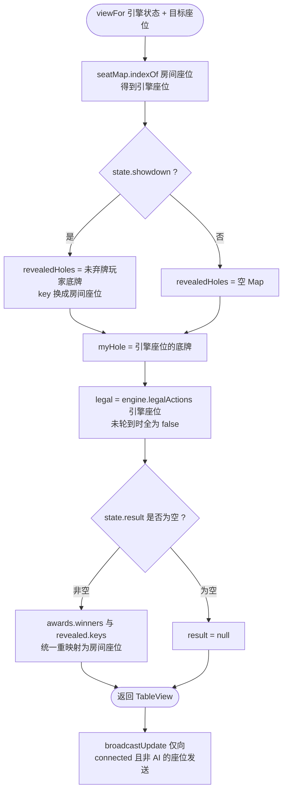

**图示来源**
- [Room.kt:334-391](file://server/src/main/kotlin/com/aniapp/pokerdemo/server/Room.kt#L334-L391)
- [GameState.kt:12-56](file://shared/src/commonMain/kotlin/com/aniapp/pokerdemo/engine/GameState.kt#L12-L56)

**本节来源**
- [Room.kt:334-391](file://server/src/main/kotlin/com/aniapp/pokerdemo/server/Room.kt#L334-L391)
- [Protocol.kt:52-84](file://shared/src/commonMain/kotlin/com/aniapp/pokerdemo/net/Protocol.kt#L52-L84)
- [GameState.kt:12-56](file://shared/src/commonMain/kotlin/com/aniapp/pokerdemo/engine/GameState.kt#L12-L56)
- [TableEngine.kt:87-100](file://shared/src/commonMain/kotlin/com/aniapp/pokerdemo/engine/TableEngine.kt#L87-L100)
- [RoomFlowTest.kt:53-80](file://server/src/test/kotlin/com/aniapp/pokerdemo/server/RoomFlowTest.kt#L53-L80)
- [AiFillOptionTest.kt:156-197](file://server/src/test/kotlin/com/aniapp/pokerdemo/server/AiFillOptionTest.kt#L156-L197)

### 客户端传输层：GameClient.kt

`GameClient` 是一个刻意保持极薄的传输壳：它不理解牌桌语义，只负责「连上 `/ws`、把文本帧解码成 `ServerMessage` 塞进 Flow、把 `ClientMessage` 编码成文本帧发出」。

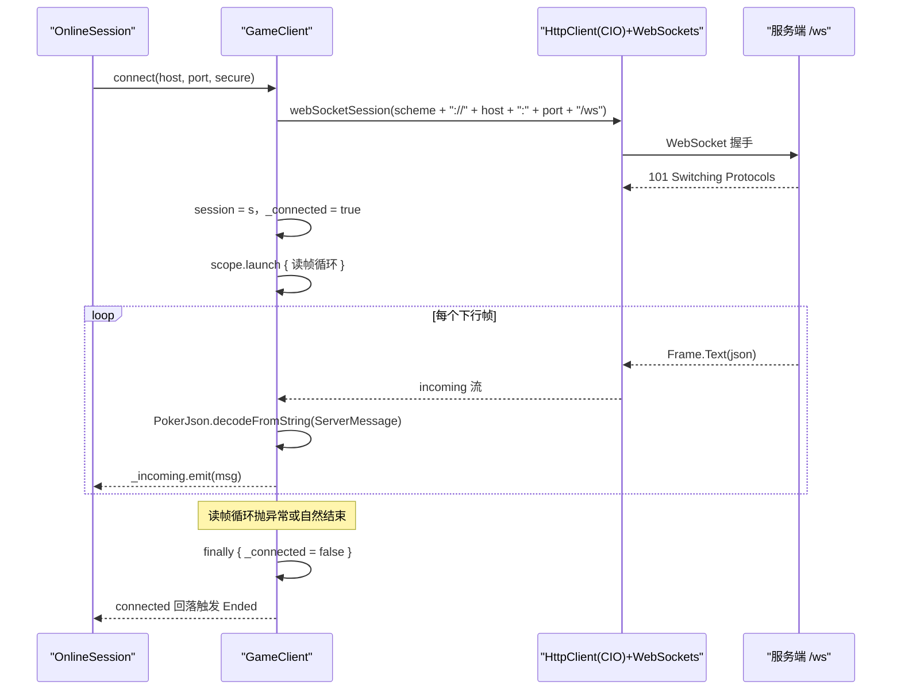

**图示来源**
- [GameClient.kt:20-62](file://shared/src/commonMain/kotlin/com/aniapp/pokerdemo/net/GameClient.kt#L20-L62)

设计要点：

- **心跳**：客户端 `pingIntervalMillis = 15_000`，服务端 `pingPeriodMillis = 15_000` / `timeoutMillis = 30_000`。移动网络 NAT 静默断连可在数十秒内被发现。
- **`incoming` 是 `MutableSharedFlow(extraBufferCapacity = 64)`**：热流、无重放，背压策略为默认的 `SUSPEND`。当消费端（UI 折叠）短时卡顿，最多可缓冲 64 条消息而不会挂起读帧循环；持续堆积则会反压到 socket 读取，属于可接受的降级。
- **`_connected` 是 `MutableStateFlow(false)`**：只在握手成功后置真；读帧循环的 `finally` 与显式 `close()` 都会置假。`OnlineSession` 用 `drop(1)` 跳过初始值 `false`，避免刚构造就被误判为断线。
- **异常吞掉是有意的**：`catch (_: Exception) {}` 只负责把 `_connected` 拉低，真正的「断线提示」由上层根据 `config.secure` 给出不同文案。
- **`send` 在无会话时静默丢弃**：`session?.send(...)`，配合调用方 `runCatching`，保证「点一下按钮就崩」不会发生。

**本节来源**
- [GameClient.kt:20-62](file://shared/src/commonMain/kotlin/com/aniapp/pokerdemo/net/GameClient.kt#L20-L62)
- [Application.kt:31-34](file://server/src/main/kotlin/com/aniapp/pokerdemo/server/Application.kt#L31-L34)
- [OnlineSession.kt:104-116](file://shared/src/commonMain/kotlin/com/aniapp/pokerdemo/session/OnlineSession.kt#L104-L116)

### 客户端会话层：OnlineSession.kt

`OnlineSession` 是 UI 与传输层之间的折叠器：把无规则的 `SharedFlow<ServerMessage>` 折叠成两个可观察状态（`phase: StateFlow<Phase>` 与 `uiState: StateFlow<GameUiState>`），`App` 只按 `phase` 做界面路由。

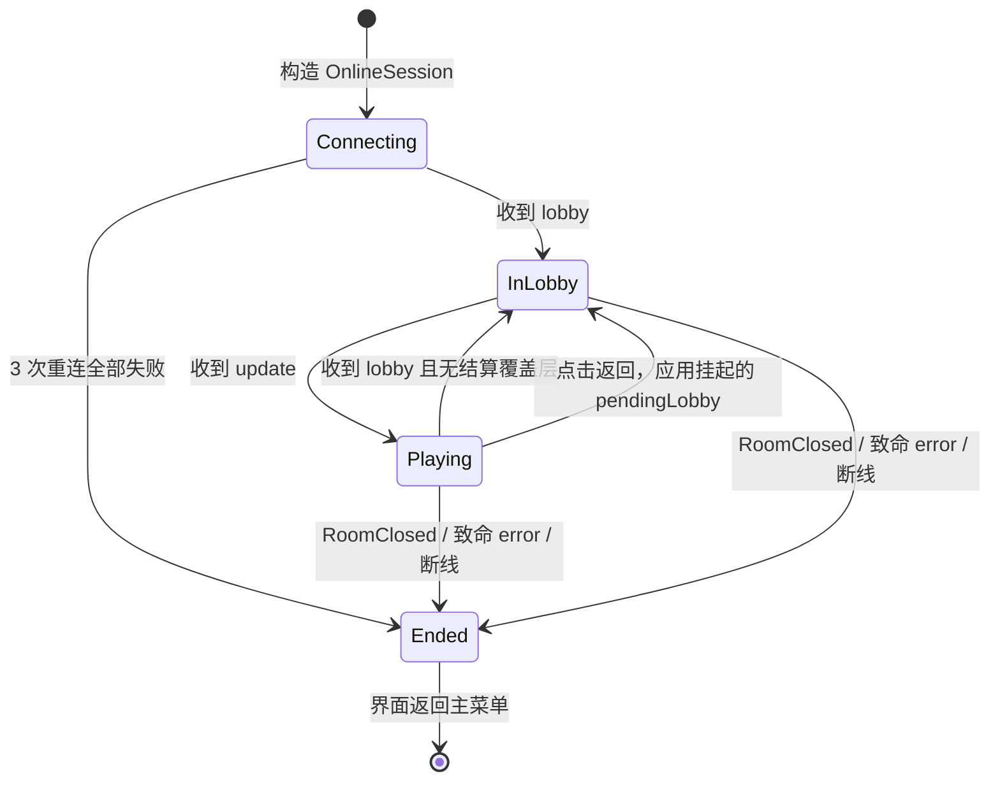

该状态机不含独立的 `Diagram sources` 之外的外部输入，其迁移全部由 `handle(msg)` 与 `connected` 回落驱动。

**连接与自动发现**：`init` 中的第一条协程在 `withTimeout(30_000)` 内做**最多 3 次**尝试，退避 1500ms → 3000ms。若 `config.autoDiscovery` 为真（地址栏留空、由 `PublicAddress` 解析得到公共服务器），第 2、3 次尝试会调用 `PublicAddress.resolve(attempt)` **换一个 DoH 源重新解析**，以应对免费隧道边缘偶发 502 与 DoH 缓存滞后。连接成功后按是否有 `joinCode` 自动发出 `join` 或 `create`。

`PublicAddress` 通过 DoH（AliDNS 与 DNSPod 两个 HTTP JSON 端点，各 8 秒超时）查询 TXT 记录 `_poker.lain-priv.work`，解析出的字符串交给 `ServerAddress.parse`；两者都失败时兜底固定域名 `wss://poker.lain-priv.work`。`ServerAddress.parse` 同时支持 `wss://`、`ws://` 与裸 `host[:port]`，缺省端口分别为 443 与 8080，并拒绝含 `/?#@` 等字符的非法输入。

**结算覆盖层保护（`pendingLobby`）**：一手牌结束后服务端会**紧接着**广播 `lobby`。若客户端此刻正处于 `Playing` 且视图里还带着 `result`（结算面板），直接切到大厅会让玩家看不到输赢。因此 `handle(Lobby)` 会把大厅暂存到 `pendingLobby`；当新的 `Update` 携带 `result == null` 时清空丢弃，玩家主动点返回时由 `backToLobby()` 兑现。

**错误分级**：`join_failed`、`not_found`、`bad_seat_count` 属于「无法继续」的致命错误，直接 `Phase.Ended`；其余（含 `not_host`、`already_started`、`need_players`、`not_in_hand`、`illegal_action`）只写入 `_error`，`App` 用 `LaunchedEffect` 延时 3 秒自动 `clearError()`，表现为一次性提示条。

**线程模型**：`scope` 为 `SupervisorJob() + Dispatchers.Default`，收发与 JSON 编解码全部离开主线程，避免点击与结算重组争抢 UI 帧；`cleanupScope` 独立存在，使得 `dispose()` 里 `scope.cancel()` 之后仍能完成 `client.close()` 的收尾。

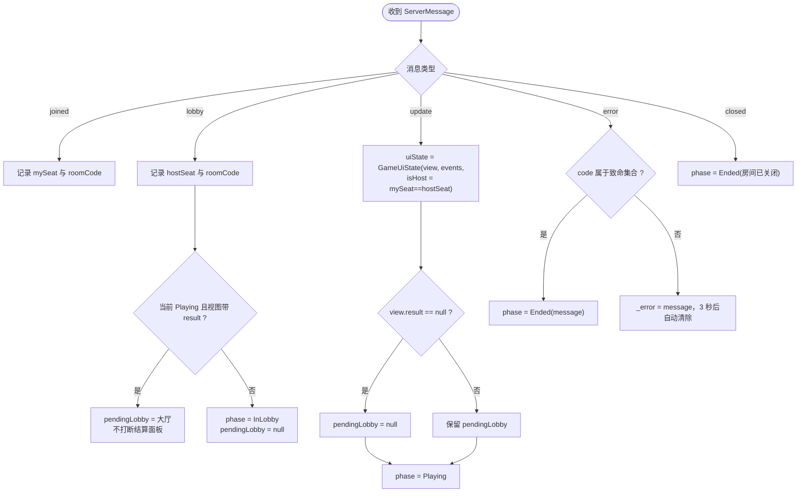

**图示来源**
- [OnlineSession.kt:119-161](file://shared/src/commonMain/kotlin/com/aniapp/pokerdemo/session/OnlineSession.kt#L119-L161)
- [App.kt:95-130](file://shared/src/commonMain/kotlin/com/aniapp/pokerdemo/ui/App.kt#L95-L130)

**本节来源**
- [OnlineSession.kt:21-194](file://shared/src/commonMain/kotlin/com/aniapp/pokerdemo/session/OnlineSession.kt#L21-L194)
- [PublicAddress.kt:13-40](file://shared/src/commonMain/kotlin/com/aniapp/pokerdemo/net/PublicAddress.kt#L13-L40)
- [ServerAddress.kt:1-40](file://shared/src/commonMain/kotlin/com/aniapp/pokerdemo/net/ServerAddress.kt#L1-L40)
- [GameSession.kt:10-33](file://shared/src/commonMain/kotlin/com/aniapp/pokerdemo/session/GameSession.kt#L10-L33)
- [App.kt:95-130](file://shared/src/commonMain/kotlin/com/aniapp/pokerdemo/ui/App.kt#L95-L130)
- [LobbyScreen.kt:79-96](file://shared/src/commonMain/kotlin/com/aniapp/pokerdemo/ui/lobby/LobbyScreen.kt#L79-L96)
- [LobbyScreen.kt:174-199](file://shared/src/commonMain/kotlin/com/aniapp/pokerdemo/ui/lobby/LobbyScreen.kt#L174-L199)

### 服务端接入层：Application.kt

**引擎与端口**：`main()` 用 `embeddedServer(CIO, port = 8080, host = "0.0.0.0")` 启动。这里使用的是 **Ktor 的 CIO 引擎**（协程原生 I/O，依赖 `libs.ktor.server.cio`），**并非 Netty**——这与 `server/build.gradle.kts` 的依赖清单一致。绑定 `0.0.0.0` 以支持局域网直连（玩家填 `192.168.x.x:8080`）。

**已安装的插件只有两个**：`WebSockets`（`pingPeriodMillis=15_000`、`timeoutMillis=30_000`）与 `ContentNegotiation`（复用共享的 `PokerJson`，使 `call.respond(StatusPayload(...))` 能直接序列化）。**没有安装 `CallLogging`、`StatusPages` 或 `CORS`**：

- 日志由 `src/main/resources/logback.xml` 控制：控制台 appender、root `INFO`、`io.ktor` 降到 `WARN`。
- 错误处理是**就地 try/catch + 协议内 `error` 帧**，而不是 `StatusPages` 集中式拦截。这样错误走的是与正常消息相同的通道，客户端只需一套解析逻辑。
- `/ws` 与 `/status` 都不需要 CORS：前者是原生 WebSocket 客户端，后者只允许本机回环访问；浏览器侧的管理面板由独立的 `admin` 模块代理。

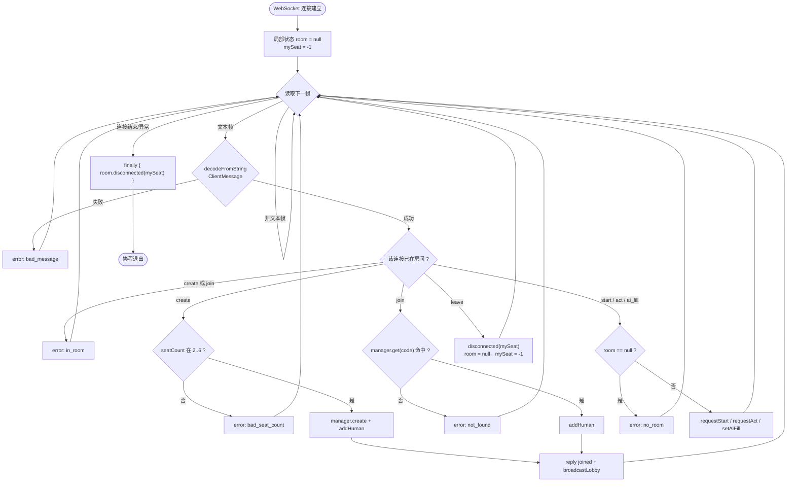

**图示来源**
- [Application.kt:38-131](file://server/src/main/kotlin/com/aniapp/pokerdemo/server/Application.kt#L38-L131)

关键点：

- **每条连接 = 一个协程**，其局部变量 `room` / `mySeat` 即「该 socket 属于哪个房间哪个座位」的唯一记录，服务端不额外维护连接表，因此不存在残留会话。
- **入房失败被映射为 `join_failed`**：`addHuman` 抛出的 `RoomException`（「对局进行中，无法加入」/「房间已满」）在 `join()` 里统一转换成 `ServerMessage.Error("join_failed", ex.message)`。
- **昵称清洗**：`cleanName` 对输入做 `trim().take(12).ifEmpty { "玩家" }`，防止超长昵称撑爆视图与牌桌渲染。
- **`finally` 兜底**：无论对端是优雅 `leave` 还是拔网线，`disconnected(mySeat)` 一定会被调用一次，这是「掉线转 AI 接管」的入口。
- **`/status` 的访问控制**：`cloudflared` 从 loopback 回连，因此公网流量在服务端看来也是本机地址，判定必须同时看转发头——只要 `Cf-Ray` / `Cf-Connecting-Ip` / `X-Forwarded-For` 任一存在，或 `remoteAddress` 不是回环，就直接 `404`。也就是说 `/status` 是一个**仅供本机（管理面板）读取的房间快照接口**，不对外暴露。
- **`/status` 不是 `/health`**：代码中不存在 `/health` 路由。存活探测由 `admin` 侧 `Sys.localProbe()` 对 `http://127.0.0.1:8080/ws` 发起握手（400/426/101 均视为服务在线），房间数据则单独从 `/status` 拉取。

**本节来源**
- [Application.kt:24-138](file://server/src/main/kotlin/com/aniapp/pokerdemo/server/Application.kt#L24-L138)
- [server/build.gradle.kts:8-35](file://server/build.gradle.kts#L8-L35)
- [logback.xml:1-11](file://server/src/main/resources/logback.xml#L1-L11)
- [Sys.kt:145](file://admin/src/main/kotlin/com/aniapp/pokerdemo/admin/Sys.kt#L145)
- [Sys.kt:167](file://admin/src/main/kotlin/com/aniapp/pokerdemo/admin/Sys.kt#L167)

### 服务端权威层：Room 与 RoomManager

`RoomManager` 用 `ConcurrentHashMap<String, Room>` 存房间，`create()` 生成 4 位大写字母房间码并循环去重，`get()` 对输入做 `trim().uppercase()`（因此玩家大小写混填房间码也能命中）。`aiDelayMs` 由 `module()` 传入（默认 `700L..1400L`，测试注入 `1L..5L` 以加速）。

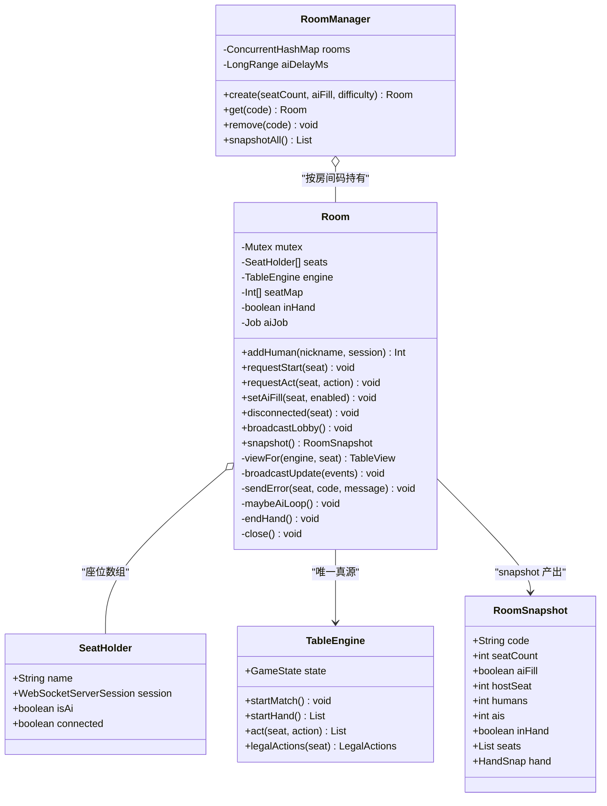

**图示来源**
- [Room.kt:47-134](file://server/src/main/kotlin/com/aniapp/pokerdemo/server/Room.kt#L47-L134)
- [Room.kt:314-413](file://server/src/main/kotlin/com/aniapp/pokerdemo/server/Room.kt#L314-L413)
- [TableEngine.kt:20-105](file://shared/src/commonMain/kotlin/com/aniapp/pokerdemo/engine/TableEngine.kt#L20-L105)

**双编号体系 `seatMap`**：房间座位可能稀疏（关闭 AI 补位、或座位 1 的玩家掉线后离开），而 `TableEngine` 要求玩家列表连续。`requestStart` 把已占用座位上收集为 `occupied` 并赋值给 `seatMap`，此后**所有出网字段都用 `seatMap[引擎下标]` 换算回房间座位**，所有入网动作都用 `seatMap.indexOf(房间座位)` 换算回引擎下标。端到端测试专门验证了「只有座位 0 与 2  occupied」时 `seats.map { it.seat } == [0, 2]`、`myHole` 数量与 `revealedHoles.keys` 均按房间座位呈现。

**引擎复用与跨手持久化**：`requestStart` 会先比较「现有引擎的玩家姓名列表」与新收集的是否完全一致；一致则**复用同一个 `TableEngine`**（仅当 `phase == MATCH_OVER` 时调 `startMatch()` 重置），否则新建。这正是「关闭 AI 补位时筹码与庄家按钮跨手延续」的实现基础，测试断言第二手 `handNumber == 2`、`dealer == 1` 且筹码守恒。

**`requestAct` 的权威校验链**：

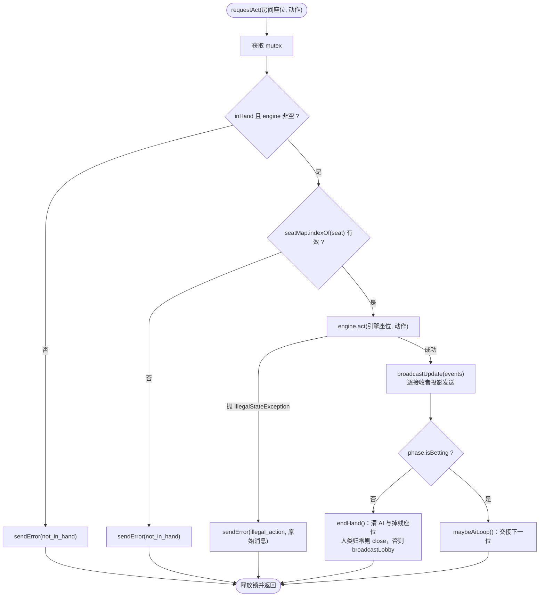

**图示来源**
- [Room.kt:165-179](file://server/src/main/kotlin/com/aniapp/pokerdemo/server/Room.kt#L165-L179)
- [Room.kt:314-326](file://server/src/main/kotlin/com/aniapp/pokerdemo/server/Room.kt#L314-L326)
- [TableEngine.kt:102-105](file://shared/src/commonMain/kotlin/com/aniapp/pokerdemo/engine/TableEngine.kt#L102-L105)

`illegal_action` 的原始中文消息直接来自引擎的 `check(...)`（例如「未轮到座位 X 行动」「当前阶段不可行动」），因此服务端不需要重复实现规则校验逻辑——**规则只写在 `TableEngine` 一处**。同理，`TableEngine.legalActions(seat)` 在「不是该座位行动」或「非下注阶段」时返回全假的 `LegalActions()`，这就是客户端拿到 `legal` 却点不动按钮的原因。

**错误码总表**

| 错误码 | 下发方 | 触发条件 | 客户端归类 |
| --- | --- | --- | --- |
| `already_started` | `Room.sendError` | 已在 `inHand` 时又发 `start`；或对局中改 `ai_fill` | 提示条 |
| `not_host` | `Room.sendError` | 非 `hostSeat` 发 `start` 或 `ai_fill` | 提示条 |
| `need_players` | `Room.sendError` | `aiFill=false` 且人类不足 2 人时 `start` | 提示条 |
| `not_in_hand` | `Room.sendError` | 无进行中牌局，或该座位不在 `seatMap` 中时 `act` | 提示条 |
| `illegal_action` | `Room.sendError` | `TableEngine.act` 抛 `IllegalStateException` | 提示条 |
| `bad_message` | `Application` 分发层 | JSON 无法解码为 `ClientMessage` | 提示条 |
| `in_room` | `Application` 分发层 | 同一连接重复 `create`/`join` | 提示条 |
| `bad_seat_count` | `Application` 分发层 | `seatCount` 不在 2..6 | **致命 → Ended** |
| `join_failed` | `Application` 的 `join()` | `addHuman` 抛 `RoomException`（对局中/房间已满） | **致命 → Ended** |
| `not_found` | `Application` 分发层 | 房间码不存在 | **致命 → Ended** |
| `no_room` | `Application` 分发层 | 未入房就发 `start`/`act`/`ai_fill` | 提示条 |

`sendError` 本身也做了防御：座位为空或没有会话就直接返回，发送异常被吞掉——**给一个已经断开的对手发错误帧不应影响其他玩家的对局**。

**本节来源**
- [Room.kt:47-70](file://server/src/main/kotlin/com/aniapp/pokerdemo/server/Room.kt#L47-L70)
- [Room.kt:127-134](file://server/src/main/kotlin/com/aniapp/pokerdemo/server/Room.kt#L127-L134)
- [Room.kt:136-188](file://server/src/main/kotlin/com/aniapp/pokerdemo/server/Room.kt#L136-L188)
- [Room.kt:407-413](file://server/src/main/kotlin/com/aniapp/pokerdemo/server/Room.kt#L407-L413)
- [Application.kt:60-131](file://server/src/main/kotlin/com/aniapp/pokerdemo/server/Application.kt#L60-L131)
- [OnlineSession.kt:148-155](file://shared/src/commonMain/kotlin/com/aniapp/pokerdemo/session/OnlineSession.kt#L148-L155)
- [TableEngine.kt:87-105](file://shared/src/commonMain/kotlin/com/aniapp/pokerdemo/engine/TableEngine.kt#L87-L105)
- [RoomFlowTest.kt:83-121](file://server/src/test/kotlin/com/aniapp/pokerdemo/server/RoomFlowTest.kt#L83-L121)
- [AiFillOptionTest.kt:60-119](file://server/src/test/kotlin/com/aniapp/pokerdemo/server/AiFillOptionTest.kt#L60-L119)

### AI 托管与乐观并发提交

AI 是「房间的一等公民」，同时又是服务端内部实现，不占用任何网络协议——`ai_fill` 消息只是让房主开关这个能力。默认策略由 `AiProfiles.server(difficulty)` 决定，`Room` 构造参数兜底为 `MonteCarloAi(MonteCarloConfig.Server)`。

难点在于：蒙特卡洛模拟是**重计算**。如果在 `mutex` 内跑 `ai.decide`，人类玩家的动作请求会被 AI 的“思考”阻塞。代码的解法是**锁内快照 → 锁外计算 → 指纹校验后提交**：

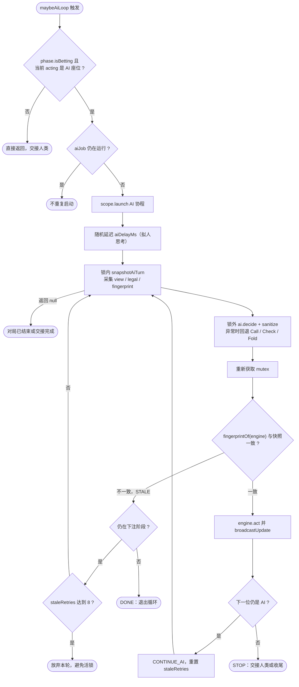

**图示来源**
- [Room.kt:224-312](file://server/src/main/kotlin/com/aniapp/pokerdemo/server/Room.kt#L224-L312)

`fingerprintOf` 覆盖 `handNumber`、`phase`、`acting`、`currentBet`、`minRaiseTo`、`pot` 以及每位玩家的 `streetBet`/`chips`/`isFolded`/`isAllIn`——足以刻画任何会影响决策结果的维度。指纹不匹配说明状态已被别的路径（人类行动、掉线接管）推进，而**那条路径自己会重启 AI 循环**，所以本协程只需放弃；`staleRetries >= 8` 的上限防止极端情况下活锁。

**掉线座位的 AI 化**：`SeatHolder.isAi` 与 `connected` 是可变的。玩家中途掉线时（`disconnected`）或发送失败时（`broadcastUpdate` 的 `catch`），服务端把该座位 `connected=false`、`isAi=true`、`session=null`，从而**立即纳入 AI 循环接管**；如果掉的正是当前行动者，还会当场 `maybeAiLoop()`，牌局不会停摆。一手结束（`endHand`）时这些座位被清除，恢复成大厅状态。测试 `disconnectMidHandBecomesAiThenSeatReleased` 完整验证了「中途掉线 → 对局照常打完 → 大厅只剩 1 人」的闭环。

**本节来源**
- [Room.kt:224-312](file://server/src/main/kotlin/com/aniapp/pokerdemo/server/Room.kt#L224-L312)
- [Room.kt:334-348](file://server/src/main/kotlin/com/aniapp/pokerdemo/server/Room.kt#L334-L348)
- [Room.kt:201-207](file://server/src/main/kotlin/com/aniapp/pokerdemo/server/Room.kt#L201-L207)
- [RoomFlowTest.kt:123-196](file://server/src/test/kotlin/com/aniapp/pokerdemo/server/RoomFlowTest.kt#L123-L196)

### 断线与房间生命周期

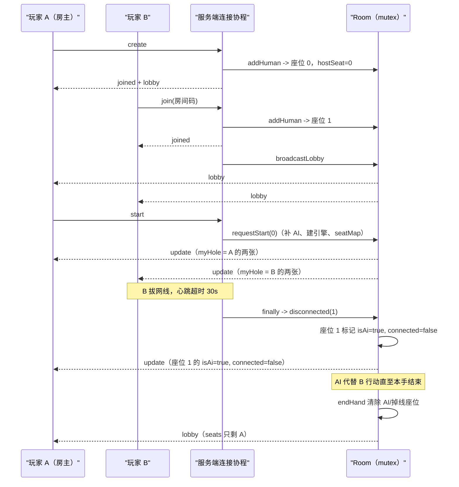

**图示来源**
- [Application.kt:60-131](file://server/src/main/kotlin/com/aniapp/pokerdemo/server/Application.kt#L60-L131)
- [Room.kt:190-209](file://server/src/main/kotlin/com/aniapp/pokerdemo/server/Room.kt#L190-L209)
- [Room.kt:314-332](file://server/src/main/kotlin/com/aniapp/pokerdemo/server/Room.kt#L314-L332)

房间销毁条件只有两个，且都收敛到 `close()`：**大厅状态下人类玩家数为 0**（`disconnected` 分支），或**一手结束清场后人类为 0**（`endHand` 分支）。`close()` 先给所有仍在线的人类发 `RoomClosed`，再 `scope.cancel()`（终止 AI 协程），最后 `manager.remove(code)` 让房间码可被重新分配。房主离开时 `hostSeat` 会自动移交下一个人类座位（`disconnected` 与 `endHand` 都有该逻辑），避免房间失去控制权。

值得注意的实现细节：`sendToHumans` 会**先编码一次 JSON、再为每个接收者新建 `Frame.Text`**，注释说明原因——Ktor 发送后会消费帧内容，同一 `Frame` 实例不能复用给多个会话。而携带敏感投影的 `broadcastUpdate` 必须在循环内逐人 `viewFor` + 逐人编码。

**本节来源**
- [Room.kt:190-209](file://server/src/main/kotlin/com/aniapp/pokerdemo/server/Room.kt#L190-L209)
- [Room.kt:314-332](file://server/src/main/kotlin/com/aniapp/pokerdemo/server/Room.kt#L314-L332)
- [Room.kt:393-405](file://server/src/main/kotlin/com/aniapp/pokerdemo/server/Room.kt#L393-L405)
- [GameClient.kt:57-62](file://shared/src/commonMain/kotlin/com/aniapp/pokerdemo/net/GameClient.kt#L57-L62)

## 依赖分析

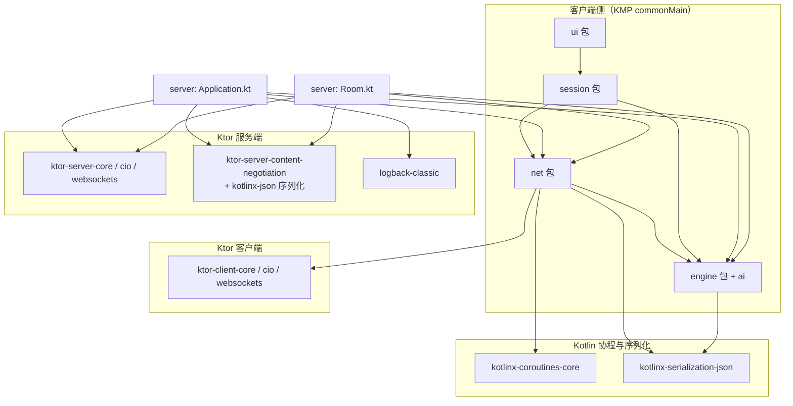

**图示来源**
- [shared/build.gradle.kts:22-34](file://shared/build.gradle.kts#L22-L34)
- [server/build.gradle.kts:8-21](file://server/build.gradle.kts#L8-L21)

依赖方向的关键事实：

- **不存在循环依赖**。`server` 单向依赖 `:shared`，复用 `net`（协议）与 `engine`（规则）；`shared` 完全不知道服务端的存在。
- **协议是唯一的双向契约**：`Room.kt` 直接 `import` `TableView`/`SeatInfo`/`ServerMessage`，`GameClient.kt` 与 `Application.kt` 共用同一个 `PokerJson` 实例配置，编解码不可能不一致。
- **客户端与服务端各用一套 Ktor 引擎但同为 CIO**：`ktor-client-cio` 与 `ktor-server-cio`，技术栈统一。
- **`admin` 不依赖 `:shared`**，仅通过 HTTP 读取 `/status`，因此它的部署与协议演进解耦。
- **测试即端到端**：`RoomFlowTest`、`AiFillOptionTest` 用 `testApplication { module(1L..5L) }` 起真实路由与真实 WebSocket 客户端，通过 `skipTo<ServerMessage.X>()` 按类型跳读消息流——协议、路由、房间三层同时被覆盖。`E2EClient.kt` 还可通过 `:server:e2eClient` 任务对已部署实例打真实公网地址。

**本节来源**
- [shared/build.gradle.kts:9-49](file://shared/build.gradle.kts#L9-L49)
- [server/build.gradle.kts:1-43](file://server/build.gradle.kts#L1-L43)
- [Room.kt:1-36](file://server/src/main/kotlin/com/aniapp/pokerdemo/server/Room.kt#L1-L36)
- [RoomFlowTest.kt:45-56](file://server/src/test/kotlin/com/aniapp/pokerdemo/server/RoomFlowTest.kt#L45-L56)

## 性能考量

- **锁的粒度与持锁时长**：`Room` 用单一 `Mutex` 保证串行，简单且正确，代价是持锁期间不能做重活。代码严格遵守「锁内只做状态读写与轻量投影」：`ai.decide`（蒙特卡洛模拟）被显式移到锁外，并用水位指纹校验提交，这是本架构最关键的一次性能让步。
- **视图投影的重复编码**：一次 `broadcastUpdate` 会为每个在线人类座位各生成一份 `TableView` 并各自 `encodeToString`（因为 `myHole`/`legal`/`mySeat` 因人而异）。座位数上限是 6，单帧体积很小，成本可接受；若未来座位规模扩大，可考虑拆出「公共部分 + 私有增量」两段消息。
- **`Update` 携带全量快照**：牺牲少量带宽换取「任意时刻丢帧都能自愈」的幂等性。对 2–6 人、每步一次的低频交互而言是正确取舍。
- **Flow 缓冲**：`extraBufferCapacity=64` 让 UI 短暂卡顿不会阻塞读帧循环；注意它是热流且无重放，若消费方在 `emit` 之前尚未订阅，消息会被丢弃——当前实现中订阅与连接在同一 `init` 中先后启动，顺序安全。
- **心跳与超时**：双向 15 秒 ping、服务端 30 秒 timeout。心跳过密会浪费移动流量，过疏则掉线发现慢；当前配置在「快速感知房主关机」与「弱网友好」之间取得平衡。
- **线程调度**：客户端与服务端的房间协程均使用 `Dispatchers.Default`，`Room.scope` 独立于 Ktor 的连接协程，AI 延迟 `delay` 不占用 I/O 线程。
- **`/status` 快照的锁竞争**：`snapshotAll()` 会顺序对每个房间加锁。管理面板轮询频率不高，但房间数量增长时会放大锁等待，建议保持低频轮询或改为缓存快照。

**本节来源**
- [Room.kt:224-312](file://server/src/main/kotlin/com/aniapp/pokerdemo/server/Room.kt#L224-L312)
- [Room.kt:334-391](file://server/src/main/kotlin/com/aniapp/pokerdemo/server/Room.kt#L334-L391)
- [Room.kt:68-69](file://server/src/main/kotlin/com/aniapp/pokerdemo/server/Room.kt#L68-L69)
- [GameClient.kt:21-32](file://shared/src/commonMain/kotlin/com/aniapp/pokerdemo/net/GameClient.kt#L21-L32)
- [OnlineSession.kt:51-54](file://shared/src/commonMain/kotlin/com/aniapp/pokerdemo/session/OnlineSession.kt#L51-L54)

## 故障排查指南

| 症状 | 根因位置 | 判定方法 | 处置 |
| --- | --- | --- | --- |
| 卡在「连接中…」后提示无法连接 | `OnlineSession` 建连协程 3 次重试全失败 | 提示文案区分 `secure`（隧道场景，含「地址可能已变」）与明文 | 确认服务器进程在 `0.0.0.0:8080` 监听、隧道存活；`scripts/poker-daemon.sh` 每 20 秒探测公网 `/ws`，两次失败自动重启 `cloudflared`，8080 掉线会自动补拉 |
| 提示「无法获取公共服务器地址」 | `PublicAddress.resolve` 两个 DoH 源与兜底域名都失败 | 检查 DNS 污染 / 出口网络 | 手动填写 `wss://…` 或局域网 `192.168.x.x:8080` |
| 加入时 Ended「房间不存在」 | `manager.get(code)` 未命中 | 房间码是否 4 位字母；大小写不敏感，`trim().uppercase()` 后比较 | 确认房主未离开（人类归零会 `close()` 并回收房间码） |
| 加入时 Ended（`join_failed`） | `addHuman` 抛「对局进行中，无法加入」或「房间已满」 | 房主是否已经按过开始 | 等本手结束（服务端会广播新的 `lobby`）再加入 |
| 点开始无反应，出现「只有房主能开始游戏」 | `requestStart` 的 `not_host` | 视图 `isHost` 是否随 `hostSeat` 移交而改变 | 由当前 `hostSeat` 对应玩家操作；房主离开时会自动移交 |
| 点开始提示「至少需要 2 名玩家」 | `aiFill=false` 时的 `need_players` | 大厅中人类座位数 | 打开 `ai_fill` 或再拉一人 |
| 点了动作界面不动 | 权威模型的**预期行为**（无乐观更新） | 看按钮是否因 `legal` 全假而禁用；`isPlayerTurn` 为假时客户端直接吞掉点击 | 属正常：未轮到你。若轮到你且仍不动，检查 `update` 是否到达（网络或服务端异常） |
| 偶发「非法动作」提示 | 客户端视图滞后于服务端状态，或跨阶段重复点击 | 服务端 `TableEngine.act` 的 `check` 消息 | 以最新 `update` 为准重绘；无需重试逻辑，因为快照是幂等的 |
| 对局突然变成「只剩 AI」 | 心跳超时或发送失败导致座位被降级为 `isAi` | `SeatHolder.connected=false` 的三处赋值点 | 玩家重连需重新 `join`；若原座位已被 `endHand` 清除，则只能进入下一手 |
| 结算面板一闪而过 | 服务端一手结束立即广播 `lobby` | `pendingLobby` 是否生效（要求此刻 `phase==Playing` 且 `view.result != null`） | 正常机制：由玩家点「返回」经 `backToLobby()` 进入大厅 |
| 收到无法解析的消息 | 两端协议版本不一致或手工客户端格式错误 | 服务端回 `bad_message` 并继续读下一帧 | 必须使用同版本 `PokerJson`；`type` 判别字段缺失是最常见原因 |
| 管理面板看不到房间数据 | `/status` 判定为非回环或带 CF/转发头返回 404 | `admin` 是否从 `http://127.0.0.1:8080/status` 请求 | 保持本机 loopback 访问，不要在公网路径上依赖 `/status` |
| 服务日志太吵或看不到 | `logback.xml` 中 `io.ktor` 被降为 `WARN`，无 `CallLogging` | 查看 `server.log` | 临时调高 `io.ktor` 级别；没有内置请求日志插件，需自行加 `CallLogging` |

**本节来源**
- [OnlineSession.kt:94-116](file://shared/src/commonMain/kotlin/com/aniapp/pokerdemo/session/OnlineSession.kt#L94-L116)
- [OnlineSession.kt:129-155](file://shared/src/commonMain/kotlin/com/aniapp/pokerdemo/session/OnlineSession.kt#L129-L155)
- [PublicAddress.kt:19-39](file://shared/src/commonMain/kotlin/com/aniapp/pokerdemo/net/PublicAddress.kt#L19-L39)
- [Application.kt:39-51](file://server/src/main/kotlin/com/aniapp/pokerdemo/server/Application.kt#L39-L51)
- [Room.kt:136-188](file://server/src/main/kotlin/com/aniapp/pokerdemo/server/Room.kt#L136-L188)
- [logback.xml:8-10](file://server/src/main/resources/logback.xml#L8-L10)
- [DEPLOY.md:11-14](file://DEPLOY.md#L11-L14)
- [poker-daemon.sh:86-103](file://scripts/poker-daemon.sh#L86-L103)
- [poker-daemon.sh:130-148](file://scripts/poker-daemon.sh#L130-L148)

## 结论

多人在线对战由三层清晰分离的实现构成：**协议（`shared/net`）→ 会话折叠（`shared/session`）→ 权威房间（`server`）**。其可靠性来自四个一以贯之的决定：

1. **状态只有一个真源**，即 `Room` 锁内的 `TableEngine`；客户端渲染快照、不做乐观更新，因此不存在「两端各自演算然后分歧」的问题。
2. **规则只实现一次**，`TableEngine` 同时服务离线与联机，联机侧只需 `check` 抛错并转成 `illegal_action`，没有第二套校验逻辑。
3. **私有信息在服务端出网前就被裁掉**：`myHole` 与 `legal` 逐人生成，别人的底牌在协议层面根本没有承载字段；摊牌亮牌是公共信息，因此按德扑语义公开（仅排除弃牌者）。
4. **异常路径始终保障对局连续性**：掉线座位就地转 AI、心跳自动清理死连接、房间在无人类时自毁并回收房间码。

在实现口径上需要澄清三点常见误解：服务器运行在 **Ktor CIO** 引擎而非 Netty；运维端点是受 loopback + 转发头双重守卫的 **`GET /status`**，系统并不存在 `/health` 路由；服务端只安装 `WebSockets` 与 `ContentNegotiation` 两个插件，错误处理走协议内 `error` 帧而非 `StatusPages`，可观测性由 `logback.xml` 与 `admin` 侧探测承担。

**后续可考虑的演进方向**（当前代码未实现，仅作为阅读提示）：把 `TableView` 拆为「公共帧 + 私有帧」以降低重复编码；为 `OnlineSession` 增加 `leave` 的显式发送与断线重连到同一座位的能力；在房间数量增长后为 `/status` 引入快照缓存以缩短锁持有时间。

## 附录：配置项与端点速查

| 项目 | 取值 | 定义位置 |
| --- | --- | --- |
| 服务器监听地址 | `0.0.0.0:8080` | [Application.kt:25](file://server/src/main/kotlin/com/aniapp/pokerdemo/server/Application.kt#L25) |
| 服务器引擎 | `io.ktor.server.cio.CIO` | [Application.kt:19-25](file://server/src/main/kotlin/com/aniapp/pokerdemo/server/Application.kt#L19-L25) |
| WebSocket 路径 | `/ws` | [Application.kt:52](file://server/src/main/kotlin/com/aniapp/pokerdemo/server/Application.kt#L52) |
| 状态快照路径 | `/status`（仅本机、无 CF/转发头） | [Application.kt:39-50](file://server/src/main/kotlin/com/aniapp/pokerdemo/server/Application.kt#L39-L50) |
| 服务端 ping / timeout | `15_000 ms` / `30_000 ms` | [Application.kt:31-34](file://server/src/main/kotlin/com/aniapp/pokerdemo/server/Application.kt#L31-L34) |
| 客户端 ping | `15_000 ms` | [GameClient.kt:21-25](file://shared/src/commonMain/kotlin/com/aniapp/pokerdemo/net/GameClient.kt#L21-L25) |
| 客户端消息缓冲 | `extraBufferCapacity = 64` | [GameClient.kt:28-29](file://shared/src/commonMain/kotlin/com/aniapp/pokerdemo/net/GameClient.kt#L28-L29) |
| 建连总超时 / 重试次数 / 退避 | `30_000 ms` / 3 次 / 1500ms 起倍增 | [OnlineSession.kt:75-93](file://shared/src/commonMain/kotlin/com/aniapp/pokerdemo/session/OnlineSession.kt#L75-L93) |
| 提示条自动消失 | `3000 ms` | [App.kt:99-105](file://shared/src/commonMain/kotlin/com/aniapp/pokerdemo/ui/App.kt#L99-L105) |
| 房间座位数 | `2..6`（创建默认 6，大厅默认 4） | [Protocol.kt:24-29](file://shared/src/commonMain/kotlin/com/aniapp/pokerdemo/net/Protocol.kt#L24-L29)、[Room.kt:52](file://server/src/main/kotlin/com/aniapp/pokerdemo/server/Room.kt#L52) |
| 房间码格式 | 4 位大写字母 A–Z | [Room.kt:54-56](file://server/src/main/kotlin/com/aniapp/pokerdemo/server/Room.kt#L54-L56) |
| 昵称长度上限 | `12` 字符，空则「玩家」 | [Application.kt:134-135](file://server/src/main/kotlin/com/aniapp/pokerdemo/server/Application.kt#L134-L135) |
| AI 思考延迟 | `700L..1400L` ms（测试注入 `1L..5L`） | [Application.kt:30](file://server/src/main/kotlin/com/aniapp/pokerdemo/server/Application.kt#L30)、[Room.kt:264](file://server/src/main/kotlin/com/aniapp/pokerdemo/server/Room.kt#L264) |
| AI 指纹过期重试上限 | `8` 次 | [Room.kt:305-307](file://server/src/main/kotlin/com/aniapp/pokerdemo/server/Room.kt#L305-L307) |
| 默认盲注 / 起始筹码 | `smallBlind=10`、`bigBlind=20`（`GameUiState` 默认值） | [GameSession.kt:10-19](file://shared/src/commonMain/kotlin/com/aniapp/pokerdemo/session/GameSession.kt#L10-L19) |
| DoH 解析超时 | 单源 `8_000 ms`，两源 + 固定域名兜底 | [PublicAddress.kt:15-38](file://shared/src/commonMain/kotlin/com/aniapp/pokerdemo/net/PublicAddress.kt#L15-L38) |
| 公共地址 TXT 记录 | `_poker.lain-priv.work` | [PublicAddress.kt:14](file://shared/src/commonMain/kotlin/com/aniapp/pokerdemo/net/PublicAddress.kt#L14) |
| 默认端口推断 | `wss` → 443，其余 → 8080 | [ServerAddress.kt:29-35](file://shared/src/commonMain/kotlin/com/aniapp/pokerdemo/net/ServerAddress.kt#L29-L35) |
| 隧道拓扑 | Cloudflare 命名隧道 `lstpoker` → `http://localhost:8080` | [DEPLOY.md:11-14](file://DEPLOY.md#L11-L14) |

**本节来源**
- [Protocol.kt:20-50](file://shared/src/commonMain/kotlin/com/aniapp/pokerdemo/net/Protocol.kt#L20-L50)
- [GameClient.kt:20-32](file://shared/src/commonMain/kotlin/com/aniapp/pokerdemo/net/GameClient.kt#L20-L32)
- [OnlineSession.kt:71-116](file://shared/src/commonMain/kotlin/com/aniapp/pokerdemo/session/OnlineSession.kt#L71-L116)
- [ServerAddress.kt:1-40](file://shared/src/commonMain/kotlin/com/aniapp/pokerdemo/net/ServerAddress.kt#L1-L40)
- [PublicAddress.kt:13-40](file://shared/src/commonMain/kotlin/com/aniapp/pokerdemo/net/PublicAddress.kt#L13-L40)
- [GameSession.kt:10-25](file://shared/src/commonMain/kotlin/com/aniapp/pokerdemo/session/GameSession.kt#L10-L25)
- [App.kt:95-130](file://shared/src/commonMain/kotlin/com/aniapp/pokerdemo/ui/App.kt#L95-L130)
- [Application.kt:24-138](file://server/src/main/kotlin/com/aniapp/pokerdemo/server/Application.kt#L24-L138)
- [Room.kt:47-70](file://server/src/main/kotlin/com/aniapp/pokerdemo/server/Room.kt#L47-L70)
- [Room.kt:255-312](file://server/src/main/kotlin/com/aniapp/pokerdemo/server/Room.kt#L255-L312)
- [DEPLOY.md:11-14](file://DEPLOY.md#L11-L14)