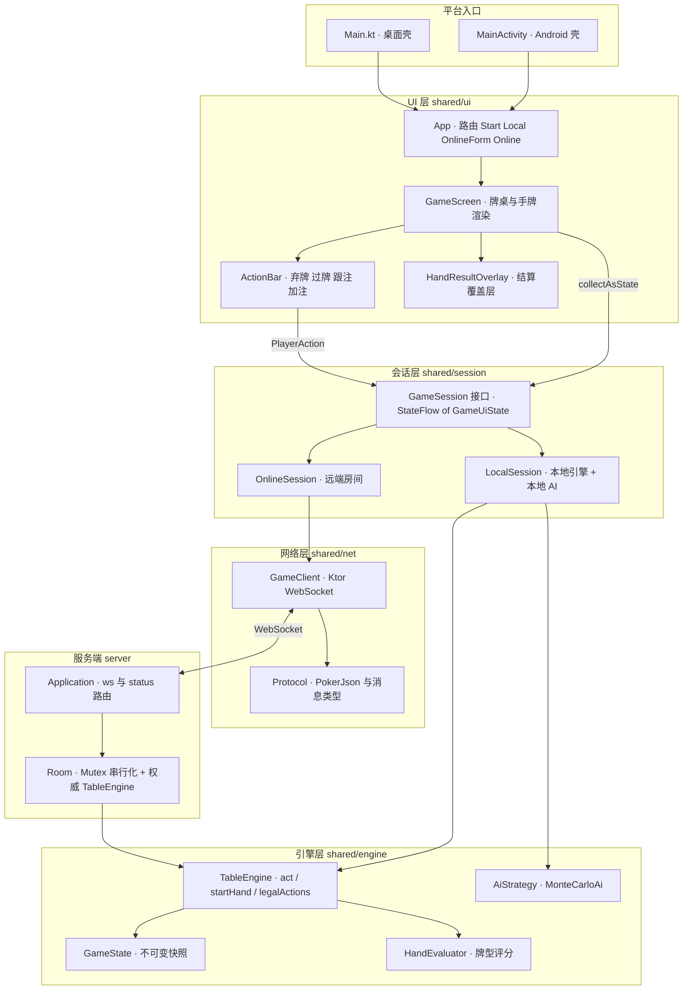
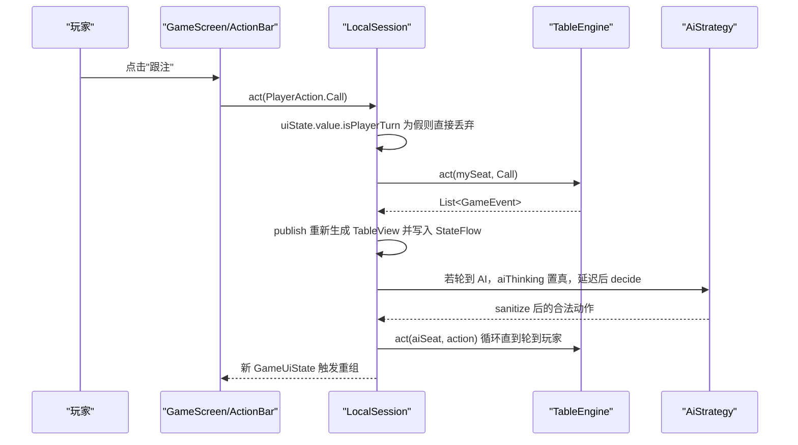
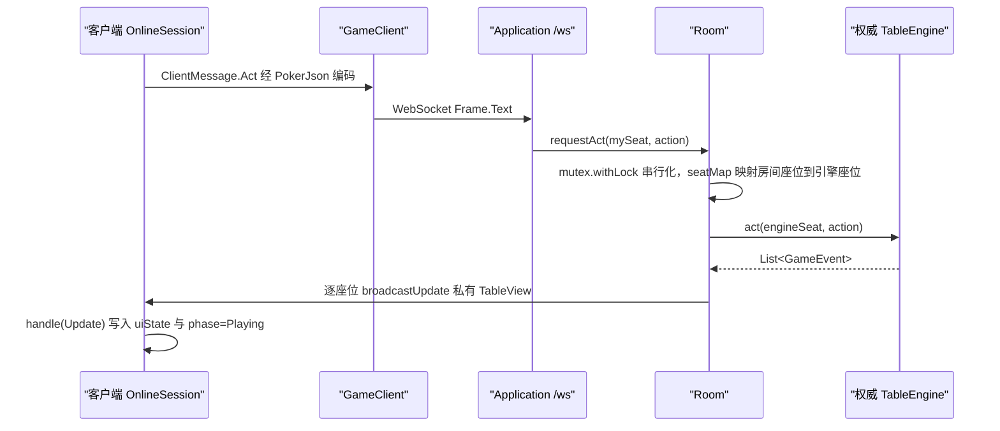

# 架构总览

<cite>
**本文引用的文件**
- [TableEngine.kt](file://shared/src/commonMain/kotlin/com/aniapp/pokerdemo/engine/TableEngine.kt)
- [GameState.kt](file://shared/src/commonMain/kotlin/com/aniapp/pokerdemo/engine/GameState.kt)
- [PlayerAction.kt](file://shared/src/commonMain/kotlin/com/aniapp/pokerdemo/engine/PlayerAction.kt)
- [GameEvent.kt](file://shared/src/commonMain/kotlin/com/aniapp/pokerdemo/engine/GameEvent.kt)
- [Card.kt](file://shared/src/commonMain/kotlin/com/aniapp/pokerdemo/engine/Card.kt)
- [HandEvaluator.kt](file://shared/src/commonMain/kotlin/com/aniapp/pokerdemo/engine/HandEvaluator.kt)
- [GameSession.kt](file://shared/src/commonMain/kotlin/com/aniapp/pokerdemo/session/GameSession.kt)
- [LocalSession.kt](file://shared/src/commonMain/kotlin/com/aniapp/pokerdemo/session/LocalSession.kt)
- [OnlineSession.kt](file://shared/src/commonMain/kotlin/com/aniapp/pokerdemo/session/OnlineSession.kt)
- [Protocol.kt](file://shared/src/commonMain/kotlin/com/aniapp/pokerdemo/net/Protocol.kt)
- [GameClient.kt](file://shared/src/commonMain/kotlin/com/aniapp/pokerdemo/net/GameClient.kt)
- [App.kt](file://shared/src/commonMain/kotlin/com/aniapp/pokerdemo/ui/App.kt)
- [GameScreen.kt](file://shared/src/commonMain/kotlin/com/aniapp/pokerdemo/ui/GameScreen.kt)
- [ActionBar.kt](file://shared/src/commonMain/kotlin/com/aniapp/pokerdemo/ui/action/ActionBar.kt)
- [Room.kt](file://server/src/main/kotlin/com/aniapp/pokerdemo/server/Room.kt)
- [Application.kt](file://server/src/main/kotlin/com/aniapp/pokerdemo/server/Application.kt)
- [MainActivity.kt](file://app/src/main/java/com/aniapp/pokerdemo/MainActivity.kt)
- [Main.kt](file://desktopApp/src/main/kotlin/com/aniapp/pokerdemo/desktop/Main.kt)
- [shared/build.gradle.kts](file://shared/build.gradle.kts)
- [app/build.gradle](file://app/build.gradle)
- [settings.gradle](file://settings.gradle)
</cite>

## 目录
1. [引言](#引言)
2. [分层结构](#分层结构)
3. [组件关系与数据流](#组件关系与数据流)
4. [引擎层：不可变 GameState 与 GameEvent](#引擎层不可变-gamestate-与-gameevent)
5. [会话层：GameSession 与 GameUiState](#会话层gamesession-与-gameuistate)
6. [网络层：序列化协议与 WebSocket 客户端](#网络层序列化协议与-websocket-客户端)
7. [UI 层：路由与单向数据流](#ui-层路由与单向数据流)
8. [服务端：权威引擎与视图广播](#服务端权威引擎与视图广播)
9. [平台入口：Android 与桌面](#平台入口android-与桌面)
10. [依赖与构建配置](#依赖与构建配置)
11. [架构优势](#架构优势)
12. [状态流与性能特性](#状态流与性能特性)
13. [约束条件与已知限制](#约束条件与已知限制)
14. [故障排查指南](#故障排查指南)
15. [演进方向](#演进方向)

## 引言
PokerDemo 是一个 **Kotlin Multiplatform + Compose Multiplatform** 的德州扑克应用，同一套牌局代码同时运行在 Android、桌面 JVM 与服务端。它不再采用"Android 单端 MVVM（ui/vm/data）"的组织方式：`app` 模块只剩 `MainActivity` 一个平台壳，原 `GameViewModel`、`app/.../data/Card`、`BettingManager` 已全部删除，职责被四个跨平台层取代。

当前架构主线是：

- **引擎层 `shared/engine`**：纯 Kotlin，无 Android/Compose 依赖。`TableEngine` 在不可变 `GameState` 上推进牌局（发牌、盲注、下注回合、边池、摊牌、淘汰、对局结束），每次推进返回 `List<GameEvent>`；`PlayerAction`/`LegalActions` 描述动作与合法动作集合；`HandEvaluator` 负责牌型评分；`engine/ai` 提供 `AiStrategy`（`MonteCarloAi`、`RuleBasedAi`）供本地与服务端复用。筹码、底池、下注回合、边池等下注领域语义已内建在引擎中，不存在独立且"待集成"的下注管理器。
- **会话层 `shared/session`**：`GameSession` 接口把"本地引擎"或"远端房间"统一包装成 `StateFlow<GameUiState>`，UI 无需区分单机与联机。
- **网络层 `shared/net`**：`Protocol.kt` 定义 `ClientMessage`/`ServerMessage`/`TableView` 与 kotlinx-serialization 的 `PokerJson`；`GameClient` 是 Ktor WebSocket 客户端。
- **UI 层 `shared/ui`**：`App` 负责 `Start / Local / OnlineForm / Online` 路由，`GameScreen` 观察 `session.uiState` 并渲染牌桌，动作通过 `session::act` 回流到会话层。
- **服务端 `server`**：`Application.kt` 暴露 `/ws` WebSocket 与 `/status` 本地接口；`Room.kt` 每房间持有一个权威 `TableEngine`，用 `Mutex` 串行化所有动作，并为每个座位投影各自的 `TableView` 后广播。

单向数据流依然成立，只是"ViewModel 持有状态"被"会话持有 `StateFlow<GameUiState>`、引擎持有 `GameState`"取代。

## 分层结构
Gradle 模块与代码分层是两套正交的划分。模块关系见 [settings.gradle:27-32](file://settings.gradle#L27-L32)：`app`、`desktopApp`、`server` 都依赖 `shared`，`admin` 是运维面板。

| 层 | 位置 | 关键类型 | 职责 |
|---|---|---|---|
| 引擎层 | `shared/src/commonMain/.../engine` | `TableEngine`、`GameState`、`Phase`、`PlayerAction`、`LegalActions`、`GameEvent`、`Deck`、`HandEvaluator` | 纯规则推进与合法性校验，不依赖任何平台或 UI 框架 |
| AI 层 | `shared/src/commonMain/.../engine/ai` | `AiStrategy`、`AiProfiles`、`AiDifficulty`、`aiViewOf`、`sanitize`、`MonteCarloAi` | 在 `AiView` + `LegalActions` 上产生决策，输出被 `sanitize` 收敛到合法动作 |
| 会话层 | `shared/src/commonMain/.../session` | `GameSession`、`GameUiState`、`LocalSession`、`OnlineSession`、`OnlineConfig`、`emptyTableView` | 把引擎或远端房间包装成 `StateFlow<GameUiState>`，并承接 `act/nextHand/newMatch/dispose` |
| 网络层 | `shared/src/commonMain/.../net` | `PokerJson`、`ClientMessage`、`ServerMessage`、`TableView`、`SeatInfo`、`GameClient` | JSON 协议定义与 Ktor WebSocket 收发 |
| UI 层 | `shared/src/commonMain/.../ui` | `App`、`AppScreen`、`GameScreen`、`ActionBar`、`PokerTable`、`SeatView`、`LobbyView`、`StartScreen` | Compose Multiplatform 渲染与交互派发 |
| 服务端 | `server/src/main/kotlin/.../server` | `Application.module`、`RoomManager`、`Room` | 房间生命周期、权威引擎、串行化动作、按座位广播视图与 AI 代打 |
| 平台壳 | `app`、`desktopApp` | `MainActivity`、`Main.kt` | 仅注入主题、Logo、返回处理与调试参数，然后调用 `App()` |

## 组件关系与数据流

**图表来源**
- [App.kt:42-47](file://shared/src/commonMain/kotlin/com/aniapp/pokerdemo/ui/App.kt#L42-L47)
- [GameScreen.kt:42-48](file://shared/src/commonMain/kotlin/com/aniapp/pokerdemo/ui/GameScreen.kt#L42-L48)
- [GameScreen.kt:135-137](file://shared/src/commonMain/kotlin/com/aniapp/pokerdemo/ui/GameScreen.kt#L135-L137)
- [GameSession.kt:27-33](file://shared/src/commonMain/kotlin/com/aniapp/pokerdemo/session/GameSession.kt#L27-L33)
- [LocalSession.kt:28-46](file://shared/src/commonMain/kotlin/com/aniapp/pokerdemo/session/LocalSession.kt#L28-L46)
- [OnlineSession.kt:35-52](file://shared/src/commonMain/kotlin/com/aniapp/pokerdemo/session/OnlineSession.kt#L35-L52)
- [Room.kt:100-110](file://server/src/main/kotlin/com/aniapp/pokerdemo/server/Room.kt#L100-L110)
- [Application.kt:29-36](file://server/src/main/kotlin/com/aniapp/pokerdemo/server/Application.kt#L29-L36)

一次"玩家点击跟注"的完整闭环在两种模式下形态不同，但入口完全一致：

**图表来源**
- [LocalSession.kt:54-57](file://shared/src/commonMain/kotlin/com/aniapp/pokerdemo/session/LocalSession.kt#L54-L57)
- [LocalSession.kt:76-110](file://shared/src/commonMain/kotlin/com/aniapp/pokerdemo/session/LocalSession.kt#L76-L110)
- [OnlineSession.kt:172-176](file://shared/src/commonMain/kotlin/com/aniapp/pokerdemo/session/OnlineSession.kt#L172-L176)
- [Room.kt:164-178](file://server/src/main/kotlin/com/aniapp/pokerdemo/server/Room.kt#L164-L178)
- [Room.kt:333-347](file://server/src/main/kotlin/com/aniapp/pokerdemo/server/Room.kt#L333-L347)

## 引擎层：不可变 GameState 与 GameEvent
`GameState` 是牌局的唯一权威数据结构，所有字段均为 `val`，引擎通过 `state.copy(...)` 生成新快照，座位级更新统一走 `updateSeat`，因此任意时刻都持有一份可比较、可序列化的完整状态 [TableEngine.kt:320-322](file://shared/src/commonMain/kotlin/com/aniapp/pokerdemo/engine/TableEngine.kt#L320-L322)。底池不落字段，而是由 `players.sumOf { it.totalCommitted }` 派生，边池归边池计算使用同一数据源 [GameState.kt:42-56](file://shared/src/commonMain/kotlin/com/aniapp/pokerdemo/engine/GameState.kt#L42-L56)。

`Phase` 用 `isBetting()` 划定"可行动"阶段（`PREFLOP/FLOP/TURN/RIVER`），`IDLE/SHOWDOWN/HAND_OVER/MATCH_OVER` 则拒绝动作 [GameState.kt:6-9](file://shared/src/commonMain/kotlin/com/aniapp/pokerdemo/engine/GameState.kt#L6-L9)。`PlayerState` 记录 `streetBet`、`totalCommitted`、`hasActedThisRound`、`raiseReopened`、`isAllIn`，正是这几个字段支撑了下注回合结束判定与"加注重新开叫"规则。

引擎对外只有四个方法：

- `startMatch()`：重置牌堆与所有座位的初始筹码 [TableEngine.kt:33-39](file://shared/src/commonMain/kotlin/com/aniapp/pokerdemo/engine/TableEngine.kt#L33-L39)。
- `startHand()`：校验阶段与存活人数，轮转庄家，发两张底牌，按单挑/多人规则放置小盲大盲，确定首个行动者；若首行动者已全下导致回合直接完成，则立即 `advanceStreet` [TableEngine.kt:41-85](file://shared/src/commonMain/kotlin/com/aniapp/pokerdemo/engine/TableEngine.kt#L41-L85)。
- `legalActions(seat)`：仅当轮到自己且处于下注阶段才返回非默认值，并给出 `canFold/canCheck/callAmount/minRaiseTo/maxRaiseTo`；当剩余筹码只够跟注时 `callAmount` 会被压到 `me.chips` [TableEngine.kt:87-100](file://shared/src/commonMain/kotlin/com/aniapp/pokerdemo/engine/TableEngine.kt#L87-L100)。
- `act(seat, action)`：先 `check` 阶段与轮次，再对动作做合法性校验（过牌须无待跟注额、跟注须 `canCall`、加注须落在 `minRaiseTo..maxRaiseTo`），随后按 `roundComplete()` 推进街或交给下一位；弃牌导致只剩一人时直接结算 [TableEngine.kt:102-153](file://shared/src/commonMain/kotlin/com/aniapp/pokerdemo/engine/TableEngine.kt#L102-L153)。

街推进与结算：`advanceStreet` 清空 `streetBet` 与回合标记、逐街烧牌并按 3/1/1 发公共牌；当只剩一名"未弃牌且有筹码"的玩家时进入 `runout` 自动发完剩余牌不再开启下注回合 [TableEngine.kt:201-233](file://shared/src/commonMain/kotlin/com/aniapp/pokerdemo/engine/TableEngine.kt#L201-L233)。`settle` 先退还"无人跟注的多余下注"，再按 `totalCommitted` 分层构造主池与边池、逐层取该层合格者中的最佳 `HandValue.score` 分配，余数按从庄家起的顺序发放，最后判定淘汰与对局结束 [TableEngine.kt:241-313](file://shared/src/commonMain/kotlin/com/aniapp/pokerdemo/engine/TableEngine.kt#L241-L313)。

每一步推进都不返回状态本身，而是返回事件序列：`BlindsPosted`、`HoleCardsDealt`、`ActionTaken`、`StreetDealt`、`UncalledReturned`、`ShowdownRevealed`、`PotAwarded`、`PlayerEliminated`、`HandFinished`、`MatchFinished` [GameEvent.kt:6-27](file://shared/src/commonMain/kotlin/com/aniapp/pokerdemo/engine/GameEvent.kt#L6-L27)。事件与状态分离，使 UI 可以按需消费"发生了什么"，而状态回答"现在是什么"。

领域模型分离在此层体现为三个互不依赖的方向：牌与牌堆 `Card/Suit/Deck` 只提供抽牌与烧牌 [Card.kt:5-35](file://shared/src/commonMain/kotlin/com/aniapp/pokerdemo/engine/Card.kt#L5-L35)；`HandEvaluator.evaluate` 是纯函数，输入 5–7 张牌输出可比较的 `HandValue`（含 `HandCategory`、`tiebreaks`、`bestFive`、`score`）并附带听牌信息 `DrawInfo` 供 AI 使用 [HandEvaluator.kt:6-36](file://shared/src/commonMain/kotlin/com/aniapp/pokerdemo/engine/HandEvaluator.kt#L6-L36)；`TableEngine` 只做规则推进，不含任何渲染或传输代码。`GameState`、`PlayerState`、`Phase`、`HandResult`、`LegalActions`、`PlayerAction`、`GameEvent` 均标注 `@Serializable`，因此同一批引擎类型可直接作为网络协议载荷复用。

## 会话层：GameSession 与 GameUiState
`GameUiState` 是 UI 的唯一输入，由按座位裁剪的 `TableView` 加上会话级元信息组成：`aiThinking`、`lastEvents`、`smallBlind`/`bigBlind`、`online`、`isHost`、`roomCode`，并派生出 `isPlayerTurn`（`table.acting == table.mySeat && table.phase.isBetting()`）、`me` 与 `seatName(seat)` [GameSession.kt:10-25](file://shared/src/commonMain/kotlin/com/aniapp/pokerdemo/session/GameSession.kt#L10-L25)。`GameSession` 接口只暴露 `uiState: StateFlow<GameUiState>` 与 `act/nextHand/newMatch/dispose` 四个动作 [GameSession.kt:27-33](file://shared/src/commonMain/kotlin/com/aniapp/pokerdemo/session/GameSession.kt#L27-L33)；`emptyTableView()` 提供联机连接前的占位视图 [GameSession.kt:35-48](file://shared/src/commonMain/kotlin/com/aniapp/pokerdemo/session/GameSession.kt#L35-L48)。

`LocalSession` 自己持有 `TableEngine`：每次推进后调用 `publish(events)`，用 `engine.toTableView(mySeat)` 重新生成整份视图写入 `MutableStateFlow`，随后 `maybeStartAi()` 接管 AI 回合——若当前行动者不是玩家，则在会话作用域内以 700–1400ms 随机延迟循环决策，`aiThinking` 期间通过 `_uiState.update` 局部更新，蒙特卡洛模拟经 `withContext(aiDispatcher)` 移出 UI 线程，但引擎状态变更仍在原作用域串行执行 [LocalSession.kt:76-110](file://shared/src/commonMain/kotlin/com/aniapp/pokerdemo/session/LocalSession.kt#L76-L110)。`nextHand()` 只在 `Phase.HAND_OVER` 生效，`newMatch()` 会取消 AI 任务、`startMatch()` 后立刻开一手 [LocalSession.kt:59-69](file://shared/src/commonMain/kotlin/com/aniapp/pokerdemo/session/LocalSession.kt#L59-L69)。`defaultEngine(aiCount, newDeck, chips)` 生成"你 + 电脑/电脑N"的座位表，并把调试用牌堆与起始筹码透传给引擎 [LocalSession.kt:112-126](file://shared/src/commonMain/kotlin/com/aniapp/pokerdemo/session/LocalSession.kt#L112-L126)。

`TableEngine.toTableView(mySeat)` 是本地模式下"引擎状态 → 座位视图"的唯一投影：底牌只在 `showdown` 且未弃牌时进入 `revealedHoles`，`legal` 只计算本座位的合法动作，本地场景 `connected` 恒为真 [LocalSession.kt:128-160](file://shared/src/commonMain/kotlin/com/aniapp/pokerdemo/session/LocalSession.kt#L128-L160)。

`OnlineSession` 不持有引擎，只做消息收发与状态落地：连接阶段在 30 秒超时内最多重试 3 次并配合 `PublicAddress.resolve` 更换 DoH 源，失败进入 `Phase.Ended` 并给出面向隧道场景的中文提示；`handle(ServerMessage)` 把 `Joined/Lobby/Update/Error/RoomClosed` 分别映射到座位号、大厅阶段、视图快照与错误 [OnlineSession.kt:73-120](file://shared/src/commonMain/kotlin/com/aniapp/pokerdemo/session/OnlineSession.kt#L73-L120)。手牌结束后服务器会立即广播 `Lobby`，为避免跳过结算覆盖层，`OnlineSession` 将大厅快照暂存到 `pendingLobby`，直到玩家点击"返回大厅"（`backToLobby()`）或出现新的无结果视图才切换阶段 [OnlineSession.kt:121-138](file://shared/src/commonMain/kotlin/com/aniapp/pokerdemo/session/OnlineSession.kt#L121-L138)。网络与 JSON 编解码运行在 `Dispatchers.Default` 的独立作用域，避免与点击、结算重组争抢 UI 帧 [OnlineSession.kt:49-52](file://shared/src/commonMain/kotlin/com/aniapp/pokerdemo/session/OnlineSession.kt#L49-L52)。

## 网络层：序列化协议与 WebSocket 客户端
`PokerJson` 统一了客户端与服务端的 JSON 配置：`classDiscriminator = "type"`、`ignoreUnknownKeys = true`、`encodeDefaults = true`，使密封消息可跨版本宽松解析 [Protocol.kt:14-18](file://shared/src/commonMain/kotlin/com/aniapp/pokerdemo/net/Protocol.kt#L14-L18)。

- 上行 `ClientMessage`：`create`（昵称、`seatCount` 默认 6、`aiFill`、`difficulty`）、`join`、`start`、`act`、`ai_fill`、`leave` [Protocol.kt:21-50](file://shared/src/commonMain/kotlin/com/aniapp/pokerdemo/net/Protocol.kt#L21-L50)。
- 下行 `ServerMessage`：`joined`（房间码、座位号、座位总数）、`lobby`（大厅座位与房主、`aiFill`）、`update`（`TableView` + `List<GameEvent>`）、`error`（`code` + 中文消息）、`closed` [Protocol.kt:86-113](file://shared/src/commonMain/kotlin/com/aniapp/pokerdemo/net/Protocol.kt#L86-L113)。
- 视图 `TableView`/`SeatInfo`：直接复用引擎的 `Card`、`Phase`、`HandResult`、`LegalActions`，并额外携带 `mySeat`、`myHole`、`revealedHoles`，构成"每座位私有视图"的传输单元 [Protocol.kt:52-84](file://shared/src/commonMain/kotlin/com/aniapp/pokerdemo/net/Protocol.kt#L52-L84)。

`GameClient` 基于 Ktor CIO 引擎并安装 `WebSockets`（15 秒 ping），把入站帧解码为 `ServerMessage` 后推入容量 64 的 `MutableSharedFlow`，连接状态由 `StateFlow<Boolean>` 表达，供上层判断断线 [GameClient.kt:20-52](file://shared/src/commonMain/kotlin/com/aniapp/pokerdemo/net/GameClient.kt#L20-L52)。协议层与 UI 之间没有任何耦合：`net` 包只依赖 `engine`。

## UI 层：路由与单向数据流
`App` 用本地 `mutableStateOf<AppScreen>` 承担路由，四个状态分别是 `Start`、`Local(aiCount, difficulty)`、`OnlineForm`、`Online(config)`；`AppScreen.Local` 与 `AppScreen.Online` 在 `remember` 中构造对应 `GameSession`，并用 `DisposableEffect` 在离屏时调用 `session.dispose()` [App.kt:42-47](file://shared/src/commonMain/kotlin/com/aniapp/pokerdemo/ui/App.kt#L42-L47)、[App.kt:75-90](file://shared/src/commonMain/kotlin/com/aniapp/pokerdemo/ui/App.kt#L75-L90)。联机分支再按 `session.phase` 分派到连接中占位、`LobbyView`、`GameScreen` 与结束页，`error` 提示 3 秒后自动清除 [App.kt:95-135](file://shared/src/commonMain/kotlin/com/aniapp/pokerdemo/ui/App.kt#L95-L135)。也就是说，`GameScreen` 对"本地会话/在线会话"完全无感，它只依赖 `GameSession` 接口。

`GameScreen` 的第一行就是 `val ui by session.uiState.collectAsState()`，随后全部渲染都从 `ui.table` 取值：对手座位沿椭圆弧按水平等分槽位布局、公共牌 `BoardRow`、底池用 `animateIntAsState` 平滑过渡、玩家座位与 `ActionBar`、以及 `HandResultOverlay` 的"下一手 / 新对局 / 返回大厅"回调 [GameScreen.kt:48-137](file://shared/src/commonMain/kotlin/com/aniapp/pokerdemo/ui/GameScreen.kt#L48-L137)。对手底牌通过 `opponentHole` 决定显示牌背还是摊牌真牌，其判据只有 `revealedHoles` 与 `folded`，UI 无法看到未摊牌的对手手牌 [GameScreen.kt:141-145](file://shared/src/commonMain/kotlin/com/aniapp/pokerdemo/ui/GameScreen.kt#L141-L145)。

`ActionBar` 是动作的唯一出口：按钮可用性由 `ui.isPlayerTurn && !ui.aiThinking` 与服务端/引擎下发的 `table.legal` 共同决定，加注面板的 `min/max` 直接取 `legal.minRaiseTo/maxRaiseTo`，快捷按钮按"当前下注 + 底池比例"取整到大盲整数倍 [ActionBar.kt:46-72](file://shared/src/commonMain/kotlin/com/aniapp/pokerdemo/ui/action/ActionBar.kt#L46-L72)、[ActionBar.kt:150-175](file://shared/src/commonMain/kotlin/com/aniapp/pokerdemo/ui/action/ActionBar.kt#L150-L175)。点击后只设置 `pending`（按钮内显示进度圈并锁住操作条），再调用 `onAction(action)`；`pending` 在下一次快照到达时清除，并有 2.5 秒超时兜底防止断线锁死。**这是"客户端不做乐观更新"的直接体现：UI 从不自行修改底池或下注额，只等待 `GameUiState` 的新值。**

## 服务端：权威引擎与视图广播
`RoomManager` 用 `ConcurrentHashMap` 保存房间，房间码为 4 位大写字母并在冲突时重取；`create` 在进入前 `require(seatCount in 2..6)`，并按 `AiProfiles.server(difficulty)` 注入服务端 AI 策略 [Room.kt:47-60](file://server/src/main/kotlin/com/aniapp/pokerdemo/server/Room.kt#L47-L60)。

`Room` 是权威状态的持有者：一个房间一套 `TableEngine`，座位表 `seats` 与 `SeatHolder`（昵称、session、`isAi`、`connected`）分离，`seatMap` 负责把"引擎连续座位索引"映射回"房间物理座位"，以支持关闭 AI 补位时的稀疏座位 [Room.kt:100-110](file://server/src/main/kotlin/com/aniapp/pokerdemo/server/Room.kt#L100-L110)。

- **串行化**：`addHuman`、`requestStart`、`requestAct`、`setAiFill`、`disconnected` 与 AI 提交全部包在同一个 `Mutex.withLock` 内，因此引擎推进不存在并发交错 [Room.kt:127-208](file://server/src/main/kotlin/com/aniapp/pokerdemo/server/Room.kt#L127-L208)。
- **开局**：`requestStart` 只允许房主触发，对局进行中拒绝重复开始；开启 `aiFill` 时用 `AI-<序号>` 补满空座位，关闭时要求至少两名真人；若座位名单与既有引擎一致则复用引擎（`MATCH_OVER` 时 `startMatch()`），否则新建 [Room.kt:136-162](file://server/src/main/kotlin/com/aniapp/pokerdemo/server/Room.kt#L136-L162)。
- **非法动作处理**：`requestAct` 捕获引擎抛出的 `IllegalStateException`，以 `error("illegal_action", message)` 单点回给发起者，不影响其他人 [Room.kt:164-178](file://server/src/main/kotlin/com/aniapp/pokerdemo/server/Room.kt#L164-L178)。
- **AI 代打**：`maybeAiLoop` 在锁内采集 `AiSnapshot`（引擎座位、`AiView`、`LegalActions`、`fingerprintOf` 生成的状态指纹），把蒙特卡洛计算放到锁外，再回锁校验指纹；不一致则返回 `STALE` 并重采（最多 8 次），一致才 `act` 并广播。决策异常时降级为跟注/过牌/弃牌 [Room.kt:224-311](file://server/src/main/kotlin/com/aniapp/pokerdemo/server/Room.kt#L224-L311)。
- **按座位投影**：`viewFor(e, seat)` 为每个连接的人类单独生成 `TableView`，`myHole` 只取本座位底牌，`result` 中的座位号经 `seatMap` 回映射，`revealedHoles` 仅在 `showdown` 时填充；`broadcastUpdate` 逐座位发送，发送失败即把该座位标记为 `connected = false, isAi = true` [Room.kt:333-388](file://server/src/main/kotlin/com/aniapp/pokerdemo/server/Room.kt#L333-L388)。
- **断线与收尾**：一手结束（非下注阶段）后 `endHand` 清空 AI 与离线座位、重选房主，无人时 `close()` 发送 `closed` 并注销房间；对局中断线则保留筹码与手牌，把座位转交 AI 继续行动，若正好轮到该座位则立即启动 AI 循环 [Room.kt:189-208](file://server/src/main/kotlin/com/aniapp/pokerdemo/server/Room.kt#L189-L208)、[Room.kt:313-331](file://server/src/main/kotlin/com/aniapp/pokerdemo/server/Room.kt#L313-L331)。

传输层在 `Application.kt`：`embeddedServer(CIO, 8080, "0.0.0.0")` 安装 `WebSockets`（15 秒 ping、30 秒超时）与 `ContentNegotiation`；`/status` 仅允许不带代理头的 loopback 访问（供 `admin` 读取 `RoomManager.snapshotAll()`），`/ws` 把解码后的 `ClientMessage` 直接派发到 `Room`，解码失败回 `bad_message`，连接结束在 `finally` 中调用 `disconnected`；昵称统一 `trim().take(12)` [Application.kt:23-49](file://server/src/main/kotlin/com/aniapp/pokerdemo/server/Application.kt#L23-L49)、[Application.kt:70-121](file://server/src/main/kotlin/com/aniapp/pokerdemo/server/Application.kt#L70-L121)。

## 平台入口：Android 与桌面
两个平台壳都不参与牌局逻辑，只把 `App()` 接入各自运行时：

- **Android**：`MainActivity.onCreate` 调用 `enableEdgeToEdge()`，读取 intent 中的 `scenario` 参数（形如 `As Ah|Ks Kh|2c 3d 4h 5s 6c`），随后 `setContent { PokerDemoTheme { App(...) } }`，注入 `versionText`、`logo`、`autoStartLocal`、`autoStartAiCount`、`scenarioDeck`、`scenarioChips` 与 `backHandler` [MainActivity.kt:22-50](file://app/src/main/java/com/aniapp/pokerdemo/MainActivity.kt#L22-L50)。真机验证钩子仅在 `FLAG_DEBUGGABLE` 包生效：`scenarioDeck` 解析各座位底牌与五行公共牌，用 `createDeck()` 过滤掉已用牌取三张作为烧牌，按 `烧牌-翻牌-烧牌-转牌-烧牌-河牌` 顺序构造确定性 `Deck`，并通过 `LocalSession.defaultEngine(aiCount, newDeck, chips)` 传给引擎 [MainActivity.kt:51-67](file://app/src/main/java/com/aniapp/pokerdemo/MainActivity.kt#L51-L67)、[MainActivity.kt:70-90](file://app/src/main/java/com/aniapp/pokerdemo/MainActivity.kt#L70-L90)。注意这里注入的是**牌堆工厂 `() -> Deck`**，因此 `startHand()` 每手重新取牌仍能复现同一序列。
- **桌面**：`Main.kt` 以 `application { Window(...) { PokerDemoTheme { App() } } }` 直接复用同一 `App`，不传任何调试参数 [Main.kt:10-18](file://desktopApp/src/main/kotlin/com/aniapp/pokerdemo/desktop/Main.kt#L10-L18)。

## 依赖与构建配置
`shared` 使用 `kotlin.multiplatform` + `android.library` + `kotlin.compose` + `compose.multiplatform` + `kotlin.serialization` 插件，同时声明 `androidTarget()` 与 `jvm("desktop")` 两个目标，因此引擎、会话、网络、UI 四层全部位于 `commonMain`，Android APK 与桌面 jar 共享同一份实现 [shared/build.gradle.kts:3-20](file://shared/build.gradle.kts#L3-L20)。`commonMain` 依赖 Compose 运行时/基础/`material3`/`ui`、Ktor client（core、cio、websockets、content-negotiation、kotlinx-json 序列化）、`kotlinx-serialization-json` 与 `kotlinx-coroutines-core`；`androidMain` 追加 `coroutines-android`，`desktopMain` 追加 `coroutines-swing`，`desktopTest` 引入 `compose.desktop.currentOs` [shared/build.gradle.kts:21-50](file://shared/build.gradle.kts#L21-L50)。

`app` 模块只 `implementation project(':shared')` 加上 activity-compose、lifecycle-runtime-ktx、coroutines-android，没有任何牌局源码目录 [app/build.gradle:64-71](file://app/build.gradle#L64-L71)。这一依赖形态本身即是架构约束的证据：**要在客户端"偷偷"推进牌局是不可能的，因为客户端只拿到会话与视图，规则实现虽然共享，但联机模式的引擎实例只存在于服务端进程。**

## 架构优势
1. **同一份规则代码三处复用**：`LocalSession` 与 `Room` 都调用 `TableEngine` + `AiStrategy` + `aiViewOf/sanitize`，本地 AI 与线上代打 AI 行为一致；单机对局与联机对局的规则差异为零。
2. **引擎零平台依赖**：`engine` 包只依赖 `kotlin.random` 与 `kotlinx.serialization` 注解，可放在 `commonTest` 与 `server/src/test` 中直接从两侧测试，无需 Robolectric 或 Compose 测试框架。
3. **不可变状态 + 事件流**：`GameState` 全 `val` 且以 `copy` 演进，配合 `List<GameEvent>`，让"状态快照"与"过程记录"各得其所；`Room.fingerprintOf` 正是依赖可比较的快照才能安全地把重计算挪到锁外。
4. **合法动作显式建模**：`LegalActions` 由引擎计算、由服务端按座位下发、由 `ActionBar` 直接驱动按钮状态，避免了客户端本地重算规则造成的分歧。
5. **按座位的信息裁剪**：`TableView.myHole` 与 `revealedHoles` 使隐藏信息在服务端出口处就被处理，UI 与网络层都拿不到不该看到的底牌。
6. **UI 与传输无关**：`GameScreen` 只依赖 `GameSession` 接口，新增会话实现（如回放、训练模式、AI 陪打）不需要改 UI。

## 状态流与性能特性
- 状态入口单一：`GameScreen` 通过 `collectAsState()` 订阅 `StateFlow<GameUiState>`，Compose 依据新快照做细粒度重组；牌桌数据是不可变值对象，等值判断天然可靠。
- 引擎快照整体替换：`LocalSession.publish` 每次都构造全新的 `GameUiState`，仅 `aiThinking` 用 `_uiState.update` 局部改写，避免中间态。
- 重计算离开 UI 线程：本地蒙特卡洛通过 `withContext(aiDispatcher)` 切到 `Dispatchers.Default`；`OnlineSession` 的连接、收包与 JSON 编解码也运行在独立作用域。
- 服务端锁粒度：`Room` 只在"采集快照"和"提交动作"两段持锁，蒙特卡洛决策在锁外执行，因此 AI 思考不会阻塞人类动作 [Room.kt:255-311](file://server/src/main/kotlin/com/aniapp/pokerdemo/server/Room.kt#L255-L311)。
- 布局尺寸随容器变化：`GameScreen` 用 `BoxWithConstraints` 依据 `maxWidth/maxHeight` 推导 `CardSize` 与座位槽宽，窗口尺寸或方向改变会触发这段布局重算，属于预期行为。
- 视图为全量广播：每次推进向每个连接座位发送完整 `TableView`（含座位列表、公共牌、结算信息），座位数上限为 6，帧体很小，无需增量 diff。

## 约束条件与已知限制
1. **座位数固定 2–6**：`TableEngine` 的 `init` 直接 `require(players.size in 2..6)`，服务端在建房时同样校验（`RoomManager.create` 与 `CreateRoom` 分别返回 `require` 失败与 `bad_seat_count`），全下桌、单挑之外的形态均需修改引擎与协议默认值 [TableEngine.kt:19-21](file://shared/src/commonMain/kotlin/com/aniapp/pokerdemo/engine/TableEngine.kt#L19-L21)、[Room.kt:51-52](file://server/src/main/kotlin/com/aniapp/pokerdemo/server/Room.kt#L51-L52)。
2. **盲注与筹码结构由 `GameConfig` 固定**：默认 `startingChips = 2000`、`smallBlind = 10`、`bigBlind = 20`，没有盲注级别随手数上升的机制；`Room` 创建引擎时只传座位名单与随机源，联机房间无法自定义盲注结构 [TableEngine.kt:5-9](file://shared/src/commonMain/kotlin/com/aniapp/pokerdemo/engine/TableEngine.kt#L5-L9)、[Room.kt:149-154](file://server/src/main/kotlin/com/aniapp/pokerdemo/server/Room.kt#L149-L154)。起始筹码可覆写只存在于本地调试路径（`PlayerInit.chips` + `scenarioChips`）。
3. **断线座位由 AI 代打**：对局中断线的座位被置为 `connected = false, isAi = true` 并清空 session，之后由服务端 AI 循环接管；一手结束（`endHand`）时该座位被直接释放，原玩家既不能中途重连回原座位，也不会在下一手自动恢复身份 [Room.kt:189-208](file://server/src/main/kotlin/com/aniapp/pokerdemo/server/Room.kt#L189-L208)、[Room.kt:313-325](file://server/src/main/kotlin/com/aniapp/pokerdemo/server/Room.kt#L313-L325)。
4. **客户端不做乐观更新**：`LocalSession.act` 与 `OnlineSession.act` 都在 `isPlayerTurn` 为假时静默丢弃；线上模式下筹码、底池、街推进只在收到 `ServerMessage.Update` 后才变化，UI 侧仅有 `pending` 按钮态，2.5 秒后自动解锁 [LocalSession.kt:54-57](file://shared/src/commonMain/kotlin/com/aniapp/pokerdemo/session/LocalSession.kt#L54-L57)、[OnlineSession.kt:172-176](file://shared/src/commonMain/kotlin/com/aniapp/pokerdemo/session/OnlineSession.kt#L172-L176)、[ActionBar.kt:50-69](file://shared/src/commonMain/kotlin/com/aniapp/pokerdemo/ui/action/ActionBar.kt#L50-L69)。
5. **加入与开局的权限约束**：仅房主可 `StartHand`/`SetAiFill`，非房主得到 `not_host`；`inHand` 期间禁止加入（`addHuman` 抛 `RoomException` → `join_failed`）；关闭 `aiFill` 时真人不足 2 人无法开始（`need_players`）[Room.kt:127-145](file://server/src/main/kotlin/com/aniapp/pokerdemo/server/Room.kt#L127-L145)。
6. **房间为进程内内存态**：`RoomManager` 只持有 `ConcurrentHashMap`，服务重启后房间与牌局全部丢失；`/ws` 无鉴权、无回放，`/status` 仅按 loopback 与代理头判定可访问性 [Room.kt:47-49](file://server/src/main/kotlin/com/aniapp/pokerdemo/server/Room.kt#L47-L49)、[Application.kt:38-48](file://server/src/main/kotlin/com/aniapp/pokerdemo/server/Application.kt#L38-L48)。
7. **牌型评估的输入范围受限**：`HandEvaluator.evaluate` 要求 5–7 张牌，因此翻牌前无法评估成牌强度，AI 需要另行依赖 `DrawInfo` 与蒙特卡洛模拟器；标准 52 张牌与固定 2 张底牌同理。
8. **错误以异常 + 字符串消息表达**：引擎用 `IllegalStateException` 携带中文消息，服务端把它转成 `illegal_action` 的 `message` 字段，客户端直接显示；协议中没有结构化的错误码枚举，文案与逻辑仍在服务端拼接。
9. **调试注入仅 Android debug 包**：`scenarioDeck`/`scenarioChips` 依赖 `FLAG_DEBUGGABLE`，桌面入口 `Main.kt` 未暴露等价参数，桌面端只能跑随机牌局 [MainActivity.kt:55-67](file://app/src/main/java/com/aniapp/pokerdemo/MainActivity.kt#L55-L67)。

## 故障排查指南
| 现象 | 可能原因 | 排查建议 |
|---|---|---|
| 按钮可点但牌局不动作 | `ui.isPlayerTurn` 为假（`table.acting != mySeat` 或阶段非下注期），`act()` 直接丢弃 | 确认 `table.acting`、`table.phase`；检查是否被 `aiThinking` 或 `pending` 锁住 |
| 加注按钮始终禁用 | `LegalActions.canRaise` 为假：`maxTo <= currentBet`，或本回合已行动且无人重新开叫 | 查看 `legal.minRaiseTo/maxRaiseTo` 是否为 null，理解 `raiseReopened` 规则 |
| 提示"非法动作" | 客户端快照过期后提交的 `RaiseTo` 落在合法区间之外，或服务端阶段已推进 | 以最新快照的 `legal` 为准重试；必要时检查 `minRaiseTo` 是否随 `lastRaiseSize` 改变 |
| 本地点击"下一手"无反应 | `nextHand()` 只在 `Phase.HAND_OVER` 生效；对局已结束时处于 `MATCH_OVER` | 改走 `HandResultOverlay` 的"新对局"（`newMatch()`） |
| 联机无法加入房间 | 房间满、对局进行中、房间码不存在或大小写/空格问题 | `manager.get` 会 `trim().uppercase()`；`addHuman` 的两种 `RoomException` 对应"房间已满""对局进行中，无法加入" |
| 无法开局 | 非房主、已开局、或关闭 AI 补位后真人不足 2 人 | 依据 `not_host`/`already_started`/`need_players` 三种错误码区分 |
| 摊牌看不到对手底牌 | `revealedHoles` 仅在 `showdown` 且未弃牌时填充；弃牌者永不亮牌 | 检查 `SeatInfo.folded` 与 `TableView.revealedHoles` 键集合 |
| 断线后手牌被自动打出 | 座位被置 `isAi = true` 并由 `maybeAiLoop` 接管，属于设计行为 | 一手结束后该座位被 `endHand` 释放，需重新进入大厅入坐 |
| 结算覆盖层被大厅页顶掉 | 服务器在手牌结束后立即广播 `Lobby`；`OnlineSession` 用 `pendingLobby` 暂存 | 确认 `backToLobby()` 被调用，或新视图 `result == null` 后才会切换阶段 |
| 连接失败提示隧道地址过期 | `wss` 快速隧道每次重启地址会变，重试 3 次仍失败 | 依据 `config.secure` 更新地址或开启 `autoDiscovery` 让 `PublicAddress.resolve` 换 DoH 源重解析 |

## 演进方向
1. **盲注结构可配置**：把 `GameConfig` 提升为房间级参数并纳入 `CreateRoom` 协议，支持盲注递增与锦标赛时长。
2. **座位身份与断线重连**：为座位引入令牌，使 `disconnected` 的座位在 `endHand` 后可被原玩家认领，替代当前"释放 + 重新入坐"的方式。
3. **错误码结构化**：把 `illegal_action` 等中文消息改为错误码 + 本地文案表，使多语言不依赖服务端字符串。
4. **事件驱动的动效**：`GameUiState.lastEvents` 已经把事件送达 UI，可据此驱动底池动画、发牌动画与动作气泡，替代当前以快照对比为主的渲染。
5. **房间持久化与多进程**：为 `RoomManager` 增加可插拔的存储后端，使房间状态可跨进程/重启恢复。
6. **协议增量**：在座位数或手数增加后，可把 `ServerMessage.Update` 扩展为 `full/delta` 两种形态，同时保留 `TableView` 作为可校验的全量兜底。
7. **更多会话实现**：借助 `GameSession` 接口新增复盘、训练（手牌范围练习）或托管观战模式，无需改动 `GameScreen` 与 `ActionBar`。