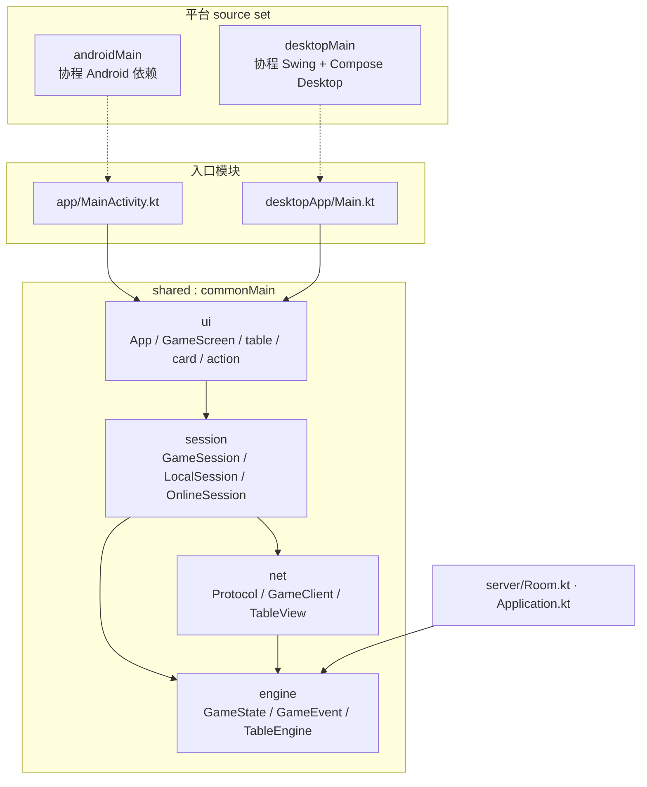
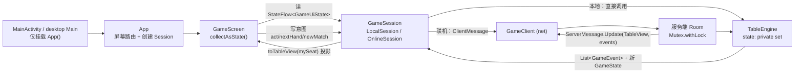
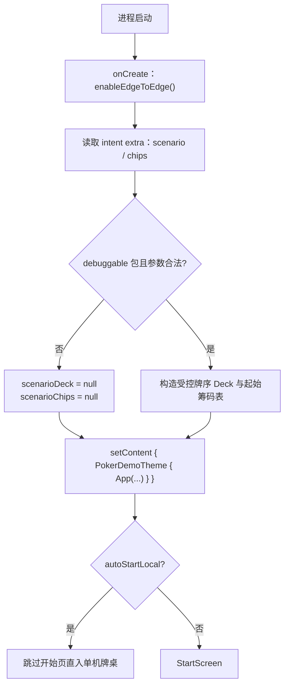
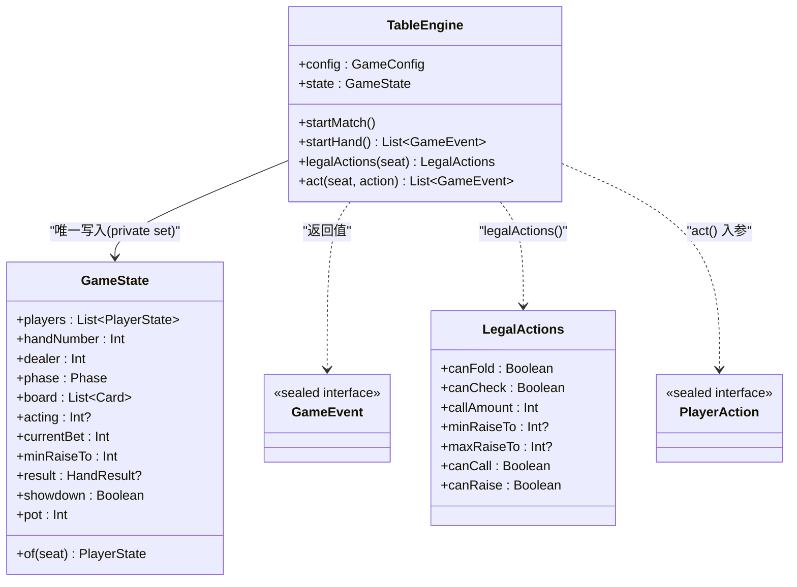
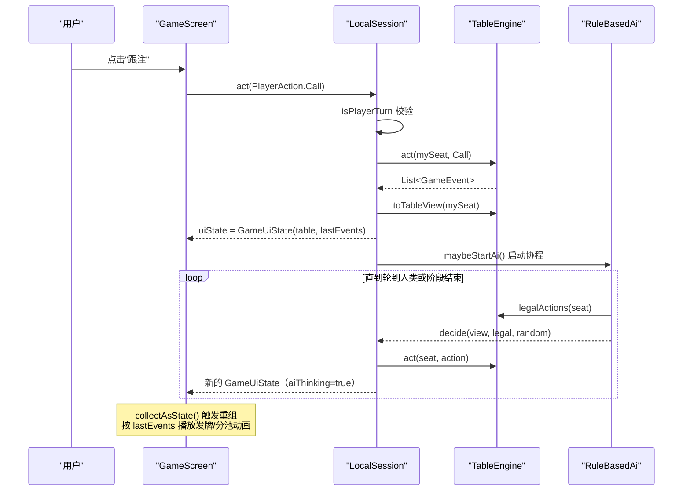
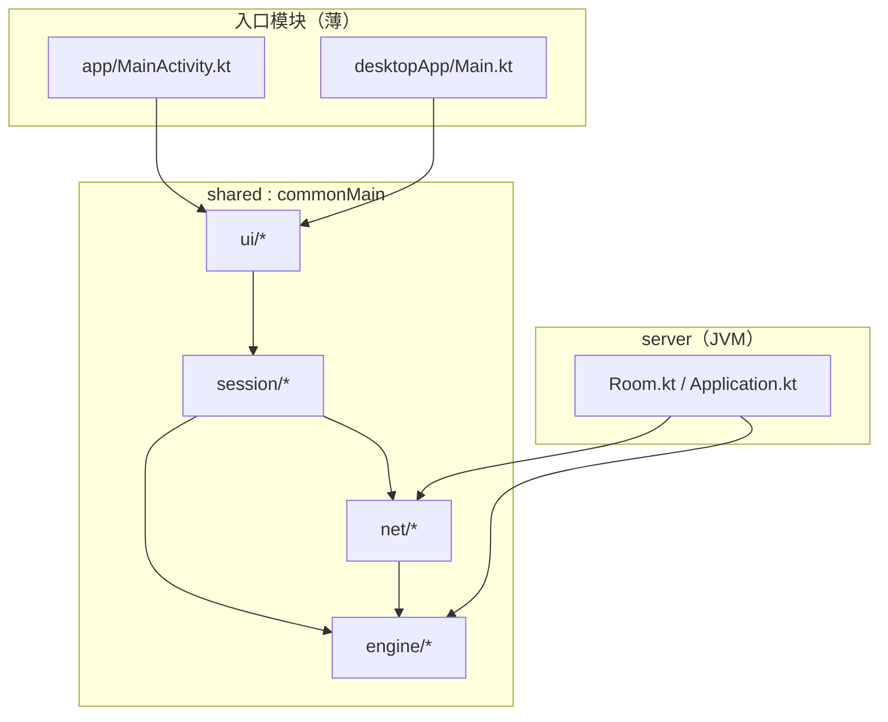

# 架构模式与分层设计

<cite>
**本文引用的文件**
- [MainActivity.kt](file://app/src/main/java/com/aniapp/pokerdemo/MainActivity.kt)
- [Main.kt](file://desktopApp/src/main/kotlin/com/aniapp/pokerdemo/desktop/Main.kt)
- [shared/build.gradle.kts](file://shared/build.gradle.kts)
- [TableEngine.kt](file://shared/src/commonMain/kotlin/com/aniapp/pokerdemo/engine/TableEngine.kt)
- [GameState.kt](file://shared/src/commonMain/kotlin/com/aniapp/pokerdemo/engine/GameState.kt)
- [GameEvent.kt](file://shared/src/commonMain/kotlin/com/aniapp/pokerdemo/engine/GameEvent.kt)
- [PlayerAction.kt](file://shared/src/commonMain/kotlin/com/aniapp/pokerdemo/engine/PlayerAction.kt)
- [GameSession.kt](file://shared/src/commonMain/kotlin/com/aniapp/pokerdemo/session/GameSession.kt)
- [LocalSession.kt](file://shared/src/commonMain/kotlin/com/aniapp/pokerdemo/session/LocalSession.kt)
- [OnlineSession.kt](file://shared/src/commonMain/kotlin/com/aniapp/pokerdemo/session/OnlineSession.kt)
- [Protocol.kt](file://shared/src/commonMain/kotlin/com/aniapp/pokerdemo/net/Protocol.kt)
- [GameScreen.kt](file://shared/src/commonMain/kotlin/com/aniapp/pokerdemo/ui/GameScreen.kt)
- [App.kt](file://shared/src/commonMain/kotlin/com/aniapp/pokerdemo/ui/App.kt)
- [Room.kt](file://server/src/main/kotlin/com/aniapp/pokerdemo/server/Room.kt)
</cite>

## 目录
1. [简介](#简介)
2. [项目结构](#项目结构)
3. [核心组件](#核心组件)
4. [架构总览](#架构总览)
5. [详细组件分析](#详细组件分析)
6. [依赖关系分析](#依赖关系分析)
7. [性能考虑](#性能考虑)
8. [故障排查指南](#故障排查指南)
9. [结论](#结论)

## 简介
PokerDemo 是一个 Kotlin Multiplatform（KMP）项目：**全部业务逻辑与 UI 都写在 `shared` 模块的 `commonMain` 里，Android 与 Desktop 只是两个"壳"入口**。早期版本采用 Android 单平台的 MVVM（Activity → ViewModel → data 包），当前实现已经不再使用 ViewModel：牌桌状态由纯 Kotlin 引擎持有，UI 通过 `GameSession` 接口消费一个 `StateFlow<GameUiState>`。

当前的分层依据是 **source set 而不是 Gradle module**：

- `commonMain` 承载领域模型与规则计算（`engine`）、会话编排（`session`）、网络协议与客户端（`net`）、Compose 展示层（`ui`）。这些代码同时编译进 Android AAR 和 Desktop JAR。
- `androidMain` / `desktopMain` 只补充平台相关依赖（协程 dispatcher、Swing runtime）与入口，不承载任何牌局逻辑。
- `server` 是独立的 JVM Ktor 应用，直接复用同一份 `engine` 代码作为唯一权威裁判。

关键的模式转变有三点：

1. **不再由 ViewModel 持有 `mutableStateOf` 字段**。状态是一份不可变的 `GameState`，只有引擎能写入（`state` 为 `private set`）。
2. **规则结果以事件日志表达**。引擎的每个动作返回 `List<GameEvent>`，UI 侧用 `lastEvents` 驱动动画与提示，而不是靠比较前后状态猜测发生了什么。
3. **合法性是查询契约而非分支判断**。UI 通过纯函数 `legalActions(seat)` 拿到 `LegalActions` 来决定按钮是否可用，服务端在 `act()` 中再次校验，客户端无法伪造动作。

依赖方向固定为 `ui → session → engine`，`net` 作为 `session` 的一种传输实现存在；跨层反向引用在本项目中不存在，因此不需要额外规则来阻断循环依赖。

## 项目结构
Gradle 层面的模块划分刻意保持扁平：只有一个 `shared` 多平台库被两端复用，`app` 与 `desktopApp` 各自只剩入口文件。



**图表来源**
- [shared/build.gradle.kts:11-53](file://shared/build.gradle.kts#L11-L53)
- [MainActivity.kt:23-50](file://app/src/main/java/com/aniapp/pokerdemo/MainActivity.kt#L23-L50)
- [Main.kt:10-17](file://desktopApp/src/main/kotlin/com/aniapp/pokerdemo/desktop/Main.kt#L10-L17)
- [Room.kt:1-15](file://server/src/main/kotlin/com/aniapp/pokerdemo/server/Room.kt#L1-L15)

实际源码组织如下：

| 路径 | 所属 source set / 模块 | 职责 | 主要类型 |
|---|---|---|---|
| `shared/.../engine/` | `commonMain` | 领域模型、规则计算、事件生成 | `GameState`、`PlayerState`、`Phase`、`GameEvent`、`PlayerAction`、`LegalActions`、`TableEngine`、`HandEvaluator`、`ai/RuleBasedAi` |
| `shared/.../session/` | `commonMain` | 业务流程编排、UI 状态容器 | `GameSession`、`GameUiState`、`LocalSession`、`OnlineSession`、`toTableView()` |
| `shared/.../net/` | `commonMain` | 线协议与 WebSocket 客户端 | `ClientMessage`、`ServerMessage`、`TableView`、`SeatInfo`、`GameClient`、`PokerJson` |
| `shared/.../ui/` | `commonMain` | Compose 展示组件 | `App`、`GameScreen`、`table/PokerTable`、`table/SeatView`、`card/*`、`action/ActionBar`、`lobby/*`、`overlay/*`、`theme/*` |
| `shared/.../build.gradle.kts` | — | 声明 `androidTarget` + `jvm("desktop")` 及按 source set 划分的依赖 | — |
| `app/src/main/java/com/aniapp/pokerdemo/` | Android 入口模块 | `ComponentActivity` + `setContent`，附带 adb 场景注入 | `MainActivity` |
| `desktopApp/src/main/kotlin/.../desktop/` | Desktop 入口模块 | `application { Window { PokerDemoTheme { App() } } }` | `main()` |
| `server/src/main/kotlin/.../server/` | 独立 JVM 模块 | 房间生命周期、串行化引擎调用、按座位投影视图 | `RoomManager`、`Room`、`module()` |

注意 `shared/build.gradle.kts` 中的依赖也按 source set 声明：`compose.runtime/foundation/material3/ui`、`ktor-client-*`、`kotlinx-serialization-json`、`kotlinx-coroutines-core` 全部落在 `commonMain`，而 `coroutines-android` 与 `coroutines-swing` 分别只在 `androidMain` 和 `desktopMain` 出现——这正是"分层依据从 module 变为 source set"的直接体现。

**章节来源**
- [shared/build.gradle.kts:11-53](file://shared/build.gradle.kts#L11-L53)
- [MainActivity.kt:1-50](file://app/src/main/java/com/aniapp/pokerdemo/MainActivity.kt#L1-L50)
- [Main.kt:1-18](file://desktopApp/src/main/kotlin/com/aniapp/pokerdemo/desktop/Main.kt#L1-L18)

## 核心组件
| 层级 | 关键文件 | 主要职责 | 是否包含业务状态 | 对外暴露方式 |
|---|---|---|---|---|
| 平台入口 | `MainActivity.kt`、`desktop/Main.kt` | 创建窗口/Activity，挂载 `App()`，传入平台资源与调试参数 | 否 | `setContent` / `application` |
| UI 层 | `App.kt`、`GameScreen.kt`、`ui/table`、`ui/card`、`ui/action` | 渲染牌桌、座位、牌面、操作条；发送用户意图 | 仅屏幕路由等纯 UI 状态 | `@Composable`，接收 `GameSession` |
| session 层 | `GameSession.kt`、`LocalSession.kt`、`OnlineSession.kt` | 持有并推送 `StateFlow<GameUiState>`；把 `act/nextHand/newMatch` 转成引擎调用或网络消息；驱动 AI 思考节奏 | 是（UI 状态的唯一来源） | `interface GameSession` |
| net 层 | `Protocol.kt`、`GameClient.kt` | 定义可序列化的 `TableView`/消息；提供 WebSocket 传输 | 否 | `sealed interface` + `@Serializable data class` |
| engine 层 | `TableEngine.kt`、`GameState.kt`、`GameEvent.kt`、`HandEvaluator.kt`、`ai/*` | 发牌、下注轮转、边池结算、牌型评估、合法动作查询 | 是（唯一权威状态） | `val state`（`private set`）、`fun act/legalActions/startHand/startMatch` |
| server | `Room.kt`、`Application.kt` | 房间与座位管理、`Mutex` 串行化、按观众座位裁剪 `TableView` | 是（持有服务端 `TableEngine`） | Ktor `/ws` WebSocket 路由 |

**章节来源**
- [GameSession.kt:11-36](file://shared/src/commonMain/kotlin/com/aniapp/pokerdemo/session/GameSession.kt#L11-L36)
- [TableEngine.kt:13-30](file://shared/src/commonMain/kotlin/com/aniapp/pokerdemo/engine/TableEngine.kt#L13-L30)
- [Room.kt:63-80](file://server/src/main/kotlin/com/aniapp/pokerdemo/server/Room.kt#L63-L80)

## 架构总览
数据流是单向闭环：**意图向下、状态向上**。



**图表来源**
- [App.kt:47-80](file://shared/src/commonMain/kotlin/com/aniapp/pokerdemo/ui/App.kt#L47-L80)
- [GameScreen.kt:42-48](file://shared/src/commonMain/kotlin/com/aniapp/pokerdemo/ui/GameScreen.kt#L42-L48)
- [GameSession.kt:28-36](file://shared/src/commonMain/kotlin/com/aniapp/pokerdemo/session/GameSession.kt#L28-L36)
- [LocalSession.kt:25-81](file://shared/src/commonMain/kotlin/com/aniapp/pokerdemo/session/LocalSession.kt#L25-L81)
- [OnlineSession.kt:84-99](file://shared/src/commonMain/kotlin/com/aniapp/pokerdemo/session/OnlineSession.kt#L84-L99)
- [TableEngine.kt:24-30](file://shared/src/commonMain/kotlin/com/aniapp/pokerdemo/engine/TableEngine.kt#L24-L30)
- [Room.kt:119-133](file://server/src/main/kotlin/com/aniapp/pokerdemo/server/Room.kt#L119-L133)

### 为什么不再用 ViewModel 作为状态容器
`ViewModel` 解决的是"配置变更后状态存活"和"状态与 UI 控件解耦"两个问题，但在 KMP 结构中它带来额外成本：

1. **平台绑定**：`androidx.lifecycle.ViewModel` 只存在于 Android target，`commonMain` 无法引用；Desktop 端需要另一套等价物，反而破坏"一份代码两端跑"。
2. **状态所有权模糊**：`mutableStateListOf<Card>` 让 UI 侧的对象成为状态的宿主，任何持有 ViewModel 的地方都能改写牌局，规则约束只能散落在各个方法里。
3. **无法服务联机模式**：联网时权威状态在服务端，客户端 ViewModel 只会变成一份可能过期的副本。

替代方案是把"状态容器"的职责交给 `GameSession`：它是一个纯 Kotlin 接口，`uiState: StateFlow<GameUiState>` 天然可被 Compose 的 `collectAsState()` 观察，而 `LocalSession` / `OnlineSession` 两个实现分别对应单机与联机，UI 完全无感。

### 为什么 UI 层只消费状态而不直接操作牌数据
- UI 拿到的不是 `GameState`，而是 `TableView`——一份**按观众座位裁剪过的投影**：`myHole` 只含自己的底牌，对手的 `hole` 被剥离，仅在 `showdown` 时通过 `revealedHoles` 补回。
- UI 甚至拿不到 `deck`，也无法构造 `Card` 塞进牌桌；能表达的只有 `PlayerAction.Fold/Check/Call/RaiseTo(amount)` 四种意图。
- 按钮可用性来自 `ui.table.legal`，即引擎给出的 `LegalActions`；`GameScreen` 里的回合判定使用 `ui.isPlayerTurn`（`table.acting == table.mySeat && table.phase.isBetting()`）。
- 服务端 `Room.viewFor()` 对每个连接单独生成视图，并把引擎座位索引翻译回房间座位号，因此不同玩家收到的 `TableView` 内容本就不同，UI 无从"越权查看"。

这套约束使"显示"与"修改牌"在类型层面就是分离的，而不是靠约定。

### 与传统 View + Fragment 架构的对比
| 对比维度 | 传统 View + Fragment（Android 单平台） | 当前 KMP + Compose + Session |
|---|---|---|
| 状态宿主 | Activity/Fragment/ViewModel 各持一部分，`savedInstanceState` 手写恢复 | `TableEngine.state` 唯一，UI 侧只有一份 `StateFlow` |
| 变更通知 | 手动 `setText`/`notifyDataSetChanged`，或 LiveData 分片 | 不可变快照替换，Compose 自动重组 |
| 规则位置 | 常与 UI 事件回调混写 | 全在 `commonMain/engine`，纯函数可单测 |
| 跨平台 | 需重写 iOS/Desktop | 同一 `commonMain` 编译到 Android 与 Desktop |
| 联机扩展 | 需在 VM 内塞入网络与冲突合并 | 新增 `GameSession` 实现即可，UI 不改 |
| 生命周期 | Fragment 事务与返回栈复杂 | 屏幕切换是 `App` 内的 `AppScreen` 密封值 |
| 可测试性 | 需要 Robolectric/Espresso 才能覆盖流程 | `commonTest` 直接跑引擎与会话（如 `MultiPlayerTableEngineTest`、`LocalSessionTest`） |

对一个小型德州扑克演示应用而言，收益最大的一点是：**同一个引擎既能在本地对战 AI，也能被服务端复用做真人对战**，无需为联机重写一套规则。

## 详细组件分析

### 平台入口：MainActivity 与 desktop main 的职责最小化
两端入口都不接触牌局语义，只做三件事：创建窗口/Activity、套上主题、把平台专属资源注入 `App()`。

`MainActivity` 额外承担一项平台能力：Compose Multiplatform 无法直接读取 Android 资源，因此 logo、版本号字符串、返回手势由 Activity 以 lambda/参数形式传入：



其中 `autoStartLocal` / `autoStartAiCount` / `scenarioDeck` / `scenarioChips` / `backHandler` 都是**注入点**而非业务参数：真机验证可以用 `adb am start --es scenario 'As Ah|Ks Kh|2c 3d 4h 5s 6c'` 固定发牌顺序，而 `commonMain` 的 UI 与引擎代码对此毫不知情。Desktop 端的 `main()` 更简单，直接 `PokerDemoTheme { App() }`。

**章节来源**
- [MainActivity.kt:23-60](file://app/src/main/java/com/aniapp/pokerdemo/MainActivity.kt#L23-L60)
- [MainActivity.kt:61-91](file://app/src/main/java/com/aniapp/pokerdemo/MainActivity.kt#L61-L91)
- [Main.kt:10-17](file://desktopApp/src/main/kotlin/com/aniapp/pokerdemo/desktop/Main.kt#L10-L17)
- [App.kt:47-56](file://shared/src/commonMain/kotlin/com/aniapp/pokerdemo/ui/App.kt#L47-L56)

### engine 层：不可变 GameState + 事件日志
`GameState` 及其全部嵌套类型都是 `data class` / `enum`，除 `pot` 之类的派生属性外没有可变字段；`GameState.pot` 由 `players.sumOf { it.totalCommitted }` 现算，避免"底池"与"各家投入"两处状态不一致。

引擎是唯一写入者：

```kotlin
var state: GameState = GameState(...)
    private set
```

因此外部（包括 `LocalSession`）只能通过 `startMatch()` / `startHand()` / `act()` 间接改变状态，并且每次调用都会拿到一份 `List<GameEvent>` 描述"这次操作产生了什么"。事件类型覆盖盲注、发牌、行动、街推进、摊牌、分池、淘汰、本手结束、比赛结束，UI 与动画只需消费事件而无需 diff 前后状态。

`legalActions(seat)` 是与 `act()` 配对的**纯查询契约**：当 `state.acting != seat` 或阶段不在下注轮时直接返回空 `LegalActions()`；否则根据 `currentBet - streetBet`、剩余筹码、`hasActedThisRound`、`raiseReopened` 推出 `canFold/canCheck/callAmount/minRaiseTo/maxRaiseTo`。`act()` 内部同样先取 `legalActions(seat)` 再用 `check(...)` 断言，非法动作抛 `IllegalStateException`——这意味着客户端即使绕过 UI 也无法提交违规动作。



**图表来源**
- [GameState.kt:38-57](file://shared/src/commonMain/kotlin/com/aniapp/pokerdemo/engine/GameState.kt#L38-L57)
- [TableEngine.kt:13-100](file://shared/src/commonMain/kotlin/com/aniapp/pokerdemo/engine/TableEngine.kt#L13-L100)
- [GameEvent.kt:6-26](file://shared/src/commonMain/kotlin/com/aniapp/pokerdemo/engine/GameEvent.kt#L6-L26)
- [PlayerAction.kt:6-27](file://shared/src/commonMain/kotlin/com/aniapp/pokerdemo/engine/PlayerAction.kt#L6-L27)

**章节来源**
- [GameState.kt:1-57](file://shared/src/commonMain/kotlin/com/aniapp/pokerdemo/engine/GameState.kt#L1-L57)
- [GameEvent.kt:1-27](file://shared/src/commonMain/kotlin/com/aniapp/pokerdemo/engine/GameEvent.kt#L1-L27)
- [PlayerAction.kt:1-27](file://shared/src/commonMain/kotlin/com/aniapp/pokerdemo/engine/PlayerAction.kt#L1-L27)
- [TableEngine.kt:24-135](file://shared/src/commonMain/kotlin/com/aniapp/pokerdemo/engine/TableEngine.kt#L24-L135)

### session 层：GameUiState 与两种 GameSession 实现
`GameUiState` 是 UI 唯一可见的状态形状，它把视图投影、事件尾巴、盲注配置和会话元信息打包成一个不可变快照：

| 字段 | 含义 | 来源 |
|---|---|---|
| `table: TableView` | 按本座位裁剪的牌桌投影 | `LocalSession`：`engine.toTableView(mySeat)`；`OnlineSession`：服务端下发的 `msg.view` |
| `aiThinking` | 本地 AI 正在"思考" | 仅 `LocalSession` 设置 |
| `lastEvents` | 最近一次操作产生的事件列表 | 引擎返回值 / `ServerMessage.Update.events` |
| `smallBlind` / `bigBlind` | 盲注展示值 | `engine.config`（联机时为默认值） |
| `online` / `isHost` / `roomCode` | 会话模式与房主身份 | `OnlineSession` 由 `Joined`/`Lobby` 消息推导 |
| `isPlayerTurn`（派生） | 是否轮到本地玩家行动 | `table.acting == table.mySeat && table.phase.isBetting()` |

`GameSession` 接口只暴露四个动作加一条状态流：`uiState`、`act(action)`、`nextHand()`、`newMatch()`、`dispose()`。UI 侧不知道也不关心背后是本地引擎还是 WebSocket。

`LocalSession` 的关键实现细节：
- `init` 中直接 `newMatch()`，即构造即开局。
- `act()` 先自守门：`if (!_uiState.value.isPlayerTurn) return`，防止非己方回合的误触进入引擎。
- `publish(events)` 重建整个 `GameUiState` 并赋值给 `_uiState`，随后调用 `maybeStartAi()`。
- `maybeStartAi()` 在协程作用域里循环接管所有非人类座位：随机 `delay(700..1400ms)` 模拟思考，取 `engine.legalActions(s)` 交给 `RuleBasedAi.decide()`，再 `publish(engine.act(s, action))`；`aiJob?.isActive` 保证同一时刻只有一个 AI 循环。
- `defaultEngine(aiCount, newDeck, chips)` 是给入口层留的注入通道，用于把 adb `scenario` 参数转换成固定牌序的引擎。

`OnlineSession` 则把同样的四个方法翻译成 `ClientMessage`：`act()` 仍先在本地检查 `isPlayerTurn`（仅为交互反馈，真实校验在服务端），然后 `client.send(ClientMessage.Act(action))`；`nextHand()` 发送 `StartHand`，`newMatch()` 复用 `nextHand()`。收到 `ServerMessage.Update` 时用服务端视图整体替换 `_uiState`，**不做本地乐观更新**，因此不存在客户端与服务端状态分叉。此外它维护自己的 `phase`（Connecting/InLobby/Playing/Ended）与 `error` 两条状态流供大厅与错误提示使用。



**图表来源**
- [LocalSession.kt:49-101](file://shared/src/commonMain/kotlin/com/aniapp/pokerdemo/session/LocalSession.kt#L49-L101)
- [LocalSession.kt:129-166](file://shared/src/commonMain/kotlin/com/aniapp/pokerdemo/session/LocalSession.kt#L129-L166)
- [GameScreen.kt:42-48](file://shared/src/commonMain/kotlin/com/aniapp/pokerdemo/ui/GameScreen.kt#L42-L48)

**章节来源**
- [GameSession.kt:11-48](file://shared/src/commonMain/kotlin/com/aniapp/pokerdemo/session/GameSession.kt#L11-L48)
- [LocalSession.kt:25-166](file://shared/src/commonMain/kotlin/com/aniapp/pokerdemo/session/LocalSession.kt#L25-L166)
- [OnlineSession.kt:25-142](file://shared/src/commonMain/kotlin/com/aniapp/pokerdemo/session/OnlineSession.kt#L25-L142)

### net 层与 server：同一引擎的两个宿主
`net` 不属于业务层，它是 `session` 的传输实现：`Protocol.kt` 定义可序列化的 `ClientMessage` / `ServerMessage` / `TableView` / `SeatInfo`，`GameClient.kt` 封装 Ktor WebSocket 收发。`TableView` 之所以放在 `net` 而不是 `engine`，是因为它本质上是"给某个观众看的 DTO"，本地模式复用它只是为了让 `GameScreen` 不必区分单机与联机。

服务端 `Room` 复用同一份 `TableEngine`，并叠加三件事：

1. **串行化**：`private val mutex = Mutex()`，`addHuman` / `requestStart` / `requestAct` / `setAiFill` / `disconnected` 全部在 `mutex.withLock {}` 内执行，保证并发消息不会交错修改引擎状态；AI 循环也在锁内推进。
2. **座位映射**：关闭 AI 补位时房间座位可能稀疏，`seatMap` 把引擎的连续索引映射回房间座位号，`viewFor()` 负责双向翻译（包括 `result.awards.winners` 与 `revealedHoles` 的键）。
3. **逐观众投影**：`broadcastUpdate()` 对每个已连接的人类座位单独调用 `viewFor(e, i)` 生成私有 `TableView` 再序列化下发；发送异常时把该座位标记为 `connected=false, isAi=true`，由 AI 代打。

`requestAct()` 捕获 `IllegalStateException` 并以 `ServerMessage.Error(code="illegal_action")` 回给发起者，其他玩家不受影响；`requestStart()` 会校验房主身份与人数下限。客户端 `OnlineSession.handle()` 对 `join_failed`/`not_found`/`bad_seat_count` 一类致命错误切换到 `Phase.Ended`，其余错误只写入 `error` 流。

**章节来源**
- [Protocol.kt:20-107](file://shared/src/commonMain/kotlin/com/aniapp/pokerdemo/net/Protocol.kt#L20-L107)
- [Room.kt:63-133](file://server/src/main/kotlin/com/aniapp/pokerdemo/server/Room.kt#L63-L133)
- [Room.kt:180-215](file://server/src/main/kotlin/com/aniapp/pokerdemo/server/Room.kt#L180-L215)
- [Room.kt:243-301](file://server/src/main/kotlin/com/aniapp/pokerdemo/server/Room.kt#L243-L301)
- [OnlineSession.kt:84-99](file://shared/src/commonMain/kotlin/com/aniapp/pokerdemo/session/OnlineSession.kt#L84-L99)

### ui 层：纯展示组件
UI 层完全由 `commonMain` 的 Compose 组合函数构成，不引用任何 Android API（这也是它能同时编译到 Desktop 的前提）。

| 组件 | 输入 | 是否持有业务状态 |
|---|---|---|
| `App` | 平台注入参数（`versionText`、`logo`、`backHandler`、`scenarioDeck` 等） | 仅 `AppScreen` 屏幕路由 |
| `GameScreen` | `GameSession` + 可选提示文案 | 否，`session.uiState.collectAsState()` |
| `table/PokerTable`、`table/SeatView` | 尺寸、座位数据、是否庄家/行动中 | 否 |
| `card/CardRow`、`card/PlayingCard` | `List<Card?>`、`faceUp`、`CardSize` | 否 |
| `action/ActionBar` | `LegalActions` + 回调 | 否 |
| `overlay/HandResultOverlay` | `HandResult` / `revealedHoles` | 否 |
| `lobby/LobbyScreen`、`start/StartScreen` | 表单值与 `OnlineSession.phase` | 否 |

`GameScreen` 的布局逻辑体现了"UI 只做呈现决策"：对手数量决定槽位宽度 `slotW = maxWidth / opponents.size`，座位沿椭圆弧分布高度 `y = -maxHeight * 0.16f * (1f + sin(PI * f))`，牌面大小由可用宽度换算——这些都是几何计算，不涉及牌局规则。对手底牌是否翻开来自治服/引擎的 `table.revealedHoles.containsKey(seat.seat)`，UI 不自行推断摊牌条件。

**章节来源**
- [App.kt:33-80](file://shared/src/commonMain/kotlin/com/aniapp/pokerdemo/ui/App.kt#L33-L80)
- [GameScreen.kt:42-80](file://shared/src/commonMain/kotlin/com/aniapp/pokerdemo/ui/GameScreen.kt#L42-L80)
- [GameScreen.kt:140](file://shared/src/commonMain/kotlin/com/aniapp/pokerdemo/ui/GameScreen.kt#L140)

## 依赖关系分析


图中没有任何反向箭头，这是分层能够成立的根本原因。

### 如何避免循环依赖
本项目通过四条结构性约束天然消除环：

1. **`engine` 零上行依赖**：`engine` 包只依赖 `kotlin.*`、`kotlinx.serialization` 与自身类型，不 import `session`/`ui`/`net`，也不 import 服务端。因此它可以被 `commonMain` 与 `server` 同时复用而不形成环。
2. **DTO 归属传输层**：`TableView`/`SeatInfo` 定义在 `net` 并被 `session` 使用，`engine` 不回引它们；`engine.LegalActions` 被 `net.TableView` 引用，方向依然是 `net → engine`。
3. **抽象边界放在 `session`**：`ui` 只依赖 `GameSession` 接口，具体实现（`LocalSession` 直连引擎、`OnlineSession` 走 `GameClient`）对 UI 不可见。新增第三种会话（如回放、录像）只需再加一个实现，不会引入 `ui → engine` 的捷径。
4. **写入权限收敛**：`TableEngine.state` 为 `private set`，`Room` 通过 `Mutex` 串行访问。跨层"共享可变状态"是循环依赖最常见的诱因，这里被不可变快照 + 显式方法调用取代。

若后续要加固，可以在 CI 中加入包级依赖检查（例如禁止 `engine` 出现 `import com.aniapp.pokerdemo.session|ui`），或把 `engine` 拆成独立 Gradle module 使违规引用在编译期失败——但按当前 source set 布局，包名约定已经足够。

**章节来源**
- [TableEngine.kt:1-30](file://shared/src/commonMain/kotlin/com/aniapp/pokerdemo/engine/TableEngine.kt#L1-L30)
- [GameSession.kt:1-36](file://shared/src/commonMain/kotlin/com/aniapp/pokerdemo/session/GameSession.kt#L1-L36)
- [Protocol.kt:1-10](file://shared/src/commonMain/kotlin/com/aniapp/pokerdemo/net/Protocol.kt#L1-L10)
- [Room.kt:1-30](file://server/src/main/kotlin/com/aniapp/pokerdemo/server/Room.kt#L1-L30)

## 性能考虑
| 方面 | 现状 | 说明与建议 |
|---|---|---|
| 状态复制 | 每次 `publish()` 新建整个 `GameUiState` 与 `TableView` | 座位最多 6、牌最多 7 张，分配开销可忽略；换来的是无锁读取与可预测重组 |
| 视图投影频率 | 本地模式在每个动作后调用 `toTableView(mySeat)`；联机模式由服务端 `broadcastUpdate()` 逐座位生成 | 服务端每座位一次 JSON 编码，属 O(座位数)，房间规模上限 6 时无压力 |
| 牌组与洗牌 | `startHand()` 重新 `newDeck()` | 保证一手牌内不发重复牌；如需压测可注入自定义 `newDeck` |
| 手牌评估 | `HandEvaluator` 在摊牌时对每家做组合搜索 | 只在 `SHOWDOWN` 触发，非热路径 |
| AI 节流 | `delay(700..1400ms)` 串行推进 | 既拟人又避免忙等；`aiJob?.isActive` 防止重复启动协程 |
| Compose 重组 | 整块 `GameUiState` 替换会让 `GameScreen` 全量重算 | 若后续动画变复杂，可把 `SeatView`/`HandRow` 的参数下沉为稳定小对象以缩小重组范围 |
| 帧复用 | 服务端注释指出 Ktor 发送后会消费帧内容 | `sendToHumans()` 复用同一 JSON 字符串、逐会话新建 `Frame.Text`，避免串消息 |

[本节部分内容为通用讨论]

## 故障排查指南
| 现象 | 可能原因 | 排查位置 |
|---|---|---|
| 点击操作按钮无反应 | `isPlayerTurn` 为假（未到己方回合或阶段已结束），`act()` 直接 return | `GameSession.kt` 的 `isPlayerTurn`、`LocalSession.act`、`OnlineSession.act` |
| 一直卡在"对手思考中" | 本地 AI 循环未推进或已被取消 | `LocalSession.maybeStartAi`、`dispose()` 后的 `aiJob` |
| 联机时报"非法动作" | 客户端视图过期，或 `RaiseTo` 金额不在 `[minRaiseTo, maxRaiseTo]` | `TableEngine.act` 的 `check`、`Room.requestAct` 的 `illegal_action` 分支 |
| 看不到对手底牌 | 未到摊牌，`revealedHoles` 为空 | `LocalSession.toTableView` 的 `showdown` 判断、`Room.viewFor` |
| 多人看到的座位号错乱 | `seatMap` 与房间座位号转换有误（关闭 AI 补位导致稀疏座位） | `Room.seatMap`、`Room.viewFor` |
| 有人掉线后牌局继续 | 掉线座位被置为 `isAi=true` 由 AI 代打，属预期行为 | `Room.disconnected`、`broadcastUpdate` 的发送异常处理 |
| 无法加入房间 | `inHand` 为真或房间已满 | `Room.addHuman`（"对局进行中，无法加入"/"房间已满"） |
| 非房主点开始无效 | 服务端拒绝 | `Room.requestStart` 的 `not_host` 分支 |
| adb `scenario` 参数无效 | 使用了 release 包（非 debuggable），或段数少于 3 | `MainActivity.scenarioDeck`、`MainActivity.scenarioChips` |
| Desktop 端缺少某项能力 | 该平台入口未注入对应参数 | `desktopApp/Main.kt` 与 `MainActivity.kt` 的差异 |

推荐调试顺序：

1. 打印 `session.uiState.value`，确认 `table.phase`、`table.acting`、`table.legal` 是否符合预期。
2. 若状态本身错误，定位到 `TableEngine`（本地）或服务端 `Room`（联机），检查 `act()` 返回的事件列表。
3. 若状态正确而界面错误，检查 `toTableView` / `viewFor` 的投影是否漏字段。
4. 若界面正确而交互无效，检查 `GameSession` 实现的自守门条件。
5. 联机问题时优先看 `ServerMessage.Error` 的 `code`，它直接对应服务端的具体校验分支。

**章节来源**
- [LocalSession.kt:49-101](file://shared/src/commonMain/kotlin/com/aniapp/pokerdemo/session/LocalSession.kt#L49-L101)
- [OnlineSession.kt:118-142](file://shared/src/commonMain/kotlin/com/aniapp/pokerdemo/session/OnlineSession.kt#L118-L142)
- [Room.kt:82-143](file://server/src/main/kotlin/com/aniapp/pokerdemo/server/Room.kt#L82-L143)
- [TableEngine.kt:87-135](file://shared/src/commonMain/kotlin/com/aniapp/pokerdemo/engine/TableEngine.kt#L87-L135)
- [MainActivity.kt:53-70](file://app/src/main/java/com/aniapp/pokerdemo/MainActivity.kt#L53-L70)

## 结论
PokerDemo 的分层不再是"Activity → ViewModel → data"，而是以 KMP source set 为界的四层单向依赖：

- `engine` 是唯一状态写入者，`GameState` 不可变、`state` 为 `private set`，规则结果以 `List<GameEvent>` 返回，合法性由纯查询 `legalActions(seat)` 给出。
- `session` 取代 ViewModel 成为状态容器与流程编排者，对外只暴露 `StateFlow<GameUiState>` 与 `act/nextHand/newMatch/dispose`；`LocalSession` 直连引擎并驱动 AI，`OnlineSession` 把同样的意图翻译成网络消息。
- `net` 是 `session` 的传输实现，`TableView` 作为按观众裁剪的投影 DTO 存在于这一层，`engine` 从不反向引用它。
- `ui` 是纯 Compose 展示层，只消费 `GameUiState`，既不持有牌数据也无法构造牌数据。
- `app` 与 `desktopApp` 只提供平台入口与平台资源注入；`server` 复用同一份 `engine`，用 `Mutex` 保证串行、用 `seatMap` 处理稀疏座位、逐观众下发视图。

由于所有业务与 UI 都在 `commonMain`，"改一处两端生效、服务端与客户端共用同一裁判"成为默认性质；而依赖方向严格自上而下、可变状态收敛到单一所有者，使得循环依赖在结构上无法形成。这个模式对小体量演示项目的价值在于：新增玩法只需扩展 `engine` 与事件类型，新增对战形态只需新增一个 `GameSession` 实现，二者都不会波及 UI。