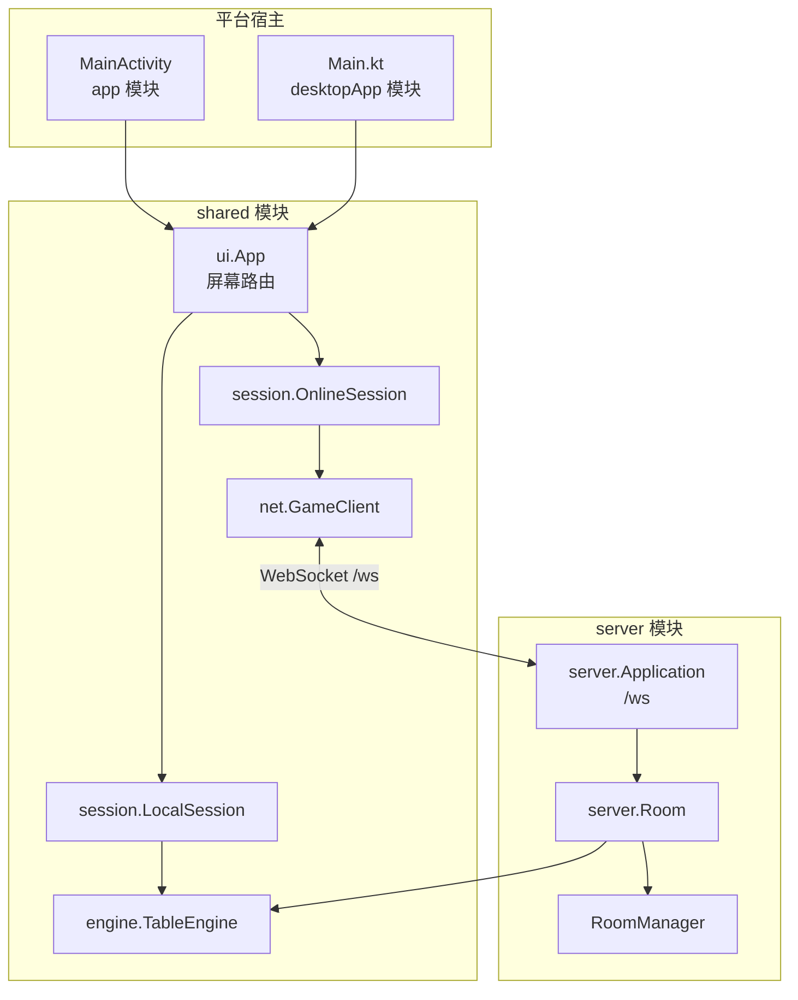
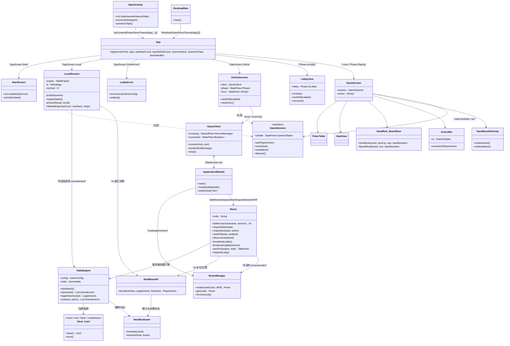
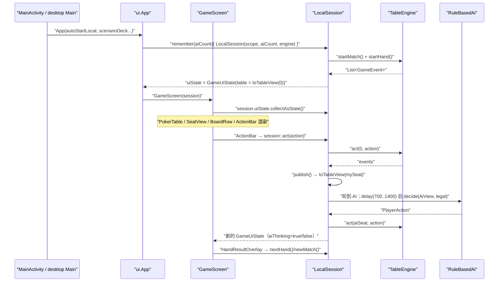
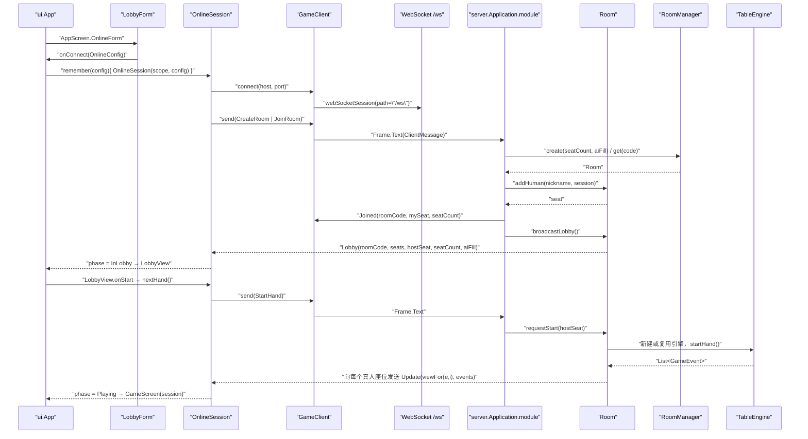
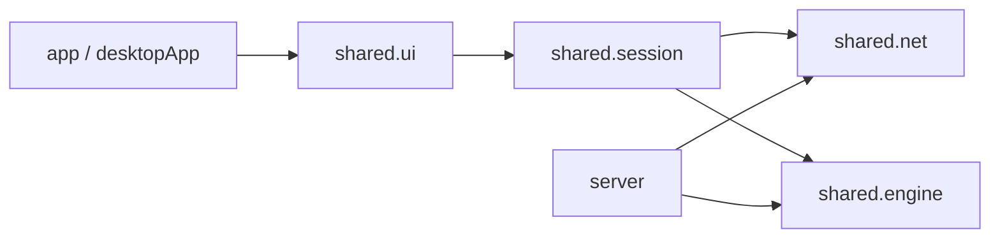
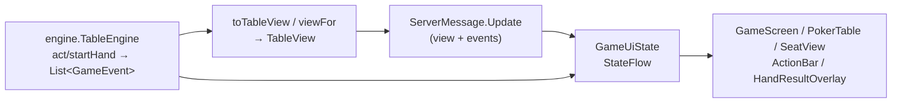

# 核心组件关系图

<cite>
**本文引用的文件**
- [MainActivity.kt](file://app/src/main/java/com/aniapp/pokerdemo/MainActivity.kt)
- [Main.kt](file://desktopApp/src/main/kotlin/com/aniapp/pokerdemo/desktop/Main.kt)
- [App.kt](file://shared/src/commonMain/kotlin/com/aniapp/pokerdemo/ui/App.kt)
- [GameScreen.kt](file://shared/src/commonMain/kotlin/com/aniapp/pokerdemo/ui/GameScreen.kt)
- [StartScreen.kt](file://shared/src/commonMain/kotlin/com/aniapp/pokerdemo/ui/start/StartScreen.kt)
- [LobbyScreen.kt](file://shared/src/commonMain/kotlin/com/aniapp/pokerdemo/ui/lobby/LobbyScreen.kt)
- [CardRow.kt](file://shared/src/commonMain/kotlin/com/aniapp/pokerdemo/ui/card/CardRow.kt)
- [LocalSession.kt](file://shared/src/commonMain/kotlin/com/aniapp/pokerdemo/session/LocalSession.kt)
- [OnlineSession.kt](file://shared/src/commonMain/kotlin/com/aniapp/pokerdemo/session/OnlineSession.kt)
- [GameSession.kt](file://shared/src/commonMain/kotlin/com/aniapp/pokerdemo/session/GameSession.kt)
- [GameClient.kt](file://shared/src/commonMain/kotlin/com/aniapp/pokerdemo/net/GameClient.kt)
- [Protocol.kt](file://shared/src/commonMain/kotlin/com/aniapp/pokerdemo/net/Protocol.kt)
- [TableEngine.kt](file://shared/src/commonMain/kotlin/com/aniapp/pokerdemo/engine/TableEngine.kt)
- [Card.kt](file://shared/src/commonMain/kotlin/com/aniapp/pokerdemo/engine/Card.kt)
- [HandEvaluator.kt](file://shared/src/commonMain/kotlin/com/aniapp/pokerdemo/engine/HandEvaluator.kt)
- [RuleBasedAi.kt](file://shared/src/commonMain/kotlin/com/aniapp/pokerdemo/engine/ai/RuleBasedAi.kt)
- [Application.kt](file://server/src/main/kotlin/com/aniapp/pokerdemo/server/Application.kt)
- [Room.kt](file://server/src/main/kotlin/com/aniapp/pokerdemo/server/Room.kt)
</cite>

## 目录
1. [简介](#简介)
2. [项目结构](#项目结构)
3. [核心组件](#核心组件)
4. [架构总览](#架构总览)
5. [详细组件分析](#详细组件分析)
6. [依赖关系分析](#依赖关系分析)
7. [数据回流路径](#数据回流路径)
8. [组件生命周期](#组件生命周期)
9. [为什么游戏逻辑不在 UI 层](#为什么游戏逻辑不在-ui-层)
10. [性能与可维护性](#性能与可维护性)
11. [常见问题排查](#常见问题排查)
12. [结论](#结论)
13. [附录：重构建议](#附录重构建议)

## 简介
PokerDemo 是 KMP（Kotlin Multiplatform）工程：Android 端 `MainActivity` 与 Desktop 端 `Main` 只是两个极薄的宿主入口，全部界面、会话与规则引擎都位于 `shared` 模块；在线对战由独立的 `server` 模块（Ktor）承载。本文绘制组件类图与交互时序图，说明两条主线：
- **本地对战**：`App` → `LocalSession` → `engine.TableEngine`（内部使用 `HandEvaluator`、`Deck`/`Card`、`ai.RuleBasedAi`）。
- **在线对战**：`App` → `LobbyForm`/`LobbyView` → `OnlineSession` → `net.GameClient` ⇄ WebSocket(`/ws`) ⇄ `server.Application` → `Room` → `RoomManager`。

UI 侧统一消费 `GameUiState`（`StateFlow`），由 `GameScreen` → `PokerTable`/`SeatView`/`ActionBar`/`HandResultOverlay` 渲染。早期文档中的 `TexasHoldemGameScreen`、`GameViewModel`、`CardView`/`CardViewBack`、`BettingManager` 链路在当前实现中已不存在，故不再作为节点出现。

**章节来源**
- [MainActivity.kt:22-48](file://app/src/main/java/com/aniapp/pokerdemo/MainActivity.kt#L22-L48)
- [Main.kt:10-17](file://desktopApp/src/main/kotlin/com/aniapp/pokerdemo/desktop/Main.kt#L10-L17)
- [App.kt:46-131](file://shared/src/commonMain/kotlin/com/aniapp/pokerdemo/ui/App.kt#L46-L131)

## 项目结构
- `app`：Android 宿主 Activity，仅注入平台资源（Logo、版本号、字符串）与调试用 scenario 参数。
- `desktopApp`：Desktop 宿主 `main()`，创建窗口并调用 `App()`。
- `shared/commonMain`
  - `ui`：Compose Multiplatform 界面（`App` 路由、`StartScreen`、`lobby`、`GameScreen`、`table`、`card`、`action`、`overlay`、`theme`）。
  - `session`：`GameSession` 接口 + `LocalSession` / `OnlineSession` 两种实现，产出 `GameUiState`。
  - `net`：`GameClient`（Ktor WebSocket 客户端）与 `Protocol`（`ClientMessage`/`ServerMessage`/`TableView`）。
  - `engine`：`TableEngine`、`GameState`、`Card`/`Deck`、`HandEvaluator`、`GameEvent`、`PlayerAction`、`ai.RuleBasedAi`。
- `server`：Ktor 服务端 `Application.module()`（注册 `/ws`）、`RoomManager` 与 `Room`（持有服务端侧 `TableEngine`）。

**图表来源**
- [MainActivity.kt:22-48](file://app/src/main/java/com/aniapp/pokerdemo/MainActivity.kt#L22-L48)
- [Main.kt:10-17](file://desktopApp/src/main/kotlin/com/aniapp/pokerdemo/desktop/Main.kt#L10-L17)
- [App.kt:76-131](file://shared/src/commonMain/kotlin/com/aniapp/pokerdemo/ui/App.kt#L76-L131)
- [Application.kt:18-30](file://server/src/main/kotlin/com/aniapp/pokerdemo/server/Application.kt#L18-L30)
- [Room.kt:39-75](file://server/src/main/kotlin/com/aniapp/pokerdemo/server/Room.kt#L39-L75)

## 核心组件
- `MainActivity`（app）
  - 职责：`enableEdgeToEdge()`，读取 `scenario`/`chips` Intent extra（仅 debug 包生效），在 `setContent { PokerDemoTheme { App(...) } }` 中传入 `versionText`、`logo`、`autoStartLocal`、`autoStartAiCount`、`scenarioDeck`、`scenarioChips`、`backHandler`。
  - 不持有游戏状态，也不创建任何 ViewModel。
- `Main.kt`（desktopApp）
  - 职责：`application { Window(...) { PokerDemoTheme { App() } } }`，以默认参数进入同一套 `App`。
- `ui.App`
  - 职责：以 `AppScreen` 密封接口做屏幕路由——`Start` / `Local(aiCount)` / `OnlineForm` / `Online(config)`；为每种屏幕创建或复用 session，并通过 `DisposableEffect` 释放。
- `StartScreen`
  - 职责：本地开局（选择 AI 数量后回调 `onLocalStart`）与进入在线表单（`onOnlineStart`）。
- `LobbyForm` / `LobbyView`
  - 职责：前者收集 `OnlineConfig`（主机、端口、昵称、座位数、加入码、AI 补位）后回调 `onConnect`；后者展示房间码、座位列表、房主操作（开始、AI 补位开关、离开）。
- `LocalSession`
  - 职责：进程内直接持有 `TableEngine` 与 `RuleBasedAi`，把引擎事件转成 `GameUiState`，并在轮到 AI 座位时以 700–1400ms 随机延时驱动 AI 行动。
- `OnlineSession`
  - 职责：通过 `GameClient` 收发消息，维护 `Phase`（Connecting / InLobby / Playing / Ended）与 `error`，把 `ServerMessage.Update` 转为 `GameUiState`。
- `net.GameClient`
  - 职责：Ktor CIO WebSocket 客户端，连接 `ws://host:port/ws`，将文本帧解码为 `ServerMessage` 汇入 `incoming: SharedFlow`，出站用 `send(ClientMessage)`。
- `engine.TableEngine`
  - 职责：唯一规则真源。发牌（`Deck.draw()`）、盲注、下注轮推进、合法动作计算、摊牌结算，返回 `List<GameEvent>`。内部依赖 `HandEvaluator.evaluate/drawInfo`、`Card`/`Deck`/`createDeck`。
- `ai.RuleBasedAi`
  - 职责：基于 `AiView` + `LegalActions` 的纯函数式决策，被 `LocalSession` 与服务端 `Room` 共同复用。
- `server.Application` / `RoomManager` / `Room`
  - `module()` 安装 WebSockets 并注册唯一路由 `/ws`；`RoomManager` 以 4 位字母码创建/查询/移除房间；`Room` 持座位表、`Mutex`、服务端 `TableEngine`、AI 循环与广播逻辑。
- UI 渲染组件
  - `GameScreen` 编排整桌；`PokerTable` 桌面背景；`SeatView` 单个座位（筹码、下注、当前行动高亮）；`HandRow`/`BoardRow`（`ui/card/CardRow.kt`）横向渲染两张手牌与五张公共牌，正反面由 `PlayingCard(card, faceUp, size)` 决定；`ActionBar` 发起动作；`HandResultOverlay` 展示本手结果与"下一手/新对局"。

**章节来源**
- [App.kt:40-131](file://shared/src/commonMain/kotlin/com/aniapp/pokerdemo/ui/App.kt#L40-L131)
- [LocalSession.kt:25-110](file://shared/src/commonMain/kotlin/com/aniapp/pokerdemo/session/LocalSession.kt#L25-L110)
- [OnlineSession.kt:27-141](file://shared/src/commonMain/kotlin/com/aniapp/pokerdemo/session/OnlineSession.kt#L27-L141)
- [GameClient.kt:21-59](file://shared/src/commonMain/kotlin/com/aniapp/pokerdemo/net/GameClient.kt#L21-L59)
- [TableEngine.kt:13-100](file://shared/src/commonMain/kotlin/com/aniapp/pokerdemo/engine/TableEngine.kt#L13-L100)
- [Application.kt:18-107](file://server/src/main/kotlin/com/aniapp/pokerdemo/server/Application.kt#L18-L107)
- [Room.kt:39-160](file://server/src/main/kotlin/com/aniapp/pokerdemo/server/Room.kt#L39-L160)
- [GameScreen.kt:41-136](file://shared/src/commonMain/kotlin/com/aniapp/pokerdemo/ui/GameScreen.kt#L41-L136)
- [CardRow.kt:25-70](file://shared/src/commonMain/kotlin/com/aniapp/pokerdemo/ui/card/CardRow.kt#L25-L70)

## 架构总览
组件类图（实线为直接调用/组合，虚线为协议或多态依赖）：

**图表来源**
- [MainActivity.kt:22-48](file://app/src/main/java/com/aniapp/pokerdemo/MainActivity.kt#L22-L48)
- [Main.kt:10-17](file://desktopApp/src/main/kotlin/com/aniapp/pokerdemo/desktop/Main.kt#L10-L17)
- [App.kt:76-131](file://shared/src/commonMain/kotlin/com/aniapp/pokerdemo/ui/App.kt#L76-L131)
- [LocalSession.kt:25-110](file://shared/src/commonMain/kotlin/com/aniapp/pokerdemo/session/LocalSession.kt#L25-L110)
- [OnlineSession.kt:27-141](file://shared/src/commonMain/kotlin/com/aniapp/pokerdemo/session/OnlineSession.kt#L27-L141)
- [GameClient.kt:21-59](file://shared/src/commonMain/kotlin/com/aniapp/pokerdemo/net/GameClient.kt#L21-L59)
- [TableEngine.kt:13-100](file://shared/src/commonMain/kotlin/com/aniapp/pokerdemo/engine/TableEngine.kt#L13-L100)
- [Card.kt:9-33](file://shared/src/commonMain/kotlin/com/aniapp/pokerdemo/engine/Card.kt#L9-L33)
- [HandEvaluator.kt:34](file://shared/src/commonMain/kotlin/com/aniapp/pokerdemo/engine/HandEvaluator.kt#L34)
- [RuleBasedAi.kt:11-60](file://shared/src/commonMain/kotlin/com/aniapp/pokerdemo/engine/ai/RuleBasedAi.kt#L11-L60)
- [Application.kt:18-107](file://server/src/main/kotlin/com/aniapp/pokerdemo/server/Application.kt#L18-L107)
- [Room.kt:39-200](file://server/src/main/kotlin/com/aniapp/pokerdemo/server/Room.kt#L39-L200)
- [GameScreen.kt:41-136](file://shared/src/commonMain/kotlin/com/aniapp/pokerdemo/ui/GameScreen.kt#L41-L136)
- [CardRow.kt:25-70](file://shared/src/commonMain/kotlin/com/aniapp/pokerdemo/ui/card/CardRow.kt#L25-L70)

## 详细组件分析

### 交互时序：本地对战一手牌

**图表来源**
- [App.kt:80-92](file://shared/src/commonMain/kotlin/com/aniapp/pokerdemo/ui/App.kt#L80-L92)
- [LocalSession.kt:45-100](file://shared/src/commonMain/kotlin/com/aniapp/pokerdemo/session/LocalSession.kt#L45-L100)
- [TableEngine.kt:41-100](file://shared/src/commonMain/kotlin/com/aniapp/pokerdemo/engine/TableEngine.kt#L41-L100)
- [GameScreen.kt:130-136](file://shared/src/commonMain/kotlin/com/aniapp/pokerdemo/ui/GameScreen.kt#L130-L136)

要点：
- `LocalSession.mySeat` 固定为 0，玩家座位名取自 `defaultEngine()` 生成的 `"你"`，其余为 `"电脑"/"电脑N"`。
- `publish()` 每次都整体替换 `_uiState`，因此 UI 拿到的是不可变快照；`aiThinking` 通过 `_uiState.update` 局部更新。
- `nextHand()` 只在 `Phase.HAND_OVER` 时生效，避免非法阶段调用引擎异常。

### 交互时序：在线建房与对局

**图表来源**
- [App.kt:94-131](file://shared/src/commonMain/kotlin/com/aniapp/pokerdemo/ui/App.kt#L94-L131)
- [OnlineSession.kt:64-115](file://shared/src/commonMain/kotlin/com/aniapp/pokerdemo/session/OnlineSession.kt#L64-L115)
- [GameClient.kt:32-52](file://shared/src/commonMain/kotlin/com/aniapp/pokerdemo/net/GameClient.kt#L32-L52)
- [Application.kt:25-100](file://server/src/main/kotlin/com/aniapp/pokerdemo/server/Application.kt#L25-L100)
- [Room.kt:84-145](file://server/src/main/kotlin/com/aniapp/pokerdemo/server/Room.kt#L84-L145)

要点：
- 只有房主可以 `requestStart` 与 `setAiFill`，否则服务端回 `not_host` 错误。
- `aiFill` 开启时，空座位在开始时被填充为 `AI-n`；关闭时要求至少 2 名真人，否则回 `need_players`。
- 若成员名单未变化，`Room` 复用既有 `TableEngine`（`MATCH_OVER` 时先 `startMatch()`），从而保留筹码与手数连续性。
- 服务端存在"引擎座位连续编号 ↔ 房间稀疏座位"的映射 `seatMap`，`viewFor()` 与 `result` 中的赢家座位都会换算回房间座位号。

### 断线与托管
- 未开局时断开：`Room.disconnected()` 清空该座位，必要时迁移房主，真人数为 0 则 `close()` 并通知 `RoomClosed`。
- 已开局时断开：座位标记为 `isAi = true`、`connected = false`、`session = null`，若正轮到该座位则立即 `maybeAiLoop()` 由 AI 代打；`endHand()` 后再清掉这些临时 AI 座位。
- 发送失败同样降级为 AI 托管（`broadcastUpdate` 捕获异常后置位）。
- 客户端侧：`GameClient.connected` 变为 false 且未主动 `dispose()` 时，`OnlineSession` 将 `phase` 置为 `Ended("与服务器断开连接")`。

**章节来源**
- [Room.kt:150-200](file://server/src/main/kotlin/com/aniapp/pokerdemo/server/Room.kt#L150-L200)
- [Room.kt:222-250](file://server/src/main/kotlin/com/aniapp/pokerdemo/server/Room.kt#L222-L250)
- [OnlineSession.kt:64-115](file://shared/src/commonMain/kotlin/com/aniapp/pokerdemo/session/OnlineSession.kt#L64-L115)

## 依赖关系分析
- 模块依赖方向：`app` / `desktopApp` → `shared`；`server` → `shared`（复用 `engine` 与 `net` 协议类型）；`shared` 不依赖任何平台宿主模块，保证两端行为一致。
- 分层依赖：`ui` → `session` → (`engine` | `net`)；`server` → (`engine` | `net`)。UI 从不直接引用 `TableEngine`，只通过 `GameSession` 抽象。
- 无环依赖：`Room` 通过构造参数持有 `RoomManager` 引用用于 `remove(code)`，`RoomManager` 不反向调用 `Room` 之外的逻辑，二者不构成类型级循环。
- 关键耦合点：`TableView`/`GameEvent`/`PlayerAction`/`LegalActions` 等序列化类型同时是本地渲染模型与线上协议载荷，`LocalSession.toTableView()` 与 `Room.viewFor()` 是两条并行但字段一致的投影实现。

**图表来源**
- [App.kt:29-38](file://shared/src/commonMain/kotlin/com/aniapp/pokerdemo/ui/App.kt#L29-L38)
- [LocalSession.kt:1-23](file://shared/src/commonMain/kotlin/com/aniapp/pokerdemo/session/LocalSession.kt#L1-L23)
- [OnlineSession.kt:1-15](file://shared/src/commonMain/kotlin/com/aniapp/pokerdemo/session/OnlineSession.kt#L1-L15)
- [Room.kt:1-28](file://server/src/main/kotlin/com/aniapp/pokerdemo/server/Room.kt#L1-L28)

## 数据回流路径
统一的回流链路为：**引擎产生事件 → 投影为视图模型 → 状态流 → Compose 重组**。

- 本地路径：`LocalSession.publish(events)` 直接调用 `engine.toTableView(mySeat)`，组装 `GameUiState(table, lastEvents, smallBlind, bigBlind)`，无需经过协议层。
- 在线路径：`Room.broadcastUpdate(events)` 为每个已连接真人座位生成一份私有 `TableView`（含各自的 `mySeat`、`myHole`、`legal`），包装成 `ServerMessage.Update(view, events)` 发送；`OnlineSession.handle()` 收到后写入 `_uiState`，并附带 `online = true`、`isHost = mySeat == hostSeat`、`roomCode`。
- 揭示信息：摊牌前 `revealedHoles` 为空 Map，`GameScreen` 据此让 `HandRow(faceUp = table.revealedHoles.containsKey(seat))` 显示背面；摊牌后仅未弃牌者的底牌进入 `revealedHoles`。
- 提示与错误：在线错误消息经 `OnlineSession.error` 流入 `GameScreen(notice = ...)`，`App` 中 3 秒后自动 `clearError()`；致命码（`join_failed`、`not_found`、`bad_seat_count`）直接结束到 `Phase.Ended`。

**章节来源**
- [LocalSession.kt:58-66](file://shared/src/commonMain/kotlin/com/aniapp/pokerdemo/session/LocalSession.kt#L58-L66)
- [LocalSession.kt:122-165](file://shared/src/commonMain/kotlin/com/aniapp/pokerdemo/session/LocalSession.kt#L122-L165)
- [Room.kt:240-296](file://server/src/main/kotlin/com/aniapp/pokerdemo/server/Room.kt#L240-L296)
- [OnlineSession.kt:84-110](file://shared/src/commonMain/kotlin/com/aniapp/pokerdemo/session/OnlineSession.kt#L84-L110)
- [GameScreen.kt:47-60](file://shared/src/commonMain/kotlin/com/aniapp/pokerdemo/ui/GameScreen.kt#L47-L60)
- [App.kt:99-106](file://shared/src/commonMain/kotlin/com/aniapp/pokerdemo/ui/App.kt#L99-L106)
- [Protocol.kt:81-106](file://shared/src/commonMain/kotlin/com/aniapp/pokerdemo/net/Protocol.kt#L81-L106)

## 组件生命周期
- `MainActivity` / desktop `Main`
  - 一次性装配：Android 在 `onCreate` 解析 Intent 后设置内容；Desktop 在 `application {}` 中开窗。宿主不保存对局状态，进程重建即回到 `App` 的初始路由。
- `App`
  - `screen` 为 `remember { mutableStateOf(...) }`，配置变更导致的重组会重置回 `Start`（或 `autoStartLocal` 指定的 `Local`）。
  - 非 `Start` 屏幕才注册 `backHandler`，返回键语义为"回到起始页"。
- `LocalSession` / `OnlineSession`
  - 分别以 `remember(s.aiCount)` / `remember(s.config)` 绑定，参数变化即重建会话；`DisposableEffect.onDispose` 调用 `dispose()`：本地取消 `aiJob`，在线置 `disposed = true` 并在独立 `cleanupScope` 中关闭 `GameClient`。
- `TableEngine`
  - 本地：随 `LocalSession` 创建，`startMatch()` 重置牌组与筹码，`startHand()` 重洗 `Deck`。
  - 在线：随 `Room.requestStart()` 惰性创建，房间关闭时随 `scope.cancel()` 与 `manager.remove(code)` 一并回收。
- UI 组件
  - `PokerTable`、`SeatView`、`HandRow`/`BoardRow`、`ActionBar`、`HandResultOverlay` 均为无副作用的展示组件；`HandRow`/`BoardRow` 用 `remember(handNumber)` 的计数器配合 `delay(120)` 实现逐张入场动画，换一手时计数复位。

**章节来源**
- [App.kt:63-92](file://shared/src/commonMain/kotlin/com/aniapp/pokerdemo/ui/App.kt#L63-L92)
- [LocalSession.kt:45-56](file://shared/src/commonMain/kotlin/com/aniapp/pokerdemo/session/LocalSession.kt#L45-L56)
- [OnlineSession.kt:44-77](file://shared/src/commonMain/kotlin/com/aniapp/pokerdemo/session/OnlineSession.kt#L44-L77)
- [TableEngine.kt:33-50](file://shared/src/commonMain/kotlin/com/aniapp/pokerdemo/engine/TableEngine.kt#L33-L50)
- [CardRow.kt:29-70](file://shared/src/commonMain/kotlin/com/aniapp/pokerdemo/ui/card/CardRow.kt#L29-L70)
- [Room.kt:190-235](file://server/src/main/kotlin/com/aniapp/pokerdemo/server/Room.kt#L190-L235)

## 为什么游戏逻辑不在 UI 层
早期版本把发牌流程写在 Activity 级 ViewModel 中；当前实现将其下沉到更合适的层次，理由如下：
- **跨端复用**：规则放在 `shared.engine.TableEngine`，Android、Desktop 与 server 共用同一份判定，避免三端各自实现导致的行为漂移。
- **权威性**：在线模式下客户端只做投影与请求，`Room` 内的 `TableEngine` 是唯一真源，客户端无法伪造牌面或跳过下注轮。
- **可测试性**：`TableEngine`、`HandEvaluator`、`RuleBasedAi` 都是纯 Kotlin、可注入 `Random` 与 `newDeck`，无需 Compose 环境即可断言事件序列（`HeadsupTableEngineTest`、`MultiPlayerTableEngineTest`、`RuleBasedAiTest`）。
- **确定性与可复现**：`scenarioDeck` 允许通过 `adb am start --es scenario 'As Ah|Ks Kh|2c 3d 4h 5s 6c'` 指定发牌顺序（仅 debug 包），真机验证特定牌型时无需改代码。
- **UI 保持声明式**：`GameScreen` 只读 `GameUiState` 并把点击回传为 `PlayerAction`，不含任何牌型判断或阶段推进分支；`ActionBar` 的可点项完全来自 `table.legal`。
- **并发安全**：引擎调用被收敛到 `LocalSession` 的单协程循环或服务端 `Room` 的 `Mutex.withLock`，UI 线程不参与状态改写。

**章节来源**
- [MainActivity.kt:50-66](file://app/src/main/java/com/aniapp/pokerdemo/MainActivity.kt#L50-L66)
- [TableEngine.kt:13-30](file://shared/src/commonMain/kotlin/com/aniapp/pokerdemo/engine/TableEngine.kt#L13-L30)
- [Room.kt:84-145](file://server/src/main/kotlin/com/aniapp/pokerdemo/server/Room.kt#L84-L145)
- [GameScreen.kt:41-136](file://shared/src/commonMain/kotlin/com/aniapp/pokerdemo/ui/GameScreen.kt#L41-L136)

## 性能与可维护性
- 状态粒度：`GameUiState` 为不可变 data class，每次动作整体替换；座位数上限 6、牌数上限 7，快照成本很低。
- 网络开销：`ServerMessage.Update` 携带完整 `TableView`（含每人私有 `myHole`/`legal`），属于"全量视图"策略，简单可靠但带宽随座位数线性增长。
- 投影重复：`LocalSession.toTableView()` 与 `Room.viewFor()` 字段含义相同但实现两份，新增字段时需同步修改，是最容易漏改的地方。
- 动画与重组：逐张发牌动画由 `LaunchedEffect(handNumber, cards.size)` 驱动，`animateIntAsState` 平滑底池数字；重组范围局限于读取 `uiState` 的 `GameScreen` 子树。
- 锁竞争：`Room` 用单 `Mutex` 串行化所有动作与 AI 循环，正确性优先；高并发场景下会成为吞吐瓶颈。

[本节为基于上述实现的综合评估]

## 常见问题排查
- 连不上服务器
  - 现象：`OnlineSession` 直接进入 `Phase.Ended("无法连接服务器：…")`。
  - 处理：确认 `server.main()` 已在 `0.0.0.0:8080` 启动，客户端填写的 host/port 指向该实例；注意路由只有 `/ws`，当前实现未提供健康检查接口。
- 加入房间失败
  - 现象：提示"房间不存在""房间已满""对局进行中，无法加入"。
  - 处理：房间码大小写不敏感（`get()` 会 `trim().uppercase()`）；开局后不允许新加入，需等本手结束。
- 点了开始没反应
  - 现象：非房主发送 `StartHand` 得到 `not_host`；`aiFill` 关闭且不足 2 人时得到 `need_players`。
  - 处理：由房主操作，或打开 AI 补位。
- 本地模式按钮灰掉
  - 现象：`ActionBar` 无可执行项。
  - 处理：`act()` 首先校验 `_uiState.value.isPlayerTurn`，未轮到玩家或阶段不在下注轮时会被忽略。
- 观战看不到对手底牌
  - 现象：摊牌前所有对手显示牌背。
  - 处理：属预期行为，`revealedHoles` 仅在 `state.showdown` 时填充未弃牌者。
- 调试特定牌局
  - 处理：使用 debug 包的 `scenario`/`chips` Intent extra；`scenarioCards()` 会自动补齐 3 张 burn 牌位置，保证发牌顺序与真实牌序一致。

**章节来源**
- [Application.kt:18-107](file://server/src/main/kotlin/com/aniapp/pokerdemo/server/Application.kt#L18-L107)
- [Room.kt:84-160](file://server/src/main/kotlin/com/aniapp/pokerdemo/server/Room.kt#L84-L160)
- [OnlineSession.kt:64-115](file://shared/src/commonMain/kotlin/com/aniapp/pokerdemo/session/OnlineSession.kt#L64-L115)
- [LocalSession.kt:45-52](file://shared/src/commonMain/kotlin/com/aniapp/pokerdemo/session/LocalSession.kt#L45-L52)
- [MainActivity.kt:27-66](file://app/src/main/java/com/aniapp/pokerdemo/MainActivity.kt#L27-L66)

## 结论
PokerDemo 的重心已从"Activity + ViewModel + 领域对象"的单机三层结构，演进为**共享引擎 + 双会话实现 + 服务端权威房间**的多端结构。两个宿主入口只负责注入平台资源；`ui.App` 承担屏幕路由与会话生命周期；`LocalSession` 与 `OnlineSession` 以同一个 `GameSession` 契约对接 UI，分别把 `TableEngine` 直调结果和 WebSocket `ServerMessage.Update` 归一为 `GameUiState`；`engine.TableEngine` 配合 `HandEvaluator`、`Deck`/`Card`、`RuleBasedAi` 构成唯一的规则真源，并被 `server.Room` 复用。UI 组件（`GameScreen`、`PokerTable`、`SeatView`、`HandRow`/`BoardRow`、`ActionBar`、`HandResultOverlay`）只做投影渲染与动作回传。

[本节为总结性内容]

## 附录：重构建议
- 统一视图投影：把 `LocalSession.toTableView()` 与 `Room.viewFor()` 抽取为 `shared` 内单一函数，接受"座位名/连接状态/AI 标记"提供者，消除双份字段维护风险。
- 增量协议：在 `ServerMessage.Update` 中改为携带必要增量事件、由客户端合并基线视图，降低全量广播成本。
- 服务可观测性：如需运维探活，可在 `module()` 的 routing 中补充 HTTP 健康检查路由；当前仅有 `/ws`。
- 并发模型：`Room` 的全局 `Mutex` 可按"引擎推进"与"网络发送"拆分，避免慢客户端阻塞整房动作。
- 引擎注入点固化：`TableEngine(random, newDeck)` 已是良好的测试接缝，建议将 `LocalSession.defaultEngine()` 的 scenario 参数扩展为通用夹具工厂，供 UI 快照测试复用。
- 契约测试：为 `ClientMessage`/`ServerMessage` 增加往返序列化测试，防止 `type` 判别字段或默认值策略变更破坏旧客户端。

[本节为通用重构建议]