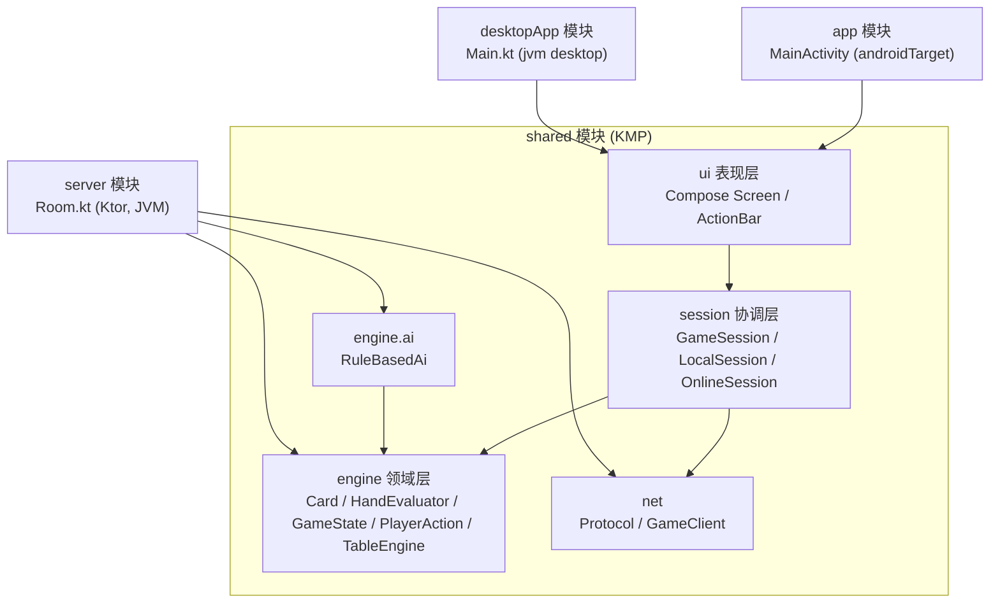
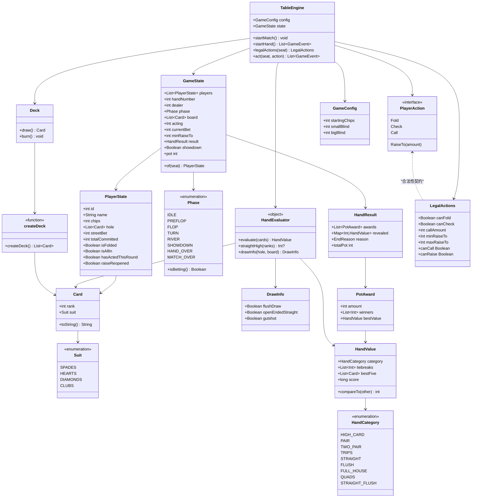
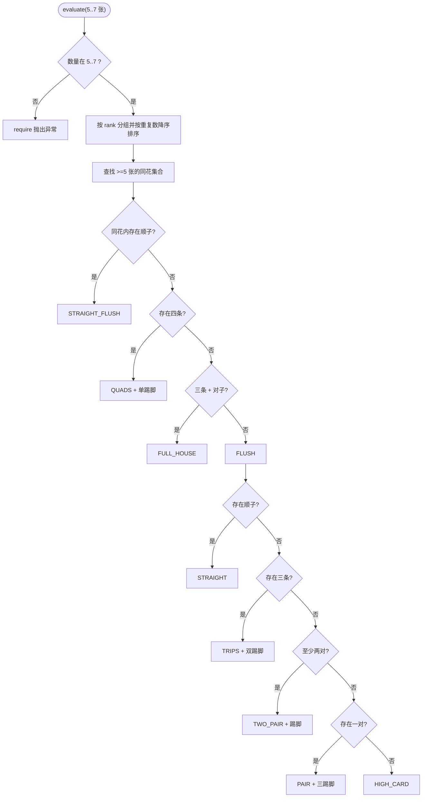
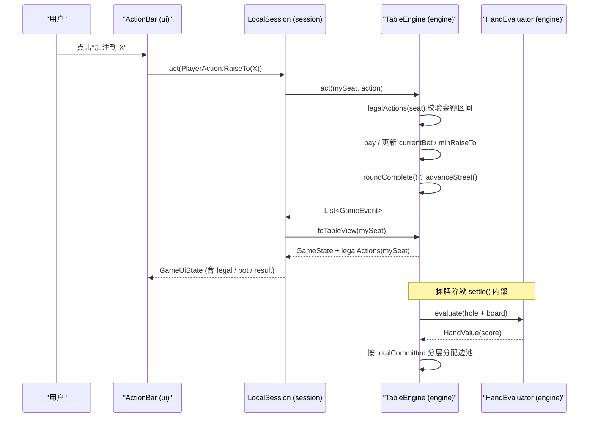
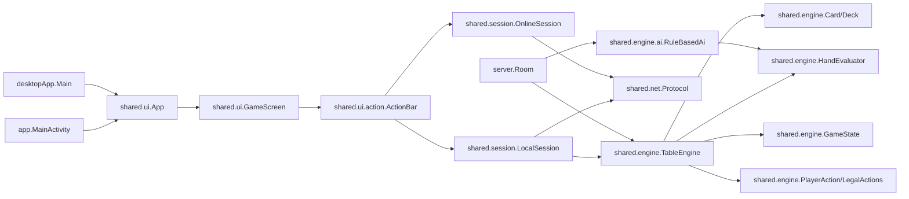

# 领域模型分离设计

<cite>
**本文引用的文件**
- [shared/src/commonMain/kotlin/com/aniapp/pokerdemo/engine/Card.kt](file://shared/src/commonMain/kotlin/com/aniapp/pokerdemo/engine/Card.kt)
- [shared/src/commonMain/kotlin/com/aniapp/pokerdemo/engine/HandEvaluator.kt](file://shared/src/commonMain/kotlin/com/aniapp/pokerdemo/engine/HandEvaluator.kt)
- [shared/src/commonMain/kotlin/com/aniapp/pokerdemo/engine/GameState.kt](file://shared/src/commonMain/kotlin/com/aniapp/pokerdemo/engine/GameState.kt)
- [shared/src/commonMain/kotlin/com/aniapp/pokerdemo/engine/PlayerAction.kt](file://shared/src/commonMain/kotlin/com/aniapp/pokerdemo/engine/PlayerAction.kt)
- [shared/src/commonMain/kotlin/com/aniapp/pokerdemo/engine/GameEvent.kt](file://shared/src/commonMain/kotlin/com/aniapp/pokerdemo/engine/GameEvent.kt)
- [shared/src/commonMain/kotlin/com/aniapp/pokerdemo/engine/TableEngine.kt](file://shared/src/commonMain/kotlin/com/aniapp/pokerdemo/engine/TableEngine.kt)
- [shared/src/commonMain/kotlin/com/aniapp/pokerdemo/session/LocalSession.kt](file://shared/src/commonMain/kotlin/com/aniapp/pokerdemo/session/LocalSession.kt)
- [shared/src/commonMain/kotlin/com/aniapp/pokerdemo/net/Protocol.kt](file://shared/src/commonMain/kotlin/com/aniapp/pokerdemo/net/Protocol.kt)
- [shared/src/commonMain/kotlin/com/aniapp/pokerdemo/ui/action/ActionBar.kt](file://shared/src/commonMain/kotlin/com/aniapp/pokerdemo/ui/action/ActionBar.kt)
- [shared/build.gradle.kts](file://shared/build.gradle.kts)
- [server/build.gradle.kts](file://server/build.gradle.kts)
- [app/build.gradle](file://app/build.gradle)
- [desktopApp/build.gradle.kts](file://desktopApp/build.gradle.kts)
- [app/src/main/java/com/aniapp/pokerdemo/MainActivity.kt](file://app/src/main/java/com/aniapp/pokerdemo/MainActivity.kt)
- [server/src/main/kotlin/com/aniapp/pokerdemo/server/Room.kt](file://server/src/main/kotlin/com/aniapp/pokerdemo/server/Room.kt)
- [shared/src/commonTest/kotlin/com/aniapp/pokerdemo/engine/HandEvaluatorTest.kt](file://shared/src/commonTest/kotlin/com/aniapp/pokerdemo/engine/HandEvaluatorTest.kt)
- [shared/src/commonTest/kotlin/com/aniapp/pokerdemo/engine/TestUtils.kt](file://shared/src/commonTest/kotlin/com/aniapp/pokerdemo/engine/TestUtils.kt)
- [shared/src/commonTest/kotlin/com/aniapp/pokerdemo/session/LocalSessionTest.kt](file://shared/src/commonTest/kotlin/com/aniapp/pokerdemo/session/LocalSessionTest.kt)

## 目录
1. [引言](#引言)
2. [项目结构](#项目结构)
3. [核心组件](#核心组件)
4. [架构总览](#架构总览)
5. [详细组件分析](#详细组件分析)
6. [依赖关系分析](#依赖关系分析)
7. [性能与复杂度](#性能与复杂度)
8. [测试策略](#测试策略)
9. [迁移指南](#迁移指南)
10. [结论](#结论)

## 引言

本项目的德州扑克规则不再放在 Android 模块的 `data` 包里，而是整体落在 Kotlin Multiplatform 共享模块 `shared` 的 `engine` 源集中：

- 落点：`shared/src/commonMain/kotlin/com/aniapp/pokerdemo/engine/`。旧的 `app/src/main/java/com/aniapp/pokerdemo/data/Card.kt`、`data/BettingManager.kt`、`vm/GameViewModel.kt` 均已不存在，`app` 模块现在只剩 `MainActivity.kt`。
- 动机：同一份领域代码要在三处复用——Android 客户端（`androidTarget`）、桌面 JVM 客户端（`jvm("desktop")`）与 Ktor 服务端。`shared/build.gradle.kts` 声明了这两个 target，`server/build.gradle.kts` 通过 `implementation(project(":shared"))` 直接依赖同一个共享模块；`app/build.gradle` 与 `desktopApp/build.gradle.kts` 同样依赖 `:shared`。
- 分层含义不变，但边界更清晰：**领域层**（`engine`，纯 Kotlin + kotlinx.serialization，无 Android/Compose 依赖）只描述牌、牌型、下注合法性与回合状态机；**会话协调层**（`session`）把引擎状态投影成 UI 快照并驱动 AI 延迟；**表现层**（`ui`）渲染快照并把用户动作回传为 `PlayerAction`。

之所以坚持这种分离：牌型评估和下注状态机不关心界面是 Compose Mobile、Compose Desktop 还是服务端无头对局；而 UI 也不应知道顺子如何判定。服务端做规则校验时，客户端不能是规则的唯一定义者——只有当规则本身是可跨平台编译的纯代码，客户端与服务端才能共享同一份实现而不产生分歧。

## 项目结构

**图表来源**
- [shared/build.gradle.kts:11-49](file://shared/build.gradle.kts#L11-L49)
- [server/build.gradle.kts:9-11](file://server/build.gradle.kts#L9-L11)
- [shared/src/commonMain/kotlin/com/aniapp/pokerdemo/session/LocalSession.kt:1-132](file://shared/src/commonMain/kotlin/com/aniapp/pokerdemo/session/LocalSession.kt#L1-L132)

## 核心组件

`engine` 包内的类型分工如下：

- `Suit` / `Card` / `createDeck()` / `Deck`：牌的模型与发牌容器，全部留在 `Card.kt`。`Card` 是不可变值对象（`rank: Int` + `suit: Suit`），`toString()` 输出 `As`/`10h` 风格简写便于调试与场景解析。
- `HandCategory` / `HandValue` / `DrawInfo` / `object HandEvaluator`：牌型评估独立成一个无状态对象，不再是散落的顶层函数。`HandValue` 携带牌型、平局比较序列、最优五张与整型 `score`，并实现 `Comparable`。
- `Phase` / `PlayerState` / `PotAward` / `HandResult` / `GameState`：不可变对局状态。`GameState` 通过 `copy` 演进，底池由 `players.sumOf { it.totalCommitted }` 派生而非单独维护。
- `PlayerAction`（`Fold` / `Check` / `Call` / `RaiseTo(amount)`）与 `LegalActions`：动作与合法性的契约。UI 只能发送这四种动作，而 `LegalActions` 精确告知当前可选动作与加注区间。
- `GameConfig`：规则配置对象，包含 `startingChips`（默认 2000）、`smallBlind`（默认 10）、`bigBlind`（默认 20）。
- `TableEngine`：回合状态机的执行者，负责发牌、盲注、行动合法性校验、街间推进、摊牌与边池分配。
- `GameEvent`：引擎对外输出的事实流（盲注、发牌、动作、街牌、未跟注退还、奖池分配、淘汰、单手结束、对局结束），供 UI 动画与服务端广播使用。

已不存在的旧概念：`PokerHand`、`HandRank`、顶层 `bestHand()`、`cardSize`。尤其重要的是 **UI 尺寸逻辑不再位于领域模型中**：扑克牌像素尺寸计算现在只出现在 Compose 布局代码里（例如 `GameScreen` 根据可用宽度推导 `CardSize`），领域层完全不感知 dp。

**章节来源**
- [shared/src/commonMain/kotlin/com/aniapp/pokerdemo/engine/Card.kt:1-35](file://shared/src/commonMain/kotlin/com/aniapp/pokerdemo/engine/Card.kt#L1-L35)
- [shared/src/commonMain/kotlin/com/aniapp/pokerdemo/engine/HandEvaluator.kt:1-32](file://shared/src/commonMain/kotlin/com/aniapp/pokerdemo/engine/HandEvaluator.kt#L1-L32)
- [shared/src/commonMain/kotlin/com/aniapp/pokerdemo/engine/GameState.kt:1-57](file://shared/src/commonMain/kotlin/com/aniapp/pokerdemo/engine/GameState.kt#L1-L57)
- [shared/src/commonMain/kotlin/com/aniapp/pokerdemo/engine/PlayerAction.kt:1-27](file://shared/src/commonMain/kotlin/com/aniapp/pokerdemo/engine/PlayerAction.kt#L1-L27)
- [shared/src/commonMain/kotlin/com/aniapp/pokerdemo/engine/TableEngine.kt:1-30](file://shared/src/commonMain/kotlin/com/aniapp/pokerdemo/engine/TableEngine.kt#L1-L30)

## 架构总览

**图表来源**
- [shared/src/commonMain/kotlin/com/aniapp/pokerdemo/engine/Card.kt:6-35](file://shared/src/commonMain/kotlin/com/aniapp/pokerdemo/engine/Card.kt#L6-L35)
- [shared/src/commonMain/kotlin/com/aniapp/pokerdemo/engine/HandEvaluator.kt:6-32](file://shared/src/commonMain/kotlin/com/aniapp/pokerdemo/engine/HandEvaluator.kt#L6-L32)
- [shared/src/commonMain/kotlin/com/aniapp/pokerdemo/engine/GameState.kt:6-56](file://shared/src/commonMain/kotlin/com/aniapp/pokerdemo/engine/GameState.kt#L6-L56)
- [shared/src/commonMain/kotlin/com/aniapp/pokerdemo/engine/PlayerAction.kt:5-27](file://shared/src/commonMain/kotlin/com/aniapp/pokerdemo/engine/PlayerAction.kt#L5-L27)
- [shared/src/commonMain/kotlin/com/aniapp/pokerdemo/engine/TableEngine.kt:6-100](file://shared/src/commonMain/kotlin/com/aniapp/pokerdemo/engine/TableEngine.kt#L6-L100)

## 详细组件分析

### 为什么领域模型放在 shared 的 engine 包

1. **一份规则，三个执行环境**  
   `shared` 同时构建 `androidTarget` 与 `jvm("desktop")`，而 `server` 以 JVM 库的方式依赖同一个 `:shared` 工程。这意味着 Android 本地对战、桌面对战、服务端房间对局使用的是完全相同的 `TableEngine` 与 `HandEvaluator` 字节码语义，不存在“客户端算出的牌型和服务端不一致”这类问题。若规则仍写在 `app` 的 `data` 包内，服务端要么复制一份实现，要么反向依赖 Android 模块——两者都不可接受。
2. **职责单一**  
   `HandEvaluator` 表达“这手牌是什么牌型、多大”，`TableEngine` 表达“此刻允许什么动作、动作后状态如何演进”。它们都不认识 Compose、`StateFlow` 或 dp。
3. **可独立测试**  
   领域代码位于 `commonTest` 可直接覆盖的源集，用 `kotlin.test`/JUnit 断言即可，无需 Robolectric、模拟器或 Android 运行时。
4. **可替换实现**  
   `TableEngine` 的随机性与牌堆通过构造参数注入（`random: Random`、`newDeck: () -> Deck`），因此可以注入固定牌序做确定性测试，也可以替换洗牌实现而不触碰任何上层代码。
5. **避免状态泄漏**  
   筹码、街注、已投入总额、底池都属于 `PlayerState`/`GameState`，是会话领域状态；界面只读取由 `toTableView()` 投影出的快照，不持有可变规则状态。

### Card / Deck 的职责边界

`Card.kt` 只回答“一张牌是什么”和“牌从哪里来”：

- `Suit` 为四花色枚举；`Card.rank` 用 2–14 表示点数，11=J、12=Q、13=K、14=A，`10` 在 `toString()` 中显示为 `T`。
- `createDeck()` 按花色×点数生成标准 52 张牌。
- `Deck` 是一个可消耗的发牌容器：主构造接收任意牌序（用于确定性场景），次构造用 `Random` 洗乱标准牌组；`draw()` 取走第一张，`burn()` 烧掉一张。
- `Suit`、`Card` 标注 `@Serializable`，因此可以原样进入网络协议（`TableView` 直接携带 `board: List<Card>` 与各家底牌）。

牌型判断、听牌判断、下注合法性都不在这里——那些属于 `HandEvaluator` 与 `TableEngine`。这一约束让 `Card` 保持纯粹的值对象角色。

**章节来源**
- [shared/src/commonMain/kotlin/com/aniapp/pokerdemo/engine/Card.kt:6-35](file://shared/src/commonMain/kotlin/com/aniapp/pokerdemo/engine/Card.kt#L6-L35)
- [app/src/main/java/com/aniapp/pokerdemo/MainActivity.kt:52-90](file://app/src/main/java/com/aniapp/pokerdemo/MainActivity.kt#L52-L90)

### HandEvaluator：从 bestHand 到独立评估对象

旧的顶层 `bestHand()` + `PokerHand` + `HandRank` 被拆成三层：

| 新类型 | 承担的角色 | 取代的旧概念 |
|---|---|---|
| `HandCategory` | 九级牌型枚举，附带中文 `label` | `HandRank` |
| `HandValue` | 牌型 + `tiebreaks` 比较序列 + `bestFive` 实际五张 + 打包后的 `score` | `PokerHand.rank` + `score` |
| `HandEvaluator` | 无状态评估入口 | 顶层 `bestHand()` |

`evaluate(cards)` 的处理顺序体现了牌型优先级：先在同花集合内找同花顺高张，再依次检查四条、葫芦、同花、顺子、三条、两对、一对，最后落到高牌。内部辅助函数 `pack()` 把 `category.ordinal + 1` 作为最高位、后面拼接 5 个 tiebreak（缺失补 0）乘 15 进制打包成 `Long`，因此比较只需一次 `score.compareTo`，短序列自然被 0 补齐而不会意外胜出。`straightHigh()` 显式把 A 视作可同时充当 15 的轮子牌，从而识别 `A-2-3-4-5`。`drawInfo(hole, board)` 额外给出同花听、两头顺听、卡张顺听的判断，供 AI 决策使用。

输入约束也从“至少 7 张”改为 **5–7 张**：这样翻牌圈（2 张底牌 + 3 张公共牌）也能直接评估，而不仅仅是河牌圈之后。

注意图中各分支最终都会调用 `pack()` 生成 `HandValue`，即“牌型 + 比较序列 + 具体五张”三者一次性确定，`bestFive` 让 UI 可以直接高亮参与牌型的五张牌，而不必反推。

**章节来源**
- [shared/src/commonMain/kotlin/com/aniapp/pokerdemo/engine/HandEvaluator.kt:6-115](file://shared/src/commonMain/kotlin/com/aniapp/pokerdemo/engine/HandEvaluator.kt#L6-L115)
- [shared/src/commonMain/kotlin/com/aniapp/pokerdemo/engine/HandEvaluator.kt:117-144](file://shared/src/commonMain/kotlin/com/aniapp/pokerdemo/engine/HandEvaluator.kt#L117-L144)

### 不可变状态与合法性契约

`GameState` 及其配套类型构成引擎的唯一真相来源：

- `Phase.isBetting()` 把 PREFLOP/FLOP/TURN/RIVER 归为可下注阶段，其余（IDLE、SHOWDOWN、HAND_OVER、MATCH_OVER）不可行动。所有行动入口都以该谓词为前提。
- `PlayerState` 记录 `streetBet`（本街已投）、`totalCommitted`（本手累计投入，用于边池计算）、`isAllIn`、`hasActedThisRound` 与 `raiseReopened`（加注重开标记）。
- `GameState.pot` 是派生属性，`currentBet` / `minRaiseTo` / `acting` 描述“现在轮到谁、要跟多少、最少加到多少”。
- `HandResult` + `PotAward` 描述一手结束的事实：每个彩池的金额、获胜座位列表、以及获胜牌型 `bestValue`（因弃牌结束时为 `null`）。

`PlayerAction` 与 `LegalActions` 一起形成契约：动作集合从旧的 `Fold/Call/Raise` 变为 `Fold/Check/Call/RaiseTo(amount)`——`Check` 被显式建模（旧实现只能靠“金额为 0 的跟注”隐式表达），`Raise` 改为“加到某个总额”`RaiseTo(amount)`，与 `LegalActions.minRaiseTo/maxRaiseTo` 的语义对齐，避免“增量还是终值”的歧义。

`legalActions(seat)` 只在 `state.acting == seat && phase.isBetting()` 时返回非空结果，否则全 false；它计算出 `callAmount = min(需跟额, 剩余筹码)`，并在“还能加出超过 currentBet 且本轮尚未行动或已被加注重开”时才开放 `minRaiseTo/maxRaiseTo`。`act(seat, action)` 会先用 `check` 校验阶段与轮次，再逐项校验动作是否合法（例如面对下注不能过牌、`RaiseTo` 金额必须落在合法区间），非法动作抛 `IllegalStateException`。这套契约有两个消费者：客户端 `ActionBar` 用它决定按钮可用性，服务端 `Room.requestAct` 用 `try/catch` 把它转成 `illegal_action` 错误消息下发给玩家。

**章节来源**
- [shared/src/commonMain/kotlin/com/aniapp/pokerdemo/engine/GameState.kt:6-56](file://shared/src/commonMain/kotlin/com/aniapp/pokerdemo/engine/GameState.kt#L6-L56)
- [shared/src/commonMain/kotlin/com/aniapp/pokerdemo/engine/PlayerAction.kt:5-27](file://shared/src/commonMain/kotlin/com/aniapp/pokerdemo/engine/PlayerAction.kt#L5-L27)
- [shared/src/commonMain/kotlin/com/aniapp/pokerdemo/engine/TableEngine.kt:85-157](file://shared/src/commonMain/kotlin/com/aniapp/pokerdemo/engine/TableEngine.kt#L85-L157)
- [shared/src/commonMain/kotlin/com/aniapp/pokerdemo/ui/action/ActionBar.kt:44-104](file://shared/src/commonMain/kotlin/com/aniapp/pokerdemo/ui/action/ActionBar.kt#L44-L104)
- [server/src/main/kotlin/com/aniapp/pokerdemo/server/Room.kt:118-134](file://server/src/main/kotlin/com/aniapp/pokerdemo/server/Room.kt#L118-L134)

### 下注逻辑的归属：BettingManager 已被 TableEngine 吸收

早期设计中 `BettingManager` 是一个未被 UI 调用的孤立扩展点——它只维护 `playerChips/aiChips/pot/currentBet/playerBet/aiBet` 等字段和 `postBlinds/playerCall/aiRaise` 之类的方法，既没有回合生命周期，也没有接入界面。

现在的实现不再保留这个类：下注领域状态被拆分并升级了。

- “筹码、街注、已投入、底池、当前最大下注、最小加注额”进入 `PlayerState` / `GameState`，成为不可变快照的一部分，而不是可变字段集合。
- “支付、跟注、加注、重置下注”进入 `TableEngine.act()` 与私有的 `pay()` / `postBlind()` / `advanceStreet()`，并由 `legalActions()` 提供合法性判定。
- “盲注大小与起始筹码”从硬编码常量上升为 `GameConfig(startingChips, smallBlind, bigBlind)`，可在构造引擎时按房间/场景配置。

也就是说，`BettingManager` 当年作为扩展点的价值已经被兑现并被更完整的状态机取代：现在下注规则既能被本地会话使用，也能被服务端直接使用，且天然支持多人（2–6 座）、全下、边池与未跟注退还。

**章节来源**
- [shared/src/commonMain/kotlin/com/aniapp/pokerdemo/engine/TableEngine.kt:6-84](file://shared/src/commonMain/kotlin/com/aniapp/pokerdemo/engine/TableEngine.kt#L6-L84)
- [shared/src/commonMain/kotlin/com/aniapp/pokerdemo/engine/TableEngine.kt:160-231](file://shared/src/commonMain/kotlin/com/aniapp/pokerdemo/engine/TableEngine.kt#L160-L231)

### 领域模型与表现层的解耦

领域层从不主动通知 UI；它只返回事件列表并更新自身 `state`。真正的桥接在 `session` 层：

由此保证：

- `ActionBar` 只根据 `LegalActions` 决定按钮启用与文案（如“跟注 N”“跟注全下”），不做任何规则推理。
- `LocalSession` 只做协程调度、AI 延迟与快照投影，不含牌型或下注算法。
- `TableEngine` 与 `HandEvaluator` 不认识 Compose，也不产生 `dp` 之类的显示量；牌面尺寸计算留在 `GameScreen` 的布局代码里。

**图表来源**
- [shared/src/commonMain/kotlin/com/aniapp/pokerdemo/session/LocalSession.kt:49-101](file://shared/src/commonMain/kotlin/com/aniapp/pokerdemo/session/LocalSession.kt#L49-L101)
- [shared/src/commonMain/kotlin/com/aniapp/pokerdemo/engine/TableEngine.kt:96-157](file://shared/src/commonMain/kotlin/com/aniapp/pokerdemo/engine/TableEngine.kt#L96-L157)
- [shared/src/commonMain/kotlin/com/aniapp/pokerdemo/engine/TableEngine.kt:239-306](file://shared/src/commonMain/kotlin/com/aniapp/pokerdemo/engine/TableEngine.kt#L239-L306)
- [shared/src/commonMain/kotlin/com/aniapp/pokerdemo/ui/action/ActionBar.kt:44-104](file://shared/src/commonMain/kotlin/com/aniapp/pokerdemo/ui/action/ActionBar.kt#L44-L104)

## 依赖关系分析

关键事实：

- `engine` 包不 import 任何 `androidx.*` 或 `io.ktor.*`，只依赖 `kotlinx.serialization`（用于跨端传输注解）与标准库，这是它能同时编译进 Android、Desktop 与 Server 的前提。
- `ui` 与 `session` 单向依赖 `engine`；`engine` 不反向依赖它们。
- `server` 依赖 `:shared` 但只用其中的 `engine` / `engine.ai` / `net` 部分，Compose 依赖不会被服务端运行路径触发。
- `net.Protocol` 中的 `ClientMessage.Act(action: PlayerAction)` 与 `TableView.legal: LegalActions` 直接把领域类型用作线上协议，客户端提交动作、服务端回传合法性，两端共用同一份定义。

**图表来源**
- [shared/build.gradle.kts:3-49](file://shared/build.gradle.kts#L3-L49)
- [server/build.gradle.kts:3-16](file://server/build.gradle.kts#L3-L16)
- [shared/src/commonMain/kotlin/com/aniapp/pokerdemo/net/Protocol.kt:35-98](file://shared/src/commonMain/kotlin/com/aniapp/pokerdemo/net/Protocol.kt#L35-L98)
- [server/src/main/kotlin/com/aniapp/pokerdemo/server/Room.kt:7-109](file://server/src/main/kotlin/com/aniapp/pokerdemo/server/Room.kt#L7-L109)

## 性能与复杂度

- `HandEvaluator.evaluate` 先做 O(n) 分组与排序（n ≤ 7），随后是常数级的牌型分支判断；`pack()` 只做 5 次乘加，产出单个 `Long`，因此 `HandValue.compareTo` 是一次整数比较，比旧实现逐元素比较计分序列更廉价。
- `TableEngine.settle` 在摊牌时为每位未弃牌玩家调用一次 `evaluate`，并按 `totalCommitted` 去重分层构造边池，规模上界为座位数（≤6），属于小集合运算。平分彩池的余数按“从庄家位起最近”的顺序发放（`orderFromDealer`），符合常规规则。
- `advanceStreet` 在只剩一名可行动玩家时会循环 runout 直接发到摊牌，避免无意义的等待；`roundComplete()` 对“仅剩一个可行动玩家”的特例单独判定，防止全下场景挂死。
- 边界条件：`evaluate` 要求 5–7 张牌，越界抛异常；`TableEngine` 要求座位数 2–6；`startHand` 要求当前处于 `IDLE`/`HAND_OVER` 且剩余筹码大于 0 的玩家至少两人。

**章节来源**
- [shared/src/commonMain/kotlin/com/aniapp/pokerdemo/engine/HandEvaluator.kt:34-50](file://shared/src/commonMain/kotlin/com/aniapp/pokerdemo/engine/HandEvaluator.kt#L34-L50)
- [shared/src/commonMain/kotlin/com/aniapp/pokerdemo/engine/TableEngine.kt:18-56](file://shared/src/commonMain/kotlin/com/aniapp/pokerdemo/engine/TableEngine.kt#L18-L56)
- [shared/src/commonMain/kotlin/com/aniapp/pokerdemo/engine/TableEngine.kt:232-306](file://shared/src/commonMain/kotlin/com/aniapp/pokerdemo/engine/TableEngine.kt#L232-L306)

## 测试策略

### 分层测试范围

| 测试类别 | 目标 | 位置 | 需要 Android |
|---|---|---|---|
| 牌型评分 | `HandEvaluator.evaluate` 各牌型与踢脚 | `shared/src/commonTest/.../engine/HandEvaluatorTest.kt` | 否 |
| 牌型比较 | `HandValue.score` 跨牌型/同牌型/轮子 A 平局 | 同上 | 否 |
| 听牌判断 | `drawInfo` 同花听/两头顺/卡张 | 同上 | 否 |
| 输入边界 | 5–7 张约束、随机 7 张牌一致性 | 同上 | 否 |
| 下注规则 | 盲注、全下、边池、重开加注、runout | `HeadsUpTableEngineTest.kt` / `MultiPlayerTableEngineTest.kt` | 否 |
| 会话协作 | AI 延迟、非己方回合动作被忽略、新一手轮庄 | `shared/src/commonTest/.../session/LocalSessionTest.kt` | 否 |
| 端到端协议 | 建房、隐藏信息、非法动作报错、AI 补位、断线接管 | `server/src/test/.../RoomFlowTest.kt` | 否（Ktor 测试主机） |
| 渲染冒烟 | Compose 桌面渲染与牌桌布局 | `shared/src/desktopTest/.../ui/` | 否（桌面 JVM） |

### 关键做法

1. **确定性牌堆**：`stackedDeck(vararg holes, board)` 按“座位 0 起每人两张、烧牌、翻牌三张……”的发牌顺序构造 `Deck`，配合 `TableEngine(newDeck = ...)` 注入，使整手牌可复现。真实设备上也可以用同样的机制——`MainActivity` 的 `scenario` intent 解析出指定手牌与公共牌后构造 `Deck`，仅 debug 包生效。
2. **独立 oracle 交叉验证**：`HandEvaluatorTest` 内置一个实现方式完全不同的 5 张笨评估器，对同一副牌给出 `(等级, 比较序列)`，用来检验主评估器的分类与踢脚顺序，而不是简单断言字符串。
3. **随机不变量测试**：用固定种子 `Random` 抽取 7 张/6 张牌喂给 `evaluate`，验证不抛异常且结果稳定，覆盖手写用例难以穷举的组合。
4. **非法动作断言**：直接对 `act()` 断言 `IllegalStateException`，把“合法性契约”当作被测需求，而不是仅在 UI 层回避。

由于这些测试都在 `commonTest` 源集，`shared/build.gradle.kts` 只声明 `kotlin("test")` 与协程测试依赖即可在 Android 与 Desktop 两个 target 上分别运行，无需任何 instrumentation。

**章节来源**
- [shared/src/commonTest/kotlin/com/aniapp/pokerdemo/engine/HandEvaluatorTest.kt:19-50](file://shared/src/commonTest/kotlin/com/aniapp/pokerdemo/engine/HandEvaluatorTest.kt#L19-L50)
- [shared/src/commonTest/kotlin/com/aniapp/pokerdemo/engine/HandEvaluatorTest.kt:186-219](file://shared/src/commonTest/kotlin/com/aniapp/pokerdemo/engine/HandEvaluatorTest.kt#L186-L219)
- [shared/src/commonTest/kotlin/com/aniapp/pokerdemo/engine/TestUtils.kt:1-33](file://shared/src/commonTest/kotlin/com/aniapp/pokerdemo/engine/TestUtils.kt#L1-L33)
- [shared/src/commonTest/kotlin/com/aniapp/pokerdemo/session/LocalSessionTest.kt:23-94](file://shared/src/commonTest/kotlin/com/aniapp/pokerdemo/session/LocalSessionTest.kt#L23-L94)
- [shared/build.gradle.kts:38-40](file://shared/build.gradle.kts#L38-L40)

## 迁移指南

### 现状总结

- 领域代码已从 `app/.../data` 迁至 `shared/src/commonMain/.../engine`，`app` 模块不再有 `data` 与 `vm` 包。
- 牌型评估入口由顶层 `bestHand()` 变为 `HandEvaluator.evaluate()`，返回值由 `PokerHand` 变为 `HandValue`；`HandRank` → `HandCategory`。
- 下注状态与方法由 `BettingManager` 迁入 `GameState`/`PlayerState` + `TableEngine`；盲注与起始筹码改由 `GameConfig` 提供。
- 动作模型由 `Fold/Call/Raise` 变为 `Fold/Check/Call/RaiseTo(amount)`，并新增 `LegalActions` 描述可行动作与加注区间。
- UI 尺寸相关的 `cardSize` 已从领域模型移除，改由 `GameScreen` 布局计算。

### API 对照与迁移步骤

| 旧写法 | 新写法 | 注意点 |
|---|---|---|
| `bestHand(seven).rank` | `HandEvaluator.evaluate(cards).category` | 输入允许 5–7 张，少于 5 张会抛异常 |
| `PokerHand.compareTo(other)` | `HandValue.compareTo(other)` | 基于打包 `score`，可直接 `maxOf { it.score }` |
| `HandRank.FOUR` / `THREE` / `STRAIGHT_FLUSH` | `HandCategory.QUADS` / `TRIPS` / `STRAIGHT_FLUSH` | 枚举名变更，且带中文 `label` |
| `BettingManager.playerCall()` | `engine.act(seat, PlayerAction.Call)` | 需先确认 `legalActions(seat).canCall` |
| `BettingManager.playerRaise(to)` | `engine.act(seat, PlayerAction.RaiseTo(to))` | `to` 是本街总投注额，须落在 `minRaiseTo..maxRaiseTo` |
| `BettingManager.postBlinds(...)` | 由 `engine.startHand()` 自动执行 | 盲注位置含单挑特例（庄家即小盲） |
| `BettingManager.smallBlind/bigBlind` | `engine.config.smallBlind/bigBlind` | 通过 `GameConfig` 注入不同规则 |
| 自行维护 `deck: MutableList<Card>` | `Deck(random)` 或 `Deck(指定牌序)` | `draw()` / `burn()` 语义已内建 |

迁移时的实操建议：

1. 不要在业务代码里重新引入可变的下注对象；需要读状态就订阅 `session.uiState`，需要动作就发 `PlayerAction`。
2. 新增规则变体（不同盲注结构、起始筹码）优先扩展 `GameConfig`，而不是在引擎里加分支常量。
3. 新增动作类型时同时更新 `PlayerAction`、`LegalActions`、`TableEngine.act()` 校验、`ActionBar` 渲染四处，并在 `commonTest` 补非法路径断言。
4. 需要网络对战时不必重写规则：服务端已直接用 `TableEngine` 校验并广播 `TableView`，客户端 `OnlineSession` 只负责收发；只要领域类型保持 `@Serializable`，协议即可随之演进。

### 向后兼容注意事项

- `HandValue` 与 `GameState` 属于跨端序列化契约的一部分，字段增删会影响客户端与服务端版本兼容，应同步升级两端。
- 保留 `HandEvaluator` 作为唯一评估入口，避免 AI 与结算路径出现两套牌型口径（目前 `RuleBasedAi` 与 `settle()` 都调用同一对象）。
- 领域层不得再引入 `androidx.*`、`dp` 或 Composable 依赖，否则会破坏 `server` 侧的纯 JVM 复用。

**章节来源**
- [shared/src/commonMain/kotlin/com/aniapp/pokerdemo/engine/HandEvaluator.kt:6-40](file://shared/src/commonMain/kotlin/com/aniapp/pokerdemo/engine/HandEvaluator.kt#L6-L40)
- [shared/src/commonMain/kotlin/com/aniapp/pokerdemo/engine/TableEngine.kt:6-84](file://shared/src/commonMain/kotlin/com/aniapp/pokerdemo/engine/TableEngine.kt#L6-L84)
- [shared/src/commonMain/kotlin/com/aniapp/pokerdemo/net/Protocol.kt:35-98](file://shared/src/commonMain/kotlin/com/aniapp/pokerdemo/net/Protocol.kt#L35-L98)

## 结论

领域模型已从 Android 模块的 `data` 包整体上移到 `shared/src/commonMain` 的 `engine` 包，这不是简单的换目录，而是把“一份规则、三端复用”变成结构性事实：`shared` 通过 `androidTarget` 与 `jvm("desktop")` 同时服务 Android 与桌面客户端，`server` 通过依赖 `:shared` 用同一个 `TableEngine` 做权威裁决。

模型本身也完成了升级：`Suit/Rank/Card/Deck/createDeck` 继续留在 `Card.kt` 描述牌；牌型评估独立为 `HandEvaluator`（配 `HandCategory`/`HandValue`/`DrawInfo`）；`GameState`/`PlayerState`/`Phase`/`LegalActions`/`HandResult`/`PotAward` 提供不可变状态与结果；`GameConfig` 承载起始筹码与大小盲；`PlayerAction(Fold/Check/Call/RaiseTo)` 与 `LegalActions` 共同构成合法性契约。旧的 `PokerHand`、`HandRank`、`bestHand`、`cardSize` 已不存在，UI 尺寸逻辑也不再混入领域层。

带来的直接收益是：牌型评分与下注规则可以在纯 JVM 上用确定性牌堆快速测试，无需 Android 环境；牌型算法可以自由替换而不影响 UI；网络对战的后端校验不需要重写规则；界面与会话层可以独立演进。下一步的自然方向是把更多规则参数（如 ante、最低加注倍数）纳入 `GameConfig`，并让 `LegalActions` 成为客户端禁用交互的唯一依据。