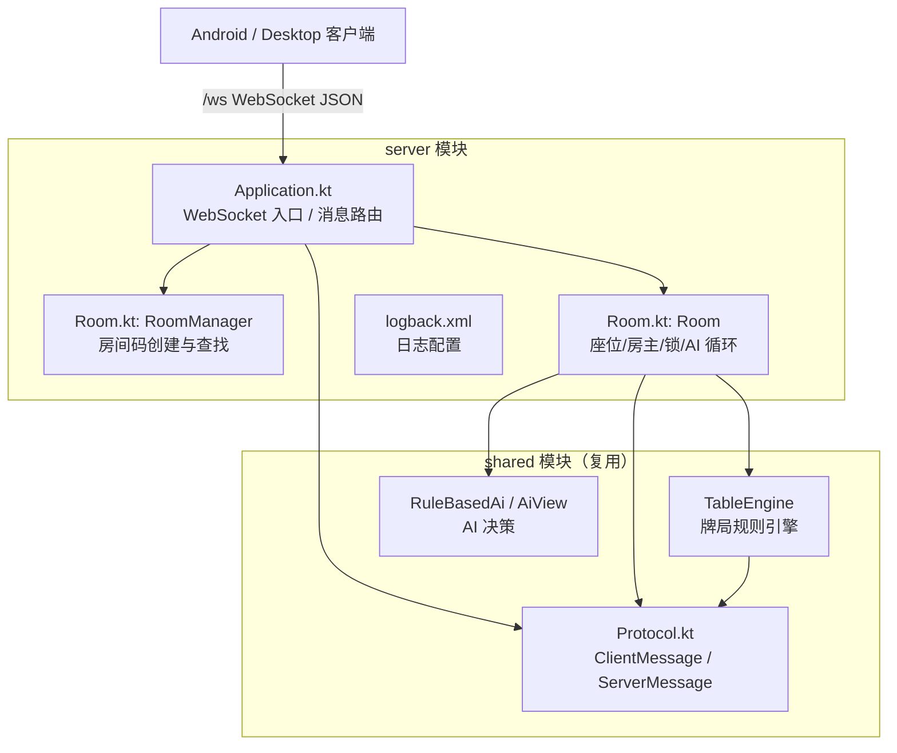
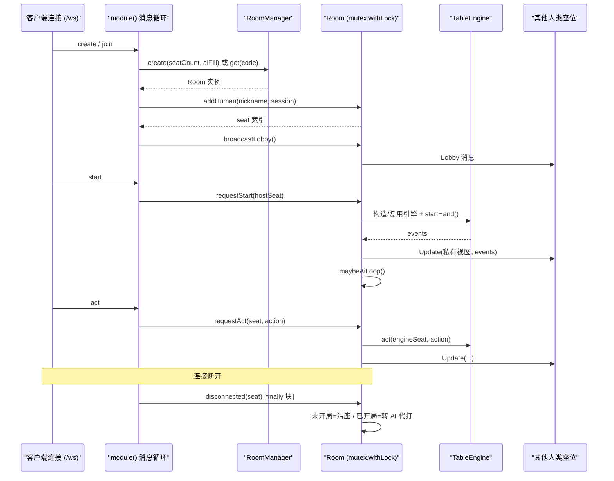
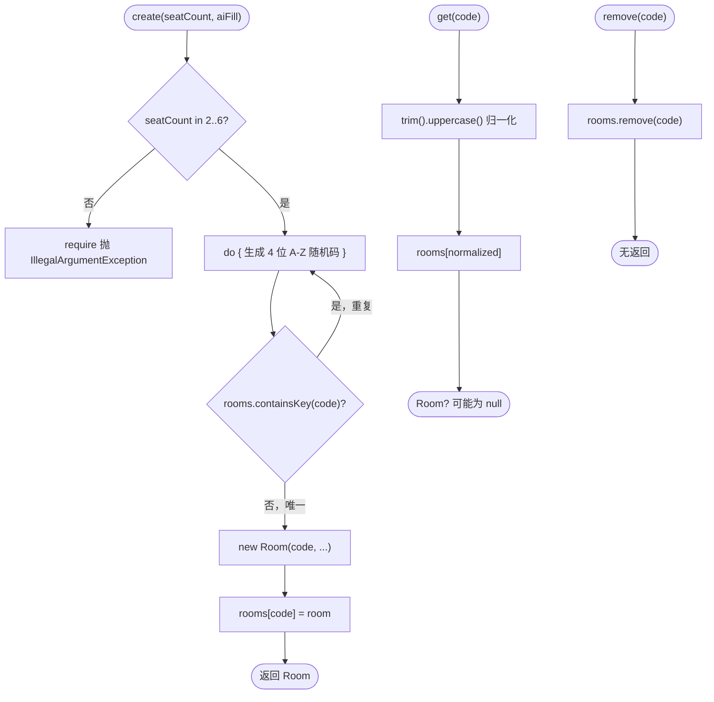
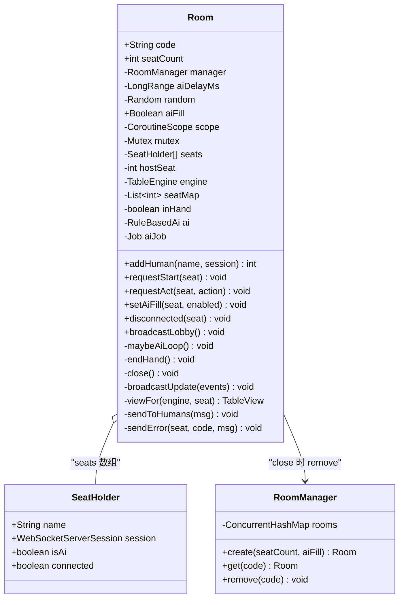
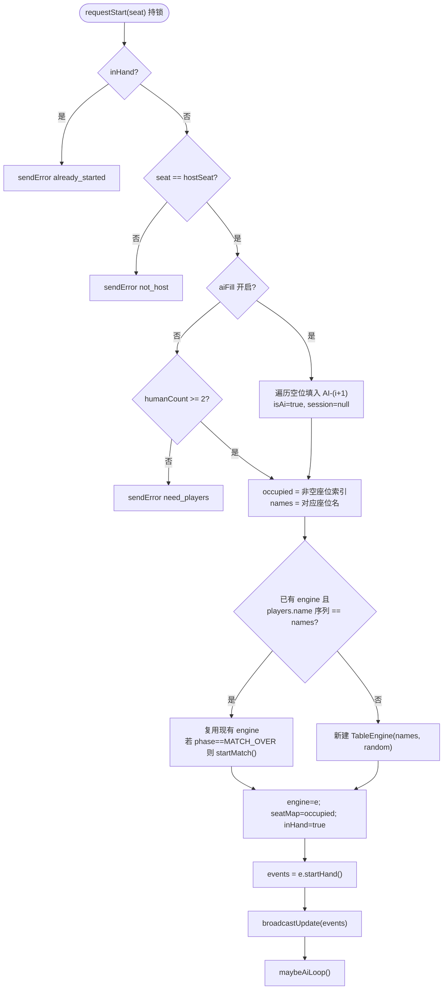
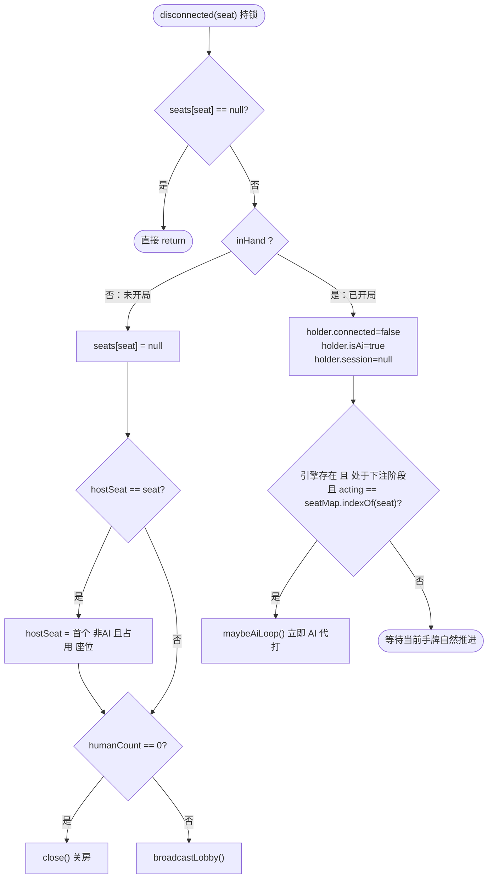
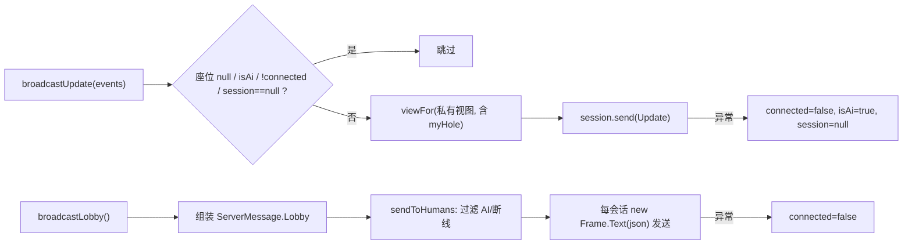
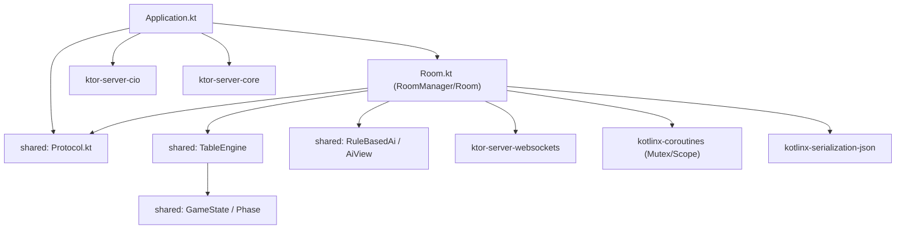

# Ktor 房间服务器

<cite>
**本文引用的文件 **
- [Room.kt](file://server/src/main/kotlin/com/aniapp/pokerdemo/server/Room.kt)
- [Application.kt](file://server/src/main/kotlin/com/aniapp/pokerdemo/server/Application.kt)
- [logback.xml](file://server/src/main/resources/logback.xml)
- [build.gradle.kts](file://server/build.gradle.kts)
- [Protocol.kt](file://shared/src/commonMain/kotlin/com/aniapp/pokerdemo/net/Protocol.kt)
- [TableEngine.kt](file://shared/src/commonMain/kotlin/com/aniapp/pokerdemo/engine/TableEngine.kt)
- [GameState.kt](file://shared/src/commonMain/kotlin/com/aniapp/pokerdemo/engine/GameState.kt)
- [AiStrategy.kt](file://shared/src/commonMain/kotlin/com/aniapp/pokerdemo/engine/ai/AiStrategy.kt)
- [RuleBasedAi.kt](file://shared/src/commonMain/kotlin/com/aniapp/pokerdemo/engine/ai/RuleBasedAi.kt)
- [RoomFlowTest.kt](file://server/src/test/kotlin/com/aniapp/pokerdemo/server/RoomFlowTest.kt)
- [AiFillOptionTest.kt](file://server/src/test/kotlin/com/aniapp/pokerdemo/server/AiFillOptionTest.kt)
</cite>

## 目录
1. [简介](#简介)
2. [项目结构](#项目结构)
3. [核心组件](#核心组件)
4. [架构总览](#架构总览)
5. [详细组件分析](#详细组件分析)
   - [RoomManager：房间码治理](#roommanager房间码治理)
   - [Room：座位与并发模型](#room座位与并发模型)
   - [加入流程 addHuman](#加入流程-addhuman)
   - [开始流程 requestStart 与 AI 补位](#开始流程-requeststart-与-ai-补位)
   - [引擎索引与房间座位的 seatMap 映射](#引擎索引与房间座位的-seatmap-映射)
   - [行动流程 requestAct](#行动流程-requestact)
   - [断线处理 disconnected 的两种状态](#断线处理-disconnected-的两种状态)
   - [AI 代打循环 maybeAiLoop](#ai-代打循环-maybeailoop)
   - [消息广播 broadcastUpdate 与 broadcastLobby](#消息广播-broadcastupdate-与-broadcastlobby)
6. [依赖分析](#依赖分析)
7. [性能考虑](#性能考虑)
8. [故障排查指南](#故障排查指南)
9. [结论](#结论)
10. [附录：错误码与协议对照表](#附录错误码与协议对照表)

## 简介
`server` 模块是一个基于 **Ktor + WebSocket** 的轻量级牌局房间服务。它不实现扑克规则本身（规则位于 `shared` 模块的 `TableEngine`），而是负责“房间治理”这一层职责：如何生成房间、如何分配座位、谁是房主、何时用 AI 补位、玩家断线后如何继续、以及如何在多个连接之间广播状态。

对非专业读者而言，可以把这个服务想象成一家棋牌室的“前台”：

- **前台经理（RoomManager）**：登记新开房间、按房号找房间、销号。
- **包间管理员（Room）**：管理一间房里的座位表、决定谁坐哪儿、什么时候开局、客人中途走了怎么安排“替身（AI）”。
- **牌桌裁判（TableEngine，来自 shared）**：真正发牌、下注、比牌。包间管理员只是把客人的指令转达给裁判，再把裁判的结果念给客人听。

本页聚焦“房间治理的实际实现”，即 `RoomManager` 与 `Room` 两个类如何协作。

## 项目结构
服务端源码只有两个 Kotlin 文件，但它们的职责划分非常清晰：`Application.kt` 是网络入口与消息路由（“接线员”），`Room.kt` 是全部房间状态机逻辑（“管理员”）。真正的游戏计算复用 `shared` 模块中的跨平台引擎。

**图示来源**
- [Application.kt:23-110](file://server/src/main/kotlin/com/aniapp/pokerdemo/server/Application.kt#L23-L110)
- [Room.kt:37-77](file://server/src/main/kotlin/com/aniapp/pokerdemo/server/Room.kt#L37-L77)
- [build.gradle.kts:9-17](file://server/build.gradle.kts#L9-L17)

**本节来源**
- [Application.kt:1-111](file://server/src/main/kotlin/com/aniapp/pokerdemo/server/Application.kt#L1-L111)
- [Room.kt:1-77](file://server/src/main/kotlin/com/aniapp/pokerdemo/server/Room.kt#L1-L77)
- [build.gradle.kts:1-41](file://server/build.gradle.kts#L1-L41)
- [logback.xml:1-11](file://server/src/main/resources/logback.xml#L1-L11)

## 核心组件
下表列出房间治理层的组成单元及其关键属性（均为 `Room.kt` 中真实声明的成员）：

| 组件 | 类型 | 关键成员 | 作用 |
|---|---|---|---|
| `RoomException` | 异常类 | `message` | 加入房间失败时抛出，由 `Application.kt` 转成 `join_failed` 错误消息 |
| `SeatHolder`（private） | 数据持有类 | `name`、`session`、`isAi`、`connected` | 一个座位上的占用者；`session` 可为空（AI 或已断线） |
| `RoomManager` | 管理器 | `rooms: ConcurrentHashMap<String, Room>`、`random`、`aiDelayMs` | 房间的创建 / 查询 / 移除 |
| `Room` | 状态机 | `scope`、`mutex`、`seats`、`hostSeat`、`engine`、`seatMap`、`inHand`、`ai`、`aiJob`、`aiFill` | 单间房间的完整生命周期 |

其中几个成员的形态需要特别强调，因为它们是理解后续所有行为的前提：

- `seats` 是**固定长度数组** `arrayOfNulls<SeatHolder>(seatCount)`，长度为房间容量（2..6），空位用 `null` 表示，因此座位索引天然是“稀疏”的。
- `hostSeat` 初始为 `-1`，表示尚无房主；第一个占座的人类会成为房主。
- `scope` 是**每个房间独立**的 `CoroutineScope(SupervisorJob() + Dispatchers.Default)`，用于承载 AI 循环协程。
- `inHand` 标记“当前是否有一手牌正在进行”，是断线处理走哪条分支的开关。

**本节来源**
- [Room.kt:31-77](file://server/src/main/kotlin/com/aniapp/pokerdemo/server/Room.kt#L31-L77)

## 架构总览
下图展示了一个客户端连接从建立到销毁所经历的调用链，以及 `Room` 内部各方法如何通过同一把 `mutex` 串行化。

**图示来源**
- [Application.kt:26-108](file://server/src/main/kotlin/com/aniapp/pokerdemo/server/Application.kt#L26-L108)
- [Room.kt:83-168](file://server/src/main/kotlin/com/aniapp/pokerdemo/server/Room.kt#L83-L168)

## 详细组件分析

### RoomManager：房间码治理
`RoomManager` 是最外层的管理器，用一个 `ConcurrentHashMap<String, Room>` 存放所有活跃房间，键就是房间码。它对外暴露三个操作：

要点逐条说明：

- **座位数约束**：`create` 首行 `require(seatCount in 2..6)`，超出范围直接抛异常。这与 `TableEngine` 自身的 `players.size in 2..6` 约束一致，形成双重保障。
- **房间码生成**：`(1..4).map { ('A'..'Z').random(random) }` 生成恰好 **4 位大写字母** 的房间码，并用 `do...while (rooms.containsKey(code))` **循环查重**，直到落到一个尚未被占用的码为止。这里用的是随 `RoomManager` 注入的同一个 `Random` 实例。
- **查询归一化**：`get(code)` 对入参做 `code.trim().uppercase()` 再查表，因此客户端传 `" ab3 "` 也能命中 `"AB3"`。**注意**：`create` 写入的是已规范化的大写码，而 `get` 会先归一，两者语义匹配。
- **移除**：`remove(code)` 直接从 map 删除；该方法由 `Room.close()` 在房间无人时回调触发（见下文）。

值得指出的一个实现细节：`get` 做了大小写与空白归一，但 `remove` 没有做同样的归一——不过 `remove` 只被 `close()` 以 `this.code`（本身就是规范化码）调用，因此不会出现不一致。

**图示来源**
- [Room.kt:37-58](file://server/src/main/kotlin/com/aniapp/pokerdemo/server/Room.kt#L37-L58)

**本节来源**
- [Room.kt:37-58](file://server/src/main/kotlin/com/aniapp/pokerdemo/server/Room.kt#L37-L58)
- [TableEngine.kt:19-21](file://shared/src/commonMain/kotlin/com/aniapp/pokerdemo/engine/TableEngine.kt#L19-L21)

### Room：座位与并发模型
`Room` 的所有可变状态都受同一把 `Mutex` 保护。这是本模块最重要的并发设计决定。

并发模型的三个支柱：

1. **固定长度座位数组**：`seats = arrayOfNulls<SeatHolder>(seatCount)`。索引 0..seatCount-1 即“房间座位号”，空位为 `null`。座位号一旦分配就不再压缩，所以中间离开的玩家会留下空洞。
2. **每房间独立作用域**：`scope = CoroutineScope(SupervisorJob() + Dispatchers.Default)`。`SupervisorJob` 意味着某个房间的 AI 循环即使异常崩溃，也不会牵连其他房间或其他子任务；`Dispatchers.Default` 让 AI 思考跑在计算线程池上。该 scope 在 `close()` 中被 `scope.cancel()` 显式取消。
3. **全部操作加锁**：`addHuman`、`requestStart`、`requestAct`、`setAiFill`、`disconnected` 的方法体整体包裹在 `mutex.withLock { ... }` 中，确保同一房间内这些操作互斥串行执行。唯一的例外是 `broadcastLobby()`（公开且不加锁），因为它只读取状态并发送，不参与状态迁移。

`humanCount` 是一个派生属性：`seats.count { it != null && !it.isAi }`，即“非 AI 的占用座位数”，它在加入校验、开局校验和断线清理中被反复使用。

**图示来源**
- [Room.kt:33-77](file://server/src/main/kotlin/com/aniapp/pokerdemo/server/Room.kt#L33-L77)
- [Room.kt:238-243](file://server/src/main/kotlin/com/aniapp/pokerdemo/server/Room.kt#L238-L243)

**本节来源**
- [Room.kt:60-77](file://server/src/main/kotlin/com/aniapp/pokerdemo/server/Room.kt#L60-L77)
- [Room.kt:238-243](file://server/src/main/kotlin/com/aniapp/pokerdemo/server/Room.kt#L238-L243)

### 加入流程 addHuman
`addHuman(nickname, session)` 负责把一个 WebSocket 连接绑定到一个座位，返回座位号；失败则抛 `RoomException`，由 `Application.kt` 的 `join()` 捕获并回 `join_failed`。

其逻辑顺序（全程持锁）为：

1. **进行中拒入**：`if (inHand) throw RoomException("对局进行中，无法加入")`。一手牌打到一半时不允许新玩家插座。
2. **找空位**：`seats.indexOfFirst { it == null }`，取第一个空槽。
3. **满房拒绝**：`if (seat < 0) throw RoomException("房间已满")`。
4. **落座**：写入 `SeatHolder(nickname, session, isAi=false, connected=true)`。
5. **房主首占与转移**：`if (hostSeat < 0 || seats[hostSeat] == null) hostSeat = seat`。也就是说，当还没有房主（`hostSeat < 0`），或原房主座位已经空掉时，**把当前这个座位交给房主**。由于加入总是填第一个空位，第一个人自然坐到 0 号并成为房主。

这里对应了需求中“首个空座交给房主”的描述：房主身份不是靠显式的“竞选”，而是靠“第一个合法入座者顺位获得”。

**本节来源**
- [Room.kt:83-91](file://server/src/main/kotlin/com/aniapp/pokerdemo/server/Room.kt#L83-L91)
- [Application.kt:35-45](file://server/src/main/kotlin/com/aniapp/pokerdemo/server/Application.kt#L35-L45)

### 开始流程 requestStart 与 AI 补位
`requestStart(seat)` 只能由房主触发，是房间从“ lobby 态”切换到“ in-hand 态”的唯一入口。

逐步核对需求要点：

- **仅房主可调**：先判 `inHand`（回 `already_started`），再判 `seat != hostSeat`（回 `not_host`）。两个早退都用 `return sendError(...)`。
- **AI 补位开启**：`for (i in seats.indices) if (seats[i] == null) seats[i] = SeatHolder("AI-${i + 1}", null, isAi = true, connected = true)`。补位命名严格是 **"AI-" + (i+1)**，其中 `i` 是座位数组索引，因此名字与座位号一一相关（0 号位叫 `AI-1`）。AI 座位的 `session` 为 `null`。
- **AI 补位关闭**：走 `else if (humanCount < 2)` 分支，回 **`need_players`**（提示“至少需要 2 名玩家才能开始”）。这解释了测试 `aiFillOffNeedsTwoHumansAndStartsWithoutAi` 期望的错误码。
- **构造或复用引擎**：`occupied = seats.indices.filter { seats[it] != null }`，`names = occupied.map { seats[it]!!.name }`。判断复用的条件是**已存在引擎且其 `state.players` 的名字序列与新 `names` 完全相等**——即玩家名单没变才复用，否则新建。复用时如果上一场已到 `MATCH_OVER`，则调用 `existing.startMatch()` 重置筹码与牌序，从而开启新一场比赛。
- **进入 in-hand**：设置 `engine = e`、`seatMap = occupied`、`inHand = true`，随后 `e.startHand()` 发出第一手的 events，`broadcastUpdate` 广播，最后 `maybeAiLoop()` 让 AI 接管轮到它的部分。

关于“名字序列一致则复用”的一个隐含结果：正因为复用以名字序列为准，AI 补位产生的 `AI-n` 名字也会被纳入序列；若某局结束后名单不变，下一局 `requestStart` 会复用同一引擎，保留筹码累积，这正是测试 `aiFillOffKeepsChipsAndDealerAcrossHands` 验证的行为。

**图示来源**
- [Room.kt:93-120](file://server/src/main/kotlin/com/aniapp/pokerdemo/server/Room.kt#L93-L120)
- [TableEngine.kt:33-45](file://shared/src/commonMain/kotlin/com/aniapp/pokerdemo/engine/TableEngine.kt#L33-L45)

**本节来源**
- [Room.kt:93-120](file://server/src/main/kotlin/com/aniapp/pokerdemo/server/Room.kt#L93-L120)
- [AiFillOptionTest.kt:60-92](file://server/src/test/kotlin/com/aniapp/pokerdemo/server/AiFillOptionTest.kt#L60-L92)
- [AiFillOptionTest.kt:121-153](file://server/src/test/kotlin/com/aniapp/pokerdemo/server/AiFillOptionTest.kt#L121-L153)

### 引擎索引与房间座位的 seatMap 映射
这是整个房间治理里最容易踩坑、也最关键的一处设计。原因如下：

- `TableEngine` 内部的玩家是**连续编号**的（`PlayerState(i, ...)`，id 从 0 递增到人数-1）。
- 房间座位是**稀疏**的：例如 4 座房间中 1 号位的人离开后，只剩座位 `[0, 2, 3]`。

于是引擎索引 `0,1,2` 与房间座位 `0,2,3` 并不相等。`seatMap` 就是连接两套编号的桥梁：`requestStart` 里赋值为 `occupied`（占用座位索引列表），使得 **`seatMap[引擎索引] = 房间座位号`**。

反向查找通过 `seatMap.indexOf(seat)` 完成：**给定房间座位号，得到引擎索引**。这两个方向贯穿全类：

| 方向 | 表达式 | 出现位置 |
|---|---|---|
| 引擎 → 房间 | `seatMap[engineIndex]` / `seatMap.getOrNull(i)` | `viewFor`、`maybeAiLoop` |
| 房间 → 引擎 | `seatMap.indexOf(roomSeat)` | `requestAct`、`disconnected`、`viewFor` |

测试 `aiFillOffSparseRoomSeatsMapCorrectly` 直接验证了映射正确性：三人入座、1 号位离开后开局，视图里 `seats.map { it.seat }` 恰为 `[0, 2]`，`mySeat`、`dealer`、`acting`、`revealedHoles.keys` 全部落在 `{0, 2}` 这套房间座位号上，而非引擎的 `{0, 1}`。

`viewFor(e, seat)` 在构造发给某个座位的私有视图时，会用 `seatMap.indexOf(seat)` 找到该连接对应的引擎玩家，取其 `hole`（底牌）作为 `myHole`；摊牌阶段 `revealed` 也把引擎的 `seatMap[it.id]` 换算回房间座位号，保证客户端看到的永远是房间座位编号。

**本节来源**
- [Room.kt:74-75](file://server/src/main/kotlin/com/aniapp/pokerdemo/server/Room.kt#L74-L75)
- [Room.kt:122-135](file://server/src/main/kotlin/com/aniapp/pokerdemo/server/Room.kt#L122-L135)
- [Room.kt:245-290](file://server/src/main/kotlin/com/aniapp/pokerdemo/server/Room.kt#L245-L290)
- [AiFillOptionTest.kt:156-200](file://server/src/test/kotlin/com/aniapp/pokerdemo/server/AiFillOptionTest.kt#L156-L200)

### 行动流程 requestAct
`requestAct(seat, action)` 把一个座位的下注动作转交给引擎。全流程持锁：

1. 若 `!inHand` 或引擎为空 → 回 `not_in_hand`。
2. `val eSeat = seatMap.indexOf(seat)`；若 `< 0`（该座位不在本手牌的参与名单里）→ 同样回 **`not_in_hand`**。这正是需求所述“缺失时回 not_in_hand”的场景，例如中途加入但未参与当前引擎名单的座位试图行动。
3. `try { val events = e.act(eSeat, action); broadcastUpdate(events); if (!phase.isBetting()) endHand() else maybeAiLoop() }`。一手结束（阶段不再是下注阶段）就走 `endHand()`，否则检查是否需要 AI 接手。
4. `catch (IllegalStateException)` → 回 `illegal_action`，把引擎抛出的非法动作信息透传给客户端。

**本节来源**
- [Room.kt:122-135](file://server/src/main/kotlin/com/aniapp/pokerdemo/server/Room.kt#L122-L135)
- [GameState.kt:6-9](file://shared/src/commonMain/kotlin/com/aniapp/pokerdemo/engine/GameState.kt#L6-L9)

### 断线处理 disconnected 的两种状态
`disconnected(seat)` 是房间治理中最细腻的部分，它以 `inHand` 为分界，走两条完全不同的路径。该方法既在客户端显式发送 `leave` 时被调用，也在 WebSocket 连接的 `finally` 块中被兜底调用。

- **未开局（lobby 态）**：直接清空座位 `seats[seat] = null`。如果被走的正是房主（`hostSeat == seat`），则重新选举房主为“第一个仍然占用且非 AI 的座位”。随后若 `humanCount == 0`（房间里再没有真人），调用 `close()` 关闭房间；否则 `broadcastLobby()` 通知剩余成员座位变化。
- **已开局（in-hand 态）**：**不清座位**，而是把该座位“幽灵化”——`connected=false`、`isAi=true`、`session=null`。这样引擎里的玩家仍在牌局中，只是改由 AI 控制。关键补充：如果此刻正好轮到该座位行动（`e.state.acting == seatMap.indexOf(seat)` 且处于下注阶段），就**立即** `maybeAiLoop()` 触发 AI 接手，避免牌局卡死等待一个已断线的玩家。

`endHand()` 在一手结束时做善后：把 `inHand` 置回 `false`，然后**清除所有 AI 座位与断线座位**（`h.isAi || !h.connected` 的都置 `null`），必要时重选房主，若 `humanCount == 0` 则 `close()`，否则回到 lobby 广播。也就是说，断线玩家在“这一手打完”之后才会真正失去座位——这与测试 `disconnectMidHandBecomesAiThenSeatReleased` 观察到的“先由 AI 打完，最终 lobby 只剩 1 人”完全吻合。

`close()` 的动作是：向所有人类发 `RoomClosed`、`scope.cancel()` 取消房间协程作用域（连带终止 AI 循环）、`manager.remove(code)` 从 `RoomManager` 的表中摘除自己。

**图示来源**
- [Room.kt:148-168](file://server/src/main/kotlin/com/aniapp/pokerdemo/server/Room.kt#L148-L168)
- [Room.kt:219-236](file://server/src/main/kotlin/com/aniapp/pokerdemo/server/Room.kt#L219-L236)

**本节来源**
- [Room.kt:148-168](file://server/src/main/kotlin/com/aniapp/pokerdemo/server/Room.kt#L148-L168)
- [Room.kt:219-243](file://server/src/main/kotlin/com/aniapp/pokerdemo/server/Room.kt#L219-L243)
- [Application.kt:99-108](file://server/src/main/kotlin/com/aniapp/pokerdemo/server/Application.kt#L99-L108)
- [RoomFlowTest.kt:167-195](file://server/src/test/kotlin/com/aniapp/pokerdemo/server/RoomFlowTest.kt#L167-L195)

### AI 代打循环 maybeAiLoop
`maybeAiLoop()` 是私有、非挂起函数，负责在合适时机启动一段 AI 自动行动协程。它有严格的**启动前置条件**，防止重复启动或在错误的座位上启动：

1. 引擎存在，否则 `return`。
2. 当前阶段必须处于下注阶段（`phase.isBetting()`），否则 `return`。
3. `acting` 不为空，且经 `seatMap.getOrNull(acting)` 能定位到房间座位，否则 `return`。
4. **该行动座位必须是 AI**（`seats[actingRoom]?.isAi == true`），否则 `return`。
5. **不能有正在运行的 `aiJob`**（`aiJob?.isActive == true` 则 `return`），保证同一时刻只有一个 AI 循环。

满足后，`aiJob = scope.launch { while(true) { delay(...); mutex.withLock { ... } } }`：

- **思考延迟**：`delay(random.nextLong(aiDelayMs.first, aiDelayMs.last + 1))`，默认区间 `aiDelayMs = 700..1400`（毫秒），模拟人类思考节奏。该区间由 `RoomManager` 构造参数传入并透传到每个 `Room`，测试可用极小值加速。
- 每次循环在**锁内**重新读取引擎状态并再次校验（in-hand、下注阶段、acting 仍是 AI），任何一条不满足就 `return@launch` 退出循环——这让 AI 能在局面改变（比如轮到真人）时优雅停手。
- 校验通过后，构造 `AiView`（含自己的底牌 `hole`、公共牌 `board`、彩池 `pot`、需跟注额 `toCall`、本街已投 `streetBet`、筹码 `chips`、大盲 `bigBlind`、活跃对手数等**仅可见信息**），交给 `RuleBasedAi.decide(view, legal, random)` 得出动作，再 `eng.act(s, action)` 执行并 `broadcastUpdate`。
- 若一手结束则 `endHand()` 后退出；若下一个行动者不再是 AI 也退出（把控制权交回真人）。

需要注意：`maybeAiLoop` 只在“当前该动的座位是 AI”时才真正驱动行动；因此 AI 补位开局、或真人断线转 AI 后轮到该座，都会经由这条路径自动进行。

**本节来源**
- [Room.kt:170-218](file://server/src/main/kotlin/com/aniapp/pokerdemo/server/Room.kt#L170-L218)
- [AiStrategy.kt:9-22](file://shared/src/commonMain/kotlin/com/aniapp/pokerdemo/engine/ai/AiStrategy.kt#L9-L22)
- [RuleBasedAi.kt](file://shared/src/commonMain/kotlin/com/aniapp/pokerdemo/engine/ai/RuleBasedAi.kt)

### 消息广播 broadcastUpdate 与 broadcastLobby
两个广播方法的共同铁律：**只发给人类连接**，绝不发给 AI 座位或已断线座位。

- `broadcastUpdate(events)`：遍历所有座位，跳过 `null`、`isAi`、`!connected` 或 `session` 为空的座位；对每个有效人类连接，用 `viewFor(e, i)` 生成**该座位专属的私有视图**（含其 `myHole`、其视角 `legal`），连同事件一起编码为 `ServerMessage.Update` 发送。发送若抛异常（连接实际已断），就地把它降级为 `connected=false, isAi=true, session=null`——相当于被动触发的“断线转 AI”。
- `broadcastLobby()`：构造 `ServerMessage.Lobby`，携带房间码、非空座位的 `LobbySeat(index, name, isAi, connected)` 列表、`hostSeat`、`seatCount`、`aiFill`，然后通过 `sendToHumans(lobby)` 群发。`sendToHumans` 同样过滤 AI/断线座位，并且**每个会话单独 new 一个 `Frame.Text(json)`**——代码注释明确指出 Ktor 发送后会消费帧内容，同一 `Frame` 实例不能复用给多个会话。发送失败时把该座位 `connected=false`。

两者的差异在于：`broadcastUpdate` 每人一份不同视图（底牌私有），`broadcastLobby` 全体一份相同内容（大厅信息本就公开）。

**图示来源**
- [Room.kt:137-146](file://server/src/main/kotlin/com/aniapp/pokerdemo/server/Room.kt#L137-L146)
- [Room.kt:245-323](file://server/src/main/kotlin/com/aniapp/pokerdemo/server/Room.kt#L245-L323)

**本节来源**
- [Room.kt:137-146](file://server/src/main/kotlin/com/aniapp/pokerdemo/server/Room.kt#L137-L146)
- [Room.kt:245-323](file://server/src/main/kotlin/com/aniapp/pokerdemo/server/Room.kt#L245-L323)
- [Protocol.kt:84-107](file://shared/src/commonMain/kotlin/com/aniapp/pokerdemo/net/Protocol.kt#L84-L107)

## 依赖分析
`Application.kt` 与 `Room.kt` 构成服务端的全部实现，它们向上依赖 `shared` 模块的引擎与协议，向外依赖 Ktor 与 kotlinx 生态。

外部依赖清单（来自 `server/build.gradle.kts`）：

| 依赖 | 用途 |
|---|---|
| `project(":shared")` | 复用 `TableEngine`、`RuleBasedAi`、协议定义 |
| `ktor.server.core` | 应用与路由基础 |
| `ktor.server.cio` | 嵌入式服务器引擎（`main()` 用 `CIO`，监听 `0.0.0.0:8080`） |
| `ktor.server.websockets` | `/ws` WebSocket 端点与会话 |
| `ktor.server.content.negotiation` / `serialization.kotlinx.json` | JSON 内容协商（尽管本项目实际手动编解码） |
| `logback.classic` | 运行时日志，配合 `logback.xml` |
| `ktor.server.test.host` / `kotlinx.coroutines.test` / `junit` | 测试支撑（`RoomFlowTest`、`AiFillOptionTest`） |

编译目标为 JVM 11，主类固定为 `com.aniapp.pokerdemo.server.ApplicationKt`。此外还注册了一个 `e2eClient` JavaExec 任务，用测试源集运行 `E2EClientKt` 作为手工端到端客户端。

`logback.xml` 将根日志级别设为 `INFO`，并把 `io.ktor` 降噪到 `WARN`，避免框架心跳日志淹没业务输出。

**图示来源**
- [Application.kt:1-21](file://server/src/main/kotlin/com/aniapp/pokerdemo/server/Application.kt#L1-L21)
- [Room.kt:1-29](file://server/src/main/kotlin/com/aniapp/pokerdemo/server/Room.kt#L1-L29)

**本节来源**
- [build.gradle.kts:1-41](file://server/build.gradle.kts#L1-L41)
- [logback.xml:1-11](file://server/src/main/resources/logback.xml#L1-L11)

## 性能考虑
以下为结合实现给出的评估（非文件级分析）：

- **单锁串行化**：房间内所有状态变更共享一把 `Mutex`，简化了正确性但使同房间操作串行。对 2..6 人的小规模房间完全够用；瓶颈只会出现在极端高频动作场景。
- **广播为同步发送且在锁内进行**：`broadcastUpdate`/`sendToHumans` 在持锁期间逐个 `session.send`。若某客户端接收慢，可能拖长临界区。生产环境可考虑在锁外排队发送。
- **AI 循环忙等可控**：`maybeAiLoop` 每步 `delay(700..1400ms)`，天然限流；`SupervisorJob` 隔离故障，`close()` 时 `scope.cancel()` 及时回收协程，避免泄漏。
- **房间码冲突重试**：4 位字母共 26⁴≈45 万组合，`do/while` 查重在实际房间数量下几乎一次命中，不构成性能问题。
- **视图重建成本**：每次更新都对每个人类座位调用 `viewFor` 重新构建 `TableView`（含 `seatMap.indexOf` 线性查找）。座位数上限为 6，开销可忽略。

[本节提供一般性指导，未针对特定源文件展开分析]

## 故障排查指南
下表汇总房间治理层可能返回给客户端的错误码及其触发条件，均取自 `Room.kt` 与 `Application.kt` 的真实分支：

| 错误码 | 触发位置 | 条件 |
|---|---|---|
| `bad_message` | Application 解析帧失败 | JSON 无法反序列化为 `ClientMessage` |
| `in_room` | Application `CreateRoom`/`JoinRoom` | 当前连接已在某房间中 |
| `bad_seat_count` | Application `CreateRoom` | `seatCount` 不在 2..6 |
| `not_found` | Application `JoinRoom` | `manager.get(code)` 返回 null |
| `join_failed` | Application `join()` 捕获 `RoomException` | 对局进行中无法加入 / 房间已满 |
| `no_room` | Application `StartHand`/`Act`/`SetAiFill` | 尚未加入房间就发指令 |
| `already_started` | `requestStart` / `setAiFill` | `inHand` 已为 true |
| `not_host` | `requestStart` / `setAiFill` | 发起者座位 ≠ `hostSeat` |
| `need_players` | `requestStart` | `aiFill=false` 且 `humanCount < 2` |
| `not_in_hand` | `requestAct` | 未在局中，或 `seatMap.indexOf(seat) < 0` |
| `illegal_action` | `requestAct` catch | 引擎抛 `IllegalStateException` |
| `RoomClosed`（消息非错误） | `close()` | 房间因 `humanCount==0` 被关闭 |

常见现象定位：

- **“加入不了房间”**：多半是 `inHand=true`（有人已开局）导致 `join_failed`，或座位已满。确认 `addHuman` 的两处 `throw`。
- **“点了开始没反应/报 not_host”**：只有房主座位能 `requestStart`；房主由第一个入座者顺位获得，若房主已离线，`disconnected`/`endHand` 会重选房主。
- **“关掉 AI 补位后开不了局”**：`need_players` 表示真人不足 2 人，需再拉一名真人入座或用 `SetAiFill` 打开补位（同样仅房主可改）。
- **“队友掉线后牌局没卡住”**：这是预期行为——已开局时掉线座位被转成 AI，`disconnected` 会在正轮到它时立刻 `maybeAiLoop` 代打，一手结束后 `endHand` 才释放其座位。
- **“座位号看起来跳号（如 0、2）”**：源于房间座位稀疏，属正常；一切对外编号都经 `seatMap` 换算回房间座位号。

**本节来源**
- [Application.kt:47-108](file://server/src/main/kotlin/com/aniapp/pokerdemo/server/Application.kt#L47-L108)
- [Room.kt:83-168](file://server/src/main/kotlin/com/aniapp/pokerdemo/server/Room.kt#L83-L168)
- [Room.kt:238-243](file://server/src/main/kotlin/com/aniapp/pokerdemo/server/Room.kt#L238-L243)

## 结论
Ktor 房间服务器把“网络接入”和“房间治理”干净地分离在两个文件里：`Application.kt` 只做协议解码与消息路由，`Room.kt` 用 `RoomManager` + `Room` 两级结构承担全部状态机职责。其治理模型可归纳为四条主线：

1. **房间码治理**：`ConcurrentHashMap` 存储，4 位大写字母随机码 + 循环查重，`get` 做 trim+uppercase 归一，`remove` 供房间自毁时清理。
2. **座位与并发**：固定长度稀疏座位数组、房主顺位首占与转移、每房间独立 `SupervisorJob` 作用域、全部状态变更在单一 `Mutex` 内串行。
3. **引擎桥接**：`seatMap` 解决“引擎连续编号 vs 房间稀疏座位”的核心矛盾，正向 `seatMap[i]`、反向 `indexOf` 双向换算贯穿行动、视图与断线判定。
4. **容错与自动化**：断线在未开局/已开局两态分别处理，后者转 AI 并在轮到时立即代打；`maybeAiLoop` 带前置守卫与思考延迟；广播严格只发人类连接。

这些行为均由 `RoomFlowTest` 与 `AiFillOptionTest` 两组端到端测试覆盖并佐证，实现与设计意图高度一致。

[本节为总结性内容，未针对特定源文件展开新的分析]

## 附录：错误码与协议对照表
客户端与服务端之间的消息契约（`Protocol.kt`）与房间治理的关系如下，便于集成方对照：

| ClientMessage（入） | 对应 Room 方法 | 主要出向 ServerMessage |
|---|---|---|
| `CreateRoom(nickname, seatCount, aiFill)` | `manager.create` → `addHuman` | `Joined`、`Lobby`、`Error` |
| `JoinRoom(code, nickname)` | `manager.get` → `addHuman` | `Joined`、`Lobby`、`Error` |
| `StartHand` | `requestStart(mySeat)` | `Update`、`Error` |
| `Act(action)` | `requestAct(mySeat, action)` | `Update`、`Error` |
| `SetAiFill(enabled)` | `setAiFill(mySeat, enabled)` | `Lobby`、`Error` |
| `Leave` | `disconnected(mySeat)` | `Lobby` / `RoomClosed` |

补充说明：`CreateRoom` 默认 `seatCount=6`、`aiFill=true`；昵称在进入房间前由 `cleanName` 做 `trim().take(12)`，空串回退为“玩家”。`aiFill` 开关除了影响开局补位，还会随 `Lobby` 消息广播给全体成员，供 UI 呈现。

**本节来源**
- [Protocol.kt:16-107](file://shared/src/commonMain/kotlin/com/aniapp/pokerdemo/net/Protocol.kt#L16-L107)
- [Application.kt:56-110](file://server/src/main/kotlin/com/aniapp/pokerdemo/server/Application.kt#L56-L110)