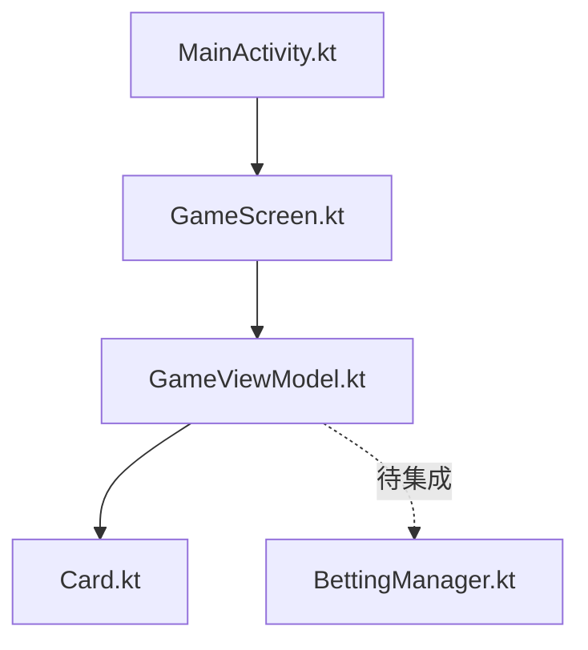
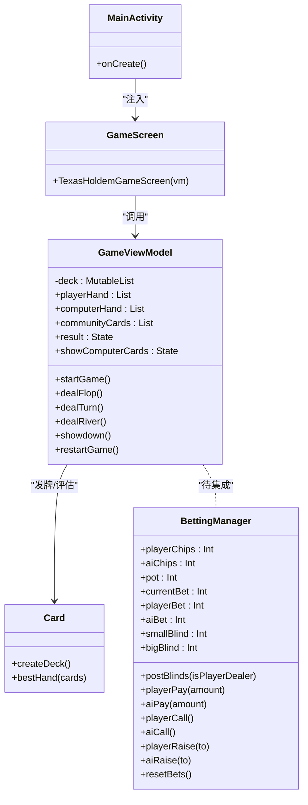
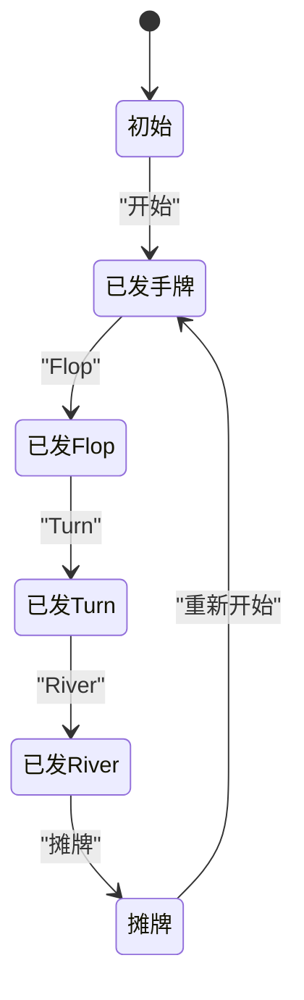
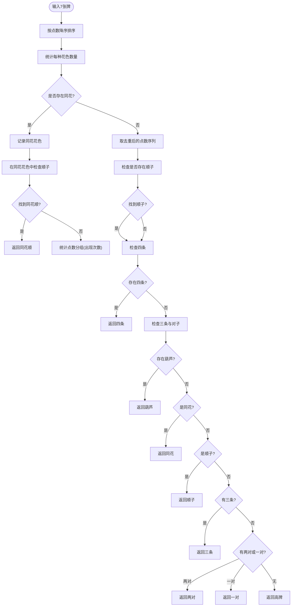
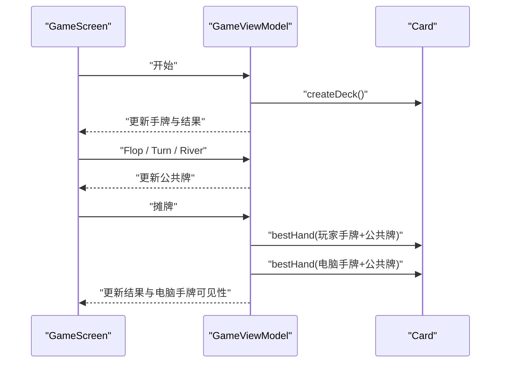
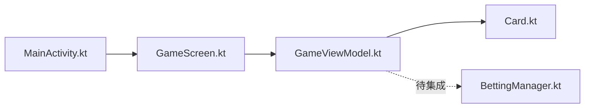

# 核心功能

<cite>
**本文引用的文件**   
- [MainActivity.kt](file://app/src/main/java/com/aniapp/pokerdemo/MainActivity.kt)
- [GameScreen.kt](file://app/src/main/java/com/aniapp/pokerdemo/ui/GameScreen.kt)
- [GameViewModel.kt](file://app/src/main/java/com/aniapp/pokerdemo/vm/GameViewModel.kt)
- [Card.kt](file://app/src/main/java/com/aniapp/pokerdemo/data/Card.kt)
- [BettingManager.kt](file://app/src/main/java/com/aniapp/pokerdemo/data/BettingManager.kt)
</cite>

## 目录
1. [简介](#简介)
2. [项目结构](#项目结构)
3. [核心组件](#核心组件)
4. [架构总览](#架构总览)
5. [详细组件分析](#详细组件分析)
6. [依赖关系分析](#依赖关系分析)
7. [性能考虑](#性能考虑)
8. [故障排查指南](#故障排查指南)
9. [结论](#结论)
10. [附录：集成与扩展建议](#附录集成与扩展建议)

## 简介
PokerDemo 是一个基于 Jetpack Compose 的德州扑克演示应用。当前代码已实现三大核心能力：
- 游戏生命周期控制：从“开始”到“发手牌”，再到公共牌阶段的 Flop、Turn、River，最终摊牌并支持重新开始。
- 牌型评估逻辑：从 2 张手牌 + 最多 5 张公共牌共 7 张牌中选出最优 5 张，判定高牌到同花顺共 9 种牌型。
- 下注系统基础模型：定义筹码、底池、盲注、Call/Raise/Pay 等状态与操作，尚未与主流程集成。

`GameViewModel` 是协调发牌、阶段推进和摊牌的核心；`Card.kt` 提供牌组、牌型评分；`BettingManager.kt` 提供下注规则模型，待后续与 UI 和业务流集成。

## 项目结构
项目采用按职责分层的方式组织源码：
- `vm/`：状态管理与业务编排（`GameViewModel`）。
- `data/`：纯数据与算法（`Card`、`BettingManager`）。
- `ui/`：Compose UI 层（`GameScreen`）。
- 入口 `MainActivity` 负责持有 ViewModel 并注入 UI。

图表来源
- [MainActivity.kt:1-16](file://app/src/main/java/com/aniapp/pokerdemo/MainActivity.kt#L1-L16)
- [GameScreen.kt:1-104](file://app/src/main/java/com/aniapp/pokerdemo/ui/GameScreen.kt#L1-L104)
- [GameViewModel.kt:1-74](file://app/src/main/java/com/aniapp/pokerdemo/vm/GameViewModel.kt#L1-L74)
- [Card.kt:1-98](file://app/src/main/java/com/aniapp/pokerdemo/data/Card.kt#L1-L98)
- [BettingManager.kt:1-48](file://app/src/main/java/com/aniapp/pokerdemo/data/BettingManager.kt#L1-L48)

章节来源
- [MainActivity.kt:1-16](file://app/src/main/java/com/aniapp/pokerdemo/MainActivity.kt#L1-L16)
- [GameScreen.kt:1-104](file://app/src/main/java/com/aniapp/pokerdemo/ui/GameScreen.kt#L1-L104)

## 核心组件
- GameViewModel：管理牌局状态机，驱动发牌阶段，并在摊牌时调用牌型评估计算胜负结果。
- Card：提供牌与花色枚举、整副牌生成、牌型等级与评分、以及从 7 张牌中选最优 5 张的评估函数。
- BettingManager：封装筹码、底池、盲注、下注动作与校验，为未来多回合下注提供基础。
- GameScreen：通过按钮触发 ViewModel 方法，展示手牌、公共牌和结果文本。
- MainActivity：Compose 入口，持有并注入 ViewModel。

章节来源
- [GameViewModel.kt:1-74](file://app/src/main/java/com/aniapp/pokerdemo/vm/GameViewModel.kt#L1-L74)
- [Card.kt:1-98](file://app/src/main/java/com/aniapp/pokerdemo/data/Card.kt#L1-L98)
- [BettingManager.kt:1-48](file://app/src/main/java/com/aniapp/pokerdemo/data/BettingManager.kt#L1-L48)
- [GameScreen.kt:1-104](file://app/src/main/java/com/aniapp/pokerdemo/ui/GameScreen.kt#L1-L104)
- [MainActivity.kt:1-16](file://app/src/main/java/com/aniapp/pokerdemo/MainActivity.kt#L1-L16)

## 架构总览
整体采用 MVVM 风格：UI 层仅做展示与事件派发，业务状态在 ViewModel 中集中维护，底层算法由 data 层提供。

图表来源
- [MainActivity.kt:1-16](file://app/src/main/java/com/aniapp/pokerdemo/MainActivity.kt#L1-L16)
- [GameScreen.kt:1-104](file://app/src/main/java/com/aniapp/pokerdemo/ui/GameScreen.kt#L1-L104)
- [GameViewModel.kt:1-74](file://app/src/main/java/com/aniapp/pokerdemo/vm/GameViewModel.kt#L1-L74)
- [Card.kt:1-98](file://app/src/main/java/com/aniapp/pokerdemo/data/Card.kt#L1-L98)
- [BettingManager.kt:1-48](file://app/src/main/java/com/aniapp/pokerdemo/data/BettingManager.kt#L1-L48)

## 详细组件分析

### 游戏生命周期与状态流转
当前生命周期由一组按钮驱动的离散方法组成：
- startGame：洗牌，给玩家与电脑各发两张手牌。
- dealFlop：当公共牌为空时发三张。
- dealTurn：当公共牌为三张时发一张。
- dealRiver：当公共牌为四张时发最后一张。
- showdown：当公共牌达到五张时亮出电脑手牌，比较双方最优 5 张牌，给出结果。
- restartGame：重置显示并重新发手牌。

图表来源
- [GameViewModel.kt:16-74](file://app/src/main/java/com/aniapp/pokerdemo/vm/GameViewModel.kt#L16-L74)
- [GameScreen.kt:45-96](file://app/src/main/java/com/aniapp/pokerdemo/ui/GameScreen.kt#L45-L96)

关键要点
- 每个阶段都有前置条件检查（如公共牌数量），避免非法跳转。
- 摊牌仅在公共牌达到 5 张时才允许执行，否则返回提示。
- 结果显示通过 `result` 状态更新，UI 自动刷新。

章节来源
- [GameViewModel.kt:16-74](file://app/src/main/java/com/aniapp/pokerdemo/vm/GameViewModel.kt#L16-L74)
- [GameScreen.kt:45-96](file://app/src/main/java/com/aniapp/pokerdemo/ui/GameScreen.kt#L45-L96)

### 牌型评估逻辑
`Card.kt` 实现了从 7 张牌中选择最优 5 张并判断牌型的完整流程：
- 输入必须是 7 张牌（2 张手牌 + 5 张公共牌）。
- 先将牌按点数降序排序，统计花色分布，判断是否存在同花。
- 提取去重后的点数序列，检测是否构成顺子。
- 若同时存在同花与顺子，则判定为同花顺。
- 统计重复点数分组，依次判定四条、葫芦、同花、顺子、三条、两对、一对、高牌。
- 输出 `PokerHand`，包含牌型等级与用于比较的分数数组。

图表来源
- [Card.kt:20-98](file://app/src/main/java/com/aniapp/pokerdemo/data/Card.kt#L20-L98)

复杂度说明
- 排序时间复杂度 O(n log n)，其中 n=7，常数级。
- 分组与判定均为线性扫描，整体可视为 O(1)。
- 空间复杂度 O(1)，只使用固定大小的临时集合。

章节来源
- [Card.kt:20-98](file://app/src/main/java/com/aniapp/pokerdemo/data/Card.kt#L20-L98)

### 下注系统基础模型
`BettingManager` 定义了完整的下注数据结构与校验规则：
- 字段包括双方筹码、底池、当前最大下注额、双方本轮已下注额、大小盲注额度。
- postBlinds：根据庄家位置支付大小盲注。
- playerPay/aiPay：通用支付方法，更新筹码、本回合下注、底池与当前最高下注额。
- playerCall/aiCall：跟注到当前最高下注额。
- playerRaise/aiRaise：加注到指定金额。
- resetBets：每轮结束后重置下注相关字段。

当前限制
- AI 下注未做空值保护与随机策略。
- 未与发牌阶段联动，也未在 UI 暴露下注按钮。
- 未处理全下 All-in、最小加注额等常见规则。

章节来源
- [BettingManager.kt:1-48](file://app/src/main/java/com/aniapp/pokerdemo/data/BettingManager.kt#L1-L48)

### GameViewModel 如何协调三大功能
- 发牌阶段：`startGame` 创建并打乱牌堆，分发手牌；`dealFlop/Turn/River` 按顺序向公共牌区发牌。
- 摊牌阶段：`showdown` 先验证公共牌数量，再分别将玩家手牌与公共牌合并、电脑手牌与公共牌合并，调用 `bestHand` 计算双方最优牌型，比较后更新结果文本。
- 状态同步：所有可变状态均为 Compose 可观察状态，UI 自动响应变化。
- 下注集成点：目前未直接引用 `BettingManager`，但可在 `startGame` 初始化下注器，在每阶段按钮点击前增加下注回合。

图表来源
- [GameViewModel.kt:16-74](file://app/src/main/java/com/aniapp/pokerdemo/vm/GameViewModel.kt#L16-L74)
- [Card.kt:20-98](file://app/src/main/java/com/aniapp/pokerdemo/data/Card.kt#L20-L98)
- [GameScreen.kt:45-96](file://app/src/main/java/com/aniapp/pokerdemo/ui/GameScreen.kt#L45-L96)

章节来源
- [GameViewModel.kt:16-74](file://app/src/main/java/com/aniapp/pokerdemo/vm/GameViewModel.kt#L16-L74)

## 依赖关系分析
- GameScreen 依赖 GameViewModel 提供状态与方法。
- GameViewModel 依赖 Card 提供的 createDeck 与 bestHand。
- BettingManager 目前独立，未被 GameViewModel 引用，属于待集成模块。
- MainActivity 仅负责注入 ViewModel，不承载业务逻辑。

图表来源
- [GameScreen.kt:1-104](file://app/src/main/java/com/aniapp/pokerdemo/ui/GameScreen.kt#L1-L104)
- [GameViewModel.kt:1-74](file://app/src/main/java/com/aniapp/pokerdemo/vm/GameViewModel.kt#L1-L74)
- [Card.kt:1-98](file://app/src/main/java/com/aniapp/pokerdemo/data/Card.kt#L1-L98)
- [BettingManager.kt:1-48](file://app/src/main/java/com/aniapp/pokerdemo/data/BettingManager.kt#L1-L48)
- [MainActivity.kt:1-16](file://app/src/main/java/com/aniapp/pokerdemo/MainActivity.kt#L1-L16)

## 性能考虑
- 牌型评估规模固定为 7 张牌，时间复杂度接近常数，开销极低。
- 每次摊牌仅调用两次 `bestHand`，不会造成明显延迟。
- 建议未来在多回合下注场景中，避免频繁重建牌堆，复用已创建的 Deck 实例或在必要时机才重新洗牌。
- UI 侧应避免在高频回调中进行复杂计算，保持 Compose 重组轻量。

## 故障排查指南
常见问题与定位建议：
- 摊牌提示“请发完所有公共牌再摊牌”：说明公共牌未达到 5 张。应先依次点击 Flop、Turn、River。
  - 参考：[GameViewModel.kt:45-56](file://app/src/main/java/com/aniapp/pokerdemo/vm/GameViewModel.kt#L45-L56)
- 牌型评估报错“必须传入7张牌”：说明传给 `bestHand` 的牌数不足 7 张。需确保手牌 2 张 + 公共牌 5 张后再摊牌。
  - 参考：[Card.kt:45-46](file://app/src/main/java/com/aniapp/pokerdemo/data/Card.kt#L45-L46)
- 按钮点击无效：检查 UI 按钮是否绑定了对应 ViewModel 方法。
  - 参考：[GameScreen.kt:61-96](file://app/src/main/java/com/aniapp/pokerdemo/ui/GameScreen.kt#L61-L96)
- 下注相关异常：检查 `BettingManager` 中筹码是否为负数或超过上限，确认是否在正确的阶段调用 Call/Raise。
  - 参考：[BettingManager.kt:14-47](file://app/src/main/java/com/aniapp/pokerdemo/data/BettingManager.kt#L14-L47)

章节来源
- [GameViewModel.kt:45-56](file://app/src/main/java/com/aniapp/pokerdemo/vm/GameViewModel.kt#L45-L56)
- [Card.kt:45-46](file://app/src/main/java/com/aniapp/pokerdemo/data/Card.kt#L45-L46)
- [GameScreen.kt:61-96](file://app/src/main/java/com/aniapp/pokerdemo/ui/GameScreen.kt#L61-L96)
- [BettingManager.kt:14-47](file://app/src/main/java/com/aniapp/pokerdemo/data/BettingManager.kt#L14-L47)

## 结论
PokerDemo 已具备清晰的牌局生命周期与可靠的牌型评估逻辑。`GameViewModel` 作为中枢，串联了发牌与摊牌流程；`Card.kt` 提供了稳定且高效的 7 选 5 牌型评分；`BettingManager.kt` 为下注规则打下基础，只需在合适的阶段将其接入即可完善完整的多回合下注体验。下一步的重点是将下注流程与发牌阶段结合，补充 UI 交互与规则校验，使整套德州扑克流程闭环。

## 附录：集成与扩展建议
- 在下注流程与发牌流程的集成方案：
  - 在 `startGame` 中初始化 `BettingManager`，并根据庄家位置调用 `postBlinds`。
  - 在每个公共牌阶段（Preflop/Flop/Turn/River）之前增加一轮或多轮下注循环，直到双方跟注或弃牌。
  - 在 `showdown` 前调用 `BettingManager.resetBets()`，准备下一局的结算与重置。
  - 将 `PlayerAction` 与 `BettingManager` 的方法映射到 UI 按钮，分别触发 Call/Raise/Pay。
- 扩展方向：
  - 引入弃牌 Fold 与最小加注额规则。
  - 增加 AI 下注策略（随机、保守、激进）。
  - 支持多人桌与多轮下注状态机。
  - 将牌型评估扩展为可视化辅助信息，例如显示最佳 5 张牌与比较细节。