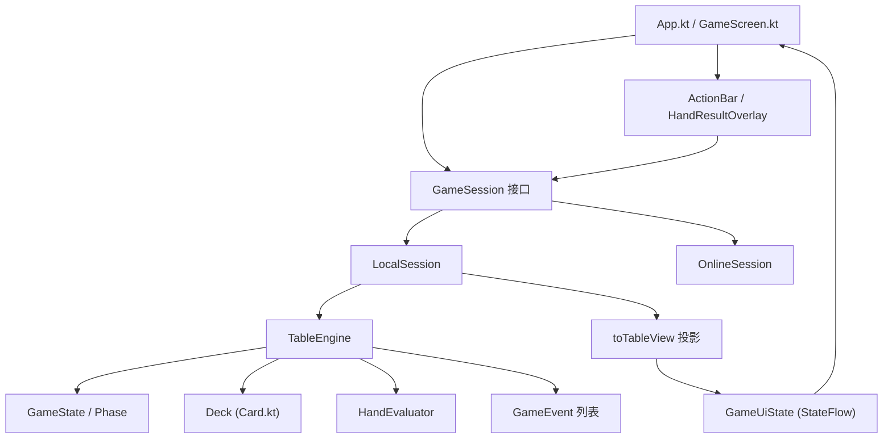
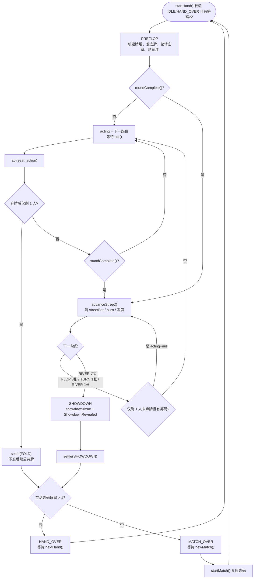
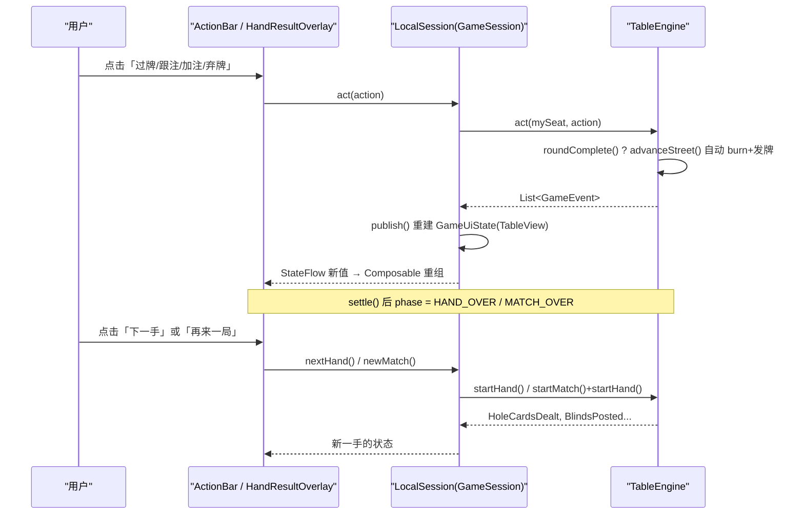
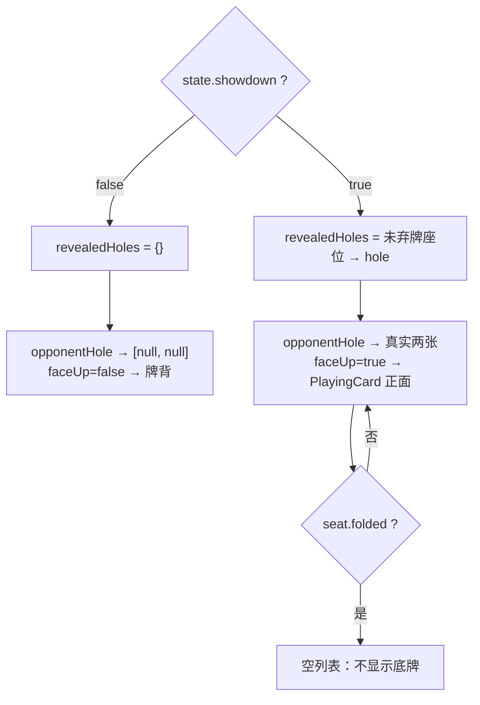

# 游戏生命周期与状态流转

<cite>
**本文引用的文件**
- [TableEngine.kt](file://shared/src/commonMain/kotlin/com/aniapp/pokerdemo/engine/TableEngine.kt)
- [GameState.kt](file://shared/src/commonMain/kotlin/com/aniapp/pokerdemo/engine/GameState.kt)
- [GameEvent.kt](file://shared/src/commonMain/kotlin/com/aniapp/pokerdemo/engine/GameEvent.kt)
- [Card.kt](file://shared/src/commonMain/kotlin/com/aniapp/pokerdemo/engine/Card.kt)
- [PlayerAction.kt](file://shared/src/commonMain/kotlin/com/aniapp/pokerdemo/engine/PlayerAction.kt)
- [GameSession.kt](file://shared/src/commonMain/kotlin/com/aniapp/pokerdemo/session/GameSession.kt)
- [LocalSession.kt](file://shared/src/commonMain/kotlin/com/aniapp/pokerdemo/session/LocalSession.kt)
- [Protocol.kt](file://shared/src/commonMain/kotlin/com/aniapp/pokerdemo/net/Protocol.kt)
- [GameScreen.kt](file://shared/src/commonMain/kotlin/com/aniapp/pokerdemo/ui/GameScreen.kt)
- [ActionBar.kt](file://shared/src/commonMain/kotlin/com/aniapp/pokerdemo/ui/action/ActionBar.kt)
- [CardRow.kt](file://shared/src/commonMain/kotlin/com/aniapp/pokerdemo/ui/card/CardRow.kt)
- [PlayingCard.kt](file://shared/src/commonMain/kotlin/com/aniapp/pokerdemo/ui/card/PlayingCard.kt)
- [HandResultOverlay.kt](file://shared/src/commonMain/kotlin/com/aniapp/pokerdemo/ui/overlay/HandResultOverlay.kt)
</cite>

## 目录
1. [简介](#简介)
2. [项目结构](#项目结构)
3. [核心组件](#核心组件)
4. [架构总览](#架构总览)
5. [阶段模型与状态字段](#阶段模型与状态字段)
6. [一手牌的启动：startHand()](#一手牌的启动starthand)
7. [下注轮推进与自动发牌](#下注轮推进与自动发牌)
8. [结算：settle() 与池分层](#结算settle-与池分层)
9. [事件流与 UI 状态映射](#事件流与-ui-状态映射)
10. [UI 层如何驱动生命周期](#ui-层如何驱动生命周期)
11. [翻前背面、摊牌正面的显示逻辑](#翻前背面摊牌正面的显示逻辑)
12. [完整生命周期示例](#完整生命周期示例)
13. [常见问题排查](#常见问题排查)
14. [结论](#结论)

## 简介
本文描述德州扑克对局的生命周期与状态流转。核心状态机位于跨平台引擎 `TableEngine`，其阶段由 `Phase` 枚举定义：`IDLE → PREFLOP → FLOP → TURN → RIVER → SHOWDOWN → HAND_OVER → MATCH_OVER`。

需要特别澄清的是：**当前实现不再通过 “开始 / Flop / Turn / River / 摊牌” 这类按钮逐步推进公共牌**。一手牌之内，阶段推进完全由引擎在玩家行动（`act()`）后判定下注轮是否结束（`roundComplete()`），再调用 `advanceStreet()` 自动 burn 一张并发放下一条街的公共牌；当只剩一名未弃牌且有筹码的玩家时，进入 runout 一次性发完剩余公共牌。用户的显式动作只有两类：轮到本人时在 `ActionBar` 上下注决策，以及在一手结束后通过 `GameSession.nextHand()` / `newMatch()` 开启下一手或新对局。

本文同时说明 `GameState` 各字段（`phase`、`board`、`players[].hole/streetBet/totalCommitted/isFolded/isAllIn`、`acting`、`currentBet/minRaiseTo`、`dealer`、`handNumber`、`result`、`showdown`）在每个阶段如何变化，Compose 侧如何通过 `StateFlow<GameUiState>` 感知更新并重组，以及结算时未跟注部分退还、主池/边池构造、余数分配的具体规则。

## 项目结构
引擎与会话、UI 的组织方式如下：
- `shared/engine`：纯 Kotlin 规则实现。`TableEngine` 是唯一的状态变更者，`GameState`/`Phase` 为不可变状态快照，`GameEvent` 为每次调用的返回值，`Deck` 负责洗牌、burn 与抽牌。
- `shared/session`：`GameSession` 接口把引擎包装成可观察的 UI 状态源；`LocalSession` 在本地驱动 AI，`OnlineSession` 走服务端。
- `shared/net`：`TableView`/`SeatInfo` 是引擎状态面向 UI 与网络的投影视图。
- `shared/ui`：Compose Multiplatform 界面，`GameScreen` 渲染牌桌，`ActionBar` 提交行动，`HandResultOverlay` 展示结算结果并提供“下一手/再来一局”。

图表来源
- [LocalSession.kt:23-90](file://shared/src/commonMain/kotlin/com/aniapp/pokerdemo/session/LocalSession.kt#L23-L90)
- [LocalSession.kt:128-166](file://shared/src/commonMain/kotlin/com/aniapp/pokerdemo/session/LocalSession.kt#L128-L166)
- [TableEngine.kt:14-40](file://shared/src/commonMain/kotlin/com/aniapp/pokerdemo/engine/TableEngine.kt#L14-L40)
- [GameScreen.kt:41-140](file://shared/src/commonMain/kotlin/com/aniapp/pokerdemo/ui/GameScreen.kt#L41-L140)

## 核心组件
- **TableEngine**：持有唯一的 `state: GameState`（外部只读，`private set`），提供 `startMatch()`、`startHand()`、`legalActions(seat)`、`act(seat, action)` 四个公开入口；其余（`advanceStreet`、`roundComplete`、`settle`、`postBlind`、`pay`、`nextSeat`）均为私有实现细节。
- **GameState / Phase**：不可变数据类 + 阶段枚举，`Phase.isBetting()` 集中判定哪些阶段允许行动。
- **GameEvent**：每个引擎方法返回本次产生的事件序列，供 UI 播放动画、提示文案与网络同步使用。
- **Deck**：每手新建一副洗好的牌，`draw()` 取牌、`burn()` 丢弃一张。
- **GameSession / LocalSession**：把引擎状态投影为 `TableView` 并封装进 `GameUiState`，通过 `StateFlow` 暴露给 Compose；`nextHand()`/`newMatch()` 是生命周期在 UI 侧的唯一控制点。

章节来源
- [TableEngine.kt:14-38](file://shared/src/commonMain/kotlin/com/aniapp/pokerdemo/engine/TableEngine.kt#L14-L38)
- [GameState.kt:6-56](file://shared/src/commonMain/kotlin/com/aniapp/pokerdemo/engine/GameState.kt#L6-L56)
- [GameEvent.kt:6-26](file://shared/src/commonMain/kotlin/com/aniapp/pokerdemo/engine/GameEvent.kt#L6-L26)
- [Card.kt:25-34](file://shared/src/commonMain/kotlin/com/aniapp/pokerdemo/engine/Card.kt#L25-L34)

## 阶段模型与状态字段

### Phase 与 isBetting()
`Phase` 定义 8 个阶段，其中 4 个属于可行动阶段：

| 阶段 | 含义 | isBetting() |
| --- | --- | --- |
| `IDLE` | 尚未开始任何一手（初始/新对局刚重置） | 否 |
| `PREFLOP` | 已发手牌与盲注，翻前下注轮 | 是 |
| `FLOP` | 已发 3 张公共牌，第二轮下注 | 是 |
| `TURN` | 已发第 4 张公共牌，第三轮下注 | 是 |
| `RIVER` | 已发第 5 张公共牌，最后一轮下注 | 是 |
| `SHOWDOWN` | 摊牌亮牌并完成结算的瞬间阶段 | 否 |
| `HAND_OVER` | 一手结束，等待下一手 | 否 |
| `MATCH_OVER` | 对局结束（存活筹码玩家 ≤ 1） | 否 |

判定表达式即 `this == PREFLOP || this == FLOP || this == TURN || this == RIVER`，因此 `SHOWDOWN`/`HAND_OVER`/`MATCH_OVER` 期间 `legalActions()` 一律返回空的 `LegalActions()`，`act()` 会直接抛异常。

章节来源
- [GameState.kt:6-11](file://shared/src/commonMain/kotlin/com/aniapp/pokerdemo/engine/GameState.kt#L6-L11)
- [TableEngine.kt:83-95](file://shared/src/commonMain/kotlin/com/aniapp/pokerdemo/engine/TableEngine.kt#L83-L95)

### GameState 字段随阶段的演变
- `handNumber`：仅在 `startHand()` 自增，UI 用它作为发牌动画的重启键。
- `dealer`：`IDLE` 时保持原值，之后每手用 `nextSeat(dealer){ chips>0 }` 轮转。
- `board`：`startHand()` 清空；`FLOP` +3 张、`TURN`/`RIVER` 各 +1 张；runout 时一次补满到 5 张。
- `players[].hole`：`startHand()` 给有筹码玩家发 2 张，无筹码玩家置空并标记 `isFolded = true`。
- `players[].streetBet`：本街已投，`advanceStreet()` 每轮开始前置 0。
- `players[].totalCommitted`：整手累计投入，结算用于分层构造池，`settle()` 末尾清零。
- `players[].isAllIn` / `chips`：由 `postBlind()`/`pay()` 计算剩零筹码自动置位，决定该座位是否退出可行动集合。
- `players[].hasActedThisRound` / `raiseReopened`：`roundComplete()` 的判定依据，加注会重开其他未全下玩家的行动权。
- `acting`：当前应行动座位；`null` 表示无人可行动（runout、结算中、阶段已结束）。
- `currentBet` / `minRaiseTo`：本街需跟到的额度与最小加注目标，`advanceStreet()` 重置为 `0` 与 `bigBlind`。
- `result`：`startHand()` 置 `null`，`settle()` 写入 `HandResult(awards, revealed, reason)`。
- `showdown`：仅 `showdown()` 私有方法置 `true`，是 UI 判断是否亮牌的开关。

章节来源
- [GameState.kt:13-56](file://shared/src/commonMain/kotlin/com/aniapp/pokerdemo/engine/GameState.kt#L13-L56)
- [TableEngine.kt:42-80](file://shared/src/commonMain/kotlin/com/aniapp/pokerdemo/engine/TableEngine.kt#L42-L80)
- [TableEngine.kt:201-231](file://shared/src/commonMain/kotlin/com/aniapp/pokerdemo/engine/TableEngine.kt#L201-L231)
- [TableEngine.kt:240-307](file://shared/src/commonMain/kotlin/com/aniapp/pokerdemo/engine/TableEngine.kt#L240-L307)

## 一手牌的启动：startHand()

`startHand()` 有两道前置校验：
1. `check(state.phase == Phase.IDLE || state.phase == Phase.HAND_OVER)`——处于下注中、摊牌中或 `MATCH_OVER` 时调用会抛出 “当前阶段不能开始新一手”。
2. `check(state.players.count { it.chips > 0 } >= 2)`——剩余有筹码玩家不足两人时抛出 “剩余筹码不足两人，对局已结束”。

满足条件后按顺序完成：
- **庄家轮转**：`IDLE` 首次开局沿用现有 `dealer`，否则 `nextSeat(state.dealer) { it.chips > 0 }` 顺时针找下一个有筹码座位，跳过被淘汰者。
- **逐手新建牌堆**：`deck = newDeck()`，即每手重新洗牌（默认 `Deck(random)`），不跨手续用残牌；同时 `lastRaiseSize` 复位为大盲。
- **构造新局状态**：`handNumber+1`、`phase = PREFLOP`、`board = emptyList()`、`acting = null`、`currentBet = 0`、`minRaiseTo = 0`、`result = null`、`showdown = false`；有筹码玩家各发 2 张底牌，`chips == 0` 的玩家底牌为空且 `isFolded = true`。产生 `HoleCardsDealt` 事件。
- **盲注座位**：单挑（heads-up，有筹码玩家恰为 2 人）时小盲就是庄家位、大盲为另一家；多人桌则小盲为庄家下一家有筹码者，大盲为小盲下一家。`postBlind()` 以 `minOf(amount, chips)` 实付，可能直接把盲注者打成 `isAllIn`。产生 `BlindsPosted` 事件。
- **下注基准**：`currentBet` 取各家 `streetBet` 最大值，`minRaiseTo = currentBet + bigBlind`。
- **首个行动者**：单挑时优先庄家（若庄家已全下则改为大盲）；多人时为 BB 之后第一个未弃牌且有筹码者。
- **立即跳过空轮**：若首行动者确定后 `roundComplete()` 已成立（例如双方盲注即全下），则 `acting = null` 并直接 `advanceStreet()`，一手可能连续发出多条街。

章节来源
- [TableEngine.kt:42-80](file://shared/src/commonMain/kotlin/com/aniapp/pokerdemo/engine/TableEngine.kt#L42-L80)
- [TableEngine.kt:181-199](file://shared/src/commonMain/kotlin/com/aniapp/pokerdemo/engine/TableEngine.kt#L181-L199)
- [Card.kt:25-34](file://shared/src/commonMain/kotlin/com/aniapp/pokerdemo/engine/Card.kt#L25-L34)

## 下注轮推进与自动发牌

### act() 之后的分支
`act(seat, action)` 先校验 `state.phase.isBetting()` 与 `state.acting == seat`，再按动作类型执行：
- `Fold`：标记弃牌；若未弃牌人数降为 1，立刻 `acting = null` 并以 `EndReason.FOLD` 调用 `settle()` 直接返回，**不再发任何公共牌**。
- `Check`：仅在 `toCall == 0` 时合法。
- `Call`：支付 `legal.callAmount`（不足时即为全下）。
- `RaiseTo`：金额必须落在 `minRaiseTo..maxRaiseTo`；达到 `minRaiseTo` 视为 full raise，更新 `lastRaiseSize` 并把其他未弃牌未全下玩家的 `raiseReopened` 置 `true`（重开行动权），否则不重开。

动作处理完后：若 `roundComplete()` 成立则 `acting = null` 并 `advanceStreet(events)`；否则 `acting = nextSeat(seat) { !it.isFolded && it.chips > 0 }`。

### roundComplete() 判定
- 未弃牌人数 ≤ 1 → 结束。
- 未弃牌且有筹码的人数为 0 → 结束（全部全下）。
- 恰好 1 人仍有筹码 → 该人已行动且 `streetBet >= currentBet` 即结束。
- 其余情况 → 所有仍可行动的人都 `hasActedThisRound` 且 `streetBet == currentBet` 才结束。

### advanceStreet() 的自动发牌循环
`advanceStreet()` 先把各家 `streetBet`、`hasActedThisRound`、`raiseReopened` 清零，`currentBet = 0`、`minRaiseTo = bigBlind`、`lastRaiseSize = bigBlind`，然后进入循环：
- 阶段映射 `PREFLOP→FLOP`、`FLOP→TURN`、`TURN→RIVER`、`RIVER→` 调用 `showdown()` 并结束。
- 每条街先 `deck.burn()` 丢一张，再发 `if (next == FLOP) 3 else 1` 张追加到 `board`。
- **runout 判定**：`state.players.count { !it.isFolded && it.chips > 0 } <= 1` 时，本轮不发行动者（`acting = null`）且循环继续，于是一次性把剩余公共牌全部发完；否则设置首位行动者为庄家之后第一个未弃牌且有筹码者，发出 `StreetDealt(next, newCards, runout)` 后 `return` 交回控制权。
- `showdown()` 私有方法把 `phase = SHOWDOWN`、`showdown = true`、`acting = null`，发出 `ShowdownRevealed`，随后以 `EndReason.SHOWDOWN` 进入 `settle()`。

图表来源
- [TableEngine.kt:97-160](file://shared/src/commonMain/kotlin/com/aniapp/pokerdemo/engine/TableEngine.kt#L97-L160)
- [TableEngine.kt:162-199](file://shared/src/commonMain/kotlin/com/aniapp/pokerdemo/engine/TableEngine.kt#L162-L199)
- [TableEngine.kt:201-238](file://shared/src/commonMain/kotlin/com/aniapp/pokerdemo/engine/TableEngine.kt#L201-L238)
- [TableEngine.kt:240-307](file://shared/src/commonMain/kotlin/com/aniapp/pokerdemo/engine/TableEngine.kt#L240-L307)

## 结算：settle() 与池分层

`settle(reason, events)` 是所有阶段终止后的统一收口，顺序如下。

**第一步：退还未被跟注部分。** 取全体 `totalCommitted` 的最大值 `maxC`；若恰好只有一人处于该最高额且 `maxC > 0`，计算第二高的投入 `second`，差额 `diff = maxC - second` 直接退回该座位（加回 `chips` 并从 `totalCommitted` 中扣减），发出 `UncalledReturned(seat, diff)`。这一步保证多余筹码不进入池的分层。

**第二步：按结果类型分配。**
- `EndReason.FOLD`：唯一未弃牌者拿走 `state.pot`（全体 `totalCommitted` 之和），记录一个 `PotAward(pot, [winner], null)`，不评估牌型、不亮牌。
- `EndReason.SHOWDOWN`：先对每位未弃牌玩家用 `HandEvaluator.evaluate(hole + board)` 求值并存入 `revealed`；再以去重升序的 `totalCommitted` 值作为层级，第 i 层金额为 `(level_i - prev) * 贡献者数`（贡献者 = `totalCommitted >= level_i` 的所有玩家），合格赢家为该层中未弃牌者。
- **无效层下沉**：从高层向低层反向遍历，若某层合格名单为空且不是最低层，则把该层金额并入下一层（`amounts[i-1] += amounts[i]; amounts[i] = 0`）。
- **平分与余数**：每层 `share = amount / winners.size`，余数 `remainder = amount % winners.size`，赢家按 `orderFromDealer(winners)`（从庄家的下一家开始顺时针排序）依次每人多分 1 枚直到余数耗尽；每个非零层产出一条 `PotAward(amount, winners, bestValue)` 与 `PotAwarded(potIndex++, winners, amount)` 事件。

**第三步：统计淘汰与终态。** 收集 `chips == 0 && totalCommitted > 0` 的座位发出 `PlayerEliminated`；随后把所有座位的 `streetBet`、`totalCommitted` 清零；写入 `HandResult`，并根据 `alive = players.filter { chips > 0 }` 是否为 1 人或更少，把 `phase` 置为 `MATCH_OVER` 或 `HAND_OVER`；最后发出 `HandFinished(result)`，对局结束时追加 `MatchFinished(winnerSeat)`。

注意：`settle()` 不会自动开启下一手，也不会复原筹码——这两件事分别由 `nextHand()`→`startHand()` 与 `startMatch()` 承担。

章节来源
- [TableEngine.kt:240-307](file://shared/src/commonMain/kotlin/com/aniapp/pokerdemo/engine/TableEngine.kt#L240-L307)
- [GameState.kt:26-41](file://shared/src/commonMain/kotlin/com/aniapp/pokerdemo/engine/GameState.kt#L26-L41)
- [GameEvent.kt:17-26](file://shared/src/commonMain/kotlin/com/aniapp/pokerdemo/engine/GameEvent.kt#L17-L26)

## 事件流与 UI 状态映射

引擎每个公开方法返回 `List<GameEvent>`，`LocalSession.publish()` 把这批事件连同新的 `TableView` 一起写入 `_uiState`：

| 事件 | 触发时机 | UI 用途 |
| --- | --- | --- |
| `HoleCardsDealt` | `startHand()` 发底牌 | 配合 `handNumber` 触发起手牌逐张浮现动画 |
| `BlindsPosted` | 小/大盲贴注 | 座位下注额与盲注提示 |
| `ActionTaken` | `act()` 每次合法行动 | 行动气泡、语音/日志 |
| `StreetDealt` | `advanceStreet()` 发 flop/turn/river | 公共牌追加动画；`isRunout` 标记一次性发完 |
| `UncalledReturned` | 结算前退还未跟注部分 | “退回 X 筹码” 提示 |
| `ShowdownRevealed` | 进入 `SHOWDOWN` | 对手底牌翻面动画 |
| `PotAwarded` | 每个池层分配 | 结果面板逐行 “主池/边池 i → 赢家” |
| `PlayerEliminated` | 结算统计淘汰 | 座位淘汰态 |
| `HandFinished` | 一手结束 | 弹出 `HandResultOverlay` |
| `MatchFinished` | 仅剩一名有筹码玩家 | 显示整场胜负与“再来一局” |

`TableEngine.toTableView(mySeat)` 是引擎状态到 UI 视图的唯一投影函数：它复制座位筹码/本街下注/累计投入/弃牌/全下等字段，附带 `legal = legalActions(mySeat)`，并在 `state.showdown` 为真时把未弃牌玩家的 `hole` 填进 `revealedHoles`，否则为空 Map——这正是 UI 判断“是否亮牌”的数据来源。

章节来源
- [GameEvent.kt:6-26](file://shared/src/commonMain/kotlin/com/aniapp/pokerdemo/engine/GameEvent.kt#L6-L26)
- [LocalSession.kt:66-90](file://shared/src/commonMain/kotlin/com/aniapp/pokerdemo/session/LocalSession.kt#L66-L90)
- [LocalSession.kt:128-166](file://shared/src/commonMain/kotlin/com/aniapp/pokerdemo/session/LocalSession.kt#L128-L166)
- [Protocol.kt:59-75](file://shared/src/commonMain/kotlin/com/aniapp/pokerdemo/net/Protocol.kt#L59-L75)

## UI 层如何驱动生命周期

### 状态订阅与重组
`GameScreen` 通过 `val ui by session.uiState.collectAsState()` 订阅 `StateFlow<GameUiState>`。`LocalSession` 每次 `publish()` 都以新对象整体替换 `_uiState.value`，因此 Flow 的值变化会触发 `GameScreen` 及其读取了 `table.*` 的子组合（`SeatView`、`BoardRow`、`ActionBar`、`HandResultOverlay`）重组。这里没有旧的 `GameViewModel` + `mutableStateListOf` 字段组，取而代之的是「引擎快照 → TableView → StateFlow」的单向数据流。

`GameUiState` 提供的派生属性承担了旧代码里散落在 ViewModel 的判断：
- `isPlayerTurn = table.acting == table.mySeat && table.phase.isBetting()`
- `me = table.seats.first { it.seat == table.mySeat }`
- `seatName(seat)` 用于把座位号渲染成 “你 / 电脑 / 玩家N”。

### 行动入口
`ActionBar` 的启用条件是 `ui.isPlayerTurn && !ui.aiThinking`，按钮可用性完全来自引擎计算的 `table.legal`：`canFold` 恒真、`canCheck` 仅在无需跟注时出现（否则显示“跟注 N”，全下时显示“跟注全下”）、`canRaise` 决定是否展开 `RaisePanel`。点击后调用 `session::act`，`LocalSession.act()` 再次用 `isPlayerTurn` 兜底拦截非法点击，然后 `publish(engine.act(mySeat, action))`。

因此「Flop/Turn/River/摊牌」不再是按钮：它们只是 `act()` 引发 `roundComplete()` 后由 `advanceStreet()` 自动发生的结果。

### 一手/一局的推进入口
`HandResultOverlay` 在 `phase == HAND_OVER || phase == MATCH_OVER` 时淡入，内部根据阶段提供两个不同回调：
- `HAND_OVER` → “下一手”按钮绑定 `session::nextHand`；
- `MATCH_OVER` → “再来一局”按钮绑定 `session::newMatch`。

`LocalSession.nextHand()` 有守卫 `if (engine.state.phase != Phase.HAND_OVER) return`，重复点击不会二次发牌；`newMatch()` 则取消正在运行的 AI 任务、`engine.startMatch()` 复原初始筹码后立即 `startHand()`。在线模式下非房主看到的是“等待房主开始下一手/新对局…”文本而非按钮。`App.kt` 也把 `session::nextHand` 作为大厅进入牌桌后的 `onStart`。

图表来源
- [GameScreen.kt:41-140](file://shared/src/commonMain/kotlin/com/aniapp/pokerdemo/ui/GameScreen.kt#L41-L140)
- [ActionBar.kt:41-108](file://shared/src/commonMain/kotlin/com/aniapp/pokerdemo/ui/action/ActionBar.kt#L41-L108)
- [GameSession.kt:10-46](file://shared/src/commonMain/kotlin/com/aniapp/pokerdemo/session/GameSession.kt#L10-L46)
- [LocalSession.kt:46-78](file://shared/src/commonMain/kotlin/com/aniapp/pokerdemo/session/LocalSession.kt#L46-L78)
- [HandResultOverlay.kt:37-144](file://shared/src/commonMain/kotlin/com/aniapp/pokerdemo/ui/overlay/HandResultOverlay.kt#L37-L144)

章节来源
- [GameSession.kt:10-34](file://shared/src/commonMain/kotlin/com/aniapp/pokerdemo/session/GameSession.kt#L10-L34)
- [LocalSession.kt:46-78](file://shared/src/commonMain/kotlin/com/aniapp/pokerdemo/session/LocalSession.kt#L46-L78)
- [GameScreen.kt:110-136](file://shared/src/commonMain/kotlin/com/aniapp/pokerdemo/ui/GameScreen.kt#L110-L136)

## 翻前背面、摊牌正面的显示逻辑

显示与否不由 UI 自行推断，而是读取 `TableView.revealedHoles`：`toTableView()` 只在 `state.showdown == true` 时填入未弃牌玩家的底牌。

- 对手手牌取值函数 `opponentHole(table, seat)`：弃牌 → 空列表（不占位）；在 `revealedHoles` 中 → 真实两张牌；否则 → `listOf(null, null)` 占位。
- `HandRow(cards, faceUp, size, handNumber)` 的 `faceUp` 传的是 `table.revealedHoles.containsKey(s.seat)`，本人手牌固定 `faceUp = true`。
- `PlayingCard(card, faceUp, size)` 内部 `showFace = faceUp && card != null`，并用 `animateFloatAsState` 在 0°/180° 间做 400ms 翻转动画；`card == null` 或非正面时呈现牌背。
- 逐张出现由 `visible = remember(handNumber) { mutableIntStateOf(0) }` + `LaunchedEffect(handNumber, cards.size)` 每 120ms 递增驱动：`handNumber` 变化即重置计数，从而避免上一手的牌残留可见；`CardSlot(visible = i < visible.intValue && (card != null || !faceUp))` 保证背面占位也参与动画。
- 公共牌 `BoardRow(table.board, cardSize, table.handNumber)` 同样以 `handNumber` 为动画键，runout 时 5 张会依次浮现。

图表来源
- [LocalSession.kt:128-166](file://shared/src/commonMain/kotlin/com/aniapp/pokerdemo/session/LocalSession.kt#L128-L166)
- [GameScreen.kt:66-75](file://shared/src/commonMain/kotlin/com/aniapp/pokerdemo/ui/GameScreen.kt#L66-L75)
- [GameScreen.kt:141-144](file://shared/src/commonMain/kotlin/com/aniapp/pokerdemo/ui/GameScreen.kt#L141-L144)
- [CardRow.kt:25-70](file://shared/src/commonMain/kotlin/com/aniapp/pokerdemo/ui/card/CardRow.kt#L25-L70)
- [PlayingCard.kt:40-47](file://shared/src/commonMain/kotlin/com/aniapp/pokerdemo/ui/card/PlayingCard.kt#L40-L47)

## 完整生命周期示例

以下用三人桌（起始筹码 2000、盲注 10/20）演示字段级变化；牌面符号遵循 `Card.toString()`（如 `As`、`Td`、`2c`）。

**① 初始 / startMatch() 后**
- `phase = IDLE`、`handNumber = 0`、`board = []`、`acting = null`、`result = null`、`showdown = false`，三家 `chips = 2000`、`hole = []`。

**② startHand()（第 1 手）**
- `dealer = 1`（从 IDLE 起步时沿用初值，第 2 手起轮转）、`phase = PREFLOP`、`handNumber = 1`。
- 三家 `hole` 各 2 张，例如座位 0 `[As Kd]`、座位 1 `[9c 7h]`、座位 2 `[Td 2c]`。
- 多人模式：SB = 庄家下一家（座位 2）贴 10、BB（座位 0）贴 20，`currentBet = 20`、`minRaiseTo = 40`，`acting = 1`（BB 之后第一位）。
- UI：对手两张牌为背面，`pot = 30`，`ActionBar` 因 `acting != mySeat` 而禁用。

**③ 全员跟注 → advanceStreet()**
- `roundComplete()` 成立后清 `streetBet`/`hasActedThisRound`，`burn()` 一张，发 3 张：`board = [Jd Th 5s]`、`phase = FLOP`、`acting = 2`（庄家下一家起），事件 `StreetDealt(FLOP, [...], isRunout = false)`。

**④ FLOP 全过牌 → TURN**
- `board` 追加 1 张至 4 张，`phase = TURN`，`acting` 仍从庄家下一家开始。

**⑤ TURN 有人全下、另一人也全下 → RIVER 变成 runout**
- 此时 `count { !isFolded && chips > 0 } <= 1`，`advanceStreet()` 循环不中断：连续发出 `StreetDealt(RIVER, [4c], isRunout = true)` 与 `StreetDealt(SHOWDOWN...)` 前的最后一张，`board` 一次补满 5 张且 `acting = null`。

**⑥ showdown() + settle(SHOWDOWN)**
- `phase = SHOWDOWN`、`showdown = true`，事件 `ShowdownRevealed` → `revealedHoles` 填充，对手牌翻正。
- 若存在全下层差，先按 `totalCommitted` 分层：例如座位 0 投入 300、座位 1 投入 300、座位 2 投入 150，则主池 `150×3 = 450`（三家合格）、边池 `150×2 = 300`（座位 0/1 合格）。
- 主池由最佳牌型者独得，`PotAward(450, [0], HandValue(...))`；边池若两家同分则 `share = 150`、`remainder = 0` 各得一半，若有奇数余数则由 `orderFromDealer` 靠前者多得 1。
- 结尾：`streetBet/totalCommitted` 清零，`phase = HAND_OVER`，`result = HandResult(awards, revealed, SHOWDOWN)`，事件依次为 `PotAwarded…`、`HandFinished`。

**⑦ HAND_OVER → nextHand()**
- Overlay 显示 “你赢了！”/“平分底池”/“{赢家} 赢了”，逐行 “主池 450 → 你”、“边池 1 300 → 你、电脑”，摊牌原因下另附每家牌型名；点击“下一手”回到 ②，`dealer` 轮转到下一个有筹码座位，`deck` 重新洗一副。

**⑧ MATCH_OVER → newMatch()**
- 当某次结算后 `alive.size <= 1`，`phase = MATCH_OVER` 并追加 `MatchFinished(winner)`；Overlay 显示 “你赢光了所有对手的筹码！” / “你输光了筹码” / “{对手} 赢得了整场比赛”，点击“再来一局”触发 `startMatch()` 把每家筹码恢复为 `initialChips`，随即 `startHand()` 开第 1 手。

章节来源
- [TableEngine.kt:33-40](file://shared/src/commonMain/kotlin/com/aniapp/pokerdemo/engine/TableEngine.kt#L33-L40)
- [TableEngine.kt:42-80](file://shared/src/commonMain/kotlin/com/aniapp/pokerdemo/engine/TableEngine.kt#L42-L80)
- [TableEngine.kt:201-238](file://shared/src/commonMain/kotlin/com/aniapp/pokerdemo/engine/TableEngine.kt#L201-L238)
- [TableEngine.kt:240-307](file://shared/src/commonMain/kotlin/com/aniapp/pokerdemo/engine/TableEngine.kt#L240-L307)
- [HandResultOverlay.kt:66-130](file://shared/src/commonMain/kotlin/com/aniapp/pokerdemo/ui/overlay/HandResultOverlay.kt#L66-L130)
- [Card.kt:10-22](file://shared/src/commonMain/kotlin/com/aniapp/pokerdemo/engine/Card.kt#L10-L22)

## 常见问题排查

- **问题：点击“下一手”没有反应**
  - 原因：`LocalSession.nextHand()` 只在 `engine.state.phase == Phase.HAND_OVER` 时生效；若对局已进入 `MATCH_OVER`，需要点“再来一局”（`newMatch()`）。
  - 解决：确认按钮与阶段匹配；Overlay 已按 `HAND_OVER`/`MATCH_OVER` 分别绑定 `nextHand`/`newMatch`。

- **问题：`startHand()` 抛 “当前阶段不能开始新一手”**
  - 原因：在一手进行中（`PREFLOP..SHOWDOWN`）或 `MATCH_OVER` 下重复请求开新手。
  - 解决：由会话层统一入口触发，不要在 UI 之外直接调引擎；`MATCH_OVER` 后必须先 `startMatch()` 复原筹码。

- **问题：抛 “剩余筹码不足两人，对局已结束”**
  - 原因：有筹码玩家少于 2 人却仍尝试开新手。
  - 解决：此时引擎已在 `settle()` 中把阶段置为 `MATCH_OVER`，应引导用户走 `newMatch()`。

- **问题：公共牌“一次发了好几条街”或提前发满 5 张**
  - 原因：这是 runout 的预期行为——当 `count { !isFolded && chips > 0 } <= 1`（例如全下对全下、或除一人外全部弃牌）时 `advanceStreet()` 循环不交回控制权，一次性补齐剩余公共牌。
  - 解决：无需修复；如需区分展示，可用 `StreetDealt.isRunout` 标志调整动画节奏。

- **问题：某人弃牌后仍在发公共牌**
  - 原因：`act()` 中 `Fold` 使未弃牌人数降为 1 时会直接 `settle(EndReason.FOLD)` 并 `return`，此路径不产生 `StreetDealt`。
  - 解决：若观察到异常，检查是否误在其他位置调用 `advanceStreet()`；结果面板在这种情况下显示 “其余玩家弃牌” 而非牌型。

- **问题：摊牌后对手牌仍是背面**
  - 原因：`revealedHoles` 由 `state.showdown` 决定，而 `showdown` 只在 `RIVER` 下注轮结束进入 `showdown()` 时置真；弃牌获胜的一手永远不亮牌。
  - 解决：确认一手确实走到 `SHOWDOWN`；另外已弃牌座位的底牌被刻意隐藏（`opponentHole` 返回空列表）。

- **问题：上一手的牌还留在屏幕上**
  - 原因：发牌动画键为 `handNumber`，若视图未收到新的 `handNumber` 就不会重置 `visible` 计数。
  - 解决：确保 `publish()` 每次都重建 `GameUiState`（现实现如此），不要缓存旧 `TableView`。

- **问题：底池金额与分配总和不一致**
  - 原因：漏算 `UncalledReturned`。结算第一步会把未被跟注的差额退回投入最高者，并从其 `totalCommitted` 中扣除，因此 `HandResult.totalPot` 小于退还款前的 `state.pot`。
  - 解决：展示总流水时应叠加 `UncalledReturned` 事件金额。

- **问题：加注后其他玩家无法再行动**
  - 原因：只有达到 `minRaiseTo` 的 full raise 才会把他人 `raiseReopened` 置真并重开行动权；不足额加注（all-in 短注）不重开。
  - 解决：属规则设计，非缺陷；`roundComplete()` 中的 `hasActedThisRound && streetBet == currentBet` 判定即依此收敛。

- **问题：AI 卡住或与新对局冲突**
  - 原因：AI 在协程循环中延时 700–1400ms 行动，`newMatch()` 会先 `aiJob?.cancel()` 再重建状态。
  - 解决：切换对局务必走 `GameSession.newMatch()`，不要绕过会话直接调用 `engine.startMatch()`。

章节来源
- [LocalSession.kt:50-90](file://shared/src/commonMain/kotlin/com/aniapp/pokerdemo/session/LocalSession.kt#L50-L90)
- [LocalSession.kt:92-126](file://shared/src/commonMain/kotlin/com/aniapp/pokerdemo/session/LocalSession.kt#L92-L126)
- [TableEngine.kt:42-46](file://shared/src/commonMain/kotlin/com/aniapp/pokerdemo/engine/TableEngine.kt#L42-L46)
- [TableEngine.kt:97-160](file://shared/src/commonMain/kotlin/com/aniapp/pokerdemo/engine/TableEngine.kt#L97-L160)
- [TableEngine.kt:201-307](file://shared/src/commonMain/kotlin/com/aniapp/pokerdemo/engine/TableEngine.kt#L201-L307)
- [GameScreen.kt:141-144](file://shared/src/commonMain/kotlin/com/aniapp/pokerdemo/ui/GameScreen.kt#L141-L144)
- [HandResultOverlay.kt:104-130](file://shared/src/commonMain/kotlin/com/aniapp/pokerdemo/ui/overlay/HandResultOverlay.kt#L104-L130)

## 结论
游戏生命周期已从「按钮逐步发牌 + ViewModel 可变列表」重构为由 `TableEngine` 单一权威状态驱动的严格状态机：`IDLE → PREFLOP → FLOP → TURN → RIVER → SHOWDOWN → HAND_OVER → MATCH_OVER`，其中仅 `isBetting()` 为真的四个阶段接受行动。一手牌由 `startHand()` 在 `IDLE`/`HAND_OVER` 且有筹码玩家 ≥ 2 时开启，逐手新建牌堆并按 `nextSeat(dealer){chips>0}` 轮转庄家；街与街之间由 `act()` → `roundComplete()` → `advanceStreet()` 自动 burn 并发牌，只剩一名未弃牌且有筹码者时进入 runout 一次发完。`settle()` 先退还未被跟注部分，再按 `totalCommitted` 分层构造主池与边池、把无效层金额并入下层、平分后按庄位顺序分配余数，最终统计淘汰并落到 `HAND_OVER` 或 `MATCH_OVER`。UI 侧只需订阅 `StateFlow<GameUiState>`、经 `ActionBar` 提交 `act()`，并在结果浮层上用 `nextHand()`/`newMatch()` 推进；亮牌与否由 `showdown` 经 `revealedHoles` 投影，天然实现了翻前背面、摊牌正面的视觉差异。