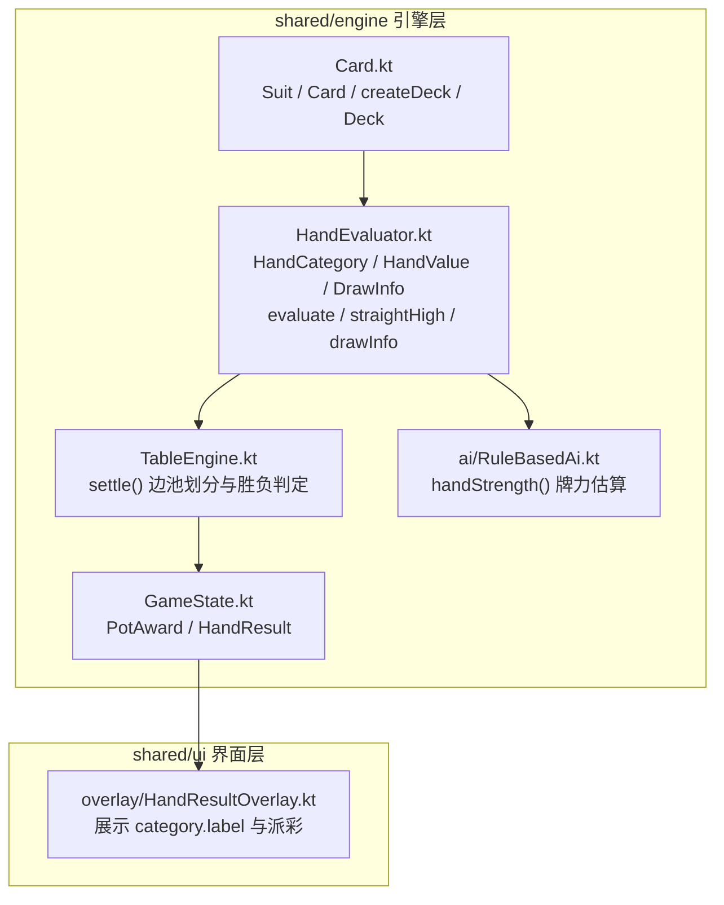
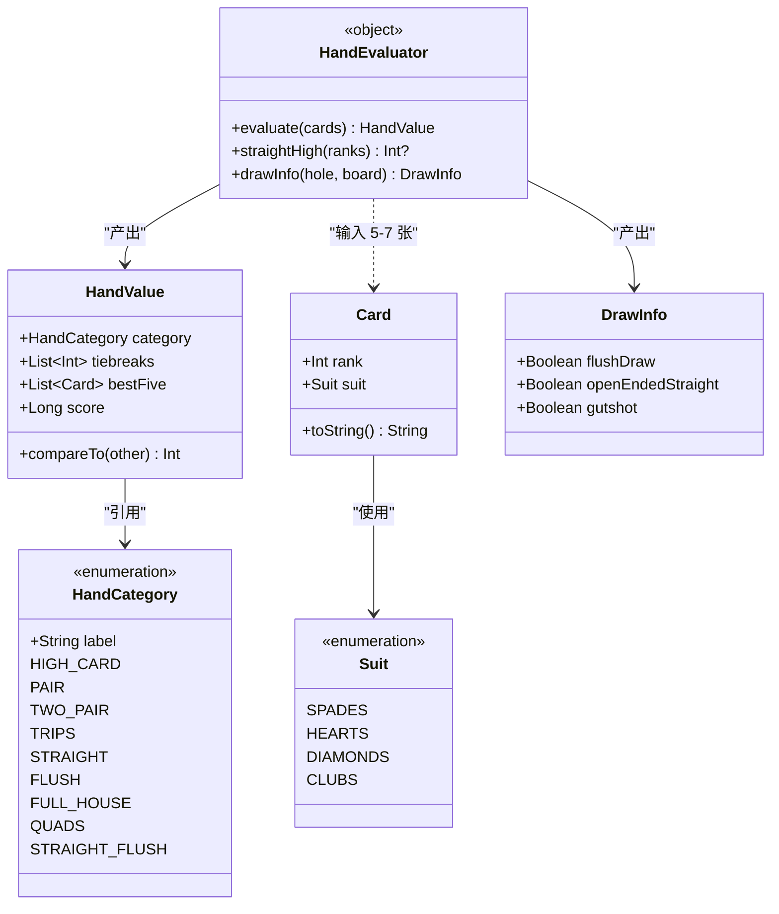
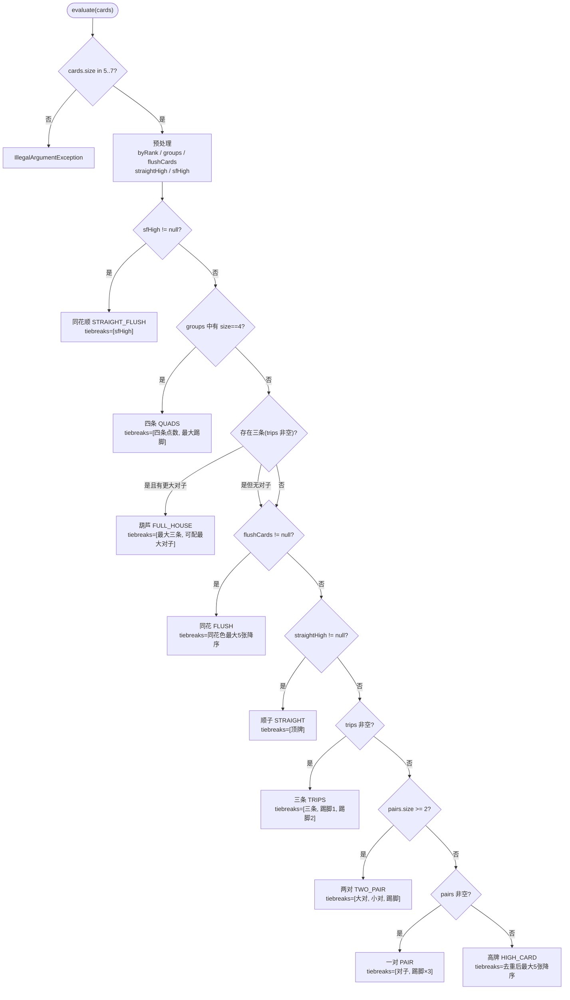
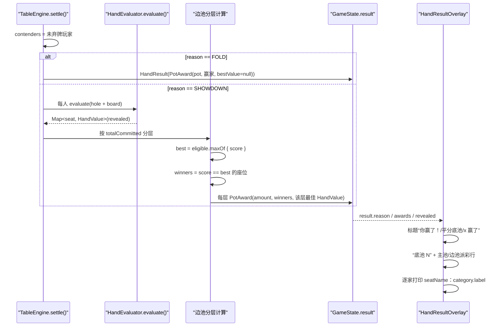

# 牌型评估与评分算法

<cite>
**本文引用的文件**
- [HandEvaluator.kt](file://shared/src/commonMain/kotlin/com/aniapp/pokerdemo/engine/HandEvaluator.kt)
- [Card.kt](file://shared/src/commonMain/kotlin/com/aniapp/pokerdemo/engine/Card.kt)
- [GameState.kt](file://shared/src/commonMain/kotlin/com/aniapp/pokerdemo/engine/GameState.kt)
- [TableEngine.kt](file://shared/src/commonMain/kotlin/com/aniapp/pokerdemo/engine/TableEngine.kt)
- [RuleBasedAi.kt](file://shared/src/commonMain/kotlin/com/aniapp/pokerdemo/engine/ai/RuleBasedAi.kt)
- [HandResultOverlay.kt](file://shared/src/commonMain/kotlin/com/aniapp/pokerdemo/ui/overlay/HandResultOverlay.kt)
- [HandEvaluatorTest.kt](file://shared/src/commonTest/kotlin/com/aniapp/pokerdemo/engine/HandEvaluatorTest.kt)
</cite>

## 目录
1. [简介](#简介)
2. [模块位置与整体结构](#模块位置与整体结构)
3. [核心数据模型](#核心数据模型)
4. [evaluate() 评估流程](#evaluate-评估流程)
5. [9 种牌型的判断规则与优先级](#9-种牌型的判断规则与优先级)
6. [score 的 base-15 打包与比较策略](#score-的-base-15-打包与比较策略)
7. [顺子与 wheel（A-2-3-4-5）处理](#顺子与-wheela-2-3-4-5处理)
8. [drawInfo() 听牌识别](#drawinfo-听牌识别)
9. [在摊牌结算中的使用](#在摊牌结算中的使用)
10. [实战示例](#实战示例)
11. [性能与复杂度分析](#性能与复杂度分析)
12. [故障排查](#故障排查)
13. [结论](#结论)

## 简介
本文件聚焦于德州扑克（Texas Hold'em）中的“牌型评估与评分”实现。该能力原先位于 Android 端 `data/Card.kt`（`bestHand()` + `PokerHand` + `HandRank`），现已随工程重构迁移到跨平台引擎层，由 `shared/src/commonMain/.../engine/HandEvaluator.kt` 中的 `HandEvaluator` 对象统一提供，旧文件已不存在于仓库中。当前实现围绕以下要点展开：
- `HandValue` 结果模型：`category`（牌型）、`tiebreaks`（比较分数序列）、`bestFive`（最优五张）、`score`（可直接比较的 Long 值）。
- `evaluate(cards)` 入口接受 **5–7 张**牌（`require(cards.size in 5..7)`），不再要求必须凑满 7 张。
- 内部按“同花顺 → 四条 → 葫芦 → 同花 → 顺子 → 三条 → 两对 → 一对 → 高牌”的顺序做条件分支，从输入牌集合中挑出最优 5 张组合。
- `score` 采用 base-15 打包，使牌型等级天然优先、同级时逐级比较踢脚，比较运算退化为一次 `Long` 比较。
- `straightHigh()` 通过把 A 额外视作 1 来支持 wheel（A-2-3-4-5），`straightFive()` 对该情形特判为 `5,4,3,2,14`。
- 新增 `drawInfo(hole, board)` 听牌识别（同花听牌、两头顺、卡顺），供 AI 的牌力估算加成使用。

## 模块位置与整体结构
评估逻辑位于 `shared` 模块的 `commonMain`，因此 Android、桌面客户端与服务端共享同一份实现；本地对局（`LocalSession`）与服务器权威对局（`server/Application.kt` + `Room.kt`）都通过 `TableEngine` 调用它，结果一致。

- 引擎层（`engine/`）：`Card.kt` 定义 `Suit`、`Card`、`createDeck()`、`Deck`；`HandEvaluator.kt` 定义 `HandCategory`、`HandValue`、`DrawInfo` 与评估算法；`TableEngine.kt` 在结算时调用 `HandEvaluator.evaluate()`；`engine/ai/RuleBasedAi.kt` 调用 `evaluate()` 与 `drawInfo()` 估算牌力。
- 状态层（`engine/GameState.kt`）：`PotAward`、`HandResult` 直接持有 `HandValue`，并通过 `@Serializable` 参与网络协议传输。
- UI 层（`ui/overlay/HandResultOverlay.kt`）：读取 `result.revealed` 中的 `HandValue.category.label` 展示每家牌型文字。



**图示来源**
- [Card.kt:6-34](file://shared/src/commonMain/kotlin/com/aniapp/pokerdemo/engine/Card.kt#L6-L34)
- [HandEvaluator.kt:6-36](file://shared/src/commonMain/kotlin/com/aniapp/pokerdemo/engine/HandEvaluator.kt#L6-L36)
- [TableEngine.kt:241-300](file://shared/src/commonMain/kotlin/com/aniapp/pokerdemo/engine/TableEngine.kt#L241-L300)
- [GameState.kt:29-39](file://shared/src/commonMain/kotlin/com/aniapp/pokerdemo/engine/GameState.kt#L29-L39)

**章节来源**
- [Card.kt:1-35](file://shared/src/commonMain/kotlin/com/aniapp/pokerdemo/engine/Card.kt#L1-L35)
- [HandEvaluator.kt:1-36](file://shared/src/commonMain/kotlin/com/aniapp/pokerdemo/engine/HandEvaluator.kt#L1-L36)

## 核心数据模型

### 花色 Suit 与牌 Card
- `Suit` 是枚举：`SPADES`、`HEARTS`、`DIAMONDS`、`CLUBS`，带 `@Serializable` 以便线上模式序列化。花色本身**不参与大小比较**（德州扑克无花色强弱），仅用于同花/同花顺判定。
- `Card(rank, suit)`：`rank` 取值 2–14，其中 11=J、12=Q、13=K、14=A。`toString()` 输出紧凑记号（10→`T`，花色首字母 `s/h/d/c`），例如 `Ah`、`Ts`、`9d`——这也是单元测试中构造牌面的书写约定。
- `createDeck()` 按 `Suit.entries` × `(2..14)` 生成标准 52 张牌；`Deck` 用 `ArrayDeque` 支持 `draw()` 与 `burn()`（烧一张），`TableEngine` 发公共牌前会先 `burn()`。

**章节来源**
- [Card.kt:6-34](file://shared/src/commonMain/kotlin/com/aniapp/pokerdemo/engine/Card.kt#L6-L34)
- [TableEngine.kt:221-223](file://shared/src/commonMain/kotlin/com/aniapp/pokerdemo/engine/TableEngine.kt#L221-L223)

### 牌型枚举 HandCategory
`HandCategory` 用枚举顺序表达牌型强弱（`ordinal` 越大越强），并携带中文 `label` 供 UI 直接展示：

| ordinal | 常量 | label |
|---|---|---|
| 0 | `HIGH_CARD` | 高牌 |
| 1 | `PAIR` | 一对 |
| 2 | `TWO_PAIR` | 两对 |
| 3 | `TRIPS` | 三条 |
| 4 | `STRAIGHT` | 顺子 |
| 5 | `FLUSH` | 同花 |
| 6 | `FULL_HOUSE` | 葫芦 |
| 7 | `QUADS` | 四条 |
| 8 | `STRAIGHT_FLUSH` | 同花顺 |

注意 `AI` 侧的牌力映射正是依赖这个顺序：`value.category.ordinal <= HandCategory.TRIPS.ordinal` 被用来判断“成牌还不够强，值得再叠加听牌加成”。

**章节来源**
- [HandEvaluator.kt:6-17](file://shared/src/commonMain/kotlin/com/aniapp/pokerdemo/engine/HandEvaluator.kt#L6-L17)
- [RuleBasedAi.kt:49-66](file://shared/src/commonMain/kotlin/com/aniapp/pokerdemo/engine/ai/RuleBasedAi.kt#L49-L66)

### 评估结果 HandValue
`HandValue` 是一次评估的完整产物：
- `category: HandCategory`：最终牌型。
- `tiebreaks: List<Int>`：比较分数序列，语义随牌型而变（详见[9 种牌型的判断规则与优先级](#9-种牌型的判断规则与优先级)）。它是**规范化的比较键**，测试直接用 `assertEquals(listOf(...), hand.tiebreaks)` 断言。
- `bestFive: List<Card>`：构成该牌型的实际五张牌，供 UI/调试展示。
- `score: Long`：把 `category` 与 `tiebreaks` 打包后的单一整数。
- `compareTo(other)` 只有一行：`score.compareTo(other.score)`。因此 `p > a`、`maxByOrNull { it.score }` 这类比较无需再逐位遍历列表。



**图示来源**
- [HandEvaluator.kt:6-32](file://shared/src/commonMain/kotlin/com/aniapp/pokerdemo/engine/HandEvaluator.kt#L6-L32)
- [Card.kt:6-19](file://shared/src/commonMain/kotlin/com/aniapp/pokerdemo/engine/Card.kt#L6-L19)

**章节来源**
- [HandEvaluator.kt:19-32](file://shared/src/commonMain/kotlin/com/aniapp/pokerdemo/engine/HandEvaluator.kt#L19-L32)

## evaluate() 评估流程
`evaluate(cards)` 的目标是从传入的 5–7 张牌中确定最优 5 张组合并给出可比较的 `HandValue`。与旧的 `bestHand()` 相比，关键差异是**输入规模放宽**：`require(cards.size in 5..7)`，因此翻牌圈（手牌 2 + 公共牌 3 = 5 张）、转牌圈（6 张）也能安全评估——这正是 AI 在每条街复用同一入口的前提。

预处理阶段构建四组索引：
1. `byRank = cards.groupBy { it.rank }`：点数 → 该点数的所有牌，用于取成组牌与查踢脚。
2. `groups`：按“张数降序、点数降序”排序的分组列表，于是 `groups.first()` 即最大的成组，`it.value.size == 4` 即四条检测。
3. `flushCards`：某个花色的全部牌，条件是 `size >= 5`（7 张牌中最多只有一个花色能凑满 5 张，故 `firstOrNull` 足够）。
4. `straightHigh` / `sfHigh`：分别在全量去重点数集合与同花花色点数集合上调用 `straightHigh()`；`sfHigh != null` 即存在同花顺。

随后由 `pack(category, tiebreaks, five)` 统一完成打分与封装（见 [score 的 base-15 打包与比较策略](#score-的-base-15-打包与比较策略)）。三个局部辅助函数负责组装 `bestFive`：
- `ofRank(rank, n)`：取某点数的前 n 张。
- `kickers(excluded, n)`：排除已成组的点数后，按点数降序取 n 张散牌作为踢脚。
- `straightFive(high, pool)`：按顺子顶牌还原连续五张，wheel 情形特判。

判定顺序（严格短路，先命中先返回）：



**图示来源**
- [HandEvaluator.kt:36-110](file://shared/src/commonMain/kotlin/com/aniapp/pokerdemo/engine/HandEvaluator.kt#L36-L110)

**章节来源**
- [HandEvaluator.kt:36-110](file://shared/src/commonMain/kotlin/com/aniapp/pokerdemo/engine/HandEvaluator.kt#L36-L110)

### 两个易被忽略的分支细节
- **同花顺优先于四条**：`sfHigh` 的检查位于四条之前，因此 `Ah 2h 3h 4h 5h Ks Qd` 会被判为同花顺而非“有对子的杂牌”，且 wheel 同花顺（steel wheel）依然胜过任意四条（测试 `steelWheel` 断言 `steel > quads`）。
- **同花的踢脚只统计同花牌**：`flushCards.sortedByDescending { it.rank }.take(5)` 只在满足 5 张的花色内部取牌，杂色大牌不会混入比较。测试用例 `Ah 9h 7h 5h 3h 2h As` 得到 `tiebreaks=[14,9,7,5,3]`，明确排除了第 7 张 `As`（它与红心 A 同点但不同花色，且此处恰好由红心 A 提供 14）。
- **顺子检查排在同花之后**：`Ah Kh Qh Jh 9h Ts 9d` 同时含同花与顺子可能，结果为 `FLUSH`，符合“同花 > 顺子”的优先级。

## 9 种牌型的判断规则与优先级

| 牌型 | 命中条件（代码层面） | tiebreaks 内容 | bestFive 组成 |
|---|---|---|---|
| 高牌 `HIGH_CARD` | 以上均不成立 | 去重后最大 5 个点数，降序 | 各点数取 1 张 |
| 一对 `PAIR` | `pairs.size == 1` | `[对子点数, 踢脚1, 踢脚2, 踢脚3]` | 对子 2 张 + 3 张踢脚 |
| 两对 `TWO_PAIR` | `pairs.size >= 2` | `[大对, 小对, 单张踢脚]` | 两大对 4 张 + 1 张踢脚 |
| 三条 `TRIPS` | `trips` 非空且未成葫芦 | `[三条点数, 踢脚1, 踢脚2]` | 三条 3 张 + 2 张踢脚 |
| 顺子 `STRAIGHT` | `straightHigh != null` | `[顺子顶牌]` | 连续 5 张（wheel 为 5,4,3,2,A） |
| 同花 `FLUSH` | `flushCards != null` | 同花色最大 5 张点数，降序 | 该花色 5 张 |
| 葫芦 `FULL_HOUSE` | `trips` 非空且存在其他可成对的点数 | `[三条点数, 对子点数]` | 三条 3 张 + 对子 2 张 |
| 四条 `QUADS` | `groups` 中存在 `size == 4` | `[四条点数, 最大踢脚]` | 四条 4 张 + 1 张踢脚 |
| 同花顺 `STRAIGHT_FLUSH` | `sfHigh != null` | `[同花顺顶牌]` | 同花色连续 5 张 |

几个需要特别理解的取点规则：

- **点对列表来自 `groups` 的既有排序**：`pairs = groups.filter { it.value.size >= 2 }.map { it.key }` 保持“张数降序、点数降序”，所以 `pairs[0]`/`pairs[1]` 直接就是大对/小对；三对场景（`As Ah Ks Kh Qd Qc 7h`）取前两对，第三对 `Q` 自动降级为踢脚，得 `[14,13,12]`。
- **葫芦在多组三条时取最大三条配最大对子**：`trips` 同样按点数降序，`t = trips.first()` 选最大三条；配对子时用 `groups.filter { it.value.size >= 2 && it.key != t }.maxOfOrNull { it.key }`，即除三条点数外**按点数**取最大可成对者。因此：
  - `As Ah Ad Ks Kh Kd 2c`（双三条）→ 三条 A，配 K（次三条拆两张作对）→ `[14,13]`；
  - `As Ah Ad 2s 2h 2d Kc` → 三条 A 配三条 2 的两张，单张 K 不成对 → `[14,2]`；
  - `8s 8h 8d 5s 5h 3d 3c`（两组三条+）→ `[8,5]`。
- **三条/一对的踢脚排除成组点数**：`kickers(setOf(t), 2)` 会把三条点数自身过滤掉，避免把同点数的第 4 张当踢脚。
- **高牌用 `distinctBy { it.rank }`**：因为走到高牌分支时必然无对子，去重只是防御性写法，保证 `tiebreaks` 恰为 5 个不同点数。

优先级顺序（从高到低）：同花顺 > 四条 > 葫芦 > 同花 > 顺子 > 三条 > 两对 > 一对 > 高牌。测试 `categoryHierarchy` 用九副依次增强的牌面验证整条链：`chain[i] < chain[i+1]` 全部成立。

**章节来源**
- [HandEvaluator.kt:43-110](file://shared/src/commonMain/kotlin/com/aniapp/pokerdemo/engine/HandEvaluator.kt#L43-L110)
- [HandEvaluatorTest.kt:70-125](file://shared/src/commonTest/kotlin/com/aniapp/pokerdemo/engine/HandEvaluatorTest.kt#L70-L125)
- [HandEvaluatorTest.kt:157-181](file://shared/src/commonTest/kotlin/com/aniapp/pokerdemo/engine/HandEvaluatorTest.kt#L157-L181)

## score 的 base-15 打包与比较策略
`pack()` 是打分的唯一出口：

```
var score = (category.ordinal + 1).toLong()
for (i in 0 until 5) score = score * 15 + tiebreaks.getOrElse(i) { 0 }
```

设计要点：
- **以 `category.ordinal + 1` 起始**，避免最高位为 0（否则高牌 `HIGH_CARD` 的 `ordinal=0` 会与“全零”混淆），也让牌型等级成为字典序的最高位。
- **基数 15**：单个点数取值范围 2–14，加上缺位补 0，共 15 个可能值，正好一位装下。因此连续乘 5 次后，`score` 等价于把 `[等级, t0, t1, t2, t3, t4]` 写成 6 位 15 进制数。
- **固定 5 位、缺位补 0**：顺子只有 `[顶牌]`，其余 4 位补 0；这保证不同长度的 `tiebreaks` 之间仍可按位对齐比较。
- **数值上界**：最大约为 `9·15⁵ + 14·15⁴ + … ≈ 7.1e6`，远小于 `Long` 容量，无溢出风险。

由此得到三级比较语义：
1. 牌型等级不同 → 高等级胜（高位决定）。
2. 等级相同 → 逐个比 `tiebreaks`，第一个不同的位置定胜负（例如两条一对先比对子点数，再比三张踢脚）。
3. 全部相同 → `score` 相等，即平局；`HandValue` 是 data class，`compareTo` 返回 0 时 `TableEngine` 会走平分底池逻辑。

由于比较被折叠进一个 `Long`，`TableEngine` 在边池结算里可以直接写 `eligible.maxOf { values.getValue(it).score }` 和 `values.getValue(it).score == best`，而不需要引入 `Comparator<HandValue>` 或列表逐项比较。

**章节来源**
- [HandEvaluator.kt:45-49](file://shared/src/commonMain/kotlin/com/aniapp/pokerdemo/engine/HandEvaluator.kt#L45-L49)
- [HandEvaluator.kt:21-26](file://shared/src/commonMain/kotlin/com/aniapp/pokerdemo/engine/HandEvaluator.kt#L21-L26)
- [TableEngine.kt:283-298](file://shared/src/commonMain/kotlin/com/aniapp/pokerdemo/engine/TableEngine.kt#L283-L298)

## 顺子与 wheel（A-2-3-4-5）处理
旧实现未显式处理低顺子，现在由 `straightHigh(ranks: Set<Int>)` 集中承担，并被普通顺子与同花顺共用：

1. `val rs = if (14 in ranks) ranks + 1 else ranks`：**把 A 同时视作 1**，从而让 wheel 在排序后的序列里表现为 `…,5,4,3,2,1` 这样的连续段。
2. 降序扫描，统计连续下降 1 的游程长度 `run`；一旦 `run >= 5`，返回 `sorted[i - 3]` 作为顶牌。这里返回的是**窗口内最小的那个连续值**，而不是当前 `sorted[i]`。
3. 效果：A-2-3-4-5 的顶端记为 **5**（最小顺子），而真正的宽顺如 `2..6` 记为 6，`10..A` 记为 14。测试 `wheelStraight` 覆盖这三档：`[5] < [6]`，且 `As 2h 3d 4c 5s 6h Kd` 取更大的顶牌 `[6]` 而非 `[5]`。

`straightFive(high, pool)` 负责还原具体五张牌：`high == 5` 时点序列为 `listOf(5, 4, 3, 2, 14)`（用 A 而非虚拟的 1），否则为 `high downTo high-4`；每个点数从 `pool` 中取第一张匹配的牌。这样 `bestFive` 在同花顺 wheel 情形下仍是合法的 5 张同花色牌。

**章节来源**
- [HandEvaluator.kt:53-56](file://shared/src/commonMain/kotlin/com/aniapp/pokerdemo/engine/HandEvaluator.kt#L53-L56)
- [HandEvaluator.kt:112-125](file://shared/src/commonMain/kotlin/com/aniapp/pokerdemo/engine/HandEvaluator.kt#L112-L125)
- [HandEvaluatorTest.kt:127-147](file://shared/src/commonTest/kotlin/com/aniapp/pokerdemo/engine/HandEvaluatorTest.kt#L127-L147)

## drawInfo() 听牌识别
`drawInfo(hole, board)` 面向尚未成牌的牌面，返回 `DrawInfo(flushDraw, openEndedStraight, gutshot)`，用于 AI 的牌力加成。它以 `all = hole + board` 为观察集合：

- **同花听牌 `flushDraw`**：`all.groupBy { it.suit }.any { it.value.size == 4 }`——某花色**恰好 4 张**（差 1 张成同花）。注意条件是 `== 4` 而非 `>= 4`，已经 5 张成同花时不再报听牌。
- **点数集合预处理**：`rs = all.map { it.rank }.toSet().let { if (14 in it) it + 1 else it }`，与 `straightHigh()` 一致地把 A 复制为 1，使 wheel 类听牌能被窗口扫描发现。
- **两头顺 `openEnded`**：扫描 `r in 1..11` 的四连窗口 `r..r+3`，若 4 个点数齐备，则当 `r >= 2 && r + 4 <= 14`（两端补牌都落在合法点数区间）时记为两头顺，否则记为卡顺（贴边的 `A-2-3-4`、`J-Q-K-A` 只能一端成牌）。
- **卡顺 `gutshot`**：再扫描所有 5 张窗口 `high in 5..14`（`high == 5` 特判为 `{14,2,3,4,5}`），窗口内已有 4 张即视为中洞听牌。
- **去重规则**：返回值最后一项是 `gutshot && !openEnded`——**两头顺命中时不再重复计入卡顺**，避免 AI 对同一听牌叠加两次加成。

测试 `drawDetection` 给出四个基准：`Ah Kh / 9h 7h 2c` 为同花听牌；`5s 6h / 7d 8c 2h` 为两头顺；`5s 7h / 8d 9c 2h` 为卡顺且非两头；`As 2h / 3d 4c 9h` 因窗口贴边被判为卡顺而非两头顺。

**章节来源**
- [HandEvaluator.kt:127-143](file://shared/src/commonMain/kotlin/com/aniapp/pokerdemo/engine/HandEvaluator.kt#L127-L143)
- [HandEvaluatorTest.kt:207-219](file://shared/src/commonTest/kotlin/com/aniapp/pokerdemo/engine/HandEvaluatorTest.kt#L207-L219)

### AI 如何使用评估结果与听牌信息
`RuleBasedAi.handStrength(view)` 是 `HandEvaluator` 的主要消费方：
- 翻牌前（`view.board.size < 3`）走独立的 `preflopStrength()` 启发式，不调用评估器。
- 否则 `HandEvaluator.evaluate(view.hole + view.board)`（此时牌数为 5/6/7，正好落在放宽后的合法区间），按 `category` 映射基础牌力：高牌 0.15、一对 0.30/0.45（对子点数不小于台面最大点数时取高值）、两对 0.55、三条 0.65、顺子 0.75、同花 0.80、葫芦 0.90、四条与同花顺 0.98。
- 当 `category.ordinal <= TRIPS.ordinal` 且 `board.size < 5` 时叠加听牌加成：同花听 +0.15，两头顺 +0.12，否则卡顺 +0.06；若已是转牌（`board.size == 4`）则加成减半，最后 `coerceIn(0.0, 1.0)`。

**章节来源**
- [RuleBasedAi.kt:46-68](file://shared/src/commonMain/kotlin/com/aniapp/pokerdemo/engine/ai/RuleBasedAi.kt#L46-L68)

## 在摊牌结算中的使用
新架构中没有旧的 `showdown()` + `result` 字符串拼接：`TableEngine` 在河圈结束后进入 `showdown(events)`，置 `phase = SHOWDOWN`、`showdown = true` 并发出 `GameEvent.ShowdownRevealed`，随后统一交给 `settle(EndReason.SHOWDOWN, events)` 生成结构化的 `HandResult`。



**图示来源**
- [TableEngine.kt:235-309](file://shared/src/commonMain/kotlin/com/aniapp/pokerdemo/engine/TableEngine.kt#L235-L309)
- [GameState.kt:29-39](file://shared/src/commonMain/kotlin/com/aniapp/pokerdemo/engine/GameState.kt#L29-L39)
- [HandResultOverlay.kt:68-104](file://shared/src/commonMain/kotlin/com/aniapp/pokerdemo/ui/overlay/HandResultOverlay.kt#L68-L104)

关键行为说明：
- **比较发生在 `score` 上**：`contenders.associate { it.id to HandEvaluator.evaluate(it.hole + state.board) }` 一次性算好每家的 `HandValue`，各奖池层用 `maxOf { it.score }` 找最强、`score == best` 收集赢家，因此完全平局自然产生多赢家并按 `orderFromDealer` 分配余数。
- **公共牌直接参与评估**：`it.hole + state.board` 在未发满 5 张时也可能只有 5–6 张，这是 `require(size in 5..7)` 放宽的直接原因；`TableEngine` 只在河圈结束或提前 runout 后才结算，正常路径下为 7 张。
- **`bestFive` 不落 UI 文本**：`PotAward.bestValue` 保存该层最强的 `HandValue`（弃牌获胜时为 `null`），UI 目前只用 `category.label` 与座位名拼出“某某：同花顺”这类结果行，胜负标题由 `awards.flatMap { it.winners }` 与 `mySeat` 推导，不再解析字符串。
- **线上模式**：`HandResult` 及其内嵌 `HandValue` 均带 `@Serializable`，服务端结算后经 `TableView.result` 下发，客户端渲染同一份评估结果。

**章节来源**
- [TableEngine.kt:235-309](file://shared/src/commonMain/kotlin/com/aniapp/pokerdemo/engine/TableEngine.kt#L235-L309)
- [GameState.kt:29-52](file://shared/src/commonMain/kotlin/com/aniapp/pokerdemo/engine/GameState.kt#L29-L52)
- [HandResultOverlay.kt:68-110](file://shared/src/commonMain/kotlin/com/aniapp/pokerdemo/ui/overlay/HandResultOverlay.kt#L68-L110)

## 实战示例
以下示例沿用测试中的记号（`T`=10，末字母为花色），给出 `evaluate()` 的实际输出。

- **高牌**：`As Kh 9d 7c 5s 3h 2d` → `HIGH_CARD`，`tiebreaks=[14,13,9,7,5]`（去重降序取 5 张）。
- **一对（含三张踢脚）**：`Ks Kh Ac Qd Js 9c 3h` → `PAIR`，`tiebreaks=[13,14,12,11]`：先对子 K，再 A/Q/J 三张踢脚。同点数对子靠踢脚分胜负正体现在此。
- **两对（三对退化）**：`As Ah Ks Kh Qd Qc 7h` → `TWO_PAIR`，`tiebreaks=[14,13,12]`：取 A、K 两大对，Q 转为单张踢脚；`As Ah Ks Kh 5d 3c 2h` 胜过 `…4d 3c 2h`，因为第 3 位踢脚 5 > 4。
- **三条**：`8s 8h 8d Ac Ks 5h 2d` → `TRIPS`，`tiebreaks=[8,14,13]`；与 `8s 8h 8d Ac Qs Jh Td` 相比第 3 位 K > Q 取胜。
- **顺子与 wheel**：`As 2h 3d 4c 5s 9h Kd` → `STRAIGHT`，`tiebreaks=[5]`，`bestFive` 为 `5,4,3,2,A`；`2s 3h 4d 5c 6s …` 顶牌 6 更大；`As Kh Qd Jc Ts 2h 3d` 顶牌 14 为最大顺子。
- **同花（只看同花色的牌）**：`Ah 9h 7h 5h 3h 2h As` → `FLUSH`，`tiebreaks=[14,9,7,5,3]`；共享 `Ah Kh Qh Jh 2c` 时，持 `9h` 者以第五张 9 胜过持 `8h` 者。
- **葫芦（多三条取最优搭配）**：`As Ah Ad Ks Kh Kd 2c` → `FULL_HOUSE`，`tiebreaks=[14,13]`；`As Ah Ad 2s 2h 2d Kc` → `[14,2]`（单张 K 无法成对）。
- **四条（必须比踢脚）**：`9s 9h 9d 9c Ks 3h 2d` → `QUADS`，`tiebreaks=[9,13]`，胜过同为四条 9 但踢脚为 Q 的 `9s 9h 9d 9c Qs Jh Td`。
- **同花顺（含 steel wheel）**：`Ah Kh Qh Jh Th 3s 2d` → `STRAIGHT_FLUSH`，`tiebreaks=[14]`；`Ah 2h 3h 4h 5h Ks Qd` → `STRAIGHT_FLUSH`，`tiebreaks=[5]`，且仍大于 `9s 9h 9d 9c As Kh Qd` 的四条。
- **公共牌play（平局）**：台面 `As Ks Qs Js Ts` 时，任一手牌都得到同一 `score`，`compareTo` 返回 0 → 平分底池；`Ah 2h 3h 4h 5h 8s 9d` 与 `Ad 2d 3d 4d 5d 8c 9c` 亦为 0。
- **听牌识别**：`Ah Kh / 9h 7h 2c` → `flushDraw=true`；`5s 6h / 7d 8c 2h` → `openEndedStraight=true`；`5s 7h / 8d 9c 2h` → `gutshot=true, openEnded=false`；`As 2h / 3d 4c 9h` → 仅 `gutshot=true`。

上述正确性由 `HandEvaluatorTest` 保障：`oracle5/oracleBest` 是一个完全独立实现的“枚举所有 C(n,5) 组合再取最大”的笨评估器，`randomOracleCrossValidation` 用固定种子 `Random(42)` 对随机 7 张与 6 张牌面逐一交叉校验 `category.ordinal` 与 `tiebreaks`。

**章节来源**
- [HandEvaluatorTest.kt:23-68](file://shared/src/commonTest/kotlin/com/aniapp/pokerdemo/engine/HandEvaluatorTest.kt#L23-L68)
- [HandEvaluatorTest.kt:70-205](file://shared/src/commonTest/kotlin/com/aniapp/pokerdemo/engine/HandEvaluatorTest.kt#L70-L205)
- [HandEvaluatorTest.kt:207-219](file://shared/src/commonTest/kotlin/com/aniapp/pokerdemo/engine/HandEvaluatorTest.kt#L207-L219)

## 性能与复杂度分析
`evaluate()` 为纯函数、无共享可变状态，单次调用开销如下（n 为输入张数，5 ≤ n ≤ 7）：

| 步骤 | 时间复杂度 | 说明 |
|---|---|---|
| `groupBy { rank }` / `groupBy { suit }` | O(n) | 各建一张哈希表 |
| `groups` 排序 | O(g log g)，g ≤ 5 | g 为不同点数个数 |
| `straightHigh(byRank.keys)` | O(k log k)，k ≤ 7 | 内含一次 `sortedDescending()` |
| `straightHigh(flushCards 点数)` | O(k log k) | 仅在同花候选存在时执行 |
| 各分支的 `kickers` / `ofRank` | O(n) | 过滤 + 排序 + take |
| 合计 | **O(n log n)**，n ≤ 7 时可视为常数 | 空间 O(n) |

真正值得注意的是**没有组合枚举**：朴素做法要评估 C(7,5)=21 个五张组合，本实现改为“按牌型优先级做条件分支 + 只保留规范化 `tiebreaks`”，把常数因子压到线性级别，同时用 `score` 让后续多次比较摊销为 O(1)。

优化建议（结合当前代码形态）：
- **避免热路径重复评估**：`TableEngine.settle()` 已经把每家的 `HandValue` 缓存在 `values` map 中复用；新增消费方应沿用这一模式，不要在循环里反复 `evaluate` 同一副牌。
- **减少中间集合分配**：`groups`、`pairs`、`trips` 都会产生新的 `List`/`Map.Entry` 视图。若未来做胜率蒙特卡洛模拟（每回合上万次评估），可改为长度为 15 的计数数组（`IntArray(15)`）配合位掩码表示点数存在性，顺子检测退化为掩码移位比较，彻底去掉排序与装箱。
- **`score` 已是理想的缓存键**：因为它单调反映完整牌力，模拟/查表场景只需保存 `Long`，无需保留 `tiebreaks` 列表与 `bestFive`（后者持有 `Card` 对象，是主要的内存开销来源）。
- **顺子与听牌的 A 处理保持单一入口**：`straightHigh()` 与 `drawInfo()` 都各自做了 `if (14 in ranks) ranks + 1`；如需扩展（例如多人 all-in 前的批量预评估），应把这一转换抽成共用工具，避免两处语义漂移。
- **并行化友好**：评估器是无副作用的 `object`，多桌并发（`server/Room.kt` 中的多个 `TableEngine`）可安全共享，无需加锁。

**章节来源**
- [HandEvaluator.kt:36-110](file://shared/src/commonMain/kotlin/com/aniapp/pokerdemo/engine/HandEvaluator.kt#L36-L110)
- [HandEvaluator.kt:112-143](file://shared/src/commonMain/kotlin/com/aniapp/pokerdemo/engine/HandEvaluator.kt#L112-L143)
- [TableEngine.kt:264-298](file://shared/src/commonMain/kotlin/com/aniapp/pokerdemo/engine/TableEngine.kt#L264-L298)

## 故障排查
- **`IllegalArgumentException: 需要 5-7 张牌，实际 N 张`**
  - 现象：调用 `evaluate()` 时抛异常，消息中带实际张数。
  - 常见原因：传入的只是 2 张手牌（漏了公共牌），或把整副牌/多余牌一起传入。
  - 排查：确认调用形式为 `hole + board`，且 `board` 至少 3 张（翻牌圈起）。旧文档中“必须至少 7 张”的说法已不适用——5 张与 6 张同样是合法输入。
- **顺子被判成高牌 / 未识别 A-2-3-4-5**
  - 排查方向：确认点数使用 2–14 编码（A 必须是 14，不能预先改成 1）；`straightHigh()` 接收的是**去重点数集合**，若上游误传含重复的 `List` 需先 `toSet()`。
- **同花比较结果与预期不符**
  - 说明：同花的 `tiebreaks` 只包含该花色内的牌，杂色大牌一律不参与；若观察到混入，请检查是否误用了自定义拼装逻辑而非 `evaluate()` 的返回值。
- **葫芦/两对在多组同频牌时选错搭配**
  - 说明：`groups` 的排序键是“张数降序 → 点数降序”，葫芦的对子来自 `maxOfOrNull { it.key }`。若手工构造牌面出现 `AAAKKK` 却期望 `[14,13]` 之外的结果，属于规则理解偏差而非缺陷。
- **AI 明显高估弱牌**
  - 排查：听牌加成仅在 `category.ordinal <= TRIPS.ordinal` 且 `board.size < 5` 时生效，转牌后自动减半；`drawInfo` 的 `flushDraw` 要求某花色**恰好** 4 张。若牌面已成同花，`flushDraw` 会是 `false`，此时牌力应来自 `FLUSH` 的基础值 0.80。
- **结算文本与牌型不符**
  - 说明：UI 展示的是 `result.revealed` 中各家自己的 `HandValue.category.label`，而边池层的 `PotAward.bestValue` 是该层最强牌（可能与某家不同）。弃牌结束时 `reason == FOLD`，`revealed` 为空且不显示牌型行。

**章节来源**
- [HandEvaluator.kt:36-37](file://shared/src/commonMain/kotlin/com/aniapp/pokerdemo/engine/HandEvaluator.kt#L36-L37)
- [HandEvaluator.kt:63-110](file://shared/src/commonMain/kotlin/com/aniapp/pokerdemo/engine/HandEvaluator.kt#L63-L110)
- [RuleBasedAi.kt:46-68](file://shared/src/commonMain/kotlin/com/aniapp/pokerdemo/engine/ai/RuleBasedAi.kt#L46-L68)
- [TableEngine.kt:257-266](file://shared/src/commonMain/kotlin/com/aniapp/pokerdemo/engine/TableEngine.kt#L257-L266)
- [HandResultOverlay.kt:96-104](file://shared/src/commonMain/kotlin/com/aniapp/pokerdemo/ui/overlay/HandResultOverlay.kt#L96-L104)

## 结论
牌型评估已从早期 Android 端 `data/Card.kt` 的 `bestHand()/PokerHand/HandRank` 演进为 `shared` 引擎层的 `HandEvaluator`，成为三端共用的单一实现：
- `evaluate(cards)` 接受 5–7 张牌，按“同花顺 → 四条 → 葫芦 → 同花 → 顺子 → 三条 → 两对 → 一对 → 高牌”的短路顺序分支，返回同时携带语义（`category`、`tiebreaks`、`bestFive`）与可比较数值（`score`）的 `HandValue`。
- base-15 打包使牌型等级天然优先、同级逐级比踢脚，比较与结算简化为 `Long` 运算，直接支撑 `TableEngine` 的边池分层与平分底池判定。
- `straightHigh()` 统一处理 A 的双重身份，wheel 顶牌记为 5 并在 `straightFive()` 中还原为 `5,4,3,2,A`；同花顺判定位于四条之前，保证 steel wheel 的正确压制关系。
- 新增 `drawInfo(hole, board)` 以“恰好 4 张同花色”和两类窗口扫描识别同花听牌、两头顺与卡顺，并在两头顺命中时不重复计卡顺，为 AI 的牌力估算提供加成依据。
- 结果通过 `@Serializable` 的 `HandResult`/`PotAward` 贯穿服务端与客户端，UI 直接消费 `category.label`，无需任何字符串解析。