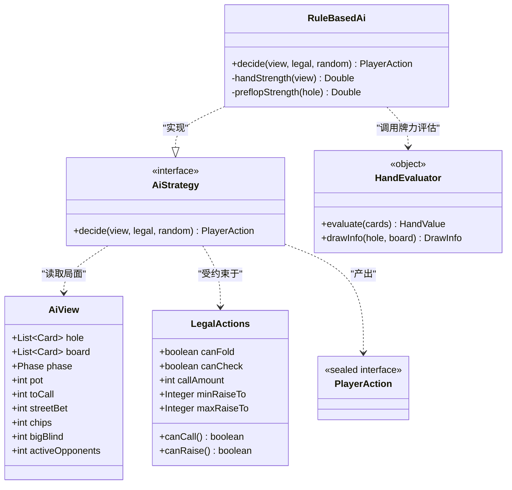
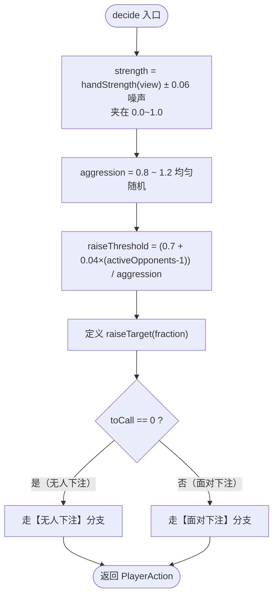
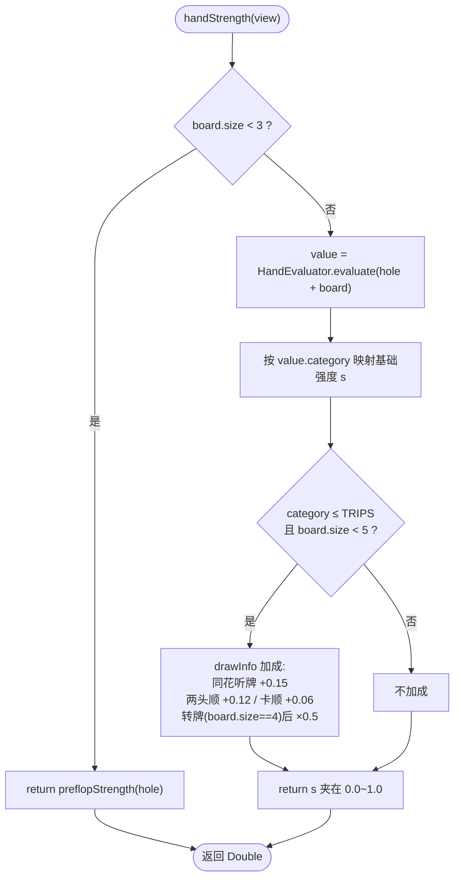
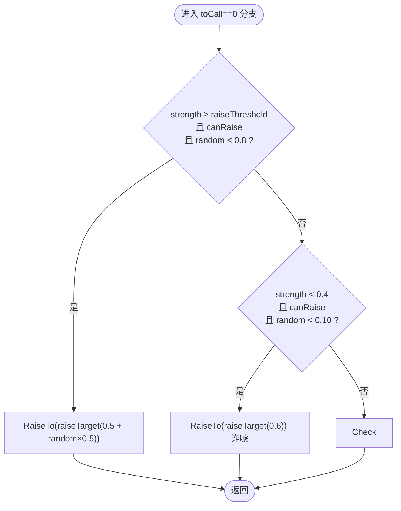
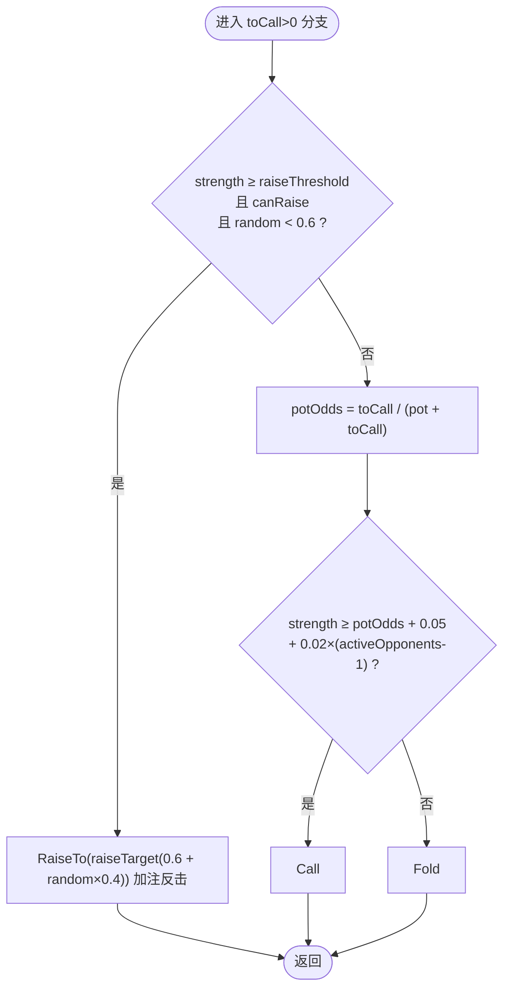
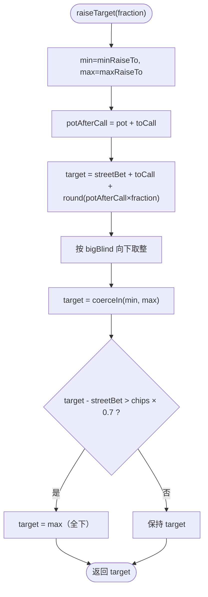
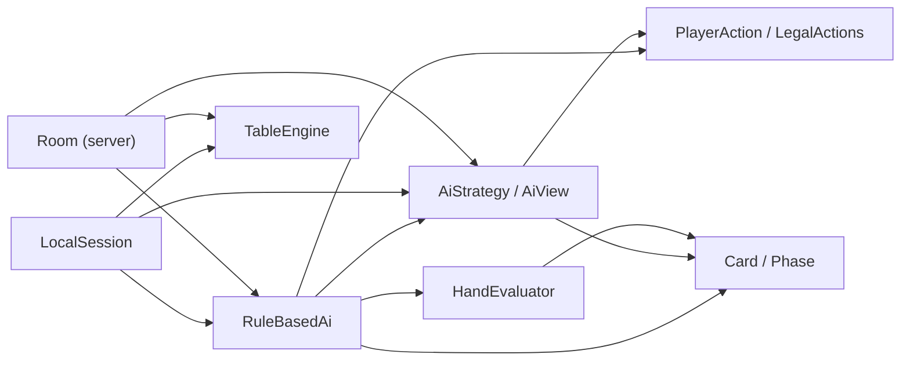

# 规则型 AI 决策策略

<cite>
**本文引用的文件**
- [AiStrategy.kt](file://shared/src/commonMain/kotlin/com/aniapp/pokerdemo/engine/ai/AiStrategy.kt)
- [RuleBasedAi.kt](file://shared/src/commonMain/kotlin/com/aniapp/pokerdemo/engine/ai/RuleBasedAi.kt)
- [HandEvaluator.kt](file://shared/src/commonMain/kotlin/com/aniapp/pokerdemo/engine/HandEvaluator.kt)
- [PlayerAction.kt](file://shared/src/commonMain/kotlin/com/aniapp/pokerdemo/engine/PlayerAction.kt)
- [GameState.kt](file://shared/src/commonMain/kotlin/com/aniapp/pokerdemo/engine/GameState.kt)
- [Card.kt](file://shared/src/commonMain/kotlin/com/aniapp/pokerdemo/engine/Card.kt)
- [TableEngine.kt](file://shared/src/commonMain/kotlin/com/aniapp/pokerdemo/engine/TableEngine.kt)
- [LocalSession.kt](file://shared/src/commonMain/kotlin/com/aniapp/pokerdemo/session/LocalSession.kt)
- [Room.kt](file://server/src/main/kotlin/com/aniapp/pokerdemo/server/Room.kt)
- [RuleBasedAiTest.kt](file://shared/src/commonTest/kotlin/com/aniapp/pokerdemo/engine/ai/RuleBasedAiTest.kt)
</cite>

## 目录
1. [引言](#引言)
2. [设计目标与信息边界](#设计目标与信息边界)
3. [核心契约：AiStrategy 与 AiView](#核心契约aistrategy-与-aiview)
4. [整体架构](#整体架构)
5. [牌力评估模型 handStrength](#牌力评估模型-handstrength)
6. [翻前强度 preflopStrength](#翻前强度-preflopstrength)
7. [成牌强度与听牌加成](#成牌强度与听牌加成)
8. [决策流程 decide](#决策流程-decide)
9. [加注目标金额 raiseTarget](#加注目标金额-raisetarget)
10. [同一实现的复用：本地会话与服务端房间](#同一实现的复用本地会话与服务端房间)
11. [依赖分析](#依赖分析)
12. [测试与行为验证](#测试与行为验证)
13. [性能考量](#性能考量)
14. [故障排查指南](#故障排查指南)
15. [结论](#结论)

## 引言

`shared/engine/ai` 包实现了本项目的机器人玩家决策能力。它采用**规则型（rule-based）**而非机器学习的方法：把一手牌的"好坏"折算成一个 0.0~1.0 之间的连续数值 `strength`，再把这个数值与若干阈值（加注门槛、底池赔率）进行比较，从而在合法动作集合中挑选出 `Fold / Check / Call / RaiseTo` 之一。

该设计有两个关键特征值得强调：

1. **信息边界是刻意设计的**。决策所需的输入被封装为 `AiView`，其中只包含公开信息（公共牌、彩池、需要跟注的金额等）和机器人自己的私有信息（自己的底牌、筹码），**从不包含对手的底牌**。因此不存在"作弊式"的全知视角。
2. **实现与运行环境解耦**。因为 `AiView` 的字段都可以从通用的 `TableEngine` 状态推导出来，所以同一个 `RuleBasedAi` 实例既能在单机模式下由 `LocalSession` 驱动，也能在服务端 `Room` 内驱动补位机器人，无需两套代码。

## 设计目标与信息边界

理解这套策略的第一步，是理解"机器人能看到什么"。下表示出了 `AiView` 的全部字段及其信息性质：

| 字段 | 类型 | 语义 | 信息性质 |
| :--- | :--- | :--- | :--- |
| `hole` | `List<Card>` | 机器人自己的两张底牌 | 私有（仅自己） |
| `board` | `List<Card>` | 已发出的公共牌（0/3/4/5 张） | 公开 |
| `phase` | `Phase` | 当前阶段（PREFLOP/FLOP/TURN/RIVER 等） | 公开 |
| `pot` | `Int` | 当前彩池总额 | 公开 |
| `toCall` | `Int` | 本轮需要跟注的金额（来自 `LegalActions.callAmount`） | 公开 |
| `streetBet` | `Int` | 机器人本街已投入金额 | 半公开 |
| `chips` | `Int` | 机器人剩余筹码 | 私有（仅自己） |
| `bigBlind` | `Int` | 大盲注额，用于加注取整 | 公开 |
| `activeOpponents` | `Int` | 未弃牌的对手人数，默认值 1 | 公开（人数可观察） |

值得注意的是 `activeOpponents` 的取值方式：两处调用方都通过 `players.count { !it.isFolded && it.id != seat }` 计算，即"未弃牌且不是自己的座位数"。这个字段直接影响加注门槛与跟注门槛——对手越多，机器人越保守。这是规则型策略对"多人底池更难赢"这一扑克常识的显式建模。

**刻意排除的信息**：`AiView` 没有任何字段承载对手底牌。服务端 `Room` 在构造视图时同样只读取 `eng.state.of(s)`（即机器人自己座位的状态），并不查询其他座位的 `hole`。这保证了策略的可移植性与公平性。

**本节来源**
- [AiStrategy.kt:10-23](file://shared/src/commonMain/kotlin/com/aniapp/pokerdemo/engine/ai/AiStrategy.kt#L10-L23)
- [LocalSession.kt:104-117](file://shared/src/commonMain/kotlin/com/aniapp/pokerdemo/session/LocalSession.kt#L104-L117)
- [Room.kt:193-208](file://server/src/main/kotlin/com/aniapp/pokerdemo/server/Room.kt#L193-L208)

## 核心契约：AiStrategy 与 AiView

`AiStrategy` 是一个单方法接口，签名极为克制：

```kotlin
interface AiStrategy {
    fun decide(view: AiView, legal: LegalActions, random: Random): PlayerAction
}
```

三个入参各自承担一个不可省略的职责，缺一不可：

- `view`：**局面描述**。回答"现在是什么情况"。它是纯数据，不含任何引擎引用。
- `legal`：**合法性约束**（`LegalActions`）。回答"哪些动作是被允许的"。策略必须保证返回的动作落在合法范围内，否则引擎会在 `act()` 中抛出异常。
- `random`：**随机源注入**。策略内部所有掷骰行为（噪声、激进度、诈唬概率）都必须使用传入的 `Random`，而不是全局随机。这使得决策过程可复现——测试中可以传入固定种子的 `Random`。

这种"把随机源作为参数传入"的设计，正是 `RuleBasedAiTest` 能够用 `Random(11)`、`Random(5)` 等固定种子做确定性断言的前提。

`LegalActions` 中与策略强相关的两个派生属性是 `canRaise`（当 `minRaiseTo` 与 `maxRaiseTo` 均非空时为真）和 `canCall`（当 `callAmount > 0` 时为真）。策略在考虑加注前一律先检查 `legal.canRaise`，在考虑跟注前依赖 `toCall > 0` 分支，从而天然规避非法动作。



**图示来源**
- [AiStrategy.kt:10-23](file://shared/src/commonMain/kotlin/com/aniapp/pokerdemo/engine/ai/AiStrategy.kt#L10-L23)
- [RuleBasedAi.kt:11-14](file://shared/src/commonMain/kotlin/com/aniapp/pokerdemo/engine/ai/RuleBasedAi.kt#L11-L14)
- [PlayerAction.kt:19-27](file://shared/src/commonMain/kotlin/com/aniapp/pokerdemo/engine/PlayerAction.kt#L19-L27)
- [HandEvaluator.kt:33-40](file://shared/src/commonMain/kotlin/com/aniapp/pokerdemo/engine/HandEvaluator.kt#L33-L40)

**本节来源**
- [AiStrategy.kt:1-23](file://shared/src/commonMain/kotlin/com/aniapp/pokerdemo/engine/ai/AiStrategy.kt#L1-L23)
- [PlayerAction.kt:1-27](file://shared/src/commonMain/kotlin/com/aniapp/pokerdemo/engine/PlayerAction.kt#L1-L27)

## 整体架构

`RuleBasedAi.decide` 的内部结构可以概括为"一次牌力评估 + 两条分支路径 + 一个注额计算器"。它在方法开头一次性算好三个贯穿全程的量：带噪声的 `strength`、随机的 `aggression`、以及随对手人数上升的 `raiseThreshold`；随后定义局部函数 `raiseTarget(fraction)`；最后按 `toCall == 0` 与否分成"无人下注"与"面对下注"两条主路径。



**图示来源**
- [RuleBasedAi.kt:14-42](file://shared/src/commonMain/kotlin/com/aniapp/pokerdemo/engine/ai/RuleBasedAi.kt#L14-L42)

## 牌力评估模型 handStrength

`handStrength(view)` 是整个策略的"感知层"，它把牌面翻译成一个 0.0~1.0 的强度分。其逻辑以公共牌数量 `board.size` 为分水岭：

- 当 `board.size < 3`（即翻牌尚未发出，处于 PREFLOP）时，没有可供评估的成牌，直接委托给 `preflopStrength(hole)`。
- 否则，把 `hole + board` 交给 `HandEvaluator.evaluate` 得到 `HandValue`，按类别映射基础分，并在满足条件时叠加听牌加成。



关于听牌加成的触发条件值得细读：`value.category.ordinal <= HandCategory.TRIPS.ordinal` 意味着只有当当前成牌**不高于三条**（高牌、一对、两对、三条）时才考虑听牌——顺子及以上已是完成牌型，无需再赌后续牌。而 `view.board.size < 5` 排除了河牌（此时已无牌可发）。加成公式中 `openEndedStraight` 与 `gutshot` 互斥地贡献 +0.12 或 +0.06（`else if`），同花听牌独立累加。若已到转牌（`board.size == 4`），只剩一张牌待发，故整个 bonus 减半。

**本节来源**
- [RuleBasedAi.kt:44-67](file://shared/src/commonMain/kotlin/com/aniapp/pokerdemo/engine/ai/RuleBasedAi.kt#L44-L67)
- [HandEvaluator.kt:126-143](file://shared/src/commonMain/kotlin/com/aniapp/pokerdemo/engine/HandEvaluator.kt#L126-L143)

## 翻前强度 preflopStrength

`preflopStrength` 用一套简化的点数系统给两张底牌打分。设高点数为 `hi`、低点数为 `lo`（按 `rank` 降序排列，rank 范围 2..14，14=A）：

1. **对子（口袋对）**：`hi.rank == lo.rank` 时返回 `maxOf(0.5, hi.rank / 14.0 * 0.85)`。也就是任意对子有 0.5 的下限，随着点数升高线性放大——例如 AA 约为 `14/14*0.85=0.85`，小对子则停在 0.5 下限。
2. **非对子**：以高点数 `hi` 起步计分：A(14)=10、K(13)=8、Q(12)=7、J(11)=6，其余为 `hi.rank / 2.0`。
   - 若两牌**同花色**，`points += 2.0`。
   - 计算间隔 `gap = hi.rank - lo.rank - 1`，并按间隔扣分：0→0、1→1、2→2、3→4、≥4→5。间隔越大扣分越多，惩罚难以连成顺子的散牌。
   - 若 `gap <= 1`（相连或隔一张）且 `hi.rank < 12`（高点数不是 Q 及以上），额外 `+1.0`，奖励小的连张牌。
3. 最终 `(points / 20.0).coerceIn(0.05, 0.95)`，把分数压缩到 0.05~0.95 区间。

| 要素 | 规则 | 直觉含义 |
| :--- | :--- | :--- |
| 对子下限 | `max(0.5, rank/14×0.85)` | 任何口袋对至少中等偏上 |
| 高点数分值 | A=10, K=8, Q=7, J=6, 其余 rank/2 | 高牌主导价值 |
| 同花加成 | `+2.0` | 同花色利于成同花 |
| 间隔扣分 | gap 0/1/2/3/≥4 → 0/1/2/4/5 | 散牌难成顺 |
| 小连张加分 | `gap≤1 且 hi<12` → `+1.0` | 中小连张有顺子潜力 |
| 归一化 | `points/20` 夹 `[0.05, 0.95]` | 输出统一量纲 |

**本节来源**
- [RuleBasedAi.kt:69-86](file://shared/src/commonMain/kotlin/com/aniapp/pokerdemo/engine/ai/RuleBasedAi.kt#L69-L86)
- [Card.kt:10-21](file://shared/src/commonMain/kotlin/com/aniapp/pokerdemo/engine/Card.kt#L10-L21)

## 成牌强度与听牌加成

当面已有三张或以上公共牌时，`handStrength` 依据 `HandEvaluator.evaluate` 返回的 `HandCategory` 映射基础强度。类别枚举顺序（从弱到强）为 HIGH_CARD、PAIR、TWO_PAIR、TRIPS、STRAIGHT、FLUSH、FULL_HOUSE、QUADS、STRAIGHT_FLUSH。

| HandCategory | 基础强度 | 说明 |
| :--- | :--- | :--- |
| HIGH_CARD（高牌） | 0.15 | 最弱 |
| PAIR（一对） | 0.45 或 0.30 | 区分超池对：`tiebreaks[0] >= board.maxOf{rank}` 记 0.45，否则 0.30 |
| TWO_PAIR（两对） | 0.55 | — |
| TRIPS（三条） | 0.65 | — |
| STRAIGHT（顺子） | 0.75 | — |
| FLUSH（同花） | 0.80 | — |
| FULL_HOUSE（葫芦） | 0.90 | — |
| QUADS / STRAIGHT_FLUSH（四条/同花顺） | 0.98 | 坚果级 |

其中"一对"的特殊处理体现了朴素的牌力判断：如果这一对的点数不低于场上最高公共牌（即所谓"顶对/超池对"），给予更高的 0.45；若是躲在公共牌之下的中对、底对，则降到 0.30。

在此之上，只要成牌不高于三条且未到河牌，就叠加 `HandEvaluator.drawInfo` 提供的听牌加成（见上一节的流程图）。这样一副"当前只是一对，但同时握有同花听牌 + 两头顺听牌"的牌会被显著抬高估值，鼓励机器人继续参与。

**本节来源**
- [RuleBasedAi.kt:46-66](file://shared/src/commonMain/kotlin/com/aniapp/pokerdemo/engine/ai/RuleBasedAi.kt#L46-L66)
- [HandEvaluator.kt:6-18](file://shared/src/commonMain/kotlin/com/aniapp/pokerdemo/engine/HandEvaluator.kt#L6-L18)
- [HandEvaluator.kt:126-143](file://shared/src/commonMain/kotlin/com/aniapp/pokerdemo/engine/HandEvaluator.kt#L126-L143)

## 决策流程 decide

拿到 `strength` 后，`decide` 根据是否有人下注走两条不同的路径。两条路径共享同一套随机化参数：`strength` 附加了 ±0.06 的均匀噪声（避免完全确定性的行为），`aggression` 在 0.8~1.2 之间随机（模拟不同"性格"的手），`raiseThreshold = (0.7 + 0.04×(activeOpponents-1)) / aggression`（对手越多门槛越高，越激进则门槛越低）。

### 无人下注分支（toCall == 0）



要点：即使牌力达标，也只有约 80% 概率主动加注（`random.nextDouble() < 0.8`），保留过牌以制造不确定性；反之弱牌（`strength < 0.4`）约有 10% 概率发动诈唬加注（`raiseTarget(0.6)`，注码比例略高于常规加注）。其余情况过牌。

### 面对下注分支（toCall > 0）



要点：先尝试用加注门槛反击（此处概率降为 0.6，比无人下注时的 0.8 更谨慎）；若不加注，则以**底池赔率**为核心判据决定是否跟注。跟注门槛在纯数学赔率 `potOdds` 上再加 0.05 的安全边际，并随对手人数每多一人再加 0.02——多人底池里跟注要求更强的牌。达不到门槛即弃牌。这也解释了 `junkFoldsToShove` 测试为何期望垃圾牌面对全下必弃：`2h7c` 在三张高公共牌面上 strength 极低，远低于 `1000/(1000+1000)+0.05=0.55` 的门槛。

**本节来源**
- [RuleBasedAi.kt:14-42](file://shared/src/commonMain/kotlin/com/aniapp/pokerdemo/engine/ai/RuleBasedAi.kt#L14-L42)
- [RuleBasedAiTest.kt:78-93](file://shared/src/commonTest/kotlin/com/aniapp/pokerdemo/engine/ai/RuleBasedAiTest.kt#L78-L93)

## 加注目标金额 raiseTarget

`raiseTarget(fraction)` 负责把"想加注多大比例"转换成一个合法的整数加注额 `RaiseTo.amount`。它的算法步骤如下：

1. 取 `min = legal.minRaiseTo!!`、`max = legal.maxRaiseTo!!`（进入此函数时 `canRaise` 已保证二者非空）。
2. 计算跟注后的彩池 `potAfterCall = view.pot + view.toCall`。
3. 初版目标：`target = view.streetBet + view.toCall + round(potAfterCall × fraction)`。即以"跟平当前下注后的位置"为基准，再加上按彩池比例放大的注码增量。
4. **按大盲取整**：`target = (target / view.bigBlind) * view.bigBlind`，向下对齐到大盲整数倍，使加注额看起来自然。
5. **夹进合法区间**：`target.coerceIn(min, max)`，确保不小于最小加注、不超过全下上限。
6. **大额自动全下**：若增量 `target - view.streetBet` 超过自身筹码的 70%（`view.chips * 0.7`），直接把 `target` 置为 `max`（全下）。

这里的 `fraction` 由调用方给出：无人下注加注用 `0.5 + random×0.5`（0.5~1.0 倍彩池），诈唬用固定 0.6，面对下注反击用 `0.6 + random×0.4`（0.6~1.0 倍彩池）。第 6 步的兜底保证了机器人在彩池巨大、自身筹码相对不足时不会做出"半吊子大加注"，而是干脆全下，符合扑克实战逻辑。



**图示来源**
- [RuleBasedAi.kt:19-28](file://shared/src/commonMain/kotlin/com/aniapp/pokerdemo/engine/ai/RuleBasedAi.kt#L19-L28)

**本节来源**
- [RuleBasedAi.kt:19-28](file://shared/src/commonMain/kotlin/com/aniapp/pokerdemo/engine/ai/RuleBasedAi.kt#L19-L28)
- [TableEngine.kt:87-100](file://shared/src/commonMain/kotlin/com/aniapp/pokerdemo/engine/TableEngine.kt#L87-L100)

## 同一实现的复用：本地会话与服务端房间

`AiView` 之所以能同时服务两种运行环境，关键在于它的每个字段都能从 `TableEngine` 的公开状态推导出来，且两处调用方采用了完全一致的构造方式。

```mermaid
sequenceDiagram
    participant Loop as "AI 轮询循环"
    participant Engine as "TableEngine"
    participant View as "AiView 构造"
    participant AI as "RuleBasedAi"

    Loop->>Engine: legalActions(seat)
    Engine-->>Loop: LegalActions(callAmount, min/maxRaiseTo)
    Loop->>View: 组装 hole/board/phase/pot/toCall/streetBet/chips/bigBlind/activeOpponents
    Note over View: activeOpponents = count(!isFolded && id!=seat)<br/>不含对手底牌
    View->>AI: decide(view, legal, random)
    AI-->>Loop: PlayerAction
    Loop->>Engine: act(seat, action)
```

**本地模式（LocalSession）**：`maybeStartAi()` 在协程中轮询，当轮到 AI 座位且处于下注阶段时，先 `delay(aiRandom.nextLong(700, 1401))` 模拟思考，再用 `aiViewOf(seat, legal.callAmount)` 组装视图并调用 `ai.decide(...)`。`ai` 默认注入 `RuleBasedAi()`，但因为是 `AiStrategy` 接口类型，可替换（如测试中的 `CallBot`）。

**服务端模式（Room）**：`maybeAiLoop()` 结构与本地高度对称，同样先延迟 `aiDelayMs`（默认 700~1400ms）、再读取 `eng.state.of(s)` 构造 `AiView`。区别在于 Room 需要通过 `seatMap` 把引擎座位索引映射回房间座位号，并且只在 `seats[actingRoom]?.isAi == true` 时才驱动机器人。Room 里的 `ai` 是硬编码的 `RuleBasedAi()` 实例，服务于 `aiFill` 补位场景。

两者共同印证了写作要点：**因为视图只暴露公开信息与自身信息，同一份 `RuleBasedAi` 源码无需任何改动即可跨端复用**。

```mermaid
graph TB
    subgraph "Shared 引擎层"
        IF["AiStrategy 接口"]
        RB["RuleBasedAi 实现"]
        AV["AiView 数据类"]
        HE["HandEvaluator"]
        RB --> IF
        RB --> HE
        IF ..> AV
    end
    subgraph "本地端"
        LS["LocalSession.maybeStartAi"]
        LSV["LocalSession.aiViewOf"]
        LS --> LSV
    end
    subgraph "服务端"
        RM["Room.maybeAiLoop"]
        RMV["Room 内联 AiView 构造"]
        RM --> RMV
    end
    LSV --> AV
    RMV --> AV
    LS --> RB
    RM --> RB
```

**图示来源**
- [LocalSession.kt:80-117](file://shared/src/commonMain/kotlin/com/aniapp/pokerdemo/session/LocalSession.kt#L80-L117)
- [Room.kt:180-219](file://server/src/main/kotlin/com/aniapp/pokerdemo/server/Room.kt#L180-L219)

**本节来源**
- [LocalSession.kt:24-32](file://shared/src/commonMain/kotlin/com/aniapp/pokerdemo/session/LocalSession.kt#L24-L32)
- [LocalSession.kt:80-117](file://shared/src/commonMain/kotlin/com/aniapp/pokerdemo/session/LocalSession.kt#L80-L117)
- [Room.kt:77-78](file://server/src/main/kotlin/com/aniapp/pokerdemo/server/Room.kt#L77-L78)
- [Room.kt:180-219](file://server/src/main/kotlin/com/aniapp/pokerdemo/server/Room.kt#L180-L219)

## 依赖分析

`engine/ai` 包对外依赖极少，方向清晰、无环：



- `RuleBasedAi` 依赖 `AiStrategy`（自身接口）、`AiView`、`HandEvaluator`、`PlayerAction`/`LegalActions`、`Card`/`Phase`。
- `AiView` 依赖 `Card`、`Phase`、`LegalActions`、`PlayerAction`。
- 上层调用方 `LocalSession`（commonMain）与 `Room`（server main）都只依赖 `AiView` 与 `RuleBasedAi`，并通过 `TableEngine` 提供视图字段的数据源。
- 由于全部位于 `commonMain`，`RuleBasedAi` 可被 Android、Desktop、Server 各 target 编译复用；`Room` 属于 JVM-only 服务端模块，不构成反向依赖。

**图示来源**
- [RuleBasedAi.kt:1-11](file://shared/src/commonMain/kotlin/com/aniapp/pokerdemo/engine/ai/RuleBasedAi.kt#L1-L11)
- [AiStrategy.kt:1-8](file://shared/src/commonMain/kotlin/com/aniapp/pokerdemo/engine/ai/AiStrategy.kt#L1-L8)
- [LocalSession.kt:9-11](file://shared/src/commonMain/kotlin/com/aniapp/pokerdemo/session/LocalSession.kt#L9-L11)
- [Room.kt:8-9](file://server/src/main/kotlin/com/aniapp/pokerdemo/server/Room.kt#L8-L9)

**本节来源**
- [AiStrategy.kt:1-23](file://shared/src/commonMain/kotlin/com/aniapp/pokerdemo/engine/ai/AiStrategy.kt#L1-L23)
- [RuleBasedAi.kt:1-11](file://shared/src/commonMain/kotlin/com/aniapp/pokerdemo/engine/ai/RuleBasedAi.kt#L1-L11)

## 测试与行为验证

`RuleBasedAiTest` 用三个测试锚定了策略的关键不变量：

| 测试 | 场景 | 断言的行为 |
| :--- | :--- | :--- |
| `alwaysLegalInRandomGameStates` | 用 `Random(11)` 跑满 200 次决策、最多 500 手 | 每次 `decide` 返回的动作都必须合法：Fold 需 `canFold`、Check 需 `canCheck`、Call 需 `canCall`、RaiseTo 需 `canRaise` 且金额落在 `minRaiseTo..maxRaiseTo` |
| `nutsNeverFolds` | 底牌 `2h3h` + 公共牌 `As Ks Qs Js Ts`（已成同花顺），面对 200 跟注 | 重复 200 次都不应出现 Fold——坚果牌 strength≈0.98，远高于任何门槛 |
| `junkFoldsToShove` | 底牌 `2h7c` + 公共牌 `As Kd Qh`，面对 1000 全下、无法加注 | 重复 200 次都应 Fold——低 strength 远低于 `potOdds+0.05` 跟注门槛 |

`assertLegal` 辅助函数与 `viewOf` 辅助函数分别复刻了生产环境的合法性校验与视图构造方式，证明"合法性"是策略层的硬约束，而非仅靠运气。这些测试也间接验证了 `raiseTarget` 的 `coerceIn(min, max)` 与全下兜底确实把加注额始终限制在合法区间内。

**本节来源**
- [RuleBasedAiTest.kt:17-36](file://shared/src/commonTest/kotlin/com/aniapp/pokerdemo/engine/ai/RuleBasedAiTest.kt#L17-L36)
- [RuleBasedAiTest.kt:38-77](file://shared/src/commonTest/kotlin/com/aniapp/pokerdemo/engine/ai/RuleBasedAiTest.kt#L38-L77)
- [RuleBasedAiTest.kt:78-93](file://shared/src/commonTest/kotlin/com/aniapp/pokerdemo/engine/ai/RuleBasedAiTest.kt#L78-L93)

## 性能考量

- **决策成本恒定且极低**：单次 `decide` 至多触发一次 `HandEvaluator.evaluate`（在 5~7 张牌上做分组与常数级扫描）与一次 `drawInfo`，均为 O(n) 级别、n≤7，无递归或大表搜索。真正的耗时来自调用方的 `delay(700~1400ms)` 人为思考间隔，而非算法本身。
- **无状态实例**：`RuleBasedAi` 不持有任何跨手累积状态，`Room` 中一个实例即可服务整房所有 AI 座位，内存占用可忽略；随机性完全由外部注入的 `Random` 提供。
- **随机源选择**：本地与测试可通过 `aiRandom` 注入固定种子以获得可复现行为；服务端使用共享的 `Random.Default`，保证多房间并发下的独立性。
- **可扩展点**：若未来要引入更复杂策略（如基于历史统计的对手建模），只需新增 `AiStrategy` 实现并在 `LocalSession` 构造处替换默认参数即可，无需触碰 `Room` 之外的决策接口。需注意此类扩展会改变 `AiView` 的信息边界，应审慎评估是否会破坏"只看公开信息"的公平性前提。

## 故障排查指南

| 症状 | 可能原因 | 定位与处置 |
| :--- | :--- | :--- |
| 引擎抛 `IllegalStateException("加注额非法...")` | 返回的 `RaiseTo.amount` 越界 | 检查 `raiseTarget` 是否遗漏 `coerceIn(min,max)`；确认进入分支前已判 `legal.canRaise`（参见 TableEngine 的 `act` 校验） |
| 机器人从不加注 | `raiseThreshold` 过高或 `canRaise` 恒为假 | `raiseThreshold=(0.7+0.04×(opponents-1))/aggression`，对手越多门槛越高；`canRaise` 取决于引擎是否允许再次加注（`hasActedThisRound`/`raiseReopened`） |
| 决策不可复现（测试抖动） | 误用了全局随机而非注入的 `random` | 策略内所有 `nextDouble/nextInt` 必须走参数 `random`；测试须传入固定种子 |
| 弱牌不弃、频繁跟注 | 底池赔率门槛偏低 | 跟注门槛为 `potOdds+0.05+0.02×(opponents-1)`，多人底池应更保守；核对 `activeOpponents` 是否正确计算 |
| 服务端 AI 座位不动 | `seatMap` 映射或 `isAi` 判定失败 | `maybeAiLoop` 仅在 `seats[seatMap[acting]]?.isAi==true` 时启动；关闭 `aiFill` 时空位不会被补为 AI |
| 观感过于机械 | 缺少随机化 | 确认 `strength` 的 ±0.06 噪声、`aggression` 0.8~1.2、加注概率 0.8/0.6、诈唬 0.10 均生效 |

**本节来源**
- [TableEngine.kt:127-137](file://shared/src/commonMain/kotlin/com/aniapp/pokerdemo/engine/TableEngine.kt#L127-L137)
- [TableEngine.kt:87-100](file://shared/src/commonMain/kotlin/com/aniapp/pokerdemo/engine/TableEngine.kt#L87-L100)
- [Room.kt:180-219](file://server/src/main/kotlin/com/aniapp/pokerdemo/server/Room.kt#L180-L219)

## 结论

`shared/engine/ai` 用最少的代码实现了一个合理、可解释、可移植的扑克机器人。其精髓有三：

1. **单一感知函数**：`handStrength` 把翻前点数系统与翻后成牌/听牌评估统一折算为 0.0~1.0 强度分，是所有决策的唯一依据。
2. **阈值 + 随机化的决策器**：`decide` 用 `raiseThreshold`、底池赔率门槛配合噪声、激进度与概率开关，让机器人在"打得像人"与"遵守规则"之间取得平衡，同时通过 `activeOpponents` 项显式建模多人底池的难度。
3. **严格的信息边界**：`AiView` 只承载公开信息与自身信息，使同一 `RuleBasedAi` 无缝服务于 `LocalSession` 与服务端 `Room`，既保证公平又消除重复实现。

对使用者而言，`AiStrategy` 接口提供了清晰的替换点；对维护者而言，`RuleBasedAiTest` 的合法性、坚果不弃、垃圾必弃三条不变量构成了可靠的回归护栏。

<docs>