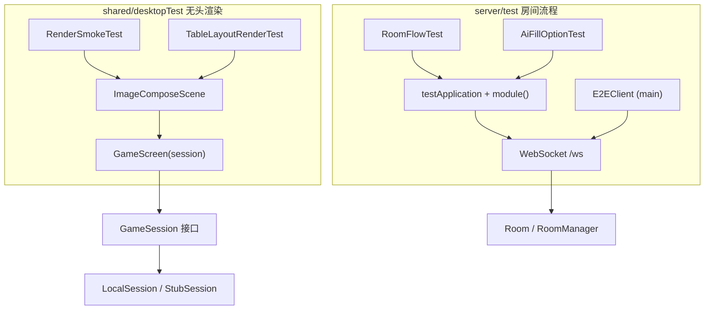
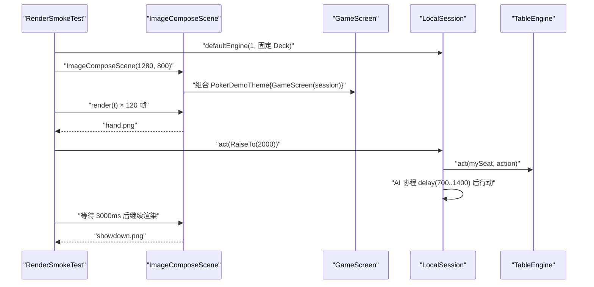
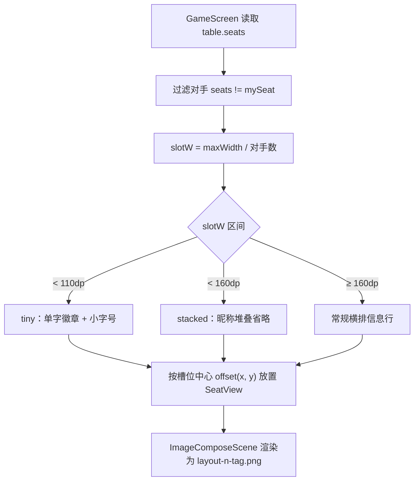
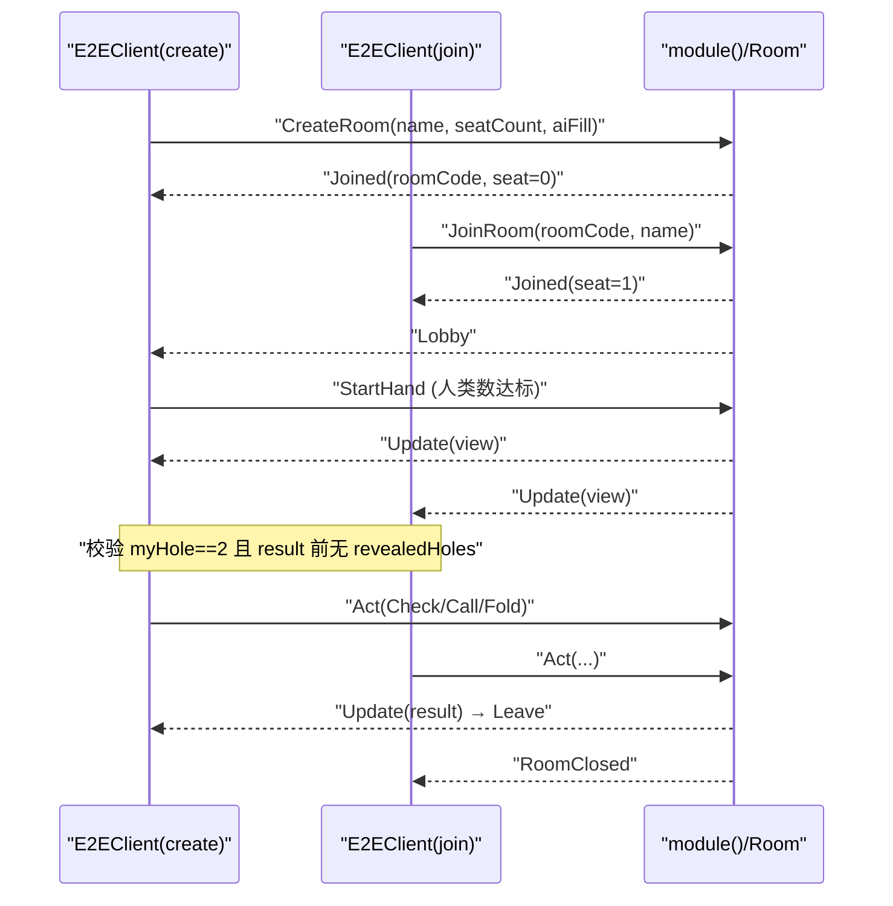

# 界面测试

<cite>
**本文引用的文件**
- [RenderSmokeTest.kt](file://shared/src/desktopTest/kotlin/com/aniapp/pokerdemo/ui/RenderSmokeTest.kt)
- [TableLayoutRenderTest.kt](file://shared/src/desktopTest/kotlin/com/aniapp/pokerdemo/ui/TableLayoutRenderTest.kt)
- [GameScreen.kt](file://shared/src/commonMain/kotlin/com/aniapp/pokerdemo/ui/GameScreen.kt)
- [SeatView.kt](file://shared/src/commonMain/kotlin/com/aniapp/pokerdemo/ui/table/SeatView.kt)
- [CardRow.kt](file://shared/src/commonMain/kotlin/com/aniapp/pokerdemo/ui/card/CardRow.kt)
- [HandResultOverlay.kt](file://shared/src/commonMain/kotlin/com/aniapp/pokerdemo/ui/overlay/HandResultOverlay.kt)
- [GameSession.kt](file://shared/src/commonMain/kotlin/com/aniapp/pokerdemo/session/GameSession.kt)
- [LocalSession.kt](file://shared/src/commonMain/kotlin/com/aniapp/pokerdemo/session/LocalSession.kt)
- [Protocol.kt](file://shared/src/commonMain/kotlin/com/aniapp/pokerdemo/net/Protocol.kt)
- [shared/build.gradle.kts](file://shared/build.gradle.kts#L47-L51)
- [RoomFlowTest.kt](file://server/src/test/kotlin/com/aniapp/pokerdemo/server/RoomFlowTest.kt)
- [AiFillOptionTest.kt](file://server/src/test/kotlin/com/aniapp/pokerdemo/server/AiFillOptionTest.kt)
- [E2EClient.kt](file://server/src/test/kotlin/com/aniapp/pokerdemo/server/E2EClient.kt)
- [Application.kt](file://server/src/main/kotlin/com/aniapp/pokerdemo/server/Application.kt)
- [Room.kt](file://server/src/main/kotlin/com/aniapp/pokerdemo/server/Room.kt)
- [server/build.gradle.kts](file://server/build.gradle.kts)
- [ExampleInstrumentedTest.kt](file://app/src/androidTest/java/com/aniapp/pokerdemo/ExampleInstrumentedTest.kt)
- [app/build.gradle](file://app/build.gradle)
</cite>

## 目录

1. [引言](#引言)
2. [测试体系总览](#测试体系总览)
3. [桌面端无头渲染测试](#桌面端无头渲染测试)
4. [牌桌布局回归：等宽槽位与紧凑徽章](#牌桌布局回归等宽槽位与紧凑徽章)
5. [服务端房间流程测试](#服务端房间流程测试)
6. [E2E 脚本客户端与真实 WebSocket 会话](#e2e-脚本客户端与真实-websocket-会话)
7. [Android Instrumentation 测试现状](#android-instrumentation-测试现状)
8. [测试环境与执行策略](#测试环境与执行策略)
9. [断言策略与状态一致性验证](#断言策略与状态一致性验证)
10. [常见问题排查与性能优化](#常见问题排查与性能优化)
11. [结论](#结论)

## 引言

PokerDemo 的 UI 自动化不再依赖 Android Compose 交互测试。历史上描述的“点击开始 / Flop / Turn / River / 摊牌 / 重新开始按钮并用 `onNodeWithText` 断言结果文本”的测试形态，在当前代码中已不存在：`GameScreen` 已迁移到 `shared` 模块的多平台 Compose UI，不再有对应的 ViewModel 按钮流程；`app` 模块的 `androidTest` 只保留模板用例。

当前实际存在两类可运行的 UI 相关自动化：

1. **桌面端无头渲染测试**（`shared/src/desktopTest`）：`RenderSmokeTest` 与 `TableLayoutRenderTest` 使用 `ImageComposeScene` 在没有窗口系统的情况下渲染 `App`/`GameScreen`，输出 PNG 到 `build/render`，用于守住牌桌布局不重叠的回归。
2. **服务端房间流程测试**（`server/src/test`）：`RoomFlowTest`、`AiFillOptionTest` 通过 Ktor `testApplication` + 真实 WebSocket 会话驱动建房、加入、开始、行动、AI 补位开关、断线托管等端到端路径；`E2EClient` 则是可用 `javaexec` 启动的联机脚本客户端。

本文描述这两类测试的结构、覆盖场景、断言方式与运行方法。



**图表来源**

- [RenderSmokeTest.kt:20-74](file://shared/src/desktopTest/kotlin/com/aniapp/pokerdemo/ui/RenderSmokeTest.kt#L20-L74)
- [TableLayoutRenderTest.kt:21-89](file://shared/src/desktopTest/kotlin/com/aniapp/pokerdemo/ui/TableLayoutRenderTest.kt#L21-L89)
- [RoomFlowTest.kt:47-52](file://server/src/test/kotlin/com/aniapp/pokerdemo/server/RoomFlowTest.kt#L47-L52)
- [E2EClient.kt:20-36](file://server/src/test/kotlin/com/aniapp/pokerdemo/server/E2EClient.kt#L20-L36)
- [Application.kt:23-28](file://server/src/main/kotlin/com/aniapp/pokerdemo/server/Application.kt#L23-L28)

## 测试体系总览

| 层级 | 位置 | 运行环境 | 验证目标 |
|---|---|---|---|
| 引擎单元测试 | `shared/src/commonTest/engine` | JVM / 通用测试 | 发牌、下注、摊牌规则 |
| 本地会话测试 | `shared/src/commonTest/session` | JVM | `LocalSession` 状态推进 |
| 无头渲染测试 | `shared/src/desktopTest/ui` | 桌面 JVM（`compose.desktop.currentOs`） | UI 能否渲染、座位布局是否重叠 |
| 房间流程测试 | `server/src/test` | Ktor `testApplication` 内存服务器 | 协议消息序列、错误码、AI 补位、断线托管 |
| 联机脚本 | `server/src/test/E2EClient.kt` | 需真实运行的服务端 | 多客户端长时间对局、中途断线 |
| Android Instrumentation | `app/src/androidTest` | Android 设备/模拟器 | 目前仅模板用例 |

需要注意：无头渲染测试并不做节点查找或点击断言，它把 Compose 渲染成位图并落盘，因此其作用是“渲染不崩溃 + 视觉产物可人工/基线比对”，而交互逻辑正确性由引擎/会话测试与服务端流程测试保证。

**章节来源**

- [shared/build.gradle.kts:47-51](file://shared/build.gradle.kts#L47-L51)
- [server/build.gradle.kts:10-22](file://server/build.gradle.kts#L10-L22)

## 桌面端无头渲染测试

### 依赖与运行前提

`desktopTest` 源集只声明了一个额外依赖：

- `implementation(compose.desktop.currentOs)`（[shared/build.gradle.kts:47-51](file://shared/build.gradle.kts#L47-L51)）

该依赖提供 Skia 桌面后端，使 `androidx.compose.ui.ImageComposeScene` 可在无窗口、无 Activity 的 JVM 进程中按时间轴推进组合与动画帧。测试本身使用 `kotlin.test` 的 `@Test`，不需要 JUnit4 规则，也不需要 `createAndroidComposeRule` / `@get:Rule`。

### RenderSmokeTest：整链冒烟

`RenderSmokeTest` 有两个用例（[RenderSmokeTest.kt:30-74](file://shared/src/desktopTest/kotlin/com/aniapp/pokerdemo/ui/RenderSmokeTest.kt#L30-L74)）：

- `renderStartScreen`：以 1280×800 创建场景，渲染 `PokerDemoTheme { App(versionText = "v-test") }`，推进 120 帧后写出 `start.png`，验证入口页组合不抛异常。
- `renderHandAndShowdown`：构造一个固定顺序的 `Deck`（前若干张为 A♠A♥K♠K♥…，保证玩家拿到强牌），用 `LocalSession.defaultEngine(1, deck)` 建立确定性引擎，再交给 `LocalSession(scope, aiCount = 1, engine = ...)`；渲染 `GameScreen(session)` 得到 `hand.png`，随后调用 `session.act(PlayerAction.RaiseTo(2000))`，`delay(3000)` 等待 AI 回合推进，再渲染出 `showdown.png`。用例前后各打印一次 `session.uiState.value.table`，便于对照状态变化。

这里的“交互”是通过 `GameSession.act(...)` 直接驱动状态机，而不是模拟按钮点击；UI 侧只需在指定时间点渲染即可捕获动作后的画面。



**图表来源**

- [RenderSmokeTest.kt:44-73](file://shared/src/desktopTest/kotlin/com/aniapp/pokerdemo/ui/RenderSmokeTest.kt#L44-L73)
- [LocalSession.kt:57-63](file://shared/src/commonMain/kotlin/com/aniapp/pokerdemo/session/LocalSession.kt#L57-L63)
- [LocalSession.kt:88-107](file://shared/src/commonMain/kotlin/com/aniapp/pokerdemo/session/LocalSession.kt#L88-L107)

**章节来源**

- [RenderSmokeTest.kt:20-74](file://shared/src/desktopTest/kotlin/com/aniapp/pokerdemo/ui/RenderSmokeTest.kt#L20-L74)
- [LocalSession.kt:25-52](file://shared/src/commonMain/kotlin/com/aniapp/pokerdemo/session/LocalSession.kt#L25-L52)

### TableLayoutRenderTest：桩会话驱动的布局矩阵

`TableLayoutRenderTest` 不依赖引擎，而是定义了一个最小 `GameSession` 实现 `StubSession`，只暴露一个 `MutableStateFlow<GameUiState>`，`act/nextHand/newMatch/dispose` 全部为空实现（[TableLayoutRenderTest.kt:23-29](file://shared/src/desktopTest/kotlin/com/aniapp/pokerdemo/ui/TableLayoutRenderTest.kt#L23-L29)）。这样可以把 UI 与协程时序彻底解耦，专注于“给定 TableView 数据时布局如何排布”。

`view(n)` 构造器刻意制造最坏情况（[TableLayoutRenderTest.kt:31-58](file://shared/src/desktopTest/kotlin/com/aniapp/pokerdemo/ui/TableLayoutRenderTest.kt#L31-L58)）：

- 首座昵称为 12 个汉字的超长名字 `"超长昵称十二字甲乙丙丁"`，最后一座固定为 `"你"`；
- 座位 0 有 `streetBet=20`，座位 1 有 `streetBet=40` 且 `allIn=true`；
- 当 `n >= 4` 时座位 3 处于 `folded`；
- 座位 2 设为 `connected=false`（触发“托管”徽章）；
- `isAi = i >= 3`；
- 公共牌固定三张、`phase = Phase.FLOP`、`pot = 60`、`myHole` 为两张贴牌。

唯一用例 `renderAllSeatCountsBothViewports` 对 `n in 2..6` 与两种视口 `(360×780, "phone")`、`(1280×800, "desk")` 做笛卡尔积，共 10 次渲染，产物命名为 `layout-$n-$tag.png`（[TableLayoutRenderTest.kt:74-89](file://shared/src/desktopTest/kotlin/com/aniapp/pokerdemo/ui/TableLayoutRenderTest.kt#L74-L89)）。每次渲染推进 150 帧并以 `Thread.sleep(12)` 轻微限速，时钟每次递增 3 秒，使不同帧落在不同的动画阶段。

**章节来源**

- [TableLayoutRenderTest.kt:21-89](file://shared/src/desktopTest/kotlin/com/aniapp/pokerdemo/ui/TableLayoutRenderTest.kt#L21-L89)
- [GameSession.kt:11-27](file://shared/src/commonMain/kotlin/com/aniapp/pokerdemo/session/GameSession.kt#L11-L27)
- [Protocol.kt:64-80](file://shared/src/commonMain/kotlin/com/aniapp/pokerdemo/net/Protocol.kt#L64-L80)

## 牌桌布局回归：等宽槽位与紧凑徽章

这组渲染测试存在的直接动因是布局算法的变更：旧版把对手座位按椭圆角度摆放，相邻座位列在窄视口或多座位时会交叠；现版本改为**水平等分槽位 + 沿椭圆弧仅分布高度**。

`GameScreen` 中的关键实现（[GameScreen.kt:57-81](file://shared/src/commonMain/kotlin/com/aniapp/pokerdemo/ui/GameScreen.kt#L57-L81)）：

- `slotW = maxWidth / opponents.size`，每个对手占一个等宽槽位；
- 水平偏移 `x = -maxWidth/2 + slotW * (j + 0.5f)`，即槽位中心，保证列之间永不重叠；
- 垂直偏移 `y = -maxHeight * 0.16f * (1 + sin(π f))`，其中 `f = (j+0.5)/opponents.size`，保留环坐观感；
- 对手牌尺寸 `oppCardSize = CardSize(minOf(cardSize.width, (slotW - 14.dp)/2f))`，随槽位收窄；
- 整体牌尺寸 `cardSize = CardSize(minOf(maxWidth / (if (seats.size > 3) 9f else 7.2f), 64.dp))`。

`SeatView` 依据传入的 `slotWidth` 计算两级压缩档位（[SeatView.kt:41-56](file://shared/src/commonMain/kotlin/com/aniapp/pokerdemo/ui/table/SeatView.kt#L41-L56)）：

- `stacked = slotWidth < 160.dp`：昵称与筹码行改为上下堆叠，昵称 `fillMaxWidth` + `TextOverflow.Ellipsis`；
- `tiny = slotWidth < 110.dp`：进一步缩小字号、内边距、庄家徽章与下注筹码高度；
- 紧凑态下状态徽章退化为单字：全下显示 `"全"`、离线托管显示 `"托"`（[SeatView.kt:153-190](file://shared/src/commonMain/kotlin/com/aniapp/pokerdemo/ui/table/SeatView.kt#L153-L190)）。

因此 6 座位手机视口正是最容易触发重叠的组合，也是矩阵测试必须覆盖 `n=6, phone` 的原因。渲染测试通过“把每种组合都出图”来固化这一约束：一旦有人改回角度摆放或在窄槽位里去掉压缩分支，图片会立即出现重叠或截断。



**图表来源**

- [GameScreen.kt:50-81](file://shared/src/commonMain/kotlin/com/aniapp/pokerdemo/ui/GameScreen.kt#L50-L81)
- [SeatView.kt:41-56](file://shared/src/commonMain/kotlin/com/aniapp/pokerdemo/ui/table/SeatView.kt#L41-L56)
- [TableLayoutRenderTest.kt:74-89](file://shared/src/desktopTest/kotlin/com/aniapp/pokerdemo/ui/TableLayoutRenderTest.kt#L74-L89)

**章节来源**

- [GameScreen.kt:45-144](file://shared/src/commonMain/kotlin/com/aniapp/pokerdemo/ui/GameScreen.kt#L45-L144)
- [SeatView.kt:38-197](file://shared/src/commonMain/kotlin/com/aniapp/pokerdemo/ui/table/SeatView.kt#L38-L197)
- [CardRow.kt:25-81](file://shared/src/commonMain/kotlin/com/aniapp/pokerdemo/ui/card/CardRow.kt#L25-L81)

## 服务端房间流程测试

### 公共测试骨架

`RoomFlowTest` 与 `AiFillOptionTest` 共享同一套工具函数（[RoomFlowTest.kt:24-52](file://server/src/test/kotlin/com/aniapp/pokerdemo/server/RoomFlowTest.kt#L24-L52)）：

- `sendMsg(ClientMessage)`：用 `PokerJson.encodeToString` 序列化后作为 `Frame.Text` 发送；
- `next()`：`withTimeout(15_000)` 内循环接收文本帧并反序列化为 `ServerMessage`；
- `skipTo<T>()`：一直读到第一条类型为 `T` 的消息，忽略中间的 lobby/update 噪声；
- `testApp { ... }`：`testApplication { application { module(1L..5L) } }`——把 AI 思考延迟压到 1–5 毫秒，使整手牌能在测试超时预算内跑完。这是服务端 `module(aiDelayMs: LongRange)` 参数化设计的用途（[Application.kt:23-25](file://server/src/main/kotlin/com/aniapp/pokerdemo/server/Application.kt#L23-L25)）。

`AiFillOptionTest` 额外提供 `lobbyWithHumans(n)`，跳过中间 Lobby 直到人类玩家数达到期望值，用于消除多连接建立顺序带来的竞态（[AiFillOptionTest.kt:47-52](file://server/src/test/kotlin/com/aniapp/pokerdemo/server/AiFillOptionTest.kt#L47-L52)）。

### 场景一：建房—加入—隐藏信息—弃牌

`createJoinHiddenInfoAndFold` 验证（[RoomFlowTest.kt:54-95](file://server/src/test/kotlin/com/aniapp/pokerdemo/server/RoomFlowTest.kt#L54-L95)）：

- 房主 A 收到 `Joined(mySeat=0)`，B 通过房间码加入收到 `Joined(mySeat=1)`，双方各自收到 `Lobby`；
- `StartHand` 后两个客户端分别收到 `Update`，`view.mySeat` 各自正确；
- **隐藏信息**：每人 `myHole` 恰好两张且两份底牌不相等；`revealedHoles` 为空——即preflop阶段不会泄露对手牌；
- `phase == PREFLOP`，`acting == 0`；A 的 `legal.canFold` 为真，B 此时尚未轮到（`canFold` 为假）；
- A 弃牌后 `phase == HAND_OVER`，筹码结算为 `1990 / 2010`（盲注差额），随后双方回到 `Lobby`。

### 场景二：非法动作与非房主开始的错误码

`illegalActionAndNonHostStartReturnError` 验证（[RoomFlowTest.kt:97-122](file://server/src/test/kotlin/com/aniapp/pokerdemo/server/RoomFlowTest.kt#L97-L122)）：

- 非房主 B 发 `StartHand` → `Error(code = "not_host")`（由 `Room.requestStart` 产生，[Room.kt:100-103](file://server/src/main/kotlin/com/aniapp/pokerdemo/server/Room.kt#L100-L103)）；
- 未轮到的 B 发 `Act(Fold)` → `Error(code = "illegal_action")`，来自引擎抛出的 `IllegalStateException` 被捕获转换（[Room.kt:130-133](file://server/src/main/kotlin/com/aniapp/pokerdemo/server/Room.kt#L130-L133)）；
- 合法动作仍返回 `Update`，说明错误不会破坏后续流程。

### 场景三：房间满员拒绝

`roomFullRejected` 创建 2 人房并占满后，第三个连接加入得到 `Error(code = "join_failed")`，对应 `addHuman` 抛出的 `RoomException("房间已满")`（[RoomFlowTest.kt:124-140](file://server/src/test/kotlin/com/aniapp/pokerdemo/server/RoomFlowTest.kt#L124-L140)、[Room.kt:85-93](file://server/src/main/kotlin/com/aniapp/pokerdemo/server/Room.kt#L85-L93)、[Application.kt:41-45](file://server/src/main/kotlin/com/aniapp/pokerdemo/server/Application.kt#L41-L45)）。

### 场景四：AI 自动补位并打完一手

`aiFillsEmptySeatsAndPlaysAutomatically` 开 4 人房、只有 1 个真人（默认 `aiFill = true`）（[RoomFlowTest.kt:142-166](file://server/src/test/kotlin/com/aniapp/pokerdemo/server/RoomFlowTest.kt#L142-L166)）：

- 开始后 `view.seats.size == 4` 且 `isAi` 座位数为 3；
- 测试以 `guard < 200` 的循环在自己回合用 `Check`/`Call` 跟注，其余回合由服务端 AI 协程推进；
- 终局断言 `phase` 为 `HAND_OVER` 或 `MATCH_OVER`、`board.size == 5`（发满五张公共牌）、并且要么 `revealedHoles` 非空（摊牌）要么结束原因是 `EndReason.FOLD`；
- 一手结束后 `endHand()` 会清除 AI 座位，`Lobby` 只剩 1 名真人。

### 场景五：中途断线转托管后释放座位

`disconnectMidHandBecomesAiThenSeatReleased`（[RoomFlowTest.kt:168-195](file://server/src/test/kotlin/com/aniapp/pokerdemo/server/RoomFlowTest.kt#L168-L195)）在开局后立即 `b.close()`：

- 服务端 `disconnected` 在对局中只把该座位标记为 `connected=false, isAi=true` 并在其回合触发 AI 循环，保证牌局不卡死（[Room.kt:158-166](file://server/src/main/kotlin/com/aniapp/pokerdemo/server/Room.kt#L158-L166)）；
- 一手结束后 `endHand()` 才真正移除该座位，`Lobby` 仅剩房主 `"A"`。

### AI 补位开关专项（AiFillOptionTest）

| 用例 | 关键断言 |
|---|---|
| `aiFillOffNeedsTwoHumansAndStartsWithoutAi` | `CreateRoom(seatCount=4, aiFill=false)` 后 `Lobby.aiFill == false`；单人开始返回 `need_players`；两名真人后开始，`seats.size == 2` 且无人 `isAi`；一手后 `Lobby` 保持 2 人且 `aiFill == false` |
| `onlyHostCanToggleAiFillAndToggleOnFillsSeats` | 非房主 `SetAiFill(true)` 返回 `not_host`；房主切换后双方 `Lobby.aiFill == true`；开始时 4 人房补齐 2 个 AI 座位 |
| `aiFillOffKeepsChipsAndDealerAcrossHands` | 第一手 `handNumber == 1, dealer == 0`；第二手 `handNumber == 2, dealer == 1`（庄家轮转），且跨手筹码守恒 `chips + streetBet == 1990 / 2010` |
| `aiFillOffSparseRoomSeatsMapCorrectly` | 4 人房 3 人进、1 人 `Leave` 后开局：房间座位映射为稀疏列表 `[0, 2]`，`dealer`/`acting` 均落在 `{0,2}`，获胜者与摊牌揭示键也只在 `{0,2}` 内 |

稀疏座位之所以能正确工作，是 `Room` 维护了 `seatMap`（引擎连续索引 → 房间座位号），`requestAct` 用 `seatMap.indexOf(seat)` 换算，`broadcastUpdate` 用 `viewFor(e, i)` 按房间座位生成视图（[Room.kt:73-75](file://server/src/main/kotlin/com/aniapp/pokerdemo/server/Room.kt#L73-L75)、[Room.kt:120-124](file://server/src/main/kotlin/com/aniapp/pokerdemo/server/Room.kt#L120-L124)、[Room.kt:243-256](file://server/src/main/kotlin/com/aniapp/pokerdemo/server/Room.kt#L243-L256)）。这些用例本质上是在验证“关闭 AI 补位”这条产品分支下的座位映射不变式。

**章节来源**

- [RoomFlowTest.kt:24-195](file://server/src/test/kotlin/com/aniapp/pokerdemo/server/RoomFlowTest.kt#L24-L195)
- [AiFillOptionTest.kt:24-199](file://server/src/test/kotlin/com/aniapp/pokerdemo/server/AiFillOptionTest.kt#L24-L199)
- [Room.kt:85-256](file://server/src/main/kotlin/com/aniapp/pokerdemo/server/Room.kt#L85-L256)
- [Protocol.kt:19-46](file://shared/src/commonMain/kotlin/com/aniapp/pokerdemo/net/Protocol.kt#L19-L46)

## E2E 脚本客户端与真实 WebSocket 会话

`E2EClient.kt` 不是 JUnit 用例，而是一个带 `main(args)` 的脚本进程，通过 Gradle 任务 `e2eClient` 启动（[server/build.gradle.kts:37-41](file://server/build.gradle.kts#L37-L41)）：

```
./gradlew :server:e2eClient -Pe2eArgs="create Alice 4 localhost 8080 2 0 3 1"
```

参数依次为 `role name arg2 host port maxHands disconnectMs minHumans aiFill`，其中 `arg2` 对 `create` 是座位数、对 `join` 是房间码（[E2EClient.kt:17-31](file://server/src/test/kotlin/com/aniapp/pokerdemo/server/E2EClient.kt#L17-L31)）。它复用 `shared` 的 `GameClient` 与协议类型，而非自行拼 WebSocket 帧，因此走的是与线上客户端完全相同的代码路径。

脚本行为（[E2EClient.kt:37-104](file://server/src/test/kotlin/com/aniapp/pokerdemo/server/E2EClient.kt#L37-L104)）：

- 全局 240 秒看门狗，超时打印 `TIMEOUT` 并以退出码 2 结束；
- 每条入站消息原样打印 JSON，便于事后排查；
- `create` 角色在收到 `Lobby` 且人类数达到 `minHumans` 后发 `StartHand`，之后每手结束（`result != null`）等到 `maxHands` 上限再 `Leave` 退出；
- 轮到自己在下注阶段时，延迟 250ms 后按 `canCheck → canCall → Fold` 优先级行动；
- **协议不变式自检**：若某条 `Update` 中 `myHole.size != 2` 打印 `VIOLATION myHole=...`；若 `revealedHoles` 非空但 `result == null` 打印 `VIOLATION early reveal`（提前泄露对手牌）；
- `disconnectMs > 0` 时，在收到第一条 `Update` 后延时强制 `exitProcess(0)`，用于模拟中途掉线，观察服务端是否将其转为 AI 托管。

由于它需要真实监听 8080 的服务端，通常配合手工或脚本启动 `:server:run`，多个终端分别以 `create`/`join` 角色并发运行。



**图表来源**

- [E2EClient.kt:52-104](file://server/src/test/kotlin/com/aniapp/pokerdemo/server/E2EClient.kt#L52-L104)
- [Application.kt:56-90](file://server/src/main/kotlin/com/aniapp/pokerdemo/server/Application.kt#L56-L90)

**章节来源**

- [E2EClient.kt:17-114](file://server/src/test/kotlin/com/aniapp/pokerdemo/server/E2EClient.kt#L17-L114)
- [server/build.gradle.kts:31-41](file://server/build.gradle.kts#L31-L41)

## Android Instrumentation 测试现状

`app` 模块的 `androidTest` 目前只有模板用例 `ExampleInstrumentedTest.useAppContext()`，它仅断言 `InstrumentationRegistry` 的目标包名为 `com.aniapp.pokerdemo`（[ExampleInstrumentedTest.kt:16-23](file://app/src/androidTest/java/com/aniapp/pokerdemo/ExampleInstrumentedTest.kt#L16-L23)）。

依赖侧同样没有 Compose 交互测试能力：`app/build.gradle` 的 `androidTestImplementation` 只包含 `libs.androidx.junit` 与 `libs.androidx.espresso.core`，未引入 `androidx.compose.ui:ui-test-junit4`（[app/build.gradle:66-71](file://app/build.gradle#L66-L71)）。虽然版本目录中定义了 `androidx-compose-ui-test-junit4` 别名，但它没有被 app 模块使用。

因此：

- 不存在针对 `GameScreen` 按钮的 Compose 交互测试；`GameScreen` 也不在 `app` 模块，而在 `shared/src/commonMain/.../ui/GameScreen.kt`；
- “开始 / Flop / Turn / River / 摊牌 / 重新开始”这类按钮不属于当前 UI：对局由 `LocalSession`/`OnlineSession` 自动推进，玩家操作集中在 `ActionBar`，手牌结果由 `HandResultOverlay` 的“下一手 / 再来一局”按钮触发（[HandResultOverlay.kt:120-139](file://shared/src/commonMain/kotlin/com/aniapp/pokerdemo/ui/overlay/HandResultOverlay.kt#L120-L139)）；
- 若将来需要在 Android 上做交互测试，应先补充 `androidx.compose.ui:ui-test-junit4` 依赖，并优先给关键控件加 `testTag`，而不是依赖中文文案匹配。

**章节来源**

- [ExampleInstrumentedTest.kt:1-24](file://app/src/androidTest/java/com/aniapp/pokerdemo/ExampleInstrumentedTest.kt#L1-L24)
- [app/build.gradle:26-29](file://app/build.gradle#L26-L29)
- [app/build.gradle:59-71](file://app/build.gradle#L59-L71)

## 测试环境与执行策略

### 运行命令

| 目标 | 命令 |
|---|---|
| 桌面渲染测试（含其它 desktop 测试） | `./gradlew :shared:desktopTest` |
| 通用引擎/会话测试 | `./gradlew :shared:allTests` 或指定 `commonTest` 任务 |
| 服务端房间流程测试 | `./gradlew :server:test` |
| 联机脚本客户端 | `./gradlew :server:e2eClient -Pe2eArgs="..."`（需先启动服务端） |
| Android 模板用例 | `./gradlew :app:connectedDebugAndroidTest` |

### 渲染测试的环境要求

- 必须是桌面 JVM target（`jvm("desktop")`），因为 `ImageComposeScene` 与 `compose.desktop.currentOs` 只在 Skia 桌面后端可用；Android instrumentation 无法运行这两个类。
- 产物写入相对路径 `build/render`，测试内部会 `mkdirs()`；该目录不纳入断言，仅供人工查看或作为基线图片来源。CI 上如需比对，应把该目录作为构建工件上传。
- 渲染依赖本机字体，中文昵称与“全/托”徽章在无中文字体的精简镜像上可能显示为方块——不影响布局宽度断言，但会影响肉眼判读。

### 稳定性策略

- 服务端流程测试统一把 `aiDelayMs` 设为 `1L..5L`，避免真实 700–1400ms 思考延迟导致长循环超时；所有等待都通过 `withTimeout(15_000)` 兜底。
- 循环推进牌局时使用显式 `guard` 计数（200 或 100 次上限），防止协议异常造成无限等待。
- 涉及多连接建立顺序的用例改用 `lobbyWithHumans(n)` 等待条件成立，而不是假定消息到达次序。
- 渲染测试不做数值断言，因此天然不受随机发牌影响；需要确定性画面时用固定 `Deck`（如 `RenderSmokeTest.renderHandAndShowdown`）。

**章节来源**

- [RoomFlowTest.kt:47-52](file://server/src/test/kotlin/com/aniapp/pokerdemo/server/RoomFlowTest.kt#L47-L52)
- [AiFillOptionTest.kt:54-59](file://server/src/test/kotlin/com/aniapp/pokerdemo/server/AiFillOptionTest.kt#L54-L59)
- [RenderSmokeTest.kt:22-28](file://shared/src/desktopTest/kotlin/com/aniapp/pokerdemo/ui/RenderSmokeTest.kt#L22-L28)
- [shared/build.gradle.kts:12-17](file://shared/build.gradle.kts#L12-L17)

## 断言策略与状态一致性验证

### 数据即断言目标

UI 层唯一的“真相来源”是 `GameUiState.table: TableView`（[GameSession.kt:11-27](file://shared/src/commonMain/kotlin/com/aniapp/pokerdemo/session/GameSession.kt#L11-L27)）。无论本地还是联机，界面元素都由它派生：

| UI 元素 | 数据来源 | 位置 |
|---|---|---|
| 我的两张手牌（始终正面） | `table.myHole` | [GameScreen.kt:113-123](file://shared/src/commonMain/kotlin/com/aniapp/pokerdemo/ui/GameScreen.kt#L113-L123) |
| 对手手牌（背面/正面切换） | `table.revealedHoles[seat]`，缺省渲染两张牌背 | [GameScreen.kt:140-144](file://shared/src/commonMain/kotlin/com/aniapp/pokerdemo/ui/GameScreen.kt#L140-L144) |
| 公共牌数量逐步增加 | `table.board`，`BoardRow` 固定 5 槽位，未发位置画占位框 | [CardRow.kt:54-81](file://shared/src/commonMain/kotlin/com/aniapp/pokerdemo/ui/card/CardRow.kt#L54-L81) |
| 底池文本 | `table.pot`（`animateIntAsState` 过渡） | [GameScreen.kt:99-101](file://shared/src/commonMain/kotlin/com/aniapp/pokerdemo/ui/GameScreen.kt#L99-L101) |
| 结果标题“你赢了！/平分底池/xx 赢了” | `table.result.awards` 中的 winners 与 `mySeat` | [HandResultOverlay.kt:76-90](file://shared/src/commonMain/kotlin/com/aniapp/pokerdemo/ui/overlay/HandResultOverlay.kt#L76-L90) |
| 摊牌牌型列表 | `result.reason == EndReason.SHOWDOWN` 时的 `result.revealed` | [HandResultOverlay.kt:103-115](file://shared/src/commonMain/kotlin/com/aniapp/pokerdemo/ui/overlay/HandResultOverlay.kt#L103-L115) |
| “下一手 / 再来一局”按钮 | `phase == HAND_OVER` / `MATCH_OVER`，联机非房主改为等待文案 | [HandResultOverlay.kt:120-139](file://shared/src/commonMain/kotlin/com/aniapp/pokerdemo/ui/overlay/HandResultOverlay.kt#L120-L139) |

由此得出的一致性验证原则：**不要断言像素或文案本身，而要断言驱动它的 `TableView` 字段**。这正是现有测试的做法——渲染测试注入受控 `TableView`（`StubSession`）或受控 `Deck`（`LocalSession`），流程测试则直接对协议里的 `Update.view` 字段做等值断言。

### 关于动画的可测性

`HandRow`/`BoardRow` 用 `LaunchedEffect(handNumber, size)` 每 120ms 递增一张牌的可见数（[CardRow.kt:25-52](file://shared/src/commonMain/kotlin/com/aniapp/pokerdemo/ui/card/CardRow.kt#L25-L52)），`AnimatedVisibility` 另有 250ms 入场动画。这意味着刚切手时牌面可能尚未全部显示。无头渲染测试通过“按时间轴反复 `scene.render(t)` 推进帧”来跨过这段动画（`RenderSmokeTest` 120 帧、`TableLayoutRenderTest` 150 帧），而不是靠 sleep 等待真实时钟。编写新的渲染用例时应沿用这一模式，否则容易拍到半透明的中间帧。

### 建议新增断言的方向

| 需求 | 可行做法 |
|---|---|
| 校验布局真的不重叠 | 在渲染矩阵基础上比较 `layout-*.png` 基线，或用 `scene.render(t)` 返回的 `ImageBitmap` 做像素级采样检查 |
| 校验座位压缩阈值 | 用 `StubSession` 扫描 `slotWidth` 边界（≈160dp、≈110dp）附近的视口宽度，确认徽章从“全下/托管”切到“全/托” |
| 校验结果覆盖层文案 | 直接在 `StubSession` 中构造 `result`（winners 含/不含 `mySeat`、多池 awards），渲染对比 |
| 校验联机视图与 UI 一致 | 复用 `RoomFlowTest` 的 `skipTo<ServerMessage.Update>()`，把拿到的 `view` 塞进 `StubSession` 渲染，即可对齐“服务端状态 ↔ 界面呈现” |

**章节来源**

- [TableLayoutRenderTest.kt:23-58](file://shared/src/desktopTest/kotlin/com/aniapp/pokerdemo/ui/TableLayoutRenderTest.kt#L23-L58)
- [RenderSmokeTest.kt:44-73](file://shared/src/desktopTest/kotlin/com/aniapp/pokerdemo/ui/RenderSmokeTest.kt#L44-L73)
- [CardRow.kt:25-108](file://shared/src/commonMain/kotlin/com/aniapp/pokerdemo/ui/card/CardRow.kt#L25-L108)
- [HandResultOverlay.kt:38-143](file://shared/src/commonMain/kotlin/com/aniapp/pokerdemo/ui/overlay/HandResultOverlay.kt#L38-L143)

## 常见问题排查与性能优化

### 问题定位表

| 现象 | 可能原因 | 处理建议 |
|---|---|---|
| `ImageComposeScene` 初始化失败 / 找不到 Skiko 原生库 | 未在 desktop target 运行，或缺少 `compose.desktop.currentOs` | 确认执行 `:shared:desktopTest`；检查 [shared/build.gradle.kts:47-51](file://shared/build.gradle.kts#L47-L51) |
| 渲染图为空白或牌未出现 | 帧推进不足，动画 `visible` 计数还没涨到目标值 | 增大 `repeat(N)` 帧数或提高起始 `nanoTime`，参考 [TableLayoutRenderTest.kt:60-72](file://shared/src/desktopTest/kotlin/com/aniapp/pokerdemo/ui/TableLayoutRenderTest.kt#L60-L72) |
| 6 座位手机视口出现文字截断 | `slotW` 小于压缩阈值，昵称被 `Ellipsis` | 属预期表现；若发生列交叠说明等宽槽位逻辑被破坏 |
| `renderHandAndShowdown` 拿不到摊牌图 | AI 延迟随机 700–1400ms，`delay(3000)` 未必够走完剩余回合 | 提高等待时长，或注入固定 `Random` 使 AI 节奏确定（见 [LocalSession.kt:96-106](file://shared/src/commonMain/kotlin/com/aniapp/pokerdemo/session/LocalSession.kt#L96-L106)） |
| 服务端测试报 `Timeout waiting to receive frame` | AI 延迟参数没调小，或牌局进入长循环 | 保持 `module(1L..5L)`；检查 `guard` 上限是否过小 |
| `Update` 中 `myHole` 不是两张 | 协议视图生成有误或座位映射错位 | 参照 `E2EClient` 的 `VIOLATION` 日志与 `Room.viewFor` 排查稀疏座位映射 |
| 想在 Android 上点按钮做交互测试 | 缺少 `ui-test-junit4` 依赖，且目标按钮不存在 | 先补依赖再基于 `ActionBar`/`HandResultOverlay` 的真实按钮设计用例 |

### 性能优化建议

- 渲染测试成本主要在逐帧 `render`，`TableLayoutRenderTest` 用 `Thread.sleep(12)` 换取 CPU 让步；若只需静态构图，可减少帧数或降低重复次数。
- 把布局类用例统一走 `StubSession`，避免拉起协程与 AI 定时器；只在需要真实状态推进时用 `LocalSession` + 固定 `Deck`。
- 服务端流程测试尽量用 `skipTo<T>()` 过滤无关广播，减少解析开销；不要为等待特定序号消息写死循环次数。
- 稀疏座位、跨手筹码这类不变式适合放在服务端测试层验证，成本远低于渲染测试，且断言精确。
- CI 中可把 `:server:test` 与 `:shared:desktopTest` 并行执行；仅在 UI 布局相关文件改动时收集 `build/render` 工件，避免上传大量二进制。

**章节来源**

- [TableLayoutRenderTest.kt:60-89](file://shared/src/desktopTest/kotlin/com/aniapp/pokerdemo/ui/TableLayoutRenderTest.kt#L60-L89)
- [LocalSession.kt:88-107](file://shared/src/commonMain/kotlin/com/aniapp/pokerdemo/session/LocalSession.kt#L88-L107)
- [RoomFlowTest.kt:33-45](file://server/src/test/kotlin/com/aniapp/pokerdemo/server/RoomFlowTest.kt#L33-L45)
- [E2EClient.kt:66-72](file://server/src/test/kotlin/com/aniapp/pokerdemo/server/E2EClient.kt#L66-L72)

## 结论

PokerDemo 的 UI 自动化由两条互补的路径构成：**桌面端无头渲染测试**保证界面在 2–6 座位、手机与桌面两种视口下都能成功组合出图，并锁死“等宽槽位 + 紧凑座位徽章不重叠”这一布局回归；**服务端房间流程测试**用真实 WebSocket 会话覆盖建房、加入、开始、行动、AI 补位开关、断线托管与错误码，从而验证驱动界面的 `TableView` 数据本身正确。旧的 Android Compose 按钮交互测试叙述已不适用，`app` 模块 `androidTest` 目前仅剩模板用例。

后续扩展时请遵循：交互与规则正确性优先在服务端/引擎测试层断言 `TableView` 字段；界面呈现问题用 `StubSession` + `ImageComposeScene` 复现并出图；只有在补齐 `ui-test-junit4` 依赖并为控件加上 `testTag` 之后，才考虑恢复 Android 端的 Compose 交互测试。