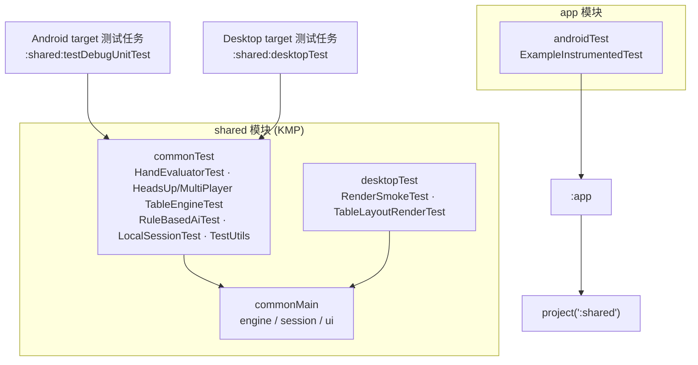
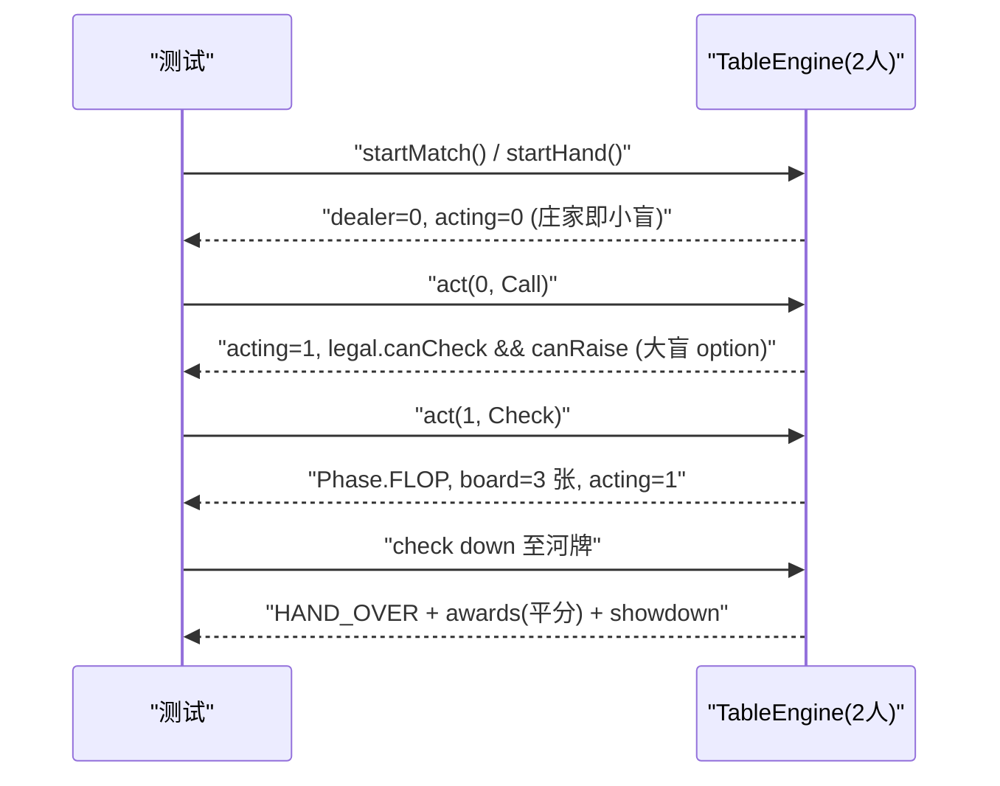
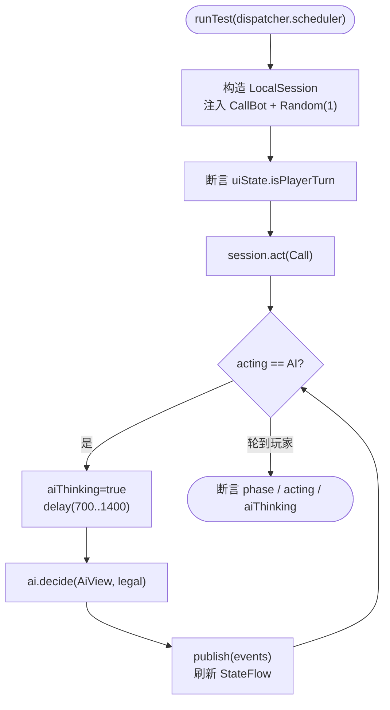
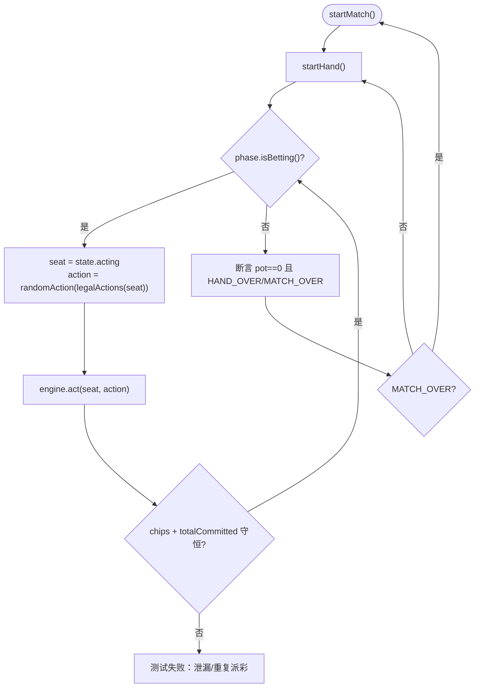
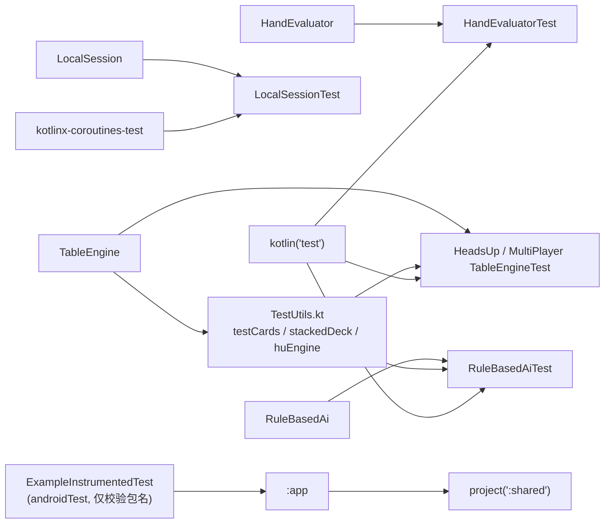

# 单元测试

<cite>
**本文引用的文件**
- [shared/build.gradle.kts](file://shared/build.gradle.kts)
- [HandEvaluator.kt](file://shared/src/commonMain/kotlin/com/aniapp/pokerdemo/engine/HandEvaluator.kt)
- [Card.kt](file://shared/src/commonMain/kotlin/com/aniapp/pokerdemo/engine/Card.kt)
- [TableEngine.kt](file://shared/src/commonMain/kotlin/com/aniapp/pokerdemo/engine/TableEngine.kt)
- [RuleBasedAi.kt](file://shared/src/commonMain/kotlin/com/aniapp/pokerdemo/engine/ai/RuleBasedAi.kt)
- [AiStrategy.kt](file://shared/src/commonMain/kotlin/com/aniapp/pokerdemo/engine/ai/AiStrategy.kt)
- [LocalSession.kt](file://shared/src/commonMain/kotlin/com/aniapp/pokerdemo/session/LocalSession.kt)
- [HandEvaluatorTest.kt](file://shared/src/commonTest/kotlin/com/aniapp/pokerdemo/engine/HandEvaluatorTest.kt)
- [HeadsUpTableEngineTest.kt](file://shared/src/commonTest/kotlin/com/aniapp/pokerdemo/engine/HeadsUpTableEngineTest.kt)
- [MultiPlayerTableEngineTest.kt](file://shared/src/commonTest/kotlin/com/aniapp/pokerdemo/engine/MultiPlayerTableEngineTest.kt)
- [RuleBasedAiTest.kt](file://shared/src/commonTest/kotlin/com/aniapp/pokerdemo/engine/ai/RuleBasedAiTest.kt)
- [LocalSessionTest.kt](file://shared/src/commonTest/kotlin/com/aniapp/pokerdemo/session/LocalSessionTest.kt)
- [TestUtils.kt](file://shared/src/commonTest/kotlin/com/aniapp/pokerdemo/engine/TestUtils.kt)
- [ExampleInstrumentedTest.kt](file://app/src/androidTest/java/com/aniapp/pokerdemo/ExampleInstrumentedTest.kt)
- [libs.versions.toml](file://gradle/libs.versions.toml)
</cite>

## 目录
1. [简介](#简介)
2. [测试代码的位置与运行方式](#测试代码的位置与运行方式)
3. [测试夹具：牌串解析与可控牌堆](#测试夹具牌串解析与可控牌堆)
4. [HandEvaluatorTest：牌型评估与 base-15 评分](#handevaluatortest牌型评估与-base-15-评分)
5. [HeadsUpTableEngineTest：单挑规则](#headsupatableenginetest单挑规则)
6. [MultiPlayerTableEngineTest：多人桌、边池与淘汰](#multiplayertableenginetest多人桌边池与淘汰)
7. [RuleBasedAiTest：只用公开信息的决策分支](#rulebasedaitest只用公开信息的决策分支)
8. [LocalSessionTest：StateFlow 快照与 AI 单飞循环](#localsessionteststateflow-快照与-ai-单飞循环)
9. [异步操作测试设计](#异步操作测试设计)
10. [不变量压力测试与性能考虑](#不变量压力测试与性能考虑)
11. [命名约定、组织结构与最佳实践](#命名约定组织结构与最佳实践)
12. [依赖分析](#依赖分析)
13. [故障排查指南](#故障排查指南)
14. [结论](#结论)

## 简介

PokerDemo 的真正单元测试全部位于 **`shared/src/commonTest`**，使用 `kotlin("test")` + `kotlinx-coroutines-test`，在 KMP 的 Android 与 Desktop（JVM）两个 target 上各跑一遍。测试对象是共享引擎层，而不是任何平台模块的业务类：

| 测试类 | 被测对象 | 覆盖重点 |
|---|---|---|
| `HandEvaluatorTest` | `HandEvaluator.evaluate()` / `drawInfo()` | 九种牌型枚举、base-15 评分键、wheel 顺子、踢脚比较、与外部口径交叉校验 |
| `HeadsUpTableEngineTest` | `TableEngine`（2 人） | 庄家=小盲、大盲 option、最小加注递进、短码全下不重开、未被跟注退还 |
| `MultiPlayerTableEngineTest` | `TableEngine`（3–6 人） | 盲注轮转、边池分层、余数按庄位分配、淘汰与 `MATCH_OVER` |
| `RuleBasedAiTest` | `RuleBasedAi.decide()` | 只用公开信息视图的决策合法性与两条极端分支 |
| `LocalSessionTest` | `LocalSession` | `StateFlow` 快照、AI 延迟单飞循环、`nextHand` / `newMatch` |

原先位于 `app/src/test/java/com/aniapp/pokerdemo/ExampleUnitTest.kt` 的 JVM 示例测试已不存在，`app` 模块目前只保留 `androidTest` 下的 `ExampleInstrumentedTest`（仅校验包名），且 `app/build.gradle` 中没有任何本地单元测试依赖，只有 `androidTestImplementation`。同理，早期文档描述的 `app/.../data/Card.kt`、`app/.../data/BettingManager.kt` 及其"筹码初始化 / 底池累计 / Call-Raise-Pay 断言表"在当前仓库中已无对应实现：筹码与底池逻辑由 `TableEngine` 的 `postBlind`、`act`、`settle` 承担，牌型评估由 `HandEvaluator` 承担。因此本文围绕实际存在的引擎与会话测试展开。服务端（Ktor）侧的房间与端到端测试归属流程测试页面，不在本文范围内。

## 测试代码的位置与运行方式

`shared` 模块声明了 `androidTarget()` 与 `jvm("desktop")` 两个 target，`commonTest` 依赖为 `kotlin("test")` 与 `libs.kotlinx.coroutines.test`；`desktopTest` 额外引入 `compose.desktop.currentOs` 以支撑 UI 渲染冒烟测试。



图表来源
- [shared/build.gradle.kts:11-49](file://shared/build.gradle.kts#L11-L49)
- [app/build.gradle:64-72](file://app/build.gradle#L64-L72)

运行方式（每个 target 一套测试任务，`commonTest` 源码会被两个 target 各编译执行一次）：

| 目标 | 命令 | 说明 |
|---|---|---|
| Desktop（JVM） | `./gradlew :shared:desktopTest` | 纯 JVM，最快，CI 首选 |
| Android | `./gradlew :shared:testDebugUnitTest` / `testReleaseUnitTest` | `androidTarget` 生成的 unit test 任务 |
| 全部 | `./gradlew :shared:allTests` | 汇总所有 KMP target 的测试报告 |
| 单个类 | `./gradlew :shared:desktopTest --tests "*HandEvaluatorTest"` | 按类名过滤 |
| 桌面 UI 冒烟 | `./gradlew :shared:desktopTest` | `desktopTest` 源码集内的 Compose 测试 |

章节来源
- [shared/build.gradle.kts:11-49](file://shared/build.gradle.kts#L11-L49)
- [app/build.gradle:64-72](file://app/build.gradle#L64-L72)
- [ExampleInstrumentedTest.kt:16-23](file://app/src/androidTest/java/com/aniapp/pokerdemo/ExampleInstrumentedTest.kt#L16-L23)

## 测试夹具：牌串解析与可控牌堆

`TestUtils.kt` 提供三个跨测试类复用的夹具，是所有确定性测试的基础：

- `testCards(s)`：把 `"As Kh Qd"` 这类空格分隔的牌串解析成 `List<Card>`，字母点数映射为 `A=14, K=13, Q=12, J=11, T=10`，其余取数字；花色 `s/h/d/c` 映射到 `Suit` 四值。
- `stackedDeck(vararg holes, board)`：按真实发牌顺序构造一个**固定顺序**的 `Deck`——从座位 0 起每人 2 张底牌，然后依次插入烧牌（`2s`、`3s`、`4s`）与翻牌 3 张、转牌、河牌。测试通过把它作为 `newDeck` 注入 `TableEngine`，从而精确控制每条街的面牌，无需依赖随机数。
- `huEngine(config, random, newDeck)`：构造 2 人桌（`玩家` vs `AI`）的最小组合根，默认 `Random(1)`，可选注入牌堆。

`TableEngine` 的构造参数 `newDeck: () -> Deck` 正是这些夹具的接入点：每次 `startHand()` 都会重新调用它，因此一手牌内可以完全预知发牌序列。

```kotlin
// 典型用法：让公共牌成为同花顺，两家都打到摊牌
val engine = huEngine(newDeck = { stackedDeck("2h 3h", "4d 5d", board = "As Ks Qs Js Ts") })
```

章节来源
- [TestUtils.kt:3-33](file://shared/src/commonTest/kotlin/com/aniapp/pokerdemo/engine/TestUtils.kt#L3-L33)
- [TableEngine.kt:13-30](file://shared/src/commonMain/kotlin/com/aniapp/pokerdemo/engine/TableEngine.kt#L13-L30)
- [Card.kt:23-35](file://shared/src/commonMain/kotlin/com/aniapp/pokerdemo/engine/Card.kt#L23-L35)

## HandEvaluatorTest：牌型评估与 base-15 评分

### 被测实现的契约

`HandEvaluator.evaluate(cards)` 要求输入 **5–7 张牌**（`require(cards.size in 5..7)`），返回 `HandValue(category, tiebreaks, bestFive, score)`：

- `category` 为 `HandCategory` 枚举，共九级，由低到高：高牌、一对、两对、三条、顺子、同花、葫芦、四条、同花顺。
- `score` 采用 **base-15 打包**：先写入 `category.ordinal + 1`，再连续 5 次 `score = score * 15 + tiebreaks[i]`（缺失位补 0）。由于点数最大为 14（A），15 进制刚好无碰撞，因此 `HandValue` 的 `compareTo` 直接委托给 `score.compareTo(other.score)`，一次整数比较即可完成"先比牌型、再逐项比踢脚"。
- 判定优先级严格自上而下：同花顺 → 四条 → 葫芦 → 同花 → 顺子 → 三条 → 两对 → 一对 → 高牌。
- `straightHigh(ranks)` 在集合含 `A(14)` 时附加虚拟 rank `1`，从而同时支持 A 高的 Broadway 顺与 wheel（A-2-3-4-5，顶牌记为 5）。

### 九种牌型的断言矩阵

测试不是简单断言 `category`，而是同时断言 `tiebreaks` 列表，因为踢脚才是区分同级牌型的关键：

| 牌型 | 测试方法 | 输入要点 | 关键断言 |
|---|---|---|---|
| 高牌 / 顺子 / 同花基础链 | `categoryHierarchy` | 九个输入按牌型递增排列 | 相邻两项 `<`，形成完整等级链 |
| 一对 | `pairKicker` | `Ks Kh Ac Qd Js 9c 3h` | `[13, 14, 12, 11]` |
| 两对 | `twoPairKickerAndThreePairs` | 7 张含三对 | 取最高两对 + 第三对作踢脚 `[14,13,12]` |
| 三条 | `tripsKicker` | 三条 + A/K 踢脚 | `[8, 14, 13]`，另一手 `[8,14,12]` 更小 |
| 顺子 | `wheelStraight` | `A 2 3 4 5` 与 `2 3 4 5 6` | wheel 顶牌 `5`；6-high 顺 > wheel；`A K Q J T` 顶牌 `14` |
| 同花 | `flushKickerOnlyCountsFlushSuit` | `Ah 9h 7h 5h 3h 2h As` | `[14,9,7,5,3]`，杂色 `As` 不得混入比较 |
| 葫芦 | `fullHouseTwoTripsPicksBest` | 双三条、三条+两对 | 取最大三条配最高对；`AAA222K` → `[14,2]` |
| 四条 | `quadsKicker` | `9999 K…` vs `9999 QJT` | `[9,13]` 大于 `[9,13→Q]` |
| 同花顺 | `steelWheel` | `Ah 2h 3h 4h 5h` | `STRAIGHT_FLUSH` 顶牌 `5`；6-high 同花顺更大；steel wheel > 四条 |

此外 `flushBeatsStraightAndTrips` 验证"同花 + 顺子面"仍判同花（非同花顺）、"同花 + 暗三条"仍判同花；`boardPlaysTie` 用 `As Ks Qs Js Ts` 公共牌面证明两家底牌无关时 `compareTo == 0`，以及两套不同花色的 wheel 也平手。

### 与外部口径的交叉校验

`HandEvaluatorTest` 内置一个**实现方式完全不同**的独立 oracle：`oracle5()` 用朴素分组法评估任意 5 张牌，`combinations(list, k)` 递归生成组合，`oracleBest()` 遍历 C(n,5) 个五张子集取最大。`assertMatchesOracle()` 同时比对 `category.ordinal` 与 `tiebreaks`：

- `fiveAndSixCardInputs`：对 5 张、6 张边界输入逐一对照 oracle。
- `randomOracleCrossValidation`：用 `Random(42)` 抽取 1000 组七张牌 + 300 组六张牌，全部与 oracle 结果一致。

这条"双实现互验"路径的意义在于：base-15 打包与主评估器的分组顺序属于内部设计，容易在重构时产生静默偏差，而暴力枚举 oracle 提供了独立的行为基准。

### 听牌信息与其他边界

`drawDetection` 覆盖 `HandEvaluator.drawInfo(hole, board)`：同花听牌（4 张同花）、两头顺（`5s 6h` + `7d 8c`）、卡张顺（`5s 7h` + `8d 9c`），并断言 wheel 型卡张（`As 2h` + `3d 4c`）记为 gutshot 而非 open-ended。

关于非法输入：`evaluate()` 的前置条件是 `5..7` 张，越界会抛 `IllegalArgumentException`；空牌组或少于 5 张牌属于该 require 分支，当前测试套件选择用合法边界（5 张、6 张）与 oracle 交叉校验来覆盖，而不是断言异常。重复 `Card` 对象不会出现在测试数据里，因为 `createDeck()` 与 `stackedDeck()` 均从标准 52 张牌构造；若需覆盖该场景，应显式构造含重复项的列表并断言按 rank/suit 分组后的行为。

章节来源
- [HandEvaluator.kt:7-116](file://shared/src/commonMain/kotlin/com/aniapp/pokerdemo/engine/HandEvaluator.kt#L7-L116)
- [HandEvaluator.kt:119-143](file://shared/src/commonMain/kotlin/com/aniapp/pokerdemo/engine/HandEvaluator.kt#L119-L143)
- [HandEvaluatorTest.kt:11-68](file://shared/src/commonTest/kotlin/com/aniapp/pokerdemo/engine/HandEvaluatorTest.kt#L11-L68)
- [HandEvaluatorTest.kt:70-193](file://shared/src/commonTest/kotlin/com/aniapp/pokerdemo/engine/HandEvaluatorTest.kt#L70-L193)
- [HandEvaluatorTest.kt:198-220](file://shared/src/commonTest/kotlin/com/aniapp/pokerdemo/engine/HandEvaluatorTest.kt#L198-L220)
- [Card.kt:23](file://shared/src/commonMain/kotlin/com/aniapp/pokerdemo/engine/Card.kt#L23)

## HeadsUpTableEngineTest：单挑规则

两人桌的规则细节最容易写错，测试逐条锁定：

- **庄家 = 小盲且翻前先行动**：`startHand()` 后断言 `dealer == 0`、`acting == 0`；`limpGivesBbOptionAndPostflopNonDealerFirst` 中玩家 limp（`Call`）后行动权交回座位 1（大盲），且 `legalActions(1)` 同时允许 `canCheck` 与 `canRaise`（即大盲 option）。进入翻牌后首行动者变为非庄家的座位 1。
- **最小加注递进**：`minRaiseProgression` 断言 `minRaiseTo` 依次为 40 → 60 → 160，即每次加注至少提高上一个加注增量；跟注后进入翻牌并把 `currentBet` 归零、底池 200。
- **未被跟注部分退还**：`sbFoldReturnsUncalledToBigBlind` 中小盲直接弃牌，事件流中出现 `GameEvent.UncalledReturned(seat=1, amount=10)`，赢家只拿回被跟注的部分（`1990 / 2010`），`pot` 结算后为 0，且不摊牌。`excessAllInIsRefunded` 进一步验证超额全下：短码 800 全下、大盲 raise 到 3200 时产生 `UncalledReturned(2400)` 与 `PotAwarded(1600)`。
- **短码全下不重进行动**：`shortAllInDoesNotReopenAction` 用 `startingChips=100`，玩家 raise 到 70 后 AI 只能 all-in 到 100（此时 `minRaiseTo == maxRaiseTo == 100`），AI 全下后玩家的 `legalActions` 中 `minRaiseTo` 为 `null`、只剩 `callAmount=30`，即不足全额加注不能重开加注入。
- **盲注自动全下与自动跑牌**：`shortStackBlindsAllInAutoRunout` 用 `startingChips=5`，`startHand()` 直接得到 `MATCH_OVER` 且公共牌发满 5 张；`startingChips=15` 时 `callAmount=5`，跟注后同样自动跑完。
- **摊牌平分**：`checkDownShowdownSplitPot` 用 `stackedDeck` 把公共牌做成同花顺，双方 check down 后 `awards.single().winners == [0,1]`，筹码回到 `2000/2000`，`showdown` 为真且两家底牌都被揭示。
- **非法行动抛异常**：`illegalActionsThrow` 对未轮到行动、不能过牌时 `Check`、低于最小加注额、牌局已结束等情况统一断言 `IllegalStateException`。
- **庄家轮转与对局重置**：`dealerRotationAndMatchReset` 验证下一手 `dealer` 移到 1 并由其先行动，`startMatch()` 后回到 `IDLE`、筹码复原、`handNumber` 归零。

`assertConserved(engine, total)` 是本类反复出现的不变量助手：任一时刻 `sum(chips + totalCommitted) == 起始总筹码`。



图表来源
- [HeadsUpTableEngineTest.kt:37-53](file://shared/src/commonTest/kotlin/com/aniapp/pokerdemo/engine/HeadsUpTableEngineTest.kt#L37-L53)
- [HeadsUpTableEngineTest.kt:71-90](file://shared/src/commonTest/kotlin/com/aniapp/pokerdemo/engine/HeadsUpTableEngineTest.kt#L71-L90)
- [TableEngine.kt:66-80](file://shared/src/commonMain/kotlin/com/aniapp/pokerdemo/engine/TableEngine.kt#L66-L80)

章节来源
- [HeadsUpTableEngineTest.kt:11-200](file://shared/src/commonTest/kotlin/com/aniapp/pokerdemo/engine/HeadsUpTableEngineTest.kt#L11-L200)
- [TableEngine.kt:37-110](file://shared/src/commonMain/kotlin/com/aniapp/pokerdemo/engine/TableEngine.kt#L37-L110)

## MultiPlayerTableEngineTest：多人桌、边池与淘汰

本类通过局部助手 `table(vararg chips, random, newDeck)` 构造 3–6 人桌，每位玩家可指定独立筹码以制造边池场景。

- **座位数校验**：`seatCountValidated` 断言 1 人和 7 人构造 `TableEngine` 时抛 `IllegalArgumentException`（实现为 `require(players.size in 2..6)`）。
- **三层边池**：`fourWayAllInCreatesThreeLayerSidePots` 用筹码 100/200/300/400 全员全下，400 中未被跟注的 100 先退还，随后按投入层级形成 `400(4人)/300(3人)/200(2人)` 三层，`awards` 顺序与金额、赢家座位、最终筹码分布全部逐一断言，总和守恒 1000。这与 `settle()` 中"按 `totalCommitted` 去重升序分层、无合格贡献者时向上一层合并"的实现一致。
- **弃牌者的钱留在池中**：`foldedPlayerMoneyStaysInPot` 断言弃牌者不出现在 `revealed` 中，其已投入金额仍计入赢家所得。
- **余数按庄位顺序分配**：`splitPotOddChipGoesLeftOfDealer` 用 1001/1001/2000 制造 3003 的奇数池，两家同花顺平手时余数 1 给"庄家左侧第一个赢家"，最终 `1501 / 1502`。这对应 `orderFromDealer(winners)` 的排序逻辑。
- **盲注与行动轮转**：`sixPlayerPreflopRotation` 断言 6 人桌 `dealer=0`、SB 投 10、BB 投 20，UTG 为座位 3，行动顺序 3→4→5→0→1→2，且 BB 最后持有 option；`postflopFirstActorIsNextOfDealer` 断言翻牌圈首行动者为座位 1。
- **全额加注重开**：`fullRaiseReopensForAllActedPlayers` 验证翻牌圈有人做全额加注后，先前已过牌的玩家可以再加注，`minRaiseTo == 80`。
- **淘汰与 MATCH_OVER**：`dealerRotationSkipsEliminated` 中筹码归零的玩家下一手被标记 `isFolded` 且无底牌，庄家轮转跳过他；剩余两家自动切换为单挑规则（庄家=小盲并先行动）。`eliminatedPlayerCannotActInNewHand` 断言对已淘汰座位调用 `act()` 抛 `IllegalStateException`。`showdownRevealsOnlyContenders` 断言 `revealed.keys == setOf(0,1)`，未跟注到底的弃牌者不亮牌。

章节来源
- [MultiPlayerTableEngineTest.kt:11-118](file://shared/src/commonTest/kotlin/com/aniapp/pokerdemo/engine/MultiPlayerTableEngineTest.kt#L11-L118)
- [MultiPlayerTableEngineTest.kt:120-215](file://shared/src/commonTest/kotlin/com/aniapp/pokerdemo/engine/MultiPlayerTableEngineTest.kt#L120-L215)
- [TableEngine.kt:20-23](file://shared/src/commonMain/kotlin/com/aniapp/pokerdemo/engine/TableEngine.kt#L20-L23)
- [TableEngine.kt:242-318](file://shared/src/commonMain/kotlin/com/aniapp/pokerdemo/engine/TableEngine.kt#L242-L318)

## RuleBasedAiTest：只用公开信息的决策分支

`AiView` 只暴露底牌、公共牌、阶段、底池、需跟注额、本街已投注、筹码、大盲与活跃对手数——**不含其他玩家底牌**。测试因此可以直接手工构造视图，而不必驱动整局游戏，这正是"AI 只用公开信息"这一约束的结构化体现。

三类断言策略：

1. **合法性优先于最优性**：`assertLegal(legal, action)` 把返回动作与 `LegalActions` 逐项对照——`Fold/Check/Call` 检查对应布尔位，`RaiseTo(amount)` 检查 `canRaise` 且 `amount in minRaiseTo..maxRaiseTo`。随机决策无法断言具体动作，但"永不产生非法动作"是可以强断言的性质。
2. **真实局面抽样**：`alwaysLegalInRandomGameStates` 用 `huEngine(random = Random(11))` 跑最多 500 手，收集至少 200 个决策点，每步先用 AI 决策再 `act()` 推进，保证 AI 的动作确实能被引擎接受。
3. **极端分支**：
   - `nutsNeverFolds`：公共牌即皇家同花顺（坚果牌），面对 `toCall=200` 重复 200 次决策，断言从不返回 `Fold`。
   - `junkFoldsToShove`：`2h 7c` 杂色垃圾牌面对 1000 的全下（`minRaiseTo=null` 表示不可再加注），用 `Random(it)` 换 200 个种子，断言一律 `Fold`。

这两条用例分别压制了 `RuleBasedAi.handStrength()` 的两端（`QUADS/STRAIGHT_FLUSH → 0.98` 与 `preflopStrength` 下限 `0.05`），使强度加权随机不会掩盖底线行为。

章节来源
- [RuleBasedAiTest.kt:16-93](file://shared/src/commonTest/kotlin/com/aniapp/pokerdemo/engine/ai/RuleBasedAiTest.kt#L16-L93)
- [AiStrategy.kt:9-23](file://shared/src/commonMain/kotlin/com/aniapp/pokerdemo/engine/ai/AiStrategy.kt#L9-L23)
- [RuleBasedAi.kt:13-63](file://shared/src/commonMain/kotlin/com/aniapp/pokerdemo/engine/ai/RuleBasedAi.kt#L13-L63)
- [RuleBasedAi.kt:65-85](file://shared/src/commonMain/kotlin/com/aniapp/pokerdemo/engine/ai/RuleBasedAi.kt#L65-L85)

## LocalSessionTest：StateFlow 快照与 AI 单飞循环

`LocalSession` 把引擎状态投影成 `StateFlow<GameUiState>`，并在轮到 AI 时启动一个后台循环。测试用注入的 `CallBot`（能过牌就过牌，否则跟注）替换 `RuleBasedAi`，从而消除随机性，只观察会话层的编排。

- **快照内容**：`uiState.value.table` 由 `engine.toTableView(mySeat)` 生成，包含座位列表、公共牌、`dealer`、`acting`、`phase`、`handNumber`、`pot`、本方底牌 `myHole`、`legal` 与摊牌揭示的 `revealedHoles`。测试全程只读 `uiState`，不触碰引擎内部。
- **AI 延迟与单飞**：`maybeStartAi()` 只在 `acting != mySeat` 且阶段仍在下注时启动协程，并且 `aiJob?.isActive == true` 时不重复启动；循环内每次先置 `aiThinking = true`，`delay(aiRandom.nextLong(700, 1401))` 后再决策落子。`aiActsOnlyAfterDelay` 因此断言：玩家行动后立即 `assertFalse(aiThinking)`，`advanceTimeBy(1500) + runCurrent()` 才推进一次 AI 行动。
- **非己回合忽略输入**：`playerActionIgnoredWhenNotTheirTurn` 断言在 AI 思考窗口内提交的 `Fold` 被丢弃，快照中的牌桌不变。
- **全下自动跑牌不挂死**：`allInRunoutCompletesWithoutHang` 玩家 raise 到 2000 后，`advanceTimeBy(30_000)` 即到达 `HAND_OVER/MATCH_OVER`，公共牌 5 张且 `aiThinking` 复位。
- **newMatch 取消待执行 AI**：`newMatchCancelsPendingAi` 在 AI 延迟期间调用 `newMatch()`，之后推进 30 秒时间也不会让旧 job 继续下注，最终停在新一手的 `PREFLOP`、玩家回合、`handNumber == 1`、座位 0 筹码 1990。
- **nextHand 推进庄家**：`nextHandAdvancesDealer` 玩家翻前弃牌结束本手后调用 `nextHand()`，`dealer` 变为 1，且推进时间后控制权回到玩家。



图表来源
- [LocalSessionTest.kt:42-56](file://shared/src/commonTest/kotlin/com/aniapp/pokerdemo/session/LocalSessionTest.kt#L42-L56)
- [LocalSession.kt:68-99](file://shared/src/commonMain/kotlin/com/aniapp/pokerdemo/session/LocalSession.kt#L68-L99)

章节来源
- [LocalSessionTest.kt:23-103](file://shared/src/commonTest/kotlin/com/aniapp/pokerdemo/session/LocalSessionTest.kt#L23-L103)
- [LocalSession.kt:36-120](file://shared/src/commonMain/kotlin/com/aniapp/pokerdemo/session/LocalSession.kt#L36-L120)
- [LocalSession.kt:122-165](file://shared/src/commonMain/kotlin/com/aniapp/pokerdemo/session/LocalSession.kt#L122-L165)

## 异步操作测试设计

会话层是唯一带协程的单元，测试手法固定为四点：

1. **虚拟时间**：`runTest(dispatcher.scheduler)` + `StandardTestDispatcher`，用 `advanceTimeBy(...)` 精确跨过 AI 的 700–1400ms 延迟，绝不 `Thread.sleep` 或真实等待。
2. **显式驱动**：`advanceTimeBy` 只推进时钟，仍需 `runCurrent()` 才让挂起点真正恢复；两者成对出现，避免"时间到了但断言提前执行"的假绿。
3. **可注入随机源**：`LocalSession(aiRandom = Random(1))` 使 `delay` 时长确定；`TableEngine(random = ...)` 与 `newDeck = { stackedDeck(...) }` 使牌局可复现。
4. **取消语义**：涉及 `Job` 的接口（`newMatch()`、`dispose()`）都要有"旧 job 不再产生副作用"的断言，如 `newMatchCancelsPendingAi`。

新增异步用例时应沿用上述模式：注入 scope/dispatcher、注入 `AiStrategy` 桩件、只断言 `uiState` 快照字段。

章节来源
- [LocalSessionTest.kt:12-40](file://shared/src/commonTest/kotlin/com/aniapp/pokerdemo/session/LocalSessionTest.kt#L12-L40)
- [LocalSession.kt:53-99](file://shared/src/commonMain/kotlin/com/aniapp/pokerdemo/session/LocalSession.kt#L53-L99)

## 不变量压力测试与性能考虑

两个引擎测试类各有一个"随机长跑"用例，它们不做逐手比对，而是断言全局不变量：

- `chipConservationStress500Hands`（单挑，`Random(7)`）：500 手 × 每步 `assertConserved`，并用 `guard < 200` 防止下注轮死循环；结束时断言 `sum(chips) == 4000`、`pot == 0`、阶段为 `HAND_OVER/MATCH_OVER`，遇 `MATCH_OVER` 则 `startMatch()` 续跑。
- `chipConservationStressMultiPlayer`（3–6 人，`Random(100+n)`）：每种人数 150 手，总量 `2000*n` 守恒。
- 两者的 `randomAction()` 助手按 `LegalActions` 组装合法选项（含 8%–10% 概率弃牌），保证随机路径始终合法。



图表来源
- [HeadsUpTableEngineTest.kt:210-243](file://shared/src/commonTest/kotlin/com/aniapp/pokerdemo/engine/HeadsUpTableEngineTest.kt#L210-L243)
- [MultiPlayerTableEngineTest.kt:235-268](file://shared/src/commonTest/kotlin/com/aniapp/pokerdemo/engine/MultiPlayerTableEngineTest.kt#L235-L268)

性能方面：

- `HandEvaluator.evaluate()` 只做一次分组 + 常数次遍历，`score` 用 base-15 整数打包，比较成本为单次 `Long` 比较，适合在 AI 与结算路径高频调用；测试里的 1000 次随机交叉校验本身即为吞吐回归信号。
- `oracleBest()` 需要遍历 C(n,5) 组合，属于**测试专用**的暴力参照实现，不应引入生产路径。
- 压力用例应设置明确的时间上限与 `guard` 计数，避免死循环拖垮 CI；如需微基准，请在独立的 benchmark source set 中进行，不要混入 `commonTest` 的功能断言，以免测试时长随机器波动。

章节来源
- [HandEvaluatorTest.kt:49-68](file://shared/src/commonTest/kotlin/com/aniapp/pokerdemo/engine/HandEvaluatorTest.kt#L49-L68)
- [HandEvaluatorTest.kt:198-205](file://shared/src/commonTest/kotlin/com/aniapp/pokerdemo/engine/HandEvaluatorTest.kt#L198-L205)
- [HandEvaluator.kt:47-51](file://shared/src/commonMain/kotlin/com/aniapp/pokerdemo/engine/HandEvaluator.kt#L47-L51)

## 命名约定、组织结构与最佳实践

- **目录与被测对象同构**：`commonTest` 的包路径与 `commonMain` 一一对应（`engine`、`engine/ai`、`session`），文件名 = 被测类名 + `Test`。
- **方法名陈述规则而非动作**：现有用例采用"事实式"命名，例如 `sbFoldReturnsUncalledToBigBlind`、`shortAllInDoesNotReopenAction`、`splitPotOddChipGoesLeftOfDealer`、`flushKickerOnlyCountsFlushSuit`、`nutsNeverFolds`、`dealerRotationSkipsEliminated`。名字即规则条目，失败日志可直接定位到扑克规则。
- **共享夹具集中在 `TestUtils.kt`**：牌串解析、牌堆构造、单挑组合根都从这里出，避免各测试类重复实现导致口径漂移。（`HandEvaluatorTest` 目前自带私有 `cards()` 副本，新增用例建议复用 `testCards()`。）
- **断言风格**：引擎与评估器测试用 `kotlin.test`（`assertEquals` / `assertTrue` / `assertFailsWith` / `assertNull`），`HandEvaluatorTest` 因使用 JUnit 兼容注解而导入 `org.junit.Assert`；两种都能跨 target 运行，新文件建议统一 `kotlin.test`。
- **一条规则一个用例**：同一测试方法内允许多个相关断言（如 wheel 与 6-high 顺的比较放在一起），但不混合无关主题。
- **守恒不变量优先**：涉及筹码流动的用例都应附带 `chips + totalCommitted` 守恒检查，这是发现派彩泄漏最廉价的手段。
- **确定性**：所有随机都以显式 `Random(seed)` 注入；需要特定牌面时用 `stackedDeck` 而不是重试随机牌堆。

章节来源
- [HandEvaluatorTest.kt:1-9](file://shared/src/commonTest/kotlin/com/aniapp/pokerdemo/engine/HandEvaluatorTest.kt#L1-L9)
- [HeadsUpTableEngineTest.kt:1-14](file://shared/src/commonTest/kotlin/com/aniapp/pokerdemo/engine/HeadsUpTableEngineTest.kt#L1-L14)
- [MultiPlayerTableEngineTest.kt:1-25](file://shared/src/commonTest/kotlin/com/aniapp/pokerdemo/engine/MultiPlayerTableEngineTest.kt#L1-L25)
- [TestUtils.kt:3-33](file://shared/src/commonTest/kotlin/com/aniapp/pokerdemo/engine/TestUtils.kt#L3-L33)

## 依赖分析



图表来源
- [shared/build.gradle.kts:36-39](file://shared/build.gradle.kts#L36-L39)
- [app/build.gradle:64-72](file://app/build.gradle#L64-L72)

版本由 `gradle/libs.versions.toml` 统一管理：`coroutines = 1.10.2`（提供 `kotlinx-coroutines-test`），`junit = 4.13.2` 供 `org.junit.Assert` 断言使用；`ktor-server-test-host` 只服务于 server 模块的流程测试。`app` 模块没有 `testImplementation` 条目，说明其本地单元测试已不存在，仅剩 `androidTestImplementation` 的 androidx junit 与 espresso。

章节来源
- [shared/build.gradle.kts:11-49](file://shared/build.gradle.kts#L11-L49)
- [libs.versions.toml:3-15](file://gradle/libs.versions.toml#L3-L15)
- [libs.versions.toml:22-24](file://gradle/libs.versions.toml#L22-L24)
- [app/build.gradle:64-72](file://app/build.gradle#L64-L72)

## 故障排查指南

- **牌型判定与预期不符**：先确认输入张数在 5–7 之间（越界会抛 `IllegalArgumentException`）；再核对 `tiebreaks` 而非只看 `category`——wheel 顶牌应为 5、葫芦的第二个元素是对子点数、同花的踢脚只能来自同花集合。疑难用例交给 `assertMatchesOracle()` 判定是主评估器还是期望值出错。
- **单挑首行动者不对**：检查是否只有 2 名存活玩家（`headsUp` 判定基于 `chips > 0` 的人数），庄家=小盲且翻前先行动；BB 的 option 只在无人加注时存在。
- **加注被拒 / `minRaiseTo` 意外为 null**：短码全下不构成全额加注，不会重开对手的行动权；`canRaise` 还要求 `maxTo > currentBet` 且本轮未行动或 `raiseReopened`。
- **底池金额与手算差 1**：多人分池的余数按"庄家左侧第一个赢家"顺序发放，不是简单给座位号最小者。
- **未被跟注的钱像是丢了**：查 `GameEvent.UncalledReturned` 是否在事件流中，退还发生在 `settle()` 分层之前。
- **会话测试卡在 AI 回合**：`advanceTimeBy` 后必须 `runCurrent()`；确认注入了 `StandardTestDispatcher` 与固定 `aiRandom`，否则 delay 区间不可预测。
- **测试在 Android target 失败、Desktop 通过**：`commonTest` 不允许引用平台 API；若出现此类差异，优先怀疑源码集中混入了 JVM-only 类型。
- **偶发失败**：搜索未固定的 `Random.Default` 与未传 `newDeck` 的分支，所有随机都必须显式播种。

章节来源
- [HandEvaluator.kt:35-51](file://shared/src/commonMain/kotlin/com/aniapp/pokerdemo/engine/HandEvaluator.kt#L35-L51)
- [TableEngine.kt:66-80](file://shared/src/commonMain/kotlin/com/aniapp/pokerdemo/engine/TableEngine.kt#L66-L80)
- [TableEngine.kt:88-99](file://shared/src/commonMain/kotlin/com/aniapp/pokerdemo/engine/TableEngine.kt#L88-L99)
- [TableEngine.kt:242-318](file://shared/src/commonMain/kotlin/com/aniapp/pokerdemo/engine/TableEngine.kt#L242-L318)
- [LocalSession.kt:86-99](file://shared/src/commonMain/kotlin/com/aniapp/pokerdemo/session/LocalSession.kt#L86-L99)

## 结论

单元测试的重心已从早期 Android `app` 模块的示例测试，转移到 `shared/src/commonTest` 的跨平台引擎测试：`HandEvaluatorTest` 用九级牌型断言 + base-15 评分键 + 独立暴力 oracle 交叉校验锁死评估算法；`HeadsUpTableEngineTest` 与 `MultiPlayerTableEngineTest` 分别覆盖单挑特殊规则与多人边池、淘汰、`MATCH_OVER` 生命周期，并以筹码守恒不变量贯穿随机长跑；`RuleBasedAiTest` 在只含公开信息的 `AiView` 上断言"永不出非法动作"及坚果/垃圾牌两条底线；`LocalSessionTest` 用虚拟时间验证 `StateFlow` 快照、AI 单飞延迟循环与 `nextHand` / `newMatch` 语义。新增测试应沿用注入式随机与 `stackedDeck` 夹具，在 `:shared:desktopTest` 与 `:shared:testDebugUnitTest` 两个 target 上同时保持绿灯；服务端房间与 WebSocket 流程测试见对应的流程测试页面。