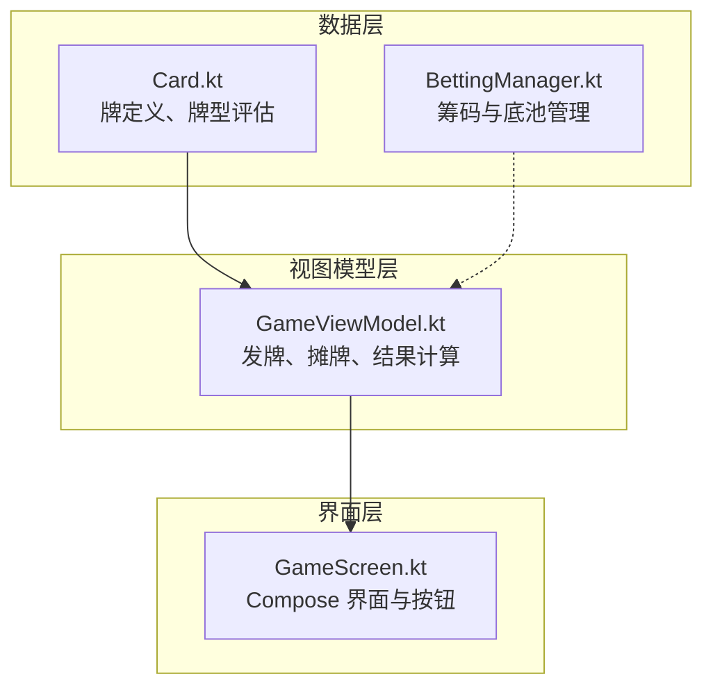
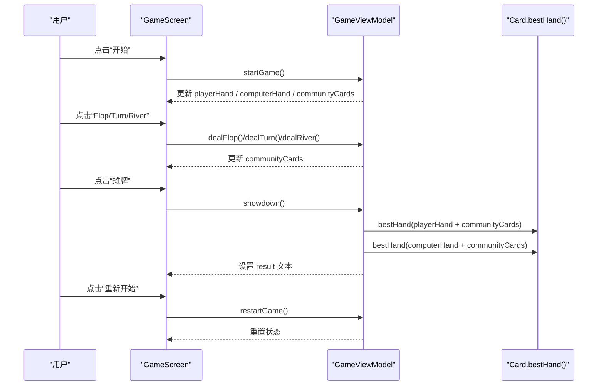
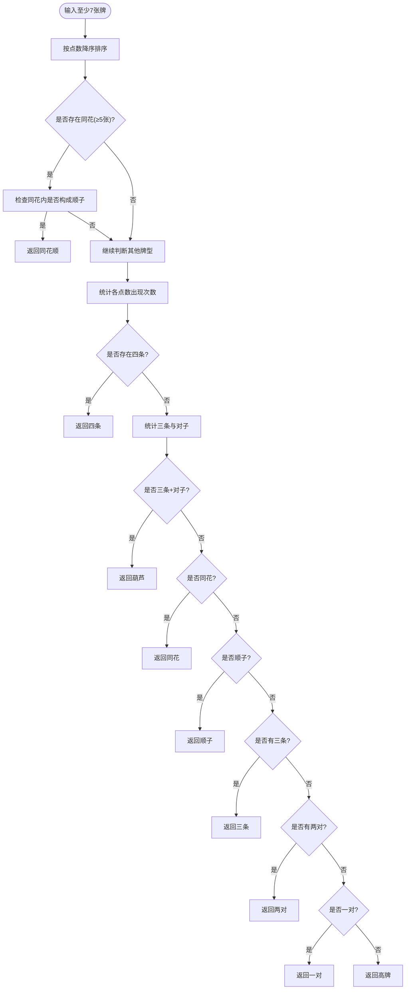
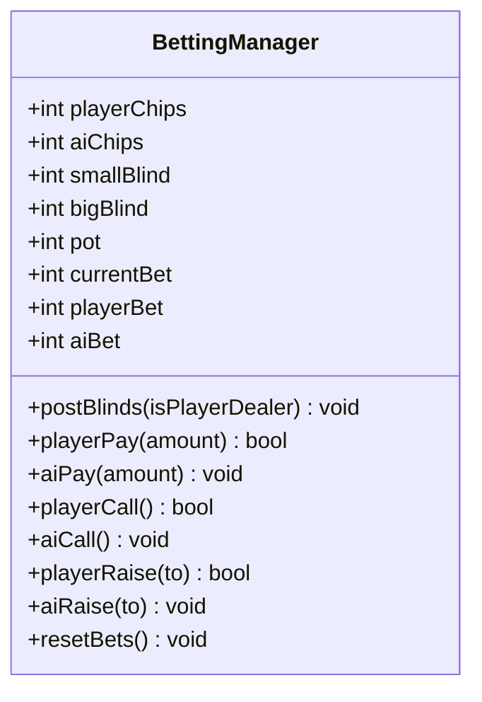
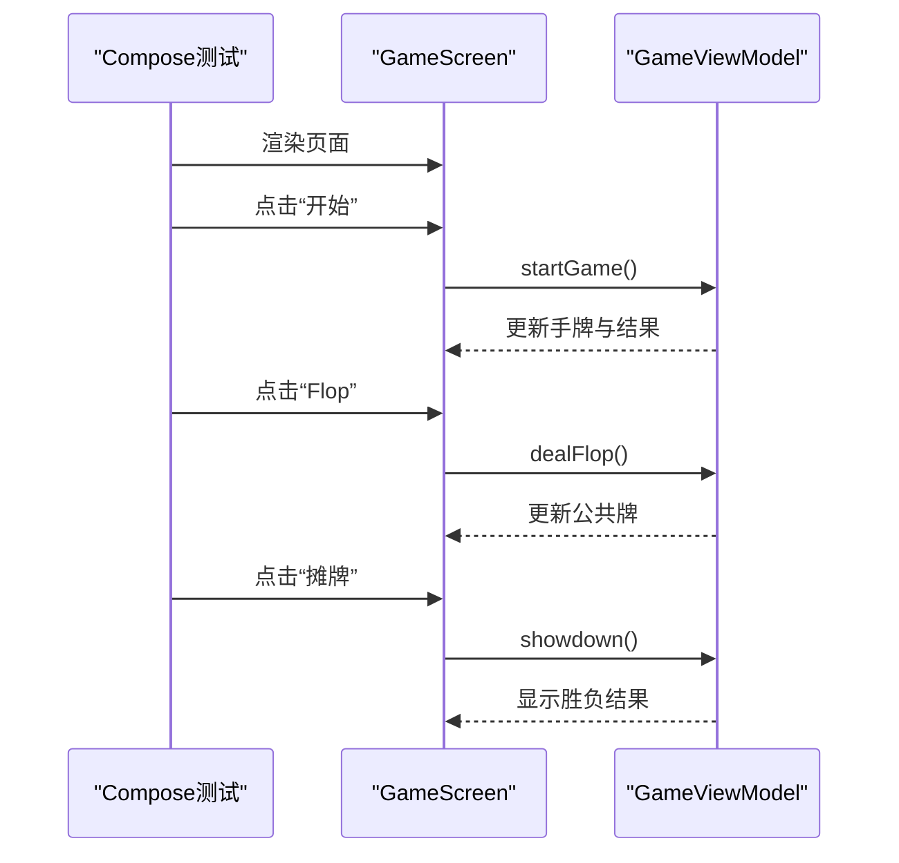
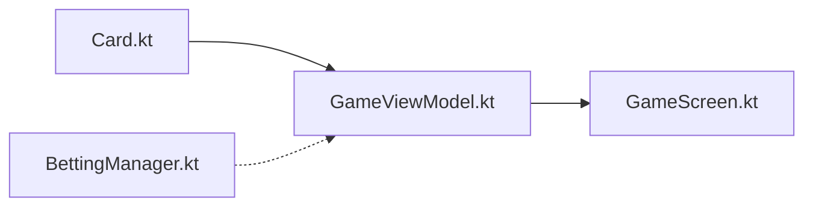

# 测试策略

<cite>
**本文引用的文件**   
- [Card.kt](file://app/src/main/java/com/aniapp/pokerdemo/data/Card.kt)
- [BettingManager.kt](file://app/src/main/java/com/aniapp/pokerdemo/data/BettingManager.kt)
- [GameScreen.kt](file://app/src/main/java/com/aniapp/pokerdemo/ui/GameScreen.kt)
- [GameViewModel.kt](file://app/src/main/java/com/aniapp/pokerdemo/vm/GameViewModel.kt)
- [build.gradle](file://app/build.gradle)
- [libs.versions.toml](file://gradle/libs.versions.toml)
- [ExampleUnitTest.kt](file://app/src/test/java/com/aniapp/pokerdemo/ExampleUnitTest.kt)
- [ExampleInstrumentedTest.kt](file://app/src/androidTest/java/com/aniapp/pokerdemo/ExampleInstrumentedTest.kt)
</cite>

## 目录
1. [引言](#引言)
2. [项目结构](#项目结构)
3. [核心组件](#核心组件)
4. [架构总览](#架构总览)
5. [详细组件分析与测试设计](#详细组件分析与测试设计)
6. [依赖关系分析](#依赖关系分析)
7. [性能与复杂度考量](#性能与复杂度考量)
8. [故障排查指南](#故障排查指南)
9. [结论](#结论)
10. [附录：测试清单与持续集成建议](#附录测试清单与持续集成建议)

## 引言
本测试策略面向 PokerDemo 的单元测试、UI 交互测试与持续集成落地，目标是围绕以下关键目标展开：
- 为 Card.bestHand() 牌型算法建立完备的单元测试矩阵，覆盖高牌到同花顺的所有牌型及边界情况。
- 对 BettingManager 的筹码变化、底池累计、下注规则进行严格的单元测试验证。
- 基于 Compose UI 测试框架，对 GameScreen 进行交互测试，覆盖按钮点击、状态更新和结果展示。
- 提供可执行的测试类示例与断言方法说明。
- 明确测试环境搭建、Mock 对象使用与异步操作测试策略。
- 给出在持续集成中执行测试并统计覆盖率的方法建议。

## 项目结构
PokerDemo 采用典型的 Android + Compose 工程结构：
- data 层包含扑克核心逻辑（牌、牌型评估、下注管理）。
- ui 层通过 Compose 实现界面与交互入口。
- vm 层负责游戏流程控制、发牌与摊牌判定。
- 现有测试骨架位于 app/src/test 与 app/src/androidTest，分别对应本地单元测试与仪器化测试。

**图示来源**
- [Card.kt:1-98](file://app/src/main/java/com/aniapp/pokerdemo/data/Card.kt#L1-L98)
- [BettingManager.kt:1-48](file://app/src/main/java/com/aniapp/pokerdemo/data/BettingManager.kt#L1-L48)
- [GameViewModel.kt:1-74](file://app/src/main/java/com/aniapp/pokerdemo/vm/GameViewModel.kt#L1-L74)
- [GameScreen.kt:1-104](file://app/src/main/java/com/aniapp/pokerdemo/ui/GameScreen.kt#L1-L104)

**章节来源**
- [Card.kt:1-98](file://app/src/main/java/com/aniapp/pokerdemo/data/Card.kt#L1-L98)
- [BettingManager.kt:1-48](file://app/src/main/java/com/aniapp/pokerdemo/data/BettingManager.kt#L1-L48)
- [GameViewModel.kt:1-74](file://app/src/main/java/com/aniapp/pokerdemo/vm/GameViewModel.kt#L1-L74)
- [GameScreen.kt:1-104](file://app/src/main/java/com/aniapp/pokerdemo/ui/GameScreen.kt#L1-L104)

## 核心组件
- Card 模块：定义花色枚举、牌数据类、整副牌生成、牌型等级与最佳手牌评估 bestHand()。
- BettingManager 模块：管理玩家与 AI 筹码、底池 pot、当前下注额 currentBet，以及跟注、加注、盲注支付等动作。
- GameViewModel 模块：封装发牌流程（开始、Flop/Turn/River）、摊牌比较结果、重新开始。
- GameScreen 模块：渲染桌面背景、手牌与公共牌区域、按钮行、结果文本；按钮回调委托给 ViewModel。

这些组件形成了清晰的职责分离：data 层提供纯函数与领域对象，vm 层编排流程，ui 层仅负责展示与事件转发。

**章节来源**
- [Card.kt:1-98](file://app/src/main/java/com/aniapp/pokerdemo/data/Card.kt#L1-L98)
- [BettingManager.kt:1-48](file://app/src/main/java/com/aniapp/pokerdemo/data/BettingManager.kt#L1-L48)
- [GameViewModel.kt:1-74](file://app/src/main/java/com/aniapp/pokerdemo/vm/GameViewModel.kt#L1-L74)
- [GameScreen.kt:1-104](file://app/src/main/java/com/aniapp/pokerdemo/ui/GameScreen.kt#L1-L104)

## 架构总览
下图展示了从 UI 到数据层的调用链与数据流向。

**图示来源**
- [GameScreen.kt:1-104](file://app/src/main/java/com/aniapp/pokerdemo/ui/GameScreen.kt#L1-L104)
- [GameViewModel.kt:1-74](file://app/src/main/java/com/aniapp/pokerdemo/vm/GameViewModel.kt#L1-L74)
- [Card.kt:1-98](file://app/src/main/java/com/aniapp/pokerdemo/data/Card.kt#L1-L98)

## 详细组件分析与测试设计

### Card.bestHand() 牌型算法测试计划
bestHand() 接收至少 7 张牌，返回最佳手牌类型与比较分数。测试应覆盖所有牌型及其边界情况，并确保排序、踢脚值与平局处理正确。

- 高牌
  - 输入：无成对、无顺子、非同花的 7 张牌，最高牌为 A。
  - 期望：返回 HIGH_CARD，score 取前 5 大牌。
- 一对
  - 输入：恰好有一对，其余散牌。
  - 期望：PAIR，score 为主对值。
- 两对
  - 输入：两个不同点数的对子。
  - 期望：TWO_PAIR，score 按对子点数降序取前两个。
- 三条
  - 输入：三张相同点数的牌。
  - 期望：THREE，score 为三条主牌值。
- 顺子
  - 输入：任意花色组成 5 连，含 A-2-3-4-5 与 10-J-Q-K-A 两类边界。
  - 期望：STRAIGHT，score 为顺子顶端。
- 同花
  - 输入：任意 5 张同花色，非顺子。
  - 期望：FLUSH，score 取该花色前 5 大牌。
- 葫芦
  - 输入：一组三条 + 一组对子。
  - 期望：FULL_HOUSE，score 先三条后对子。
- 四条
  - 输入：四张相同点数。
  - 期望：FOUR，score 为四条主牌值。
- 同花顺
  - 输入：同花色且构成 5 连。
  - 期望：STRAIGHT_FLUSH，score 为顺子顶端。
- 边界与异常
  - 少于 7 张牌时抛出参数校验异常。
  - 多组三条或两对时，按算法取最大组合。
  - 同花与顺子同时存在时优先同花顺。

**图示来源**
- [Card.kt:1-98](file://app/src/main/java/com/aniapp/pokerdemo/data/Card.kt#L1-L98)

建议测试类与方法命名：
- 类名：CardBestHandTest
- 方法示例：testHighCard、testOnePair、testTwoPairs、testThreeOfAKind、testStraight、testFlush、testFullHouse、testFourOfAKind、testStraightFlush、testLessThanSevenThrows、testAceLowStraight、testAceHighStraight、testMultiplePairsAndTrips

断言要点：
- 断言返回的 HandRank 等于预期。
- 断言 score 列表长度与内容符合牌型语义。
- 对平局场景，断言 compareTo 返回 0。
- 对异常场景，断言抛出 IllegalArgumentException 或 require 失败信息。

**章节来源**
- [Card.kt:1-98](file://app/src/main/java/com/aniapp/pokerdemo/data/Card.kt#L1-L98)

### BettingManager 单元测试计划
BettingManager 的职责包括：
- 初始化筹码与小大盲注。
- postBlinds 根据庄家位置支付盲注。
- playerPay/aiPay 扣减筹码、累加各自下注额与底池，并更新 currentBet。
- playerCall/aiCall/playerRaise/aiRaise 封装具体下注动作。
- resetBets 重置每轮下注状态。

测试矩阵：
- 筹码变化
  - 初始筹码与盲注配置正确。
  - playerPay(amount) 成功时：playerChips 减少 amount，pot 增加 amount，currentBet 更新。
  - playerPay(amount) 失败时（amount > playerChips）：返回 false，筹码不变。
- 底池累计
  - 多次下注后 pot 等于双方下注之和。
  - aiPay 与 playerPay 共同作用时 pot 同步增长。
- 下注规则验证
  - call 金额应为 currentBet - playerBet/aiBet。
  - raise(to) 将当前下注提升至 to。
  - resetBets 后 playerBet、aiBet、currentBet 归零。
- 盲注
  - isPlayerDealer=true 时玩家支付小盲、AI 支付大盲；反之相反。

建议测试类与方法命名：
- 类名：BettingManagerTest
- 方法示例：testPostBlindsPlayerDealer、testPostBlindsComputerDealer、testPlayerPaySuccess、testPlayerPayInsufficientChips、testPotAccumulation、testCallAmount、testRaiseToNewAmount、testResetBets

断言要点：
- 断言 playerChips/aiChips/pot/currentBet/playerBet/aiBet 最终值。
- 断言 playerPay 返回值 true/false。
- 断言边界条件：刚好耗尽筹码、raise 到刚好等于当前筹码。

**图示来源**
- [BettingManager.kt:1-48](file://app/src/main/java/com/aniapp/pokerdemo/data/BettingManager.kt#L1-L48)

**章节来源**
- [BettingManager.kt:1-48](file://app/src/main/java/com/aniapp/pokerdemo/data/BettingManager.kt#L1-L48)

### Compose UI 测试：GameScreen 交互测试
GameScreen 通过 Compose 渲染界面，并将点击事件委托给 GameViewModel。UI 测试的目标是验证：
- “开始”按钮点击后，屏幕显示两张电脑手牌背面，玩家手牌已发出。
- “Flop/Turn/River”按钮依次点击后，公共牌数量逐步达到 5。
- “摊牌”按钮点击后，computerHand 可见，result 显示胜负或平局。
- “重新开始”按钮点击后，状态回到初始，result 提示已重新开始。

测试步骤建议：
- 启动 Compose 测试宿主，注入一个可观察状态的 GameViewModel。
- 使用 onNodeWithText 查找按钮节点，performClick 触发点击。
- 使用 onNodeWithText 或 onNodeWithTag 断言结果文本。
- 使用 hasAnyChildMatch 或递归遍历 CardRow 来断言卡牌数量。

注意：
- GameViewModel 的状态使用 mutableStateOf/mutableStateListOf，测试需确保在 Compose 调度器下读取最新状态。
- 可使用 runCurrentFrame 或等待帧完成后再断言。

建议测试类与方法命名：
- 类名：GameScreenInteractionTest
- 方法示例：testStartButtonEmitsHands、testDealFlopAddsCommunityCards、testShowdownShowsComputerCardsAndResult、testRestartResetsResult

断言要点：
- 断言按钮点击前后 result 文本的变化。
- 断言 public cards 的数量与顺序。
- 断言 showComputerCards 控制的手牌显示切换。

**图示来源**
- [GameScreen.kt:1-104](file://app/src/main/java/com/aniapp/pokerdemo/ui/GameScreen.kt#L1-L104)
- [GameViewModel.kt:1-74](file://app/src/main/java/com/aniapp/pokerdemo/vm/GameViewModel.kt#L1-L74)

**章节来源**
- [GameScreen.kt:1-104](file://app/src/main/java/com/aniapp/pokerdemo/ui/GameScreen.kt#L1-L104)
- [GameViewModel.kt:1-74](file://app/src/main/java/com/aniapp/pokerdemo/vm/GameViewModel.kt#L1-L74)

## 依赖关系分析
- Card.kt 对外暴露 createDeck、bestHand、HandRank、PokerHand。
- BettingManager.kt 独立于 UI，适合本地单元测试。
- GameViewModel.kt 依赖 Card.createDeck 与 Card.bestHand。
- GameScreen.kt 依赖 GameViewModel，并通过 Compose API 渲染。

**图示来源**
- [Card.kt:1-98](file://app/src/main/java/com/aniapp/pokerdemo/data/Card.kt#L1-L98)
- [BettingManager.kt:1-48](file://app/src/main/java/com/aniapp/pokerdemo/data/BettingManager.kt#L1-L48)
- [GameViewModel.kt:1-74](file://app/src/main/java/com/aniapp/pokerdemo/vm/GameViewModel.kt#L1-L74)
- [GameScreen.kt:1-104](file://app/src/main/java/com/aniapp/pokerdemo/ui/GameScreen.kt#L1-L104)

**章节来源**
- [Card.kt:1-98](file://app/src/main/java/com/aniapp/pokerdemo/data/Card.kt#L1-L98)
- [BettingManager.kt:1-48](file://app/src/main/java/com/aniapp/pokerdemo/data/BettingManager.kt#L1-L48)
- [GameViewModel.kt:1-74](file://app/src/main/java/com/aniapp/pokerdemo/vm/GameViewModel.kt#L1-L74)
- [GameScreen.kt:1-104](file://app/src/main/java/com/aniapp/pokerdemo/ui/GameScreen.kt#L1-L104)

## 性能与复杂度考量
- bestHand() 主要开销来自排序与分组：
  - 排序时间复杂度 O(n log n)，n 为输入牌数（通常 7）。
  - 分组与计数近似 O(n)。
  - 整体复杂度可视为 O(n log n)，对于固定规模输入性能良好。
- BettingManager 操作均为常量时间更新，复杂度 O(1)。
- GameViewModel 发牌过程涉及列表操作，但规模固定（最多 52 张），性能可忽略不计。

优化建议：
- 若未来扩展为多牌型并发评估，可对 bestHand() 的结果缓存（例如以排序后的牌签名作为键）。
- 避免在 Compose 重组中重复创建 Deck，可在 ViewModel 初始化阶段生成并复用。

[本节为通用性能讨论，不直接分析具体代码文件]

## 故障排查指南
- bestHand() 抛参异常
  - 现象：传入少于 7 张牌时报错。
  - 排查：确认调用方始终传入 2 手牌 + 5 公共牌。
- 摊牌结果为平局
  - 现象：双方 PokerHand.compareTo 相等。
  - 排查：检查双方手牌与公共牌的组合是否正确，score 列表是否一致。
- UI 未更新
  - 现象：点击按钮后 result 或手牌未刷新。
  - 排查：确认 GameViewModel 的状态使用 mutableStateOf/mutableStateListOf，并在 Compose 中读取；必要时等待一帧后再断言。
- 筹码计算错误
  - 现象：pot 与 currentBet 不一致。
  - 排查：核对 playerPay/aiPay 的累加顺序与 maxOf(currentBet, ...) 的更新时机。

**章节来源**
- [Card.kt:1-98](file://app/src/main/java/com/aniapp/pokerdemo/data/Card.kt#L1-L98)
- [BettingManager.kt:1-48](file://app/src/main/java/com/aniapp/pokerdemo/data/BettingManager.kt#L1-L48)
- [GameViewModel.kt:1-74](file://app/src/main/java/com/aniapp/pokerdemo/vm/GameViewModel.kt#L1-L74)
- [GameScreen.kt:1-104](file://app/src/main/java/com/aniapp/pokerdemo/ui/GameScreen.kt#L1-L104)

## 结论
本测试策略以 Card.bestHand() 为核心算法保障，以 BettingManager 的业务规则为资金流基础，并以 Compose UI 测试覆盖用户交互路径。通过明确的测试矩阵、断言方法与流程图示，可以系统化地提升 PokerDemo 的质量与稳定性。建议在开发过程中持续完善用例，并在持续集成环境中自动化执行测试与覆盖率统计。

[本节为总结性内容，不直接分析具体代码文件]

## 附录：测试清单与持续集成建议

### 测试环境与依赖
- 本地单元测试
  - 使用 JUnit 4，运行于主机 JVM。
  - 参考示例：[ExampleUnitTest.kt](file://app/src/test/java/com/aniapp/pokerdemo/ExampleUnitTest.kt#L1-L17)
- 仪器化测试
  - 使用 AndroidJUnitRunner 与 Espresso/Compose Test。
  - 参考示例：[ExampleInstrumentedTest.kt](file://app/src/androidTest/java/com/aniapp/pokerdemo/ExampleInstrumentedTest.kt#L1-L24)
- Compose UI 测试依赖
  - 已在构建脚本引入 compose BOM、compose-ui-test-junit4、compose-ui-test-manifest。
  - 依赖版本与插件由 libs.versions.toml 集中管理。

**章节来源**
- [ExampleUnitTest.kt:1-17](file://app/src/test/java/com/aniapp/pokerdemo/ExampleUnitTest.kt#L1-L17)
- [ExampleInstrumentedTest.kt:1-24](file://app/src/androidTest/java/com/aniapp/pokerdemo/ExampleInstrumentedTest.kt#L1-L24)
- [build.gradle:1-57](file://app/build.gradle#L1-L57)
- [libs.versions.toml:1-32](file://gradle/libs.versions.toml#L1-L32)

### Mock 与隔离策略
- Card.bestHand() 是纯函数，无需 Mock，直接构造输入牌集合进行断言。
- BettingManager 可直接实例化，通过不同构造函数参数与调用序列验证状态变化。
- GameViewModel 可通过测试中的可变状态或自定义工厂注入到 GameScreen，便于 Compose 测试。

### 异步操作测试策略
- GameViewModel 目前不包含协程或延迟任务；若有后续异步加载（如网络发牌），建议使用：
  - runBlockingTest 或 testDispatcher 控制调度器。
  - advanceUntilIdle 或 waitUntilIdle 等待异步完成。
  - 对 suspend 函数使用 assertFailsWith 或 expectCatching 验证异常。

### 持续集成与覆盖率
- 在 CI 中执行：
  - 单元测试：./gradlew :app:testDebugUnitTest
  - 仪器化测试：./gradlew :app:connectedAndroidTest
- 覆盖率统计：
  - 集成 JaCoCo 插件，生成 HTML 报告。
  - 在 CI 中上传覆盖率报告并设置最低覆盖率阈值。

[本节为通用指导，不直接分析具体代码文件]