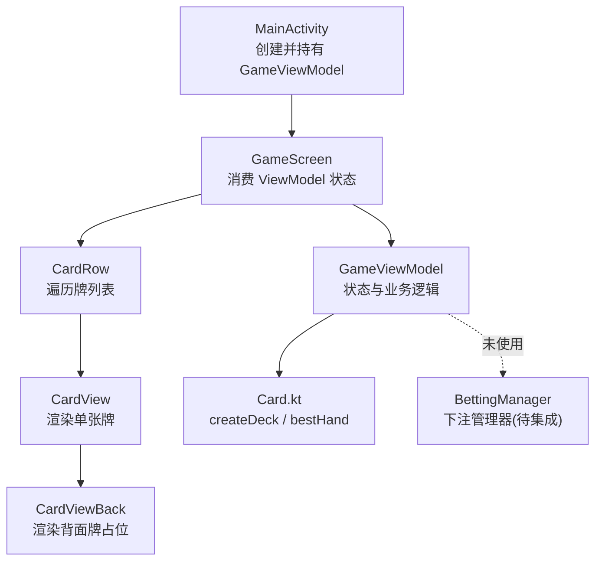
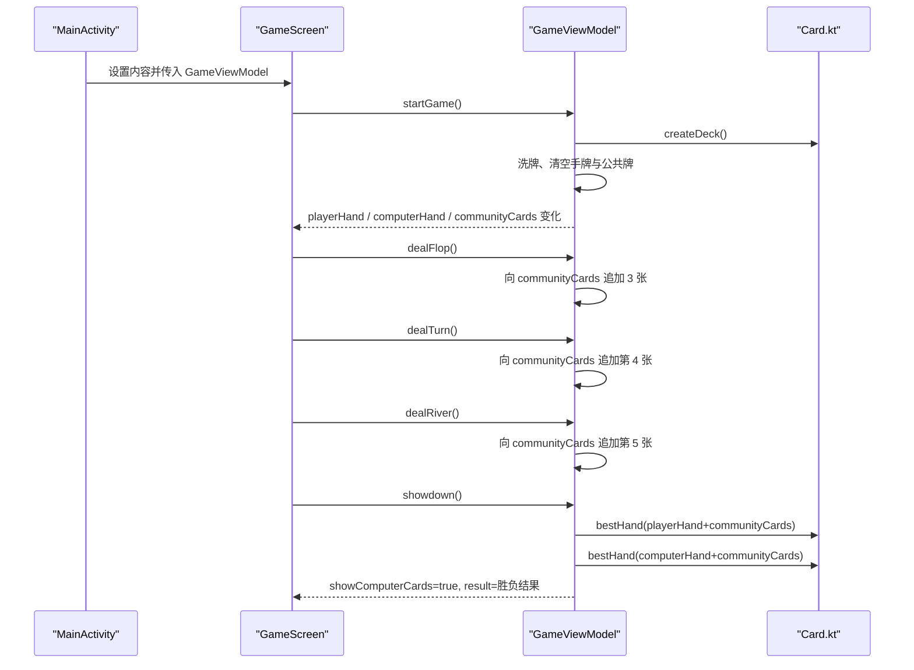
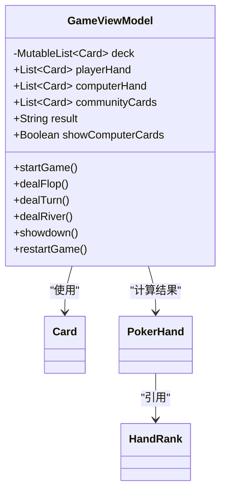
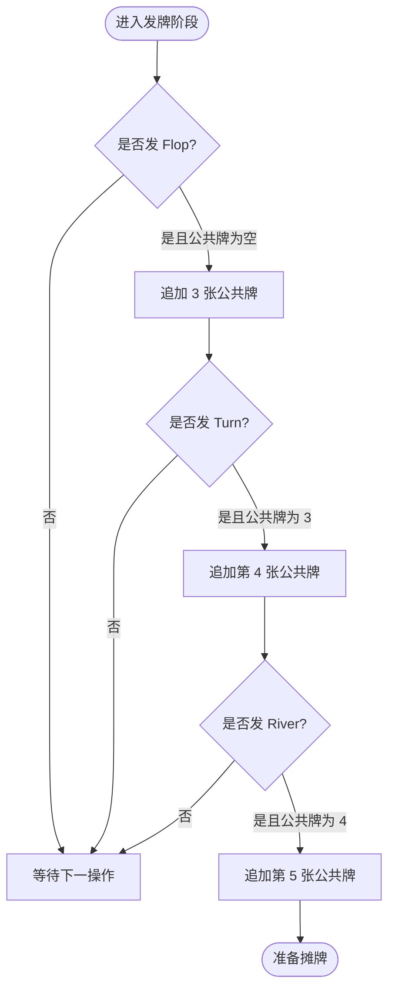
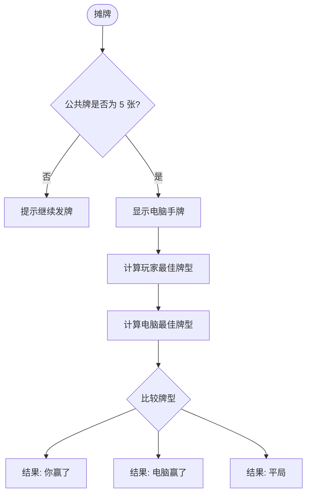
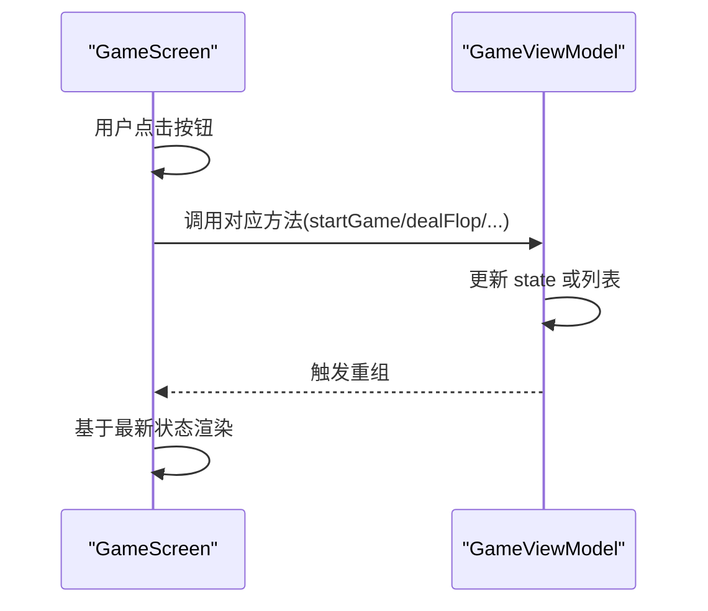
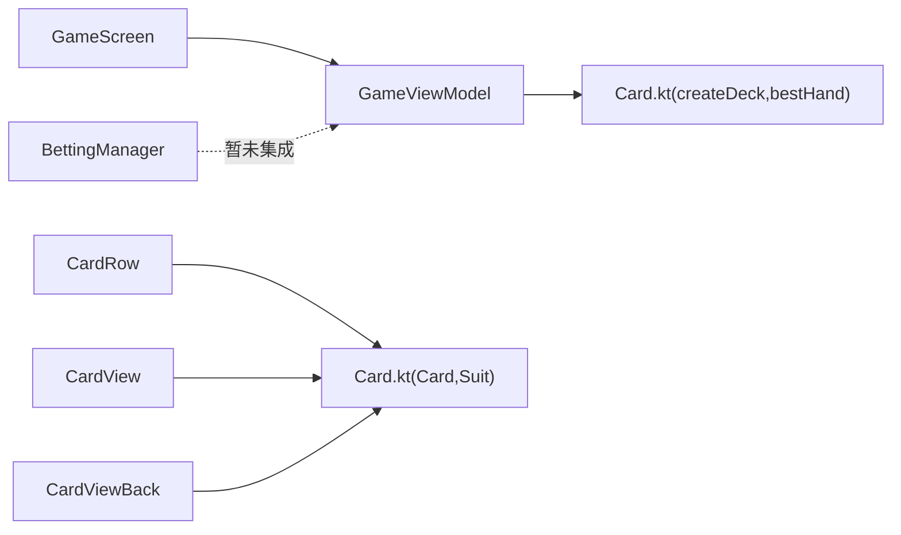

# 状态管理与 ViewModel

<cite>
**本文引用的文件**   
- [GameViewModel.kt](file://app/src/main/java/com/aniapp/pokerdemo/vm/GameViewModel.kt)
- [Card.kt](file://app/src/main/java/com/aniapp/pokerdemo/data/Card.kt)
- [BettingManager.kt](file://app/src/main/java/com/aniapp/pokerdemo/data/BettingManager.kt)
- [GameScreen.kt](file://app/src/main/java/com/aniapp/pokerdemo/ui/GameScreen.kt)
- [CardRow.kt](file://app/src/main/java/com/aniapp/pokerdemo/ui/CardRow.kt)
- [CardView.kt](file://app/src/main/java/com/aniapp/pokerdemo/ui/CardView.kt)
- [CardViewBack.kt](file://app/src/main/java/com/aniapp/pokerdemo/ui/CardViewBack.kt)
- [MainActivity.kt](file://app/src/main/java/com/aniapp/pokerdemo/MainActivity.kt)
</cite>

## 目录
1. [引言](#引言)
2. [项目结构](#项目结构)
3. [核心组件](#核心组件)
4. [架构总览](#架构总览)
5. [详细组件分析](#详细组件分析)
6. [依赖关系分析](#依赖关系分析)
7. [性能与重组特性](#性能与重组特性)
8. [常见问题与排错指南](#常见问题与排错指南)
9. [结论](#结论)

## 引言
本文件面向 PokerDemo 的 Compose + ViewModel 状态管理，重点解析 `GameViewModel` 的状态字段设计、生命周期、方法副作用处理，以及与 Compose UI 的绑定方式。文档还包含状态变化时序图、事件流程图、常见竞态问题及内存泄漏防护建议，帮助读者在不直接阅读源码的情况下掌握该项目的状态流转机制。

## 项目结构
PokerDemo 采用按职责分层的典型 Android Compose 工程组织：
- `vm`：视图模型层，负责游戏状态与业务逻辑。
- `data`：数据模型与纯函数工具，如牌组创建、牌型评估。
- `ui`：Compose 界面层，负责渲染手牌、公共牌、按钮和结果文本。
- `MainActivity`：应用入口，通过 `viewModels()` 提供单例 `GameViewModel`。

**图表来源**
- [MainActivity.kt:1-16](file://app/src/main/java/com/aniapp/pokerdemo/MainActivity.kt#L1-L16)
- [GameScreen.kt:1-104](file://app/src/main/java/com/aniapp/pokerdemo/ui/GameScreen.kt#L1-L104)
- [CardRow.kt:1-24](file://app/src/main/java/com/aniapp/pokerdemo/ui/CardRow.kt#L1-L24)
- [CardView.kt:1-79](file://app/src/main/java/com/aniapp/pokerdemo/ui/CardView.kt#L1-L79)
- [CardViewBack.kt:1-30](file://app/src/main/java/com/aniapp/pokerdemo/ui/CardViewBack.kt#L1-L30)
- [GameViewModel.kt:1-74](file://app/src/main/java/com/aniapp/pokerdemo/vm/GameViewModel.kt#L1-L74)
- [Card.kt:1-98](file://app/src/main/java/com/aniapp/pokerdemo/data/Card.kt#L1-L98)
- [BettingManager.kt:1-48](file://app/src/main/java/com/aniapp/pokerdemo/data/BettingManager.kt#L1-L48)

**章节来源**
- [MainActivity.kt:1-16](file://app/src/main/java/com/aniapp/pokerdemo/MainActivity.kt#L1-L16)
- [GameViewModel.kt:1-74](file://app/src/main/java/com/aniapp/pokerdemo/vm/GameViewModel.kt#L1-L74)

## 核心组件
本节聚焦 `GameViewModel` 的状态字段设计与职责边界。

- `playerHand`: 玩家手牌，类型为可观察列表，用于驱动玩家手牌的 Compose 显示。
- `computerHand`: 电脑手牌，类型为可观察列表，在摊牌前以“背面”占位显示，摊牌后展示真实牌面。
- `communityCards`: 公共牌，随 Flop/Turn/River 阶段逐步增加，最多 5 张。
- `result`: 当前游戏结果或提示文本，由状态机各阶段更新。
- `showComputerCards`: 控制是否显示电脑手牌，默认隐藏，摊牌时切换为可见。
- `deck`: 私有可变牌堆，仅在 `startGame` 中初始化并洗牌，其他阶段从该牌堆抽牌。

这些字段共同构成德州扑克单局状态的最小集合。其中，列表字段使用 `mutableStateListOf`，标量字段使用 `mutableStateOf`，从而在 Compose 中触发细粒度重组。

**章节来源**
- [GameViewModel.kt:1-74](file://app/src/main/java/com/aniapp/pokerdemo/vm/GameViewModel.kt#L1-L74)

## 架构总览
下图展示一次完整发牌到摊牌的核心调用链与状态变化路径。

**图表来源**
- [GameScreen.kt:1-104](file://app/src/main/java/com/aniapp/pokerdemo/ui/GameScreen.kt#L1-L104)
- [GameViewModel.kt:1-74](file://app/src/main/java/com/aniapp/pokerdemo/vm/GameViewModel.kt#L1-L74)
- [Card.kt:1-98](file://app/src/main/java/com/aniapp/pokerdemo/data/Card.kt#L1-L98)

## 详细组件分析

### GameViewModel 状态字段设计
- 列表字段 `playerHand`、`computerHand`、`communityCards` 使用 `mutableStateListOf`，保证对元素增删改时能触发 Compose 重组。
- 标量字段 `result`、`showComputerCards` 使用 `mutableStateOf`，赋值即触发重组。
- `deck` 是私有内部状态，不暴露给 UI；其职责是维护牌源与随机抽取顺序，避免 UI 误操作。

生命周期要点：
- 首次进入屏幕时，`GameViewModel` 被 `MainActivity` 通过 `viewModels()` 创建并缓存，配置变更不会重建。
- `startGame` 会重新初始化 `deck`，并清空所有手牌与公共牌，使单局状态重置。
- `restartGame` 会先重置显示状态（隐藏电脑手牌），再调用 `startGame`，最后更新结果提示。

**图表来源**
- [GameViewModel.kt:1-74](file://app/src/main/java/com/aniapp/pokerdemo/vm/GameViewModel.kt#L1-L74)
- [Card.kt:1-98](file://app/src/main/java/com/aniapp/pokerdemo/data/Card.kt#L1-L98)

**章节来源**
- [GameViewModel.kt:1-74](file://app/src/main/java/com/aniapp/pokerdemo/vm/GameViewModel.kt#L1-L74)

### mutableStateOf 与 mutableStateListOf 的正确用法
- `mutableStateOf` 适合不可变值或简单标量状态，例如 `result` 文本、`showComputerCards` 开关。
- `mutableStateListOf` 适合需要频繁增删元素的集合状态，例如手牌和公共牌列表。
- 在 Compose 中读取这些状态时，通常直接访问属性或 `.value`；当作为参数传递给子组合函数时，应传递列表本身而非快照，以便子树监听列表项变化。

触发重组的原则：
- 改变 `result.value` 或 `showComputerCards.value` 会触发订阅该状态的组合函数重组。
- 对 `playerHand`、`computerHand`、`communityCards` 的增删操作会触发依赖该列表的组合函数重组。
- 列表传参时应避免无谓拷贝；在本项目中 `CardRow` 接收 `List<Card?>` 并逐项渲染，符合预期。

**章节来源**
- [GameViewModel.kt:1-74](file://app/src/main/java/com/aniapp/pokerdemo/vm/GameViewModel.kt#L1-L74)
- [GameScreen.kt:1-104](file://app/src/main/java/com/aniapp/pokerdemo/ui/GameScreen.kt#L1-L104)
- [CardRow.kt:1-24](file://app/src/main/java/com/aniapp/pokerdemo/ui/CardRow.kt#L1-L24)

### 核心方法实现逻辑与副作用处理

#### startGame
职责：
- 生成并洗牌一副新牌，存入 `deck`。
- 清空玩家手牌、电脑手牌、公共牌。
- 将 `result` 设置为“游戏进行中”。
- 从牌堆依次抽取两张给玩家和电脑。

副作用与注意点：
- 每次调用都会完全替换牌堆并清空列表，确保单局状态独立。
- 列表清空与新增属于同一事务性流程，避免中间态被 UI 观察到不一致状态。

**章节来源**
- [GameViewModel.kt:1-74](file://app/src/main/java/com/aniapp/pokerdemo/vm/GameViewModel.kt#L1-L74)

#### dealFlop / dealTurn / dealRiver
职责：
- 根据当前公共牌数量判断是否可以发牌。
- Flop：公共牌为空时发 3 张。
- Turn：公共牌为 3 张时发第 4 张。
- River：公共牌为 4 张时发第 5 张。

副作用与注意点：
- 条件检查保证了发牌顺序正确，防止跳过阶段。
- 每次发牌都修改 `communityCards`，触发相关 UI 重组。

**图表来源**
- [GameViewModel.kt:1-74](file://app/src/main/java/com/aniapp/pokerdemo/vm/GameViewModel.kt#L1-L74)

**章节来源**
- [GameViewModel.kt:1-74](file://app/src/main/java/com/aniapp/pokerdemo/vm/GameViewModel.kt#L1-L74)

#### showdown
职责：
- 若公共牌已满 5 张，则显示电脑手牌，并分别计算玩家与电脑的最佳牌型。
- 比较牌型大小，更新 `result` 为“你赢了”“电脑赢了”或“平局”。
- 若公共牌不足 5 张，提示用户继续发牌。

副作用与注意点：
- 在摊牌成功后才打开 `showComputerCards`，避免提前泄露信息。
- 调用 `bestHand` 进行纯计算，无外部 I/O，但可能产生一定计算开销；对于 7 选 5 的简化评估，在当前规模下可以接受。

**图表来源**
- [GameViewModel.kt:1-74](file://app/src/main/java/com/aniapp/pokerdemo/vm/GameViewModel.kt#L1-L74)
- [Card.kt:1-98](file://app/src/main/java/com/aniapp/pokerdemo/data/Card.kt#L1-L98)

**章节来源**
- [GameViewModel.kt:1-74](file://app/src/main/java/com/aniapp/pokerdemo/vm/GameViewModel.kt#L1-L74)
- [Card.kt:1-98](file://app/src/main/java/com/aniapp/pokerdemo/data/Card.kt#L1-L98)

#### restartGame
职责：
- 重置 `showComputerCards` 为隐藏。
- 调用 `startGame` 重新发牌。
- 更新 `result` 为“已重新开始”。

副作用与注意点：
- 先隐藏电脑手牌，再发牌，保证 UI 状态一致。
- 该方法是对 `startGame` 的包装，保持单一职责清晰。

**章节来源**
- [GameViewModel.kt:1-74](file://app/src/main/java/com/aniapp/pokerdemo/vm/GameViewModel.kt#L1-L74)

### 与 Compose 状态的绑定模式
- `GameScreen` 直接读取 `GameViewModel` 的可观察状态，无需额外封装 `observeAsState()`。这是因为 `mutableStateOf` 与 `mutableStateListOf` 本身就是 Compose 状态。
- 按钮点击回调直接调用 `GameViewModel` 的方法，形成“UI 动作 -> ViewModel 状态变更 -> Compose 重组”的单向数据流。
- 状态提升的最佳实践体现在：所有可变状态集中在 `GameViewModel`，UI 仅做展示与事件转发，避免重复状态。

**图表来源**
- [GameScreen.kt:1-104](file://app/src/main/java/com/aniapp/pokerdemo/ui/GameScreen.kt#L1-L104)
- [GameViewModel.kt:1-74](file://app/src/main/java/com/aniapp/pokerdemo/vm/GameViewModel.kt#L1-L74)

**章节来源**
- [GameScreen.kt:1-104](file://app/src/main/java/com/aniapp/pokerdemo/ui/GameScreen.kt#L1-L104)
- [GameViewModel.kt:1-74](file://app/src/main/java/com/aniapp/pokerdemo/vm/GameViewModel.kt#L1-L74)

## 依赖关系分析
- `GameViewModel` 依赖 `Card.kt` 中的 `createDeck` 与 `bestHand`，用于牌组生成与牌型评估。
- `GameScreen` 依赖 `GameViewModel` 提供的状态与方法。
- `CardRow` 与 `CardView` 依赖 `Card` 数据结构与尺寸计算函数。
- `BettingManager` 目前未被 `GameViewModel` 使用，属于预留的下注逻辑模块。

**图表来源**
- [GameViewModel.kt:1-74](file://app/src/main/java/com/aniapp/pokerdemo/vm/GameViewModel.kt#L1-L74)
- [Card.kt:1-98](file://app/src/main/java/com/aniapp/pokerdemo/data/Card.kt#L1-L98)
- [GameScreen.kt:1-104](file://app/src/main/java/com/aniapp/pokerdemo/ui/GameScreen.kt#L1-L104)
- [CardRow.kt:1-24](file://app/src/main/java/com/aniapp/pokerdemo/ui/CardRow.kt#L1-L24)
- [CardView.kt:1-79](file://app/src/main/java/com/aniapp/pokerdemo/ui/CardView.kt#L1-L79)
- [CardViewBack.kt:1-30](file://app/src/main/java/com/aniapp/pokerdemo/ui/CardViewBack.kt#L1-L30)
- [BettingManager.kt:1-48](file://app/src/main/java/com/aniapp/pokerdemo/data/BettingManager.kt#L1-L48)

**章节来源**
- [GameViewModel.kt:1-74](file://app/src/main/java/com/aniapp/pokerdemo/vm/GameViewModel.kt#L1-L74)
- [Card.kt:1-98](file://app/src/main/java/com/aniapp/pokerdemo/data/Card.kt#L1-L98)

## 性能与重组特性
- 列表重组：由于 `playerHand`、`computerHand`、`communityCards` 都是 `mutableStateListOf`，单个元素增删即可触发依赖它们的组合函数重组，避免整屏重绘。
- 计算复杂度：`bestHand` 对最多 7 张牌进行评估，时间复杂度较低，在当前规模下不构成性能瓶颈。
- 可优化点：
  - 可在摊牌时缓存计算结果，避免重复比较。
  - 可将 `cardSize` 的计算提升到更高组合层，减少重复测量。
  - 未来若引入异步网络或数据库操作，建议使用协程并在 ViewModel 中集中处理。

[本节为通用性能建议，不直接分析具体代码文件]

## 常见问题与排错指南

### 常见状态同步问题
- 过早摊牌：用户在公共牌未满 5 张时点击“摊牌”，应看到“请发完所有公共牌再摊牌”的提示。
- 电脑手牌提前暴露：`showComputerCards` 应在 `showdown` 成功时才设为真，否则 UI 可能提前显示电脑牌。
- 列表状态不同步：确保所有发牌逻辑都通过 `communityCards` 添加元素，而不是在 UI 层直接构造列表。

排查步骤：
- 确认 `result` 文本是否正确反映当前阶段。
- 检查 `showComputerCards` 是否在摊牌后才变为真。
- 验证 `communityCards` 长度是否符合当前阶段（Flop=3、Turn=4、River=5）。

**章节来源**
- [GameViewModel.kt:1-74](file://app/src/main/java/com/aniapp/pokerdemo/vm/GameViewModel.kt#L1-L74)
- [GameScreen.kt:1-104](file://app/src/main/java/com/aniapp/pokerdemo/ui/GameScreen.kt#L1-L104)

### 竞态条件处理
当前实现为同步逻辑，不存在并发风险。若未来引入异步发牌或远程结算，需要注意：
- 使用协程作用域与取消语义，避免在 ViewModel 销毁后继续更新状态。
- 使用状态快照与防抖，避免快速多次点击导致状态跳跃。
- 对关键阶段（如 Flop/Turn/River）加入状态守卫，防止乱序完成回调覆盖状态。

[本节为通用并发建议，不直接分析具体代码文件]

### 内存泄漏防护
- `GameViewModel` 由 `viewModels()` 提供，生命周期与 Activity/NavBackStackEntry 绑定，不会因配置变更而丢失。
- `deck` 为私有可变变量，仅在 `startGame` 中初始化；注意不要在静态上下文或全局对象中持有 `GameViewModel` 引用。
- Compose 组合函数中不要保存 ViewModel 或 State 到长期存活对象；如需持久化，应写入受控存储（如 Room、DataStore）。

**章节来源**
- [MainActivity.kt:1-16](file://app/src/main/java/com/aniapp/pokerdemo/MainActivity.kt#L1-L16)
- [GameViewModel.kt:1-74](file://app/src/main/java/com/aniapp/pokerdemo/vm/GameViewModel.kt#L1-L74)

## 结论
`GameViewModel` 通过清晰的字段划分与条件发牌逻辑，实现了德州扑克单局的完整状态机。配合 Compose 的可观察状态，UI 能够以最小代价响应状态变化。当前实现简洁可靠，适合作为学习 Compose 与 ViewModel 集成的示例。未来可扩展下注、弃牌、跟注、加注等交互，并通过协程与状态守卫增强健壮性。