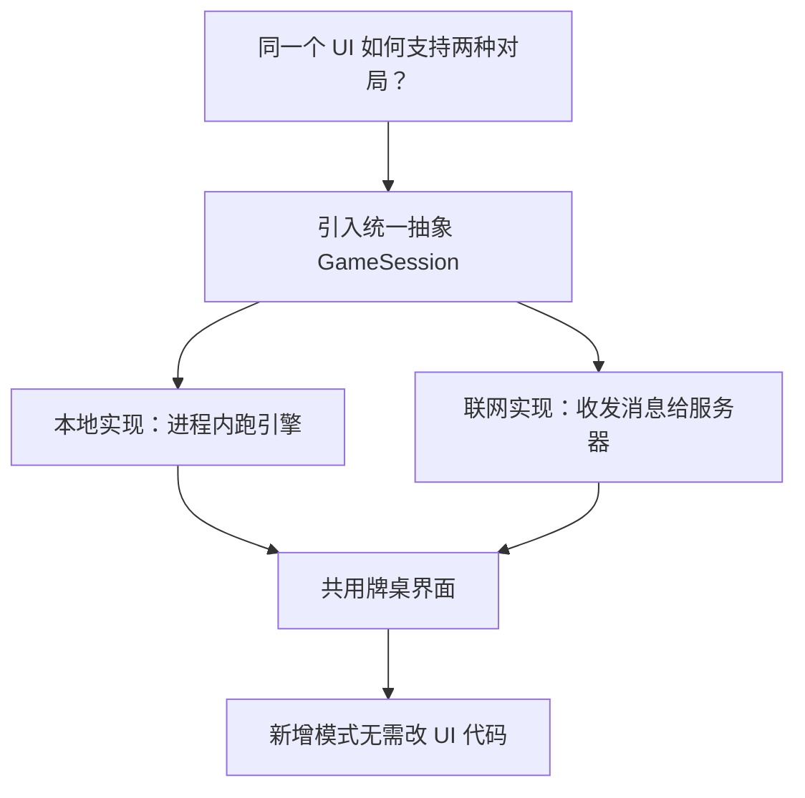
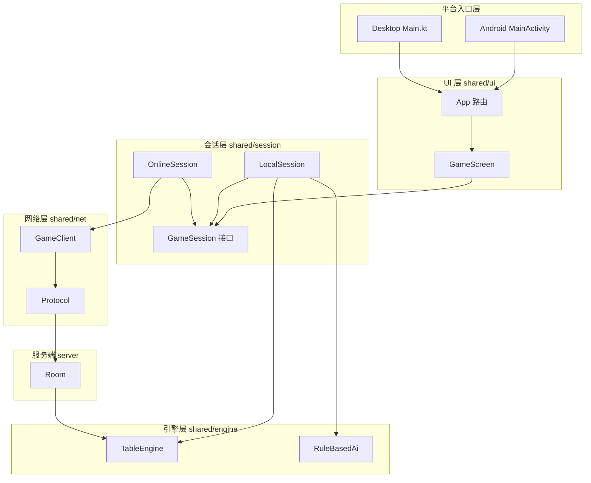
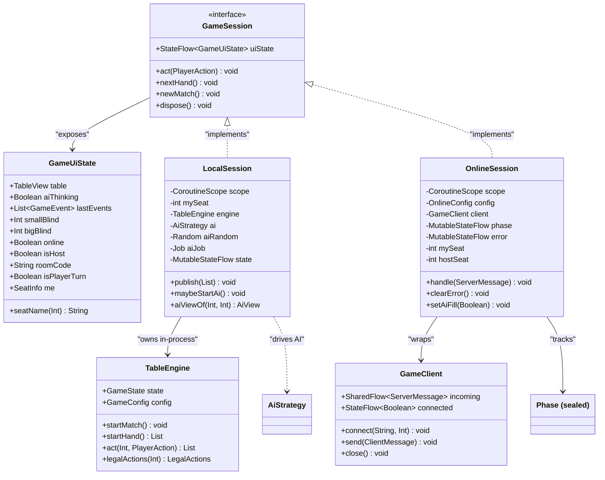
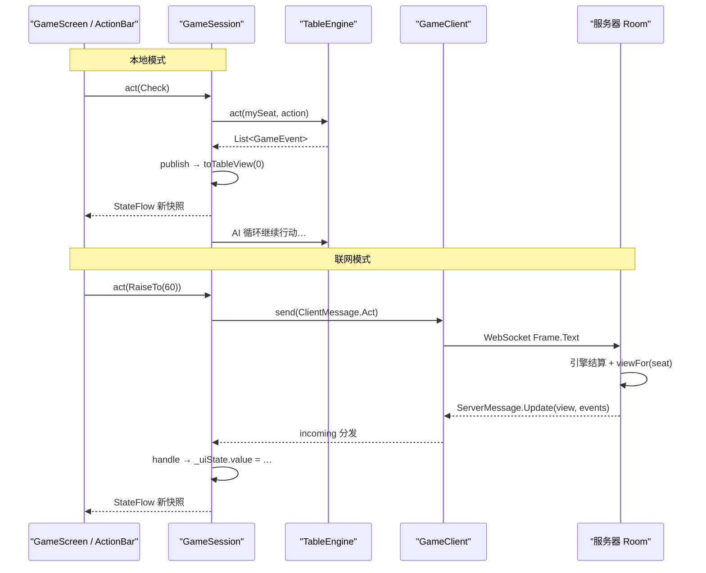
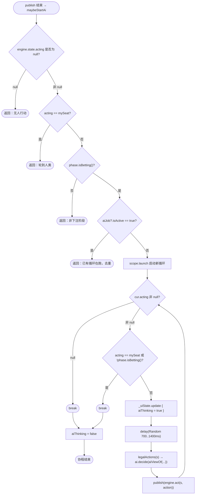
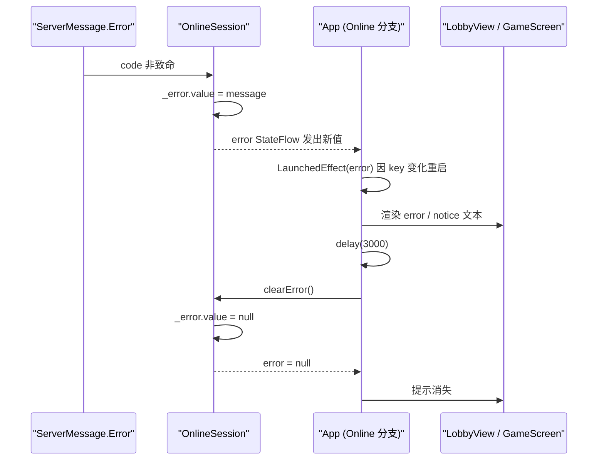
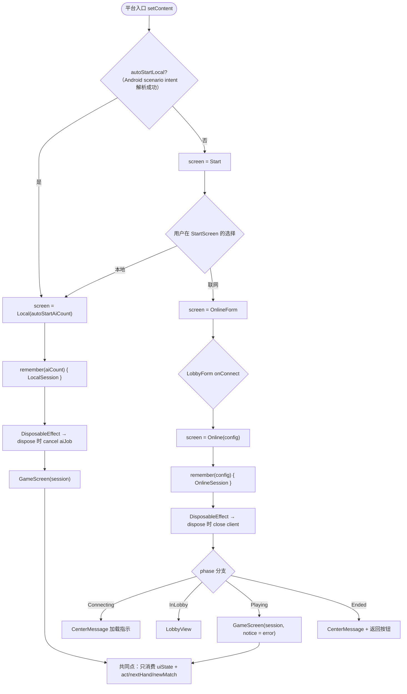
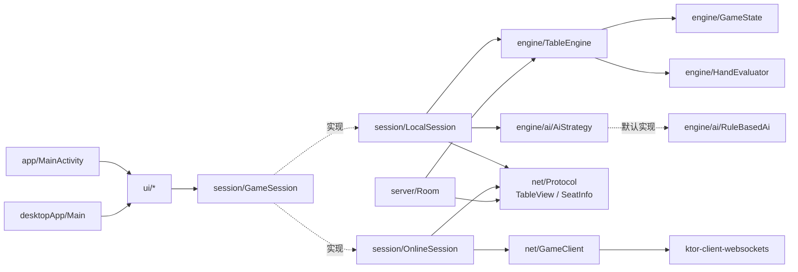

# 跨平台分层与会话抽象

<cite>
**本文引用的文件 **
- [GameSession.kt](file://shared/src/commonMain/kotlin/com/aniapp/pokerdemo/session/GameSession.kt)
- [LocalSession.kt](file://shared/src/commonMain/kotlin/com/aniapp/pokerdemo/session/LocalSession.kt)
- [OnlineSession.kt](file://shared/src/commonMain/kotlin/com/aniapp/pokerdemo/session/OnlineSession.kt)
- [App.kt](file://shared/src/commonMain/kotlin/com/aniapp/pokerdemo/ui/App.kt)
- [GameScreen.kt](file://shared/src/commonMain/kotlin/com/aniapp/pokerdemo/ui/GameScreen.kt)
- [TableEngine.kt](file://shared/src/commonMain/kotlin/com/aniapp/pokerdemo/engine/TableEngine.kt)
- [GameState.kt](file://shared/src/commonMain/kotlin/com/aniapp/pokerdemo/engine/GameState.kt)
- [AiStrategy.kt](file://shared/src/commonMain/kotlin/com/aniapp/pokerdemo/engine/ai/AiStrategy.kt)
- [RuleBasedAi.kt](file://shared/src/commonMain/kotlin/com/aniapp/pokerdemo/engine/ai/RuleBasedAi.kt)
- [Protocol.kt](file://shared/src/commonMain/kotlin/com/aniapp/pokerdemo/net/Protocol.kt)
- [GameClient.kt](file://shared/src/commonMain/kotlin/com/aniapp/pokerdemo/net/GameClient.kt)
- [Room.kt](file://server/src/main/kotlin/com/aniapp/pokerdemo/server/Room.kt)
- [MainActivity.kt](file://app/src/main/java/com/aniapp/pokerdemo/MainActivity.kt)
- [Main.kt](file://desktopApp/src/main/kotlin/com/aniapp/pokerdemo/desktop/Main.kt)
- [LocalSessionTest.kt](file://shared/src/commonTest/kotlin/com/aniapp/pokerdemo/session/LocalSessionTest.kt)
</cite>

## 目录
1. [引言](#引言)
2. [项目结构](#项目结构)
3. [核心组件：会话抽象层](#核心组件会话抽象层)
4. [架构总览](#架构总览)
5. [详细组件分析](#详细组件分析)
6. [依赖关系分析](#依赖关系分析)
7. [性能考量](#性能考量)
8. [故障排查指南](#故障排查指南)
9. [结论](#结论)
10. [附录](#附录)

## 引言

本页聚焦于本项目中最关键的一层抽象：**会话（Session）**。它回答一个工程问题——同一套 UI 如何同时驱动"本地人机对战"和"联网多人对战"两种截然不同的对局来源。

早期实现中，这一职责由名为 `GameViewModel` 的单一状态容器承担。当前代码库中该类已被移除（全仓库检索无任何 `GameViewModel` 符号），其"状态容器"职责由新的 `GameSession` 接口承接：UI 不再关心牌局是谁算出来的，只订阅一个 `StateFlow<GameUiState>` 并调用四个动作方法。

对非技术读者可以这样理解：`GameSession` 像是一个"标准插座"。无论是本地引擎（自己在家跟电脑打牌）还是远端服务器（跟真人联网打牌），只要它们都能插进这个插座并提供相同的形状（一份界面状态 + 四个操作按钮），屏幕上的牌桌界面就无需为两种模式各写一套代码。

本节为概念性介绍，不直接分析具体源文件。



## 项目结构

仓库采用 Kotlin Multiplatform 分层组织，按"能力层次"而非"平台"划分模块：

- `shared/commonMain`：全部业务逻辑与 UI（Compose Multiplatform），包括 `engine`（规则引擎）、`net`（协议与客户端）、`session`（会话抽象）、`ui`（界面）。
- `shared/commonTest`、`shared/desktopTest`：跨平台单元测试与桌面渲染冒烟测试。
- `server`：Ktor 服务端，房间管理与广播逻辑。
- `app`：Android 入口，仅负责把平台特有能力（返回键、图标、场景参数）注入 `App`。
- `desktopApp`：桌面入口，直接调用 `App()`。

会话抽象位于 `engine`（纯规则）与 `ui`（纯渲染）之间，是二者唯一的桥梁：



**图示来源 **
- [App.kt:40-131](file://shared/src/commonMain/kotlin/com/aniapp/pokerdemo/ui/App.kt#L40-L131)
- [LocalSession.kt:24-31](file://shared/src/commonMain/kotlin/com/aniapp/pokerdemo/session/LocalSession.kt#L24-L31)
- [OnlineSession.kt:25-42](file://shared/src/commonMain/kotlin/com/aniapp/pokerdemo/session/OnlineSession.kt#L25-L42)
- [MainActivity.kt:29-47](file://app/src/main/java/com/aniapp/pokerdemo/MainActivity.kt#L29-L47)

**章节来源**
- [App.kt:1-45](file://shared/src/commonMain/kotlin/com/aniapp/pokerdemo/ui/App.kt#L1-L45)
- [Main.kt:1-20](file://desktopApp/src/main/kotlin/com/aniapp/pokerdemo/desktop/Main.kt#L1-L20)

## 核心组件：会话抽象层

### GameSession：契约定义

`GameSession` 只有四个动作加一个状态流，刻意保持极小面积：

| 成员 | 类型 | 语义 |
|---|---|---|
| `uiState` | `StateFlow<GameUiState>` | 唯一的状态出口，UI 单向订阅 |
| `act(action)` | `(PlayerAction) -> Unit` | 提交一次玩家操作 |
| `nextHand()` | `() -> Unit` | 进入下一手牌 |
| `newMatch()` | `() -> Unit` | 重开一整场比赛 |
| `dispose()` | `() -> Unit` | 释放后台协程/连接资源 |

关键点在于 `act` / `nextHand` / `newMatch` 均为**同步且无返回值**的方法。这意味着两个实现必须自行处理异步性：本地实现把结果同步写入状态流；联网实现则把发送动作放进协程里"发射后不管"，真正的状态更新来自服务器回包。这种不对称被接口有意隐藏起来。

`GameUiState` 是投影后的视图数据，除 `table: TableView` 外还携带若干派生便捷属性：

- `isPlayerTurn`：`table.acting == table.mySeat && table.phase.isBetting()`，即"轮到我且处于下注阶段"。
- `me`：从 `table.seats` 中定位自己的座位信息。
- `seatName(seat)`：自己显示为"你"，否则取座位名或退化为"玩家N"。
- `aiThinking`、`lastEvents`、`smallBlind`/`bigBlind`、`online`/`isHost`/`roomCode`：分别服务 AI 思考提示、事件动画、盲注展示与联机标识。

`emptyTableView()` 提供一个空壳视图（`Phase.IDLE`、空座位列表、`mySeat = 0`），供联网会话在收到首个 `Update` 之前作为初始值使用——这保证了 `uiState` 永远非空，UI 无需处理 null。

**章节来源**
- [GameSession.kt:10-48](file://shared/src/commonMain/kotlin/com/aniapp/pokerdemo/session/GameSession.kt#L10-L48)

### 类图：会话层的类型关系



**图示来源 **
- [GameSession.kt:26-32](file://shared/src/commonMain/kotlin/com/aniapp/pokerdemo/session/GameSession.kt#L26-L32)
- [LocalSession.kt:24-100](file://shared/src/commonMain/kotlin/com/aniapp/pokerdemo/session/LocalSession.kt#L24-L100)
- [OnlineSession.kt:25-142](file://shared/src/commonMain/kotlin/com/aniapp/pokerdemo/session/OnlineSession.kt#L25-L142)
- [TableEngine.kt:13-100](file://shared/src/commonMain/kotlin/com/aniapp/pokerdemo/engine/TableEngine.kt#L13-L100)
- [GameClient.kt:19-59](file://shared/src/commonMain/kotlin/com/aniapp/pokerdemo/net/GameClient.kt#L19-L59)

## 架构总览

数据流呈严格的单向环：UI 调用 `act` → 会话推进状态 → 状态流回推 UI。本地路径在进程内闭环，联网路径经由 WebSocket 绕服务器一圈。



**图示来源 **
- [LocalSession.kt:46-71](file://shared/src/commonMain/kotlin/com/aniapp/pokerdemo/session/LocalSession.kt#L46-L71)
- [OnlineSession.kt:63-115](file://shared/src/commonMain/kotlin/com/aniapp/pokerdemo/session/OnlineSession.kt#L63-L115)
- [GameClient.kt:32-56](file://shared/src/commonMain/kotlin/com/aniapp/pokerdemo/net/GameClient.kt#L32-L56)
- [Room.kt:243-265](file://server/src/main/kotlin/com/aniapp/pokerdemo/server/Room.kt#L243-L265)

## 详细组件分析

### LocalSession：进程内会话与 AI 驱动

#### 整体形态

`LocalSession` 构造时接收 `CoroutineScope`、`aiCount`、可注入的 `TableEngine`、`AiStrategy` 与 `Random`。后三个参数带默认值（`defaultEngine(aiCount)`、`RuleBasedAi()`、`Random.Default`），使得生产代码只需两个参数，而测试可以注入受控牌堆与确定性随机源。内部固定 `mySeat = 0`，即人类玩家永远坐在 0 号位。

`init` 块直接调用 `newMatch()`，因此会话一旦构造就立刻处于"已发好第一手牌"的状态，无需 UI 额外触发。

#### publish(events)：整体替换而非增量修改

`publish` 是本地会话唯一的状态出口，其设计要点是**每次都新建一个完整的 `GameUiState` 赋值给 `_uiState.value`**，而不是对旧列表做增删改：

- 表格部分重新调用 `engine.toTableView(mySeat)`，从引擎权威状态完整投影；
- `lastEvents` 替换为本次动作产生的事件列表（供 UI 播放入场动画）；
- 盲注字段从 `engine.config` 重新读取。

之所以必须整体替换，是因为 `TableEngine.state` 本身也是用不可变 `data class` + `copy` 演进的（见 `updateSeat` 的实现方式）。如果 UI 侧持有的是可变列表引用，`StateFlow` 的值相等性判断会认为"没有变化"，从而漏发更新。整体替换保证每次 `publish` 都产生一个新的、内容不同的对象，触发下游重组。

`publish` 末尾无条件调用 `maybeStartAi()`，把"是否该让 AI 接手"的判断权交给引擎当前状态。

#### maybeStartAi()：单条协程循环驱动连续行动

这是本地会话最精妙的部分。目标：当轮到 AI 时，让所有 AI 座位连续行动直到回到人类玩家手中，且看起来有"思考延迟"。

流程图示（对应源码 L80-L99）：



逐项拆解需求中的关键约束：

- **单条协程循环**：`while(true)` 在同一个 `scope.launch` 内串行执行多个 AI 决策，而非每个 AI 各起一个协程。这样天然避免了并发抢着改引擎状态。
- **700–1400ms 随机延迟**：`delay(aiRandom.nextLong(700, 1401))`，上界写成 `1401` 是因为 `nextLong(from, until)` 的区间为左闭右开，实际取值范围是 700..1400。延迟使用可注入的 `aiRandom`，测试中传入 `Random(1)` 即可得到确定节奏。
- **aiThinking 单独下发**：思考标志通过 `_uiState.update { it.copy(aiThinking = true) }` 修改，**不走 `publish`**。原因是此时引擎状态没有任何变化，若调用 `publish` 会把 `lastEvents` 清空，导致正在播放的动作动画被打断。
- **`aiJob?.isActive` 去重**：外层守卫与 `newMatch`/`dispose` 中的 `aiJob?.cancel()` 配合，保证任意时刻至多存在一个 AI 循环。
- **终止条件**：轮到自己（`s == mySeat`）或非下注阶段（`!cur.phase.isBetting()`）即 `break`；`acting` 为 null（例如全下注摊牌的空档）同样 `break`。`break` 之后统一把 `aiThinking` 复位为 `false`。

值得注意的细节：`maybeStartAi` 的守卫只看**当前** `acting`。若某次 `publish` 后正好轮到人类，则不会启动循环；而当人类随后 `act` 交回 AI 时，那次 `act` 内部的 `publish` 又会再次尝试启动。因此循环是"接力式"重启的，而非永久常驻。

#### aiViewOf(seat, toCall)：只组装公开信息

AI 决策所需的 `AiView` 由该方法构造，字段严格限定为该座位自身可见的信息：自己的底牌 `hole`、公共牌 `board`、阶段、底池、需跟注额、本街已投、筹码、大盲、以及未弃牌对手数量。

其中 `activeOpponents` 通过 `g.players.count { !it.isFolded && it.id != seat }` 计算，只统计人数而不泄露任何对手的牌力或身份细节。这与 `RuleBasedAi.decide(view, legal, random)` 的签名一致——策略接口在设计上就拿不到其他玩家的底牌，从源头杜绝"作弊 AI"。（`toCall` 由调用方从 `engine.legalActions(s).callAmount` 传入，避免重复计算。）

#### defaultEngine(aiCount, newDeck, chips)：命名与场景装配

伴生对象工厂负责生成玩家名单：0 号固定为"你"，其余为 AI；当只有一个 AI 时命名为"电脑"，多于一个时命名为"电脑1""电脑2"…… 两个可选参数专为测试与 Android 场景注入保留：`newDeck` 可换成可控牌堆，`chips` 可按座位覆盖起始筹码（`chips?.getOrNull(i)` 缺失时回落到配置默认值）。

**章节来源**
- [LocalSession.kt:24-71](file://shared/src/commonMain/kotlin/com/aniapp/pokerdemo/session/LocalSession.kt#L24-L71)
- [LocalSession.kt:80-115](file://shared/src/commonMain/kotlin/com/aniapp/pokerdemo/session/LocalSession.kt#L80-L115)
- [LocalSession.kt:117-132](file://shared/src/commonMain/kotlin/com/aniapp/pokerdemo/session/LocalSession.kt#L117-L132)
- [AiStrategy.kt:9-23](file://shared/src/commonMain/kotlin/com/aniapp/pokerdemo/engine/ai/AiStrategy.kt#L9-L23)
- [TableEngine.kt:82-96](file://shared/src/commonMain/kotlin/com/aniapp/pokerdemo/engine/TableEngine.kt#L82-L96)

### toTableView(mySeat)：本地与远端统一的视图投影口径

`TableEngine.toTableView` 是扩展函数（定义在 `LocalSession.kt` 底部），把引擎的内部 `GameState` 翻译成协议层的 `TableView`。它是"引擎语言"与"UI/线协议语言"之间唯一的翻译点，因此本地与远端在 UI 上看到的数据形状完全一致。

三条必须精确理解的投影规则：

| 规则 | 实现位置 | 行为 |
|---|---|---|
| 底牌只在摊牌时暴露 | `revealed` 计算 | 仅当 `s.showdown == true` 才填入 `revealedHoles`，内容为"未弃牌玩家 id → 底牌"；否则为空 Map |
| `legal` 只算自己座位 | `legal = legalActions(mySeat)` | 视图里只携带本座位的合法动作集合，不为其他座位计算 |
| `isAi` 的定义 | `isAi = p.id != mySeat` | 本地模式下除自己以外一律标记为 AI |

关于第一条需要强调其安全含义：折叠状态的玩家的底牌**从不**进入 `revealedHoles`（`filter { !it.isFolded }`），符合扑克规则；而在非摊牌阶段，即便是自己的底牌也仅通过 `myHole` 字段下发，其他人看不到。

`connected` 在本地投影中恒为 `true`——因为进程内不存在掉线概念。这一点与服务端形成对照：`Room.viewFor` 会为每个座位填充真实的连接状态，并在发送失败时把该座位降级为 AI 占位。

关于第三条同样要留意：`isAi = p.id != mySeat` 是**本地视角**的判定。在服务端投影中，AI 与否取决于房间注册信息而非相对座位，所以"我以外的真人玩家"在联网视图里不会被误标为 AI。

**章节来源**
- [LocalSession.kt:134-166](file://shared/src/commonMain/kotlin/com/aniapp/pokerdemo/session/LocalSession.kt#L134-L166)
- [Protocol.kt:47-80](file://shared/src/commonMain/kotlin/com/aniapp/pokerdemo/net/Protocol.kt#L47-L80)
- [Room.kt:259-265](file://server/src/main/kotlin/com/aniapp/pokerdemo/server/Room.kt#L259-L265)

### OnlineSession：消息驱动的会话状态机

#### 双通道状态：phase 与 error

联网会话比本地会话多出两个对外可见的状态流，它们**不属于** `GameSession` 接口，而是 `OnlineSession` 特有的扩展能力：

- `phase: StateFlow<Phase>`：连接生命周期状态机，`sealed interface` 包含四种状态。
- `error: StateFlow<String?>`：一次性错误提示文本。

之所以把它们放在接口之外，是因为 `App` 路由需要按 `phase` 决定渲染"连接中/大厅/牌桌/已结束"四种不同界面，而这个概念在本地模式下毫无意义。

| Phase | 载荷 | 触发来源 |
|---|---|---|
| `Connecting` | 无 | 构造时的初始值 |
| `InLobby` | `roomCode`、`seats`、`hostSeat`、`seatCount`、`mySeat`、`aiFill` | 收到 `ServerMessage.Lobby` |
| `Playing` | 无 | 收到 `ServerMessage.Update` |
| `Ended` | `message` | 连接失败、致命错误码、断线、`RoomClosed` |

#### init：三条并发协程

构造时启动三条独立协程，分工清晰：

1. **连接与入房**：`client.connect(host, port)` 成功后，依据 `config.joinCode` 是否存在决定上行 `JoinRoom(code, nickname)` 还是 `CreateRoom(nickname, seatCount ?: 6, aiFill)`。整段包在 `try/catch` 中，异常直接把 `phase` 置为 `Ended("无法连接服务器：…")`。
2. **消息接收**：`client.incoming.collect { handle(it) }`，把服务器推送交给统一处理器。
3. **断线监测**：`client.connected.drop(1).collect { … }`。`drop(1)` 至关重要——它丢弃初始值 `false`，否则会话一创建就会立即被误判为"已断开"。回调中还需同时满足 `!disposed` 且当前 `phase` 不是 `Ended`，才写入 `Ended("与服务器断开连接")`，避免用户主动离开后弹出虚假错误。

#### handle(msg)：一条消息改变一类状态

| ServerMessage | 副作用 |
|---|---|
| `Joined` | 记录 `mySeat`、`roomCode`（不改变 phase） |
| `Lobby` | 记录 `hostSeat`、`roomCode`，phase → `InLobby(...)` |
| `Update` | 重建 `GameUiState(table = msg.view, lastEvents = msg.events, online = true, isHost = mySeat == hostSeat, roomCode = roomCode)`，phase → `Playing` |
| `Error` | 若 `code ∈ {join_failed, not_found, bad_seat_count}` → phase `Ended(message)`；否则仅设 `error` |
| `RoomClosed` | phase → `Ended("房间已关闭")` |

这里体现了两级错误严重度的分流：**影响能否继续游戏的错误**（房间号不存在、加入失败、座位数非法）直接把会话终结到 `Ended`；**可恢复的业务错误**（如非法操作）只写入 `error` 文本，游戏继续进行。`isHost` 不是服务器直接告知的字段，而是客户端用 `mySeat == hostSeat` 推导得出。

#### 上行动作：fire-and-forget

`act` 先做与本地同样的 `isPlayerTurn` 前置校验（防止无效请求往返），随后 `scope.launch { runCatching { client.send(...) } }`。`runCatching` 吞掉发送异常——因为断线情况已经由第三条协程通过 `connected` 流专门处理，此处无需重复报错。

`nextHand()` 上行 `ClientMessage.StartHand`；`newMatch()` 直接委托给 `nextHand()`，因为重赛在协议层面就是"再开一手"，筹码重置由服务端负责。`setAiFill(enabled)` 是仅大厅可用的房间设置开关，同样以 `runCatching` 包裹。

`clearError()` 把 `error` 置 null，供 UI 定时自动清除调用。

#### dispose 与清理作用域

`dispose()` 先置 `disposed = true`（抑制后续断线误报），再用独立的 `cleanupScope`（`SupervisorJob() + Dispatchers.Default`）发起 `client.close()`。之所以不复用传入的 `scope`：调用 `dispose` 的场景往往正是宿主组合被销毁之时，此时原 `scope` 可能已在取消过程中，在里面再 launch 清理任务不可靠。

**章节来源**
- [OnlineSession.kt:25-83](file://shared/src/commonMain/kotlin/com/aniapp/pokerdemo/session/OnlineSession.kt#L25-L83)
- [OnlineSession.kt:85-115](file://shared/src/commonMain/kotlin/com/aniapp/pokerdemo/session/OnlineSession.kt#L85-L115)
- [OnlineSession.kt:117-142](file://shared/src/commonMain/kotlin/com/aniapp/pokerdemo/session/OnlineSession.kt#L117-L142)
- [Protocol.kt:17-45](file://shared/src/commonMain/kotlin/com/aniapp/pokerdemo/net/Protocol.kt#L17-L45)
- [GameClient.kt:32-59](file://shared/src/commonMain/kotlin/com/aniapp/pokerdemo/net/GameClient.kt#L32-L59)

### App.kt：路由与会话生命周期

#### AppScreen：以数据表达目的地

路由状态用一个 `sealed interface AppScreen` 建模，四个分支恰好覆盖全部界面：

| 分支 | 载荷 | 渲染目标 |
|---|---|---|
| `Start` | 无 | `StartScreen`（选择本地/联网） |
| `Local` | `aiCount: Int` | `GameScreen(LocalSession)` |
| `OnlineForm` | 无 | `LobbyForm`（填写主机/昵称等） |
| `Online` | `config: OnlineConfig` | 按 `OnlineSession.phase` 分四路渲染 |

`screen` 保存在 `remember { mutableStateOf(...) }` 中，初值取决于 `autoStartLocal`——Android 侧检测到 `scenario` intent 时会跳过首页直接进入本地对局。

#### remember(key) 构造会话：键的选择决定语义

两个会话分支都用 `remember(key)` 创建会话，且 key 各不相同：

- 本地：`remember(s.aiCount)`。AI 数量是本地会话的全部配置，因此只有换桌人数才会重建引擎。
- 联网：`remember(s.config)`。`OnlineConfig` 是 `data class`，按字段值比较；相同的主机+端口+昵称+房间码会被视为同一会话而复用，避免重组时无谓地重连。

由于 `AppScreen.Online` 把整个 `config` 编码进了路由值，"换房间"必然意味着 `screen` 变成新的 `Online(newConfig)`，从而 `remember` 失效并新建 `OnlineSession`。这是把配置纳入路由键带来的正确性红利。

#### DisposableEffect(onDispose { session.dispose() })：显式资源回收

两个分支都紧跟一行 `DisposableEffect(session) { onDispose { session.dispose() } }`。effect 的 key 是 session 实例本身，因此：

- 离开该屏（切回 `Start` 或 `OnlineForm`）→ 组合移除 → `onDispose` 触发 → 本地取消 `aiJob`、联网关闭 WebSocket；
- 同屏内配置变化导致 `remember` 重建 → 旧 session 的 effect 先 dispose，再为新 session 建立 effect。

没有这一步，本地会话的 AI 循环会在后台继续消耗协程并改写已废弃的状态流；联网会话则会残留打开的 socket。

#### backHandler 注入：平台差异下沉到入口

```kotlin
if (screen !is AppScreen.Start) {
    backHandler?.invoke { screen = AppScreen.Start }
}
```

这段代码的意义在于"共享层不认识 Android"。`backHandler` 的类型是 `(@Composable (onBack: () -> Unit) -> Unit)?`——它本身是可组合的高阶函数，因此只能在组合期间调用。Android 的 `MainActivity` 传入 `{ onBack -> BackHandler(onBack = onBack) }`，把系统返回键映射为"回到首页"；桌面端 `Main.kt` 完全不传，于是该分支为 null，不做任何事。

同时注意 `screen !is AppScreen.Start` 的条件：首页不需要拦截返回键，交给系统正常退出应用。

#### 联机错误的自动清除



机制说明：`LaunchedEffect(error)` 以 `error` 为 key，每当出现非空错误就重启计时器；`delay(3000)` 后调用 `session.clearError()`。若期间又发生新错误，key 改变会使上一轮协程被取消并重新计时，因而提示总是从最后一次错误起算 3 秒。

错误的呈现位置随 phase 而变：`InLobby` 时作为 `error` 参数传给 `LobbyView`，`Playing` 时作为 `notice` 传给 `GameScreen`（后者内部以金色小字渲染）。`Connecting` 与 `Ended` 不显示错误条——前者由加载指示器占据，后者已把 `message` 直接呈现在正文中。

#### Ended 状态的用户出口

`Phase.Ended` 渲染居中消息加一个"返回"按钮，点击后 `screen = AppScreen.Start`。这条路径会连带触发前述 `DisposableEffect`，确保失败的连接被关闭。

**章节来源**
- [App.kt:40-45](file://shared/src/commonMain/kotlin/com/aniapp/pokerdemo/ui/App.kt#L40-L45)
- [App.kt:47-131](file://shared/src/commonMain/kotlin/com/aniapp/pokerdemo/ui/App.kt#L47-L131)
- [GameScreen.kt:43-136](file://shared/src/commonMain/kotlin/com/aniapp/pokerdemo/ui/GameScreen.kt#L43-L136)
- [MainActivity.kt:29-47](file://app/src/main/java/com/aniapp/pokerdemo/MainActivity.kt#L29-L47)

### 会话选择的整体决策流

下图汇总从应用启动到确定"用哪个会话实现"的完整判断链（整合 `App` 与 `MainActivity` 的实际逻辑）：



**图示来源 **
- [App.kt:51-131](file://shared/src/commonMain/kotlin/com/aniapp/pokerdemo/ui/App.kt#L51-L131)
- [MainActivity.kt:26-47](file://app/src/main/java/com/aniapp/pokerdemo/MainActivity.kt#L26-L47)

## 依赖关系分析

会话层的依赖方向是**单向向下且可替换**的，这是它能同时容纳两种实现的根本原因。



关键观察：

- **UI 只依赖接口**：`GameScreen` 的参数类型是 `GameSession`，它既不知道 `TableEngine` 也不知道 `GameClient`。因此 `commonTest` 与 `desktopTest` 可以直接构造 `LocalSession` 喂给 UI，无需任何 mock 框架。
- **`LocalSession` 依赖 `net.Protocol` 但不依赖 `net.GameClient`**：它需要 `TableView`/`SeatInfo` 这两个纯数据结构作为投影目标，却完全不碰传输层。这说明 `Protocol.kt` 中的 DTO 事实上扮演了"共享视图模型"的角色，而不只是线格式。
- **服务端复用同一投影思想**：`server/Room.kt` 自行实现了 `viewFor(e, seat)`，逻辑与 `TableEngine.toTableView` 同构但更复杂（需处理真实连接状态与座位映射 `seatMap`）。两者共享 `TableView` 定义，因而客户端 UI 无需区分数据来源。
- **可注入性**：`LocalSession` 的 `engine`、`ai`、`aiRandom` 三参数均可覆盖，`TableEngine` 的 `random`、`newDeck` 同理。`LocalSessionTest` 正是利用这一点注入 `CallBot`（只会过牌/跟注的策略桩）与 `Random(1)`，使 AI 行为完全可预测。

**图示来源 **
- [GameScreen.kt:28-44](file://shared/src/commonMain/kotlin/com/aniapp/pokerdemo/ui/GameScreen.kt#L28-L44)
- [LocalSession.kt:1-31](file://shared/src/commonMain/kotlin/com/aniapp/pokerdemo/session/LocalSession.kt#L1-L31)
- [OnlineSession.kt:1-42](file://shared/src/commonMain/kotlin/com/aniapp/pokerdemo/session/OnlineSession.kt#L1-L42)
- [Room.kt:243-265](file://server/src/main/kotlin/com/aniapp/pokerdemo/server/Room.kt#L243-L265)

**章节来源**
- [LocalSessionTest.kt:24-40](file://shared/src/commonTest/kotlin/com/aniapp/pokerdemo/session/LocalSessionTest.kt#L24-L40)

## 性能考量

- **视图重算成本**：`publish` 每次都完整重建 `TableView`（遍历所有座位、复制牌面列表）。在最多 6 个座位、每手数次动作的量级下开销可忽略；但若未来引入高频动画逐帧刷新，应考虑缓存或增量 diff。
- **AI 延迟是刻意的用户体验**：700–1400ms 的 `delay` 纯粹用于模拟思考节奏。测试中通过虚拟时间调度器（`advanceTimeBy(1500)`）瞬时跨过，不影响测试耗时。
- **协程数量恒定**：本地会话最多只有一个 AI 循环协程（`aiJob?.isActive` 去重保证），联网会话固定三条长驻协程加每条上行消息一个短协程，均不随座位数增长。
- **incoming 缓冲**：`GameClient._incoming` 是 `extraBufferCapacity = 64` 的 `SharedFlow`，可吸收突发广播；`OnlineSession` 以 `collect` 持续消费，正常情况下不会积压。
- **StateFlow 相等性去重**：`StateFlow` 会丢弃"值相等"的更新。这正是 `publish` 必须整体替换、且各字段都是不可变 data class 的原因——既保证必要更新不被吞，也保证真正无变化的重复赋值不会引起多余重组。
- **remember 键粒度**：`remember(s.config)` 依赖 `data class` 的结构相等性；若将来把 `OnlineConfig` 换成含不稳定引用（如 lambda）的类型，会导致每次重组都重连，需改为显式 key。

## 故障排查指南

| 症状 | 根因定位 | 处置思路 |
|---|---|---|
| 本地模式下 AI 迟迟不动作 | 检查 `maybeStartAi` 的前置守卫：`acting` 为 null、或 `phase` 不在下注阶段（`HAND_OVER`/`SHOWDOWN`）都会直接 return | 属正常行为；确认是否卡在等待"下一手" |
| AI 连续行动但界面动画被打断 | `aiThinking` 更新走了 `publish` 而非 `_uiState.update`，清空了 `lastEvents` | 保持两条更新路径分离 |
| 切换 AI 数量后仍沿用旧牌局 | `remember` 的 key 未包含变化维度 | 确保 key 覆盖所有会改变会话的配置 |
| 离开牌桌后仍有后台活动 | `DisposableEffect` 缺失或 session 未被 `remember` 稳定持有 | 核对 `onDispose { session.dispose() }` 是否成对存在 |
| 联网刚进入就被判定"与服务器断开连接" | 断线监听缺少 `drop(1)`，把 `connected` 的初始 `false` 当成状态变化 | 保留 `drop(1)` 与 `!disposed`、`phase !is Ended` 双重守卫 |
| 输入操作毫无反应 | `act` 首行的 `isPlayerTurn` 前置校验静默丢弃请求（本地与联网都有此检查） | 先确认 `table.acting == mySeat` 且处于下注阶段 |
| 服务器报错但界面没结束，也没提示 | 错误码分类：仅 `join_failed`/`not_found`/`bad_seat_count` 走 `Ended`，其余只写 `error` 且 3 秒后自动清除 | 查看 `handle` 中的错误码集合，必要时提升严重度 |
| 其他玩家底牌提前可见 | 检查 `revealedHoles` 是否仅在 `showdown` 为真时填充，以及是否过滤了弃牌玩家 | 严禁在非摊牌阶段写入他人底牌 |
| 大厅里"房主"标识错乱 | `isHost` 由客户端 `mySeat == hostSeat` 推导，依赖先收到 `Joined` 再收到 `Lobby` | 若消息顺序异常需检查服务端广播时机 |
| 手动离开房间后弹出断线提示 | `dispose()` 未先置 `disposed = true` | 保证标志位在关闭连接之前设置 |

**章节来源**
- [LocalSession.kt:46-99](file://shared/src/commonMain/kotlin/com/aniapp/pokerdemo/session/LocalSession.kt#L46-L99)
- [OnlineSession.kt:63-142](file://shared/src/commonMain/kotlin/com/aniapp/pokerdemo/session/OnlineSession.kt#L63-L142)
- [App.kt:73-103](file://shared/src/commonMain/kotlin/com/aniapp/pokerdemo/ui/App.kt#L73-L103)

## 结论

会话抽象层用不到 350 行代码完成了三件事：

1. **收敛状态容器职责**。原先分散在 `GameViewModel` 中的"持有什么状态、如何更新、何时清理"被拆成清晰的三层：`GameUiState`（数据形状）、`GameSession`（行为契约）、两个实现（各自的生命周期管理）。UI 侧只剩一个订阅点和四个调用点。
2. **统一视图投影口径**。`TableEngine.toTableView` 与 `GameUiState` 的组合，使"引擎状态"与"线上视图"成为同一份 `TableView` 的两个产地。信息安全边界（底牌只在摊牌暴露、`legal` 只算自己、`aiViewOf` 只含公开信息）在投影层集中强制执行，而不是散落在各个界面组件里。
3. **把平台差异限制在入口**。`backHandler`、`autoStartLocal`、`scenarioDeck` 等参数使共享层对 Android 返回键、桌面窗口零感知；`remember(key)` + `DisposableEffect` 则把会话生命周期牢牢绑定到组合树，避免手工接线。

后续可考虑的改进方向：将 `OnlineSession` 专有的 `phase`/`error` 提炼为一个可选接口（例如 `Connectable`），以便路由层在不 `as` 强转的前提下判断"这是一个联网会话"；以及为 `TableView` 投影增加轻量缓存或差分能力，以支撑更高频的动画刷新。

## 附录

### 术语对照

| 术语 | 含义 |
|---|---|
| 会话（Session） | 一局游戏运行期的状态容器与控制入口 |
| 投影（Projection） | 把引擎内部状态转换为 UI 视图数据的单向映射 |
| 本地会话 | 在客户端进程内直接驱动 `TableEngine` 的会话实现 |
| 联网会话 | 通过 WebSocket 与服务器交换消息的会话实现 |
| 下注阶段 | `Phase.isBetting()` 为真的四个阶段：翻牌前、翻牌圈、转牌圈、河牌圈 |
| fire-and-forget | 发送请求后立即返回，结果通过状态流异步到达 |

### 会话能力对比表

| 能力 | LocalSession | OnlineSession |
|---|---|---|
| 状态来源 | 进程内 `TableEngine` | 服务器 `ServerMessage.Update` |
| `mySeat` 确定方式 | 常量 `0` | 服务器 `Joined.mySeat`（初值 `-1`） |
| 初始 `uiState` | `engine.toTableView(0)`（已发好牌） | `emptyTableView()`（空壳，待首个 Update） |
| AI 驱动 | 自有协程循环 | 由服务端代打 |
| `newMatch()` | 重置筹码后开新一手 | 委托 `nextHand()`，上行 `StartHand` |
| `dispose()` | 取消 `aiJob` | 置 `disposed` 后关闭客户端 |
| 额外对外状态 | 无 | `phase`、`error` |
| 错误严重度分级 | 不适用 | 致命 → `Ended`；一般 → `error` |
| `isHost` 来源 | 默认 `true` | `mySeat == hostSeat` 推导 |
| `connected` 字段 | 恒为 `true` | 服务端提供真实值 |