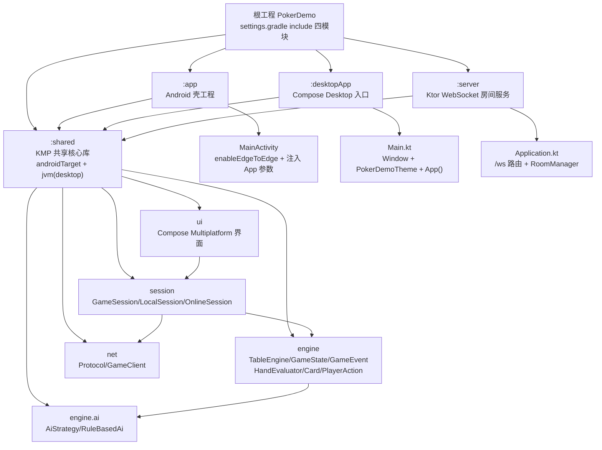
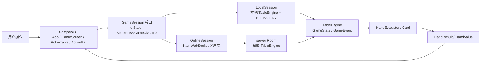
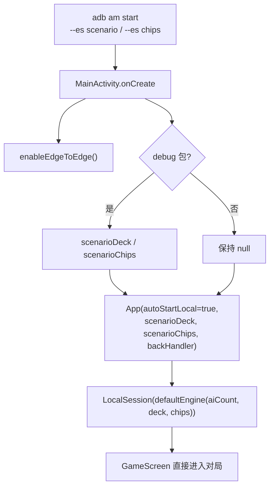
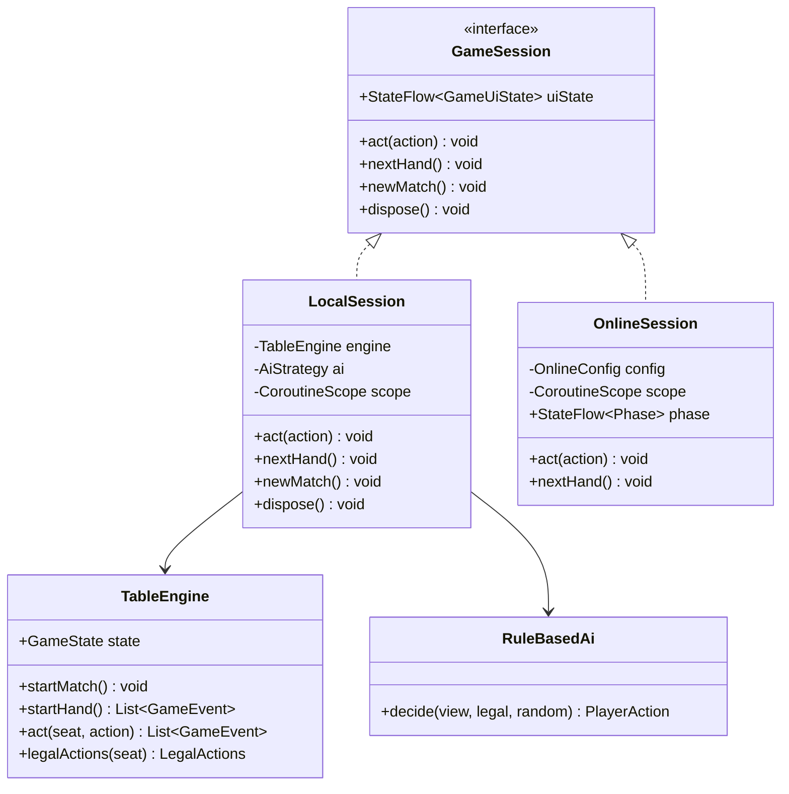
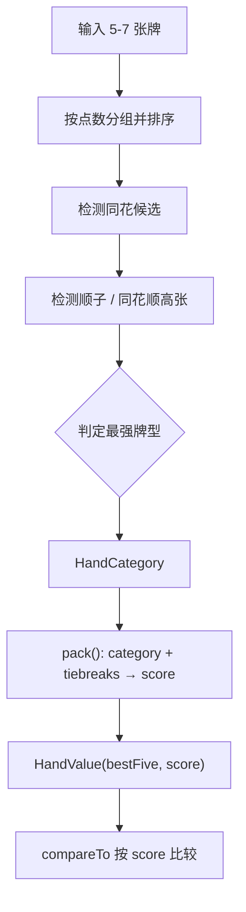
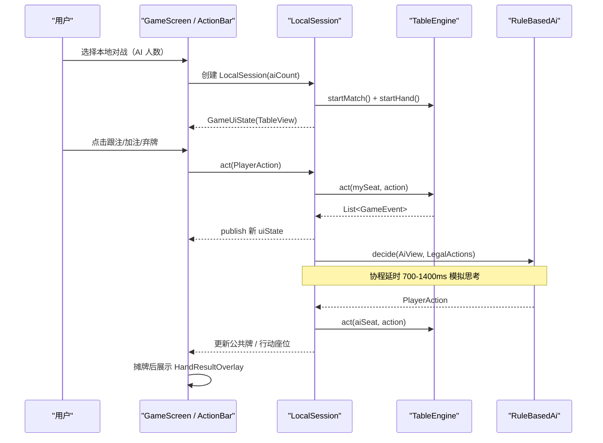
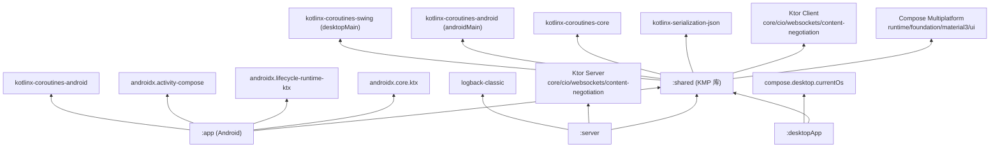

# 项目概述

<cite>
**本文引用的文件**
- [settings.gradle](file://settings.gradle)
- [build.gradle](file://build.gradle)
- [libs.versions.toml](file://gradle/libs.versions.toml)
- [app/build.gradle](file://app/build.gradle)
- [shared/build.gradle.kts](file://shared/build.gradle.kts)
- [server/build.gradle.kts](file://server/build.gradle.kts)
- [desktopApp/build.gradle.kts](file://desktopApp/build.gradle.kts)
- [AndroidManifest.xml](file://app/src/main/AndroidManifest.xml)
- [MainActivity.kt](file://app/src/main/java/com/aniapp/pokerdemo/MainActivity.kt)
- [Main.kt](file://desktopApp/src/main/kotlin/com/aniapp/pokerdemo/desktop/Main.kt)
- [Application.kt](file://server/src/main/kotlin/com/aniapp/pokerdemo/server/Application.kt)
- [Room.kt](file://server/src/main/kotlin/com/aniapp/pokerdemo/server/Room.kt)
- [TableEngine.kt](file://shared/src/commonMain/kotlin/com/aniapp/pokerdemo/engine/TableEngine.kt)
- [GameState.kt](file://shared/src/commonMain/kotlin/com/aniapp/pokerdemo/engine/GameState.kt)
- [GameEvent.kt](file://shared/src/commonMain/kotlin/com/aniapp/pokerdemo/engine/GameEvent.kt)
- [HandEvaluator.kt](file://shared/src/commonMain/kotlin/com/aniapp/pokerdemo/engine/HandEvaluator.kt)
- [Card.kt](file://shared/src/commonMain/kotlin/com/aniapp/pokerdemo/engine/Card.kt)
- [PlayerAction.kt](file://shared/src/commonMain/kotlin/com/aniapp/pokerdemo/engine/PlayerAction.kt)
- [Protocol.kt](file://shared/src/commonMain/kotlin/com/aniapp/pokerdemo/net/Protocol.kt)
- [GameSession.kt](file://shared/src/commonMain/kotlin/com/aniapp/pokerdemo/session/GameSession.kt)
- [LocalSession.kt](file://shared/src/commonMain/kotlin/com/aniapp/pokerdemo/session/LocalSession.kt)
- [OnlineSession.kt](file://shared/src/commonMain/kotlin/com/aniapp/pokerdemo/session/OnlineSession.kt)
- [App.kt](file://shared/src/commonMain/kotlin/com/aniapp/pokerdemo/ui/App.kt)
- [GameScreen.kt](file://shared/src/commonMain/kotlin/com/aniapp/pokerdemo/ui/GameScreen.kt)
</cite>

## 目录
1. [项目简介](#项目简介)
2. [构建环境与运行方式](#构建环境与运行方式)
3. [技术栈与学习价值](#技术栈与学习价值)
4. [项目结构概览](#项目结构概览)
5. [核心目标：单局德州扑克流程](#核心目标单局德州扑克流程)
6. [架构总览](#架构总览)
7. [分层组件分析](#分层组件分析)
8. [数据模型与牌型评估](#数据模型与牌型评估)
9. [用户交互与状态流转](#用户交互与状态流转)
10. [依赖关系分析](#依赖关系分析)
11. [性能与可维护性特征](#性能与可维护性特征)
12. [常见问题排查](#常见问题排查)
13. [总结](#总结)

## 项目简介
PokerDemo 是一个使用 Kotlin Multiplatform（KMP）+ Compose Multiplatform 实现的德州扑克演示项目。根工程为多模块 Gradle 构建，`settings.gradle` 中声明了四个模块：`:app`、`:shared`、`:server`、`:desktopApp`。

项目聚焦于完整的单局德州扑克体验：发玩家手牌、逐步发出 Flop/Turn/River 公共牌、按街下注、摊牌比较各座位最佳五张牌并显示胜负结果。在此基础上还扩展了两条对局路径：

- **本地对战**：由 `shared` 模块的 `LocalSession` 驱动，用规则型 AI（`RuleBasedAi`）填充其余座位。
- **在线房间**：客户端通过 Ktor WebSocket 连接到 `:server` 模块的房间服务，多人同桌对战，空位可选由 AI 补齐。

同一套引擎、协议与 UI 代码同时编译到 Android 与桌面 JVM 两个目标，因此该项目也是理解「共享核心库 + 平台壳工程」这一 KMP 典型组织方式的学习示例。

## 构建环境与运行方式
- 语言与工具链
  - Kotlin 2.0.21，Gradle Version Catalog 统一版本管理（[gradle/libs.versions.toml](file://gradle/libs.versions.toml)）
  - Android Gradle Plugin 8.13.2
  - Compose Multiplatform 1.7.3，Android 侧仍引入 Compose BOM 2024.09.00
  - kotlinx.serialization 1.7.3、Ktor 3.0.1、kotlinx.coroutines 1.10.2、logback 1.5.12
  - 各模块 Java/JVM target 统一为 11
- Android 端系统版本
  - `minSdk 28`、`targetSdk 36`、`compileSdk 36`
  - 应用需要 `INTERNET` 权限（在线模式访问房间服务），主 Activity 锁定竖屏并通过 `configChanges` 自行处理配置变化
- 关键配置位置
  - 模块声明：[settings.gradle:28-31](file://settings.gradle#L28-L31)
  - 插件声明（均 `apply false`）：[build.gradle:2-10](file://build.gradle#L2-L10)
  - Android 壳构建脚本：[app/build.gradle](file://app/build.gradle)
  - 共享库双目标构建脚本：[shared/build.gradle.kts](file://shared/build.gradle.kts)
- 运行方式
  - **Android**：Android Studio 打开根目录后运行 `:app`；也可执行 `./gradlew :app:assembleDebug`。APK 文件名带自动生成的版本号与构建时间戳（版本号取自距设定起点的分钟数，无需手工修改）。
  - **桌面**：运行 `:desktopApp`（Compose Desktop，入口 `com.aniapp.pokerdemo.desktop.MainKt`），窗口标题为 `LSTPoker`，初始尺寸 1280×800。
  - **服务端**：运行 `:server:run`（`application` 插件，主类 `com.aniapp.pokerdemo.server.ApplicationKt`），在 `0.0.0.0:8080` 上以 CIO 引擎提供 `/ws` WebSocket 端点。桌面或 Android 客户端在联机界面填写服务器地址与端口即可加入房间。
  - **真机场景验证**：debug 包支持通过 Intent 参数注入指定手牌与起始筹码，例如
    `adb am start --es scenario 'As Ah|Ks Kh|2c 3d 4h 5s 6c' --es chips '500,1000,2000'`，
    其中 `scenario` 首段为玩家手牌、其后各段为其他座位手牌、末段为五张公共牌；`chips` 可选，按座位指定起始筹码。

**章节来源**
- [settings.gradle:28-31](file://settings.gradle#L28-L31)
- [app/build.gradle:10-56](file://app/build.gradle#L10-L56)
- [shared/build.gradle.kts:56-64](file://shared/build.gradle.kts#L56-L64)
- [desktopApp/build.gradle.kts:24-28](file://desktopApp/build.gradle.kts#L24-L28)
- [server/build.gradle.kts:32-34](file://server/build.gradle.kts#L32-L34)
- [AndroidManifest.xml:5-28](file://app/src/main/AndroidManifest.xml#L5-L28)
- [MainActivity.kt:22-56](file://app/src/main/java/com/aniapp/pokerdemo/MainActivity.kt#L22-L56)

## 技术栈与学习价值
- **纯 Kotlin**：四个模块全部为 Kotlin 源码，Android 侧无 XML 布局页面。
- **Kotlin Multiplatform**：`shared` 模块配置 `androidTarget()` 与 `jvm("desktop")` 两个编译目标，公共代码放在 `commonMain`，平台差异通过 `androidMain` / `desktopMain` 的协程调度依赖（`coroutines-android` / `coroutines-swing`）解决。
- **Compose Multiplatform**：`shared` 应用 `org.jetbrains.compose` 与 `org.jetbrains.kotlin.plugin.compose` 插件，UI 层（牌桌、座位、按钮、主题）完全跨平台复用；Material3 由 `compose.material3` 提供。
- **kotlinx.serialization**：引擎状态、事件、动作以及网络消息均为 `@Serializable`，同一份类型定义既用于内存状态快照，也用于 WebSocket JSON 编解码。
- **Ktor**：`server` 使用 `ktor-server-websockets` + CIO 提供房间服务；`shared` 的联网会话使用 `ktor-client-websockets` + CIO 作为客户端。
- **Gradle Version Catalog**：所有版本与插件坐标集中在 `libs.versions.toml`，子模块通过 `alias(libs.plugins.…)` 引用。
- **状态驱动的单向数据流**：会话层暴露 `StateFlow<GameUiState>`，Compose 侧用 `collectAsState()` 订阅，UI 只读取状态并通过回调把动作交回会话层。
- 适合初学者掌握：
  - KMP 多模块工程的搭建方式与共享库/平台壳的职责划分。
  - Compose 中 `remember`、`mutableStateOf`、`collectAsState`、`LaunchedEffect`、`DisposableEffect` 的组合使用。
  - 用接口（`GameSession`）隔离「本地引擎 + AI」与「远程服务器权威状态」两种实现。
  - 游戏状态在 `Phase`（PREFLOP → FLOP → TURN → RIVER → SHOWDOWN → HAND_OVER）之间的流转。

**章节来源**
- [libs.versions.toml:1-17](file://gradle/libs.versions.toml#L1-L17)
- [libs.versions.toml:48-59](file://gradle/libs.versions.toml#L48-L59)
- [shared/build.gradle.kts:1-54](file://shared/build.gradle.kts#L1-L54)
- [App.kt:57-131](file://shared/src/commonMain/kotlin/com/aniapp/pokerdemo/ui/App.kt#L57-L131)
- [GameSession.kt:27-32](file://shared/src/commonMain/kotlin/com/aniapp/pokerdemo/session/GameSession.kt#L27-L32)

## 项目结构概览
根工程按「共享核心 + 三个终端」组织：

**图表来源**
- [settings.gradle:28-31](file://settings.gradle#L28-L31)
- [shared/build.gradle.kts:1-54](file://shared/build.gradle.kts#L1-L54)
- [app/build.gradle:64-72](file://app/build.gradle#L64-L72)
- [desktopApp/build.gradle.kts:9-13](file://desktopApp/build.gradle.kts#L9-L13)
- [server/build.gradle.kts:8-22](file://server/build.gradle.kts#L8-L22)
- [MainActivity.kt:22-48](file://app/src/main/java/com/aniapp/pokerdemo/MainActivity.kt#L22-L48)
- [Main.kt:10-17](file://desktopApp/src/main/kotlin/com/aniapp/pokerdemo/desktop/Main.kt#L10-L17)
- [Application.kt:17-30](file://server/src/main/kotlin/com/aniapp/pokerdemo/server/Application.kt#L17-L30)

### 各模块职责
- **`:shared`** — 唯一的业务核心库，`commonMain` 内按包分层：
  - `engine`：`TableEngine`（一手牌的完整状态机）、`GameState`/`Phase`/`PlayerState`、`GameEvent`、`HandEvaluator`/`HandValue`、`Card`/`Suit`/`Deck`、`PlayerAction`/`LegalActions`。
  - `engine.ai`：`AiStrategy` 接口与 `RuleBasedAi` 实现，配合 `AiView` 决策视图。
  - `net`：`Protocol`（`ClientMessage`/`ServerMessage`/`TableView`/`SeatInfo` 等可序列化消息）、`GameClient`（WebSocket 客户端封装）。
  - `session`：`GameSession` 接口及 `LocalSession`、`OnlineSession` 两种实现，向 UI 输出 `GameUiState`。
  - `ui`：Compose Multiplatform 界面，含 `App`（屏幕路由）、`GameScreen`、`table/PokerTable`、`table/SeatView`、`card/CardRow`、`card/PlayingCard`、`action/ActionBar`、`lobby/LobbyScreen`、`overlay/HandResultOverlay`、`start/StartScreen`、`theme/*`。
- **`:app`** — Android 壳：仅负责 Activity 生命周期、边到边显示、资源（图标、字符串、主题）与 debug 场景注入，业务全部委托给 `:shared`。
- **`:desktopApp`** — Compose Desktop 入口：创建窗口并直接渲染 `PokerDemoTheme { App() }`。
- **`:server`** — Ktor 服务端：`RoomManager` 管理房间，`Room` 持有权威 `TableEngine` 并向各连接广播视图与事件；附带 `E2EClient` 与 `RoomFlowTest` 等测试。

**章节来源**
- [shared/build.gradle.kts:19-54](file://shared/build.gradle.kts#L19-L54)
- [App.kt:32-40](file://shared/src/commonMain/kotlin/com/aniapp/pokerdemo/ui/App.kt#L32-L40)
- [Application.kt:17-28](file://server/src/main/kotlin/com/aniapp/pokerdemo/server/Application.kt#L17-L28)
- [Room.kt:39-61](file://server/src/main/kotlin/com/aniapp/pokerdemo/server/Room.kt#L39-L61)

## 核心目标：单局德州扑克流程
`TableEngine` 是单局流程的唯一权威实现，其约束与阶段推进如下：

1. **开局前置条件**
   - 座位数必须为 2–6，否则构造时抛异常。
   - `startMatch()` 重置每位玩家的初始筹码；`startHand()` 要求当前阶段为 `IDLE` 或 `HAND_OVER`，且剩余筹码大于 0 的玩家不少于两人。
2. **发手牌与盲注**
   - 每手重新洗牌（`newDeck()` 可注入自定义发牌序列，用于测试与 debug 场景）。
   - 庄家按钮沿有效座位轮转；每位有筹码玩家发两张底牌，筹码不足者标记为已弃牌。
   - 发布盲注，产生 `BlindsPosted`、`HoleCardsDealt` 等事件。
3. **下注街与公共牌阶段**
   - `Phase.isBetting()` 为 PREFLOP/FLOP/TURN/RIVER 四街；每街由 `acting` 指示当前行动座位。
   - 玩家动作为 `Fold`/`Check`/`Call`/`RaiseTo`，`legalActions(seat)` 返回该座位的合法动作集合（含跟注额、最小与最大加注值）。
   - 街结束后发出对应公共牌（Flop 三张、Turn/River 各一张），产生 `StreetDealt` 事件。
4. **摊牌与结算**
   - 达到摊牌时 `showdown` 置真，未弃牌玩家的底牌通过 `revealedHoles` 公开。
   - `HandEvaluator.evaluate()` 对「两张底牌 + 五张公共牌」计算最佳五张 `HandValue`，按编码后的 `score` 比较大小。
   - 结果以 `HandResult`（多个 `PotAward` 边池派彩 + 各座位牌型 + 结束原因 `FOLD`/`SHOWDOWN`）形式给出，并产生 `ShowdownRevealed`、`PotAwarded`、`HandFinished` 事件；玩家被淘汰时产生 `PlayerEliminated`，全场结束时产生 `MatchFinished`。

**章节来源**
- [TableEngine.kt:16-60](file://shared/src/commonMain/kotlin/com/aniapp/pokerdemo/engine/TableEngine.kt#L16-L60)
- [GameState.kt:6-57](file://shared/src/commonMain/kotlin/com/aniapp/pokerdemo/engine/GameState.kt#L6-L57)
- [GameEvent.kt:5-27](file://shared/src/commonMain/kotlin/com/aniapp/pokerdemo/engine/GameEvent.kt#L5-L27)
- [PlayerAction.kt:5-27](file://shared/src/commonMain/kotlin/com/aniapp/pokerdemo/engine/PlayerAction.kt#L5-L27)
- [HandEvaluator.kt:34-50](file://shared/src/commonMain/kotlin/com/aniapp/pokerdemo/engine/HandEvaluator.kt#L34-L50)

## 架构总览
项目采用「引擎 → 会话 → UI」的分层，并以 `GameSession` 接口隔离本地与在线两条实现路径：

- UI 层不直接接触牌组或规则，只消费 `GameUiState`（内含 `TableView` 快照、盲注、是否联机、房号等）并调用 `act`/`nextHand`/`newMatch`。
- `LocalSession` 在同一进程内推进引擎，并用协程延时模拟 AI 思考；`OnlineSession` 则把动作发给服务器，等待 `ServerMessage.Update` 推送新的 `TableView`。
- `server` 的 `Room` 复用同一个 `TableEngine`，保证本地与在线玩法一致。

**图表来源**
- [GameSession.kt:11-32](file://shared/src/commonMain/kotlin/com/aniapp/pokerdemo/session/GameSession.kt#L11-L32)
- [LocalSession.kt:24-56](file://shared/src/commonMain/kotlin/com/aniapp/pokerdemo/session/LocalSession.kt#L24-L56)
- [OnlineSession.kt:16-42](file://shared/src/commonMain/kotlin/com/aniapp/pokerdemo/session/OnlineSession.kt#L16-L42)
- [App.kt:57-131](file://shared/src/commonMain/kotlin/com/aniapp/pokerdemo/ui/App.kt#L57-L131)
- [Application.kt:23-105](file://server/src/main/kotlin/com/aniapp/pokerdemo/server/Application.kt#L23-L105)

## 分层组件分析

### 平台入口：MainActivity 与 desktop Main
两个平台入口都极其轻量，只做「主题 + 参数注入」：

- **Android `MainActivity`**
  - 继承 `ComponentActivity`，`onCreate` 中调用 `enableEdgeToEdge()`。
  - 在 `PokerDemoTheme` 包裹下调用共享的 `App(...)`，传入：
    - `versionText`：来自 `resValue "string", "app_version"` 的自动生成版本号。
    - `logo`：用 `painterResource(R.mipmap.ic_launcher_foreground)` 渲染的应用图标组合函数。
    - `backHandler`：把 Android 的 `BackHandler` 注入共享 UI，使非起始屏可返回上一级。
    - `autoStartLocal` / `autoStartAiCount` / `scenarioDeck` / `scenarioChips`：仅在 debug 包生效的场景注入参数。
  - `scenarioDeck(parts)` 校验 `parts` 至少三段（玩家手牌 + 其他座位手牌 + 公共牌），解析如 `As Ah|Ks Kh|2c 3d 4h 5s 6c` 的记法，并从随机整副牌中挑出三张不属于这些牌的牌作为烧牌，重排成「底牌—烧牌—公共牌」顺序的确定性牌堆；`scenarioChips()` 解析逗号分隔的起始筹码列表。release 包因缺少 `FLAG_DEBUGGABLE` 而返回 `null`，即完全禁用该通道。
- **Desktop `Main.kt`**
  - `application { Window(...) { PokerDemoTheme { App() } } }`，不传任何额外参数，关闭请求即退出应用。

**图表来源**
- [MainActivity.kt:22-91](file://app/src/main/java/com/aniapp/pokerdemo/MainActivity.kt#L22-L91)
- [App.kt:57-88](file://shared/src/commonMain/kotlin/com/aniapp/pokerdemo/ui/App.kt#L57-L88)
- [LocalSession.kt:109-123](file://shared/src/commonMain/kotlin/com/aniapp/pokerdemo/session/LocalSession.kt#L109-L123)

**章节来源**
- [MainActivity.kt:21-91](file://app/src/main/java/com/aniapp/pokerdemo/MainActivity.kt#L21-L91)
- [Main.kt:10-17](file://desktopApp/src/main/kotlin/com/aniapp/pokerdemo/desktop/Main.kt#L10-L17)
- [app/build.gradle:19-31](file://app/build.gradle#L19-L31)

### 视图层：shared/ui
- `App`：以密封接口 `AppScreen` 表达四个屏幕——`Start`、`Local(aiCount)`、`OnlineForm`、`Online(config)`；切换时按需创建并销毁会话（`remember` + `DisposableEffect`）。联机分支再按 `OnlineSession.Phase`（连接中 / 大厅 / 游戏中 / 已结束）渲染不同内容，错误提示 3 秒后自动清除。
- `GameScreen`：接收 `GameSession` 与可选 `notice`，从 `uiState` 取 `TableView` 渲染牌桌；依据可用宽度计算牌面尺寸，对手座位按水平等分槽位、垂直沿椭圆弧分布，避免相邻座位重叠。
- `table/PokerTable`、`table/SeatView`：桌面背景与单个座位（昵称、筹码、本街下注、庄家标记、行动高亮、底牌区）。
- `card/CardRow`、`card/PlayingCard`：牌行布局与单张牌正反面绘制，摊牌后才翻面。
- `action/ActionBar`：依 `LegalActions` 渲染弃牌/过牌/跟注/加注控件。
- `lobby/LobbyScreen`：联机表单与房间大厅（成员列表、房号、AI 补位开关、开始下一手）。
- `overlay/HandResultOverlay`：一手结束时的派彩与牌型结果浮层。
- `start/StartScreen`：欢迎页，承载 logo、版本号与「本地对战 / 联机」入口。
- `theme/Theme.kt`、`Color.kt`、`Type.kt`：`PokerDemoTheme` 与牌桌配色、排版定义。

**章节来源**
- [App.kt:42-131](file://shared/src/commonMain/kotlin/com/aniapp/pokerdemo/ui/App.kt#L42-L131)
- [GameScreen.kt:41-80](file://shared/src/commonMain/kotlin/com/aniapp/pokerdemo/ui/GameScreen.kt#L41-L80)

### 会话层：GameSession / LocalSession / OnlineSession
- `GameSession`：统一契约——`uiState: StateFlow<GameUiState>`、`act(PlayerAction)`、`nextHand()`、`newMatch()`、`dispose()`。`GameUiState` 还提供 `isPlayerTurn`、`me`、`seatName()` 等派生属性。
- `LocalSession`：持有 `TableEngine` 与 `RuleBasedAi`；每次 `publish(events)` 后用 `maybeStartAi()` 检查轮到哪个 AI 座位，在协程循环中随机延时约 700–1400ms 模拟思考，再取 `legalActions` 让 AI 决策并推进引擎。`defaultEngine(aiCount, newDeck, chips)` 组装「你 + 电脑/电脑N」的座位列表，并允许注入自定义牌堆与逐座位起始筹码。
- `OnlineSession`：以 `OnlineConfig(host, port, nickname, seatCount?, joinCode?, aiFill)` 建立连接，用内部 `Phase` 状态机驱动 UI；连接失败或服务器断开时进入 `Ended` 阶段并给出提示。
- `net/GameClient` + `net/Protocol`：客户端侧的 WebSocket 收发与消息类型定义。

**图表来源**
- [GameSession.kt:27-32](file://shared/src/commonMain/kotlin/com/aniapp/pokerdemo/session/GameSession.kt#L27-L32)
- [LocalSession.kt:24-107](file://shared/src/commonMain/kotlin/com/aniapp/pokerdemo/session/LocalSession.kt#L24-L107)
- [OnlineSession.kt:16-42](file://shared/src/commonMain/kotlin/com/aniapp/pokerdemo/session/OnlineSession.kt#L16-L42)
- [TableEngine.kt:16-60](file://shared/src/commonMain/kotlin/com/aniapp/pokerdemo/engine/TableEngine.kt#L16-L60)

**章节来源**
- [GameSession.kt:11-48](file://shared/src/commonMain/kotlin/com/aniapp/pokerdemo/session/GameSession.kt#L11-L48)
- [LocalSession.kt:24-141](file://shared/src/commonMain/kotlin/com/aniapp/pokerdemo/session/LocalSession.kt#L24-L141)
- [OnlineSession.kt:16-42](file://shared/src/commonMain/kotlin/com/aniapp/pokerdemo/session/OnlineSession.kt#L16-L42)

### 服务端：Application 与 Room
- `main()` 以 CIO 引擎在 `0.0.0.0:8080` 启动，`module()` 安装 `WebSockets` 并注册 `/ws` 路由。
- 每条连接维护自己的 `room` 与 `mySeat`，收到的文本帧用 `PokerJson.decodeFromString<ClientMessage>` 解析；解析失败回复 `Error("bad_message", …)`。
- 消息处理：
  - `CreateRoom`：已在房间中则拒绝；座位数不在 2–6 范围内回复 `bad_seat_count`；否则创建房间并加入。
  - `JoinRoom`：房间不存在回复 `not_found`。
  - `StartHand` / `Act` / `SetAiFill`：未加入房间回复 `no_room`，否则转交 `Room.requestStart` / `requestAct` / `setAiFill`。
  - `Leave` 与连接结束时调用 `disconnected(seat)`。
- `RoomManager` 负责房间的创建、查询与移除；`Room` 持有权威引擎，用互斥锁串行化加入，向各座位广播 `Lobby` 与 `Update` 消息，并可按 `aiFill` 选项用 AI 填补空位。`module(aiDelayMs)` 的服务端 AI 思考延时区间同样默认 700–1400ms，便于测试覆盖。
- 昵称统一经 `cleanName()` 去除空白、截断至 12 字符，空值回退为「玩家」。

**章节来源**
- [Application.kt:17-111](file://server/src/main/kotlin/com/aniapp/pokerdemo/server/Application.kt#L17-L111)
- [Room.kt:30-166](file://server/src/main/kotlin/com/aniapp/pokerdemo/server/Room.kt#L30-L166)

## 数据模型与牌型评估
`engine` 包中的类型全部标注 `@Serializable`，既是引擎内部状态，也是网络传输载荷：

- `Card.kt`：`Suit` 花色枚举、`Card(rank, suit)` 数据类（`toString()` 输出 `As`/`10c` 式记法，正是 debug `scenario` 参数的语法）、`createDeck()` 生成 52 张标准牌、`Deck` 支持有序牌堆构造以及 `draw()`/`burn()`。
- `GameState.kt`：`Phase`（含 `isBetting()`）、`PlayerState`（筹码、底牌、本街投入、总投入、弃牌、全下、本轮是否行动、加注是否重开行动权）、`HandResult`/`PotAward`/`EndReason`、`GameState`（座位列表、手数、庄家、公共牌、当前行动座位、当前下注、最小再加注值、派彩结果、是否已摊牌），`pot` 由各座位总投入求和得出。
- `PlayerAction.kt`：`Fold`/`Check`/`Call`/`RaiseTo(amount)` 四种动作与 `LegalActions` 合法性描述。
- `GameEvent.kt`：盲注、发底牌、行动、发公共牌、退还未跟注金额、摊牌揭示、派彩、淘汰、单手结束、整场结束等事件类型。
- `Protocol.kt`：`ClientMessage`（create/join/start/act/ai_fill/leave）、`ServerMessage`（joined/lobby/update/error/closed 等）、`TableView`/`SeatInfo`/`LobbySeat` 视图模型。

牌型评估由 `HandEvaluator` 完成：

1. 输入必须为 5–7 张牌，通常是两张底牌加最多五张公共牌。
2. 按点数分组并按「组大小、点数」降序排序，识别对子、三条、四条等结构。
3. 找出同花候选集合，分别检测普通顺子与同花顺的高张。
4. 通过 `pack()` 把牌型类别与最多五个平局决胜点数打包成单调可比较的 `score`，返回携带 `bestFive` 的 `HandValue`。
5. `HandCategory` 自带中文标签（高牌、一对、两对、三条、顺子、同花、葫芦、四条、同花顺），供结果浮层直接展示。
6. `DrawInfo` 额外描述听牌信息（同花听牌、两头顺、卡顺），供规则型 AI 判断。

**图表来源**
- [HandEvaluator.kt:34-50](file://shared/src/commonMain/kotlin/com/aniapp/pokerdemo/engine/HandEvaluator.kt#L34-L50)
- [GameState.kt:28-40](file://shared/src/commonMain/kotlin/com/aniapp/pokerdemo/engine/GameState.kt#L28-L40)

**章节来源**
- [Card.kt:5-34](file://shared/src/commonMain/kotlin/com/aniapp/pokerdemo/engine/Card.kt#L5-L34)
- [GameState.kt:5-57](file://shared/src/commonMain/kotlin/com/aniapp/pokerdemo/engine/GameState.kt#L5-L57)
- [PlayerAction.kt:5-27](file://shared/src/commonMain/kotlin/com/aniapp/pokerdemo/engine/PlayerAction.kt#L5-L27)
- [GameEvent.kt:5-27](file://shared/src/commonMain/kotlin/com/aniapp/pokerdemo/engine/GameEvent.kt#L5-L27)
- [HandEvaluator.kt:5-50](file://shared/src/commonMain/kotlin/com/aniapp/pokerdemo/engine/HandEvaluator.kt#L5-L50)

## 用户交互与状态流转
UI 只读取 `uiState`，动作经由 `GameSession` 回流到引擎，状态更新触发 Compose 重组。

联机路径则由 `OnlineSession` 取代本地引擎：客户端发送 `ClientMessage.Act`，服务器 `Room` 推进权威引擎后广播 `ServerMessage.Update(TableView, events)`，客户端据此刷新 `uiState`。

**图表来源**
- [App.kt:78-88](file://shared/src/commonMain/kotlin/com/aniapp/pokerdemo/ui/App.kt#L78-L88)
- [LocalSession.kt:46-96](file://shared/src/commonMain/kotlin/com/aniapp/pokerdemo/session/LocalSession.kt#L46-L96)
- [GameSession.kt:11-25](file://shared/src/commonMain/kotlin/com/aniapp/pokerdemo/session/GameSession.kt#L11-L25)
- [Application.kt:83-99](file://server/src/main/kotlin/com/aniapp/pokerdemo/server/Application.kt#L83-L99)

**章节来源**
- [GameScreen.kt:41-80](file://shared/src/commonMain/kotlin/com/aniapp/pokerdemo/ui/GameScreen.kt#L41-L80)
- [LocalSession.kt:46-107](file://shared/src/commonMain/kotlin/com/aniapp/pokerdemo/session/LocalSession.kt#L46-L107)

## 依赖关系分析
模块依赖呈星形：三个终端模块都只依赖 `:shared`，业务依赖集中在共享库中。

要点：
- `shared` 对 Compose 运行时与基础库使用 `api(...)` 暴露给上层，因此壳工程无需重复声明 UI 依赖。
- `server` 复用 `shared` 的 `net.Protocol` 消息类型与 `engine` 逻辑，确保客户端与服务端序列化格式一致。
- `app` 的 release 变体目前复用 debug 证书以便直接安装演示包，且未开启混淆。
- 测试依赖分布在 `shared` 的 `commonTest`/`desktopTest`（引擎、AI、渲染冒烟测试）与 `server` 的 `test`（Ktor 测试主机 + E2E 客户端）。

**图表来源**
- [shared/build.gradle.kts:19-54](file://shared/build.gradle.kts#L19-L54)
- [app/build.gradle:64-72](file://app/build.gradle#L64-L72)
- [server/build.gradle.kts:8-22](file://server/build.gradle.kts#L8-L22)
- [desktopApp/build.gradle.kts:9-13](file://desktopApp/build.gradle.kts#L9-L13)

**章节来源**
- [libs.versions.toml:18-46](file://gradle/libs.versions.toml#L18-L46)
- [shared/build.gradle.kts:19-54](file://shared/build.gradle.kts#L19-L54)
- [app/build.gradle:33-62](file://app/build.gradle#L33-L62)

## 性能与可维护性特征
- 优点
  - 单一权威实现：`TableEngine` 同时服务于本地与在线对局，规则改动只需一处。
  - 依赖注入友好：`TableEngine` 接受 `Random` 与 `newDeck()`，`LocalSession` 接受 `AiStrategy` 与 `Random`，测试可用确定性牌堆与固定延时替换。
  - 状态快照化：`GameState`/`TableView` 为不可变数据类，UI 只消费快照，避免跨层可变状态。
  - 平台壳极薄：新增平台只需一个入口文件与 `PokerDemoTheme { App() }`。
- 可优化点
  - debug 场景注入逻辑写在 `MainActivity` 中，若后续增加更多调试参数，宜下沉到独立的构建变体源集。
  - `LocalSession.maybeStartAi()` 的 AI 循环在单次调用中连续处理多个 AI 座位，座位较多时会串行等待多次随机延时。
  - 服务端 `Room` 以互斥锁保护加入流程，长连接频繁重连场景下需关注锁竞争。
  - `GameScreen` 按可用宽度推导牌面尺寸并在多处重复计算，座位数上限提升时应复核布局开销。

[本节为通用建议，不直接分析具体代码片段]

## 常见问题排查
- 无法连接房间服务器
  - 现象：联机界面提示「无法连接服务器」。
  - 原因：`:server` 未启动，或客户端填写的地址/端口与实际监听地址（`0.0.0.0:8080`）不符；Android 模拟器访问宿主机需注意使用宿主映射地址。
  - 参考位置：[OnlineSession.kt:66-80](file://shared/src/commonMain/kotlin/com/aniapp/pokerdemo/session/OnlineSession.kt#L66-L80)、[Application.kt:17-21](file://server/src/main/kotlin/com/aniapp/pokerdemo/server/Application.kt#L17-L21)
- 创建房间被拒绝
  - 原因一：座位数不在 2–6 之间，服务器回复 `bad_seat_count`。
  - 原因二：该连接已在某个房间中，回复 `in_room`，需先离开。
  - 参考位置：[Application.kt:57-79](file://server/src/main/kotlin/com/aniapp/pokerdemo/server/Application.kt#L57-L79)
- `adb` 注入的 scenario 没有生效
  - 原因：release 包不含 `FLAG_DEBUGGABLE`，`scenarioDeck`/`scenarioChips` 直接返回 `null`；或 `scenario` 分段少于 3 段（缺少公共牌段）。
  - 记法要求：点数用 `T` 表示 10，花色用小写 `s/h/d/c`，公共牌段必须是 5 张。
  - 参考位置：[MainActivity.kt:26-56](file://app/src/main/java/com/aniapp/pokerdemo/MainActivity.kt#L26-L56)、[Card.kt:10-20](file://shared/src/commonMain/kotlin/com/aniapp/pokerdemo/engine/Card.kt#L10-L20)
- 提示「当前阶段不能开始新一手」或「剩余筹码不足两人」
  - 原因：在未处于 `IDLE`/`HAND_OVER` 时请求新一手，或有效玩家已少于两人（对局应结束）。
  - 参考位置：[TableEngine.kt:40-45](file://shared/src/commonMain/kotlin/com/aniapp/pokerdemo/engine/TableEngine.kt#L40-L45)
- 摊牌后看不到对手底牌
  - 原因：对手已弃牌的座位不会进入 `revealedHoles`，只有未弃牌玩家在摊牌时亮牌。
  - 参考位置：[LocalSession.kt:126-132](file://shared/src/commonMain/kotlin/com/aniapp/pokerdemo/session/LocalSession.kt#L126-L132)
- 构建失败或依赖解析错误
  - 检查 Gradle/Java 版本是否为 JDK 11 目标，以及仓库镜像配置。
  - 参考位置：[settings.gradle:1-26](file://settings.gradle#L1-L26)、[libs.versions.toml:1-17](file://gradle/libs.versions.toml#L1-L17)

**章节来源**
- [MainActivity.kt:50-64](file://app/src/main/java/com/aniapp/pokerdemo/MainActivity.kt#L50-L64)
- [Application.kt:57-105](file://server/src/main/kotlin/com/aniapp/pokerdemo/server/Application.kt#L57-L105)
- [TableEngine.kt:40-45](file://shared/src/commonMain/kotlin/com/aniapp/pokerdemo/engine/TableEngine.kt#L40-L45)

## 总结
PokerDemo 已从早期的单模块 Android MVVM 示例演进为多模块 Kotlin Multiplatform 项目：`:shared` 承载引擎（含 AI）、协议、会话与 Compose Multiplatform 界面；`:app` 退化为 Android 壳，仅负责 `enableEdgeToEdge`、注入 `PokerDemoTheme`/`App` 的 `versionText`、`logo`、`backHandler` 以及 debug-only 的 `scenario`/`chips` Intent 参数；`:desktopApp` 提供 Compose Desktop 入口；`:server` 提供 Ktor WebSocket 房间服务。

围绕「发手牌 → Flop/Turn/River → 下注 → 摊牌比牌并显示胜负」这一核心流程，项目在保持可读性的同时展示了：

- KMP 共享核心库与平台壳的职责边界，以及一套 UI 在 Android/Desktop 上的复用。
- 以 `GameSession` 抽象统一「本地引擎 + 规则 AI」与「服务器权威状态 + WebSocket 同步」两种玩法。
- 不可变状态快照 + `StateFlow` + Compose 重组构成的单向数据流。
- 可序列化模型同时充当领域状态与网络协议的设计取舍。
- 通过 Gradle Version Catalog 集中管理 Kotlin、Compose Multiplatform、Ktor、serialization 等依赖版本。

由于引擎与协议彼此解耦，项目可以较容易地继续扩展为更完整的锦标赛规则、更强的 AI 策略、动画发牌或多端战绩记录。